# Локальные признаки и сопоставление изображений для визуального позиционирования

**Мастер-лекция курса.** Документ связывает 18 учебных материалов этой папки (17 конспектов и один полный перевод) в единый курс: от [RANSAC](RANSAC_конспект.md) 1981 года до [XFeat](XFeat_конспект.md) 2024 года. Все числа, формулы и факты взяты из этих документов. Утверждения, которых в документах курса нет, помечены «(не из статей курса)». Подробности, таблицы и выводы — в самих конспектах, ссылки на них стоят в начале каждой лекции.

## Оглавление

- [Введение](#введение)
- [Порядок чтения](#порядок-чтения)
- [Лекция 1. RANSAC](#лекция-1-ransac)
- [Лекция 2. SIFT](#лекция-2-sift)
- [Лекция 3. SURF](#лекция-3-surf)
- [Лекция 4. FAST](#лекция-4-fast)
- [Лекция 5. BRIEF](#лекция-5-brief)
- [Лекция 6. ORB](#лекция-6-orb)
- [Лекция 7. LIFT](#лекция-7-lift)
- [Лекция 8. HardNet](#лекция-8-hardnet)
- [Лекция 9. SuperPoint](#лекция-9-superpoint)
- [Лекция 10. D2-Net](#лекция-10-d2-net)
- [Лекция 11. R2D2](#лекция-11-r2d2)
- [Лекция 12. SuperGlue](#лекция-12-superglue)
- [Лекция 13. DISK](#лекция-13-disk)
- [Лекция 14. LoFTR](#лекция-14-loftr)
- [Лекция 15. ALIKE](#лекция-15-alike)
- [Лекция 16. ALIKED](#лекция-16-aliked)
- [Лекция 17. LightGlue](#лекция-17-lightglue)
- [Лекция 18. XFeat](#лекция-18-xfeat)
- [Сводная сравнительная таблица](#сводная-сравнительная-таблица)
- [Как выбрать метод для задачи визуального позиционирования](#как-выбрать-метод-для-задачи-визуального-позиционирования)
- [Типичные ошибки](#типичные-ошибки)
- [Расхождения между документами курса](#расхождения-между-документами-курса)
- [Что читать дальше (вне курса)](#что-читать-дальше-вне-курса)

---

## Введение

### Цель курса

Задача визуального позиционирования: по снимку с камеры (дрона, робота, телефона) определить, где находится камера и куда она смотрит. Для этого кадр сравнивают с картой: ортофотопланом, спутниковым снимком, SfM-реконструкцией или базой геопривязанных снимков. «Сравнивают» — это почти всегда значит найти соответствия между точками кадра и точками карты, а затем по этим соответствиям вычислить геометрию: гомографию, существенную матрицу или позу камеры через PnP.

Курс отвечает на три вопроса:

1. **Как находить и описывать точки**, которые узнаются при смене ракурса, масштаба, освещения и сезона. Это детекторы и дескрипторы: от [SIFT](SIFT_конспект.md), [SURF](SURF_конспект.md), [FAST](FAST_конспект.md), [BRIEF](BRIEF_конспект.md) и [ORB](ORB_конспект.md) до обучаемых [SuperPoint](SuperPoint_конспект.md), [D2-Net](D2-Net_конспект.md), [R2D2](R2D2_конспект.md), [DISK](DISK_конспект.md), [ALIKE](ALIKE_конспект.md), [ALIKED](ALIKED_конспект.md) и [XFeat](XFeat_конспект.md).
2. **Как их сопоставлять**, если ближайший сосед по дескриптору часто ошибается. Это тест отношения, взаимная проверка, обучаемые матчеры [SuperGlue](SuperGlue_конспект.md) и [LightGlue](LightGlue_конспект.md), бездетекторный (detector-free) [LoFTR](LoFTR_перевод.md).
3. **Как не дать выбросам испортить ответ.** Это [RANSAC](RANSAC_конспект.md) и его потомки: минимальная выборка, консенсус и оценка позы по нескольким точкам (P3P).

После курса инженер должен уметь выбрать связку «детектор + дескриптор + матчер + робастная оценка» под своё железо (CPU, бортовой GPU, сервер) и условия съёмки (день/ночь, надир с произвольным курсом, слабая текстура). Он также должен знать, какие числа из статей можно сравнивать между собой, а какие нельзя.

### Общий конвейер

Почти все системы из курса укладываются в одну схему. Глобальный поиск похожих снимков (NetVLAD и аналоги) упоминается в конспектах, но сам в курс не входит.

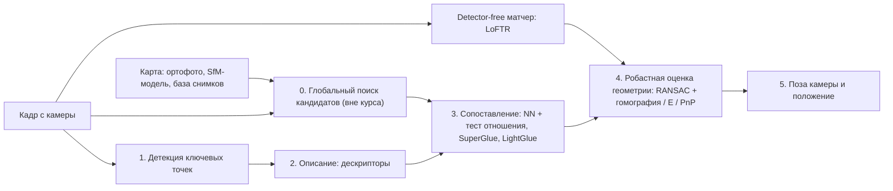

- **Детекция** выбирает повторяемые точки: углы ([FAST](FAST_конспект.md)), блобы (DoG в [SIFT](SIFT_конспект.md), детерминант гессиана в [SURF](SURF_конспект.md)) или максимумы обученной карты откликов ([SuperPoint](SuperPoint_конспект.md), [R2D2](R2D2_конспект.md), [DISK](DISK_конспект.md), [ALIKE](ALIKE_конспект.md), [XFeat](XFeat_конспект.md)).
- **Описание** превращает окрестность точки в вектор: вещественный ([SIFT](SIFT_конспект.md) 128, [SuperPoint](SuperPoint_конспект.md) 256) или двоичный ([BRIEF](BRIEF_конспект.md) и [ORB](ORB_конспект.md) — 256 бит). Сравнивают по евклидову расстоянию или по расстоянию Хэмминга.
- **Сопоставление** ищет пары. Классика — ближайший сосед с тестом отношения Лоу. Обучаемые матчеры ([SuperGlue](SuperGlue_конспект.md), [LightGlue](LightGlue_конспект.md)) решают задачу частичного назначения сразу для всех точек. [LoFTR](LoFTR_перевод.md) объединяет шаги 1–3: он сопоставляет плотные признаки без детектора.
- **Робастная оценка.** [RANSAC](RANSAC_конспект.md) перебирает минимальные выборки (4 точки для гомографии, 3 для P3P) и выбирает модель с наибольшим консенсусом.
- **Поза.** PnP по 2D–3D соответствиям, если у карты есть высоты (DEM, SfM). Гомография — для почти плоской надирной сцены.

### Генеалогия методов

Сплошная стрелка означает, что метод прямо строится на предшественнике. Пунктир означает, что заимствована идея или компонент. [RANSAC](RANSAC_конспект.md) стоит в конце любого конвейера курса.

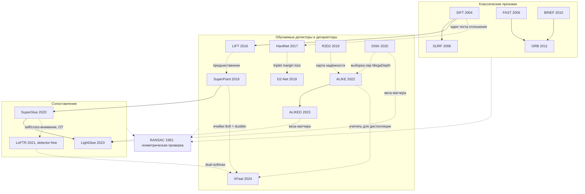

Три линии развития видны сразу.

1. **Классическая:** [SIFT](SIFT_конспект.md) задаёт образец (масштабное пространство, ориентация, гистограммы градиентов), [SURF](SURF_конспект.md) его ускоряет, [FAST](FAST_конспект.md) + [BRIEF](BRIEF_конспект.md) → [ORB](ORB_конспект.md) делают его двоичным и пригодным для реального времени.
2. **Обучаемая:** [LIFT](LIFT_конспект.md) обучает классическую схему по частям, [HardNet](HardNet_конспект.md) учит только дескриптор. [SuperPoint](SuperPoint_конспект.md), [D2-Net](D2-Net_конспект.md), [R2D2](R2D2_конспект.md), [DISK](DISK_конспект.md), [ALIKE](ALIKE_конспект.md)/ALIKED и [XFeat](XFeat_конспект.md) переходят к одной полносвёрточной сети на всё изображение.
3. **Сопоставление:** [SuperGlue](SuperGlue_конспект.md) учит сам процесс сопоставления. [LoFTR](LoFTR_перевод.md) убирает детектор, [LightGlue](LightGlue_конспект.md) делает обучаемый матчер быстрым и адаптивным.

---

## Порядок чтения

Порядок в целом следует рекомендованной логике. Отступлений два:

- [SuperGlue](SuperGlue_конспект.md) стоит после [R2D2](R2D2_конспект.md), то есть после всех детекторов, которые он сравнивает. Сам он требует только [SuperPoint](SuperPoint_конспект.md).
- [LightGlue](LightGlue_конспект.md) стоит после [ALIKED](ALIKED_конспект.md), потому что использует признаки [SuperPoint](SuperPoint_конспект.md), [DISK](DISK_конспект.md) и [ALIKED](ALIKED_конспект.md).

[XFeat](XFeat_конспект.md) идёт последним: он берёт идеи из [SuperPoint](SuperPoint_конспект.md), [ALIKE](ALIKE_конспект.md), [R2D2](R2D2_конспект.md) и [LoFTR](LoFTR_перевод.md), а в репозитории есть LighterGlue — уменьшенный [LightGlue](LightGlue_конспект.md).

Время чтения дано для внимательного чтения конспекта с формулами, без проработки PDF оригинала. «Обязательно» и «желательно» — с точки зрения инженера визуального позиционирования.

| № | Документ | Что нужно знать заранее | Что вводит | Время | Статус |
|---|---|---|---|---|---|
| 1 | [RANSAC](RANSAC_конспект.md) | школьная геометрия, МНК | выбросы против шума, минимальная выборка, число итераций $k$, задача LDP / PnP, P3P | 2–2.5 ч | **обязательно** |
| 2 | [SIFT](SIFT_конспект.md) | свёртка, градиент | масштабное пространство DoG, субпиксельная локализация, ориентация, 128-мерный дескриптор, тест отношения 0.8 | 2 ч | **обязательно** |
| 3 | [SURF](SURF_конспект.md) | [SIFT](SIFT_конспект.md) | интегральное изображение, детерминант гессиана на box-фильтрах, U-SURF, протокол Mikolajczyk | 1.5 ч | желательно |
| 4 | [FAST](FAST_конспект.md) | — (полезен [SIFT](SIFT_конспект.md) для сравнения) | тест сегмента на окружности из 16 пикселей, обучение дерева решений, повторяемость на 3D-сценах | 1 ч | желательно |
| 5 | [BRIEF](BRIEF_конспект.md) | [FAST](FAST_конспект.md) (как источник точек), [SURF](SURF_конспект.md) (как эталон) | двоичные тесты интенсивности, расстояние Хэмминга, цена инвариантности к повороту | 1 ч | желательно |
| 6 | [ORB](ORB_конспект.md) | [FAST](FAST_конспект.md), [BRIEF](BRIEF_конспект.md) | ориентация по центроиду яркости, обучение декоррелированных тестов (rBRIEF), LSH | 1.5 ч | **обязательно** |
| 7 | [LIFT](LIFT_конспект.md) | [SIFT](SIFT_конспект.md); основы CNN | обучаемая версия конвейера [SIFT](SIFT_конспект.md), soft-argmax, учитель из SfM | 1.5 ч | желательно |
| 8 | [HardNet](HardNet_конспект.md) | [SIFT](SIFT_конспект.md) (тест отношения), [LIFT](LIFT_конспект.md) | hardest-in-batch, triplet margin loss, бенчмарки HPatches и Brown | 1.5 ч | желательно |
| 9 | [SuperPoint](SuperPoint_конспект.md) | [LIFT](LIFT_конспект.md), [HardNet](HardNet_конспект.md); [FAST](FAST_конспект.md) и [ORB](ORB_конспект.md) для сравнения | одна сеть на всё изображение, самообучение (MagicPoint, Homographic Adaptation), ячейки 8×8 + dustbin | 2 ч | **обязательно** |
| 10 | [D2-Net](D2-Net_конспект.md) | [SuperPoint](SuperPoint_конспект.md), [HardNet](HardNet_конспект.md) | describe-and-detect, MegaDepth как учитель, Aachen Day-Night и InLoc | 1.5 ч | желательно |
| 11 | [R2D2](R2D2_конспект.md) | [SuperPoint](SuperPoint_конспект.md), [D2-Net](D2-Net_конспект.md) | повторяемость ≠ надёжность, AP-потеря, перенос стиля «в ночь» | 1.5 ч | желательно |
| 12 | [SuperGlue](SuperGlue_конспект.md) | [SuperPoint](SuperPoint_конспект.md), [RANSAC](RANSAC_конспект.md); основы внимания | матчер как «middle-end», GNN с self/cross-вниманием, оптимальный транспорт (Синкхорн), dustbin | 2 ч | **обязательно** |
| 13 | [DISK](DISK_конспект.md) | [SuperPoint](SuperPoint_конспект.md), [R2D2](R2D2_конспект.md), [SuperGlue](SuperGlue_конспект.md) (для сравнения) | детекция и сопоставление как стохастическая политика, REINFORCE, IMC 2020 | 1.5–2 ч | **обязательно** |
| 14 | [LoFTR](LoFTR_перевод.md) | [SuperGlue](SuperGlue_конспект.md) | detector-free, грубое-к-точному, линейное внимание, dual-softmax | 2.5 ч | **обязательно** |
| 15 | [ALIKE](ALIKE_конспект.md) | [SuperPoint](SuperPoint_конспект.md), [R2D2](R2D2_конспект.md), [DISK](DISK_конспект.md) | дифференцируемая детекция DKD, потеря репроекции, NRE, лёгкие сети | 1.5 ч | желательно |
| 16 | [ALIKED](ALIKED_конспект.md) | [ALIKE](ALIKE_конспект.md) | деформируемые свёртки, разреженная голова дескрипторов SDDH, разреженная NRE | 2 ч | **обязательно** |
| 17 | [LightGlue](LightGlue_конспект.md) | [SuperGlue](SuperGlue_конспект.md), [LoFTR](LoFTR_перевод.md) (dual-softmax); [SuperPoint](SuperPoint_конспект.md), [DISK](DISK_конспект.md), [ALIKED](ALIKED_конспект.md) как входы | адаптивная глубина и ширина, rotary-кодирование, рецепт обучения | 2 ч | **обязательно** |
| 18 | [XFeat](XFeat_конспект.md) | [SuperPoint](SuperPoint_конспект.md), [ALIKE](ALIKE_конспект.md), [R2D2](R2D2_конспект.md), [LoFTR](LoFTR_перевод.md), [LightGlue](LightGlue_конспект.md) | признаки для CPU, разделение веток детектора и дескриптора, полуплотный режим [XFeat](XFeat_конспект.md)* | 1.5 ч | **обязательно** |

Итого около 30 часов внимательного чтения.

**Почему именно так.**

1. [RANSAC](RANSAC_конспект.md) идёт первым, хотя он старше всех. Он задаёт «геометрический базис»: что такое выброс, почему нельзя усреднять, сколько попыток нужно при доле верных пар $w$. Без этого непонятно, зачем последующие методы гонятся за долей инлаеров. Его эксперимент с аэроснимком — прямой предок задачи «положение дрона по кадру и ортофото».
2. [SIFT](SIFT_конспект.md) — эталон, с которым сравнивают все остальные. Это его дескриптор, его тест отношения и его 128 измерений.
3. [SURF](SURF_конспект.md) показывает первый способ ускорения: аппроксимировать фильтры. Попутно он вводит протокол оценки Mikolajczyk, на который ссылаются [FAST](FAST_конспект.md), [BRIEF](BRIEF_конспект.md) и [ORB](ORB_конспект.md).
4–6. [FAST](FAST_конспект.md) → [BRIEF](BRIEF_конспект.md) → [ORB](ORB_конспект.md): детектор, двоичный дескриптор и их сборка в практичный признак реального времени. [ORB](ORB_конспект.md) без [FAST](FAST_конспект.md) и [BRIEF](BRIEF_конспект.md) читается хуже: половина статьи исправляет их недостатки.
7–8. [LIFT](LIFT_конспект.md) показывает, как обучить классическую схему, и почему это трудно. [HardNet](HardNet_конспект.md) показывает, что функция потерь важнее архитектуры.
9–11. [SuperPoint](SuperPoint_конспект.md) → [D2-Net](D2-Net_конспект.md) → [R2D2](R2D2_конспект.md): три ответа на вопрос «как обучить детектор без разметки» — синтетика и гомографии, SfM/MVS-соответствия, надёжность отдельно от повторяемости.
12. [SuperGlue](SuperGlue_конспект.md) — смена парадигмы: учится сопоставление, а не дескриптор.
13. [DISK](DISK_конспект.md) — обучение с подкреплением на число верных пар. Его признаки используются в [LightGlue](LightGlue_конспект.md).
14. [LoFTR](LoFTR_перевод.md) — отказ от детектора. Он вводит dual-softmax, который потом берут [LightGlue](LightGlue_конспект.md) и [XFeat](XFeat_конспект.md).
15–16. [ALIKE](ALIKE_конспект.md) → [ALIKED](ALIKED_конспект.md) — линия лёгких субпиксельных признаков. [ALIKED](ALIKED_конспект.md) + [LightGlue](LightGlue_конспект.md) — открытая связка, пригодная для коммерции.
17. [LightGlue](LightGlue_конспект.md) — быстрый матчер, который закрывает тему сопоставления.
18. [XFeat](XFeat_конспект.md) — итог курса: признаки для CPU, собранные из идей почти всех предыдущих лекций.

### Сокращённые треки

**Быстрый трек за вечер (≈4–5 ч).** Читать эту лекцию целиком, а из конспектов только указанные разделы.

1. [RANSAC](RANSAC_конспект.md) — разд. 2 «Парадигма [RANSAC](RANSAC_конспект.md)» и «Значение для задачи визуального позиционирования».
2. [SIFT](SIFT_конспект.md) — разд. 6 «Локальный дескриптор» и 7.1 «Сопоставление точек и тест отношения расстояний».
3. [SuperPoint](SuperPoint_конспект.md) — разд. 3 «Архитектура» и 5 «Homographic Adaptation».
4. [LightGlue](LightGlue_конспект.md) — разд. 3 «Метод» и 5.2 «Относительная поза — MegaDepth-1500».
5. [XFeat](XFeat_конспект.md) — «Суть в одном абзаце», разд. 3 и 4.1.

**Для бортовой и CPU-реализации (≈13 ч).** [RANSAC](RANSAC_конспект.md) → [FAST](FAST_конспект.md) → [BRIEF](BRIEF_конспект.md) → [ORB](ORB_конспект.md) → [SuperPoint](SuperPoint_конспект.md) → [ALIKE](ALIKE_конспект.md) → [ALIKED](ALIKED_конспект.md) → [LightGlue](LightGlue_конспект.md) → [XFeat](XFeat_конспект.md). Акцент на скорости, размере дескриптора, двоичных дескрипторах, GFLOPs и замерах на CPU и ARM ([XFeat](XFeat_конспект.md)). Отдельное внимание — инвариантности к повороту: дрон с произвольным курсом.

**Для максимальной точности и офлайн-построения карты (≈17 ч).** [RANSAC](RANSAC_конспект.md) → [SIFT](SIFT_конспект.md) → [SuperPoint](SuperPoint_конспект.md) → [D2-Net](D2-Net_конспект.md) → [R2D2](R2D2_конспект.md) → [DISK](DISK_конспект.md) → [SuperGlue](SuperGlue_конспект.md) → [LoFTR](LoFTR_перевод.md) → [ALIKED](ALIKED_конспект.md) → [LightGlue](LightGlue_конспект.md). Акцент на Aachen Day-Night, InLoc, MegaDepth-1500 и IMC. Нужно понять, что ограничивает субпиксельную точность и когда плотные методы выигрывают у разреженных.

---

## Лекция 1. RANSAC

📄 Подробно: [RANSAC — конспект](RANSAC_конспект.md) · PDF: [оригинал](../original/RANSAC_Fischler_1981.pdf)

*Fischler, Bolles. Communications of the ACM, 1981.*

### Мотивация

До [RANSAC](RANSAC_конспект.md) модели по данным оценивали методом наименьших квадратов (МНК). МНК опирается на «предположение о сглаживании»: хороших точек достаточно много, и они «перевесят» плохие. Но у детекторов ошибки двух видов. **Ошибки измерения** распределены примерно нормально, и их можно усреднить. **Ошибки классификации** — это грубые промахи, например перепутанный ориентир. Их усреднять нельзя. Популярная эвристика «подогнать МНК, выкинуть точку с наибольшей невязкой, повторить» ломается на одной «отравленной» точке: выброс тянет прямую так сильно, что выбрасываются хорошие точки (рис. 1 статьи). Тезис авторов: усреднять непроверенный набор данных — неправильно.

### Ключевая идея

[RANSAC](RANSAC_конспект.md) переворачивает стратегию. Вместо «взять всё и чистить» он берёт минимальное случайное подмножество из $n$ точек, которого достаточно, чтобы построить модель (2 точки для прямой, 3 для P3P). По этой модели собирается **консенсус** — все точки, согласующиеся с ней в пределах допуска. Если консенсус достаточно велик (не меньше $t$), модель уточняется по нему через МНК. Если нет, берётся новая выборка. После заданного числа попыток метод возвращает лучший найденный консенсус или сообщает о неудаче. Свободных параметров три: допуск, число попыток $k$ и порог консенсуса $t$.

Вторая половина статьи — применение к задаче определения положения (Location Determination Problem, LDP): найти позу камеры по ориентирам с известными 3D-координатами. Сегодня это называется PnP. Авторы показывают, что P3P имеет до 4 решений, и дают его аналитическое решение через уравнение четвёртой степени. Они доказывают единственность решения для компланарного P4P и для P6P, а для P4P и P5P в общем положении показывают возможную неоднозначность. Метод проверен на реальном аэроснимке. Для курса это ключевой момент: задача «где камера по снимку и ориентирам» поставлена и решена именно здесь.

### Главные формулы

Пусть $w$ — вероятность того, что точка попадает в допуск (доля инлаеров), $n$ — размер минимальной выборки, $b = w^n$. Тогда ожидаемое число попыток до первой «чистой» выборки равно

$$E(k) = \frac{1}{b} = w^{-n}, \qquad SD(k) = \frac{\sqrt{1 - w^n}}{w^n} \approx E(k).$$

Каноническая формула числа итераций, которая есть во всех реализациях: при требуемой уверенности $z$ хотя бы одна выборка должна быть без выбросов.

$$k = \frac{\log(1 - z)}{\log(1 - w^n)}.$$

Система P3P по теореме косинусов. Здесь $a, b, c$ — расстояния от центра проекции до трёх ориентиров, $R$ — известные расстояния между ориентирами, $\theta$ — углы между лучами, известные из снимка и внутренних параметров камеры:

$$R_{ab}^2 = a^2 + b^2 - 2ab\cos\theta_{ab},\quad R_{ac}^2 = a^2 + c^2 - 2ac\cos\theta_{ac},\quad R_{bc}^2 = b^2 + c^2 - 2bc\cos\theta_{bc}.$$

### Что нового

Это первая лекция курса, поэтому новое здесь всё. Главное: разделение шума и грубых ошибок, принцип «минимальная выборка + консенсус», а также постановка задачи PnP с подсчётом её решений.

### Ключевые числа

- Таблица $E(k)$ из разд. 2.4: при $w = 0.5$ это 2, 4, 8, 16, 32, 64 для $n = 1..6$; при $w = 0.2$, $n = 4$ — уже 625.
- Пример: $w = 0.5$, $n = 4$, $z = 0.9$ дают $k \approx 35.7$. Асимптотически $k \approx 2.3\,E(k)$ при $z = 0.90$ и $k \approx 3.0\,E(k)$ при $z = 0.95$. Совет авторов: делать в 2–3 раза больше попыток, чем $E(k)$.
- Порог консенсуса: $t - n = 5$ даёт менее 5 % шанса ложного консенсуса.
- Эксперимент 1 (разд. 4.2): 20 ориентиров, 5 грубых ошибок. Эвристика «МНК с отсевом» оставила 3 выброса, а [RANSAC](RANSAC_конспект.md) нашёл верное решение на второй тройке.
- Эксперимент 3 (разд. 4.4): аэроснимок с высоты около 4000 футов, 25 ориентиров, 3 из них грубые ошибки. Первая тройка дала консенсус 17, после расширения он вырос до всех 22 верных точек. СКО положения: X 0.1 фута, Y 6.4 фута, Z 2.1 фута.
- По вычислениям конспекта: P3P при 20 % инлаеров и $z = 0.99$ требует $k \approx 573$, гомография ($n = 4$) — около 2876.

### Ограничения

- Число итераций растёт экспоненциально по $n$ и по доле выбросов. Отсюда важность минимальных решателей.
- Жёсткий порог и равный вес всех инлаеров. Позже это исправляют MSAC, MLESAC и MAGSAC.
- Выборка равномерная: качество пар не учитывается (позже PROSAC). Нет локальной оптимизации (позже LO-RANSAC). Вырожденные конфигурации не обрабатываются (позже DEGENSAC).
- Доля $w$ нужна заранее, хотя обычно неизвестна. Эксперименты небольшие. Для P3P нужны известные внутренние параметры камеры.

### Что посмотреть в конспекте

- Разд. 1 и рис. 1 — почему не работает МНК с отсевом.
- Разд. 2.4 — вывод формулы для $k$ и таблица $E(k)$.
- Разд. 3.2 — таблица числа решений PnP при разных $n$.
- Приложение A — аналитическое решение P3P с проверочным примером A.2 (корни 1, 1, 4, 0.25).
- Раздел «Значение для задачи визуального позиционирования» — параметры OpenCV по умолчанию и их подводные камни.

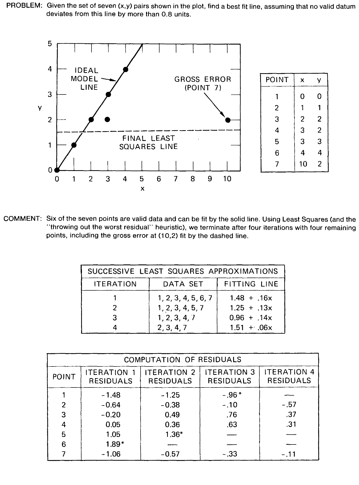

### Вопросы для самопроверки

1. Почему эвристика «подогнать МНК и выкинуть точку с наибольшей невязкой» может так и не убрать выброс?

Ответ

Выброс входит в первую подгонку и смещает модель к себе. Из-за этого невязка у него может оказаться не самой большой, а наибольшие невязки получают хорошие точки. Их и выбрасывают (рис. 1: после 4 итераций выброс всё ещё в наборе). Ошибки классификации — это не шум, и усреднение их не гасит.

2. Сколько итераций нужно для гомографии ($n = 4$) при доле инлаеров 50 % и уверенности 0.9? Что будет при доле 20 %?

Ответ

$k = \log(0.1)/\log(1 - 0.5^4) = \log 0.1/\log(15/16) \approx 35.7$. При $w = 0.2$ ожидание $E(k) = 0.2^{-4} = 625$, а с гарантией нужно в несколько раз больше. Конспект приводит около 2876 итераций при $z = 0.99$. Это экспоненциальный рост по $w^{-n}$.

3. Почему для P3P нужен [RANSAC](RANSAC_конспект.md), даже если решение аналитическое?

Ответ

Аналитическое решение по трём точкам точно, но лишь при условии, что все три соответствия верны. Кроме того, P3P даёт до 4 решений. [RANSAC](RANSAC_конспект.md) перебирает тройки, для каждого решения считает консенсус по остальным ориентирам и так отбрасывает и выбросы, и ложные корни. Итог уточняется по консенсусу (не меньше 6 точек в [RANSAC](RANSAC_конспект.md)/LD).

---

## Лекция 2. SIFT

📄 Подробно: [SIFT — конспект](SIFT_конспект.md) · PDF: [оригинал](../original/SIFT_Lowe_2004.pdf)

*Lowe. International Journal of Computer Vision, 2004.*

### Мотивация

Детекторы углов (Moravec, Harris & Stephens) работают на одном заранее заданном масштабе. Если объект приблизился в два раза, они находят уже другие точки. Schmid и Mohr добавили к углам Харриса дескриптор, инвариантный к повороту, но не к масштабу. Корреляция патчей чувствительна к неточной регистрации. Аффинно-инвариантные детекторы того времени шумнее и выигрывают по повторяемости только при наклоне плоскости больше примерно 40°. Цель Лоу — много отличительных признаков, инвариантных к масштабу и повороту и частично устойчивых к освещению и ракурсу, чтобы отдельный признак находил своё соответствие в большой базе.

### Ключевая идея

[SIFT](SIFT_конспект.md) — каскад из четырёх шагов, каждый дешевле следующего.

1. **Поиск экстремумов в масштабном пространстве.** Изображение многократно размывается гауссианом, соседние уровни вычитаются (DoG). DoG приближает нормированный по масштабу лапласиан, а его экстремумы — самые стабильные признаки. Каждый отсчёт сравнивается с 26 соседями в пространстве и масштабе.
2. **Точная локализация.** Квадратичная аппроксимация Тейлора даёт субпиксельное положение и масштаб. Слабоконтрастные точки ($|D| < 0.03$) и отклики на рёбрах (отношение $\mathrm{Tr}^2/\mathrm{Det}$ гессиана, $r = 10$) отбрасываются.
3. **Ориентация** — по пику 36-корзинной гистограммы градиентов. Каждый пик выше 80 % максимума порождает дополнительную точку.
4. **Дескриптор.** В повёрнутом окне 16×16 строится сетка 4×4 гистограмм по 8 направлений, всего 128 чисел. Затем вектор нормируется, обрезается по 0.2 и нормируется снова. Обрезка гасит влияние нелинейных изменений освещения.

Сопоставление: ближайший сосед с **тестом отношения** $d_1/d_2 < 0.8$. Для объектного распознавания дальше идут Best-Bin-First, голосование Хафа и аффинная подгонка.

### Главные формулы

Разность гауссиан и её связь с лапласианом:

$$D(x, y, \sigma) = L(x, y, k\sigma) - L(x, y, \sigma), \qquad G(x,y,k\sigma) - G(x,y,\sigma) \approx (k-1)\,\sigma^2 \nabla^2 G.$$

Субпиксельное уточнение по разложению Тейлора: $\mathbf{x} = (x, y, \sigma)^\top$, точка отбрасывается при $|D(\hat{\mathbf{x}})| < 0.03$.

$$\hat{\mathbf{x}} = -\left(\frac{\partial^2 D}{\partial \mathbf{x}^2}\right)^{-1} \frac{\partial D}{\partial \mathbf{x}}.$$

Тест отношения расстояний до первого и второго соседа:

$$\frac{\lVert \mathbf{f} - \mathbf{f}_{(1)} \rVert}{\lVert \mathbf{f} - \mathbf{f}_{(2)} \rVert} < 0.8.$$

### Что нового по сравнению с RANSAC

[RANSAC](RANSAC_конспект.md) отвечал на вопрос «что делать с выбросами». [SIFT](SIFT_конспект.md) отвечает на вопрос «откуда брать соответствия». Он вводит масштабное пространство, ориентацию, дескриптор на гистограммах градиентов и тест отношения. Тест отношения фильтрует выбросы ещё до геометрии. Лоу отмечает, что [RANSAC](RANSAC_конспект.md) и LMedS плохо работают, когда доля верных пар сильно ниже 50 %, поэтому в распознавании объектов он использует голосование Хафа.

### Ключевые числа

- Около 2000 стабильных точек на изображении 500×500.
- 3 масштаба на октаву (разд. 3.2), $\sigma = 1.6$; исходное изображение увеличивается вдвое, что даёт почти в 4 раза больше точек.
- Дескриптор: 128 вещественных чисел, оптимум сетки 4×4×8 (разд. 6.2).
- Тест отношения 0.8 убирает 90 % ложных пар и теряет меньше 5 % верных (разд. 7.1).
- Больше 50 % верных пар при повороте плоскости до 50° (разд. 6.3). Практические пределы ракурса — около 50° для плоских поверхностей и около 30° для 3D-объектов.
- Распознавание всех объектов на сцене — меньше 0.3 с на Pentium 4 2 ГГц (разд. 8).
- Скорость в других документах курса: 1036 мс на детекцию и описание (800×640, Pentium IV 3 ГГц) в конспекте [SURF](SURF_конспект.md) и 5228.7 мс на кадр (640×480, около 1000 точек, i7 2.8 ГГц) в конспекте [ORB](ORB_конспект.md).

### Ограничения

- Медленный: пирамида с удвоением и 128-мерные float-дескрипторы. Это мотивация для [SURF](SURF_конспект.md) и [ORB](ORB_конспект.md).
- Не аффинно-инвариантный. Работает только с яркостью, цвет не использует.
- Чувствителен к сильным нелинейным изменениям вида: день/ночь, сезоны, разные сенсоры.
- Ошибки доминирующей ориентации на повторяющихся структурах.
- Многие детали не специфицированы, поэтому реализации в OpenCV, VLFeat и других библиотеках различаются.

### Что посмотреть в конспекте

- Разд. 3.0–3.3 и рис. 1–2 — пирамида и поиск экстремумов.
- Разд. 4 — локализация и отсев рёбер (каскад 832 → 729 → 536 на рис. 5).
- Разд. 6.1 и рис. 7 — устройство дескриптора.
- Разд. 7.1 и рис. 11 — тест отношения.
- Раздел «Значение для задачи визуального позиционирования» — параметры OpenCV: `contrastThreshold` делится на число слоёв, RootSIFT.

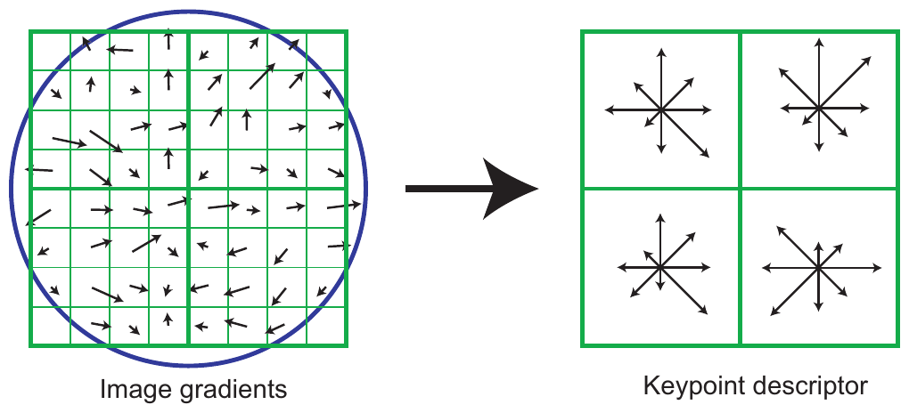

### Вопросы для самопроверки

1. Зачем нормированный дескриптор [SIFT](SIFT_конспект.md) обрезают по 0.2 и нормируют снова?

Ответ

Нормировка на единичную длину даёт инвариантность к аффинному изменению контраста. Изменение яркости убирается уже тем, что используются градиенты. Нелинейные эффекты освещения (насыщение, блики) дают отдельные большие градиенты. Обрезка по 0.2 ограничивает их вклад и увеличивает вес распределения направлений, а повторная нормировка возвращает единичную длину.

2. Как работает тест отношения и почему он лучше порога на абсолютное расстояние?

Ответ

Для каждого дескриптора берутся два ближайших соседа. Пара принимается, если $d_1/d_2 < 0.8$. Абсолютное расстояние плохо разделяет верные и неверные пары: одни дескрипторы отличительнее других. Отношение же показывает, насколько ближайший сосед однозначен. Порог 0.8 убирает 90 % ложных пар и теряет меньше 5 % верных.

3. Почему [SIFT](SIFT_конспект.md) находит больше стабильных точек, если перед построением пирамиды увеличить изображение вдвое?

Ответ

Первое размытие $\sigma = 1.6$ при исходном размытии около 0.5 уничтожает высокие частоты. Увеличение вдвое линейной интерполяцией сохраняет их для самых мелких масштабов. По статье это даёт почти в 4 раза больше стабильных точек.

---

## Лекция 3. SURF

📄 Подробно: [SURF — конспект](SURF_конспект.md) · PDF: [оригинал](../original/SURF_Bay_2006.pdf)

*Bay, Tuytelaars, Van Gool. ECCV 2006.*

### Мотивация

[SIFT](SIFT_конспект.md) хорош, но дорог на всех трёх шагах. Детекция требует пирамиды гауссиан, описание — гистограмм градиентов, сопоставление — 128-мерного вектора. Best-Bin-First ускоряет поиск, но, по оценке авторов [SURF](SURF_конспект.md), ценой точности. PCA-SIFT (36 измерений) сопоставляется быстрее, но менее отличителен и дольше считается. GLOH отличительнее, но ещё дороже. Авторы хотят ускорить все три шага без потери качества. Они опираются на два наблюдения. Детекторы на гессиане стабильнее детекторов типа Харриса. А DoG уже показал, что грубые аппроксимации дают большой выигрыш в скорости при малой потере точности.

### Ключевая идея

[SURF](SURF_конспект.md) строится на **интегральном изображении**: сумма по любому прямоугольнику стоит 4 обращения к памяти независимо от его размера. Отсюда три решения.

1. **Детектор Fast-Hessian.** Вторые производные гауссиана заменяются box-фильтрами: окно 9×9 соответствует $\sigma = 1.2$. Положение и масштаб точки выбираются по детерминанту гессиана с весом 0.9 при смешанной производной.
2. **Масштабное пространство без пирамиды изображений.** Вместо уменьшения изображения растёт размер фильтра: 9, 15, 21, 27…, и каждый фильтр стоит одинаково.
3. **Дескриптор на вейвлетах Хаара.** Ориентация берётся по откликам в круге радиуса $6s$ со скользящим окном $\pi/3$. Затем окно $20s$ делится на 4×4 подобласти, и каждая даёт четыре суммы. Итого 64 числа.

Варианты: U-SURF без ориентации, [SURF](SURF_конспект.md)-36 и [SURF](SURF_конспект.md)-128. Знак лапласиана — бесплатный индекс: тёмный блоб на светлом фоне никогда не сравнивается со светлым на тёмном.

### Главные формулы

Интегральное изображение:

$$I_\Sigma(\mathbf{x}) = \sum_{i=0}^{i\le x}\sum_{j=0}^{j\le y} I(i,j).$$

Приближённый детерминант гессиана на box-фильтрах:

$$\det(\mathcal{H}_\text{approx}) = D_{xx}D_{yy} - (0.9\,D_{xy})^2.$$

Вектор подобласти дескриптора; $d_x, d_y$ — отклики вейвлетов Хаара:

$$\mathbf{v} = \Bigl(\textstyle\sum d_x,\ \sum d_y,\ \sum \lvert d_x\rvert,\ \sum \lvert d_y\rvert\Bigr).$$

### Что нового по сравнению с SIFT

- Интегральное изображение и фильтры постоянной стоимости вместо пирамиды гауссиан.
- Детерминант гессиана вместо DoG.
- Дескриптор 64 вместо 128.
- Индекс по знаку лапласиана.
- Явная мысль: если ориентация известна, её инвариантность не нужна (U-SURF). Эта мысль вернётся в [BRIEF](BRIEF_конспект.md).

### Ключевые числа

- Детекторы (Graffiti, 800×640, Pentium IV 3 ГГц): Fast-Hessian — 120 мс на 1418 точек; DoG — 400 мс; Hessian-Laplace — 650 мс; Harris-Laplace — 1800 мс.
- Детекция и описание: U-SURF 255 мс, [SURF](SURF_конспект.md) 354 мс, [SURF](SURF_конспект.md)-128 391 мс, [SIFT](SIFT_конспект.md) 1036 мс. [SURF](SURF_конспект.md) примерно в 3 раза быстрее [SIFT](SIFT_конспект.md).
- Распознавание в музее (тест отношения 0.7, без геометрической проверки): [SURF](SURF_конспект.md)-128 85.7 %, U-SURF 83.8 %, [SURF](SURF_конспект.md) 82.6 %, GLOH 78.3 %, [SIFT](SIFT_конспект.md) 78.1 %, PCA-SIFT 72.3 %.

### Ограничения

- Инвариантен только к масштабу и повороту, не к аффинным искажениям. Повторяемость на Graffiti при 50° падает до нуля.
- Box-фильтры не изотропны. По оценке конспекта, они чувствительны к поворотам не на кратные 90°.
- Блоб-детектор даёт мало точек на чистых углах и в слабой текстуре.
- Число октав и уровней в статье не указано.
- Вне статьи: [SURF](SURF_конспект.md) запатентован, в OpenCV он находится в модуле non-free.

### Что посмотреть в конспекте

- Разд. 3.2 и рис. 1 — box-аппроксимация.
- Разд. 3.3 — масштабное пространство без пирамиды.
- Разд. 4.1–4.4 — дескриптор и знак лапласиана.
- Разд. 5.1, таблицы 1–2 — скорость.
- Раздел «Значение…» — флаг `OPENCV_ENABLE_NONFREE`, `upright=True` для надирной съёмки с известным курсом.

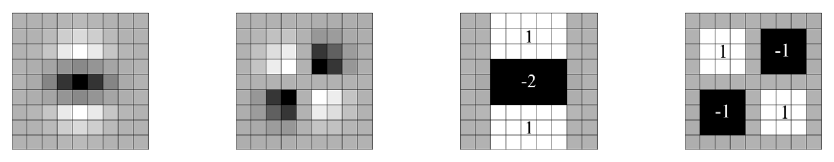

### Вопросы для самопроверки

1. Почему в [SURF](SURF_конспект.md) масштабное пространство строится увеличением фильтра, а не уменьшением изображения?

Ответ

Благодаря интегральному изображению box-фильтр любого размера стоит одинаково: несколько обращений к памяти. Изображение не нужно ни размывать, ни прореживать, нет наложения спектров и повторной выборки, а уровни можно считать независимо.

2. Что такое U-SURF и когда он лучше полного [SURF](SURF_конспект.md)?

Ответ

U-SURF — [SURF](SURF_конспект.md) без оценки ориентации, то есть «прямой» (upright). Он быстрее (255 против 354 мс) и при небольших поворотах отличительнее. В музейном тесте 83.8 % против 82.6 %. Это выгодно, когда ориентация камеры известна, например при надирной съёмке с курсом от IMU или компаса после поворота кадра «на север».

3. Как знак лапласиана ускоряет сопоставление?

Ответ

Знак следа гессиана отделяет светлые блобы на тёмном фоне от тёмных на светлом. Его получают бесплатно при детекции. Сравнивать имеет смысл только признаки с одинаковым знаком, так что примерно половина кандидатов отсекается без вычисления расстояний. Оценка «примерно вдвое» принадлежит конспекту.

---

## Лекция 4. FAST

📄 Подробно: [FAST — конспект](FAST_конспект.md) · PDF: [оригинал](../original/FAST_Rosten_2006.pdf)

*Rosten, Drummond. ECCV 2006.*

### Мотивация

В SLAM на живом видео детектор должен оставлять время остальной системе. На кадре PAL 768×288 при 50 полях в секунду Harris требует 120 % времени поля, а DoG из [SIFT](SIFT_конспект.md) — 300 %. Первая версия теста сегмента, написанная вручную авторами при $n = 12$, была быстрой, но имела четыре слабости. Предтест не обобщается на $n < 12$. Порядок проверки пикселей неявно предполагает распределение признаков. Результаты первых тестов выбрасываются. Нет подавления немаксимумов.

### Ключевая идея

Пиксель $p$ — угол, если на окружности Брезенхэма радиуса 3 (16 пикселей) есть $n$ подряд идущих пикселей, которые все ярче $I_p + t$ или все темнее $I_p - t$. Это **тест сегмента**. Главный ход статьи — машинное обучение порядка проверок. На изображениях целевой области медленный прямой тест размечает углы. Затем дерево решений ID3 учится задавать вопросы о пикселях окружности в самом информативном порядке, то есть с минимальным числом обращений к памяти. Дерево компилируется во вложенный код `if-else`. Для подавления немаксимумов вводится оценка $V$.

Вторая часть статьи — новая методика оценки повторяемости на настоящих 3D-сценах (Box, Maze, Bas-relief) с моделью поверхности вместо одних гомографий. Неожиданный вывод: [FAST](FAST_конспект.md)-9 не только самый быстрый, но и самый повторяемый, когда нужно больше примерно 200 углов на кадр. Слабое место — шум.

### Главные формулы

Состояние пикселя окружности относительно центра:

$$S_{p\to x} = \begin{cases} d, & I_{p\to x} \le I_p - t \\ s, & I_p - t < I_{p\to x} < I_p + t \\ b, & I_p + t \le I_{p\to x} \end{cases}$$

Энтропия множества для ID3; $c$ и $\bar c$ — число углов и не-углов:

$$H(P) = (c + \bar c)\log_2(c + \bar c) - c\log_2 c - \bar c\log_2 \bar c.$$

Оценка для подавления немаксимумов:

$$V = \max\left(\sum_{x\in S_\text{bright}} \bigl(|I_{p\to x} - I_p| - t\bigr),\ \sum_{x\in S_\text{dark}} \bigl(|I_p - I_{p\to x}| - t\bigr)\right).$$

### Что нового по сравнению с SIFT и SURF

Отказ от функции отклика по всему изображению: решение принимается несколькими сравнениями яркостей. Детектор не вычисляется, а **выучивается**: это первый в курсе пример ML-подхода к детекции. [SuperPoint](SuperPoint_конспект.md) позже цитирует [FAST](FAST_конспект.md) именно как первый ML-детектор углов. Ещё одно новое — оценка повторяемости на 3D-сценах.

### Ключевые числа

- В среднем 2.26 вопроса на пиксель при $n = 9$ и 2.39 при $n = 12$, против 2.8 у ручного детектора.
- Таблица 1 (768×288, около 500 точек): [FAST](FAST_конспект.md)-9 с NMS — 1.33 мс на Opteron 2.6 ГГц (6.65 % времени поля) и 5.29 мс на Pentium III 850 МГц. Harris — 24.0 мс (120 %), DoG — 60.1 мс (301 %), SUSAN — 7.58 мс.
- Рекомендовано $n = 9$. При $n \le 8$ детектор срабатывает на рёбрах.

### Ограничения

- Чувствителен к шуму.
- Нет масштаба, ориентации и дескриптора — это только детектор.
- Сильный отклик на рёбрах при малом $n$ и на тонких линиях. Нет меры «угловатости», поэтому в [ORB](ORB_конспект.md) добавляют Харриса.
- Число точек зависит от порога $t$ и напрямую не задаётся. Нет субпиксельной точности.

### Что посмотреть в конспекте

- Разд. 2.1 и рис. 1 — тест сегмента.
- Разд. 2.2 — обучение дерева.
- Разд. 2.3 — варианты оценки $V$.
- Разд. 2.4 — таблица времени (обратите внимание на примечание об опечатке 1280 % для DoG).
- Разд. 4 и рис. 6 — повторяемость и шум.
- Раздел «Значение…» — параметры `FastFeatureDetector` и сетка по ячейкам для слабой текстуры.

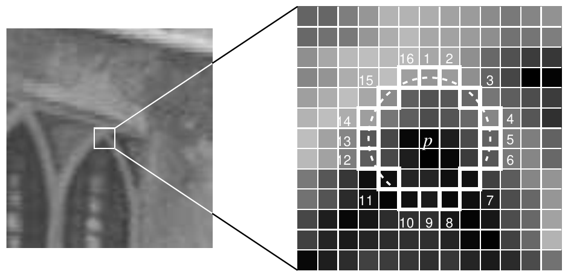

### Вопросы для самопроверки

1. Почему [FAST](FAST_конспект.md)-9 предпочтительнее [FAST](FAST_конспект.md)-12 и почему нельзя брать $n \le 8$?

Ответ

На 3D-сценах [FAST](FAST_конспект.md)-9 даёт лучшую повторяемость среди всех $n$ (рис. 6A) при почти той же скорости. При $n \le 8$ дуга из 8 пикселей возникает и на прямом ребре, где половина окружности ярче, поэтому детектор начинает срабатывать на рёбрах.

2. Что именно «обучается» в [FAST](FAST_конспект.md) и меняет ли это определение угла?

Ответ

Обучается порядок вопросов — дерево ID3, которое минимизирует среднее число проверок пикселей. Определение угла остаётся тестом сегмента, но выученное дерево не строго ему эквивалентно и зависит от обучающих изображений. Это отмечено в ограничениях.

3. Почему голый [FAST](FAST_конспект.md) плохо подходит для глобальной локализации по спутниковому снимку?

Ответ

У [FAST](FAST_конспект.md) нет масштаба, ориентации и дескриптора. При разной GSD и произвольном курсе одной повторяемости мало: точки нужно описать и сопоставить инвариантно. [FAST](FAST_конспект.md) используют как быстрый источник точек для [BRIEF](BRIEF_конспект.md) или [ORB](ORB_конспект.md) или для покадрового трекинга.

---

## Лекция 5. BRIEF

📄 Подробно: [BRIEF — конспект](BRIEF_конспект.md) · PDF: [оригинал](../original/BRIEF_Calonder_2010.pdf)

*Calonder, Lepetit, Strecha, Fua. ECCV 2010.*

### Мотивация

[SIFT](SIFT_конспект.md) занимает 128 чисел, [SURF](SURF_конспект.md)-64 — 64 float, то есть 256 байт. Для SLAM с большим числом точек и для мобильных устройств это дорого и по памяти, и по скорости сопоставления. Существующие способы укоротить дескриптор (PCA, квантование, бинаризация через хеширование) сначала вычисляют полный длинный дескриптор, а потом его сжимают. [BRIEF](BRIEF_конспект.md) строит короткую двоичную строку прямо из патча, без обучения.

### Ключевая идея

Патч сначала сглаживается. Каждый бит — результат одного сравнения яркостей в двух заранее выбранных точках: 1, если первая темнее второй. Пары выбираются один раз, случайно, из изотропного гауссиана вокруг центра (геометрия G II), и одинаковы для всех точек. 128, 256 или 512 тестов дают 16, 32 или 64 байта ([BRIEF](BRIEF_конспект.md)-16/32/64). Сравнение идёт по **расстоянию Хэмминга**: XOR и подсчёт единиц (popcount), одна-две инструкции процессора.

Главный вывод статьи: инвариантность к повороту имеет цену. Если сильных поворотов в плоскости нет, [BRIEF](BRIEF_конспект.md) не хуже [SURF](SURF_конспект.md) или U-SURF, но в десятки раз быстрее. Если ориентация известна (телефон с датчиком ориентации, робот, дрон с IMU), за инвариантность не стоит платить.

### Главные формулы

Двоичный тест на сглаженном патче $\mathbf{p}$:

$$\tau(\mathbf{p}; \mathbf{x}, \mathbf{y}) := \begin{cases} 1, & \mathbf{p}(\mathbf{x}) < \mathbf{p}(\mathbf{y}), \\ 0, & \text{иначе}. \end{cases}$$

Дескриптор из $n_d$ тестов:

$$f_{n_d}(\mathbf{p}) := \sum_{1 \le i \le n_d} 2^{i-1}\, \tau(\mathbf{p}; \mathbf{x}_i, \mathbf{y}_i).$$

Расстояние: $d_H(a,b) = \mathrm{popcount}(a \oplus b)$. Это обозначение конспекта; в статье расстояние описано словами.

### Что нового по сравнению с FAST и SURF

- Первый в курсе **двоичный** дескриптор и расстояние Хэмминга.
- Дескриптор строится без вычисления длинного вектора.
- Явная постановка вопроса о цене инвариантности.
- [FAST](FAST_конспект.md) впервые выступает как источник точек для дескриптора.

### Ключевые числа

- По умолчанию 256 бит ([BRIEF](BRIEF_конспект.md)-32). Сглаживание гауссианом с параметром 2 в окне 9×9.
- Скорость (512 точек, 2.66 ГГц): вычисление [BRIEF](BRIEF_конспект.md)-32 занимает 8.87 мс против 335 мс у [SURF](SURF_конспект.md)-64, сопоставление — 4.35 мс против 28.3 мс. Вычисление в 35–41 раз быстрее, сопоставление в 4–13 раз.
- [BRIEF](BRIEF_конспект.md)-64 лучше [SURF](SURF_конспект.md) и U-SURF на всех наборах, кроме Graffiti, при вчетверо меньшей длине.
- Поворот: [BRIEF](BRIEF_конспект.md)-32 почти не деградирует до 10–15°, затем обваливается.
- У несовпадающих пар 256-битное расстояние распределено примерно как гауссиан с центром около 128.

### Ограничения

- Нет инвариантности ни к повороту (обвал после примерно 10–15°), ни к масштабу: масштаб определяет детектор.
- Слаб на однородных областях (Graffiti), чувствителен к шуму и сглаживанию.
- Случайные пары коррелированы и неоптимальны. [ORB](ORB_конспект.md) позже показал это и исправил обучением.
- Протокол оценки завышает абсолютные значения (авторы это признают). Оценка проведена на малых наборах.

### Что посмотреть в конспекте

- Разд. 3.1 — определение дескриптора.
- Разд. 3.3 и рис. 2–3 — пять геометрий тестов.
- Разд. 3.4 и рис. 4 — распределения расстояний.
- Разд. 4 «Чувствительность к повороту» и рис. 9 — обвал при повороте.
- Разд. 4 «Скорость».
- Раздел «Значение…» — [BRIEF](BRIEF_конспект.md) после поворота надирного кадра «на север» по курсу; пороги Хэмминга.

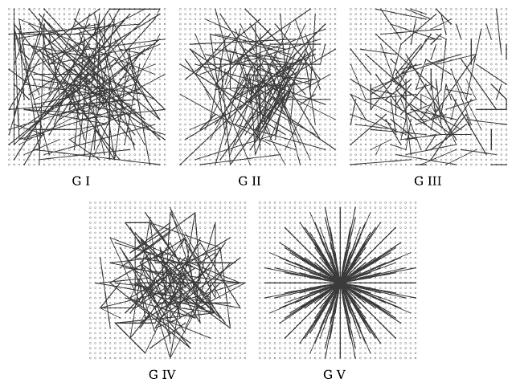

### Вопросы для самопроверки

1. Почему сравнение двоичных дескрипторов так быстро?

Ответ

Расстояние Хэмминга — это XOR двух битовых строк и подсчёт единиц. Для 256 бит это несколько машинных слов и инструкция popcount (POPCNT в SSE4.2). Для вещественного дескриптора нужны 64–128 умножений и сложений с плавающей точкой.

2. В каких условиях отсутствие инвариантности к повороту у [BRIEF](BRIEF_конспект.md) — достоинство?

Ответ

Когда ориентация камеры известна или почти постоянна: телефон с датчиком ориентации, наземный робот, надирный кадр дрона, повёрнутый по курсу. Тогда инвариантность только теряет информацию и отличительность. Однако ошибка курса больше примерно 10–15° приводит к обвалу качества.

3. Какая геометрия выбора пар оказалась лучшей и в чём её недостаток?

Ответ

G II: обе точки пары выбираются i.i.d. из изотропного гауссиана с $\sigma^2 = S^2/25$ вокруг центра патча. Недостаток: случайные тесты коррелированы, и часть битов несёт мало информации. Это показано и исправлено в [ORB](ORB_конспект.md) через жадный отбор декоррелированных тестов.

---

## Лекция 6. ORB

📄 Подробно: [ORB — конспект](ORB_конспект.md) · PDF: [оригинал](../original/ORB_Rublee_2011.pdf)

*Rublee, Rabaud, Konolige, Bradski. ICCV 2011.*

### Мотивация

Нужно качество, близкое к [SIFT](SIFT_конспект.md), но в реальном времени на устройствах без GPU и без патентных ограничений [SIFT](SIFT_конспект.md) и [SURF](SURF_конспект.md). [FAST](FAST_конспект.md) и [BRIEF](BRIEF_конспект.md) быстры, но у каждого свои дыры. У [FAST](FAST_конспект.md) нет ориентации, меры угловатости и масштаба. [BRIEF](BRIEF_конспект.md) «очень чувствителен к повороту в плоскости». Если же [BRIEF](BRIEF_конспект.md) просто повернуть по ориентации (steered [BRIEF](BRIEF_конспект.md)), разброс его битов падает, а корреляция между битами растёт. От этого страдает и отличительность, и хеширование LSH.

### Ключевая идея

[ORB](ORB_конспект.md) = **oFAST + rBRIEF**.

- **oFAST.** [FAST](FAST_конспект.md)-9 запускается на пирамиде с низким порогом, и по отклику Харриса оставляются лучшие $N$ точек. Ориентация берётся по **центроиду яркости**: вектор из центра угла в «центр масс» яркости патча.
- **rBRIEF.** Тесты [BRIEF](BRIEF_конспект.md) на патче 31×31 (каждая точка теста — среднее по подокну 5×5) поворачиваются на угол точки с шагом 12° по таблице. Сами 256 тестов не случайны: их жадно отбирают из 205 590 кандидатов на 300 тыс. точек PASCAL VOC 2006. Отбираются тесты со средним около 0.5 (максимальная дисперсия) и с малой корреляцией с уже выбранными.

Для больших баз используется multi-probe LSH. Декоррелированные биты дают более равномерные корзины и быстрый поиск.

### Главные формулы

Моменты патча и центроид:

$$m_{pq} = \sum_{x,y} x^p\, y^q\, I(x, y), \qquad C = \left(\frac{m_{10}}{m_{00}},\ \frac{m_{01}}{m_{00}}\right).$$

Ориентация точки:

$$\theta = \operatorname{atan2}(m_{01}, m_{10}).$$

Повёрнутый («steered») [BRIEF](BRIEF_конспект.md); $\mathbf{S}$ — матрица координат тестов, $\mathbf{R}_\theta$ — поворот:

$$\mathbf{S}_\theta = \mathbf{R}_\theta \mathbf{S}, \qquad g_n(\mathbf{p}, \theta) := f_n(\mathbf{p}) \mid (\mathbf{x}_i, \mathbf{y}_i) \in \mathbf{S}_\theta.$$

### Что нового по сравнению с FAST и BRIEF

- Дешёвая ориентация через центроид.
- Ранжирование [FAST](FAST_конспект.md) по Харрису и пирамида.
- **Обучение** набора двоичных тестов под декорреляцию: шаг от «случайно» к «выучено», ещё без нейросетей.
- Анализ двоичных дескрипторов через дисперсию битов и PCA.
- LSH для больших баз.

### Ключевые числа

- Дескриптор 256 бит = 32 байта. Пирамида из 5 уровней с шагом $\sqrt{2}$.
- Время на кадр (640×480, около 1000 точек, i7 2.8 ГГц, один поток): [ORB](ORB_конспект.md) 15.3 мс, [SURF](SURF_конспект.md) 217.3 мс, [SIFT](SIFT_конспект.md) 5228.7 мс. Это на порядок быстрее [SURF](SURF_конспект.md) и более чем на два порядка быстрее [SIFT](SIFT_конспект.md).
- Поворот с шумом: [ORB](ORB_конспект.md) сохраняет больше 70 % инлаеров при любом угле, [BRIEF](BRIEF_конспект.md) обваливается после примерно 10°.
- Реальные данные: на Boat [ORB](ORB_конспект.md) даёт 45.8 % инлаеров, [SURF](SURF_конспект.md) 28.6 %, [SIFT](SIFT_конспект.md) 30.2 %. На Magazines лидирует [SURF](SURF_конспект.md) (38.305 % против 36.180 %).
- Трекинг на телефоне ARM 1 ГГц: 640×480 с частотой 7 Гц.
- Реализация под лицензией BSD вошла в OpenCV 2.3.

### Ограничения

- Масштаб только через пирамиду; при больших изменениях масштаба [ORB](ORB_конспект.md) хуже [SIFT](SIFT_конспект.md).
- Точки скапливаются в текстурных областях, потому что top-N по Харрису берётся без учёта распределения. Наблюдение приведено со ссылкой на статью [SuperPoint](SuperPoint_конспект.md); обычное лечение — сетка или квадродерево, как в ORB-SLAM.
- Ориентация неустойчива на почти однородных патчах.
- Тесты выучены на PASCAL 2006.
- Аффинные и сильные световые изменения не исследованы.

### Что посмотреть в конспекте

- Разд. 3.2 — центроид яркости.
- Разд. 4.2–4.3 и рис. 3–6 — дисперсия, корреляция и обучение тестов.
- Разд. 4.4 и рис. 7 — устойчивость к повороту.
- Разд. 5 — LSH.
- Разд. 6.1 — время.
- Раздел «Значение…» — параметры OpenCV по умолчанию (8 уровней × 1.2, а не 5 × $\sqrt{2}$) и предварительный поворот по IMU.

### Вопросы для самопроверки

1. Почему нельзя просто повернуть тесты [BRIEF](BRIEF_конспект.md) по ориентации и считать задачу решённой?

Ответ

У повёрнутого [BRIEF](BRIEF_конспект.md) средние битов отходят от 0.5, то есть дисперсия падает, а корреляция между битами растёт. Это видно на рис. 3–4 конспекта. Дескриптор становится менее отличительным, а корзины LSH — неравномерными, и поиск замедляется. rBRIEF лечит это отбором тестов с высокой дисперсией и низкой корреляцией.

2. Как вычисляется ориентация в [ORB](ORB_конспект.md) и когда она ненадёжна?

Ответ

По моментам первого порядка в круглом окне: $\theta = \operatorname{atan2}(m_{01}, m_{10})$, то есть направление на центроид яркости. Когда центроид совпадает с центром ($|C| \to 0$, почти однородный патч), направление не определено. Для углов [FAST](FAST_конспект.md) это редкость.

3. Что изменится, если при сопоставлении кадра дрона с картой заранее повернуть кадр по курсу из IMU?

Ответ

[ORB](ORB_конспект.md) инвариантен к повороту, поэтому качество сохранится и сопоставление станет устойчивее: уходят ошибки оценки ориентации, а остаточный поворот [ORB](ORB_конспект.md) выдерживает. Для неинвариантных признаков ([BRIEF](BRIEF_конспект.md), [SuperPoint](SuperPoint_конспект.md), [DISK](DISK_конспект.md), [ALIKE](ALIKE_конспект.md), [XFeat](XFeat_конспект.md)) такой предварительный поворот вообще обязателен. Конспекты советуют его везде, где есть надёжный курс.

---

## Лекция 7. LIFT

📄 Подробно: [LIFT — конспект](LIFT_конспект.md) · PDF: [оригинал](../original/LIFT_Yi_2016.pdf)

*Yi, Trulls, Lepetit, Fua. ECCV 2016.*

### Мотивация

К 2016 году нейросети уже обходили ручные признаки, но только на отдельных шагах конвейера. TILDE учил детектор, Yi et al. (CVPR 2016) — ориентацию, DeepDesc, MatchNet и PN-Net — дескриптор. Никто не оптимизировал шаги совместно, с учётом друг друга. В итоге каждый компонент хорош сам по себе, но система в целом не оптимальна.

### Ключевая идея

[LIFT](LIFT_конспект.md) — это классический конвейер [SIFT](SIFT_конспект.md) «детектор → ориентация → дескриптор», где каждый шаг заменён своей CNN. Шаги соединены дифференцируемыми операциями. NMS заменён **soft-argmax**. Вырезание и поворот патча выполняют Spatial Transformers — они не обучаются и только деформируют геометрию. Обучение идёт на четвёрках патчей в сиамской сети из четырёх ветвей с общими весами: два вида одной 3D-точки, другая точка и патч без признаков. Учитель — SfM-реконструкции туристических фотоколлекций (Piccadilly, Roman-Forum), построенные VisualSFM на точках [SIFT](SIFT_конспект.md). Положение и ориентация точки — латентные переменные, их не регрессируют к координатам SfM.

Ключевая находка: обучить всё сразу с нуля не удалось, компоненты «тянут в разные стороны». Поэтому обучение ступенчатое и в обратном порядке: сначала дескриптор, затем ориентация при замороженном дескрипторе, затем детектор через весь конвейер. На инференсе детектор проходит по пирамиде масштабов всего изображения, а ориентация и дескриптор считаются только в найденных точках.

### Главные формулы

Потеря дескриптора: контрастная, с порогом $C = 4$ для отрицательных пар.

$$\mathcal{L}_{\text{desc}}(\mathbf{p}^k_\theta, \mathbf{p}^l_\theta) = \begin{cases} \lVert h_\rho(\mathbf{p}^k_\theta) - h_\rho(\mathbf{p}^l_\theta) \rVert_2, & \text{положительная пара},\\ \max\left(0,\; C - \lVert h_\rho(\mathbf{p}^k_\theta) - h_\rho(\mathbf{p}^l_\theta) \rVert_2\right), & \text{отрицательная пара}. \end{cases}$$

Soft-argmax вместо NMS, $\beta = 10$:

$$\mathbf{x} = \mathrm{softargmax}(\mathbf{S}) = \frac{\sum_{\mathbf{y}} \exp(\beta\, \mathbf{S}(\mathbf{y}))\, \mathbf{y}}{\sum_{\mathbf{y}} \exp(\beta\, \mathbf{S}(\mathbf{y}))}.$$

### Что нового по сравнению с классикой

- Все три шага выучены из данных.
- Учитель — SfM, то есть реальные изменения ракурса и освещения, а не синтетика.
- Soft-argmax как дифференцируемая замена NMS (эта идея вернётся в [ALIKE](ALIKE_конспект.md)).
- Явный урок: совместное обучение детектора и дескриптора — трудная задача оптимизации.

### Ключевые числа

- Matching score (Strecha / DTU / Webcam): [LIFT](LIFT_конспект.md) (pic) .374/.317/.196 против [SIFT](SIFT_конспект.md) .283/.272/.128, [SURF](SURF_конспект.md) .208/.244/.117, [ORB](ORB_конспект.md) .157/.127/.120.
- Абляция (Strecha): самый большой вклад вносит выученная ориентация — NN mAP растёт с .517 до .671 при [SIFT](SIFT_конспект.md)-детекторе и [SIFT](SIFT_конспект.md)-дескрипторе.
- Дескриптор: 128-мерный float (архитектура DeepDesc). Патч $s = 64$ px.
- Время работы в статье не приводится.

### Ограничения

- Обучение по частям: с нуля не сходится, а совместное дообучение переобучается.
- Патчевая схема из трёх сетей с пирамидой — медленно.
- Детектор — однослойная модель.
- Обучающие точки — только те, что нашёл [SIFT](SIFT_конспект.md) и сохранил SfM, поэтому есть смещение к DoG-структурам.
- Выпущенная модель слаба при больших поворотах в плоскости.
- Код запатентован и разрешён только для академического использования, стек устарел (Theano).

### Что посмотреть в конспекте

- Разд. 3.1 и рис. 1–2 — конвейер и сиамская схема.
- Разд. 3.2 — данные SfM.
- Разд. 3.3–3.5 — потери трёх компонентов.
- Разд. 3.6 и рис. 4 — инференс.
- Разд. 4.4 и таблица 3 — вклад компонентов.

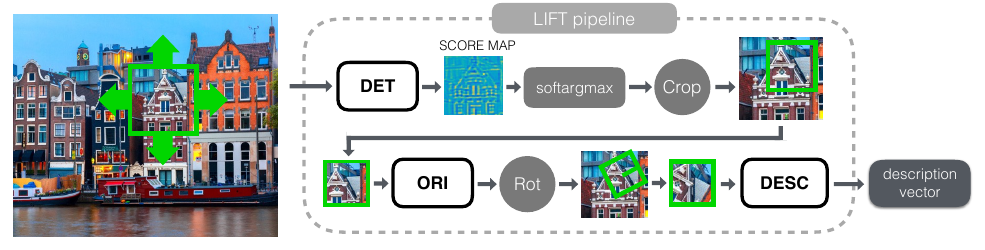

### Вопросы для самопроверки

1. Зачем [LIFT](LIFT_конспект.md) заменяет NMS на soft-argmax?

Ответ

NMS (argmax) недифференцируем, градиент через выбор точки не проходит. Soft-argmax — взвешенное по $\exp(\beta S)$ среднее координат — даёт дифференцируемое положение. Через него потеря дескриптора может обучать детектор.

2. Почему компоненты обучаются в обратном порядке: дескриптор → ориентация → детектор?

Ответ

Совместное обучение с нуля не сходилось. Дескриптор можно обучить на известных из SfM положениях и ориентациях. Затем при замороженном дескрипторе ориентация учится делать дескрипторы совпадающими. Последним учится детектор: он выбирает точки, которые хорошо описываются уже обученной парой «ориентация + дескриптор».

3. Какой компонент в абляции дал наибольший прирост и что это значит для дронов?

Ответ

Выученная ориентация: NN mAP вырос с .517 до .671. Для дронов с произвольным курсом ориентация критична. Конспект советует либо выученную или классическую оценку ориентации, либо компенсацию курса по IMU или компасу.

---

## Лекция 8. HardNet

📄 Подробно: [HardNet — конспект](HardNet_конспект.md) · PDF: [оригинал](../original/HardNet_Mishchuk_2017.pdf)

*Mishchuk, Mishkin, Radenović, Matas. NIPS 2017.*

### Мотивация

Обучаемые дескрипторы ([LIFT](LIFT_конспект.md), MatchNet, DeepCompare) хорошо выглядели на верификации патчей, но на реальных задачах — сопоставлении изображений, поиске, 3D-реконструкции — проигрывали [SIFT](SIFT_конспект.md) и его вариантам. Одно из объяснений: патчевые датасеты малы и однообразны. Авторы показывают, что дело не в данных, а в функции потерь. Ни одна из прежних потерь прямо не воспроизводила критерий теста отношения [SIFT](SIFT_конспект.md).

### Ключевая идея

[HardNet](HardNet_конспект.md) — это прежде всего **функция потерь**, архитектура взята у L2Net без изменений. В мини-батче из $n$ пар (ровно одна пара на 3D-точку) строится матрица расстояний $n \times n$. Для каждой пары ищется ближайший **не**совпадающий дескриптор — минимум по строке и по столбцу, «hardest-in-batch» — и берётся более трудный из двух. К тройке применяется triplet margin loss с порогом 1. По сути это обучаемый тест отношения: ближайший чужой должен быть дальше своего хотя бы на порог.

Абляция показывает, что успех определяет именно стратегия выборки. Глобальный поиск трудных негативов проваливается из-за шума разметки: «трудные негативы» часто оказываются позитивами.

### Главные формулы

Расстояния между L2-нормированными дескрипторами:

$$d(a_i, p_j) = \sqrt{2 - 2\, a_i^\top p_j}.$$

Потеря с самым трудным негативом в батче:

$$L = \frac{1}{n} \sum_{i=1}^{n} \max\Big(0,\; 1 + d(a_i, p_i) - \min\big(d(a_i, p_{j_{\min}}),\, d(a_{k_{\min}}, p_i)\big)\Big),$$

где $j_{\min} = \arg\min_{j \ne i} d(a_i, p_j)$ и $k_{\min} = \arg\min_{k \ne i} d(a_k, p_i)$.

### Что нового по сравнению с LIFT

Внимание переносится с «учить всё» на «правильно учить дескриптор». Вводятся hardest-in-batch и стандарт бенчмарков HPatches, Brown FPR95 и W1BS. Становится ясно, насколько важен размер батча: выигрыш пренебрежимо мал выше 512. Triplet margin loss из этой линии потом использует [D2-Net](D2-Net_конспект.md).

### Ключевые числа

- Архитектура: вход 32×32, 7 свёрток, без пулинга, выход 128-мерный L2-нормированный float. Около 1.3 млн параметров — это оценка конспекта по архитектуре.
- Brown, средний FPR95: [SIFT](SIFT_конспект.md) 26.55 %, L2Net 3.24 %, [HardNet](HardNet_конспект.md) 1.57 %, [HardNet](HardNet_конспект.md)+ 1.51 %.
- HPatches, mAP верификация / сопоставление / поиск: rSIFT 58.53/27.22/42.49; L2Net 84.46/40.82/59.64; [HardNet](HardNet_конспект.md)+ 88.43/52.76/69.66.
- Поиск Oxford5k / Paris6k (HQE): [HardNet](HardNet_конспект.md)++ 86.8/88.3 и 82.8/84.9.
- Время работы не оценивается.

### Ограничения

- Только дескриптор: детектор, масштаб и ориентация внешние, и качество системы ограничено детектором.
- Обучение на Brown/Liberty — узкий домен трёх туристических сцен.
- На кросс-модальных данных (map2photo, ИК) выигрыш над [SIFT](SIFT_конспект.md) мал.
- Воспроизводимость: числа NIPS-версии не повторились после обновлений PyTorch, необычный lr = 10.
- Нет оценки времени и точности позы.

### Что посмотреть в конспекте

- Разд. 3.1 и рис. 1 — выборка hardest-in-batch.
- Разд. 3.2 и рис. 2 — архитектура.
- Разд. 3.5 — размер батча.
- Разд. 4.1 — HPatches.
- Разд. 4.2 — абляция выборки и потерь.
- Разд. 4.3 — W1BS, включая map2photo.

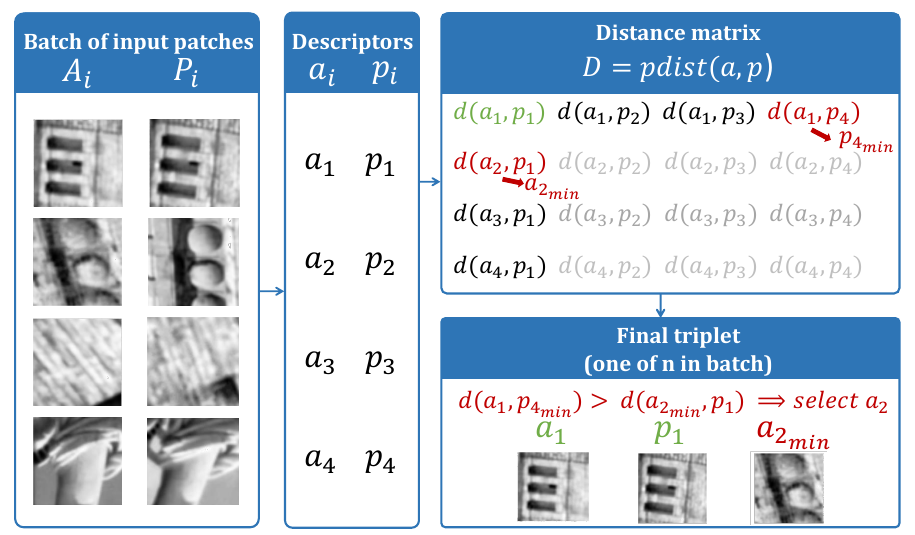

### Вопросы для самопроверки

1. Чем [HardNet](HardNet_конспект.md) концептуально связан с тестом отношения [SIFT](SIFT_конспект.md)?

Ответ

Тест отношения требует, чтобы ближайший сосед был заметно ближе второго, то есть ближайшего чужого. Потеря [HardNet](HardNet_конспект.md) требует, чтобы расстояние до своей пары было меньше расстояния до самого близкого чужого в батче хотя бы на порог 1. Это прямая обучаемая версия того же критерия.

2. Почему глобальный поиск трудных негативов работает хуже hardest-in-batch?

Ответ

В больших патчевых наборах есть шум разметки: самые трудные негативы во всём датасете часто на самом деле являются позитивами (та же точка, другой ID). Обучение на них портит модель. Внутри случайного батча с одной парой на 3D-точку такие коллизии редки.

3. Где место [HardNet](HardNet_конспект.md) в современном конвейере позиционирования?

Ответ

Как замена дескриптора [SIFT](SIFT_конспект.md) при надёжном внешнем детекторе (DoG, Hessian-Affine, [ORB](ORB_конспект.md)/FAST). На вход подаётся патч 32×32, нормированный по масштабу и ориентации детектора. Конспект упоминает готовые связки в hloc и Kornia, а также дообучение потерей hardest-in-batch на своих парах «кадр — ортофото».

---

## Лекция 9. SuperPoint

📄 Подробно: [SuperPoint — конспект](SuperPoint_конспект.md) · PDF: [оригинал](../original/DeTone_SuperPoint_Self-Supervised_Interest_CVPR_2018_paper.pdf)

*DeTone, Malisiewicz, Rabinovich (Magic Leap). CVPR Workshops 2018.*

### Мотивация

[LIFT](LIFT_конспект.md) — это патчевая схема из трёх сетей с классическим учителем SfM, не работающая на всём изображении за один проход и не работающая в реальном времени. Учить детектор с учителем мешает то, что «точка интереса» для геометрии не имеет семантики: человек не может её разметить, задача плохо определена. Нужен способ получить разметку без человека и одна сеть, которая за один проход выдаёт и точки, и дескрипторы.

### Ключевая идея

Одна полносвёрточная сеть: общий VGG-подобный энкодер (выход в 8 раз меньше входа) и две головы.

- **Голова детектора** для каждой ячейки 8×8 выдаёт 65 логитов: 64 позиции и «dustbin» — «точки нет». После softmax и depth-to-space получается карта полного разрешения, не больше одной точки на ячейку.
- **Голова дескрипторов** выдаёт полуплотную карту 256-мерных векторов на сетке 1/8, которую интерполируют в точках.

Разметка — **самообучение** в три этапа.

1. **MagicPoint** обучается на синтетических фигурах (Synthetic Shapes), где углы известны точно.
2. **Homographic Adaptation.** MagicPoint прогоняется на многих случайных гомографических искажениях реальных изображений MS-COCO. Ответы возвращаются обратно и усредняются, получается псевдоразметка. Так детектор учится быть повторяемым при сменах ракурса.
3. Детектор и дескриптор обучаются совместно на парах, связанных известной гомографией.

### Главные формулы

Итоговая потеря: детектор на обоих изображениях плюс дескриптор.

$$\mathcal{L} = \mathcal{L}_p(\mathcal{X}, Y) + \mathcal{L}_p(\mathcal{X}', Y') + \lambda\, \mathcal{L}_d(\mathcal{D}, \mathcal{D}', S).$$

Потеря дескриптора с порогами $m_p = 1$, $m_n = 0.2$ и весом $\lambda_d = 250$; $s = 1$, если ячейки соответствуют друг другу по гомографии с точностью до 8 px:

$$l_d(\mathbf{d}, \mathbf{d}'; s) = \lambda_d \cdot s \cdot \max(0, m_p - \mathbf{d}^\top\mathbf{d}') + (1-s)\cdot\max(0, \mathbf{d}^\top\mathbf{d}' - m_n).$$

Homographic Adaptation — усреднение по $N_h$ случайным гомографиям:

$$\hat{F}(I; f_\theta) = \frac{1}{N_h}\sum_{i=1}^{N_h} \mathcal{H}_i^{-1} f_\theta(\mathcal{H}_i(I)).$$

### Что нового по сравнению с LIFT и HardNet

- Одна сеть на всё изображение и один проход.
- Детектор как классификация позиции в ячейке с dustbin. Эту идею возьмут [XFeat](XFeat_конспект.md) и, в виде dustbin в матчере, [SuperGlue](SuperGlue_конспект.md).
- Самообучение через синтетику и гомографии вместо SfM.
- Реальное время на GPU.

### Ключевые числа

- 480×640: прямой проход около 11.15 мс на Titan X плюс около 1.5 мс на CPU на интерполяцию дескрипторов. Итого около 13 мс, примерно 70 FPS.
- Дескриптор 256-мерный float единичной нормы. $N_h = 100$; MS-COCO, 80 000 изображений.
- Повторяемость на HPatches (освещение / ракурс, NMS = 4): [SuperPoint](SuperPoint_конспект.md) .652/.503, [FAST](FAST_конспект.md) .575/.503, Harris .620/.556.
- Оценка гомографии на HPatches (ε = 1/3/5 px): [SuperPoint](SuperPoint_конспект.md) .310/.684/.829, [SIFT](SIFT_конспект.md) .424/.676/.759, [LIFT](LIFT_конспект.md) .284/.598/.717, [ORB](ORB_конспект.md) .150/.395/.538. NN mAP: [SuperPoint](SuperPoint_конспект.md) .821, [SIFT](SIFT_конспект.md) .694. Ошибка локализации: [SuperPoint](SuperPoint_конспект.md) 1.158 px, [SIFT](SIFT_конспект.md) 0.833 px.
- Число параметров: 1.3 млн — это число приводит конспект [R2D2](R2D2_конспект.md) в таблице Aachen.

### Ограничения

- **Нет инвариантности к повороту**: в обучении нет больших поворотов, провал показан на рис. 8, строка 4. Для дронов это критично.
- Нет явной многомасштабности.
- Ограниченная субпиксельная точность из-за сетки 8×8: при ε = 1 [SuperPoint](SuperPoint_конспект.md) хуже [SIFT](SIFT_конспект.md).
- Не больше одной точки на ячейку.
- Модель мира — гомография: параллакс и сезонные изменения не учтены.
- Официальные веса Magic Leap только для некоммерческого использования.

### Что посмотреть в конспекте

- Разд. 3 и рис. 3 — архитектура.
- Разд. 4 — Synthetic Shapes и MagicPoint, таблица против [FAST](FAST_конспект.md), Harris и Shi.
- Разд. 5 и рис. 5–7 — Homographic Adaptation.
- Разд. 7.1–7.3 — время, повторяемость, гомография.
- Раздел «Значение…» — параметры инференса (`conf_thresh = 0.015`, `nms_dist = 4`), связки с [SuperGlue](SuperGlue_конспект.md) и [LightGlue](LightGlue_конспект.md), лицензия.

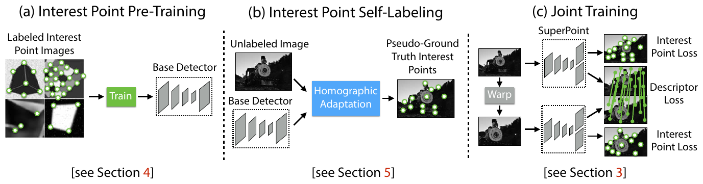

### Вопросы для самопроверки

1. Зачем в голове детектора [SuperPoint](SuperPoint_конспект.md) 65 каналов, а не 64?

Ответ

64 канала — позиции внутри ячейки 8×8, 65-й — dustbin «в этой ячейке точки нет». Softmax по 65 каналам — это классификация «где точка или её нет». После отбрасывания dustbin и depth-to-space получается карта полного разрешения, не больше одной точки на ячейку.

2. Что делает Homographic Adaptation и почему это повышает повторяемость?

Ответ

Детектор применяется к многим случайно искажённым гомографиями версиям изображения, ответы возвращаются обратным преобразованием и усредняются. Остаются точки, которые детектор находит при многих ракурсах. На них и обучается следующая версия, поэтому детектор учится повторяемости. По статье повторяемость растёт примерно на 21 % при $N_h = 100$ и почти не растёт дальше.

3. Почему [SuperPoint](SuperPoint_конспект.md) выигрывает у [SIFT](SIFT_конспект.md) при ε = 3 и 5 px, но проигрывает при ε = 1 px?

Ответ

У [SuperPoint](SuperPoint_конспект.md) лучше дескриптор (NN mAP .821 против .694), поэтому больше верных пар и надёжнее грубая оценка. Но точки привязаны к сетке 8×8 без субпиксельного уточнения, и ошибка локализации у него 1.158 px против 0.833 px у [SIFT](SIFT_конспект.md). На строгом пороге 1 px это решает.

---

## Лекция 10. D2-Net

📄 Подробно: [D2-Net — конспект](D2-Net_конспект.md) · PDF: [оригинал](../original/D2-Net_Dusmanu_2019.pdf)

*Dusmanu, Rocco, Pajdla, Pollefeys, Sivic, Torii, Sattler. CVPR 2019.*

### Мотивация

В схеме detect-then-describe детектор смотрит на маленькую окрестность и низкоуровневые структуры (углы, блобы). При смене дня и ночи, сезона или в слабой текстуре его повторяемость падает, хотя дескрипторы, видящие более крупный патч, часто ещё могли бы сопоставиться. Плотные методы без детектора справляются лучше, но дороги по времени и памяти сопоставления. [D2-Net](D2-Net_конспект.md) хочет разреженные точки с «отложенной детекцией»: точки берутся из глубоких высокоуровневых карт признаков.

### Ключевая идея

**Describe-and-detect.** Одна CNN — VGG16, обрезанная по conv4_3 — даёт тензор $F$ размера $h \times w \times n$. Он играет две роли одновременно. Вектор по всем каналам в пикселе — это дескриптор. Пиксель — точка, если в своём самом сильном канале он является локальным максимумом по пространству. Все параметры общие, обе задачи оптимизирует одна потеря.

Обучение идёт на соответствиях MegaDepth (SfM + MVS + проверка по глубине). Используется triplet margin ranking loss, взвешенный мягкими оценками детекции. Сеть работает и без дообучения, на готовой VGG16, а дообучение улучшает результат. На инференсе можно включить пирамиду масштабов.

### Главные формулы

Жёсткая детекция на инференсе:

$$(i, j)\ \text{— точка} \iff D^k_{ij}\ \text{— локальный максимум в}\ D^k, \quad k = \arg\max_t D^t_{ij}.$$

Мягкая детекция при обучении: soft-NMS $\alpha$ в окне 3×3, отношение к максимуму по каналам $\beta$, итоговая оценка $s$ нормирована на изображение.

$$\gamma_{ij} = \max_k \left(\alpha^k_{ij}\, \beta^k_{ij}\right), \qquad s_{ij} = \frac{\gamma_{ij}}{\sum_{(i', j')} \gamma_{i'j'}}.$$

Потеря — triplet margin, взвешенный детекцией в обоих изображениях:

$$\mathcal{L}(I_1, I_2) = \sum_{c \in \mathcal{C}} \frac{s^{(1)}_c\, s^{(2)}_c}{\sum_{q \in \mathcal{C}} s^{(1)}_q\, s^{(2)}_q}\; \max\left(0,\; M + p(c)^2 - n(c)^2\right).$$

### Что нового по сравнению с SuperPoint

- Нет отдельных голов: детектор и дескриптор — один тензор.
- Учитель — реальные SfM/MVS-соответствия (MegaDepth) вместо гомографий.
- Впервые в курсе результаты на **визуальной локализации в трудных условиях**: Aachen Day-Night (ночные запросы против дневной карты) и InLoc (помещения).

### Ключевые числа

- Дескриптор 512-мерный float.
- MegaDepth: 196 сцен, 327 036 пар.
- Aachen Day-Night, 98 ночных запросов, доля локализованных при 0.5 м, 2° / 1 м, 5° / 5 м, 10°: D2 SS Trained 44.9/66.3/88.8, D2 MS 43.9/67.3/87.8, [SuperPoint](SuperPoint_конспект.md) 42.8/57.1/75.5, Upright RootSIFT 36.7/54.1/72.5.
- InLoc: InLoc + D2 MS — 43.2/61.1/74.2 при 0.25/0.5/1.0 м, лучший результат в таблице.
- HPatches: лучший при порогах ≥ 6.5 px, проигрывает при 1–3 px.
- SfM: ошибка репроекции 1.19–1.35 px против 0.60–0.69 px у RootSIFT.
- Время в статье не приводится. В конспекте [ALIKE](ALIKE_конспект.md) приведено 889.40 GFLOPs и 6.60 FPS для [D2-Net](D2-Net_конспект.md)(MS).

### Ограничения

- Плохая локализация точек: карты в 1/4 разрешения.
- Тяжёлая модель (VGG16, расширенные свёртки), 512-мерный float, пирамида — это три прохода.
- В обучающих данных около 90 % пар отличаются по направлению оси камеры меньше чем на 20°. Инвариантности к повороту нет.
- Тест отношения плохо подходит: он теряет 20–25 % верных пар. Лучше взаимный ближайший сосед.

### Что посмотреть в конспекте

- Разд. 3 и рис. 2–3 — describe-and-detect и мягкая детекция.
- Разд. 4.1 — потеря.
- Разд. 4.2 — MegaDepth.
- Разд. 4.3 — изменения сети на тесте.
- Разд. 5.3 — Aachen и InLoc.
- Раздел «Значение…» — когда [D2-Net](D2-Net_конспект.md) подходит, а когда нет.

### Вопросы для самопроверки

1. Как в [D2-Net](D2-Net_конспект.md) определяется ключевая точка?

Ответ

Для пикселя берётся канал с максимальным откликом $k = \arg\max_t D^t_{ij}$. Пиксель — точка, если $D^k_{ij}$ — локальный максимум в карте $D^k$. Детекция выбирает пиксели, дескриптор которых «выделяется» на фоне соседей, — отсюда название «отложенная детекция».

2. Почему [D2-Net](D2-Net_конспект.md) хорош на Aachen ночью, но проигрывает на HPatches при порогах 1–3 px?

Ответ

Глубокие признаки VGG устойчивы к смене освещения и вида, поэтому на ночных запросах находятся верные соответствия. Но карты признаков имеют низкое разрешение (1/4 на тесте), и точки локализуются грубо. На строгих пиксельных порогах и в ошибке репроекции SfM (~1.2–1.35 px) это проигрыш.

3. Почему для [D2-Net](D2-Net_конспект.md) не рекомендуют тест отношения?

Ответ

Потеря [D2-Net](D2-Net_конспект.md) не учит дескрипторы быть отличительными в смысле теста отношения. При фильтрации по отношению теряется 20–25 % верных пар. Рекомендуется взаимный ближайший сосед.

---

## Лекция 11. R2D2

📄 Подробно: [R2D2 — конспект](R2D2_конспект.md) · PDF: [оригинал](../original/R2D2_Revaud_NeurIPS2019.pdf)

*Revaud, Weinzaepfel, De Souza, Humenberger (NAVER LABS Europe). NeurIPS 2019.*

### Мотивация

Обучаемые детекторы учили повторяемость, обучаемые дескрипторы учились в точках, заданных детектором. Но **повторяемая точка не обязательно надёжна для сопоставления**. Шахматная доска, листва, окна небоскрёбов и морские волны дают массу повторяемых экстремумов, но из-за самоподобия они неоднозначны. Хорошая точка должна быть и повторяемой, и надёжной, и надёжность надо оценивать отдельно.

### Ключевая идея

Небольшая полносвёрточная сеть (на основе L2-Net, около 0.5 млн параметров) выдаёт в **каждом пикселе** три вещи: 128-мерный дескриптор $X$, карту повторяемости $S$ и отдельную карту надёжности $R$.

- **Повторяемость** обучается без учителя. Требуется, чтобы $S$ и деформированная $S'$ совпадали локально, по косинусному сходству в окнах $N \times N$, и были «пиковыми».
- **Дескриптор** обучается потерей ранжирования — дифференцируемым приближением Average Precision.
- **Надёжность** обучается вместе с дескриптором через модифицированную AP-потерю с порогом $\kappa$. Там, где AP заведомо низкий (небо, вода, повторяющиеся фасады), сеть учится ставить $R \to 0$.

На инференсе точки — локальные максимумы $S$ на многомасштабной пирамиде, ранжированные по $S \cdot R$.

Отдельная ценность — данные. Помимо гомографий используются ночные версии Aachen, полученные переносом стиля, и реальные пары с псевдоразметкой оптического потока.

### Главные формулы

Повторяемость: косинусное сходство окон плюс пиковость.

$$\mathcal{L}_{rep}(I, I', U) = \mathcal{L}_{cosim}(I, I', U) + \tfrac{1}{2}\big(\mathcal{L}_{peaky}(I) + \mathcal{L}_{peaky}(I')\big).$$

AP-потеря с надёжностью, $\kappa = 0.5$:

$$\mathcal{L}_{AP,R} = \frac{1}{B}\sum_{ij}\Big(1 - \big[\widetilde{\mathrm{AP}}(p_{ij})\,R_{ij} + \kappa\,(1 - R_{ij})\big]\Big).$$

Смысл: если сеть «признаёт» пиксель ненадёжным ($R \to 0$), она получает фиксированную награду $\kappa$ вместо низкого AP.

### Что нового по сравнению с D2-Net

- Разделение повторяемости и надёжности.
- AP-потеря вместо triplet.
- Перенос стиля как способ научить сеть дню и ночи.
- Очень маленькая сеть: 0.5 млн параметров против 15 млн у [D2-Net](D2-Net_конспект.md) в таблице Aachen.

### Ключевые числа

- Абляция (HPatches MMA@3): только надёжность — 0.588, только повторяемость — 0.639, обе — 0.688.
- Aachen Day-Night, протокол CVPR 2019, 0.5 м, 2° / 1 м, 5° / 5 м, 10°: [R2D2](R2D2_конспект.md) N = 16 — 45.9/65.3/86.7 (5K точек, 128 измерений, 0.5 млн весов); [D2-Net](D2-Net_конспект.md) — 44.9/66.3/88.8 (19K точек, 512 измерений, 15 млн весов).
- Данные: W+A+S+F дают MMA@3 0.719 и 45.9/65.3/86.7 на Aachen.
- Скорость: около 0.5 с на 1 Мпикс на Tesla P100 в одном масштабе и около 1 с по всей пирамиде.

### Ограничения

- Медленный: полное разрешение везде плюс пирамида.
- Нет инвариантности к повороту в плоскости. Многомасштабность только внешняя.
- Сложная подготовка реальных данных (SfM + EpicFlow + DeepMatching).
- Числа Aachen сегодня не воспроизводятся: эталон обновлён.
- Код и веса под CC BY-NC-SA 3.0, только некоммерческое использование.

### Что посмотреть в конспекте

- Разд. 1 и рис. 1 — повторяемость ≠ надёжность.
- Разд. 3.3–3.4 — потери.
- Разд. 4.1–4.2 — источники данных.
- Разд. 5.2 — абляция.
- Разд. 5.5 — Aachen.
- Раздел «Значение…» — почему надёжность полезна на полях, крышах, лесе и воде.

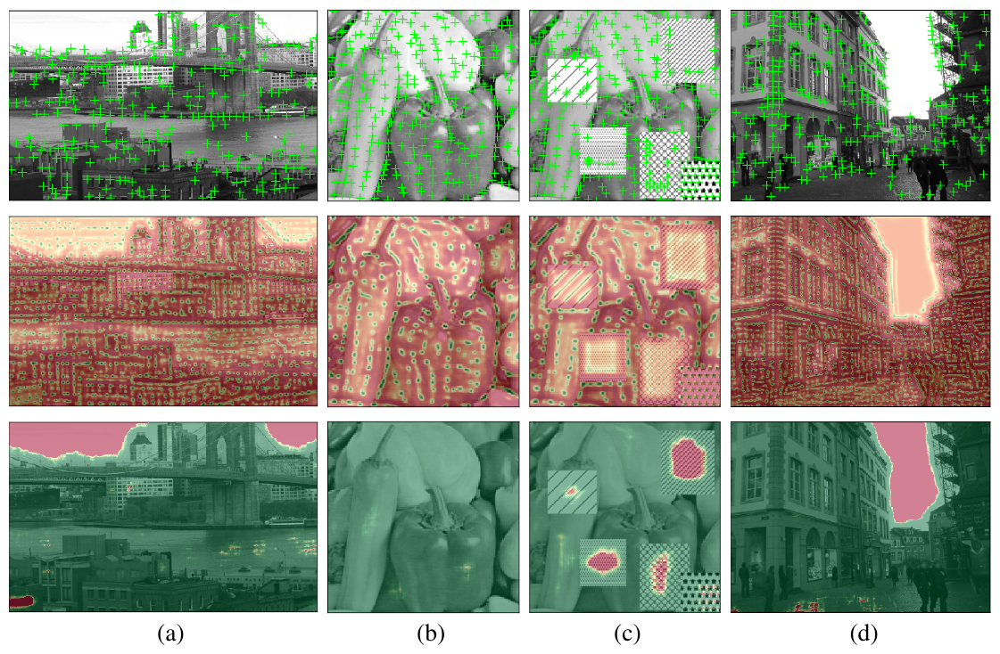

### Вопросы для самопроверки

1. Приведите пример точки, которая повторяема, но ненадёжна.

Ответ

Угол клетки шахматной доски, окно в регулярном фасаде, гребень волны. Детектор находит такие точки на обоих снимках, но дескриптор не может отличить одну клетку или одно окно от соседнего, и сопоставление неоднозначно. [R2D2](R2D2_конспект.md) ставит в таких местах $R \to 0$.

2. Зачем в $\mathcal{L}_{AP,R}$ константа $\kappa$?

Ответ

Без неё сеть могла бы объявить ненадёжным всё. С $\kappa = 0.5$ ставить $R \to 0$ выгодно только там, где достижимый AP ниже 0.5, а там, где дескриптор хорош, выгодно $R \to 1$. Так $R$ становится оценкой «можно ли здесь хорошо сопоставить».

3. Почему [R2D2](R2D2_конспект.md) предпочтительнее для офлайн-построения карты, чем для борта?

Ответ

Около 0.5–1 с на мегапиксель на P100 и плотные карты во всех масштабах — слишком дорого для бортового цикла. Для офлайн-карты качество и надёжность точек важнее. Конспект также напоминает о некоммерческой лицензии.

---

## Лекция 12. SuperGlue

📄 Подробно: [SuperGlue — конспект](SuperGlue_конспект.md) · PDF: [оригинал](../original/SuperGlue_Sarlin_2020.pdf) ([arXiv-версия с приложениями](../original/SuperGlue_Sarlin_2020_arXiv.pdf))

*Sarlin, DeTone, Malisiewicz, Rabinovich. CVPR 2020.*

### Мотивация

Все предыдущие лекции улучшали точки и дескрипторы, а сопоставление оставалось эвристикой: ближайший сосед, тест отношения, взаимная проверка, затем [RANSAC](RANSAC_конспект.md). Обучаемые фильтры выбросов (PointCN, OANet, NG-RANSAC) только классифицируют уже найденные NN-пары. Они не видят изображений и не могут найти больше верных пар, чем нашёл NN. Предложение авторов: учить сам процесс сопоставления, сделав его обучаемым «middle-end» между front-end (детектор и дескриптор) и back-end (поза, BA).

### Ключевая идея

Сопоставление ставится как **частичное назначение** между двумя множествами точек.

1. К каждому дескриптору прибавляется закодированное MLP положение $(x, y, c)$.
2. Графовая сеть с вниманием $L = 9$ раз чередует self-внимание (внутри изображения) и cross-внимание (между изображениями). Дескриптор точки «обогащается» контекстом: соседями на своём снимке и кандидатами на чужом.
3. Матрица оценок — скалярные произведения итоговых «дескрипторов сопоставления». Она дополняется строкой и столбцом **dustbin** с одним обучаемым числом $z$, куда уходят точки без пары.
4. Регуляризованная энтропией задача **оптимального транспорта** решается дифференцируемым алгоритмом Синкхорна ($T = 100$ итераций).

Обучение сквозное, через NLL по эталонным соответствиям и непарным точкам. Эталон берётся из гомографий или из позы и глубины.

### Главные формулы

Ограничения частичного назначения:

$$\mathbf{P}\mathbf{1}_N \le \mathbf{1}_M, \qquad \mathbf{P}^\top \mathbf{1}_M \le \mathbf{1}_N.$$

Сообщение внимания:

$$\mathbf{m}_{\mathcal{E}\to i} = \sum_{j:(i,j)\in\mathcal{E}} \alpha_{ij}\,\mathbf{v}_j, \qquad \alpha_{ij} = \mathrm{Softmax}_j\!\left(\mathbf{q}_i^\top \mathbf{k}_j\right).$$

Потеря: первое слагаемое отвечает за полноту, слагаемые с dustbin — за точность.

$$\mathrm{Loss} = -\sum_{(i,j)\in\mathcal{M}} \log\bar{\mathbf{P}}_{i,j} - \sum_{i\in\mathcal{I}} \log\bar{\mathbf{P}}_{i,N+1} - \sum_{j\in\mathcal{J}} \log\bar{\mathbf{P}}_{M+1,j}.$$

### Что нового

- Обучаемый матчер: внимание и оптимальный транспорт.
- Dustbin в назначении.
- Взаимность пар через ограничения транспорта, а не эвристику.
- Сопоставление использует геометрию: позиционное кодирование.
- Оценка по AUC позы на ScanNet и PhotoTourism вместо одних пиксельных метрик.

### Ключевые числа

- D = 256, 9 пар слоёв, 4 головы, около 12 млн параметров.
- Время на GTX 1080: 512 точек — 69 мс, 1024 — 87 мс, 2048 — 270 мс.
- ScanNet, AUC@5/10/20°: SP + [SuperGlue](SuperGlue_конспект.md) 16.16/33.81/51.84 против SP + OANet 11.76/26.90/43.85 и SP + взаимный NN 9.43/21.53/36.40.
- PhotoTourism: SP + SG 34.18/50.32/64.16, [SIFT](SIFT_конспект.md) + SG 23.68/36.44/49.44, [SIFT](SIFT_конспект.md) + ratio 15.19/24.72/35.30.
- С [SIFT](SIFT_конспект.md) [SuperGlue](SuperGlue_конспект.md) находит до 10 раз больше верных пар, чем тест отношения.
- Синтетическая гомография: точность 90.7 %, полнота 98.3 %.
- Абляция: без cross-внимания AUC@20 падает с 51.84 до 42.57.

### Ограничения

- Квадратичная сложность и фиксированная глубина: лёгкие и трудные пары стоят одинаково. Это мотивация для [LightGlue](LightGlue_конспект.md).
- Синкхорн дорог: 100 итераций стоят примерно столько же, сколько GNN.
- Веса привязаны к экстрактору. Выпущены только веса для [SuperPoint](SuperPoint_конспект.md) (indoor/outdoor), кода обучения нет.
- Нет инвариантности к повороту: абсолютные координаты, снимки выровнены по EXIF.
- Не плотный метод: без повторяемых точек не работает.
- Лицензия только для некоммерческих исследований.

### Что посмотреть в конспекте

- Разд. 3.1–3.3 и рис. 3 — GNN, оптимальный транспорт, потеря.
- Разд. 5.2–5.3 — ScanNet и PhotoTourism.
- Разд. 5.4 — абляция.
- «Время работы (прил. C)».
- «Визуальная локализация: Aachen Day-Night (прил. B)».
- Раздел «Значение…» — настройки hloc (`superglue` с 50 итерациями, `superglue-fast` с 5).

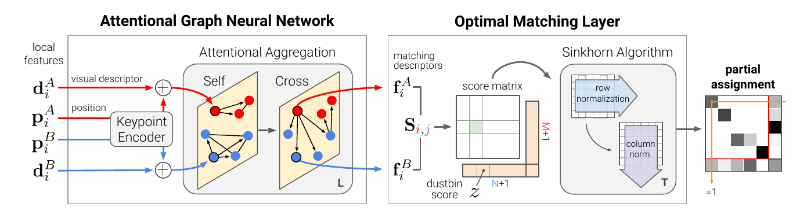

### Вопросы для самопроверки

1. Зачем нужен dustbin?

Ответ

Не у каждой точки есть пара: перекрытие частичное, есть окклюзии и неповторившиеся точки. Dustbin — лишняя строка и столбец в матрице оценок, куда точка может «назначиться», если подходящей пары нет. Он превращает полное назначение в частичное, а его значение $z$ обучается.

2. Чем [SuperGlue](SuperGlue_конспект.md) принципиально отличается от фильтров выбросов вроде OANet?

Ответ

Фильтры выбросов работают над готовыми NN-парами: они могут только отбросить пару, но не найти новую. [SuperGlue](SuperGlue_конспект.md) видит все точки и дескрипторы обоих изображений и решает задачу назначения сам. Он находит пары, которые NN пропустил, поэтому полнота на гомографиях 98.3 % против 64.7 % у OANet.

3. Что показывает абляция «без cross-внимания»?

Ответ

AUC@20 на ScanNet падает с 51.84 до 42.57. Главная сила [SuperGlue](SuperGlue_конспект.md) — обмен информацией между изображениями: дескриптор точки меняется в зависимости от того, что есть на втором снимке.

---

## Лекция 13. DISK

📄 Подробно: [DISK — конспект](DISK_конспект.md) · PDF: [оригинал](../original/NeurIPS-2020-disk-learning-local-features-with-policy-gradient-Paper.pdf)

*Tyszkiewicz, Fua, Trulls. NeurIPS 2020.*

### Мотивация

Учить дескриптор в заданных точках легко. Учить детекцию и сопоставление вместе трудно: выбор точек и решение «пара / не пара» дискретны, сопоставление комбинаторно, а качество признака зависит от остальных признаков. Предшественники решали это приближённо. [SuperPoint](SuperPoint_конспект.md) и [R2D2](R2D2_конспект.md) оптимизируют суррогатные цели, LF-Net нарушает дифференцируемость, [D2-Net](D2-Net_конспект.md) делает сильное предположение, что экстремумы дескрипторов — хорошие точки. Подход с подкреплением RFP имел одну шумную награду за позу и годился только для дообучения [SuperPoint](SuperPoint_конспект.md).

### Ключевая идея

[DISK](DISK_конспект.md) (DIScrete Keypoints) формулирует детекцию и сопоставление как **вероятностные политики** и максимизирует ожидаемую награду за верные пары методом policy gradient (REINFORCE).

- **Детекция.** U-Net выдаёт карту $K$ и плотные 128-мерные дескрипторы. В каждой ячейке $h \times h$ точка сэмплируется: softmax предлагает позицию, сигмоида решает, принять ли её.
- **Сопоставление** — релаксированный взаимный NN. Softmax по строке и по столбцу от $-\theta_M \cdot$ расстояние, обе выборки должны совпасть. Вероятность каждой пары вычисляется в замкнутой форме.
- **Награда аддитивна:** $+\lambda_{tp}$ за верную пару, $\lambda_{fp}$ за неверную, 0 за «правдоподобную» без глубины, плюс штраф $\lambda_{kp}$ за каждую точку.

Вклад сопоставления считается точно, а дисперсия градиента идёт только от сэмплирования точек. Поэтому [DISK](DISK_конспект.md) стабильно обучается с нуля и даёт очень плотные и при этом отличительные признаки.

### Главные формулы

Вероятность точки в ячейке $u$:

$$P(p\mid K^u) = \operatorname{softmax}(K^u)_p\cdot \sigma(K^u_p).$$

Вероятность пары — согласие сопоставлений в обе стороны:

$$P(i\leftrightarrow j) = P_{A\to B}(j\mid d, i)\cdot P_{A\leftarrow B}(i\mid d,j), \qquad P_{A\to B}(j\mid d, i) = \operatorname{softmax}\big(-\theta_M\, d(i,\cdot)\big)_j.$$

Градиент ожидаемой награды:

$$\nabla_\theta\, \mathbb{E}\, R = \mathbb{E}_{F_A,F_B}\Big[\sum_{i,j} P(i\leftrightarrow j)\cdot r(i\leftrightarrow j)\cdot \nabla_\theta \Gamma_{ij}\Big],$$

где $\Gamma_{ij}$ — сумма логарифмов вероятностей пары и обеих точек.

### Что нового по сравнению с SuperPoint, D2-Net и R2D2

- Цель обучения — прямо число верных пар после сопоставления, а не суррогат повторяемости.
- Используется обучение с подкреплением.
- Глубина MegaDepth используется как награда. В абляции показано, что хватает и эпиполярной награды по одним позам.
- Признаки [DISK](DISK_конспект.md) стали одним из стандартных входов для [LightGlue](LightGlue_конспект.md).

### Ключевые числа

- Дескриптор 128-мерный float. U-Net около 1.1 млн параметров, выход в полном разрешении.
- IMC 2020, 2k точек: стерео mAA 0.5132, мультивид 0.7271. Upright Root-SIFT — 0.3986/0.5623, [R2D2](R2D2_конспект.md) — 0.3346/0.6149. Около 50 % больше инлаеров, первое место в категории 2k среди методов со стандартным матчером.
- HPatches AUC@5 (оба подмножества): [DISK](DISK_конспект.md) 2k — 0.689, [R2D2](R2D2_конспект.md) — 0.613, [SuperPoint](SuperPoint_конспект.md) — 0.590.
- Sacre Coeur SfM: 30.0 наблюдений на точку против 22.3 у RootSIFT.
- Скорость: около 7 fps (около 140 мс) на 1024×1024 на V100 в FP32, по приложению arXiv. В конспекте [ALIKE](ALIKE_конспект.md) — 15.73 FPS на 640×480 на TITAN X.
- Устойчивость к повороту: около 1.0 до 15–20°, затем резкое падение почти до нуля к 35°.

### Ограничения

- Нет инвариантности к повороту в плоскости, аугментация не использовалась.
- Расхождение между обучением (сетка) и инференсом (NMS), около 20 % дубликатов на границах ячеек.
- Нет явной многомасштабности. Бюджет 8k используется неоптимально.
- U-Net в полном разрешении тяжелее [SuperPoint](SuperPoint_конспект.md).
- Обучение квадратично по числу точек.
- Лицензия: в самом конспекте [DISK](DISK_конспект.md) не указана. По конспектам [SuperGlue](SuperGlue_конспект.md) и [LightGlue](LightGlue_конспект.md) (README cvg/LightGlue) — Apache-2.0.

### Что посмотреть в конспекте

- Разд. 3.2–3.5 — распределения, награда, градиент.
- Разд. 4.3 — гиперпараметры $\lambda$ и отжиг.
- Разд. 5.1 — IMC.
- Разд. 5.4 — абляции «сетка против NMS» и «глубина против эпиполярной награды».
- Рис. 6 — устойчивость к повороту.
- Раздел «Значение…» — связка [DISK](DISK_конспект.md) + [LightGlue](LightGlue_конспект.md) и настройки инференса.

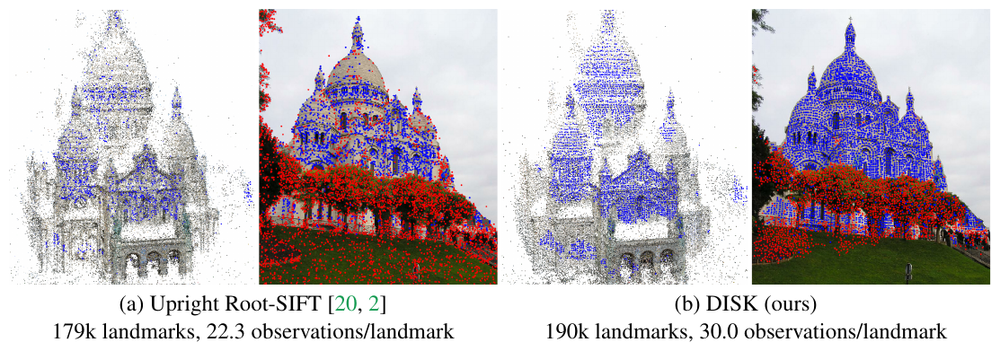

### Вопросы для самопроверки

1. Почему [DISK](DISK_конспект.md) использует policy gradient, а не обычный градиентный спуск по потере?

Ответ

Выбор точек и решение о паре дискретны, и цель (число верных пар) от них зависит недифференцируемо. Если сделать выбор случайным (политикой), можно дифференцировать ожидаемую награду через логарифмы вероятностей (REINFORCE). Это прямо оптимизирует нужную цель без суррогатов.

2. Зачем штраф $\lambda_{kp}$ за каждую точку?

Ответ

Без него сеть сэмплировала бы точки везде: неверные пары штрафуются, но непарные точки ничего не стоят. Небольшой отрицательный $\lambda_{kp} = -0.001$ заставляет выбирать только точки, у которых есть шанс дать верную пару. Он и $\lambda_{fp}$ включаются постепенно в первые 5 эпох.

3. Что делать с [DISK](DISK_конспект.md) на дроне с произвольным курсом?

Ответ

[DISK](DISK_конспект.md) устойчив только к поворотам в пределах обучающего распределения, примерно 15–20°. Конспект советует выравнивать кадр по курсу из IMU, перебирать несколько поворотов запроса или дообучить с поворотной аугментацией.

---

## Лекция 14. LoFTR

📄 Подробно: [LoFTR — перевод](LoFTR_перевод.md) · PDF: [оригинал](../original/LoFTR_Sun_2021_arXiv.pdf)

*Sun, Shen, Wang, Bao, Zhou. CVPR 2021. Это единственный полный перевод в курсе: arXiv-версия статьи под CC BY 4.0.*

### Мотивация

Все предыдущие методы зависят от детектора. Если повторяемых точек нет — слабая текстура, повторяющиеся узоры, большая смена ракурса или освещения, размытие, — то «без повторяемых точек верных соответствий нет даже при идеальных дескрипторах». Особенно часто это бывает в помещениях. Плотные методы (NCNet, DRC-Net) опираются на CNN-признаки с ограниченным рецептивным полем. Внимание [SuperGlue](SuperGlue_конспект.md) ограничено найденными точками. Обычный трансформер на всех пикселях стоит $O(N^2)$.

### Ключевая идея

[LoFTR](LoFTR_перевод.md) — **бездетекторный** полуплотный матчер, работающий от грубого к точному.

1. CNN (ResNet-18 + FPN) даёт грубые признаки в 1/8 разрешения и точные в 1/2.
2. Грубые признаки разворачиваются в последовательность, к ним один раз прибавляется 2D-синусоидальное позиционное кодирование. Затем они проходят модуль [LoFTR](LoFTR_перевод.md): $N_c = 4$ пары self/cross-слоёв с **линейным вниманием** ($\phi = \mathrm{elu} + 1$, $O(N)$). Признаки становятся зависимыми от контекста обоих изображений, поэтому в однородной области «видно», где ты находишься относительно краёв.
3. Дифференцируемый слой сопоставления — dual-softmax или OT, как в [SuperGlue](SuperGlue_конспект.md) — даёт матрицу уверенностей. Пары выбираются по порогу $\theta_c$ и взаимной максимальности.
4. Для каждой грубой пары вырезается окно 5×5 на карте 1/2, и меньший [LoFTR](LoFTR_перевод.md) ($N_f = 1$) уточняет положение до субпиксельного через ожидание по softmax-корреляции.

### Главные формулы

Линейное внимание:

$$\mathrm{sim}(Q, K) = \phi(Q) \cdot \phi(K)^T, \qquad \phi(\cdot) = \mathrm{elu}(\cdot) + 1.$$

Dual-softmax по матрице оценок $\mathcal{S}(i,j) = \frac{1}{\tau}\langle \tilde F^A_{tr}(i), \tilde F^B_{tr}(j)\rangle$:

$$\mathcal{P}_c(i, j) = \mathrm{softmax}\big(\mathcal{S}(i, \cdot)\big)_j \cdot \mathrm{softmax}\big(\mathcal{S}(\cdot, j)\big)_i.$$

Потеря: NLL на грубом уровне плюс $\ell_2$ на точном, взвешенный обратной дисперсией тепловой карты.

$$\mathcal{L} = \mathcal{L}_c + \mathcal{L}_f, \qquad \mathcal{L}_f = \frac{1}{|\mathcal{M}_f|} \sum \frac{1}{\sigma^2(\hat i)} \lVert \hat j' - \hat j'_{gt} \rVert_2.$$

### Что нового по сравнению с SuperGlue

- Нет детектора. Внимание идёт по всем грубым ячейкам, а не по точкам.
- Линейное внимание вместо квадратичного.
- Схема «грубое → точное» с субпиксельным уточнением.
- Dual-softmax как лёгкая альтернатива Синкхорну. Его позже возьмут [LightGlue](LightGlue_конспект.md) (вместе с matchability) и [XFeat](XFeat_конспект.md).

### Ключевые числа

- 116 мс на пару 640×480 (dual-softmax) на RTX 2080Ti, 130 мс для варианта OT. $N_c = 4$, $N_f = 1$, $\theta_c = 0.2$, $w = 5$.
- HPatches AUC@3/5/10 px: LoFTR-DS 65.9/75.6/84.6, SP + [SuperGlue](SuperGlue_конспект.md) 53.9/68.3/81.7, [DISK](DISK_конспект.md) + NN 52.3/64.9/78.9.
- ScanNet AUC@5/10/20°: LoFTR-DS 22.06/40.8/57.62 против SP + SG 16.16/33.81/51.84.
- MegaDepth AUC@5/10/20°: LoFTR-DS 52.8/69.19/81.18 против SP + SG 42.18/61.16/75.96.
- InLoc (HLoc + LoFTR-OT): DUC1 47.5/72.2/84.8, DUC2 54.2/74.8/85.5 — первое место среди опубликованных методов.
- Aachen v1.1, ночь, трек локальных признаков: 72.8/88.5/99.0.
- Обучение: 64 × GTX 1080Ti, 24 ч.

### Ограничения

Раздел переводчика:

- Скорость и память: число токенов $HW/64$.
- Признаки зависят от пары, поэтому признаки базы нельзя закэшировать.
- Точки в A — центры ячеек 1/8, не больше одной пары на ячейку. Окно уточнения ±4 px не исправляет грубые ошибки.
- Нет явной инвариантности к повороту и масштабу.
- Отдельные веса для помещений и улицы.
- Нет метрики точности для бездетекторных методов.
- Код и статья расходятся: focal loss против NLL, AdamW против Adam.
- Лицензия кода — Apache-2.0. Файлы OT взяты из некоммерческого SuperGluePretrainedNetwork и в репозиторий не входят. Лицензия весов не указана.

### Что посмотреть в конспекте

В переводе:

- Разд. 3.2 и рис. 3 — линейное внимание.
- Разд. 3.3 — dual-softmax и OT.
- Разд. 3.4 — грубое → точное.
- Разд. 4.1–4.3 — таблицы 1–5.
- Разд. 4.4 — абляция и визуализация внимания.
- «Приложения переводчика» — интеграция в hloc и kornia, гибридная схема для борта.

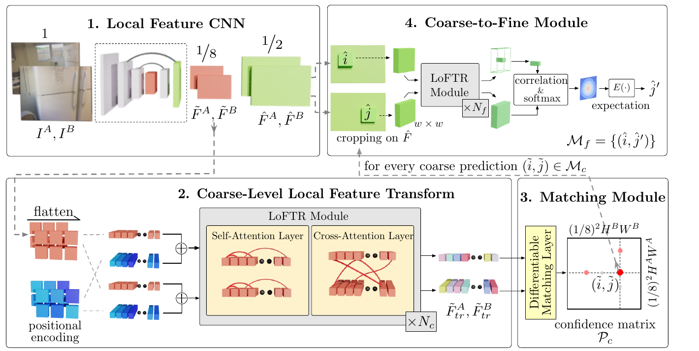

### Вопросы для самопроверки

1. Почему [LoFTR](LoFTR_перевод.md) находит соответствия на однотонной стене, где детекторы не находят точек?

Ответ

Он не ищет точки: он сопоставляет все грубые ячейки. После self- и cross-внимания признак ячейки несёт информацию о далёком контексте (края стены, объекты рядом) и о втором изображении. Поэтому однородные ячейки становятся различимыми по положению относительно структуры сцены (рис. 1 и 4 перевода).

2. Что такое dual-softmax и чем он проще Синкхорна?

Ответ

Произведение softmax по строке и softmax по столбцу матрицы оценок. Высокое значение получается только при взаимном предпочтении. Это одна операция вместо итераций Синкхорна (100 в [SuperGlue](SuperGlue_конспект.md)) и без dustbin. В [LoFTR](LoFTR_перевод.md) вариант с OT (3 итерации) — 130 мс, с dual-softmax — 116 мс, а точность сопоставима.

3. Почему [LoFTR](LoFTR_перевод.md) неудобен для поиска по большой базе снимков?

Ответ

Признаки вычисляются совместно для пары: cross-внимание зависит от обоих снимков. Признаки базы нельзя посчитать заранее и сохранить, поэтому на каждого кандидата нужен полный прогон. Конспект советует держать число кандидатов малым и использовать [LoFTR](LoFTR_перевод.md) как тяжёлую проверку трудных кадров.

---

## Лекция 15. ALIKE

📄 Подробно: [ALIKE — конспект](ALIKE_конспект.md) · PDF: [оригинал](../original/ALIKE_Zhao_2022.pdf)

*Zhao, Wu, Miao, Chen, Chen, Li. IEEE Transactions on Multimedia, 2022.*

### Мотивация

Обучаемые детекторы на карте откликов ([SuperPoint](SuperPoint_конспект.md), [R2D2](R2D2_конспект.md), [D2-Net](D2-Net_конспект.md), [DISK](DISK_конспект.md)) получают точки через NMS. NMS недифференцируем, поэтому сеть учится на промежуточной карте, а положение точки напрямую не оптимизируется. Отсюда ограниченная субпиксельная точность, видная ещё в лекции 9. Кроме того, эти методы гонятся за точностью, а не за скоростью. [ALIKE](ALIKE_конспект.md) с самого начала проектируется для реального времени.

### Ключевая идея

Лёгкая сеть выдаёт в полном разрешении карту откликов $S$ и карту дескрипторов $D$. Энкодер из четырёх блоков работает в масштабах $H$, $H/2$, $H/8$, $H/32$, признаки агрегируются апсемплингом и конкатенацией.

Главное — модуль **DKD** (Differentiable Keypoint Detection). После NMS в окне 5×5 вокруг каждого максимума берётся soft-argmax с температурой. Получается субпиксельная координата, и градиент через неё проходит к откликам окна. Тогда можно прямо минимизировать **ошибку репроекции** точек между двумя видами.

Дополнительные потери:

- **dispersity peak** — острый пик ровно в точке;
- **NRE** — плотная дескрипторная потеря по всей карте второго изображения вместо triplet. Triplet у авторов вырождался на субпиксельных дескрипторах;
- **надёжность** в духе [R2D2](R2D2_конспект.md).

### Главные формулы

DKD: softmax в окне и интегральная регрессия смещения.

$$s'(i,j) = \mathrm{softmax}\!\left(\frac{s(i,j) - s_{max}}{t_{det}}\right), \qquad \mathbf{p} = [u,v]^T_{NMS} + \sum_{0 \le i,j < N} s'(i,j)\,[i,j]^T.$$

Потеря репроекции: точка из A, перенесённая по известной позе и глубине (или гомографии), должна попасть в детекцию B.

$$\mathbf{p}_{AB} = \pi\!\left(d_A R_{AB}\, \pi^{-1}(\mathbf{p}_A) + \mathbf{t}_{AB}\right), \qquad \mathcal{L}_{rp} = \tfrac{1}{2}\left(\mathrm{dist}_{AB} + \mathrm{dist}_{BA}\right).$$

NRE — кросс-энтропия между «истинным» положением и распределением сходства по всей карте $D_B$:

$$\mathrm{NRE} = -\ln q_m(\mathbf{p}_{AB} \mid \mathbf{d}_{p_A}, D_B), \qquad q_m = \mathrm{softmax}\!\left(\frac{\bar C_{\mathbf{d}_{p_A}, D_B} - 1}{t_{des}}\right).$$

### Что нового по сравнению с DISK и SuperPoint

- Дифференцируемая субпиксельная детекция и прямая оптимизация репроекции.
- NRE вместо triplet.
- Акцент на эффективности: GFLOPs и параметры как метрика, «качество на GFLOP» (PPC).
- Семейство конфигураций T/S/N/L.

### Ключевые числа

- Конфигурации на 640×480: Tiny — 0.080 млн параметров и 2.109 GFLOPs, дескриптор 64; Normal — 0.318 млн и 7.909 GFLOPs, дескриптор 128; Large — 0.653 млн и 19.685 GFLOPs.
- TITAN X Pascal, 640×480: ALIKE-N 95.19 FPS, ALIKE-L 68.18, [SuperPoint](SuperPoint_конспект.md) 45.87, [DISK](DISK_конспект.md) 15.73, [R2D2](R2D2_конспект.md)(MS) 8.70, [D2-Net](D2-Net_конспект.md)(MS) 6.60.
- HPatches MHA@3: ALIKE-N 75.74, ALIKE-L 76.85, ASLFeat(MS) 73.52, [SuperPoint](SuperPoint_конспект.md) 70.19, [DISK](DISK_конспект.md) 70.56.
- IMW2020, стерео mAA@10°: ALIKE-N 47.18, [DISK](DISK_конспект.md) 51.22, [SuperPoint](SuperPoint_конспект.md) 28.97. PPC у ALIKE-N в 10 раз выше, чем у [DISK](DISK_конспект.md).
- Абляция: triplet вместо NRE даёт MMA@3 39.38 против 70.78 — вырождение.

### Ограничения

- По статье: отказы при экстремальной смене освещения и больших изменениях ракурса — у неглубокой сети более «низкоуровневые» дескрипторы.
- Уступает [DISK](DISK_конспект.md) по MMA@3 и на IMW2020.
- Нет инвариантности к повороту и масштабу.
- NRE требует много памяти: плотная карта на каждую точку.
- Скорость мерилась только на настольных GPU.
- Готовых весов [LightGlue](LightGlue_конспект.md) для [ALIKE](ALIKE_конспект.md) нет — это наблюдение по репозиторию.

### Что посмотреть в конспекте

- Разд. 3 — архитектура и таблица I.
- Разд. 4 и рис. 1, 3 — DKD.
- Разд. 5.1–5.3 — потери, NRE против triplet (рис. 6, 9).
- Разд. 6.5 — сложность и скорость.
- Разд. 6.6–6.7 — IMW и Aachen.

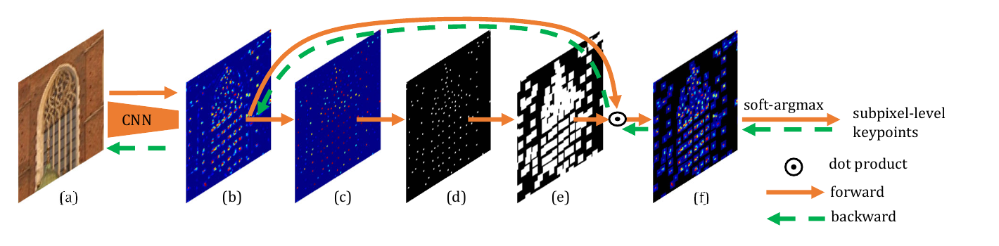

### Вопросы для самопроверки

1. Как DKD сочетает недифференцируемый NMS и обучение положения точки?

Ответ

NMS даёт целочисленное положение максимума, градиента через него нет. Затем в окне 5×5 вокруг него берётся soft-argmax (softmax с температурой и ожидание координат), который даёт дифференцируемое субпиксельное смещение. Итоговая точка — сумма двух частей. Градиент проходит через смещение к откликам окна.

2. Чем NRE лучше triplet loss для субпиксельных дескрипторов?

Ответ

Triplet сравнивает с одним позитивом и одним негативом. На субпиксельных точках он у авторов вырождался: потеря «прилипала» к порогу 0.5. NRE — кросс-энтропия по всей карте дескрипторов второго изображения, которая требует максимального сходства именно в истинном (билинейно размазанном) положении. Это плотный и стабильный сигнал: MMA@3 70.78 против 39.38.

3. Что такое PPC и почему он важен для бортовых систем?

Ответ

PPC = mAA(10°)/GFLOPs, качество на единицу вычислений. На борту бюджет вычислений фиксирован, и PPC показывает, сколько точности даёт каждый GFLOP. ALIKE-N по PPC примерно в 10 раз эффективнее [DISK](DISK_конспект.md), хотя по mAA и уступает ему.

---

## Лекция 16. ALIKED

📄 Подробно: [ALIKED — конспект](ALIKED_конспект.md) · PDF: [оригинал](../original/ALIKED_Zhao_2023.pdf)

*Zhao, Wu, Chen, Chen, Xu, Li. IEEE Transactions on Instrumentation and Measurement, 2023.*

### Мотивация

У методов с двумя головами ([SuperPoint](SuperPoint_конспект.md), [R2D2](R2D2_конспект.md), [ALIKE](ALIKE_конспект.md)) голова дескрипторов DMH считает плотную карту на всём изображении, хотя дескрипторы нужны в нескольких тысячах точек. Именно она съедает основные вычисления. Вторая проблема — геометрическая инвариантность. Обычная свёртка с фиксированной сеткой её не даёт, а явная оценка масштаба и ориентации ([LIFT](LIFT_конспект.md), LF-Net, AffNet) ограничена аффинной моделью. Деформируемая свёртка (DCN) может моделировать произвольную локальную геометрию, но на плотной карте полного разрешения она дорога.

### Ключевая идея

[ALIKED](ALIKED_конспект.md) развивает [ALIKE](ALIKE_конспект.md). В энкодере average pooling вместо max и SELU вместо ReLU, в двух глубоких блоках стоят деформируемые свёртки. Детекция остаётся прежней: голова откликов и DKD из [ALIKE](ALIKE_конспект.md), субпиксельные дифференцируемые точки.

Главное новшество — **SDDH** (Sparse Deformable Descriptor Head). Для каждой найденной точки по патчу признаков $K \times K$ предсказываются $M$ произвольных позиций выборки. В них билинейно берутся признаки, которые кодируются и взвешенно суммируются в дескриптор. Дескриптор строится только в точках, что экономно, и по гибкой «деформируемой» окрестности, подстроенной под локальную геометрию, что выразительно. Плотной карты больше нет, поэтому потеря NRE становится **разреженной**: распределение берётся по найденным точкам второго изображения. Это экономит память примерно в 3.5 раза.

### Главные формулы

Деформируемая свёртка: к регулярной сетке $p_i$ добавляются предсказанные смещения $\Delta p_i$.

$$F'(p) = \sum_{i=1}^{K^2} w(p_i)\, F(p + p_i + \Delta p_i).$$

SDDH: предсказание $M$ позиций и агрегация в дескриптор.

$$p_s = \mathrm{conv1x1}\big(\mathrm{SELU}(\mathrm{convKxK}(F^{K\times K}))\big), \qquad d = \sum_{i=1}^{M} w_M(p_i)\, \Phi\big(F(p + p_{s_i})\big).$$

Разреженная NRE — кросс-энтропия по множеству найденных точек второго изображения. Конспект называет её InfoNCE-подобной.

$$L_{ds}(p_A, I_B) = -\ln q_m(d_A, d_B), \qquad q_m(d_A, D_B) = \mathrm{softmax}\big((D_B\, d_A - 1)/t_{des}\big).$$

### Что нового по сравнению с ALIKE

- Дескриптор только в точках через SDDH.
- Деформируемая модель инвариантности вместо аффинной.
- Разреженная NRE.
- Отдельная версия с поворотной аугментацией: aliked-n16rot.
- Официальные веса [LightGlue](LightGlue_конспект.md) для [ALIKED](ALIKED_конспект.md) в cvg/LightGlue.

### Ключевые числа

- Сравнение голов (480×640×128, RTX 2060): DMH около 51.9/14.7 мс, SDDH около 7.6/1.25 мс при K=5, N=5000 / K=3, N=1000.
- ALIKED-T(16): 0.192 млн параметров, 1.37 GFLOPs, 125.87 FPS на 640×480 (RTX 2060).
- ALIKED-N(16): 0.677 млн, 4.05 GFLOPs, 77.40 FPS. В тех же условиях [SuperPoint](SuperPoint_конспект.md) — 52.63 FPS, [DISK](DISK_конспект.md) — 11.81.
- HPatches MHA@3: T(16) 78.70, N(16) 77.22, ALIKE-N 75.74.
- IMW, стерео mAA@10°: N(16) 52.28 против [DISK](DISK_конспект.md) 51.22. В мультивиде [DISK](DISK_конспект.md) лучше: 72.96 против 71.78.
- Aachen Day-Night, ночь, не больше 1024 точек, 0.25 м, 2° / 0.5 м, 5° / 5 м, 10°: N(32) 77.6/88.8/100.0, N(16) 73.5/85.7/98.0, [DISK](DISK_конспект.md) 60.2/72.4/81.6, [SuperPoint](SuperPoint_конспект.md) 58.2/66.3/72.4.
- Поворот: ALIKED-N(16, rot) около 0.84 при 45° по графику. Без rot-версии точность заметно падает уже при ≳30°.
- Лицензия: код и веса под BSD-3-Clause, только инференс, кода обучения нет.

### Ограничения

- По авторам: при одновременно большой смене масштаба и ракурса верных соответствий часто нет. SDDH оценивает позиции одним слоем; предлагаемое решение — обучаемый матчер вместо mNN.
- Grid-sampling и 32-битные float-дескрипторы не идеальны для мобильных платформ.
- Кластеризация точек на неравномерной текстуре (отказ на TUM).
- По конспекту: нестандартные операции (DCN, вырезание патчей) делают N(16) медленнее ALIKE-N при меньших GFLOPs и усложняют экспорт в ONNX и TensorRT.

### Что посмотреть в конспекте

- Разд. 3 и рис. 1 — архитектура.
- Разд. 4 и рис. 2–3 — SDDH против DMH, таблица III.
- Разд. 5.3 — разреженная NRE.
- Разд. 7.1–7.4 — HPatches, IMW, FM-Bench, Aachen.
- Разд. 7.5 и рис. 6–7 — деформируемая инвариантность.
- Раздел «Значение…» — [ALIKED](ALIKED_конспект.md) + [LightGlue](LightGlue_конспект.md) и параметры инференса.

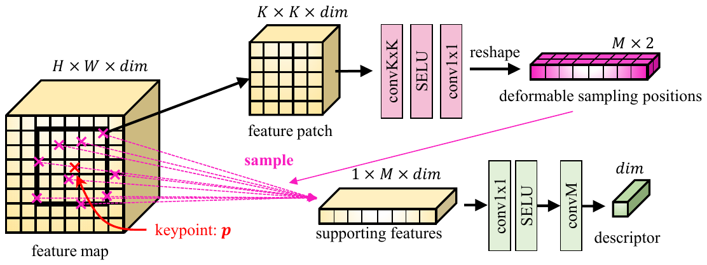

### Вопросы для самопроверки

1. Почему SDDH быстрее плотной головы дескрипторов, хотя каждая точка обрабатывается сложнее?

Ответ

DMH сворачивает всю карту $H \times W$ с $C^2 K^2$ операциями на пиксель, хотя дескрипторы нужны в тысяче точек. SDDH тратит вычисления только в $N$ найденных точках на $M$ позициях выборки. При N = 1000 это около 1.25 мс против 14.7 мс у DMH на RTX 2060.

2. Чем деформируемая модель инвариантности общее аффинной?

Ответ

Аффинная модель задаёт одно преобразование ($A$, $b$, 6 степеней свободы) на всю окрестность. Деформируемая даёт своё смещение $(\Delta x, \Delta y)$ каждой позиции выборки. Это позволяет описать и поворот, и масштаб, и перспективу, и нежёсткие изменения.

3. Какую связку из курса можно рекомендовать для коммерческого продукта и почему?

Ответ

[ALIKED](ALIKED_конспект.md) + [LightGlue](LightGlue_конспект.md): у [ALIKED](ALIKED_конспект.md) код и веса под BSD-3-Clause, у [LightGlue](LightGlue_конспект.md) код и веса под Apache-2.0 (по README). Связка [SuperPoint](SuperPoint_конспект.md) + [LightGlue](LightGlue_конспект.md) не подходит: официальные веса [SuperPoint](SuperPoint_конспект.md) некоммерческие. Альтернатива — [DISK](DISK_конспект.md) + [LightGlue](LightGlue_конспект.md), у [DISK](DISK_конспект.md) по README Apache-2.0.

---

## Лекция 17. LightGlue

📄 Подробно: [LightGlue — конспект](LightGlue_конспект.md) · PDF: [оригинал](../original/LightGlue_Lindenberger_2023.pdf) ([arXiv-версия с приложениями](../original/LightGlue_Lindenberger_2023_arXiv.pdf))

*Lindenberger, Sarlin, Pollefeys. ICCV 2023.*

### Мотивация

[SuperGlue](SuperGlue_конспект.md) задал парадигму совместного сопоставления и отбраковки выбросов трансформером и оптимальным транспортом, но у него две проблемы.

- **Он дорог:** квадратичен по числу точек и одинаково долго работает на лёгких и трудных парах. Это плохо для трекинга, SLAM и крупномасштабного картирования.
- **Его трудно обучать:** нужны ресурсы, которых у многих групп нет, а последователи (SGMNet, ClusterGNN) не дотягивали до его качества.

Плотные матчеры ([LoFTR](LoFTR_перевод.md), MatchFormer, ASpanFormer) робастны, но медленны, а это ограничивает разрешение входа.

### Ключевая идея

[LightGlue](LightGlue_конспект.md) — переработанный [SuperGlue](SuperGlue_конспект.md) из множества простых изменений.

- Каждый слой состоит из self- и cross-внимания: $L = 9$, $d = 256$, 4 головы. Состояние инициализируется только дескриптором.
- Self-внимание использует **относительное rotary-кодирование** положения в каждом слое.
- Cross-внимание **двунаправленное**: матрица сходства считается один раз для обоих направлений.
- Голова сопоставления лёгкая: dual-softmax по матрице сходства, умноженный на сигмоидальную «сопоставимость» (matchability) каждой точки. Она заменяет Синкхорна и dustbin.
- Голова дешёвая, поэтому применяется **глубокий надзор** на каждом слое.

Главное — **адаптивность**. Классификатор уверенности после каждого слоя позволяет досрочно выйти, когда предсказания устоялись: это адаптивная глубина. Точки, уверенно признанные несопоставимыми, удаляются: это адаптивная ширина. Лёгкая пара (соседние кадры) выходит после 3 слоёв, трудная — после 8. Опубликован и рецепт обучения: предобучение на гомографиях, затем дообучение на MegaDepth, всего несколько GPU-дней.

### Главные формулы

Rotary self-внимание — оценка зависит только от относительного положения точек:

$$a_{ij} = \mathbf{q}_i^\top\, \mathbf{R}(\mathbf{p}_j - \mathbf{p}_i)\, \mathbf{k}_j.$$

Матрица назначения — dual-softmax, умноженный на сопоставимость обеих точек:

$$\mathbf{P}_{ij} = \sigma^A_i\, \sigma^B_j\, \operatorname{Softmax}_{k\in\mathcal{A}}(\mathbf{S}_{kj})_i\, \operatorname{Softmax}_{k\in\mathcal{B}}(\mathbf{S}_{ik})_j.$$

Правило досрочного выхода: доля уверенных точек больше $\alpha = 95\,\%$ при пороге $\lambda_\ell$, убывающем с глубиной слоя $\ell$.

$$\mathrm{exit} = \Big(\frac{1}{N+M}\sum_{I}\sum_{i} [\![ c^I_i > \lambda_\ell ]\!]\Big) > \alpha, \qquad \lambda_\ell = 0.8 + 0.1\, e^{-4\ell/L}.$$

### Что нового по сравнению с SuperGlue и LoFTR

- Адаптивная глубина и ширина.
- Matchability вместо dustbin и dual-softmax (из линии [LoFTR](LoFTR_перевод.md)) вместо Синкхорна.
- Относительное позиционное кодирование.
- Глубокий надзор.
- Открытый рецепт обучения (glue-factory).
- Веса для нескольких экстракторов: [SuperPoint](SuperPoint_конспект.md), [DISK](DISK_конспект.md), [SIFT](SIFT_конспект.md) в статье; [ALIKED](ALIKED_конспект.md), DoGHardNet в коде.

### Ключевые числа

- MegaDepth-1500, RTX 3080, AUC@5/10/20° с [RANSAC](RANSAC_конспект.md): SP + [LightGlue](LightGlue_конспект.md) 49.9/67.0/80.1 за 44.2 мс; SP + [SuperGlue](SuperGlue_конспект.md) 49.7/67.1/80.6 за 70.0 мс; адаптивный вариант 49.4/67.2/80.1 за 31.4 мс; [DISK](DISK_конспект.md) + [LightGlue](LightGlue_конспект.md) 43.5/61.0/75.3; [LoFTR](LoFTR_перевод.md) 52.8/69.2/81.2 за 181 мс. С LO-RANSAC SP + LG даёт 66.7/79.3/87.9 против 66.4/78.6/86.5 у [LoFTR](LoFTR_перевод.md).
- Aachen Day-Night (hloc, 4096 точек): LG адаптивный — 17.2 пары/с, 26.1 с оптимизацией, против 6.5 у [SuperGlue](SuperGlue_конспект.md) при сопоставимой точности (ночь 87.8/93.9/100 против 86.7/92.9/100).
- IMC 2021: [DISK](DISK_конспект.md)(8K) + LG — лучший в таблице, mean AUC@5/10 58.8/70.0.
- Адаптивность: средний слой выхода 4.7/5.5/6.9 для лёгких, средних и трудных пар, ускорение 1.86/1.33/1.16×.
- Обучение: около 2 суток предобучения и около 2 суток дообучения на 2 × RTX 3090.
- README: около 150 FPS при 1024 точках и около 50 FPS при 4096 на RTX 3080; около 20 FPS при 512 точках на CPU i7-10700K.
- Лицензия: код и веса под Apache-2.0. Веса [SuperPoint](SuperPoint_конспект.md) в том же репозитории — под ограничительной лицензией Magic Leap.

### Ограничения

- Разреженный метод: качество ограничено повторяемостью и локализацией точек. В слабой текстуре и при экстремальной смене вида плотные методы лучше.
- Внимание остаётся квадратичным.
- Веса привязаны к экстрактору.
- Нет явной инвариантности к повороту.
- Повторяющиеся структуры (видно на InLoc).
- Выигрыш адаптивности зависит от железа: в коде прореживание выключено на CPU.
- Обучен только на фототуристических данных.

### Что посмотреть в конспекте

- Разд. 3.2–3.4 и рис. 3 — архитектура и адаптивность.
- Разд. 3.6 — отличия от [SuperGlue](SuperGlue_конспект.md).
- Разд. 4 — рецепт обучения.
- Разд. 5.2 — MegaDepth-1500.
- Разд. 5.4 — Aachen.
- Разд. 5.5 — абляции и таблица 6 по трудности пар.
- Раздел «Значение…» — параметры кода (`depth_confidence`, `width_confidence`), режимы скорости, конфигурации hloc.

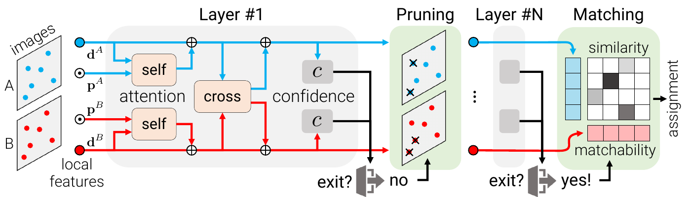

### Вопросы для самопроверки

1. Почему в онлайн-позиционировании по видео адаптивная глубина особенно выгодна?

Ответ

Соседние кадры — «лёгкие» пары с большим перекрытием и малым изменением вида. Предсказания устанавливаются за несколько слоёв, и сеть досрочно выходит: в среднем на 4.7 слое, ускорение 1.86× для лёгких пар. Трудные пары «кадр — ортофото» выигрывают меньше, поэтому их нужно проверять на своих данных.

2. Чем matchability в [LightGlue](LightGlue_конспект.md) заменяет dustbin [SuperGlue](SuperGlue_конспект.md)?

Ответ

Вместо лишней строки и столбца в транспортной задаче каждая точка получает сигмоидальную оценку $\sigma_i$ — «есть ли у неё пара вообще». Она умножается на dual-softmax. Без matchability точность в абляции падает с 86.8 до 67.4 %.

3. Почему с [LightGlue](LightGlue_конспект.md) не нужен тест отношения, а прореживание может не дать ускорения на CPU?

Ответ

[LightGlue](LightGlue_конспект.md) сам решает задачу назначения с учётом контекста и сопоставимости: пары берутся по порогу $\tau = 0.1$ и взаимной максимальности, и фильтр по отношению только выбросит верные пары. Прореживание требует gather/scatter, которые на CPU не окупаются, поэтому в коде оно включено только на CUDA при числе точек больше 1024.

---

## Лекция 18. XFeat

📄 Подробно: [XFeat — конспект](XFeat_конспект.md) · PDF: [оригинал](../original/Potje_XFeat_Accelerated_Features_for_Lightweight_Image_Matching_CVPR_2024_paper.pdf)

*Potje, Cadar, Araujo, Martins, Nascimento. CVPR 2024.*

### Мотивация

Современные матчеры ([LoFTR](LoFTR_перевод.md), ASpanFormer, DKM) подняли точность ценой больших вычислений, что неприемлемо для мобильных роботов, AR и носимых устройств. Ускорения либо привязаны к железу (квантизация и бинаризация в ZippyPoint), либо всё ещё дороги на высоком разрешении. У [ALIKE](ALIKE_конспект.md) финальная карта в исходном разрешении. [SuperPoint](SuperPoint_конспект.md) заметно дорог на типичных разрешениях, [LightGlue](LightGlue_конспект.md) как трансформер всё ещё дорог. Наивное урезание каналов бьёт по робастности.

### Ключевая идея

Аппаратно-независимая лёгкая CNN на полутоновом входе. Ключ — формула стоимости свёрточного слоя: главный множитель — $H \cdot W$. Поэтому первые слои на высоком разрешении очень «тонкие» (4 канала), а каналы примерно утраиваются при каждом уменьшении разрешения вдвое: {4, 8, 24, 64, 64, 128}.

- **Дескрипторы.** Признаки с 1/8, 1/16 и 1/32 суммируются, и fusion-блок даёт плотные 64-мерные дескрипторы на 1/8 и отдельную карту надёжности (как в [R2D2](R2D2_конспект.md)).
- **Детектор** — отдельная параллельная ветка, это главная новинка. Изображение нарезается на ячейки 8×8 (64 канала), четыре свёртки 1×1 дают 65 логитов: 64 позиции + dustbin, как в [SuperPoint](SuperPoint_конспект.md). Детектор обучается **дистилляцией** из ALIKE-Tiny.

Режимов два. **[XFeat](XFeat_конспект.md)**: разреженный, до 4096 точек, взаимный NN. **[XFeat](XFeat_конспект.md)\***: полуплотный, top-10 000 по надёжности, 2 масштаба, взаимный NN плюс MLP. MLP по паре грубых дескрипторов классифицирует пиксельное смещение внутри ячейки 8×8 — это дешёвое уточнение до пикселя.

### Главные формулы

Стоимость свёрточного слоя:

$$F_{ops} = H_i \cdot W_i \cdot C_i \cdot C_{i+1} \cdot k^2.$$

Дескрипторная потеря — симметричный dual-softmax NLL при $\mathbf{S} = F_1 F_2^\top$:

$$\mathcal{L}_{ds} = -\sum_i \log\big(\mathrm{softmax}_r(\mathbf{S})_{ii}\big) - \sum_i \log\big(\mathrm{softmax}_r(\mathbf{S}^{\mathsf{T}})_{ii}\big).$$

Уточнение как классификация смещения в ячейке:

$$\mathbf{o} = \mathrm{MLP}(\mathrm{concat}(\mathbf{f}_a, \mathbf{f}_b)) \in \mathbb{R}^{8\times 8}, \qquad (x, y) = \arg\max_{i,j} \mathbf{o}(i,j).$$

### Что нового

[XFeat](XFeat_конспект.md) собирает идеи всего курса и добавляет немного своего:

- распределение каналов по разрешению, исходя из формулы стоимости;
- отделение детектора от дескриптора: детектор с рецептивным полем ровно 8×8 и дистилляцией;
- уточнение до пикселя классификацией по паре дескрипторов;
- замеры на CPU ноутбука и на ARM-плате, а не на GPU.

### Ключевые числа

- CPU Intel Core i5-1135G7, 640×480: [XFeat](XFeat_конспект.md) 27.1 FPS, [XFeat](XFeat_конспект.md)\* 19.2 FPS, [ALIKE](ALIKE_конспект.md) (Tiny) 5.3, [SuperPoint](SuperPoint_конспект.md) 3.0, [DISK](DISK_конспект.md) 1.2, [ORB](ORB_конспект.md) 44.3. [XFeat](XFeat_конспект.md) в 5 раз быстрее [ALIKE](ALIKE_конспект.md) и в 9 раз быстрее [SuperPoint](SuperPoint_конспект.md).
- MegaDepth-1500 (1200 px), AUC@5/10/20°: [XFeat](XFeat_конспект.md) 42.6/56.4/67.7, [XFeat](XFeat_конспект.md)\* 50.2/65.4/77.1, [DISK](DISK_конспект.md)\* (10k) 55.2/66.8/75.3, [SuperPoint](SuperPoint_конспект.md) 37.3/50.1/61.5, [ORB](ORB_конспект.md) 17.9/27.6/39.0. [XFeat](XFeat_конспект.md)\* обходит [DISK](DISK_конспект.md)\* по AUC@20 примерно при 16-кратном ускорении.
- ScanNet-1500 AUC@20: [XFeat](XFeat_конспект.md) 47.8 и [XFeat](XFeat_конспект.md)\* 50.3 против [SuperPoint](SuperPoint_конспект.md) 36.7 и [DISK](DISK_конспект.md) 30.4/33.9.
- Aachen Day-Night (HLoc), ночь: [XFeat](XFeat_конспект.md) 77.6/89.8/98.0, [DISK](DISK_конспект.md) 83.7/89.8/99.0, [SuperPoint](SuperPoint_конспект.md) 77.6/85.7/95.9, [ORB](ORB_конспект.md) 10.2/12.2/19.4.
- ARM Orange Pi Zero 3, 480×360: [XFeat](XFeat_конспект.md) 1.8 FPS, [ALIKE](ALIKE_конспект.md) 0.58, [SuperPoint](SuperPoint_конспект.md) 0.16.
- Обучение: около 36 ч на одной RTX 4090.
- LighterGlue (README): MegaDepth-1500 при 1024 px и 4096 точках — 56.4/71.0/81.9 против 59.1/73.8/84.1 у SP + [LightGlue](LightGlue_конспект.md).
- Лицензия кода и весов в конспекте не указана.

### Ограничения

- На строгих порогах (AUC@5°, 0.25 м / 2°) уступает [DISK](DISK_конспект.md) и [ALIKE](ALIKE_конспект.md) из-за грубого разрешения 1/8.
- Детектор ограничен учителем ALIKE-Tiny.
- Нет инвариантности к сильному повороту в плоскости.
- Матчер простейший (MNN). Связка с [LightGlue](LightGlue_конспект.md) в статье не исследована.
- Скорость мерилась в основном на одном CPU, энергопотребление не оценивалось.
- Официального экспорта в ONNX нет.

### Что посмотреть в конспекте

- Разд. 3.1 — бэкбон и формула (1).
- Разд. 3.2 и рис. 3 — головы, особенно «Голова ключевых точек».
- «Полуплотное сопоставление и модуль уточнения» и рис. 4.
- Разд. 3.3 — потери и дистилляция.
- Разд. 4.1 — MegaDepth и скорость на CPU.
- Разд. 4.4 — абляции.
- Раздел «Значение…» — [XFeat](XFeat_конспект.md) в HLoc, режимы, риски для надирной съёмки.

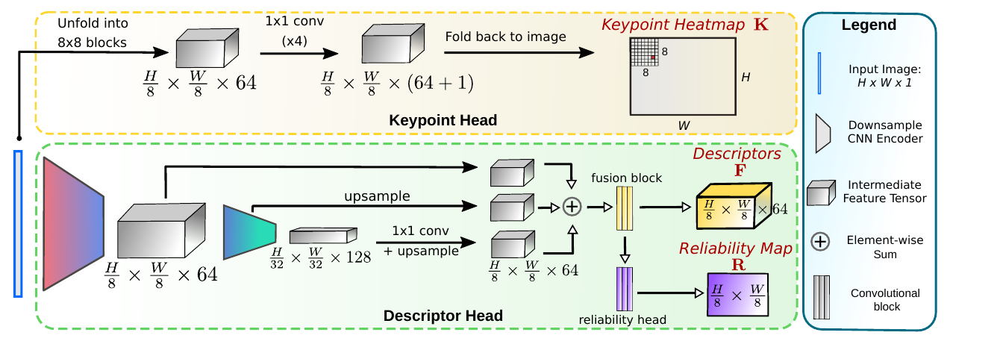

### Вопросы для самопроверки

1. Почему [XFeat](XFeat_конспект.md) делает первые слои очень тонкими, а не равномерно урезает каналы?

Ответ

Стоимость слоя пропорциональна $H \cdot W \cdot C_i \cdot C_{i+1}$. На высоком разрешении множитель $H \cdot W$ огромен, поэтому каждый канал там дорог, а на 1/32 почти бесплатен. Тонкие ранние слои и утроение каналов при каждом уменьшении разрешения сохраняют ёмкость сети в глубоких слоях при малой общей стоимости. Равномерное урезание (как у [SuperPoint](SuperPoint_конспект.md) и [ALIKE](ALIKE_конспект.md)) бьёт по робастности.

2. Зачем детектору [XFeat](XFeat_конспект.md) отдельная ветка с рецептивным полем 8×8 и учитель [ALIKE](ALIKE_конспект.md)?

Ответ

Отделение детектора от дескриптора упрощает обе задачи. Абляция показала, что совместная детекция ухудшает [XFeat](XFeat_конспект.md)\*: 39.7 против 50.2. Для локализации угла внутри ячейки достаточно локального окна 8×8. ALIKE-Tiny даёт готовую субпиксельно-точную разметку для дистилляции, и не нужна собственная схема самообучения.

3. Когда стоит включать [XFeat](XFeat_конспект.md)\* вместо [XFeat](XFeat_конспект.md)?

Ответ

Когда точек мало: слабая текстура (поля, асфальт, помещения, вид сверху) или когда важна полнота и точность позы. [XFeat](XFeat_конспект.md)\* даёт 1885 инлаеров против 892 и AUC@5° 50.2 против 42.6 на MegaDepth, но работает медленнее: 19.2 против 27.1 FPS на CPU, по конспекту около 30 %.

---

## Сводная сравнительная таблица

Скорость приведена так, как её сообщает соответствующий документ курса, с указанием железа и разрешения. Числа на разном железе напрямую **не сравнимы** (см. раздел «Расхождения»). Лицензии — по конспектам, которые ссылаются на README репозиториев. Перед коммерческим использованием их нужно проверить самостоятельно.

| Метод | Тип | Год | Дескриптор | Инвариантность | Скорость (как в документах) | Типичное применение | Лицензия кода / весов |
|---|---|---|---|---|---|---|---|
| [RANSAC](RANSAC_конспект.md) | робастная оценка модели, PnP/P3P | 1981 | — | устойчив к большой доле грубых ошибок; P3P требует известных внутренних параметров | $k = \log(1-z)/\log(1-w^n)$ итераций; около 1 с на позицию камеры (1981) | геометрическая проверка в любом конвейере: гомография, E/F, PnP | статья © ACM; реализации в OpenCV |
| [SIFT](SIFT_конспект.md) | детектор DoG + дескриптор | 2004 | 128, float | масштаб, поворот; частично свет и ракурс (до ~50° для плоскости) | <0.3 с на распознавание (P4 2 ГГц); 1036 мс детекция+описание 800×640 (по [SURF](SURF_конспект.md)); 5228.7 мс/кадр (по [ORB](ORB_конспект.md)) | эталонный baseline, SfM, сопоставление с картой | патент истёк в 2020 г., в OpenCV ≥ 4.4 в основном модуле |
| [SURF](SURF_конспект.md) | детектор Fast-Hessian + дескриптор | 2006 | 64 (36/128), float | масштаб, поворот (U-SURF — без поворота) | 354 мс детекция+описание 800×640, Pentium IV 3 ГГц | быстрый классический baseline на CPU | запатентован, OpenCV non-free |
| [FAST](FAST_конспект.md) | детектор углов | 2006 | — | нет масштаба и ориентации | 1.33 мс на поле 768×288, Opteron 2.6 ГГц | трекинг VO/SLAM, источник точек для [BRIEF](BRIEF_конспект.md) и [ORB](ORB_конспект.md) | в конспекте не указана; есть в OpenCV |
| [BRIEF](BRIEF_конспект.md) | двоичный дескриптор | 2010 | 128/256/512 бит | нет поворота (обвал после 10–15°) и масштаба | 8.87 мс на 512 дескрипторов ([BRIEF](BRIEF_конспект.md)-32), 2.66 ГГц | при известной ориентации; большие двоичные карты | в конспекте не указана; opencv_contrib |
| [ORB](ORB_конспект.md) | oFAST + rBRIEF | 2011 | 256 бит | поворот; масштаб через пирамиду | 15.3 мс/кадр 640×480, около 1000 точек, i7 2.8 ГГц; 7 Гц на телефоне ARM | CPU VO/SLAM (ORB-SLAM), BoW-релокализация, лёгкий baseline | BSD (OpenCV 2.3) |
| [LIFT](LIFT_конспект.md) | обучаемый конвейер детектор+ориентация+дескриптор | 2016 | 128, float | поворот (выученная ориентация), масштаб через пирамиду | в статье не приводится | исторический; источник идей | запатентован, только академическое использование |
| [HardNet](HardNet_конспект.md) | обучаемый дескриптор патча | 2017 | 128, float | от внешнего детектора | в статье не приводится | замена дескриптора [SIFT](SIFT_конспект.md) при надёжном детекторе | MIT (по репозиторию) |
| [SuperPoint](SuperPoint_конспект.md) | детектор+дескриптор, одна сеть | 2018 | 256, float | свет; ракурс через гомографии; **нет поворота** | около 13 мс (около 70 FPS) 480×640, Titan X | фронтенд hloc с [SuperGlue](SuperGlue_конспект.md)/LightGlue | официальные веса некоммерческие (Magic Leap) |
| [D2-Net](D2-Net_конспект.md) | describe-and-detect | 2019 | 512, float | день/ночь, сезоны; нет поворота | в статье не приводится; 6.60 FPS (MS) по [ALIKE](ALIKE_конспект.md), TITAN X | офлайн-локализация в трудных условиях | Clear BSD; веса на VGG16 и MegaDepth — проверять |
| [R2D2](R2D2_конспект.md) | детектор+дескриптор+надёжность | 2019 | 128, float | ракурс, свет, день/ночь (перенос стиля); нет поворота | около 0.5 с / 1 Мпикс (около 1 с пирамида), P100 | офлайн-карты, повторяющиеся текстуры | CC BY-NC-SA 3.0, некоммерческая |
| [SuperGlue](SuperGlue_конспект.md) | обучаемый матчер (GNN + OT) | 2020 | вход: дескрипторы экстрактора | нет поворота (абсолютные координаты) | 69 / 87 / 270 мс при 512 / 1024 / 2048 точках, GTX 1080 | эталонный матчер в hloc с [SuperPoint](SuperPoint_конспект.md) | некоммерческая (Magic Leap) |
| [DISK](DISK_конспект.md) | детектор+дескриптор, RL | 2020 | 128, float | свет, ракурс, масштаб из данных; поворот до ~15–20° | около 7 fps 1024², V100 FP32; 15.73 FPS 640×480 (по [ALIKE](ALIKE_конспект.md)) | плотные признаки для SfM и локализации; с [LightGlue](LightGlue_конспект.md) | Apache-2.0 (по README [LightGlue](LightGlue_конспект.md)) |
| [LoFTR](LoFTR_перевод.md) | бездетекторный матчер | 2021 | плотные признаки 1/8 и 1/2 | слабая текстура; нет явной инвариантности к повороту и масштабу | 116 мс на пару 640×480, RTX 2080Ti | трудные пары, помещения, офлайн | код Apache-2.0; OT-файлы некоммерческие; веса не указаны |
| [ALIKE](ALIKE_конспект.md) | лёгкий детектор+дескриптор, DKD | 2022 | 64/96/128/128 (T/S/N/L), float | нет поворота и масштаба | ALIKE-N 95 FPS 640×480, TITAN X Pascal | реальное время, субпиксельные точки | BSD-3-Clause |
| [ALIKED](ALIKED_конспект.md) | лёгкий детектор + SDDH | 2023 | 64 (T) / 128 (N), float | «деформируемая»; поворот — версия rot; масштаб до ~4× | T(16) 125.87 FPS, N(16) 77.40 FPS 640×480, RTX 2060 | лёгкий фронтенд с [LightGlue](LightGlue_конспект.md), коммерческая связка | BSD-3-Clause |
| [LightGlue](LightGlue_конспект.md) | адаптивный обучаемый матчер | 2023 | вход: [SuperPoint](SuperPoint_конспект.md)/DISK/ALIKED/SIFT | нет явной инвариантности к повороту | 44.2 мс (31.4 адаптивный) на пару MegaDepth, 2048 точек, RTX 3080 | быстрый матчер онлайн и в hloc | Apache-2.0 (веса [SuperPoint](SuperPoint_конспект.md) в репо — Magic Leap) |
| [XFeat](XFeat_конспект.md) | лёгкий детектор+дескриптор (+ [XFeat](XFeat_конспект.md)\*) | 2024 | 64, float | нет сильного поворота | 27.1 FPS ([XFeat](XFeat_конспект.md)\* 19.2) 640×480 на CPU i5-1135G7; 1.8 FPS на Orange Pi Zero 3 | CPU и встраиваемые системы | в конспекте не указана |

---

## Как выбрать метод для задачи визуального позиционирования

Ниже — рекомендации, собранные из разделов «Значение для задачи визуального позиционирования» всех конспектов. Это ориентиры, а не готовый ответ: каждый конспект настаивает на проверке на собственных данных по итоговой точности позы и доле локализованных кадров.

**Геометрия — всегда.** После любого матчера нужен [RANSAC](RANSAC_конспект.md) или его потомок: гомография для почти плоской надирной сцены, существенная матрица для относительной позы, PnP при наличии DEM или SfM-карты. Порог задавайте в пикселях того изображения, где меряется ошибка. Требуйте минимум десятков инлаеров, чтобы не поверить повторяющейся текстуре (поля, крыши, лес). Априорная информация от GNSS/IMU (гравитация, курс) сокращает минимальную выборку и число итераций.

**CPU и встраиваемые системы.**

- Самый быстрый классический вариант — [ORB](ORB_конспект.md): 15.3 мс на кадр на i7, BSD, двоичный 256-битный дескриптор, сопоставление по Хэммингу. Распределяйте точки по сетке, а не берите глобальный top-N.
- Лучший обучаемый вариант в курсе для CPU — [XFeat](XFeat_конспект.md): 27.1 FPS на ноутбучном CPU, на MegaDepth и ScanNet точнее [SuperPoint](SuperPoint_конспект.md). В слабой текстуре используйте [XFeat](XFeat_конспект.md)\*.
- ALIKED-T(16) (1.37 GFLOPs) и ALIKE-N (7.9 GFLOPs) — кандидаты для бортового GPU. Но DCN и grid-sampling у [ALIKED](ALIKED_конспект.md) хуже поддерживаются на NPU и TensorRT, поэтому реальное время нужно мерить.
- В документах курса нет замеров на Jetson, поэтому мерить нужно самим.

**Бортовой или серверный GPU.**

- Связка «лёгкий экстрактор + [LightGlue](LightGlue_конспект.md)»: [SuperPoint](SuperPoint_конспект.md), [DISK](DISK_конспект.md) или [ALIKED](ALIKED_конспект.md) + [LightGlue](LightGlue_конспект.md). В видеопотоке [LightGlue](LightGlue_конспект.md) выигрывает за счёт досрочного выхода на лёгких парах.
- Для коммерческого продукта — [ALIKED](ALIKED_конспект.md) или [DISK](DISK_конспект.md) + [LightGlue](LightGlue_конспект.md). Официальные веса [SuperPoint](SuperPoint_конспект.md) и [SuperGlue](SuperGlue_конспект.md) некоммерческие, [R2D2](R2D2_конспект.md) — тоже.

**День/ночь, сезоны, смена сенсора.**

- На Aachen Day-Night сильнее всех в курсе выглядят методы, обученные на реальных изменениях вида: [D2-Net](D2-Net_конспект.md), [R2D2](R2D2_конспект.md) (перенос стиля «в ночь»), [DISK](DISK_конспект.md), [ALIKED](ALIKED_конспект.md) (ночью N(32) 77.6/88.8/100.0 при ≤ 1024 точках), SP + [SuperGlue](SuperGlue_конспект.md) и [LightGlue](LightGlue_конспект.md), [LoFTR](LoFTR_перевод.md).
- Классические [SIFT](SIFT_конспект.md), [SURF](SURF_конспект.md) и [ORB](ORB_конспект.md) здесь заметно слабее: у [ORB](ORB_конспект.md) ночью 10.2/12.2/19.4 в таблице [XFeat](XFeat_конспект.md).
- Для пар «дрон — спутник» конспекты рекомендуют сравнивать с плотными матчерами и дообучать на своём домене. Варианты: Homographic Adaptation на неразмеченных снимках района ([SuperPoint](SuperPoint_конспект.md)), стилизация ортофото под бортовую камеру (идея [R2D2](R2D2_конспект.md)), эпиполярная награда по одним позам ([DISK](DISK_конспект.md)), glue-factory для [LightGlue](LightGlue_конспект.md).

**Надирная съёмка с произвольным курсом (поворот в плоскости).**

Это главная ловушка для дронов. Большинство обучаемых признаков не инвариантны к повороту: [SuperPoint](SuperPoint_конспект.md) (провал на рис. 8), [DISK](DISK_конспект.md) (обвал после ~15–20°), [ALIKE](ALIKE_конспект.md), [XFeat](XFeat_конспект.md), [D2-Net](D2-Net_конспект.md), [R2D2](R2D2_конспект.md). Матчеры [SuperGlue](SuperGlue_конспект.md) и [LightGlue](LightGlue_конспект.md) тоже не инвариантны.

Варианты по убыванию надёжности:

1. Повернуть кадр «на север» по курсу из IMU или компаса. Тогда работают и неинвариантные признаки, а [BRIEF](BRIEF_конспект.md) и U-SURF даже выигрывают. Но ошибка курса больше примерно 10–15° обрушивает [BRIEF](BRIEF_конспект.md).
2. Взять инвариантные признаки: [SIFT](SIFT_конспект.md), [ORB](ORB_конспект.md) (больше 70 % инлаеров при любом угле), ALIKED-N(16, rot) (около 0.84 при 45°), [SIFT](SIFT_конспект.md) + [LightGlue](LightGlue_конспект.md).
3. Перебрать несколько поворотов запроса.

**Масштаб и GSD.** Ни один метод курса не выдерживает произвольную разницу масштабов. Даже [ALIKED](ALIKED_конспект.md) в одномасштабном режиме падает при разнице больше примерно 4, а в многомасштабном держится примерно до 8. Приводите кадр и карту к сопоставимой GSD по высоте полёта и параметрам камеры или используйте пирамиду. Дефолтной пирамиды [ORB](ORB_конспект.md) в OpenCV (8 × 1.2, около 3.6×) может не хватить.

**Слабая текстура (поля, вода, снег, однотонные крыши).**

- Бездетекторный [LoFTR](LoFTR_перевод.md) находит соответствия там, где детекторов нет.
- [DISK](DISK_конспект.md) даёт плотные признаки и в низкотекстурных областях.
- [XFeat](XFeat_конспект.md)\* (полуплотный) — дешёвый компромисс.
- Карта надёжности [R2D2](R2D2_конспект.md) и отбор по $K \cdot R$ в [XFeat](XFeat_конспект.md) отсеивают небо и однородные поверхности.
- Конспект [LoFTR](LoFTR_перевод.md) предлагает гибрид: быстрый разреженный матчер в основном цикле, [LoFTR](LoFTR_перевод.md) — как тяжёлая проверка трудных кадров.

**Субпиксельная точность позы.**

- [SIFT](SIFT_конспект.md) и [ALIKE](ALIKE_конспект.md)/ALIKED (DKD) точнее сеточных методов. [SuperPoint](SuperPoint_конспект.md), [D2-Net](D2-Net_конспект.md) и [XFeat](XFeat_конспект.md) ограничены сеткой.
- Модуль «от грубого к точному» в [LoFTR](LoFTR_перевод.md) и уточнение в [XFeat](XFeat_конспект.md)\* частично это исправляют.
- Конспект [SuperPoint](SuperPoint_конспект.md) советует субпиксельное уточнение после сопоставления.

**Офлайн-карта и максимальное качество.** [DISK](DISK_конспект.md), [R2D2](R2D2_конспект.md), [D2-Net](D2-Net_конспект.md), [SuperPoint](SuperPoint_конспект.md) + [SuperGlue](SuperGlue_конспект.md) или [LightGlue](LightGlue_конспект.md), [LoFTR](LoFTR_перевод.md). Время не критично, важнее число верных пар и длина треков. Помните, что признаки [LoFTR](LoFTR_перевод.md) нельзя кэшировать.

---

## Типичные ошибки

1. **`cv2.findHomography` без флага метода.** По умолчанию `method=0` — это простой МНК без [RANSAC](RANSAC_конспект.md). Нужно явно указать [RANSAC](RANSAC_конспект.md), RHO, LMEDS или USAC (конспект [RANSAC](RANSAC_конспект.md)).
2. **Параметры `solvePnPRansac` по умолчанию.** `reprojectionError=8.0` слишком груб для точной локализации, обычно берут 2–4 px. `iterationsCount=100` слишком мало при низкой доле инлаеров: считайте $k$ по формуле.
3. **Числа из статей сравнивают между собой, хотя протоколы разные.** HPatches в [SuperGlue](SuperGlue_конспект.md) — точность и полнота, в [LoFTR](LoFTR_перевод.md) — AUC при 3/5/10 px, в [LightGlue](LightGlue_конспект.md) — AUC при 1/5 px, в [HardNet](HardNet_конспект.md) — mAP патчей, в [ALIKE](ALIKE_конспект.md) — MHA. Aachen v1.0 и v1.1 различаются, пороги тоже. На MegaDepth-1500 одна и та же связка SP + SG даёт 42.18 или 49.7 AUC@5° в зависимости от порога [RANSAC](RANSAC_конспект.md).
4. **FPS сравнивают на разном железе.** ALIKE-N — 95.19 FPS на TITAN X и 84.96 FPS на RTX 2060 в двух конспектах. Всегда указывайте GPU или CPU, разрешение и число точек.
5. **Признаки неинвариантны к повороту, а курс не компенсирован.** См. предыдущий раздел.
6. **Тест отношения там, где он вреден.** Для [D2-Net](D2-Net_конспект.md) он теряет 20–25 % верных пар. С [SuperGlue](SuperGlue_конспект.md) и [LightGlue](LightGlue_конспект.md) он не нужен. С классическими признаками он нужен: 0.75–0.8 для [SIFT](SIFT_конспект.md), 0.7 в статье [SURF](SURF_конспект.md).
7. **Скопление точек.** Глобальный top-N по отклику ([ORB](ORB_конспект.md), [ALIKED](ALIKED_конспект.md) на TUM) даёт кластеры и плохо обусловленную геометрию. Нужны сетка, квадродерево или лимит на ячейку.
8. **Матчер с весами от другого экстрактора.** [SuperGlue](SuperGlue_конспект.md) и [LightGlue](LightGlue_конспект.md) обучены под конкретный экстрактор и конкретные веса. Смена экстрактора требует других весов или переобучения.
9. **Невнимание к лицензиям.** Официальные [SuperPoint](SuperPoint_конспект.md) и [SuperGlue](SuperGlue_конспект.md), [R2D2](R2D2_конспект.md) и [LIFT](LIFT_конспект.md) нельзя брать в продукт без лицензии. [SURF](SURF_конспект.md) в OpenCV — non-free.
10. **Параметры OpenCV не совпадают со статьёй.**
    - [SIFT](SIFT_конспект.md): `contrastThreshold` делится на `nOctaveLayers`. Эффективный порог около 0.013 против 0.03 в статье.
    - [ORB](ORB_конспект.md): 8 уровней × 1.2, а не 5 × $\sqrt{2}$; сглаживание тоже другое.
    - [BRIEF](BRIEF_конспект.md): патч 48, box-фильтр.
11. **Ожидание выигрыша от прореживания [LightGlue](LightGlue_конспект.md) на CPU.** В коде оно выключено на CPU и MPS.
12. **Размер входа.** [SuperPoint](SuperPoint_конспект.md) и [LoFTR](LoFTR_перевод.md) предпочитают стороны, кратные 8, [ALIKE](ALIKE_конспект.md) и [ALIKED](ALIKED_конспект.md) — кратные 32 (по коду).

---

## Расхождения между документами курса

При сведении документов обнаружены следующие несовпадения. Большинство объясняется разными протоколами, а не ошибками.

1. **Порог обвала [BRIEF](BRIEF_конспект.md) при повороте.** Конспект [BRIEF](BRIEF_конспект.md): 10–15°. Конспект [ORB](ORB_конспект.md): около 10°.
2. **Порог теста отношения.** 0.8 в [SIFT](SIFT_конспект.md), 0.7 в музейном эксперименте [SURF](SURF_конспект.md).
3. **[RANSAC](RANSAC_конспект.md) при доле инлаеров ниже 50 %.** Конспект [RANSAC](RANSAC_конспект.md): работает при $w < 0.5$, если итераций достаточно. Лоу в [SIFT](SIFT_конспект.md): [RANSAC](RANSAC_конспект.md) и LMedS работают плохо, когда доля верных пар сильно ниже 50 %, поэтому он использует Хафа. Это разные постановки: Лоу говорит о выбросах выше 99 % после теста отношения.
4. **Aachen Day-Night в [R2D2](R2D2_конспект.md) против [D2-Net](D2-Net_конспект.md).** [R2D2](R2D2_конспект.md) приводит для [D2-Net](D2-Net_конспект.md) «19K точек, 44.9/66.3/88.8». В конспекте [D2-Net](D2-Net_конспект.md) 44.9/66.3/88.8 — это D2 SS Trained с 14.5K точек, а 19.3K — это D2 MS Trained с 44.9/64.3/88.8. Строки смешаны. Также различаются RootSIFT (33.7/52.0/65.3 против Upright RootSIFT 36.7/54.1/72.5), число точек [SuperPoint](SuperPoint_конспект.md) (7K против 6.6K), DELF и HAN+HN.
5. **Aachen в [SuperGlue](SuperGlue_конспект.md).** Для [R2D2](R2D2_конспект.md) там 46.9/66.3/88.8 (20k точек), для [D2-Net](D2-Net_конспект.md) 45.9/68.4/88.8 (15k). Это не совпадает с конспектами [R2D2](R2D2_конспект.md) и [D2-Net](D2-Net_конспект.md). Видимо, другой прогон в общем протоколе с COLMAP.
6. **Aachen, [SuperPoint](SuperPoint_конспект.md) при 2048 точках.** Конспект [ALIKE](ALIKE_конспект.md): 72.4/79.6/88.8. Конспект [ALIKED](ALIKED_конспект.md): 69.4/78.6/87.8. Это прямое расхождение, остальные строки этих таблиц совпадают.
7. **Aachen в [XFeat](XFeat_конспект.md)** (HLoc, top-4096, ≤ 1024 px), **в [LightGlue](LightGlue_конспект.md)** (v1.0, 0.25 м / 2°…) и **в [LoFTR](LoFTR_перевод.md)** (v1.1) получены по разным протоколам. Например, SP + SG ночью: 45.9/70.4/88.8 ([SuperGlue](SuperGlue_конспект.md), пороги 0.5 м / 2°…), 86.7/92.9/100 ([LightGlue](LightGlue_конспект.md), v1.0) и 77.0/90.6/100 ([LoFTR](LoFTR_перевод.md) и приложение [LightGlue](LightGlue_конспект.md), v1.1).
8. **SP + [SuperGlue](SuperGlue_конспект.md) на MegaDepth-1500.** Конспект [LoFTR](LoFTR_перевод.md): 42.18/61.16/75.96. Конспект [LightGlue](LightGlue_конспект.md): 49.7/67.1/80.6. [LightGlue](LightGlue_конспект.md) объясняет разницу подбором порога [RANSAC](RANSAC_конспект.md) (0.5 вместо 1.0).
9. **InLoc, SP + SG.** Конспект [LoFTR](LoFTR_перевод.md): DUC1 49.0/68.7/80.8, DUC2 53.4/77.1/82.4. Приложение [LightGlue](LightGlue_конспект.md): DUC1 47.0/69.2/79.8, DUC2 53.4/77.1/80.9.
10. **Скорость [LoFTR](LoFTR_перевод.md).** 116 мс (640×480, RTX 2080Ti) в переводе против 181 мс (840 px, RTX 3080) в [LightGlue](LightGlue_конспект.md). Сама [LightGlue](LightGlue_конспект.md) одновременно пишет «около 8× быстрее [LoFTR](LoFTR_перевод.md)» (подпись рис. 1) и «[LoFTR](LoFTR_перевод.md) и MatchFormer в 5–11 раз медленнее» (разд. 5.2).
11. **ASpanFormer в [LightGlue](LightGlue_конспект.md):** 369 мс в таблице 2 и 239 мс в таблице приложения.
12. **[LoFTR](LoFTR_перевод.md), внутреннее расхождение статьи:** LoFTR-OT 21.51/40.39/57.96 в таблице 2 против 20.06/40.8/57.62 в полной модели абляции.
13. **Число точек [SuperPoint](SuperPoint_конспект.md) на HPatches:** 1.7K в [D2-Net](D2-Net_конспект.md) против 1563 в [DISK](DISK_конспект.md).
14. **FPS одних и тех же методов в [ALIKE](ALIKE_конспект.md) (TITAN X Pascal) и [ALIKED](ALIKED_конспект.md) (RTX 2060)** различаются: [SuperPoint](SuperPoint_конспект.md) 45.87 против 52.63, [DISK](DISK_конспект.md) 15.73 против 11.81, [R2D2](R2D2_конспект.md)(MS) 8.70 против 4.10. GFLOPs ASLFeat(MS) — 44.24 в таблицах HPatches и 77.58 в таблицах IMW, в обоих конспектах.
15. **Обучение [LIFT](LIFT_конспект.md).** Конспект [SuperPoint](SuperPoint_конспект.md) объясняет проигрыш [LIFT](LIFT_конспект.md) обучением на «одной уличной последовательности». Конспект [LIFT](LIFT_конспект.md) говорит о коллекциях Piccadilly (3384 снимка) и Roman-Forum (1658).
16. **Таблица времени [FAST](FAST_конспект.md):** 1280 % для DoG на Pentium III — вероятная опечатка оригинала. 345 мс при бюджете 20 мс — это около 1725 %. Так отмечено в конспекте [FAST](FAST_конспект.md).
17. **Написание:** «Синкхорн» в конспектах [SuperGlue](SuperGlue_конспект.md) и [LoFTR](LoFTR_перевод.md), «Синхорн» в конспекте [LightGlue](LightGlue_конспект.md).

---

## Что читать дальше (вне курса)

Эти работы **не входят в курс**. Конспектов по ним нет, а часть из них лишь упоминается в документах как продолжение. Список — только ориентир, содержание по памяти здесь не излагается.

- **SiLK** — самообучаемые ключевые точки (в курсе упоминается только в таблицах [XFeat](XFeat_конспект.md)). *(не из статей курса)*
- **DeDoDe** — раздельное обучение детектора и дескриптора. *(не из статей курса)*
- **DKM** — плотный матчер (упоминается в мотивации [XFeat](XFeat_конспект.md)). *(не из статей курса)*
- **RoMa** — плотный матчер; конспекты советуют сравнивать с ним для междоменных пар. *(не из статей курса)*
- **ASpanFormer** — плотный трансформерный матчер (в курсе только в таблицах [LightGlue](LightGlue_конспект.md)). *(не из статей курса)*
- **MAGSAC++** — современная робастная оценка (в курсе упоминается как потомок [RANSAC](RANSAC_конспект.md) и используется в протоколах [XFeat](XFeat_конспект.md) и [LightGlue](LightGlue_конспект.md)). *(не из статей курса)*
- **hloc** — иерархический конвейер локализации, в котором используются многие методы курса. *(не из статей курса)*
- **MASt3R** — 3D-ориентированное сопоставление. *(не из статей курса)*
