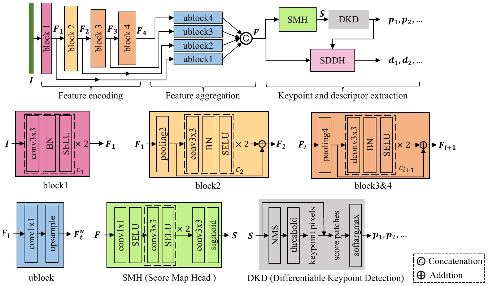
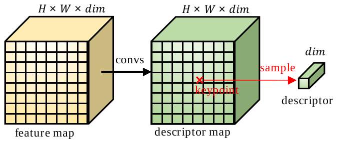
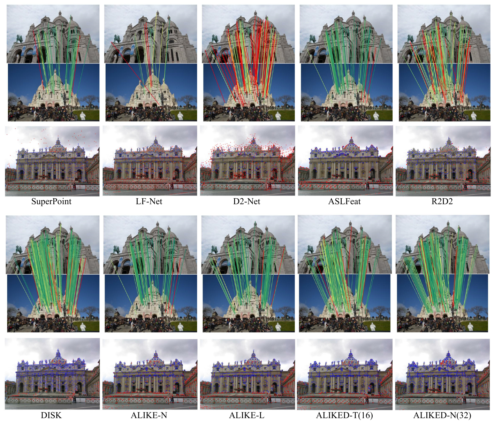
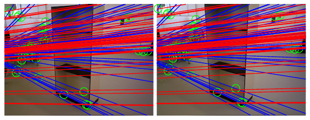
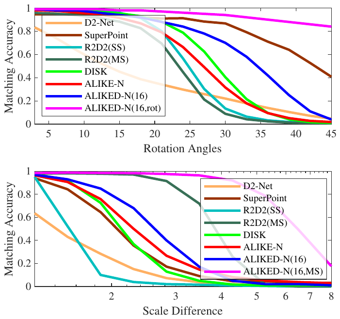
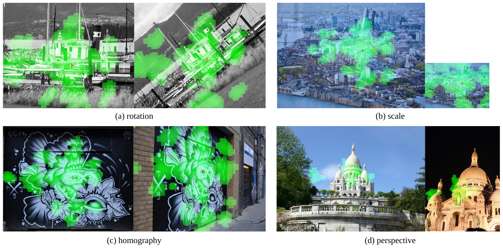
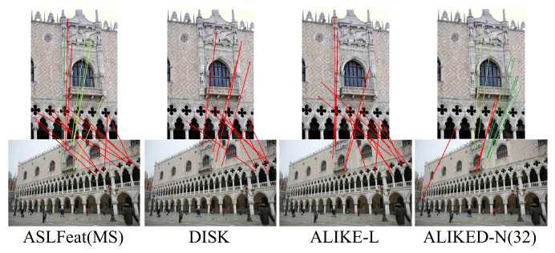

# ALIKED: A Lighter Keypoint and Descriptor Extraction Network via Deformable Transformation — конспект

**Авторы:** Xiaoming Zhao, Xingming Wu, Weihai Chen (corresponding), Peter C. Y. Chen, Qingsong Xu, Zhengguo Li (Beihang University; National University of Singapore; University of Macau; A*STAR I2R)
**Площадка:** IEEE Transactions on Instrumentation and Measurement (TIM), т. 72, 2023, с. 1–16, DOI 10.1109/TIM.2023.3271000 (библиографические данные — по BibTeX в официальном репозитории). Препринт: arXiv:2304.03608 (v2 — 16.04.2023).
**Источник PDF:** https://arxiv.org/pdf/2304.03608 (arXiv v2) · локальная копия: `../original/ALIKED_Zhao_2023.pdf`
**Лицензия и режим:** препринт на arXiv распространяется по **CC BY-NC-ND 4.0** (условия NC/ND не допускают свободного производного перевода; журнальная версия — IEEE), поэтому это **конспект своими словами**, а не перевод.
**Код и веса:** `Shiaoming/ALIKED` (BSD-3-Clause; веса `aliked-t16`, `aliked-n16`, `aliked-n16rot`, `aliked-n32`; только инференс — кода обучения в репозитории нет). Обёртка и обученный под ALIKED матчер — в `cvg/LightGlue` (Apache-2.0).

> **Суть в одном абзаце.** ALIKED — развитие лёгкой сети [ALIKE](ALIKE_конспект.md). Авторы замечают, что в типичных «картовых» (map-based) методах — [SuperPoint](SuperPoint_конспект.md), [R2D2](R2D2_конспект.md), [ALIKE](ALIKE_конспект.md) — голова дескрипторов считает **плотную** карту дескрипторов на всём изображении, хотя нужны дескрипторы только в нескольких тысячах ключевых точек; к тому же обычные свёртки с фиксированной сеткой не дают геометрической инвариантности. Предлагается **SDDH (Sparse Deformable Descriptor Head)** — голова, которая для каждой найденной точки по её локальному патчу признаков предсказывает $M$ «деформируемых» позиций выборки, берёт в них опорные признаки и агрегирует их в дескриптор. Так дескриптор строится только в точках (экономия вычислений) и по гибкой, подстраивающейся под локальную геометрию окрестности (выразительность). Поскольку плотной карты дескрипторов больше нет, функция потерь NRE (neural reprojection error) из [ALIKE](ALIKE_конспект.md) «ослабляется» с плотной на **разреженную** — вероятности считаются только по множеству найденных точек, что заодно резко экономит память GPU. Итог: ALIKED-T(16) — 0.19 млн параметров, 1.37 GFLOPs, ~126 FPS на 640×480 (RTX 2060) при качестве на уровне лучших методов; ALIKED-N(16/32) — лучшие или близкие к лучшим результаты на HPatches, IMW, FM-Bench и Aachen Day-Night.

*Рис. 1 (из оригинальной статьи). Архитектура ALIKED: кодирование признаков (block1–block4; в block3/4 — деформируемые свёртки), агрегация многомасштабных признаков (ublock1–4 и конкатенация в $F$), голова карты откликов SMH → модуль дифференцируемой детекции DKD → точки $p_1, p_2, \dots$; SDDH извлекает дескрипторы $d_1, d_2, \dots$ только в этих точках. Внизу — устройство блоков.*

---

## 1. Введение: постановка проблемы

- Ключевые точки и дескрипторы — основа многих задач визуальных измерений (visual measurement): SLAM, вычислительная фотография, распознавание мест (visual place recognition). Важны одновременно **эффективность** (ресурсоограниченные платформы) и **устойчивость**.
- Эволюция: ручные методы ([SIFT](SIFT_конспект.md), [ORB](ORB_конспект.md)) → обучаемые дескрипторы патчей в заданных точках → единая сеть, извлекающая и точки, и дескрипторы ([SuperPoint](SuperPoint_конспект.md), ASLFeat, [ALIKE](ALIKE_конспект.md)). Авторы называют последние **map-based** методами: две головы — голова карты откликов (SMH, Score Map Head) и голова карты дескрипторов (DMH, Descriptor Map Head); точки берутся из карты откликов, дескрипторы сэмплируются из карты дескрипторов.
- **Проблема 1 — геометрическая инвариантность.** Обычные свёртки фиксированного размера её не дают. Оценка масштаба и ориентации ([LIFT](LIFT_конспект.md), LF-Net и др.) покрывает только аффинные искажения. Деформируемая свёртка (DCN, Deformable Convolution Network) может моделировать произвольную локальную геометрию, подбирая смещения для каждого отсчёта ядра, — но на плотной карте она дорога.
- **Проблема 2 — избыточность DMH.** Плотная карта дескрипторов вычисляется и там, где точек нет; это основная статья вычислительных затрат.
- **Идея:** считать деформируемые дескрипторы **только в найденных точках** (SDDH), причём вместо фиксированной сетки $K\times K$ (как у DCN) предсказывать произвольное число $M$ позиций выборки (идея навеяна деформируемым выравниванием изображений).
- **Следствие для обучения:** без плотной карты нельзя построить плотную NRE-потерю из [ALIKE](ALIKE_конспект.md) → предлагается её разреженная версия.
- **Вклады:** (1) SDDH; (2) сеть ALIKED с разреженной NRE-потерей; (3) эксперименты: сопоставление изображений, 3D-реконструкция, визуальная (ре)локализация.

## 2. Связанные работы

### 2.1. Геометрически инвариантные дескрипторы

- **Ручные:** [SIFT](SIFT_конспект.md) оценивает масштаб в пространстве масштабов и ориентацию по гистограмме градиентов, затем описывает нормализованный патч; [ORB](ORB_конспект.md) оценивает ориентацию по центру масс и поворачивает патч.
- **Обучаемые:** большинство методов (патчевые и совместные) получают инвариантность через **аугментацию данных**. Явное моделирование: [LIFT](LIFT_конспект.md) (имитирует конвейер [SIFT](SIFT_конспект.md) тремя сетями), AffNet, UCN, LF-Net (аффинные параметры + Spatial Transformer Network), GIFT (группы изображений разных масштабов/поворотов), HDD-Net (вращение ядер свёртки).
- Во всех них преобразование заранее ограничено аффинным. ALIKED, как и ASLFeat, использует DCN, а SDDH развивает ту же «деформируемую» идею для эффективного извлечения дескрипторов.

### 2.2. Совместное обучение детектора и дескриптора

| Метод | Ключевая идея (по описанию авторов ALIKED) |
|---|---|
| [SuperPoint](SuperPoint_конспект.md) | лёгкая сеть, обучение на гомографических парах (Homographic Adaptation) |
| [R2D2](R2D2_конспект.md) | карты повторяемости (repeatability) и надёжности (reliability), дескрипторы обучаются AP-потерей |
| [DISK](DISK_конспект.md) | обучение карты откликов и дескрипторов обучением с подкреплением (policy gradient) |
| [ALIKE](ALIKE_конспект.md) | модуль дифференцируемой детекции (DKD), самая лёгкая сеть — пригодна для реального времени |
| [D2-Net](D2-Net_конспект.md) | точки — максимумы по каналам и пространству карты признаков низкого разрешения → низкая точность локализации |
| ASLFeat | многоуровневые признаки и DCN для улучшения локализации и дескрипторов |
| D2D | детекция по карте дескрипторов с абсолютной и относительной «заметностью» (saliency) |

Общая беда — дорогие плотные карты дескрипторов. ALIKED отказывается от них в пользу разреженных деформируемых дескрипторов.

### 2.3. Деформируемые свёртки

- DCN добавляет обучаемые смещения к ядру свёртки; успешно применялась в детекции объектов, сегментации, распознавании действий, оценке позы, видео-суперразрешении, HDR, интерполяции кадров; в ASLFeat — для плотных дескрипторов.
- Deformable DETR использует DCN-подобное внимание к малому набору позиций; InternImage (DCNv3) снижает стоимость трансформеров. ALIKED следует той же философии: считать только в разреженных позициях.

## 3. Архитектура ALIKED

Три части (Рис. 1): кодирование признаков → агрегация признаков → извлечение точек и дескрипторов.

### 3.1. Кодирование признаков (Feature Encoding)

- Вход — цветное изображение $I \in \mathbb{R}^{H\times W\times 3}$.
- **block1:** две свёртки 3×3 (+BN+SELU) → низкоуровневые признаки $F_1$ (полное разрешение).
- **block2:** average pooling 2×2 → две свёртки 3×3 с остаточной связью → $F_2$.
- **block3, block4:** average pooling 4×4 → остаточный блок с **деформируемыми свёртками 3×3 (DCN)** → $F_3$, $F_4$.
- Разрешения (по коду, не указаны в статье явно): $F_1$ — $H\times W$, $F_2$ — $H/2$, $F_3$ — $H/8$, $F_4$ — $H/32$; вход дополняется до кратности 32.
- Активация — **SELU** вместо ReLU (для лучшей сходимости); пулинг — average вместо max (изменения относительно [ALIKE](ALIKE_конспект.md)).

### 3.2. Агрегация признаков (Feature Aggregation)

- Четыре ublock: свёртка 1×1 (выравнивание числа каналов) + апсемплинг до общего разрешения.
- Выровненные $F^u_1..F^u_4$ конкатенируются в итоговую карту признаков $F$.
- По коду: каждый ublock даёт $dim/4$ каналов, апсемплинг билинейный, так что $F \in \mathbb{R}^{H\times W\times dim}$ (по официальному коду / коду [LightGlue](LightGlue_конспект.md)).

### 3.3. Детекция: SMH + DKD

- **SMH (Score Map Head):** свёртка 1×1 до 8 каналов → две свёртки 3×3 (4 канала, SELU) → свёртка 3×3 до 1 канала → sigmoid → карта откликов $S \in \mathbb{R}^{H\times W}$. (Это вариант SH3 из абляции — см. разд. 7.4.)
- **DKD (Differentiable Keypoint Detection)** — модуль из [ALIKE](ALIKE_конспект.md):
  1. NMS (non-maximum suppression) на карте $S$ → локальные максимумы;
  2. порог по отклику → пиксельные точки;
  3. в окне вокруг каждой точки — **softargmax** по откликам → субпиксельные **дифференцируемые** координаты $P = \{p_1, p_2, \dots\}$.
- Дифференцируемость координат позволяет напрямую оптимизировать ошибку репроекции точек между изображениями (разд. 5.1).

### 3.4. Конфигурации сети

| Модель | $c_1$ | $c_2$ | $c_3$ | $c_4$ | $dim$ (дескриптор) |
|---|---|---|---|---|---|
| Tiny (-T) | 8 | 16 | 32 | 64 | 64 |
| Normal (-N) | 16 | 32 | 64 | 128 | 128 |
| Large (-L) | 32 | 64 | 128 | 128 | 128* |

*(Таблица II статьи; * в Large-модели голова дескриптора — две свёртки 1×1, как в [ALIKE](ALIKE_конспект.md). В экспериментах реально обучены только T и N; обозначение ALIKED-\[T/N\]($M$) — число позиций выборки $M$ в SDDH, $K=3$.)*

## 4. Sparse Deformable Descriptor Head (SDDH)

### 4.1. Деформируемая модель инвариантности

Классический подход моделирует искажение локального патча **аффинным** преобразованием:

$$
\begin{bmatrix} x' \\ y' \\ 1 \end{bmatrix} =
\begin{bmatrix} A & b \\ 0 & 1 \end{bmatrix}
\begin{bmatrix} x \\ y \\ 1 \end{bmatrix}
$$

- $[x, y, 1]^\top$, $[x', y', 1]^\top$ — однородные координаты до и после преобразования;
- $A \in \mathbb{R}^{2\times2}$ — аффинная матрица, $b \in \mathbb{R}^2$ — сдвиг; всего 6 степеней свободы на патч.

Реальная локальная форма окрестности сложнее, поэтому авторы используют **деформируемое** преобразование — своё смещение для каждого пикселя окрестности:

$$
\begin{bmatrix} x' \\ y' \end{bmatrix} = \begin{bmatrix} x \\ y \end{bmatrix} + \begin{bmatrix} \Delta x \\ \Delta y \end{bmatrix}
$$

- $[\Delta x, \Delta y]^\top$ — смещение данного пикселя вокруг точки; число степеней свободы равно числу пикселей, т.е. модель обобщает аффинную.

### 4.2. Напоминание: DCN и голова плотных дескрипторов (DMH)

Деформируемая свёртка в точке $p$ карты признаков $F$:

$$
F'(p) = \sum_{i=1}^{K^2} w(p_i)\, F(p + p_i + \Delta p_i)
$$

- $F'(p) \in \mathbb{R}^{dim}$ — выходной признак;
- $p_i$ — $i$-я позиция регулярной сетки ядра $K\times K$ (при $K=3$: $(-1,-1), \dots, (1,1)$);
- $\Delta p_i$ — предсказанное смещение этой позиции;
- $w$ — веса свёртки.

DCN применяется в block3 и block4 ALIKED. Однако как **голова дескрипторов** плотная DCN (или любая плотная DMH, Рис. 3) неэффективна: свёртки на карте полного разрешения дороги, поэтому существующие методы либо понижают разрешение ([SuperPoint](SuperPoint_конспект.md)), либо используют очень лёгкие операции ([ALIKE](ALIKE_конспект.md), [R2D2](R2D2_конспект.md)) — и тем ограничивают выразительность дескрипторов.

*Рис. 3 (из оригинальной статьи). Традиционная DMH: свёртки над всей картой признаков $H\times W\times dim$ дают плотную карту дескрипторов, из которой затем сэмплируются дескрипторы в ключевых точках.*

### 4.3. Устройство SDDH

*Рис. 2 (из оригинальной статьи). SDDH: по патчу признаков $K\times K$ вокруг точки $p$ (здесь $K=5$) оценивает $M$ деформируемых позиций выборки, берёт в них $M$ опорных признаков (supporting features) с карты признаков, кодирует их и агрегирует взвешенной суммой convM в дескриптор размерности $dim$.*

Для ключевой точки $p \in \mathbb{R}^2$:

1. Вырезается патч признаков $F^{K\times K}$ размера $K\times K$ с центром в $p$.
2. Оцениваются $M$ деформируемых позиций выборки:

$$
p_s = \mathrm{conv1x1}\big(\mathrm{SELU}(\mathrm{convKxK}(F^{K\times K}))\big), \qquad p_s \in \mathbb{R}^{M\times 2}
$$

   - у обеих свёрток $2M$ выходных каналов; convKxK — **без паддинга**, т.е. сворачивает патч $K\times K$ в один вектор.
3. В позициях $p + p_{s_i}$ билинейно сэмплируются опорные признаки с карты $F$.
4. Дескриптор:

$$
d = \sum_{i=1}^{M} w_M(p_i)\, \Phi\big(F(p + p_{s_i})\big), \qquad \Phi(x) = \mathrm{SELU}(\mathrm{conv1x1}(x))
$$

   - $d \in \mathbb{R}^{dim}$; $w_M$ — веса операции **convM**: это «свёртка» по $M$ гибким позициям вместо $K\times K$ фиксированных;
   - на выходе дескриптор L2-нормируется (по коду).

**Отличия от DCN:**
- DCN работает на плотной карте, SDDH — только в разреженных точках → стоимость пропорциональна числу точек, а не пикселей;
- DCN привязана к сетке $K\times K$ смещений, SDDH допускает **любое** целое $M$ → гибкость и по качеству, и по вычислениям;
- DCN — простой слой, который стекается многократно; SDDH — более «тяжёлая» сеть оценки позиций, сразу выдающая дескриптор.

Детали реализации (по коду [LightGlue](LightGlue_конспект.md)/официальному): в DCN блоков 3–4 используется вариант без модулирующей маски (`mask=False`), смещения ограничиваются по модулю четвертью размера карты; смещения SDDH для патчей с $K=3$; патчи вырезаются кастомной CUDA-операцией (`custom_ops`) в официальном репозитории.

### 4.4. Сравнение эффективности DMH и SDDH

Карта признаков $H\times W\times C$, $N$ точек; DMH = convKxK(SELU(conv1x1(x))), эквивалентная SDDH имеет $M = K^2$.

| Этап | Теоретическая сложность | $K=5, N=5000$ | $K=3, N=1000$ | Время, $K=5, N=5000$ | Время, $K=3, N=1000$ |
|---|---|---|---|---|---|
| DMH: свёртки | $HWC^2(K^2+1)$ | 130.86 G | 50.33 G | 50.79 мс | 14.42 мс |
| DMH: сэмплинг дескрипторов | $4NC$ | 2.56 M | 2.56 M | 1.06 мс | 0.28 мс |
| SDDH: оценка позиций | $2NM(K^2C + 2M)$ | 812.50 M | 21.06 M | 3.42 мс | 0.58 мс |
| SDDH: сэмплинг признаков | $4NMC$ | 64.00 M | 4.61 M | 1.56 мс | 0.30 мс |
| SDDH: извлечение дескрипторов (conv1x1 + convM) | $2NMC^2$ | 4096.00 M | 294.91 M | 2.62 мс | 0.37 мс |

*(Таблица III; карта 480×640×128, GPU NVIDIA RTX 2060.)* Итого DMH ≈ 51.9 / 14.7 мс против SDDH ≈ 7.6 / 1.25 мс (суммы по строкам таблицы). Выигрыш SDDH тем больше, чем меньше патч и число точек.

## 5. Функции потерь

Пара изображений $(I_A, I_B)$; DKD даёт точки $P_A \in \mathbb{R}^{N_A\times2}$, $P_B \in \mathbb{R}^{N_B\times2}$; SDDH — дескрипторы $D_A \in \mathbb{R}^{N_A\times dim}$, $D_B \in \mathbb{R}^{N_B\times dim}$. Потери репроекции и «пиковости» заимствованы из [ALIKE](ALIKE_конспект.md), NRE переделана в разреженную, потеря надёжности — новая формулировка.

### 5.1. Потеря репроекции (Reprojection Loss)

Перенос точки $p_A$ во второе изображение по известной глубине и позе:

$$
p_{AB} = \pi\big(d_A R_{AB}\, \pi^{-1}(p_A) + t_{AB}\big)
$$

- $R_{AB}$, $t_{AB}$ — поворот и сдвиг от камеры $A$ к камере $B$;
- $d_A$ — глубина точки $p_A$;
- $\pi(\cdot)$ — проекция 3D-точки $[X, Y, Z]^\top$ на плоскость изображения, $\pi^{-1}$ — обратная проекция пикселя в луч.

Соответствующей точкой $p_B$ считается ближайшая к $p_{AB}$ точка в $I_B$, если расстояние меньше $th_{gt}$ пикселей; аналогично $p_B \to p_{BA}$. Потеря на паре:

$$
L_{rp}(p_A, p_B) = \tfrac{1}{2}\big(\lVert p_A - p_{BA}\rVert + \lVert p_B - p_{AB}\rVert\big)
$$

$L_{rp}$ — среднее по всем сопоставленным парам в обоих направлениях.

### 5.2. Потеря «дисперсного пика» (Dispersity Peak Loss)

Заставляет отклик быть острым пиком точно в точке. Для окна $W\times W$ карты откликов вокруг точки $p$ (патч $S_p$):

$$
L_{pk}(p) = \mathrm{mean}\big(\mathrm{softmax}(s_p)\cdot \lVert p - c \rVert\big)
$$

- $s_p \in S_p$ — отклики в патче; $c$ — координаты пикселей патча; $\cdot$ — скалярное произведение;
- $\mathrm{softmax}(x) = \exp(x)/\sum_i \exp(x_i)$.

Чем больше «масса» отклика сосредоточена у самой точки, тем меньше потеря. Усредняется по всем точкам обоих изображений.

### 5.3. Разреженная NRE-потеря (Sparse Neural Reprojection Error)

Плотная NRE (из [ALIKE](ALIKE_конспект.md)) сравнивает кросс-энтропией плотную карту «вероятности репроекции» с плотной картой «вероятности сопоставления» по карте дескрипторов. Без карты дескрипторов авторы переходят к **векторам по множеству точек**:

- вектор вероятности репроекции $q_r(p_A, P_B)$ — бинарный вектор длины $N_B$, единица в позиции точки, соответствующей $p_A$;
- вектор сходства:

$$
\mathrm{sim}(d_A, D_B) = D_B\, d_A
$$

- вектор вероятности сопоставления:

$$
q_m(d_A, D_B) = \mathrm{softmax}\big((\mathrm{sim}(d_A, D_B) - 1)/t_{des}\big)
$$

  ($t_{des}$ — температура, задаёт «резкость» распределения; вычитание 1 — сдвиг, т.к. косинусное сходство нормированных векторов ≤ 1);
- потеря — кросс-энтропия, которая из-за бинарности $q_r$ сводится к:

$$
L_{ds}(p_A, I_B) = \mathrm{CE}\big(q_r(p_A, P_B)\,\Vert\, q_m(d_A, D_B)\big) = -\ln q_m(d_A, d_B)
$$

  где $d_B$ — дескриптор соответствующей точки в $I_B$. Симметрично $L_{ds}(p_B, I_A)$; итог — среднее по всем дескрипторам обоих изображений.

По сути это InfoNCE-подобная контрастная потеря, где негативами служат все остальные найденные точки второго изображения (сравнение — собственная интерпретация конспекта).

### 5.4. Потеря надёжности (Reliable Loss)

Идея из [R2D2](R2D2_конспект.md): слаботекстурные, неразличимые области ненадёжны и не должны давать точек. Надёжность точки $p_A$ относительно $I_B$:

$$
r(p_A, I_B) = \mathrm{softmax}\big(\mathrm{sim}(d_A, D_B)/t_{rel}\big)
$$

(берётся значение для соответствующей точки; $t_{rel}$ — температура). Потеря:

$$
L_{re}(S_A, I_B) = \frac{1}{\hat S_A} \sum_{p_A \in P_A,\; s_A = S_A(p_A)} \big(1 - r(p_A, I_B)\big)\, s_A
$$

- $s_A$ — отклик карты $S_A$ в точке $p_A$; $\hat S_A$ — сумма откликов во всех точках (нормировка);
- минимизация требует, чтобы высокий отклик был у точек с высокой надёжностью и наоборот. В отличие от [ALIKE](ALIKE_конспект.md), ограничивается только отклик $s_A$ самой точки.

### 5.5. Итоговая потеря

$$
L = \omega_{rp} L_{rp} + \omega_{pk} L_{pk} + \omega_{ds} L_{ds} + \omega_{re} L_{re}
$$

с весами $\omega_{rp} = 1$, $\omega_{pk} = 0.5$, $\omega_{ds} = 5$, $\omega_{re} = 1$ (дескрипторную потерю на высокоразмерных векторах минимизировать труднее — поэтому вес больше).

## 6. Детали обучения

### Гиперпараметры

| Параметр | Значение |
|---|---|
| Базовая сеть (baseline) | ALIKE-N |
| Радиус DKD (окно NMS/softargmax) | 2 px (окно 5×5) |
| Порог соответствия $th_{gt}$ | 5 px |
| Температуры | $t_{det} = 0.1$, $t_{des} = 0.1$, $t_{rel} = 1$ |
| Веса потерь | $\omega_{rp}=1$, $\omega_{pk}=0.5$, $\omega_{ds}=5$, $\omega_{re}=1$ |
| Точки для обучения | top-400 точек DKD + 400 случайных, затем NMS для удаления повторов |
| Оптимизатор | Adam, $\beta = (0.9, 0.999)$; **learning rate в статье не указан** (кода обучения в репозитории нет) |
| Размер изображения | 800×800 |
| Батч | 2, накопление градиента по 6 батчам (эффективно 12) |
| Длительность | 100K шагов, выбор лучшего чекпоинта по валидации; в абляциях — 10K шагов |
| SDDH | $K = 3$, $M \in \{16, 32\}$ |
| Обученные модели | ALIKED-T(16) (реальное время), ALIKED-N(16) (баланс), ALIKED-N(32) (качество); дополнительно ALIKED-N(16, rot) — с аугментацией поворотами |
| GPU обучения | не указан |

### Данные

| Тип пар | Источник | Детали |
|---|---|---|
| Перспективные (perspective) | MegaDepth | туристические фото достопримечательностей, глубина и позы из COLMAP; выборка пар как в [DISK](DISK_конспект.md) (без сцен валидации/теста IMW2020): 135 сцен × 10k пар |
| Гомографические (homographic) | датасет [R2D2](R2D2_конспект.md) | синтетические пары из Oxford/Paris retrieval и Aachen + пары с переносом стиля (style transfer) на Aachen |

## 7. Эксперименты

Оборудование для замеров: Intel i7-10700F, NVIDIA RTX 2060, CUDA 10.2, PyTorch 1.11.0. Сопоставление везде — **взаимный ближайший сосед (mNN, mutual nearest neighbor)**; обучаемые матчеры ([SuperGlue](SuperGlue_конспект.md) и т.п.) и плотные матчеры сознательно исключены — оценивается «чистое» качество точек и дескрипторов.

### 7.1. Скорость и HPatches

HPatches: 57 сцен с изменением освещения и 59 — ракурса (по 5 пар; 8 ненадёжных сцен исключены по протоколу [D2-Net](D2-Net_конспект.md)). До 5000 точек, порог отклика 0.2, допуск 3 px. Метрики: **MMA** (доля верных среди предложенных соответствий), **MHA** (доля верно оценённых гомографий по углам изображения), **MS** (доля верных соответствий среди совместно видимых точек). Авторы считают MHA важнее, т.к. цель — оценка гомографии.

| Модель | Параметры, млн | GFLOPs | FPS | MMA@3 | MHA@3 |
|---|---|---|---|---|---|
| [D2-Net](D2-Net_конспект.md) (MS) | 7.635 | 889.40 | 7.63 | 37.29% | 38.33% |
| LF-Net (MS) | 2.642 | 24.37 | 23.67* | 55.60% | 57.78% |
| [SuperPoint](SuperPoint_конспект.md) | 1.301 | 26.11 | 52.63 | 65.37% | 70.19% |
| [R2D2](R2D2_конспект.md) (MS) | 0.484 | 464.55 | 4.10 | 75.77% | 71.48% |
| ASLFeat (MS) | 0.823 | 44.24 | 7.10* | 72.44% | 73.52% |
| [DISK](DISK_конспект.md) | 1.092 | 98.97 | 11.81 | **77.59%** | 70.56% |
| ALIKE-N | 0.318 | 7.91 | 84.96 | 70.78% | 75.74% |
| ALIKE-L | 0.653 | 19.68 | 56.66 | 70.50% | 76.85% |
| **ALIKED-T(16)** | **0.192** | **1.37** | **125.87** | 72.99% | **78.70%** |
| **ALIKED-N(16)** | 0.677 | 4.05 | 77.40 | 74.43% | 77.22% |
| **ALIKED-N(32)** | 0.980 | 4.62 | 75.64 | 75.23% | 74.44% |

*(Таблица IV; GFLOPs и FPS — на 640×480 с 1K точек, RTX 2060. * — FPS LF-Net и ASLFeat оценены пересчётом по соотношению производительности GPU.)*

**Интерпретация:**
- ALIKED — минимальные GFLOPs среди всех методов благодаря разреженной голове дескрипторов.
- ALIKED-N(16) при меньших GFLOPs, чем ALIKE-N, работает чуть медленнее (77.4 против 85.0 FPS): вырезание патчей — нестандартная, неоптимизированная операция (~1 мс в реализации авторов).
- ALIKED-T(16) — 126 FPS и лучший MHA@3 (78.70%); [DISK](DISK_конспект.md) лидирует по MMA, но уступает [ALIKE](ALIKE_конспект.md)/ALIKED по MHA.
- Замечание конспекта: в тексте статьи второе место по MHA названо «ALIKE-N(16) (77.22%)» — по таблице это ALIKED-N(16).

### 7.2. Оценка позы и 3D-реконструкция (IMW)

Image Matching Workshop (IMW) benchmark, тестовая часть: снимки туристов в разное время разными камерами. До 2048 точек, порог отклика 0.1. Ошибка позы — максимум из угловых ошибок поворота и сдвига; **mAA(5°/10°)** — средняя точность при пороге ошибки. **PPC** (performance per cost) = mAA(10°) / GFLOPs.

| Метод | GFLOPs | NF | Rep | MS | Stereo mAA(5°) | Stereo mAA(10°) | Stereo PPC | NM | NL | TL | Multiview mAA(5°) | Multiview mAA(10°) | Multiview PPC |
|---|---|---|---|---|---|---|---|---|---|---|---|---|---|
| [D2-Net](D2-Net_конспект.md) (MS) | 889.40 | 2045.6 | 16.80% | 29.30% | 6.06% | 12.27% | 0.01 | 2045.6 | 1999.4 | 3.01 | 17.77% | 28.30% | 0.03 |
| [SuperPoint](SuperPoint_конспект.md) | 26.11 | 2048.0 | 36.40% | 63.00% | 19.71% | 28.97% | 1.11 | 2048.0 | 1185.4 | 4.33 | 44.35% | 54.66% | 2.09 |
| [R2D2](R2D2_конспект.md) (MS) | 464.55 | 2048.0 | 42.90% | 74.60% | 27.20% | 39.02% | 0.08 | 2048.0 | 1225.9 | 4.28 | 53.13% | 64.03% | 0.14 |
| ASLFeat (MS) | 77.58 | 2042.6 | 43.10% | 74.90% | 22.62% | 33.65% | 0.43 | 157.5 | 1106.6 | 4.42 | 45.28% | 55.61% | 0.72 |
| [DISK](DISK_конспект.md) | 98.97 | 2048.0 | 44.80% | 85.20% | 38.72% | 51.22% | 0.52 | 526.4 | 2424.8 | 5.50 | 63.25% | 72.96% | 0.74 |
| ALIKE-N | 7.91 | 1802.7 | 43.30% | 81.10% | 35.12% | 47.18% | 5.97 | 276.5 | 1644.2 | 4.97 | 59.18% | 69.21% | 8.75 |
| ALIKE-L | 19.68 | 1770.6 | 42.90% | 82.20% | 37.24% | 49.58% | 2.52 | 298.3 | 1693.3 | 5.02 | 60.30% | 70.22% | 3.57 |
| **ALIKED-T(16)** | 1.37 | 2031.3 | 43.38% | 84.01% | 37.95% | 50.38% | **36.77** | 334.9 | 1830.6 | 5.24 | 60.31% | 70.88% | **51.74** |
| **ALIKED-N(16)** | 4.05 | 1934.2 | **46.30%** | 85.47% | **39.53%** | **52.28%** | 12.91 | 401.3 | 1975.4 | 5.57 | 61.44% | 71.78% | 17.72 |
| **ALIKED-N(32)** | 4.62 | 1731.1 | 45.61% | **85.90%** | 39.52% | 52.23% | 11.30 | 389.9 | 1853.2 | 5.58 | 61.67% | 72.09% | 15.59 |

*(Таблица V. NF — число точек, Rep — повторяемость, NM — число соответствий, NL — число 3D-точек (landmarks), TL — длина трека. ASLFeat в этой таблице — 77.58 GFLOPs, в Таблице IV — 44.24; в статье расхождение не поясняется.)*

**Интерпретация:**
- Стерео: ALIKED-N(16) обходит [DISK](DISK_конспект.md) по Rep, mAA(5°) и mAA(10°) на 1.5, 0.81 и 1.06 п.п. — авторы связывают это с деформируемыми дескрипторами.
- Многовидовая реконструкция: лучший — [DISK](DISK_конспект.md) (72.96%); ALIKED-N(32) — 72.09%. Причина, по мнению авторов, — у [DISK](DISK_конспект.md) больше точек/треков (NL 2424.8), что даёт больше ограничений в bundle adjustment.
- N(32) ≈ N(16): после $M = 16$ отдача от увеличения числа позиций мала.
- ALIKED-T(16) лишь немного хуже лучших, но его PPC ≈ в 6 раз выше, чем у лучшего из прежних (ALIKE-N).

*Рис. 4 (из оригинальной статьи). Стереосопоставление (1-я и 3-я строки; от зелёного к жёлтому — верные соответствия с ошибкой репроекции 0–5 px, красные — ошибочные) и многовидовая реконструкция (2-я и 4-я строки; красные — найденные, синие — зарегистрированные точки) на IMW-val. [SuperPoint](SuperPoint_конспект.md), LF-Net и [D2-Net](D2-Net_конспект.md) плохо справляются с большой сменой ракурса; у [R2D2](R2D2_конспект.md) точки разбросаны; у [DISK](DISK_конспект.md) точки равномерно покрывают здание, но больше ошибочных соответствий; у ALIKED точки сосредоточены на рёбрах и углах, ошибок меньше, чем у [DISK](DISK_конспект.md), а соответствий больше, чем у [ALIKE](ALIKE_конспект.md).*

### 7.3. FM-Bench (оценка фундаментальной матрицы)

Четыре набора: TUM (внутри помещений, SLAM), KITTI (вождение), Tanks and Temples (T&T, широкая база), CPC (Community Photo Collection, фото из интернета). Recall — доля пар с верной оценкой (порог NSGD — normalized symmetric geometric distance — 0.05).

| Метод | GFLOPs | TUM %Recall | KITTI %Recall | T&T %Recall | CPC %Recall |
|---|---|---|---|---|---|
| LF-Net (MS) | 24.37 | 53.00 | 80.40 | 57.40 | 19.40 |
| [D2-Net](D2-Net_конспект.md) (MS) | 889.40 | 34.50 | 71.40 | 68.40 | 31.30 |
| [SuperPoint](SuperPoint_конспект.md) | 26.11 | 45.80 | 86.10 | 81.80 | 40.50 |
| [R2D2](R2D2_конспект.md) (MS) | 464.55 | 57.70 | 78.80 | 73.00 | 43.00 |
| ASLFeat (MS) | 77.58 | 59.90 | 92.20 | 88.70 | 54.40 |
| [DISK](DISK_конспект.md) | 98.97 | 59.70 | 90.20 | 86.60 | **59.10** |
| ALIKE-N | 7.91 | 45.10 | 89.60 | 82.50 | 40.00 |
| ALIKE-L | 19.68 | 43.70 | 88.70 | 86.50 | 43.50 |
| **ALIKED-T(16)** | 1.37 | 59.20 | 92.30 | 89.90 | 56.20 |
| **ALIKED-N(16)** | 4.05 | **63.60** | 92.10 | **92.10** | 58.00 |
| **ALIKED-N(32)** | 4.62 | 58.20 | **92.40** | 91.70 | 58.30 |

*(Выборка столбцов %Recall из Таблицы VI; в оригинале также доли инлаеров до/после [RANSAC](RANSAC_конспект.md) и число соответствий.)*

- ALIKED-N(16) — лучший recall на TUM и T&T, ALIKED-N(32) — на KITTI; на CPC лидирует [DISK](DISK_конспект.md).
- **Типичный отказ на TUM** (Рис. 5): при неравномерной текстуре точки ALIKED концентрируются в богатых текстурой областях; соответствия верны, но плохо распределены — для оценки фундаментальной матрицы геометрических ограничений не хватает.

*Рис. 5 (из оригинальной статьи). Пример отказа на TUM: зелёные окружности — сопоставленные точки (собраны в текстурных зонах), красные и синие линии — эталонные и оценённые эпиполярные линии.*

### 7.4. Визуальная (ре)локализация: Aachen Day-Night

Карта строится по дневным снимкам, запросы — ночные; доля верно локализованных запросов при порогах (0.25 м, 2°) / (0.5 м, 5°) / (5 м, 10°); порог отклика 0.1.

| Метод | ≤1024 т.: 0.25м,2° | 0.5м,5° | 5м,10° | ≤2048 т.: 0.25м,2° | 0.5м,5° | 5м,10° |
|---|---|---|---|---|---|---|
| [D2-Net](D2-Net_конспект.md) (SS) | 64.3 | 78.6 | 91.8 | 74.5 | 85.7 | 96.9 |
| [D2-Net](D2-Net_конспект.md) (MS) | 53.1 | 74.5 | 86.7 | 61.2 | 81.6 | 94.9 |
| SEKD (SS) | 30.6 | 33.7 | 38.8 | 42.9 | 51.0 | 57.1 |
| SEKD (MS) | 35.7 | 42.9 | 50.0 | 50.0 | 63.3 | 70.4 |
| [SuperPoint](SuperPoint_конспект.md) | 58.2 | 66.3 | 72.4 | 69.4 | 78.6 | 87.8 |
| [R2D2](R2D2_конспект.md) (MS) | 55.1 | 70.4 | 77.6 | 63.3 | 78.6 | 87.8 |
| ASLFeat (SS) | 35.7 | 43.9 | 50.0 | 54.1 | 67.3 | 76.5 |
| ASLFeat (MS) | 25.5 | 32.7 | 41.8 | 49.0 | 59.2 | 69.4 |
| [DISK](DISK_конспект.md) | 60.2 | 72.4 | 81.6 | 70.4 | 82.7 | 94.9 |
| ALIKE-N | 59.2 | 73.5 | 83.7 | 68.4 | 84.7 | 96.9 |
| ALIKE-L | 66.3 | 76.5 | 86.7 | 74.5 | 87.8 | 98.0 |
| **ALIKED-T(16)** | 70.4 | 87.8 | 98.0 | 78.6 | 87.8 | 98.0 |
| **ALIKED-N(16)** | 73.5 | 85.7 | 98.0 | **80.6** | 87.8 | 99.0 |
| **ALIKED-N(32)** | **77.6** | **88.8** | **100.0** | 76.5 | 87.8 | **100.0** |

*(Таблица VII, %.)*

- ALIKED заметно лучше всех прежних методов, особенно при малом числе точек (≤1024): даже 64-мерный ALIKED-T(16) обходит конкурентов.
- Авторы пишут, что ALIKED-N(32) лучший и при 1024, и при 2048 точках; по таблице при 2048 точках на самом строгом пороге лучше ALIKED-N(16) (80.6 против 76.5) — замечание конспекта.

### 7.5. Деформируемая инвариантность

Синтетика на базе 59 «ракурсных» сцен HPatches: поворот 0–45° с шагом 3° (840 пар) и масштаб $2^{-s}$, $s \in [0, 3]$ с шагом 0.3 (560 пар).

*Рис. 6 (из оригинальной статьи). Точность сопоставления в зависимости от угла поворота (сверху) и разницы масштабов (снизу) для [D2-Net](D2-Net_конспект.md), [SuperPoint](SuperPoint_конспект.md), [R2D2](R2D2_конспект.md) (SS/MS), [DISK](DISK_конспект.md), ALIKE-N, ALIKED-N(16), а также ALIKED-N(16, rot) (с аугментацией поворотами) и ALIKED-N(16, MS) (многомасштабное сопоставление).*

- **Поворот:** лучший — ALIKED-N(16, rot) (≈0.84 при 45° по графику). [SuperPoint](SuperPoint_конспект.md) тоже устойчив (Homographic Adaptation включает повороты). Без аугментации ALIKED-N(16) — второй после [SuperPoint](SuperPoint_конспект.md), но при ~30° и выше точность заметно падает. Модель с аугментацией поворотами немного хуже в 3D-реконструкции — по мнению авторов, ориентация изображения сама по себе полезный признак, который сеть неявно кодирует; поэтому остальные модели обучались без неё.
- **Масштаб:** среди одномасштабных методов лучший — ALIKED-N(16), но при разнице масштабов >4 все одномасштабные методы падают до нуля. В многомасштабном режиме (как в [R2D2](R2D2_конспект.md)(MS)) ALIKED-N(16, MS) деградирует лишь к разнице ~8 — заметно лучше [R2D2](R2D2_конспект.md)(MS), т.к. хорошая инвариантность на малых разницах масштаба «склеивает» уровни пирамиды.

*Рис. 7 (из оригинальной статьи). Области, на которые «смотрят» деформируемые дескрипторы, для пар с (a) поворотом, (b) масштабом, (c) гомографией, (d) перспективой. Синие кресты — точки, красные — позиции выборки SDDH, зелёные маски — рецептивные поля деформируемых свёрток. Для соответствующих точек сеть фокусируется на одной и той же локальной структуре; при повороте область поворачивается вместе с изображением, при смене масштаба позиции выборки отчасти масштабируются.*

### 7.6. Абляции

Обучение 10K шагов, оценка последнего чекпоинта на HPatches и IMW-validation.

**Потеря NRE и данные (Таблица VIII):**

| Данные | NRE | Память GPU, ГБ (batch 1) | HPatches MMA@3 | MHA@3 | MS@3 | IMW-val mAA(10°) | MS@3 |
|---|---|---|---|---|---|---|---|
| MegaDepth 480 | плотная | 11.1 | 64.87 | 74.26 | 36.56 | 60.62 | 86.19 |
| MegaDepth 480 | разреженная | **3.2** | 63.55 | 72.78 | 32.63 | 56.51 | 83.60 |
| MegaDepth 800 | разреженная | 7.2 | 61.77 | 71.67 | 31.98 | 60.19 | 86.47 |
| MegaDepth 800 + гомогр. 800 | разреженная | 9.6 | **70.72** | **75.93** | **44.24** | 54.43 | 83.51 |

- Разреженная NRE хуже плотной, но экономит память в ~3.5 раза; потерю качества компенсирует рост разрешения обучения 480→800.
- Добавление гомографических пар улучшает HPatches, но ухудшает IMW — у базовой сети не хватает ёмкости на оба типа данных (что и мотивирует улучшения архитектуры).

**Архитектура (Таблица IX; 640×480, 1K точек, RTX 2060; Stage1 — признаки + DKD, Stage2 — дескрипторы):**

| # | Конфигурация | GFLOPs St1 / St2 | Время всего, мс | HP MMA@3 | HP MHA@3 | HP MS@3 | IMW mAA(10°) | IMW MS@3 |
|---|---|---|---|---|---|---|---|---|
| 1 | Baseline (ALIKE-N) | 7.99 (плотно) | 12.42 | 70.72 | 75.93 | 44.24 | 54.43 | 83.51 |
| 2 | + AVG pooling + SELU | 7.99 | 12.42 | 70.78 | 75.19 | 41.28 | 57.00 | 82.29 |
| 3 | SH1 | 8.31 | 12.88 | 71.62 | 74.63 | 43.40 | 57.13 | 83.44 |
| 4 | SH2 | 9.47 | 13.96 | 71.00 | 76.30 | 44.68 | 60.87 | 85.40 |
| 5 | SH3 | 8.41 | 12.11 | 69.42 | 75.74 | 42.69 | 58.22 | 84.24 |
| 6 | 1×DCN + SH3 | 8.42 | 12.37 | 71.23 | 74.81 | 44.32 | 60.12 | 85.93 |
| 7 | 2×DCN + SH3 | 8.51 | 12.91 | 70.62 | 75.19 | 45.50 | 63.58 | 87.52 |
| 8 | 2×DCN+SH3+SDH1 | 3.48 / 0.13 | 11.70 | 70.63 | 75.93 | 45.92 | 64.30 | 88.05 |
| 9 | 2×DCN+SH3+SDH2 | 3.48 / 0.59 | 12.29 | 72.49 | 75.19 | 46.07 | 62.01 | 86.65 |
| 10 | 2×DCN+SH3+SDH3 | 3.48 / 2.95 | 13.47 | 72.60 | 76.11 | 45.97 | 63.68 | 88.10 |
| 11 | … + SDDH $K=1, M=16$ | 3.48 / 0.54 | 12.65 | 71.53 | 74.26 | 44.81 | 65.68 | 89.21 |
| 12 | … + SDDH $K=3, M=16$ | 3.48 / 0.57 | 12.92 | 72.52 | **76.85** | 46.62 | 65.39 | 88.93 |
| 13 | … + SDDH $K=5, M=16$ | 3.48 / 0.64 | 13.23 | 71.94 | 75.00 | 44.39 | 65.51 | 89.49 |
| 14 | … + SDDH $K=3, M=8$ | 3.48 / 0.28 | 12.72 | 71.16 | 75.37 | 45.85 | 64.72 | 88.28 |
| 15 | … + SDDH $K=3, M=24$ | 3.48 / 0.86 | 13.07 | 69.86 | 73.52 | 44.71 | 67.59 | **90.29** |
| 16 | … + SDDH $K=3, M=32$ | 3.48 / 1.14 | 13.22 | **72.64** | 75.00 | **47.37** | **67.78** | 90.12 |

*(Метрики в %. Разбивка времени (Extract / DKD / Desc): для плотных вариантов 1–7 — 10.76–12.30 / 1.44 / 0.22 мс; для разреженных 8–16 — 9.60 / 1.44 / 0.66–2.43 мс.)*

Обозначения голов (Таблица X):

| Обозначение | Состав |
|---|---|
| SH1 | [(3×3, 1), sigmoid] |
| SH2 | [(3×3, d), SELU, [(3×3, 4), SELU]×2, (3×3, 4), sigmoid] |
| SH3 | [(1×1, 8), SELU, [(3×3, 4), SELU]×2, (3×3, 4), sigmoid] |
| SDH1 | [(1×1, d), SELU, (1×1, d)] — разреженная голова без деформации |
| SDH2 | [(3×3, d)] |
| SDH3 | [(3×3, d), SELU, (3×3, d)] |
| SDDH$_K^M$ | деформируемая голова с ядром $K$ и $M$ позициями |
| n×DCN | DCN в последних $n$ блоках энкодера |

Выводы абляции:
- **Энкодер:** AVG+SELU даёт +3.43 п.п. mAA(10°) на IMW-val. DCN в двух последних блоках добавляет лишь 0.1 GFLOPs и ~0.8 мс, но +2.81 п.п. MS на HPatches и +4.36 / +3.28 п.п. mAA / MS на IMW. В первых блоках DCN не ставят: дорого на высоком разрешении и может навредить низкоуровневым признакам.
- **Голова откликов:** ядро 3×3 (SH1) полезно; более глубокая SH2 лучше, но дороже (+1.41 GFLOPs, +1.54 мс); SH3 с предварительным сжатием до 8 каналов экономит 1.06 GFLOPs при сходном качестве.
- **Голова дескрипторов:** переход к разреженным головам резко снижает GFLOPs (8.51 → ~3.6–6.4 всего); более глубокие разреженные головы лучше, но SDH3 дороже SDH1 на 2.82 GFLOPs и 1.77 мс на 1K точек и всё равно не даёт геометрической инвариантности. SDDH: размер $K$ влияет слабо, рост $M$ расширяет рецептивное поле и улучшает дескрипторы. Компромисс — $K=3$, $M=16$; для качества — $M=32$.

### 7.7. Ограничения (по авторам)

*Рис. 8 (из оригинальной статьи). Пара с большой разницей и масштаба, и ракурса: ASLFeat(MS), [DISK](DISK_конспект.md), ALIKE-L и ALIKED-N(32) дают в основном ошибочные (красные) соответствия; ALIKED восстанавливает часть верных благодаря деформируемому дескриптору.*

- При **одновременно** сильной смене масштаба и ракурса ALIKED, как и другие SOTA-методы, часто не находит верных соответствий; SDDH имеет лишь один слой оценки позиций, что ограничивает моделирование сильных деформаций. Возможное решение — обучаемый матчер вместо mNN.
- Сеть использует grid-sampling и 32-битные вещественные дескрипторы — не идеально для мобильных платформ. В планах — «аппаратно-дружественная» версия.

## 8. Выводы авторов

- SDDH вносит деформируемое преобразование в дескрипторы, делая их устойчивее, и считает их только в разреженных точках, убирая избыточные свёртки плотной карты.
- Разреженная NRE-потеря позволяет обучать такие дескрипторы и экономит память.
- Сеть показывает высокое качество в сопоставлении, 3D-реконструкции и визуальной релокализации.
- Планы: совместное обучение экстрактора и матчера, аппаратно-дружественные сети, дальнейшее улучшение качества.

---

## Описание ключевых рисунков

*Рисунки вставлены в соответствующие разделы выше (Рис. 1 — после аннотации, 2–3 — разд. 4, 4 — разд. 7.2, 5 — разд. 7.3, 6–7 — разд. 7.5, 8 — разд. 7.7). Здесь — сводное описание.*

- **Рис. 1 — архитектура.** Четыре блока энкодера с понижением разрешения (×2, затем ×4, ×4), деформируемые свёртки в block3/4; ublock-и выравнивают каналы и разрешение, после конкатенации — карта $F$. Ветвь детекции SMH → DKD (NMS → порог → softargmax в окне) выдаёт субпиксельные точки, которые передаются в SDDH.
- **Рис. 2 — SDDH.** Для точки $p$ берётся патч $K\times K$ карты признаков; convKxK → SELU → conv1x1 → $M\times2$ смещений; по ним сэмплируются $M$ опорных признаков ($1\times M\times dim$), которые проходят conv1x1+SELU и агрегируются convM в дескриптор.
- **Рис. 3 — классическая DMH** для сравнения: плотная свёртка всей карты признаков и сэмплинг в точках.
- **Рис. 4 — IMW-val:** качественное сравнение 10 методов на стерео и многовидовой реконструкции.
- **Рис. 5 — отказ на TUM** из-за неравномерного распределения точек.
- **Рис. 6 — кривые инвариантности** к повороту и масштабу.
- **Рис. 7 — визуализация деформируемых позиций выборки** на парах с разными искажениями.
- **Рис. 8 — отказ** при одновременно большой разнице масштаба и ракурса.

---

## Сильные стороны и ограничения

### Сильные стороны
- **Очень высокая эффективность:** 1.37–4.62 GFLOPs на 640×480 — на порядок меньше [SuperPoint](SuperPoint_конспект.md) (26.11) и [DISK](DISK_конспект.md) (98.97); ALIKED-T(16) — 0.19 млн параметров и ~126 FPS на бюджетной RTX 2060.
- **Разреженная голова дескрипторов:** стоимость дескрипторов пропорциональна числу точек, а не пикселей — можно гибко менять бюджет точек.
- **Деформируемые дескрипторы** дают лучшую устойчивость к ракурсу и умеренному масштабу, чем у [ALIKE](ALIKE_конспект.md); лучшие результаты на Aachen Day-Night (день ↔ ночь) даже при ≤1024 точек.
- **Субпиксельные дифференцируемые точки** (DKD) и прямое обучение ошибки репроекции → хорошая точность позы (IMW stereo — лучший результат в таблице).
- **Обучение на реальной 3D-геометрии** (MegaDepth: глубина + позы) в сочетании с гомографическими парами — сигнал ближе к реальным задачам, чем чисто гомографический.
- **Экономия памяти при обучении** благодаря разреженной NRE (3.2 против 11.1 ГБ при 480×480).
- **Открытый код и веса под BSD-3-Clause** (в отличие от весов [SuperPoint](SuperPoint_конспект.md)).

### Ограничения
- **Нет встроенной инвариантности к повороту:** без rot-аугментации точность заметно падает при поворотах ≳30°; rot-версия немного хуже в 3D-реконструкции.
- **Нет инвариантности к большим масштабам:** при разнице >4 одномасштабное сопоставление проваливается — нужна пирамида.
- **Сильный масштаб + ракурс одновременно** — отказ (признано авторами).
- **Неравномерное распределение точек** при неравномерной текстуре (сгущение в текстурных зонах) → плохая обусловленность геометрии (пример с TUM). В многовидовой реконструкции уступает [DISK](DISK_конспект.md), у которого больше треков.
- **Нестандартные операции:** деформируемые свёртки и вырезание патчей хуже оптимизированы (ALIKED-N медленнее ALIKE-N при меньших GFLOPs), что усложняет экспорт в ONNX/TensorRT и запуск на NPU/мобильных (замечание конспекта, частично — авторы).
- **Оценка только с mNN:** вклад обучаемых матчеров в статье не исследуется.
- **Неполнота описания обучения:** не указаны learning rate и GPU обучения, код обучения не опубликован; Large-конфигурация описана, но не исследована.
- Небольшие несоответствия текста и таблиц (MHA второго места, лидер Aachen при 2048 точках, GFLOPs ASLFeat в двух таблицах).

---

## Значение для задачи визуального позиционирования

*Ниже — практические заметки конспекта; всё, что не взято из статьи, помечено.*

**Роль в конвейере (не из статьи).** В иерархической схеме глобального позиционирования (глобальный поиск кандидатов — NetVLAD / MixVPR / AnyLoc и т.п. → локальные признаки → сопоставление → [RANSAC](RANSAC_конспект.md) + PnP / гомография, как в hloc) ALIKED — лёгкая альтернатива [SuperPoint](SuperPoint_конспект.md) на этапе локальных признаков. Сама статья подтверждает пригодность для релокализации: на Aachen Day-Night ALIKED лучший даже при ≤1024 точках (из статьи).

**ALIKED + [LightGlue](LightGlue_конспект.md) (не из статьи — по репозиторию `cvg/LightGlue`).**
- [LightGlue](LightGlue_конспект.md) выпускает обученные веса матчера для ALIKED (`features='aliked'`, веса `aliked_lightglue`, `input_dim = 128`); использование: `ALIKED(max_num_keypoints=2048)` + `LightGlue(features='aliked')`.
- Экстрактор в обёртке [LightGlue](LightGlue_конспект.md) по умолчанию: `model_name = "aliked-n16"`, `detection_threshold = 0.2`, `nms_radius = 2`, `max_num_keypoints = -1` (до 20000 точек), предварительный ресайз длинной стороны до 1024. Матчер обучен под 128-мерные дескрипторы → для ALIKED-T(16) (64-мерный) эти веса не подходят (вывод конспекта из кода). Предполагаемо матчер обучен именно с `aliked-n16`; при смене варианта (n32, n16rot) совместимость не гарантирована (не проверено).
- Лицензии: код и веса [LightGlue](LightGlue_конспект.md) — Apache-2.0, ALIKED — BSD-3-Clause → связка ALIKED+[LightGlue](LightGlue_конспект.md) пригодна для коммерческого использования, в отличие от [SuperPoint](SuperPoint_конспект.md)+[LightGlue](LightGlue_конспект.md) (веса [SuperPoint](SuperPoint_конспект.md) — некоммерческие) (по README [LightGlue](LightGlue_конспект.md)).
- Это отвечает и на ограничение, указанное самими авторами: при сильных изменениях ракурса/масштаба обучаемый матчер вместо mNN должен восстановить больше соответствий.

**Практические заметки (не из статьи, если не указано иное):**
- **Параметры инференса официального репозитория:** порог отклика `scores_th = 0.2`, режим top-K (`top_k > 0`) или пороговый, `n_limit = 5000`, радиус DKD 2 (по коду `Shiaoming/ALIKED`). В статье: порог 0.2 и до 5000 точек на HPatches; 0.1 и до 2048/1024 — на IMW и Aachen (из статьи). Для позиционирования по картам разумно брать порог 0.1 и фиксированный top-K для предсказуемого времени.
- **Вход — RGB**, а не grayscale (из статьи и кода); размеры дополняются до кратности 32 (по коду).
- **Сборка:** официальный репозиторий требует компиляции `custom_ops` (вырезание патчей); обёртка [LightGlue](LightGlue_конспект.md) работает на `torchvision.ops.deform_conv2d` без сборки.
- **Встраиваемые платформы:** низкие GFLOPs привлекательны для Jetson/борта БПЛА, но деформируемые свёртки и grid-sampling поддерживаются в TensorRT/NPU хуже обычных свёрток — нужно проверять реальное время, а не GFLOPs. Существуют сторонние ONNX/TensorRT-экспорты (например, LightGlue-ONNX) — проверять на своей платформе.
- **Поворот:** для надирной съёмки с произвольным курсом — вариант `aliked-n16rot` (обучен с аугментацией поворотами; в статье — ALIKED-N(16, rot), устойчив до 45° и выше по графику) или компенсация курса по IMU/компасу. Совместимость `n16rot` с весами [LightGlue](LightGlue_конспект.md) — проверить.
- **Масштаб:** при разнице масштабов кадра и карты >~2–4 — приводить к сопоставимому GSD или использовать пирамиду (в статье ALIKED в многомасштабном режиме держится до разницы ~8).
- **Распределение точек:** из-за склонности к кластеризации в текстурных зонах полезно ограничивать число точек на ячейку сетки или поднимать NMS-радиус при слабой текстуре (поля, вода, снег).
- **Межсезонное и день/ночь** сопоставление: результаты Aachen обнадёживают, но для «дрон ↔ ортофото» нужна проверка на своих данных; при необходимости — дообучение (код обучения придётся писать самостоятельно, ориентируясь на [ALIKE](ALIKE_конспект.md)).

---

## Глоссарий (англ. → рус.)

| English | Русский |
|---|---|
| keypoint / interest point | ключевая (особая) точка |
| descriptor | дескриптор |
| map-based method | «картовый» метод (точки и дескрипторы из плотных карт) |
| score map | карта откликов (оценок) ключевых точек |
| Score Map Head (SMH) | голова карты откликов |
| Descriptor Map Head (DMH) | голова (плотной) карты дескрипторов |
| Sparse Deformable Descriptor Head (SDDH) | разреженная деформируемая голова дескрипторов |
| Differentiable Keypoint Detection (DKD) | дифференцируемая детекция ключевых точек |
| deformable convolution (DCN) | деформируемая свёртка |
| deformable transformation | деформируемое преобразование |
| affine transformation | аффинное преобразование |
| offset | смещение (позиции выборки) |
| sample position / supporting features | позиция выборки / опорные признаки |
| bilinear sampling / grid sampling | билинейная выборка (интерполяция) |
| feature encoding / aggregation | кодирование / агрегация признаков |
| receptive field | рецептивное поле |
| softargmax | мягкий аргмаксимум (взвешенное по softmax среднее координат) |
| non-maximum suppression (NMS) | подавление немаксимумов |
| reprojection loss / error | потеря / ошибка репроекции |
| dispersity peak loss | потеря «дисперсного пика» (острота пика отклика) |
| Neural Reprojection Error (NRE) | нейронная ошибка репроекции |
| reliable (reliability) loss | потеря надёжности |
| temperature | температура (softmax) |
| cross-entropy | кросс-энтропия |
| mutual nearest neighbor (mNN) | взаимный ближайший сосед |
| learned matcher | обучаемый матчер (сопоставитель) |
| mean matching accuracy (MMA) | средняя точность сопоставления |
| mean homography accuracy (MHA) | средняя точность оценки гомографии |
| matching score (MS) | доля успешных сопоставлений |
| repeatability (Rep) | повторяемость |
| mean average accuracy (mAA) | средняя точность (по порогам ошибки позы) |
| performance per cost (PPC) | качество на единицу вычислений |
| track length (TL) | длина трека (число видов на 3D-точку) |
| landmark | ориентир / 3D-точка карты |
| bundle adjustment | совместная оптимизация (уточнение) параметров камер и точек |
| visual (re-)localization | визуальная (ре)локализация |
| fundamental matrix | фундаментальная матрица |
| Normalized Symmetric Geometric Distance (NSGD) | нормированное симметричное геометрическое расстояние |
| SELU (Scaled Exponential Linear Unit) | масштабированная экспоненциальная линейная функция активации |
| average pooling | усредняющий пулинг |
| GFLOPs | миллиарды операций с плавающей точкой |
| ground sampling distance (GSD) | пространственное разрешение на местности |
