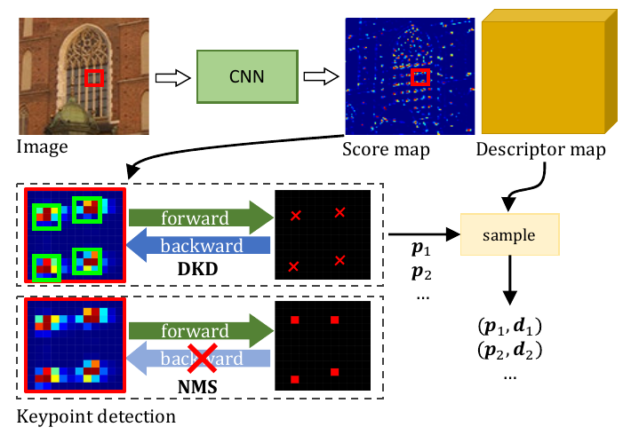
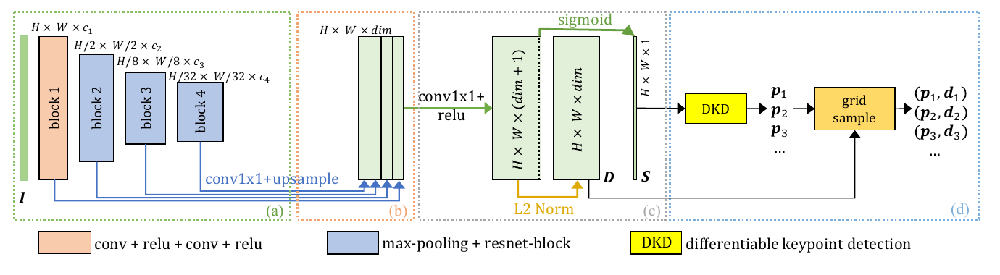
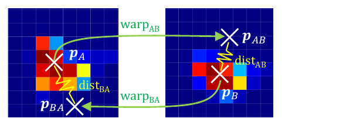
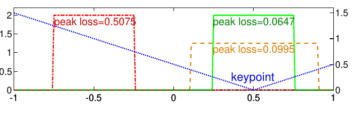
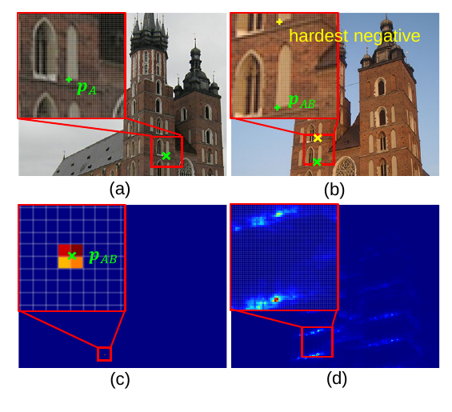
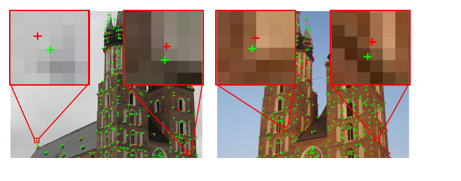
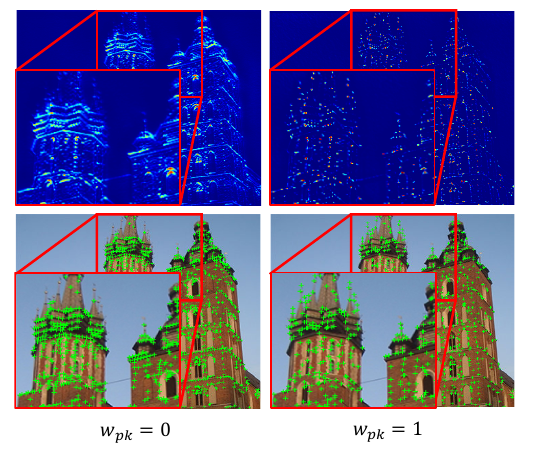
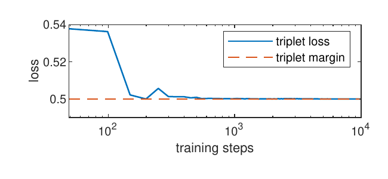
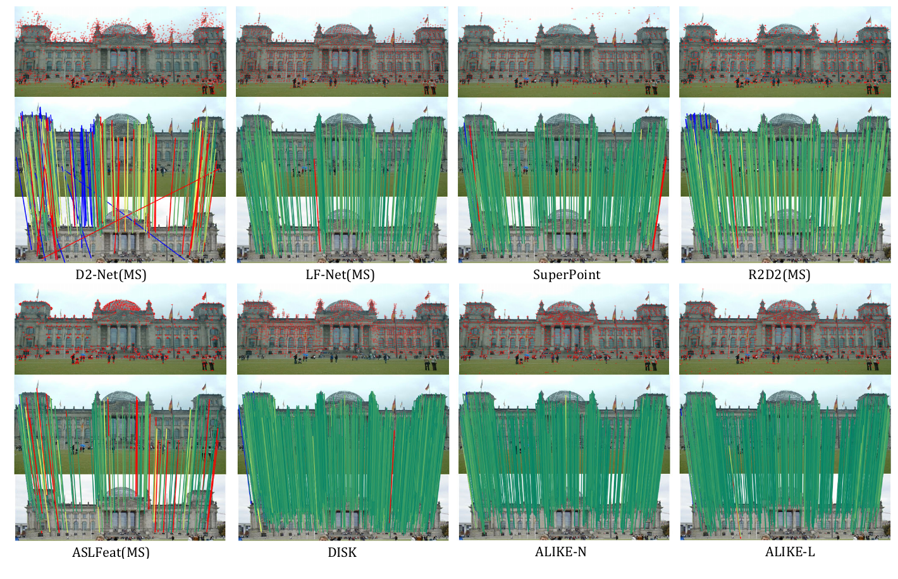
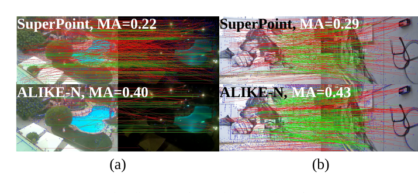

# ALIKE: Accurate and Lightweight Keypoint Detection and Descriptor Extraction — конспект

**Авторы:** Xiaoming Zhao, Xingming Wu, Jinyu Miao, Weihai Chen, Peter C. Y. Chen, Zhengguo Li (Beihang University; National University of Singapore; Institute for Infocomm Research, A*STAR)
**Площадка:** IEEE Transactions on Multimedia (TMM), 2022, DOI 10.1109/TMM.2022.3155927 (по BibTeX в README официального репозитория). Препринт: arXiv:2112.02906 (v2 — 05.02.2022).
**Источник PDF:** https://arxiv.org/pdf/2112.02906 (arXiv v2); локальная копия: `../original/ALIKE_Zhao_2022.pdf`
**Лицензия:** arXiv-версия распространяется под CC BY-NC-SA 4.0 (некоммерческая) — не входит в разрешённый для полного перевода список, поэтому здесь конспект своими словами с короткими цитатами.
**Код и веса:** `Shiaoming/ALIKE` (BSD-3-Clause; там же архив с кодом обучения).

> **Суть в одном абзаце.** Большинство обучаемых детекторов ([SuperPoint](SuperPoint_конспект.md), [R2D2](R2D2_конспект.md), [D2-Net](D2-Net_конспект.md), ASLFeat, [DISK](DISK_конспект.md)) извлекают ключевые точки из карты откликов (score map) через подавление немаксимумов (NMS), которое недифференцируемо, — поэтому сеть учится на «промежуточной» карте, а не на самих координатах точек. ALIKE предлагает **дифференцируемый детектор ключевых точек (Differentiable Keypoint Detection, DKD)**: после NMS в окне 5×5 вокруг каждого максимума берётся soft-argmax, что даёт субпиксельную координату, через которую проходят градиенты к карте откликов. Это позволяет напрямую минимизировать **ошибку репроекции точек** между двумя изображениями. Дополнительно вводятся **dispersity peak loss** (карта должна иметь острый пик ровно в точке), дескрипторная потеря **NRE** (neural reprojection error, по всей плотной карте дескрипторов вместо triplet loss) и **потеря надёжности (reliability)**. Сеть очень лёгкая (0.08–0.65 млн параметров, 2–20 GFLOPs на 640×480): ALIKE-N работает ~95 FPS на 640×480 (NVIDIA TITAN X Pascal) и по точности гомографии на HPatches, оценке позы на IMW2020 и локализации на Aachen Day-Night сопоставима или лучше значительно более тяжёлых методов.

*Рис. 1 (из оригинальной статьи). Сеть выдаёт карту откликов и карту дескрипторов. В DKD (средний ряд) положение точки вычисляется из распределения откликов в локальном окне, поэтому градиент проходит назад; при классическом NMS (нижний ряд) обратный проход невозможен. Дескрипторы сэмплируются в субпиксельных точках.*

---

## 1. Введение: постановка проблемы

- Разреженные ключевые точки и дескрипторы — компактное представление для быстрого сопоставления изображений; применяются в SLAM и, что характерно для авторов, в HDR-съёмке (high dynamic range imaging).
- Подход «карта откликов → NMS» ([SuperPoint](SuperPoint_конспект.md), [R2D2](R2D2_конспект.md) и др.) имеет принципиальный изъян: NMS просто выбирает пиксель с максимумом, это операция без градиента. Сеть обучают на сходстве карт или на синтетической разметке, но **положение точки напрямую не оптимизируется**.
- Наблюдение авторов: положение точки «поддерживается» всем локальным патчем откликов — распределение значений вокруг максимума несёт информацию о субпиксельном положении, даже если сам максимум не сдвигается.
- Дескрипторы, сэмплированные в субпиксельных точках, по опыту авторов плохо обучаются triplet loss (неустойчиво, см. разд. 6.2), поэтому берётся NRE loss из работ по sparse-to-dense сопоставлению.
- Отдельный акцент — **эффективность**: существующие методы гонятся за точностью сопоставления, а не за скоростью; ALIKE проектируется для реального времени (роботы).
- Вклады:
  1. модуль DKD + потери репроекции и dispersity peak для точных и повторяемых точек;
  2. обучение плотной карты дескрипторов NRE-потерей — сходимость стабильнее, чем с triplet loss;
  3. лёгкая сеть с агрегацией многоуровневых признаков, ~95 FPS при качестве на уровне SOTA.

## 2. Связанные работы

Авторы делят обучаемые методы на три группы:

| Группа | Представители | Как получают точки | Замечание авторов |
|---|---|---|---|
| Патч-ориентированные (patch-based) | MatchNet, TFeat, L2-Net, [HardNet](HardNet_конспект.md), SOSNet, [LIFT](LIFT_конспект.md) | только дескрипторы патчей ([LIFT](LIFT_конспект.md) — имитация [SIFT](SIFT_конспект.md)) | рецептивное поле ограничено патчем |
| На карте откликов (score map based, detect-then-describe) | TILDE, Quad-networks, Key.Net, LF-Net, [SuperPoint](SuperPoint_конспект.md), MLIFeat, SEKD, [R2D2](R2D2_конспект.md), HDD-Net, [DISK](DISK_конспект.md), Reinforced SP | NMS по карте откликов | обучаются на карте, а не на точках (кроме Key.Net) |
| «Описать-и-детектировать» (describe-and-detect) | [D2-Net](D2-Net_конспект.md), ASLFeat, UR2KiD, D2D | отклик вычисляется из «отличимости» дескрипторов/признаков | тоже NMS, тоже надзор на карте |

- Ближайший родственник — **Key.Net**, который тоже использует softargmax. Отличия ALIKE: не нужны ручные (handcrafted) признаки и псевдо-разметка точек; Key.Net ищет точки на фиксированной сетке патчей и не умеет точки на границе патчей, а в ALIKE окна центрируются в найденных NMS-максимумах.
- LF-Net тоже применяет softargmax, но обучение всё равно ведётся по карте откликов.
- [DISK](DISK_конспект.md) и Reinforced Feature Points ослабляют детекцию/сопоставление до вероятностных процессов и обучаются с подкреплением (policy gradient); DKD, по словам авторов, похож на сэмплирование в этих методах, но градиенты идут прямо в отклики окна.

## 3. Архитектура сети

Вход — RGB-изображение $I \in \mathbb{R}^{H\times W\times 3}$; выход — карта откликов $S \in \mathbb{R}^{H\times W}$ и карта дескрипторов $D \in \mathbb{R}^{H\times W\times dim}$ **в полном разрешении**. Затем DKD находит субпиксельные точки $\mathbf{p} = [u, v]^T$, и в них сэмплируются дескрипторы $\mathbf{d} \in \mathbb{R}^{dim}$.

*Рис. 2 (из оригинальной статьи). (a) энкодер из четырёх блоков с разрешениями H, H/2, H/8, H/32; (b) агрегация: каждый уровень приводится conv1×1 к общему числу каналов, билинейно апсемплируется и конкатенируется; (c) голова: conv1×1+ReLU → H×W×(dim+1), первые dim каналов L2-нормируются (дескрипторы D), последний — sigmoid (отклики S); (d) DKD и сэмплирование дескрипторов.*

- **(a) Энкодер.** Блок 1 — две свёртки 3×3 с ReLU; блоки 2–4 — max-pooling + базовый ResNet-блок 3×3. Пулинг в блоке 2 уменьшает в 2 раза, в блоках 3 и 4 — в 4 раза (итого H/2, H/8, H/32). Число каналов блоков — $c_1..c_4$. Максимальное рецептивное поле — **204×204** пикселей.
- **(b) Агрегация признаков.** 1×1-свёртка подгоняет каналы каждого уровня, билинейный апсемплинг до H×W, затем простая конкатенация — комбинирует точную локализацию мелких уровней и выразительность глубоких.
- **(c) Голова.** Выдаёт H×W×(dim+1): дескрипторы L2-нормируются, канал отклика проходит через sigmoid. У модели Large голова содержит 2 слоя ($N_{head}=2$), у остальных — один.
- **(d) DKD + grid sample** — разд. 4.
- Вход по коду: RGB, делённый на 255; размеры дополняются нулями до кратных 32 (по официальному коду).

**Конфигурации (Таблица I статьи):**

| Модель | $c_1$ | $c_2$ | $c_3$ | $c_4$ | dim | $N_{head}$ | Параметры, млн | GFLOPs (640×480) |
|---|---|---|---|---|---|---|---|---|
| Tiny (T) | 8 | 16 | 32 | 64 | 64 | 1 | 0.080 | 2.109 |
| Small (S) | 8 | 16 | 48 | 96 | 96 | 1 | 0.142 | 3.893 |
| Normal (N) | 16 | 32 | 64 | 128 | 128 | 1 | 0.318 | 7.909 |
| Large (L) | 32 | 64 | 128 | 128 | 128 | 2 | 0.653 | 19.685 |

## 4. Дифференцируемая детекция ключевых точек (DKD)

**Классический NMS** эквивалентен argmax в локальном окне $N\times N$:

$$
[\hat i, \hat j]^T_{NMS} = \arg\max_{i,j} \{ s(i,j) \mid 0 \le i,j < N \},
$$

где $s(i,j)$ — отклик в позиции $(i,j)$ окна. Выходная координата не связана со значениями откликов функционально, градиента нет.

**Шаги DKD** (Рис. 3):

1. «NMS-карта»: в каждом окне $N\times N$ оставить только локальный максимум $s_{max}$, остальные обнулить:
   $$ s = \begin{cases} s_{max}, & s = s_{max} \\ 0, & \text{иначе}\end{cases} $$
2. Порог $th$ отсекает слабые отклики → пиксельные точки $[u,v]^T_{NMS}$ (на этом шаге NMS-методы заканчиваются).
3. Вокруг каждой точки берётся окно $N\times N$ исходной карты, отклики нормируются softmax с температурой:
   $$ s'(i,j) = \mathrm{softmax}\!\left(\frac{s(i,j) - s_{max}}{t_{det}}\right), \qquad \mathrm{softmax}(x) = \frac{\exp(x)}{\sum \exp(x)}, $$
   где $t_{det}$ — температура («резкость» нормировки), $s'(i,j)$ — вероятность того, что точка находится в $(i,j)$.
4. Ожидаемое положение в окне (интегральная регрессия, integral regression):
   $$ [\hat i, \hat j]^T_{soft} = \sum_{0 \le i,j < N} s'(i,j)\,[i,j]^T. $$
5. Итоговая субпиксельная точка:
   $$ \mathbf{p} = [u,v]^T_{soft} = [u,v]^T_{NMS} + [\hat i, \hat j]^T_{soft}. $$

- Первое слагаемое — пиксельная позиция (без градиента), второе — субпиксельное смещение, дифференцируемое по откликам окна. Поэтому модуль **частично дифференцируем (partially differentiable)**: оптимизация положения точки = оптимизация откликов в её окне. Карта откликов оптимизируется разреженно, только в окнах найденных точек.

*Рис. 3 (из оригинальной статьи). (a) изображение, (b) карта откликов, (c) карта после NMS, (d) координаты после порога, (e) локальные окна, (f) отклики в окнах. Пиксельные точки находятся NMS и порогом, затем отклики в окнах дают субпиксельные точки через soft-argmax; зелёным пунктиром — путь градиента.*

**Детали реализации (по официальному коду `soft_detect.py`):** окно задаётся радиусом `radius=2` (ядро 5×5); NMS сделан через max-pool с радиусом 2; точки у границы шириной `radius+1` отбрасываются; температура 0.1; режимы — top-K либо порог `scores_th` (по умолчанию 0.2) с ограничением `n_limit` (по умолчанию 5000); если ни одна точка не прошла порог, используется среднее значение карты.

## 5. Функции потерь

Для пары изображений $I_A, I_B$ сеть даёт $S_A, S_B$, DKD — точки $\mathbf{p}_A, \mathbf{p}_B$. Точки переносятся на другое изображение дифференцируемой функцией:

$$
\mathbf{p}_{AB} = \mathrm{warp}_{AB}(\mathbf{p}_A).
$$

Варианты warp: гомография $[\mathbf{p}_{AB}^T, 1]^T = H_{AB}[\mathbf{p}_A^T, 1]^T$ ($H_{AB}$ — матрица 3×3); перспективная 3D-проекция

$$
\mathbf{p}_{AB} = \pi\!\left(d_A R_{AB}\, \pi^{-1}(\mathbf{p}_A) + \mathbf{t}_{AB}\right),
$$

где $\pi(P) = KP/Z$ — проекция 3D-точки $P=[X,Y,Z]^T$ в пиксели с внутренними параметрами $K$; $R_{AB}, \mathbf{t}_{AB}$ — поворот и сдвиг из системы A в B; $d_A$ — глубина точки $\mathbf{p}_A$. Допускается даже оптический поток.

### 5.1. Потеря репроекции (reprojection loss)

Для $\mathbf{p}_{AB}$ ищется ближайшая детектированная точка $\mathbf{p}_B$ в радиусе $th_{gt}$ пикселей:

$$
\mathrm{dist}_{AB} = \lVert \mathbf{p}_{AB} - \mathbf{p}_B \rVert_p, \qquad
\mathcal{L}_{rp} = \tfrac{1}{2}\left(\mathrm{dist}_{AB} + \mathrm{dist}_{BA}\right),
$$

- $p$ — порядок нормы (в экспериментах $p=1$); симметричная форма по аналогии с симметричным эпиполярным расстоянием.
- Потеря «стягивает» перенесённую точку и соответствующую (Рис. 4), подстраивая отклики в окнах. По мнению авторов, она **неявно обеспечивает повторяемость**: точки в неповторяемых местах дают большие ошибки. Поэтому отдельные меры сходства карт (разность откликов как в Key.Net, косинусное сходство как в [R2D2](R2D2_конспект.md), KL-дивергенция как в SEKD) не нужны.

*Рис. 4 (из оригинальной статьи). Перенесённая точка ($\mathbf{p}_{AB}$, $\mathbf{p}_{BA}$) и соответствующая детекция ($\mathbf{p}_B$, $\mathbf{p}_A$) стягиваются друг к другу; $\mathrm{dist}_{AB}$, $\mathrm{dist}_{BA}$ — расстояния репроекции.*

### 5.2. Dispersity peak loss

- Проблема: шаг градиента, улучшающий субпиксельное смещение, может сдвинуть сам пиксельный максимум $[u,v]_{NMS}$. Чтобы оптимизация была согласованной, окно должно быть **«пиковым» (peaky)**: высокий отклик в точке, низкий вокруг. Тогда даже при сдвиге окна смещение пересчитается так, что точка останется на месте.
- Ранее ([R2D2](R2D2_конспект.md), SEKD) «пиковость» задавали разностью максимума и среднего по патчу — это лишь статистика без учёта пространственного распределения. ALIKE взвешивает вероятности расстоянием до точки:

$$
d(i,j) = \left\lVert [i,j] - [\hat i, \hat j]_{soft} \right\rVert_p, \qquad
\mathcal{L}_{pk} = \frac{1}{N^2}\sum_{0\le i,j<N} d(i,j)\, s'(i,j),
$$

где $d(i,j)$ — расстояние пикселя окна до субпиксельной точки, $s'$ — softmax-отклики из шага 3 DKD. Масса откликов вдали от точки штрафуется.

*Рис. 5 (из оригинальной статьи). Одномерный пример: окно [−1, 1], точка в x = 0.5. Красное и зелёное распределения имеют одинаковую статистику «максимум − среднее», но разные значения dispersity peak loss (0.5075 и 0.0647), потому что зелёное сосредоточено вокруг точки; синяя пунктирная кривая — расстояние до точки.*

### 5.3. Дескрипторная потеря: NRE вместо triplet loss

- Triplet loss использует для дескриптора $\mathbf{p}_A$ только два дескриптора из B — соответствующий и «самый трудный отрицательный» (hardest negative), то есть плотная карта почти не ограничена. NRE (Germain et al., CVPR 2021) сравнивает два плотных распределения по всей карте $D_B$ (Рис. 6).

**Распределение репроекции** — билинейное «размазывание» единицы по 4 соседним пикселям точки $\mathbf{p}_{AB}$:

$$
q_r(\mathbf{p}_B \mid \mathrm{warp}_{AB}, \mathbf{p}_A) = w_{00}[\![\mathbf{p}_B = \lfloor \mathbf{p}_{AB}\rfloor]\!] + w_{01}[\![\mathbf{p}_B = \lfloor \mathbf{p}_{AB}\rfloor + [0,1]^T]\!] + w_{10}[\![\cdot + [1,0]^T]\!] + w_{11}[\![\cdot + [1,1]^T]\!],
$$

$[\![\cdot]\!]$ — скобка Айверсона, $\lfloor\cdot\rfloor$ — округление вниз, $w_{ij}$ — билинейные веса. Если точка ушла за кадр — класс «выброс» (out) с вероятностью 1.

**Карта сходства и распределение сопоставления:**

$$
C_{\mathbf{d}_{p_A}, D_B} = D_B\, \mathbf{d}_{p_A} \in \mathbb{R}^{H\times W}, \qquad
q_m(\mathbf{p}_B \mid \mathbf{d}_{p_A}, D_B) = \mathrm{softmax}\!\left(\frac{\bar C_{\mathbf{d}_{p_A}, D_B} - 1}{t_{des}}\right),
$$

где $\bar C$ — карта сходства, дополненная элементом «out» (размер $H\cdot W + 1$), $t_{des}$ — температура.

**NRE** — кросс-энтропия этих распределений; благодаря форме $q_r$ сводится к

$$
\mathrm{NRE}(\mathbf{p}_A, \mathrm{warp}_{AB}, \mathbf{d}_{p_A}, D_B) = -\sum_{\mathbf{p}_B \in \{I_B, out\}} q_r \ln q_m = -\ln q_m(\mathbf{p}_{AB} \mid \mathbf{d}_{p_A}, D_B).
$$

Симметричная потеря:

$$
\mathcal{L}_{de} = \frac{1}{N_A + N_B}\left(\sum_{\mathbf{p}_A \in I_A} \mathrm{NRE}(\mathbf{p}_A, \mathrm{warp}_{AB}, \mathbf{d}_{p_A}, D_B) + \sum_{\mathbf{p}_B \in I_B} \mathrm{NRE}(\mathbf{p}_B, \mathrm{warp}_{BA}, \mathbf{d}_{p_B}, D_A)\right),
$$

$N_A, N_B$ — число точек в изображениях.

*Рис. 6 (из оригинальной статьи). (a) исходное изображение A, (b) целевое B, (c) карта вероятности репроекции, (d) карта вероятности сопоставления. Зелёные кресты — пара соответствующих точек; жёлтый — самый трудный отрицательный дескриптор. Triplet loss видит только две точки в B, NRE — всю карту $D_B$.*

### 5.4. Потеря надёжности (reliability loss)

- Репроекция и peak loss не учитывают свойства дескрипторов, поэтому точки могут оказаться в слабо текстурированных или повторяющихся местах (идея «надёжности» — из [R2D2](R2D2_конспект.md)).
- Нормированная карта сходства с температурой $t_{rel}$ и надёжность точки — значение этой карты в точке репроекции:

$$
\tilde C_{\mathbf{d}_{p_A}, D_B} = \exp\!\left(\frac{C_{\mathbf{d}_{p_A}, D_B} - 1}{t_{rel}}\right), \qquad
r_{p_A} = \mathrm{bisampling}\!\left(\tilde C_{\mathbf{d}_{p_A}, D_B}, \mathbf{p}_{AB}\right),
$$

где bisampling — билинейное сэмплирование. *(Примечание: в тексте статьи $\tilde C$ называется «нормализованной», но в формуле (19) явно записан только экспоненциальный множитель; нормировка, видимо, подразумевается softmax'ом, как в (16).)* В однородной или повторяющейся области дескриптор похож на многие соседние, нормированное значение в истинной точке мало → $r$ мало → точка ненадёжна.

- Потеря (по образцу [D2-Net](D2-Net_конспект.md) и ASLFeat — взвешивание откликами пары):

$$
\mathcal{L}^{A}_{reliability} = \frac{1}{N_A}\sum_{\mathbf{p}_A \in I_A,\ \mathbf{p}_{AB}\in I_B} \frac{s_{p_A}\, s_{p_{AB}}}{\sum_{\mathbf{p}'_A, \mathbf{p}'_{AB}} s_{p'_A}\, s_{p'_{AB}}}\,(1 - r_{p_A}), \qquad
\mathcal{L}_{rl} = \tfrac12\left(\mathcal{L}^A_{reliability} + \mathcal{L}^B_{reliability}\right),
$$

где $s_p$ — отклик карты в точке $p$. Высокие отклики «поощряются» только там, где сопоставление надёжно.

### 5.5. Итоговая потеря

$$
\mathcal{L} = w_{rp}\mathcal{L}_{rp} + w_{pk}\mathcal{L}_{pk} + w_{rl}\mathcal{L}_{rl} + w_{de}\mathcal{L}_{de}.
$$

## 6. Обучение и эксперименты

### 6.1. Данные и гиперпараметры

| Параметр | Значение |
|---|---|
| Обучающие данные | MegaDepth (туристические фото + плотные глубины и позы из COLMAP); пары из [DISK](DISK_конспект.md): 135 сцен, ~63k изображений, без сцен, пересекающихся с валидацией/тестом IMW2020 |
| Тип warp при обучении | 3D-проекция по глубине и позе (MegaDepth) |
| Размер кропа | 480×480 (crop + resize) |
| DKD при обучении | окно $N = 5$, 400 точек + ещё 400 случайных точек в «незаметных» (non-salient) местах |
| $th_{gt}$ / норма $p$ | 5 px / $p = 1$ |
| Веса потерь | $w_{rp}=1$, $w_{pk}=1$, $w_{rl}=1$, $w_{de}=5$ |
| Температуры | $t_{det}=0.1$, $t_{rel}=1$, $t_{des}=0.02$ |
| Оптимизатор | Adam; lr с разогревом (warm-up) от 0 до 3e−3 за 500 шагов, далее постоянный 3e−3 |
| Батч | 1, градиент накапливается 16 шагов |
| Время обучения | ~2 суток на NVIDIA Titan RTX |
| Число эпох/итераций, аугментации | в статье не указаны (код обучения выложен в репозитории архивом `ALIKE_code.zip`; в рамках этого конспекта не разбирался) |

### 6.2. Метрики

Пусть у A и B есть $N'_A$, $N'_B$ взаимно видимых (co-visible) точек, $N_{cov} = (N'_A + N'_B)/2$; $N_{gt}$ — эталонных пар с ошибкой репроекции < 3 px; $N_{putative}$ — гипотетических соответствий по взаимному ближайшему соседу (mutual NN) дескрипторов; $N_{inlier}$ — из них верных при заданном пороге.

| Метрика | Формула / смысл |
|---|---|
| Повторяемость (Repeatability, Rep) | $N_{gt}/N_{cov}$ |
| Matching Score (MS) | $N_{inlier}/N_{cov}$ |
| Mean Matching Accuracy (MMA) | среднее по парам $N_{inlier}/N_{putative}$ |
| Mean Homography Accuracy (MHA) | доля углов изображения, верно перенесённых оценённой гомографией, средняя по парам |

Авторы подчёркивают: MMA — промежуточная метрика; главное — точность конечной задачи (MHA при строгих порогах).

### 6.3. Абляция архитектуры (HPatches, одна шкала, $th = 0.2$, до 5000 точек)

| Модель | Rep | MS | MMA@3 | MHA@3 |
|---|---|---|---|---|
| Tiny | 56.19% | 32.54% | 63.92% | 70.56% |
| Small | **58.25%** | 34.96% | 67.61% | 73.52% |
| Normal | 54.93% | 38.58% | **70.78%** | 75.74% |
| Large | 53.70% | **39.80%** | 70.50% | **76.85%** |

Normal примерно на 6% лучше Tiny по MS/MMA/MHA, а Large при удвоенной сложности даёт лишь ~1% — для реального времени выбрана Normal.

### 6.4. Абляция потерь (модель Normal)

| RP | PK | RL | DE | Rep | MS | MMA@3 | MHA@3 |
|:-:|:-:|:-:|:-:|---|---|---|---|
| | | ✓ | ✓ | 59.26% | 34.55% | 71.83% | 67.22% |
| | ✓ | ✓ | ✓ | 48.75% | 30.88% | 62.95% | 72.59% |
| ✓ | | ✓ | ✓ | **65.77%** | 38.12% | **74.44%** | 70.74% |
| ✓ | ✓ | | ✓ | 51.11% | 33.77% | 65.23% | 74.44% |
| ✓ | ✓ | ✓ | ✓ | 54.93% | **38.58%** | 70.78% | **75.74%** |
| ✓ | ✓ | ✓ | triplet | 57.91% | 14.13% | 39.38% | 60.74% |

**Интерпретация:**
- **Репроекция** улучшает все метрики (строка 5 против 2, строка 3 против 1) и визуально делает точки точнее (Рис. 7).
- **Dispersity peak** — компромисс: MHA растёт, но Rep и MMA падают. Без неё карта менее острая, точки скучиваются, и шанс «найти пару в толпе» выше — это завышает повторяемость, но не помогает гомографии. Поскольку важна конечная задача, потерю оставили (Рис. 8).
- **Надёжность** повышает MS и MMA (строка 5 против 4): меньше ложных соответствий.
- **Triplet loss** (margin 0.5, отрицательные — среди точек) для субпиксельных дескрипторов застревает в локальном минимуме: потеря подходит к margin, но не пересекает его — все дескрипторы становятся одинаковыми (Рис. 9). NRE сходится стабильно, но требует больше памяти и времени из-за плотной карты сходства.

*Рис. 7 (из оригинальной статьи). Субпиксельные точки сети, обученной с потерей репроекции (зелёные кресты) и без неё (красные): с потерей точки точнее попадают в углы.*

*Рис. 8 (из оригинальной статьи). Карты откликов (верхний ряд) и точки (нижний) для $w_{pk}=0$ и $w_{pk}=1$: с потерей карта становится «пиковой», точки не скучиваются.*

*Рис. 9 (из оригинальной статьи). Кривая triplet loss (синяя) быстро прилипает к значению margin 0.5 (красный пунктир) и дальше не опускается — вырожденное решение.*

### 6.5. Сложность, скорость и оценка гомографии (HPatches, Таблица IV)

FPS — на 640×480; по выводам статьи замер на NVIDIA TITAN X (Pascal). MS — многомасштабная детекция (конкретные масштабы для ALIKE(MS) в статье не указаны).

| Метод | Параметры, млн | GFLOPs | FPS | MMA@1 | MMA@2 | MMA@3 | MHA@1 | MHA@2 | MHA@3 |
|---|---|---|---|---|---|---|---|---|---|
| [D2-Net](D2-Net_конспект.md)(MS) | 7.635 | 889.40 | 6.60 | 9.78% | 23.52% | 37.29% | 5.19% | 21.30% | 38.33% |
| LF-Net(MS) | 2.642 | 24.37 | 29.88 | 19.94% | 41.98% | 55.60% | 17.41% | 42.41% | 57.78% |
| [SuperPoint](SuperPoint_конспект.md) | 1.301 | 26.11 | 45.87 | 34.27% | 54.94% | 65.37% | 35.00% | 58.33% | 70.19% |
| [R2D2](R2D2_конспект.md)(MS) | 0.484 | 464.55 | 8.70 | 33.31% | 62.17% | **75.77%** | 35.74% | 59.44% | 71.48% |
| ASLFeat(MS) | 0.823 | 44.24 | 8.96 | 39.16% | 61.07% | 72.44% | 37.22% | 61.67% | 73.52% |
| [DISK](DISK_конспект.md) | 1.092 | 98.97 | 15.73 | 43.71% | **66.98%** | **77.59%** | 34.07% | 57.59% | 70.56% |
| **ALIKE-N** | **0.318** | **7.91** | **95.19** | 43.52% | 63.14% | 70.78% | 42.04% | 62.78% | 75.74% |
| **ALIKE-L** | 0.653 | 19.68 | 68.18 | 43.90% | 63.11% | 70.50% | **45.00%** | **65.93%** | **76.85%** |
| ALIKE-N(MS) | 0.318 | 25.97 | 41.48 | 44.06% | 65.56% | 74.05% | 44.07% | 65.37% | 75.93% |
| ALIKE-L(MS) | 0.653 | 64.63 | 29.15 | **44.97%** | 66.21% | 74.51% | **45.00%** | 65.37% | 76.48% |

**Интерпретация:**
- Мало параметров ≠ мало вычислений: у [R2D2](R2D2_конспект.md) 0.48 млн параметров, но 464.55 GFLOPs (свёртки в полном разрешении с большим числом каналов); у ALIKE-N — 7.91 GFLOPs.
- ALIKE-N/ALIKE-L/SuperPoint — самые быстрые (95/68/46 FPS).
- При строгих порогах (MMA@1, MHA@1–2) ALIKE заметно лучше — следствие DKD и потерь на точность локализации. По MHA@3 ALIKE-N и ALIKE-L превосходят лучший из прочих (ASLFeat(MS)) на 2.22 и 3.33 п.п. при в ~5.6 и ~2.2 раза меньшей сложности. При мягком пороге MMA@3 [DISK](DISK_конспект.md) и [R2D2](R2D2_конспект.md) впереди.

### 6.6. Оценка позы камеры (IMW2020, test, до 2048 точек, встроенный mutual NN; Таблица V)

PPC (performance per cost) = mAA(10°) / GFLOPs. NF — число признаков, NM — число соответствий, NL — число 3D-точек, TL — длина трека.

| Метод | GFLOPs | Стерео: NF | Rep | MS | mAA(5°) | mAA(10°) | PPC | Мультивид: NM | NL | TL | mAA(5°) | mAA(10°) | PPC |
|---|---|---|---|---|---|---|---|---|---|---|---|---|---|
| [D2-Net](D2-Net_конспект.md)(MS) | 889.40 | 2046 | 16.80% | 29.30% | 6.06% | 12.27% | 0.0138 | 2045.60 | 1999.37 | 3.01 | 17.77% | 28.30% | 0.0318 |
| LF-Net(MS)* | 24.37 | — | — | — | — | 23.44% | 0.9620 | 196.70 | 1385.00 | 4.14 | — | 51.41% | 2.1099 |
| [SuperPoint](SuperPoint_конспект.md) | 26.11 | 2048 | 36.40% | 63.00% | 19.71% | 28.97% | 1.1093 | 2048.00 | 1185.38 | 4.33 | 44.35% | 54.66% | 2.0935 |
| [R2D2](R2D2_конспект.md)(MS) | 464.55 | 2048 | 42.90% | 74.60% | 27.20% | 39.02% | 0.0840 | 2048.00 | 1225.85 | 4.28 | 53.13% | 64.03% | 0.1378 |
| ASLFeat(MS) | 77.58 | 2043 | 43.10% | 74.90% | 22.62% | 33.65% | 0.4337 | 157.51 | 1106.59 | 4.42 | 45.28% | 55.61% | 0.7168 |
| [DISK](DISK_конспект.md) | 98.97 | 2048 | **44.80%** | **85.20%** | **38.72%** | **51.22%** | 0.5175 | 526.35 | 2424.80 | 5.50 | **63.25%** | **72.96%** | 0.7372 |
| ALIKE-N | 7.91 | 1803 | 43.30% | 81.10% | 35.12% | 47.18% | **5.9652** | 276.48 | 1644.20 | 4.97 | 59.18% | 69.21% | **8.7507** |
| ALIKE-L | 19.68 | 1771 | 42.90% | 82.20% | 37.24% | 49.58% | 2.5187 | 298.30 | 1693.31 | 5.02 | 60.30% | 70.22% | 3.5673 |

\* Результаты LF-Net взяты авторами из статьи [DISK](DISK_конспект.md) (на сайте бенчмарка их нет).

- ALIKE уступает только [DISK](DISK_конспект.md), но [DISK](DISK_конспект.md) требует 98.97 GFLOPs. С учётом PPC ALIKE-N примерно в 10 раз, ALIKE-L — в 5 раз эффективнее [DISK](DISK_конспект.md). *(В тексте статьи GFLOPs ALIKE-L и ALIKE-N в этом месте перепутаны местами; верные значения — в таблицах: N — 7.91, L — 19.68.)*

*Рис. 10 (из оригинальной статьи). Точки (1-й и 3-й ряды) и соответствия (2-й и 4-й) на валидации IMW2020 для [D2-Net](D2-Net_конспект.md)(MS), LF-Net(MS), [SuperPoint](SuperPoint_конспект.md), [R2D2](R2D2_конспект.md)(MS), ASLFeat(MS), [DISK](DISK_конспект.md), ALIKE-N, ALIKE-L. Цвет соответствия: от зелёного к жёлтому — ошибка 0–5 px, красный — > 5 px, синий — нет эталонной глубины.*

Качественные наблюдения авторов: у [D2-Net](D2-Net_конспект.md) и ASLFeat точки берутся из карт низкого разрешения — менее точны; у LF-Net, [R2D2](R2D2_конспект.md), [DISK](DISK_конспект.md) много ложных точек на бестекстурной границе здания; у [R2D2](R2D2_конспект.md) точки скучены, у [DISK](DISK_конспект.md) почти все на зданиях; у [SuperPoint](SuperPoint_конспект.md) точек меньше всего, часть — на небе; у ALIKE большинство точек на углах и рёбрах.

### 6.7. Визуальная (ре)локализация (Aachen Day-Night, 98 ночных запросов; Таблица VI)

Доля запросов, локализованных в пределах (0.25 м, 2°) / (0.5 м, 5°) / (5 м, 10°), стандартный конвейер бенчмарка.

| Метод | 2048 точек | | | без ограничения | | |
|---|---|---|---|---|---|---|
| | 0.25м,2° | 0.5м,5° | 5м,10° | 0.25м,2° | 0.5м,5° | 5м,10° |
| [D2-Net](D2-Net_конспект.md)(SS) | **74.5** | 85.7 | 96.9 | 78.6 | 88.8 | 100.0 |
| [D2-Net](D2-Net_конспект.md)(MS) | 61.2 | 81.6 | 94.9 | 79.6 | 86.7 | 100.0 |
| SEKD(SS) | 42.9 | 51.0 | 57.1 | 54.1 | 65.3 | 74.5 |
| SEKD(MS) | 50.0 | 63.3 | 70.4 | 59.2 | 72.4 | 82.7 |
| [SuperPoint](SuperPoint_конспект.md) | 72.4 | 79.6 | 88.8 | 73.5 | 81.6 | 93.9 |
| [R2D2](R2D2_конспект.md)(MS) | 63.3 | 78.6 | 87.8 | 71.4 | 85.7 | 99.0 |
| ASLFeat(SS) | 54.1 | 67.3 | 76.5 | 77.6 | 88.8 | 100.0 |
| ASLFeat(MS) | 49.0 | 59.2 | 69.4 | 77.6 | **90.8** | 100.0 |
| [DISK](DISK_конспект.md) | 70.4 | 82.7 | 94.9 | **84.7** | **90.8** | 100.0 |
| ALIKE-N | 68.4 | 84.7 | 96.9 | 77.6 | 87.8 | 100.0 |
| ALIKE-L | **74.5** | **87.8** | **98.0** | 79.6 | 86.7 | 100.0 |

- Без ограничения числа точек почти все методы хороши; при практичном лимите 2048 [D2-Net](D2-Net_конспект.md)(MS), ASLFeat и [DISK](DISK_конспект.md) заметно проседают, а ALIKE-L — лучший во всех трёх допусках. ALIKE-N близок при меньших вычислениях.

### 6.8. Ограничения (раздел статьи)

- Два типа отказов: **экстремальные изменения освещения** и **большие изменения ракурса** (Рис. 11). Причина, по словам авторов, — неглубокая сеть извлекает более «низкоуровневые» дескрипторы и жертвует выразительностью.
- Тем не менее на случайно выбранных трудных парах точность сопоставления (MA = верные / гипотетические) у ALIKE-N примерно вдвое выше, чем у [SuperPoint](SuperPoint_конспект.md) (0.40 против 0.22 и 0.43 против 0.29), при втрое меньших GFLOPs.

*Рис. 11 (из оригинальной статьи). Сопоставления [SuperPoint](SuperPoint_конспект.md) и ALIKE-N при (a) резкой смене освещения (день/ночь) и (b) большой смене ракурса. Зелёные линии — верные (ошибка < 3 px), красные — неверные; показаны 500 лучших гипотез.*

## 7. Выводы авторов

- DKD даёт точные субпиксельные точки, которые обучаются напрямую потерями репроекции и dispersity peak; дескрипторы — NRE, надёжность — отдельной потерей.
- Качество на уровне или выше SOTA в гомографии, позе и локализации при существенно меньшем времени: ALIKE-N и ALIKE-L — 95 и 68 FPS на 640×480 (NVIDIA TITAN X Pascal).
- Планы: повысить надёжность и точность с помощью высокоуровневой семантики или обучения с подкреплением; встроить модель в SLAM и HDR-приложения.

---

## Описание ключевых рисунков

*Рисунки вставлены в соответствующие разделы выше (Рис. 1 — после аннотации, 2 — разд. 3, 3 — разд. 4, 4–6 — разд. 5, 7–9 — разд. 6.4, 10 — разд. 6.6, 11 — разд. 6.8).*

- **Рис. 1** — общий принцип: карта откликов + карта дескрипторов; DKD против NMS (градиент проходит / не проходит).
- **Рис. 2** — архитектура: энкодер из 4 блоков, агрегация многоуровневых признаков в полном разрешении, единая голова dim+1 каналов, DKD + grid sample.
- **Рис. 3** — пошаговая работа DKD от карты откликов до субпиксельных точек.
- **Рис. 4** — потеря репроекции как «стягивание» перенесённых точек к детекциям.
- **Рис. 5** — почему dispersity peak учитывает пространственное распределение, а «максимум − среднее» нет.
- **Рис. 6** — разница между triplet loss (две точки) и NRE (вся плотная карта).
- **Рис. 7–9** — визуальные эффекты абляций: точность точек, «пиковость» карты, вырождение triplet loss.
- **Рис. 10** — качественное сравнение восьми методов на IMW2020.
- **Рис. 11** — отказные сценарии и сравнение с [SuperPoint](SuperPoint_конспект.md).

---

## Сильные стороны и ограничения

### Сильные стороны
- **Субпиксельные точки «из коробки»** и обучение, напрямую оптимизирующее их положение; лучшие результаты при строгих порогах (MMA@1, MHA@1) — важно для точной геометрии.
- **Очень лёгкая сеть**: 0.08–0.65 млн параметров, 2–20 GFLOPs на 640×480; ALIKE-N — ~95 FPS на GPU 2016 года. Рекордный PPC на IMW2020.
- **Карты в полном разрешении** — нет ограничения «одна точка на ячейку 8×8», как у [SuperPoint](SuperPoint_конспект.md).
- **Обучение на реальных 3D-соответствиях** (MegaDepth) без синтетики и псевдо-разметки.
- **Хорошо при ограниченном числе точек** (Aachen, 2048 точек) — реалистичный режим для онлайн-систем.
- Простой код, BSD-3-лицензия на репозиторий (по README/LICENSE репозитория); выложен код обучения.

### Ограничения
- **Неглубокая сеть → слабее при экстремальных изменениях освещения и ракурса** (признано авторами); по MMA@3 и на IMW2020 уступает [DISK](DISK_конспект.md).
- **Нет инвариантности к повороту и явной многомасштабности**: обучение на MegaDepth, без специальной обработки поворотов; многомасштабный режим (MS) — внешней пирамидой и в разы дороже.
- **Dispersity peak** снижает повторяемость и MMA ради точности гомографии — компромисс, а не «бесплатное» улучшение.
- **NRE требует много памяти**: плотная карта сходства $H\times W$ на каждую точку (батч 1 с накоплением градиента).
- **Сравнение скорости** — только GPU-desktop; нет замеров на CPU/встраиваемых устройствах в статье.
- Мелкие несогласованности текста (перепутанные GFLOPs N/L в разделе про IMW2020; ссылка SEKD [17] вместо [20] в Таблице VI) — числа следует брать из таблиц.

---

## Значение для задачи визуального позиционирования

*Всё в этом разделе, кроме ссылок на результаты статьи, — практические соображения, не из статьи.*

- **Роль в конвейере.** ALIKE — лёгкий локальный признак для этапа «локальные признаки → сопоставление → [RANSAC](RANSAC_конспект.md)/PnP» после глобального поиска кандидатов (NetVLAD, MixVPR, AnyLoc и т.п.). Его прямой преемник [ALIKED](ALIKED_конспект.md) (те же авторы, 2023) имеет готовые веса [LightGlue](LightGlue_конспект.md); для самого ALIKE готового обученного [LightGlue](LightGlue_конспект.md) в официальном [LightGlue](LightGlue_конспект.md) нет (по состоянию репозитория `cvg/LightGlue` на момент написания — не из статьи), поэтому с ALIKE обычно используют mutual NN + [RANSAC](RANSAC_конспект.md)/MAGSAC или переобучают матчер.
- **Скорость на бортовом вычислителе.** 7.9 GFLOPs (ALIKE-N) против 26 у [SuperPoint](SuperPoint_конспект.md) — заметный выигрыш для Jetson-класса устройств. Однако основная стоимость — свёртки и апсемплинг в полном разрешении; реальный FPS на Jetson/TensorRT нужно мерить самостоятельно.
- **Точность субпикселя** полезна для оценки позы по немногим точкам и для триангуляции; при сопоставлении кадра с ортофото/картой это прямо влияет на точность координат.
- **Параметры инференса (по официальному коду):** вход RGB / 255, размеры дополняются до кратных 32; `radius=2` (окно 5×5); режим top-K или `scores_th=0.2` + `n_limit=5000`; субпиксельная детекция включена по умолчанию (`--no_sub_pixel` для отключения). Для позиционирования разумно ограничивать число точек (1–2 тыс.) — статья показывает, что ALIKE хорошо работает именно при лимите.
- **Поворот/масштаб.** Для надирной съёмки с произвольным курсом — компенсировать поворот по IMU/компасу или делать несколько поворотов; масштаб приводить к сопоставимому GSD. Внутренних механизмов инвариантности у ALIKE нет.
- **Междоменное сопоставление** (дрон ↔ спутник, день ↔ ночь, сезоны) — именно та зона, где авторы фиксируют отказы (экстремальные освещение и ракурс). Здесь стоит сравнивать с [ALIKED](ALIKED_конспект.md), [DISK](DISK_конспект.md), [SuperPoint](SuperPoint_конспект.md)+[LightGlue](LightGlue_конспект.md) и плотными матчерами ([LoFTR](LoFTR_перевод.md), RoMa) на своих данных; ALIKE можно дообучить на своём домене (код обучения доступен; нужна глубина/позы или гомографии для warp).
- **Лицензии.** Текст статьи — CC BY-NC-SA; код и веса в репозитории — BSD-3-Clause (по файлу LICENSE), что удобнее для коммерческого применения, чем веса [SuperPoint](SuperPoint_конспект.md). Обучающие данные MegaDepth имеют свои условия — проверять отдельно при переобучении.

---

## Глоссарий (англ. → рус.)

| English | Русский |
|---|---|
| keypoint | ключевая точка |
| descriptor | дескриптор |
| score map | карта откликов (вероятности точки) |
| descriptor map | карта дескрипторов |
| differentiable keypoint detection (DKD) | дифференцируемая детекция ключевых точек |
| non-maximum suppression (NMS) | подавление немаксимумов |
| soft-argmax | «мягкий» argmax (матожидание координаты по softmax) |
| integral regression | интегральная регрессия |
| temperature | температура (параметр резкости softmax) |
| sub-pixel keypoint | субпиксельная ключевая точка |
| partially differentiable | частично дифференцируемый |
| reprojection loss | потеря (ошибка) репроекции |
| dispersity peak loss | потеря «рассеянного пика» (штраф за разброс откликов вокруг точки) |
| peaky score map | карта откликов с острыми пиками |
| neural reprojection error (NRE) | нейронная ошибка репроекции |
| triplet loss / hardest negative | триплетная потеря / самый трудный отрицательный пример |
| reliability | надёжность (различимость дескриптора в точке) |
| repeatability | повторяемость |
| matching score (MS) | доля успешных сопоставлений |
| mean matching accuracy (MMA) | средняя точность сопоставления |
| mean homography accuracy (MHA) | средняя точность оценки гомографии |
| mean average accuracy (mAA) | средняя точность (интеграл по порогам угловой ошибки) |
| performance per cost (PPC) | качество на единицу вычислительной стоимости |
| co-visible keypoints | взаимно видимые точки |
| mutual nearest neighbor (MNN) | взаимный ближайший сосед |
| putative matches / inliers | гипотетические соответствия / верные соответствия (инлаеры) |
| warp | перенос (деформация) координат между изображениями |
| homography | гомография |
| camera intrinsics | внутренние параметры камеры |
| feature aggregation | агрегация признаков |
| receptive field | рецептивное поле |
| grid sample / bilinear sampling | сэмплирование по сетке / билинейная интерполяция |
| Iverson bracket | скобка Айверсона |
| multi-scale (MS) / single-scale (SS) | многомасштабный / одномасштабный режим |
| visual (re-)localization | визуальная (ре)локализация |
| GFLOPs | миллиарды операций с плавающей точкой |
| warm-up (learning rate) | разогрев скорости обучения |
| gradient accumulation | накопление градиента |
| HDR imaging | съёмка с расширенным динамическим диапазоном |
