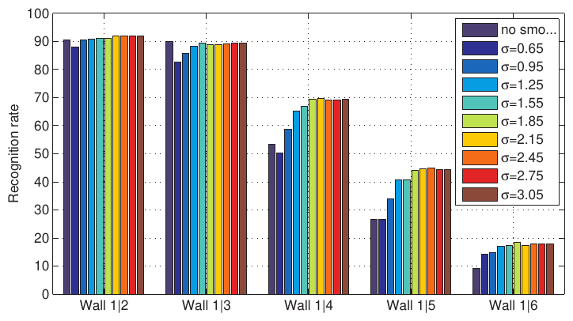
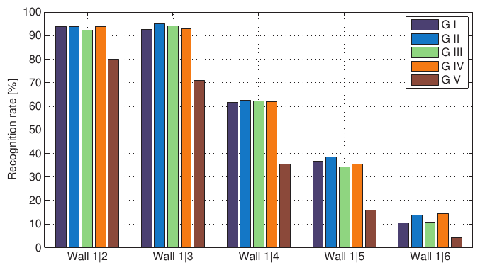
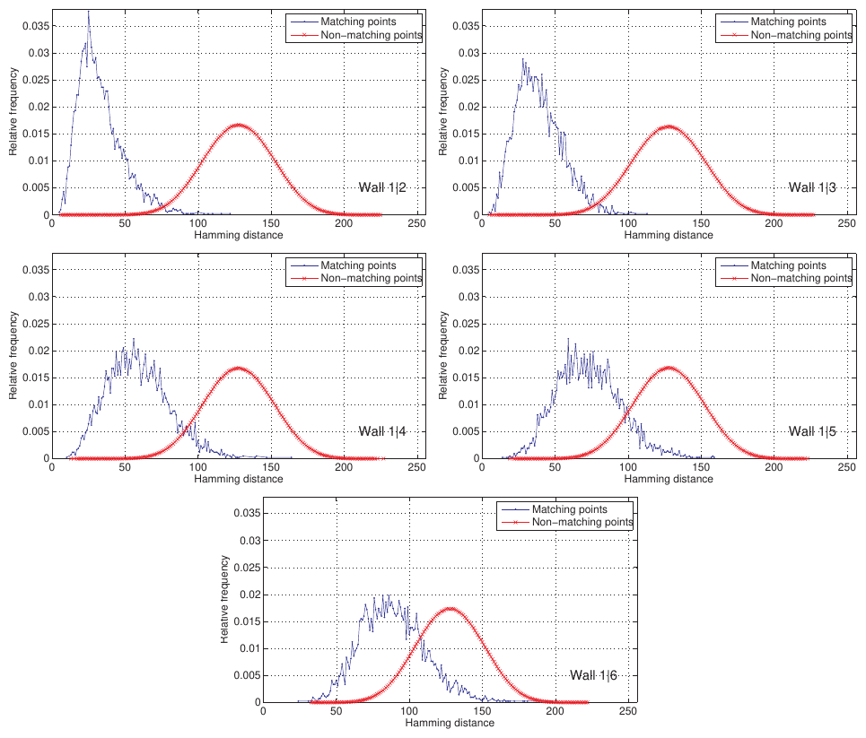
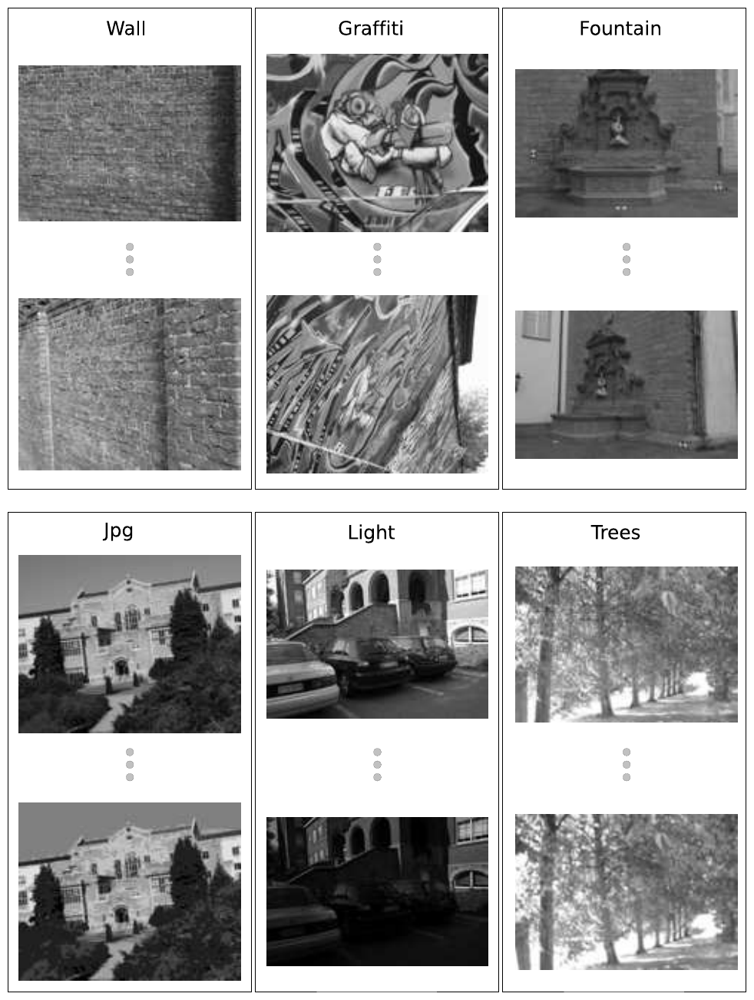
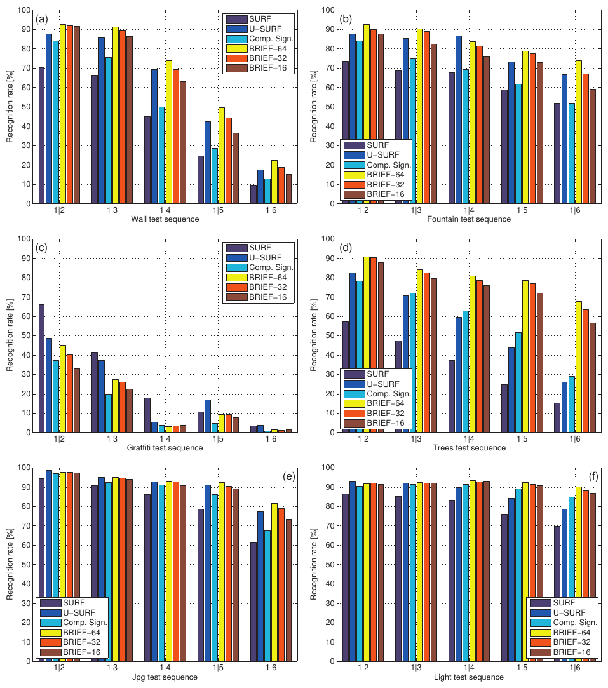
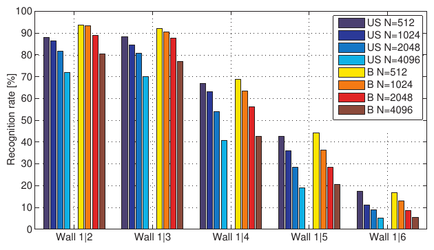
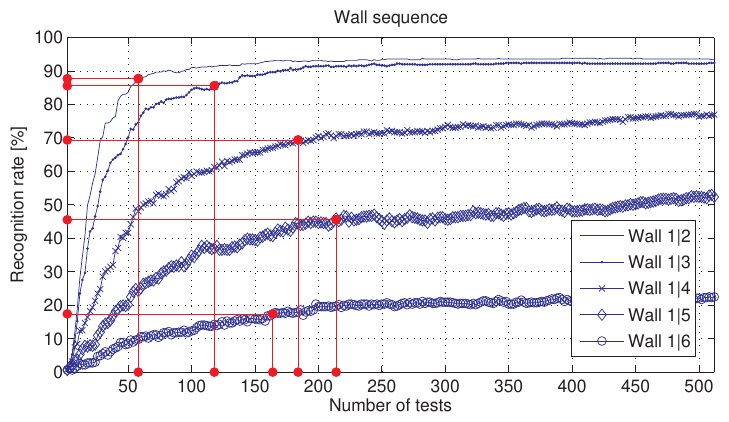
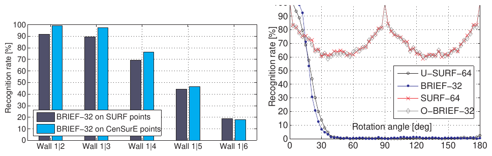

# BRIEF: Binary Robust Independent Elementary Features — конспект

**Авторы:** Michael Calonder, Vincent Lepetit, Christoph Strecha, Pascal Fua (CVLab, EPFL, Лозанна, Швейцария)
**Площадка:** ECCV 2010 (European Conference on Computer Vision), Springer LNCS, т. 6314, с. 778–792, DOI 10.1007/978-3-642-15561-1_56.
**Источник PDF:** открытая копия в институциональном репозитории EPFL Infoscience — https://infoscience.epfl.ch/handle/20.500.14299/50665 (файл `top_1.pdf`, отмечен как open access); локально: [../original/BRIEF_Calonder_2010.pdf](../original/BRIEF_Calonder_2010.pdf)
**Лицензия и режим:** статья опубликована Springer (все права защищены); копия в репозитории EPFL открыта для чтения, но свободная лицензия (CC) не указана → конспект своими словами, а не перевод.
**Расширенная версия (не разбирается здесь):** Calonder et al., «BRIEF: Computing a Local Binary Descriptor Very Fast», IEEE TPAMI 34(7), 2012.

> **Суть в одном абзаце.** BRIEF — двоичный дескриптор особой точки, который строится **напрямую** из сглаженного патча изображения: каждый бит — результат сравнения яркостей в двух заранее выбранных случайных точках патча ($1$, если первая темнее второй). 128–512 таких сравнений дают битовую строку длиной 16–64 байта, а сходство двух дескрипторов — это **расстояние Хэмминга** (XOR + подсчёт единиц), которое на современных CPU считается очень быстро. Обучения нет: пары точек просто сэмплируются из изотропного гауссова распределения вокруг центра патча. При отсутствии сильных поворотов в плоскости BRIEF даёт такую же или лучшую долю правильных сопоставлений, чем [SURF](SURF_конспект.md) и U-SURF, при этом вычисляется в 35–41 раз быстрее [SURF](SURF_конспект.md) и сопоставляется в 4–13 раз быстрее. Платой является отсутствие инвариантности к повороту и масштабу.

---

## 1. Введение

- Дескрипторы особых точек — основа распознавания объектов, 3D-реконструкции, поиска изображений и **локализации камеры**. Растёт объём данных и доля мобильных устройств → нужны дескрипторы, которые быстро вычисляются, быстро сопоставляются и занимают мало памяти.
- Известные способы получить короткие дескрипторы: понижение размерности (PCA, LDA) длинного дескриптора вроде [SIFT](SIFT_конспект.md) или [SURF](SURF_конспект.md); квантование компонент малым числом бит; хеширование [SIFT](SIFT_конспект.md) в двоичные строки, сравниваемые по Хэммингу.
- Общий недостаток: **сначала нужно посчитать полный длинный дескриптор**, а потом сжимать.
- Идея BRIEF: сразу получать двоичную строку из патча, сравнивая яркости пар точек (как в классификаторах на рандомизированных деревьях / наивном Байесе, Ferns), но **без какого-либо обучения**.
- Эксперименты: часто достаточно 256 или даже 128 бит. Сравнение строк — расстояние Хэмминга, для которого в процессорах есть специальные инструкции (XOR и подсчёт бит, POPCNT в SSE4.2).

## 2. Связанные работы

- **[SIFT](SIFT_конспект.md)** — очень различимый (discriminative), но 128-мерный вектор: относительно медленно вычислять и сопоставлять; плохо для SLAM с многими точками и для крупномасштабной 3D-реконструкции с огромными базами дескрипторов.
- **[SURF](SURF_конспект.md)** — гистограммы градиентов, ускоренные интегральными изображениями (integral images); 64-мерная версия стала стандартом де-факто, поэтому BRIEF сравнивается с ней. Но 64 float = **256 байт** на дескриптор.

Три класса методов сокращения дескрипторов:

| Класс | Примеры | Особенности |
|---|---|---|
| Понижение размерности | PCA, LDE (Linear Discriminant Embedding) | PCA — без потерь качества и прост; LDE требует размеченных пар, может улучшить, но и переобучиться |
| Квантование | [SIFT](SIFT_конспект.md) с 4 бит на компоненту; DAISY + PCA + квантование до 60 бит | экономия памяти и быстрое сравнение; но у DAISY биты сгруппированы по 4 и **не могут** сравниваться по Хэммингу независимо |
| Бинаризация | LSH-подобное хеширование [SIFT](SIFT_конспект.md) (умножение на матрицу + порог); бинаризация GIST; нелинейный NCA | сравнение по Хэммингу — XOR + подсчёт бит |

Общая проблема всех трёх — **сначала длинный дескриптор, потом сжатие**. BRIEF строит короткий сразу. Сравнения пар яркостей уже использовались для классификации (Ferns и др.), но BRIEF отличается отсутствием онлайн- или офлайн-обучения.

## 3. Метод

### 3.1. Определение дескриптора

**Бинарный тест** $\tau$ на сглаженном патче $\mathbf{p}$ размера $S\times S$:

$$
\tau(\mathbf{p}; \mathbf{x}, \mathbf{y}) :=
\begin{cases}
1, & \text{если } \mathbf{p}(\mathbf{x}) < \mathbf{p}(\mathbf{y}), \\
0, & \text{иначе},
\end{cases}
$$

- $\mathbf{p}(\mathbf{x})$ — яркость пикселя в **сглаженной** версии патча в точке $\mathbf{x} = (u, v)^\top$;
- $(\mathbf{x}, \mathbf{y})$ — пара точек теста.

**Дескриптор BRIEF** — битовая строка из $n_d$ тестов:

$$
f_{n_d}(\mathbf{p}) := \sum_{1 \le i \le n_d} 2^{i-1}\, \tau(\mathbf{p}; \mathbf{x}_i, \mathbf{y}_i),
$$

- $n_d$ — число тестов (длина в битах); рассматриваются $n_d = 128, 256, 512$;
- набор пар $\{(\mathbf{x}_i, \mathbf{y}_i)\}$ выбирается один раз и фиксируется для всех точек.

Обозначение **BRIEF-k**, где $k = n_d/8$ — число байт: BRIEF-16 (128 бит), BRIEF-32 (256 бит), BRIEF-64 (512 бит).

**Сопоставление:** расстояние Хэмминга $d_H(\mathbf{a}, \mathbf{b}) = \operatorname{popcount}(\mathbf{a} \oplus \mathbf{b})$ — число различающихся бит (форма записи — наша, в статье описано словами).

Единственные проектные решения: (1) ядро сглаживания; (2) пространственное расположение пар. Их выбор делается на наборе **Wall** (5 пар изображений с возрастающей базой, плоская сцена, гомография известна) по метрике «доля распознавания» (recognition rate), определённой в разд. 4.

### 3.2. Сглаживающие ядра

- Тесты смотрят на отдельные пиксели → очень чувствительны к шуму. Предварительное сглаживание повышает стабильность и повторяемость (аналогия: тест — это знак производной, а дифференцировать без сглаживания бессмысленно).
- Эксперимент: гауссово сглаживание с параметром от 0 до 3 (Рис. 1). Чем сложнее пара, тем важнее сглаживание; в диапазоне 1–3 результаты почти постоянны.
- **Выбор: гауссово ядро с параметром 2 и окном 9×9 пикселей** («необходимо и достаточно»).
  *(В тексте статьи сказано «variances of Gaussian kernel ranging from 0 to 3» и «use a value of 2», а на легенде Рис. 1 подписано σ = 0.65…3.05 — т.е. терминология «дисперсия»/σ в статье не вполне последовательна.)*

*Рис. 1 (из оригинальной статьи). Каждая группа из 10 столбцов — доля распознавания на одной паре изображений Wall при возрастающем гауссовом сглаживании. Для трудных пар (справа) сглаживание существенно замедляет падение качества.*

### 3.3. Пространственное расположение тестов

Начало координат — в центре патча. Пять геометрий выбора $n_d$ пар:

| Вариант | Распределение | Комментарий |
|---|---|---|
| G I | $(X, Y) \sim$ i.i.d. $\mathrm{Uniform}(-\tfrac{S}{2}, \tfrac{S}{2})$ | равномерно по патчу, тесты могут быть у границы |
| **G II** | $(X, Y) \sim$ i.i.d. $\mathrm{Gaussian}(0, \tfrac{1}{25}S^2)$ | изотропная гауссиана; $\sigma^2 = S^2/25$ (т.е. $s = \tfrac{5}{2}\sigma$, где $s = S/2$) — лучший по эксперименту |
| G III | $X \sim \mathrm{Gaussian}(0, \tfrac{1}{25}S^2)$, $Y \sim \mathrm{Gaussian}(\mathbf{x}_i, \tfrac{1}{100}S^2)$ | вторая точка — вокруг первой, тесты более локальные; выходящие за патч точки прижимаются к краю |
| G IV | случайно из дискретных узлов грубой полярной сетки | пространственное квантование |
| G V | $\mathbf{x}_i = (0,0)^\top$, $\mathbf{y}_i$ — все узлы грубой полярной сетки из $n_d$ точек | регулярная симметричная схема (сравнение с центром) |

- $X, Y$ — случайные координаты первой и второй точки теста; $S$ — размер стороны патча.

*Рис. 2 (из оригинальной статьи). Пять способов выбора расположения тестов (G I–G V); показано по 128 тестов. Все, кроме крайнего правого (G V), получены случайным сэмплированием.*

*Рис. 3 (из оригинальной статьи). Доля распознавания на парах Wall для пяти геометрий тестов.*

**Результат:** регулярная симметричная G V заметно проигрывает всем случайным (G I–G IV); G II имеет небольшое преимущество в большинстве случаев → **используется G II**.

Размер патча $S$ в тексте ECCV-версии явно не приведён *(в открытой реализации авторов и в OpenCV используется патч 48×48 — см. практические заметки)*.

### 3.4. Распределения расстояний

- Около 4000 соответствующих точек из 5 пар Wall; строятся нормированные гистограммы расстояний Хэмминга между соответствующими (inliers) и несоответствующими точками (Рис. 4).
- Для BRIEF-32 максимум расстояния $32 \cdot 8 = 256$ бит; распределение для несоответствующих точек примерно гауссово с центром около **128** (как у случайных строк).
- Распределение для соответствующих точек сдвинуто влево и смещается вправо с ростом базы (сложности пары).
- Сопоставление = классификация пар «совпадает / не совпадает» по расстоянию Хэмминга; чем лучше разделены распределения, тем выше доля распознавания.

*Рис. 4 (из оригинальной статьи). Распределения расстояний Хэмминга для соответствующих (тонкие синие) и несоответствующих (толстые красные) пар точек на пяти парах Wall. Лучше всего они разделены на первых парах с малой базой.*

## 4. Результаты

### Протокол

- Основное сравнение — с **[SURF](SURF_конспект.md)-64** (OpenCV, 64 float = 256 байт) и **U-SURF** («upright» [SURF](SURF_конспект.md), без коррекции ориентации — как и BRIEF). Для полноты добавлены Compact Signatures (код из SVN OpenCV).
- Шесть открытых последовательностей по 6 изображений; первое сопоставляется с остальными пятью (5 пар):

| Набор | Тип изменения | Эталон |
|---|---|---|
| Wall | ракурс (плоская сцена) | гомография |
| Graffiti | ракурс + поворот (плоская сцена) | гомография |
| Fountain | ракурс (полностью 3D-сцена) | лазерное сканирование |
| Jpg | артефакты сжатия JPEG | гомография ≈ тождественная |
| Light | освещение | гомография ≈ тождественная |
| Trees | размытие | гомография ≈ тождественная |

Wall и Fountain упорядочены по возрастанию базы — пара 1|6 намного сложнее 1|2.

*Рис. 5 (из оригинальной статьи). Наборы для сравнения: Wall, Graffiti, Fountain, Jpg, Light, Trees; в каждом 6 изображений, первое сопоставляется с остальными пятью.*

**Метрики:**
- время CPU (усреднённое по многим прогонам);
- **доля распознавания (recognition rate)**:
  1. взять $N$ особых точек на первом изображении, по эталону вычислить $N$ соответствующих точек на втором, посчитать $2N$ дескрипторов;
  2. для каждой точки первого набора найти ближайшего соседа во втором — это «сопоставление»;
  3. $r = n_c / N$, где $n_c$ — число правильных сопоставлений.
- Авторы признают, что такая схема может завышать абсолютные значения (нет выбросов от детектора), но относительный порядок методов корректен. Проверка: при реальной детекции [SURF](SURF_конспект.md)-точек на обоих изображениях + NN + проверка взаимной согласованности (left-right consistency check) BRIEF превосходит [SURF](SURF_конспект.md) в той же пропорции.
- Для честного сравнения дескрипторов все методы считаются на **[SURF](SURF_конспект.md)-точках** ([SURF](SURF_конспект.md) нужны масштаб и ориентация, U-SURF — масштаб).

### Основные выводы

- BRIEF лучше [SURF](SURF_конспект.md) на всех наборах, **кроме Graffiti**: там нужна сильная инвариантность к повороту, а большие однотонные области делают тесты малоинформативными (данные «любят» гистограммы градиентов).
- Против U-SURF: BRIEF лучше на Wall, Fountain, Trees, сопоставим на Light и Jpg.
- **Ориентационная инвариантность имеет цену** и по скорости, и по качеству: при умеренных поворотах в плоскости BRIEF и U-SURF превосходят [SURF](SURF_конспект.md). Поэтому коррекцию ориентации следует избегать, если она не нужна: телефон с датчиком ориентации, городская съёмка в «канонической» ориентации, мобильные роботы с известной ориентацией.

### Доля распознавания в зависимости от длины дескриптора

*Рис. 6 (из оригинальной статьи). Доля распознавания на (a) Wall, (b) Fountain, (c) Graffiti, (d) Trees, (e) Jpg, (f) Light для [SURF](SURF_конспект.md), U-SURF, Compact Signatures и BRIEF-64/32/16. Число в названии BRIEF — длина в байтах (у [SURF](SURF_конспект.md) и U-SURF — 256 байт).*

При $N = 512$ точек:
- **BRIEF-64** превосходит [SURF](SURF_конспект.md) и U-SURF на всех последовательностях, кроме Graffiti, при дескрипторе в 4 раза короче;
- **BRIEF-32** немного хуже, но всё ещё хорошо выглядит против [SURF](SURF_конспект.md)/U-SURF;
- **BRIEF-16** слишком короткий — показывает пределы подхода.

*Рис. 7 (из оригинальной статьи). Доля распознавания на парах Wall при $N$ = 512, 1024, 2048, 4096 для U-SURF (US) и BRIEF-32 (B). С ростом $N$ доля падает у всех, но при одинаковом $N$ BRIEF-32 лучше U-SURF, кроме последней пары, где обе низки.*

*Рис. 8 (из оригинальной статьи). Доля распознавания на Wall в зависимости от числа тестов. Вертикальные и горизонтальные линии — число тестов, при котором BRIEF достигает доли распознавания U-SURF.*

Число бит BRIEF, нужных для достижения качества U-SURF на Wall (U-SURF: $64 \cdot 4 \cdot 8 = 2048$ бит при 4 байтах на float):

| Пара Wall | 1\|2 | 1\|3 | 1\|4 | 1\|5 | 1\|6 |
|---|---|---|---|---|---|
| Бит BRIEF | 58 | 118 | 184 | 214 | 164 |

Насыщение после ~200 тестов для лёгких пар и рост вплоть до 512 для трудных: BRIEF-32 близок к оптимуму при малой базе, BRIEF-64 предпочтительнее при большой.

### Влияние детектора

- В реальном применении детектор [SURF](SURF_конспект.md) «съест» выигрыш BRIEF в скорости; разумнее брать быстрый детектор — **CenSurE** (в OpenCV 2.0 — «Star») или **[FAST](FAST_конспект.md)**.
- На Wall BRIEF-32 на точках CenSurE работает даже **немного лучше**, чем на точках [SURF](SURF_конспект.md) (Рис. 9, слева).

### Чувствительность к повороту

- Первое изображение Wall ($N = 512$) сопоставляется с его повёрнутой копией (0–180°).
- BRIEF-32 и U-SURF: почти без деградации до **10–15°**, затем резкий обвал.
- [SURF](SURF_конспект.md) (с коррекцией ориентации) лучше при больших поворотах, но хуже при малых.
- **O-BRIEF-32** — BRIEF-32 на изображении, повёрнутом по ориентации, оценённой [SURF](SURF_конспект.md). Кривые O-BRIEF-32 и [SURF](SURF_конспект.md) почти совпадают → поведение при повороте определяется **качеством оценки ориентации**, а не самим дескриптором. (O-BRIEF — демонстрация, а не практический метод.)

*Рис. 9 (из оригинальной статьи). Слева: BRIEF-32 на точках [SURF](SURF_конспект.md) и CenSurE (на CenSurE немного лучше). Справа: доля распознавания при сопоставлении первого изображения Wall с его повёрнутой копией в зависимости от угла для U-SURF-64, BRIEF-32, [SURF](SURF_конспект.md)-64 и O-BRIEF-32.*

### Скорость

Конвейер: (1) детекция, (2) вычисление дескрипторов, (3) сопоставление (поиск ближайшего соседа). Для BRIEF шаг 1 можно делать любым быстрым детектором (CenSurE, [FAST](FAST_конспект.md)). Время шагов 2 и 3 для 512 точек, машина 2.66 ГГц, Linux x86-64:

| Время, мс | BRIEF-16 | BRIEF-32 | BRIEF-64 | [SURF](SURF_конспект.md)-64 |
|---|---|---|---|---|
| Вычисление дескрипторов | 8.18 | 8.87 | 9.57 | 335 |
| Сопоставление (точный NN) | 2.19 | 4.35 | 8.16 | 28.3 |

- Построение дескрипторов: ускорение **35–41×** относительно [SURF](SURF_конспект.md); время самих тестов почти не зависит от длины — основная часть уходит на **сглаживание** (приближённое сглаживание через интегральные изображения могло бы ускорить ещё). Для U-SURF (примерно на 1/3 быстрее [SURF](SURF_конспект.md)) ожидаемое ускорение — 23–27×.
- Сопоставление: ускорение **4–13×**. В статье сказано, что время сопоставления растёт «квадратично» с числом бит, но абсолютные значения в полезном диапазоне крайне малы *(по самой таблице рост близок к линейному: 2.19 → 4.35 → 8.16 мс)*.
- Инструкция POPCNT (SSE4.2) могла бы свести время почти к нулю, но в момент экспериментов была только на новейших Core i7 — использовалась реализация на SSE2/SSE4.1.

## 5. Выводы авторов

- BRIEF представляет патч битовой строкой из небольшого числа тестов сравнения яркостей; он намного быстрее в построении и сопоставлении, чем передовые аналоги, и часто даёт **более высокую** долю распознавания — **пока не требуется инвариантность к большим поворотам в плоскости**.
- Практически важно: сопоставление в реальном времени возможно даже на очень слабых устройствах.
- Теоретически: подтверждает тренд перехода от евклидова расстояния к расстоянию Хэмминга.
- Планы: добавить инвариантность к ориентации и масштабу; по мнению авторов, с быстрыми оценщиками ориентации это возможно без заметной потери скорости. (Это и было сделано позже в [ORB](ORB_конспект.md) и в TPAMI-версии BRIEF.)
- Авторы обещают выложить код (в сноске).

---

## Сводка алгоритма BRIEF (по статье)

**Подготовка (один раз):**
1. Выбрать размер патча $S$ и длину $n_d \in \{128, 256, 512\}$.
2. Сэмплировать $n_d$ пар $(\mathbf{x}_i, \mathbf{y}_i)$ i.i.d. из $\mathcal{N}(0, S^2/25)$ (геометрия G II) и зафиксировать.

**Для каждого изображения:**
1. Сгладить изображение гауссовым ядром (параметр 2, окно 9×9).
2. Найти особые точки любым детектором ([FAST](FAST_конспект.md), CenSurE, [SURF](SURF_конспект.md)…).
3. Для каждой точки: для $i = 1..n_d$ сравнить сглаженные яркости в $\mathbf{x}_i$ и $\mathbf{y}_i$ (относительно центра точки) и записать бит.
4. Сопоставлять по расстоянию Хэмминга (XOR + popcount), например перебором ближайшего соседа.

### Гиперпараметры

| Параметр | Значение в статье |
|---|---|
| Длина дескриптора $n_d$ | 128 / **256** / 512 бит (BRIEF-16 / 32 / 64) |
| Сглаживание | гауссово, параметр 2 (диапазон 1–3 почти равноценен), окно 9×9 |
| Геометрия тестов | G II: i.i.d. $\mathcal{N}(0, S^2/25)$ |
| Размер патча $S$ | в ECCV-версии явно не указан |
| Метрика | расстояние Хэмминга |
| Ориентация / масштаб | не обрабатываются |
| Число точек в тестах | $N = 512$ (также 1024–4096) |

---

## Сильные стороны и ограничения

### Сильные стороны
- **Очень дешёвое вычисление**: несколько сотен сравнений пикселей после одного сглаживания.
- **Очень дешёвое сравнение**: Хэмминг через XOR + POPCNT; хорошо ложится на SIMD, GPU, FPGA.
- **Компактность**: 32 байта против 256 у [SURF](SURF_конспект.md)-64 и 128–512 у [SIFT](SIFT_конспект.md) (в зависимости от хранения) — важно для больших карт/баз.
- **Нет обучения** — нет зависимости от обучающего домена.
- **Высокая доля распознавания** при малых поворотах и умеренных изменениях ракурса, освещения, размытия, JPEG.
- Метод показал, что ориентационная инвариантность не бесплатна — полезный инженерный принцип.

### Ограничения
- **Нет инвариантности к повороту:** резкий обвал после ~10–15°.
- **Нет инвариантности к масштабу:** зависит от масштаба, который даёт детектор (или его отсутствия).
- **Слабость на однотонных областях** (Graffiti): тесты сравнения яркостей малоинформативны там, где мало текстуры.
- **Чувствительность к сглаживанию и шуму** — без предсглаживания качество резко падает.
- Случайные пары **коррелированы** и неоптимальны (позднее показано в [ORB](ORB_конспект.md): у BRIEF высокая корреляция бит; rBRIEF решает это обучением).
- Протокол оценки (эталонные соответствия, без выбросов детектора) завышает абсолютные значения — авторы это признают.
- Оценка — на небольших классических наборах (Oxford affine + Strecha), без задач позиционирования.

---

## Значение для задачи визуального позиционирования

**Роль в конвейере.** BRIEF — «чистый» дескриптор без ориентации и масштаба. В задачах визуального позиционирования он интересен (а) как основа [ORB](ORB_конспект.md), (б) в сценариях, где ориентация камеры известна (IMU/компас на БПЛА), и тогда отказ от ориентационной инвариантности, по выводу статьи, даже повышает качество, (в) когда важны память и скорость (большие карты из двоичных дескрипторов, слабые бортовые вычислители).

**Практические заметки** *(не из статьи, если не указано иное):*
- **OpenCV:** `cv::xfeatures2d::BriefDescriptorExtractor::create(int bytes = 32, bool use_orientation = false)` (модуль `xfeatures2d` из opencv_contrib; проверено по заголовку `xfeatures2d.hpp`, ветка 4.x). Допустимые `bytes`: 16, 32, 64. По исходнику `brief.cpp`: `PATCH_SIZE = 48`, `KERNEL_SIZE = 9`, сглаживание реализовано **через интегральное изображение (box-фильтр)**, а не гауссово ядро, как в статье; точки ближе `PATCH_SIZE/2 + KERNEL_SIZE/2` к границе отбрасываются.
- **Сопоставление:** `cv::BFMatcher(cv::NORM_HAMMING)`; для больших баз — LSH (FLANN `LshIndexParams`) или многоиндексное хеширование. Классический ratio test и проверка взаимной согласованности (cross-check) работают и для двоичных дескрипторов.
- **Компенсация поворота по датчикам.** Для надирной съёмки с БПЛА с известным курсом можно повернуть кадр к «северу» (как карту) и использовать BRIEF без ориентации — это прямое применение вывода статьи о цене ориентационной инвариантности. При ошибке курса > ~10–15° качество резко упадёт.
- **Масштаб.** BRIEF сам по себе не масштабно-инвариантен: кадр и карту нужно приводить к одному GSD или использовать пирамиду (как в [ORB](ORB_конспект.md)).
- **Междоменное сопоставление** (разные сенсоры, сезон, время суток) — слабое место всех дескрипторов на сравнениях яркостей; обучаемые дескрипторы обычно заметно устойчивее, это стоит проверять на своих данных.
- **Порог Хэмминга.** Из Рис. 4: несоответствующие пары для 256 бит концентрируются около 128; соответствующие — существенно левее. Для ориентира: ORB-SLAM2 для 256-битного [ORB](ORB_конспект.md) использует пороги 50 (`TH_LOW`) и 100 (`TH_HIGH`) (по коду `ORBmatcher.cc`); для своих данных порог подбирать по распределениям, аналогичным Рис. 4.

---

## Глоссарий (англ. → рус.)

| English | Русский |
|---|---|
| feature point descriptor | дескриптор особой точки |
| binary string / bitstring | двоичная (битовая) строка |
| binary test / intensity difference test | двоичный тест / тест сравнения яркостей |
| image patch | патч (фрагмент) изображения |
| smoothing kernel | сглаживающее ядро |
| Hamming distance | расстояние Хэмминга |
| popcount / bit count | подсчёт единичных бит |
| XOR | исключающее ИЛИ |
| L2 norm | евклидова норма |
| recognition rate | доля распознавания (доля правильных сопоставлений) |
| nearest neighbor (NN) | ближайший сосед |
| left-right consistency check | проверка взаимной согласованности |
| baseline | база (расстояние между положениями камеры) |
| in-plane rotation | поворот в плоскости изображения |
| orientation invariance | инвариантность к ориентации |
| upright (U-SURF) | «вертикальный», без оценки ориентации |
| dimensionality reduction | понижение размерности |
| PCA | метод главных компонент |
| LDA / LDE | линейный дискриминантный анализ / линейное дискриминантное вложение |
| quantization | квантование |
| Locality Sensitive Hashing (LSH) | хеширование, чувствительное к близости |
| integral image | интегральное изображение |
| sampling geometry / spatial arrangement | геометрия выбора / пространственное расположение тестов |
| i.i.d. | независимые одинаково распределённые |
| polar grid | полярная сетка |
| CenSurE (Center Surround Extrema) / Star | детектор CenSurE / Star |
| Compact Signatures | компактные сигнатуры (дескриптор Calonder et al.) |
| ground truth | эталонные данные |
| homography | гомография |
