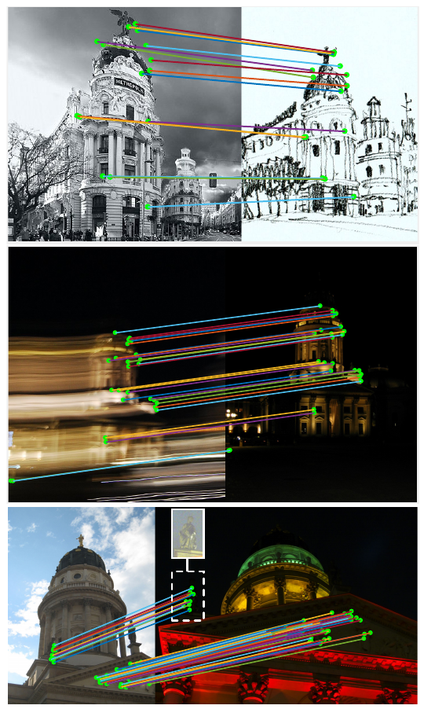
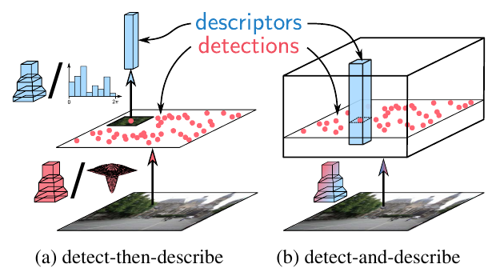
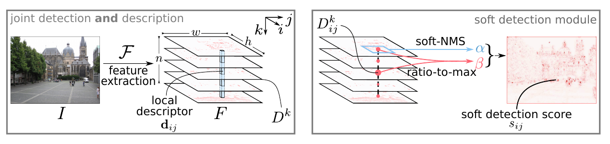
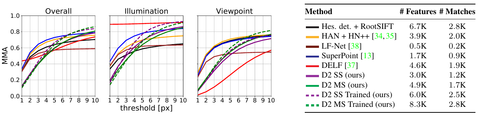
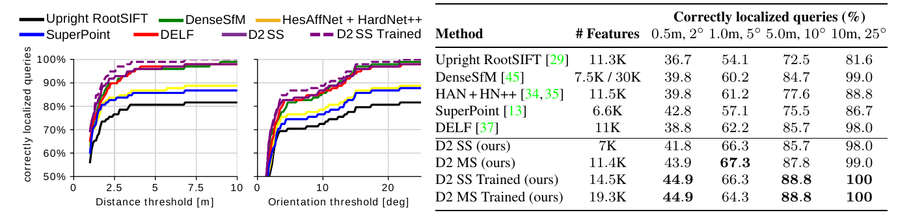

# D2-Net: A Trainable CNN for Joint Description and Detection of Local Features — конспект

**Авторы:** Mihai Dusmanu, Ignacio Rocco, Tomas Pajdla, Marc Pollefeys, Josef Sivic, Akihiko Torii, Torsten Sattler (ENS/Inria, ETH Zurich, CIIRC ЧВУТ в Праге, Microsoft, Tokyo Tech, Chalmers)
**Площадка:** CVPR 2019 (IEEE/CVF Conference on Computer Vision and Pattern Recognition), с. 8092–8101 (по колонтитулам CVF-версии). Препринт: arXiv:1905.03561.
**Источник PDF:** CVF Open Access — https://openaccess.thecvf.com/content_CVPR_2019/papers/Dusmanu_D2-Net_A_Trainable_CNN_for_Joint_Description_and_Detection_of_CVPR_2019_paper.pdf · локальная копия: [../original/D2-Net_Dusmanu_2019.pdf](../original/D2-Net_Dusmanu_2019.pdf)
**Код и веса:** `mihaidusmanu/d2-net` (PyTorch; лицензия Clear BSD; веса `d2_ots.pth` — без дообучения, `d2_tf.pth` — дообученные, `d2_tf_no_phototourism.pth` — без сцен PhotoTourism).
**Лицензия статьи и режим документа:** CVF Open Access (копирайт IEEE/CVF, «identical to the accepted version»), arXiv-версия — non-exclusive distribution license (не CC) → конспект своими словами, а не перевод.

> **Суть в одном абзаце.** Классические и большинство обучаемых признаков работают по схеме «сначала детектировать, потом описать» (detect-then-describe): детектор смотрит на маленькую окрестность и низкоуровневые структуры (углы, блобы), из-за чего его повторяемость резко падает при смене день/ночь, сезона или на слабой текстуре — хотя дескрипторы при этом ещё вполне сопоставимы. D2-Net предлагает обратный порядок — **«описать и детектировать» (describe-and-detect)**: одна CNN (VGG16 до conv4_3) выдаёт плотную карту признаков, которая одновременно служит и **дескрипторами** (вектор по всем каналам в пикселе), и **детектором** (ключевая точка — локальный максимум в «самом сильном» канале этого пикселя). Все параметры общие для обеих задач. Обучение — на соответствиях из MegaDepth (SfM + MVS) с триплетной потерей, взвешенной мягкими оценками детекции. Результат: лучшая на момент публикации локализация на Aachen Day-Night (особенно при строгих порогах) и InLoc (помещения), сопоставимое качество в SfM — при менее точной локализации точек.

*Рис. 1 (из оригинальной статьи). Сопоставления D2-Net при сильных различиях внешнего вида: фото ↔ рисунок, размытие движения, день ↔ ночь.*

---

## 1. Введение: постановка проблемы

- Пиксельные соответствия между изображениями — основа 3D-зрения, трекинга, поиска изображений и визуальной локализации.
- **Разреженные локальные признаки** (sparse local features) по схеме detect-then-describe: детектор находит точки, дескриптор описывает патч вокруг каждой. Плюсы: быстрое сопоставление (приближённый ближайший сосед, евклидово расстояние), экономия памяти, масштабируемость SfM и локализации, хорошая точность локализации точек.
- **Слабое место:** при экстремальной смене внешнего вида (день–ночь, сезоны) и в слабо текстурированных сценах. Причина — **низкая повторяемость детектора**: дескриптор смотрит на большой патч и кодирует более высокоуровневые структуры, а детектор — на малую область и низкоуровневую статистику пикселей, которая сильнее всего меняется. Дескрипторы при этом часто ещё можно сопоставить, даже если точки не находятся повторно.
- **Плотные методы** (без детектора, дескрипторы во всех пикселях) работают в трудных условиях заметно лучше, но дороже по времени сопоставления и памяти.
- **Идея D2:** взять лучшее от обоих — разреженный набор признаков, но с **отложенной детекцией (postponed detection)**: сначала CNN строит карты признаков, затем из **них же** берутся и дескрипторы, и точки (локальные максимумы карт). Детектор тем самым жёстко связан с дескриптором: обнаруживаются пиксели с **локально уникальными** дескрипторами, и обе задачи опираются на высокоуровневую информацию глубоких слоёв.
- Подход работает уже **без обучения** (готовый VGG16), а дообучение на MegaDepth его улучшает.
- Признанные авторами минусы: дороже классических признаков (плотное извлечение, хотя за один проход CNN); высокоуровневая детекция даёт **более устойчивые, но менее точно локализованные** точки — хотя, как показано, точности хватает для локализации и SfM.

*Рис. 2 (из оригинальной статьи). (a) Двухэтапный подход detect-then-describe в разных вариантах: детектор (ручной или обучаемый) находит точки, затем дескриптор описывает патч. (b) Предлагаемый подход: одна CNN извлекает плотные признаки, служащие и дескрипторами, и детекторами.*

## 2. Связанные работы

- **Локальные признаки (detect-then-describe).** Ручные детекторы (Harris, DoG/SIFT, Hessian-Affine, MSER и др.) и дескрипторы ([SIFT](SIFT_конспект.md), [SURF](SURF_конспект.md), [BRIEF](BRIEF_конспект.md), [ORB](ORB_конспект.md), BRISK); обучаемые дескрипторы (L2Net, [HardNet](HardNet_конспект.md), TFeat, DeepDesc и др.) или детекторы (Quad-Networks, TILDE-подобные); совместно обучаемые — **[LIFT](LIFT_конспект.md)**, **LF-Net**. Детектор обычно смотрит на малую область и низкоуровневые структуры.
- **[SuperPoint](SuperPoint_конспект.md)** — ближайшая работа: тоже общее глубокое представление для детекции и описания, но с **раздельными головами-декодерами**, обученными отдельными потерями. В D2-Net **все параметры общие**, и обе задачи оптимизируются **одной** совместной потерей.
- **Плотное извлечение и сопоставление** (UCN, DenseSfM и др.) — лучше разреженного в трудных условиях, особенно при сильной смене освещения; это и указывает, что детектор — слабое звено.
- **Поиск изображений.** DELF добавляет модуль внимания (attention) поверх плотных признаков для выбора небольшого числа надёжных точек (снизить ложные совпадения при поиске); D2-Net, по экспериментам, значительно лучше DELF в сопоставлении и локализации. Tolias et al. (R-MAC) неявно детектируют точки как глобальные максимумы карт признаков — это вдохновило D2-Net детектировать **локальные** максимумы.
- **Детекция объектов** (SSD, YOLO, Faster R-CNN): тоже плотные признаки + оценка предложений + NMS, но решают другую задачу и не дают пиксельных соответствий.

## 3. Совместный конвейер детекции и описания

*Рис. 3 (из оригинальной статьи). Сеть D2: CNN 𝓕 извлекает карты признаков F (h×w×n) с двойной ролью: (i) дескриптор d_ij — срез всех n карт в позиции (i, j); (ii) детекции — NMS по пространству в карте плюс NMS по каналам дескриптора. При обучении оценки детекции s_ij считаются из мягкого локального максимума α и отношения к максимуму по каналам β.*

Первый шаг — применить CNN $\mathcal{F}$ к изображению $I$:

$$
F = \mathcal{F}(I), \qquad F \in \mathbb{R}^{h \times w \times n}
$$

- $h \times w$ — пространственное разрешение карт признаков, $n$ — число каналов.

### 3.1. Описание (Feature Description)

Тензор $F$ трактуется как **плотный набор дескрипторов**:

$$
\mathbf{d}_{ij} = F_{ij:}, \qquad \mathbf{d} \in \mathbb{R}^n, \quad i = 1..h,\; j = 1..w
$$

- Перед сравнением — L2-нормировка: $\hat{\mathbf{d}}_{ij} = \mathbf{d}_{ij} / \lVert \mathbf{d}_{ij} \rVert_2$; сравниваются евклидовым расстоянием.
- При обучении дескрипторы подстраиваются так, чтобы одна и та же точка сцены давала похожие векторы при сильных изменениях внешнего вида.
- Размерность $n = 512$ — число каналов conv4_3 в VGG16 *(следует из архитектуры; в тексте статьи явно не названо)*.

### 3.2. Детекция (Feature Detection)

Тот же тензор трактуется как набор **2D-карт откликов** $n$ «детекторов»:

$$
D^k = F_{::k}, \qquad D^k \in \mathbb{R}^{h \times w}, \quad k = 1..n
$$

- Каждая $D^k$ — аналог карты DoG в [SIFT](SIFT_конспект.md) или «угловатости» в детекторе Harris; затем отклики разреживаются.

**Жёсткая детекция (hard detection)** — используется при инференсе. В отличие от классики, карт много, и точка может быть найдена в любой из них:

$$
(i, j) \text{ — детекция} \iff D^k_{ij} \text{ — локальный максимум в } D^k, \quad \text{где } k = \arg\max_t D^t_{ij}
$$

- т.е. для каждого пикселя сначала выбирается **самый сильный канал** (NMS по каналам, channel selection), затем проверяется, что в этом канале пиксель — **пространственный локальный максимум** (NMS по пространству).

**Мягкая детекция (soft detection)** — используется при обучении, чтобы детекция была дифференцируемой.

Мягкий локальный максимум (soft local-max), аналог пространственного NMS:

$$
\alpha^k_{ij} = \frac{\exp\left(D^k_{ij}\right)}{\sum_{(i', j') \in \mathcal{N}(i, j)} \exp\left(D^k_{i'j'}\right)}
$$

- $\mathcal{N}(i, j)$ — 9 соседей пикселя $(i, j)$, включая его самого (окно 3×3).

Мягкий выбор канала — «отношение к максимуму» (ratio-to-max), аналог NMS по каналам:

$$
\beta^k_{ij} = \frac{D^k_{ij}}{\max_t D^t_{ij}}
$$

Объединение критериев — максимум произведения по всем каналам:

$$
\gamma_{ij} = \max_k \left(\alpha^k_{ij}\, \beta^k_{ij}\right)
$$

Нормировка по изображению — итоговая мягкая оценка детекции:

$$
s_{ij} = \frac{\gamma_{ij}}{\sum_{(i', j')} \gamma_{i'j'}}
$$

- $s_{ij}$ — «вес» пикселя как ключевой точки; сумма по изображению равна 1.

### 3.3. Многомасштабная детекция (Multiscale Detection)

- CNN-дескрипторы благодаря аугментациям при предобучении частично устойчивы к масштабу, но **не инвариантны**; при сильной смене ракурса сопоставление ломается.
- Решение — **пирамида изображений** (только при тесте): $I^\rho$ с $\rho \in \{0.5, 1, 2\}$ (половинное, исходное, двойное разрешение) → карты $F^\rho$.
- Крупные структуры распространяются с грубых масштабов на более тонкие:

$$
\tilde{F}^\rho = F^\rho + \sum_{\gamma < \rho} F^\gamma
$$

- $F^\gamma$ более грубых масштабов приводятся к разрешению $F^\rho$ билинейной интерполяцией; детекция выполняется на объединённых картах $\tilde{F}^\rho$.
- **Гейтинг откликов (response gating)** против повторной детекции: начиная с самого грубого масштаба, найденные позиции отмечаются маской; маска переносится (ближайший сосед) на следующие масштабы, и детекции в отмеченных областях игнорируются.
- Обозначения в экспериментах: **D2 SS** — один масштаб (single-scale), **D2 MS** — многомасштабный (multi-scale); «Trained» — дообученная модель, без пометки — готовый VGG16 (off-the-shelf).

## 4. Совместная оптимизация детекции и описания

### 4.1. Функция потерь

Цели: точки должны быть **повторяемыми** (детекция), дескрипторы — **различимыми** (описание). Авторы расширяют триплетную ранжирующую потерю с порогом (triplet margin ranking loss), успешно применявшуюся для дескрипторов (TFeat, [HardNet](HardNet_конспект.md)), чтобы она учитывала и детекцию.

Дана пара изображений $(I_1, I_2)$ и соответствие $c: A \leftrightarrow B$ ($A \in I_1$, $B \in I_2$).

**Положительное расстояние** — между соответствующими дескрипторами:

$$
p(c) = \left\lVert \hat{\mathbf{d}}^{(1)}_A - \hat{\mathbf{d}}^{(2)}_B \right\rVert_2
$$

**Отрицательное расстояние** — до самого «сбивающего» (confounding) дескриптора в любом из изображений:

$$
n(c) = \min\left( \left\lVert \hat{\mathbf{d}}^{(1)}_A - \hat{\mathbf{d}}^{(2)}_{N_2} \right\rVert_2,\; \left\lVert \hat{\mathbf{d}}^{(1)}_{N_1} - \hat{\mathbf{d}}^{(2)}_B \right\rVert_2 \right)
$$

где трудные негативы ищутся **вне квадратной окрестности** правильного соответствия:

$$
N_1 = \arg\min_{P \in I_1} \left\lVert \hat{\mathbf{d}}^{(1)}_P - \hat{\mathbf{d}}^{(2)}_B \right\rVert_2 \quad \text{при} \quad \lVert P - A \rVert_\infty > K
$$

(аналогично для $N_2$).

- $K$ — радиус «безопасной» окрестности: точки ближе $K$ к правильной позиции не считаются негативами (соседние пиксели естественно похожи). Значение в статье не указано; в официальном коде `safe_radius = 4` в клетках карты признаков (по коду `lib/loss.py`).

**Триплетный член** с порогом $M$:

$$
m(c) = \max\left(0,\; M + p(c)^2 - n(c)^2\right)
$$

- $M$ — порог; в статье не указан, в коде `margin = 1` (по коду). В коде квадраты расстояний считаются как $2 - 2\,\hat{\mathbf{d}}^\top\hat{\mathbf{d}}'$ (по коду).

**Итоговая потеря** — среднее триплетных членов, взвешенное оценками детекции:

$$
\mathcal{L}(I_1, I_2) = \sum_{c \in \mathcal{C}} \frac{s^{(1)}_c\, s^{(2)}_c}{\sum_{q \in \mathcal{C}} s^{(1)}_q\, s^{(2)}_q}\; m\big(p(c), n(c)\big)
$$

- $s^{(1)}_c$, $s^{(2)}_c$ — мягкие оценки детекции (формула для $s_{ij}$) в точках $A$ и $B$;
- $\mathcal{C}$ — все соответствия между $I_1$ и $I_2$.

**Почему так:** потеря — взвешенное среднее триплетных членов. Чтобы её уменьшить, сеть **повышает относительные оценки детекции** у самых различимых соответствий (с малым $m$) и понижает у неразличимых; и наоборот, соответствия с высокими оценками «подталкиваются» к ещё более различимым дескрипторам. Так одной потерей связываются повторяемость (точки должны быть найдены в обоих изображениях — произведение $s^{(1)} s^{(2)}$) и различимость.

### 4.2. Обучающие данные

- **MegaDepth:** 196 сцен, реконструированных COLMAP из 1 070 468 интернет-фото; для 102 681 изображения доступны внутренние/внешние параметры камер и карты глубины из Multi-View Stereo (MVS).
- Отбор пар: все пары изображений с перекрытием разреженных SfM-облаков **не менее 50%**.
- Соответствия: все точки второго изображения с известной глубиной проецируются в первое; **проверка глубины** по карте глубины первого изображения убирает загороженные пиксели.
- Итого 327 036 пар. Валидация — 18 149 пар из 78 сцен (в каждой < 500 пар), обучение — остальные 118 сцен.

### 4.3. Детали реализации

**Архитектура.** VGG16, предобученная на ImageNet, обрезанная после **conv4_3**, — инициализация $\mathcal{F}$.

| Параметр | Значение |
|---|---|
| Основа | VGG16 (ImageNet) до conv4_3 |
| Дообучаемые слои | только последний (conv4_3) |
| Оптимизатор | Adam |
| Начальный lr | $10^{-3}$, деление на 2 каждые 10 эпох |
| Эпохи | 50 (в коде по умолчанию `--num_epochs 10` — по коду `train.py`) |
| Пар на сцену за эпоху | 100 случайных (компенсация дисбаланса сцен) |
| Кроп | случайный 256×256 вокруг одного соответствия |
| Размер батча | 1 (пара изображений) |
| Мин. соответствий в паре | 128 (для осмысленных градиентов) |
| Порог $M$ / радиус $K$ | не указаны в статье; в коде 1 / 4 клетки карты (по коду) |
| Предобработка | по коду: `caffe` (веса Caffe VGG16; по README) |
| Исходное обучение | TensorFlow; в репозитории — переписанный на PyTorch конвейер (по README) |

**Изменения при тесте** (для повышения разрешения карт):
- последний пулинг **pool3** (шаг 2) заменяется **average pooling с шагом 1**;
- conv4_1 … conv4_3 заменяются **дилатированными (dilated) свёртками с rate 2**, чтобы рецептивное поле не изменилось;
- в результате карты имеют разрешение **1/4 от входа** (вместо 1/8) → больше кандидатов и лучше локализация;
- положения точек уточняются **локальной субпиксельной доводкой** на уровне карты признаков (как в [SIFT](SIFT_конспект.md)), а дескрипторы **билинейно интерполируются** в уточнённых позициях.

*Практические параметры извлечения (по коду `extract_features.py`):* максимальная сторона изображения 1600 px, сумма сторон не более 2800 px; по умолчанию один масштаб, флаг `--multiscale` включает пирамиду.

## 5. Экспериментальная оценка

### 5.1. Сопоставление изображений (HPatches)

- 108 из 116 последовательностей HPatches (исключены изображения больше 1200×1600, т.к. не все методы с ними справлялись): 52 — только освещение, 56 — только ракурс; 6 изображений в каждой, первое сопоставляется со всеми остальными → 540 пар.
- **Протокол:** ближайший сосед, принимаются только **взаимные** ближайшие соседи (mutual nearest neighbors); соответствие верно, если ошибка репроекции по эталонной гомографии ниже порога. Метрика — **MMA** (mean matching accuracy, средняя доля верных соответствий на пару) как функция порога 1–10 px.
- Базовые линии: Hessian-Affine + RootSIFT; HesAffNet + [HardNet](HardNet_конспект.md)++ (HAN + HN++; [HardNet](HardNet_конспект.md)++ обучался на HPatches); LF-Net; [SuperPoint](SuperPoint_конспект.md); DELF.

*Рис. 4 (из оригинальной статьи). MMA в зависимости от порога (px) для всех пар, только освещения и только ракурса, плюс среднее число найденных признаков и взаимных NN-соответствий. D2-Net (SS и MS) лучше всех в целом при пороге от 6.5 px.*

Среднее число признаков и взаимных соответствий (из рис. 4):

| Метод | # признаков | # соответствий |
|---|---|---|
| Hes. det. + RootSIFT | 6.7K | 2.8K |
| HAN + HN++ | 3.9K | 2.0K |
| LF-Net | 0.5K | 0.2K |
| [SuperPoint](SuperPoint_конспект.md) | 1.7K | 0.9K |
| DELF | 4.6K | 1.9K |
| D2 SS | 3.0K | 1.2K |
| D2 MS | 4.9K | 1.7K |
| D2 SS Trained | 6.0K | 2.5K |
| D2 MS Trained | 8.3K | 2.8K |

**Интерпретация авторов:**
- D2-Net — лучший в целом при порогах **≥ 6.5 px**; при строгих порогах (1–3 px) проигрывает detect-then-describe методам: те используют низкоуровневые блобы, которые лучше локализуются, а D2 ещё и детектирует на пониженном разрешении карт CNN.
- DELF не уточняет положения: на последовательностях освещения (камера неподвижна) это даёт «идеальную» точность при строгих порогах, но на ракурсах он слаб.
- LF-Net: увеличение числа точек сверх 500 ухудшало результат; авторы предполагают, что LF-Net не рассчитан на сопоставление взаимными ближайшими соседями.
- Слабость D2 на ракурсах объясняется **смещением обучающих данных**: ~90% пар MegaDepth имеют разницу направлений осей камер < 20°.
- Многомасштабная детекция улучшает устойчивость к ракурсу, но добавляет «сбивающих» дескрипторов и ухудшает устойчивость к освещению.

### 5.2. 3D-реконструкция

- Local Feature Evaluation Benchmark (Schönberger et al.): Madrid Metropolis (1344 изобр.), Gendarmenmarkt (1463), Tower of London (1576) — интернет-фото с разными камерами и условиями; исчерпывающее сопоставление всех пар (без поиска изображений). Протокол: SfM (COLMAP), затем MVS.
- Базовые линии: RootSIFT (лучший по сайту бенчмарка) и GeoDesc (с ratio-тестом 0.89, как советуют его авторы).

Таблица 1 статьи:

| Сцена | Метод | Зарег. изобр. | Разреж. точек | Длина трека | Ошибка репроекции | Плотных точек |
|---|---|---|---|---|---|---|
| Madrid Metropolis | RootSIFT | 500 | 116K | 6.32 | **0.60 px** | **1.82M** |
| | GeoDesc | 495 | **144K** | 5.97 | 0.65 px | 1.56M |
| | D2 MS | **501** | 84K | 6.33 | 1.28 px | 1.46M |
| | D2 MS trained | 495 | **144K** | **6.39** | 1.35 px | 1.46M |
| Gendarmenmarkt | RootSIFT | 1035 | 338K | 5.52 | **0.69 px** | **4.23M** |
| | GeoDesc | 1004 | **441K** | 5.14 | 0.73 px | 3.88M |
| | D2 MS | **1053** | 250K | 5.08 | 1.19 px | 3.49M |
| | D2 MS trained | 965 | 310K | **5.55** | 1.28 px | 3.15M |
| Tower of London | RootSIFT | **804** | 239K | **7.76** | **0.61 px** | **3.05M** |
| | GeoDesc | 776 | **341K** | 6.71 | 0.63 px | 2.73M |
| | D2 MS | 785 | 180K | 5.32 | 1.24 px | 2.73M |
| | D2 MS trained | 708 | 287K | 5.20 | 1.34 px | 2.86M |

- В целом D2 на уровне лучших: число зарегистрированных изображений сопоставимо, т.е. точности точек **достаточно** для SfM.
- Ошибка репроекции примерно вдвое выше (~1.2–1.35 px против ~0.6–0.7 px) — прямое следствие менее точной локализации.
- Меньше 3D-точек — из-за **ratio-теста** в конвейере реконструкции: для D2 он отбрасывает и 20–25% верных соответствий, т.к. потеря D2 не учитывает такую фильтрацию (детали — в supplementary).

### 5.3. Локализация в трудных условиях

**Aachen Day-Night (день–ночь).** Задача локальной реконструкции: для каждого из 98 ночных снимков даны до 20 релевантных дневных с известными позами; дневные сопоставляются исчерпывающе, 3D-структура триангулируется по известным позам, затем по ней локализуются ночные снимки. Метрика — доля ночных запросов с ошибкой позы в пределах порогов. Для методов с порогом числа признаков (HAN + HN++, DELF, [SuperPoint](SuperPoint_конспект.md)) порог подбирался в пользу строгих порогов точности; приводятся лучшие результаты каждого.

*Рис. 5 (из оригинальной статьи). Доля правильно локализованных ночных запросов в зависимости от порога расстояния и угла (графики) и при фиксированных порогах (таблица). D2-Net заметно лучше всех при строгих порогах.*

| Метод | # признаков | 0.5 м, 2° | 1.0 м, 5° | 5.0 м, 10° | 10 м, 25° |
|---|---|---|---|---|---|
| Upright RootSIFT | 11.3K | 36.7 | 54.1 | 72.5 | 81.6 |
| DenseSfM | 7.5K / 30K | 39.8 | 60.2 | 84.7 | 99.0 |
| HAN + HN++ | 11.5K | 39.8 | 61.2 | 77.6 | 88.8 |
| [SuperPoint](SuperPoint_конспект.md) | 6.6K | 42.8 | 57.1 | 75.5 | 86.7 |
| DELF | 11K | 38.8 | 62.2 | 85.7 | 98.0 |
| D2 SS | 7K | 41.8 | 66.3 | 85.7 | 98.0 |
| D2 MS | 11.4K | 43.9 | **67.3** | 87.8 | 99.0 |
| D2 SS Trained | 14.5K | **44.9** | 66.3 | **88.8** | **100** |
| D2 MS Trained | 19.3K | **44.9** | 64.3 | **88.8** | **100** |

- D2-Net лучше всех базовых линий, особенно при строгих порогах; разреженный D2 обходит даже **DenseSfM** (плотные VGG16-признаки с иерархическим сопоставлением conv4 → conv3), использующий заметно больше признаков, времени и памяти.
- Менее точная локализация точек **не мешает** точной оценке позы.

**InLoc (помещения).** ~10 тыс. изображений базы, два здания; сильная смена ракурса и освещения, изменения сцены во времени, слабая текстура и повторяющиеся структуры. D2 встроен в два варианта конвейера InLoc (код авторов InLoc):
- **Direct PE** (pose estimation) — запрос сопоставляется с лучшим изображением по поиску (NetVLAD), по соответствиям оценивается поза;
- **Sparse PE** — сопоставление с топ-100 найденными, пространственная верификация, поза — по изображению с наибольшим числом проверенных соответствий;
- **Dense PE** — плотные CNN-дескрипторы VGG16 с направляемым сопоставлением conv5 → conv3;
- **Dense PV** (pose verification) — рендер синтетического изображения из оценённой позы и сравнение с запросом по плотным [SIFT](SIFT_конспект.md); пересортировка топ-10. InLoc = Dense PE + Dense PV.

Таблица 2 статьи — доля локализованных запросов, % (ошибка ориентации ≤ 10°):

| Метод | 0.25 м | 0.5 м | 1.0 м |
|---|---|---|---|
| Direct PE — Aff. RootSIFT | 18.5 | 26.4 | 30.4 |
| Direct PE — D2 MS | **27.7** | **40.4** | **48.6** |
| Sparse PE — Aff. RootSIFT (5 МБ на изобр.) | 21.3 | 32.2 | 44.1 |
| Sparse PE — D2 MS (120 МБ) | **35.0** | **48.6** | **62.6** |
| Dense PE (350 МБ) | **35.0** | 46.2 | 58.1 |
| Sparse PE — Aff. RootSIFT + Dense PV | 29.5 | 42.6 | 54.5 |
| Sparse PE — D2 MS + Dense PV | 38.0 | 54.1 | 65.4 |
| Dense PE + Dense PV (= InLoc) | **41.0** | **56.5** | **69.9** |
| **InLoc + D2 MS** | **43.2** | **61.1** | **74.2** |

- D2 намного лучше RootSIFT в Direct и Sparse PE и лучше плотного Dense PE, требуя меньше памяти (120 МБ против 350 МБ на изображение).
- С Dense PV D2 не достигает полного InLoc (тот использует плотные данные), но приближается к нему.
- **Комбинация** InLoc и D2 (выбор позы по оценке Dense PV среди топ-10 каждого метода; выбрано 182 позы Dense PE и 174 позы Sparse PE с D2 MS) даёт новый state of the art.

## 6. Выводы авторов

- Предложен подход describe-and-detect: детекция не по низкоуровневым структурам, а **отложена** до появления более надёжной информации и выполняется совместно с описанием.
- Метод превосходит state-of-the-art в локализации камеры в трудных условиях (день–ночь, помещения) и пригоден для 3D-реконструкции, несмотря на худшую локализацию точек.
- Дальнейшая работа: повысить точность положения точек (больше пространственное разрешение карт CNN или регрессия точных координат); добавить в потерю цель, похожую на ratio-тест, — для SfM и подобных приложений.

---

## Описание ключевых рисунков

*Рисунки вставлены в соответствующие разделы выше (Рис. 1 — после аннотации, 2 — разд. 1, 3 — разд. 3, 4 — разд. 5.1, 5 — разд. 5.3). Здесь — сводка.*

- **Рис. 1** — качественные сопоставления: фото ↔ рисунок, размытие движения, день ↔ ночь; соответствия находятся при очень сильном различии внешнего вида.
- **Рис. 2** — концептуальное сравнение: (a) detect-then-describe — детектор на низкоуровневых структурах, затем дескриптор патча; (b) detect-and-describe — один «кубик» признаков CNN, из которого берутся и точки, и дескрипторы.
- **Рис. 3** — схема сети: VGG-экстрактор → тензор F; дескриптор — вертикальный срез; модуль мягкой детекции: soft-NMS (α) + ratio-to-max (β) → карта оценок s.
- **Рис. 4** — MMA на HPatches по порогу для всех/освещения/ракурса + таблица числа признаков и соответствий; D2 выигрывает при больших порогах, проигрывает при строгих и на ракурсе.
- **Рис. 5** — Aachen Day-Night: кривые доли локализованных запросов по порогу расстояния и угла + таблица; D2 лидирует при строгих порогах.

---

## Сильные стороны и ограничения

### Сильные стороны
- **Простая и общая идея:** одна сеть, все параметры общие; детектор — «бесплатное» следствие дескрипторного тензора, без отдельной головы.
- **Устойчивость к сильной смене внешнего вида** (день–ночь, слабая текстура в помещениях) — на момент публикации лучший разреженный метод на Aachen Day-Night и InLoc.
- Работает **даже без дообучения** (готовый VGG16) — удобно для быстрого старта.
- **Учитель из реальной 3D-геометрии** (MegaDepth: SfM + MVS + проверка глубины), а не синтетических гомографий — реальные параллакс, окклюзии и изменения освещения.
- Совместная потеря естественно связывает повторяемость и различимость (веса $s^{(1)}s^{(2)}$ в триплетной потере).
- Значительно экономнее плотных методов по памяти (120 МБ против 350 МБ на изображение в InLoc) при сопоставимом или лучшем качестве.

### Ограничения
- **Плохая точность локализации точек:** детекция на картах 1/4 разрешения (при обучении — 1/8) по высокоуровневым признакам; на HPatches при порогах < 6.5 px проигрывает классике; ошибка репроекции в SfM ~1.2–1.35 px против ~0.6–0.7 px у RootSIFT.
- **Тяжёлая модель:** VGG16 до conv4_3, дилатированные свёртки на 1/4 разрешения, 512-мерные дескрипторы float32 → медленно и много памяти; при многомасштабном режиме — ещё ×3 проходов. Время работы в статье не приводится.
- **512-D дескрипторы** — в 4 раза больше [SIFT](SIFT_конспект.md)/HardNet по памяти и времени сопоставления.
- Смещение обучающих данных к **малым изменениям ракурса** (~90% пар < 20°) → слабость на HPatches-viewpoint; нет явной инвариантности к повороту.
- Дообучается только один слой (conv4_3) — возможности обучения используются ограниченно.
- Потеря не учитывает **ratio-тест**, поэтому стандартные SfM-конвейеры с ratio-фильтрацией теряют 20–25% верных соответствий D2.
- Многомасштабный режим ухудшает устойчивость к освещению (больше сбивающих дескрипторов).
- Ключевые гиперпараметры потери ($M$, $K$) не названы в тексте статьи (есть только в коде).

---

## Значение для задачи визуального позиционирования

**Роль в конвейере.** D2-Net изначально нацелен на **визуальную локализацию** в трудных условиях: в иерархической схеме «глобальный поиск кандидатов (NetVLAD и др.) → локальные признаки → сопоставление → [RANSAC](RANSAC_конспект.md) + PnP» (hloc) он занимает место локальных признаков. Результаты на Aachen Day-Night и InLoc прямо относятся к сценарию «запрос в других условиях, чем карта».

**Практические заметки** *(не из статьи):*
- **Где D2-Net осмыслен:** сопоставление кадров с картой/базой, снятой в другое время суток или сезон; слабо текстурированные сцены. Для задачи «кадр БПЛА ↔ ортофото/спутник» межсезонная и межсенсорная устойчивость — ключевое требование, и идея describe-and-detect здесь полезна.
- **Где нет:** высокоточная геометрия (субпиксельная оценка позы, калибровка) и встраиваемые платформы с жёсткими ограничениями по времени — D2-Net тяжёл (VGG16, 512-D). На Jetson-классе устройств реальная частота будет низкой; разрешение входа — главный рычаг.
- **Современные альтернативы** с той же идеей «детекция из плотных признаков» и обучением на MegaDepth, но точнее и быстрее: [R2D2](R2D2_конспект.md), ASLFeat (уточнение локализации и многоуровневая детекция), [DISK](DISK_конспект.md), [ALIKED](ALIKED_конспект.md); для сопоставления — [LightGlue](LightGlue_конспект.md)/SuperGlue или плотные матчеры ([LoFTR](LoFTR_перевод.md), RoMa). D2-Net полезен как базовая линия и как источник идей.
- **Сопоставление.** В статье — взаимный ближайший сосед; классический ratio-тест для D2 плохо подходит (теряет верные соответствия). Дескрипторы L2-нормированы → для ускорения можно применять PCA до 128–256 измерений *(эмпирическая практика, проверять на своих данных)*.
- **Параметры извлечения по коду:** изображение ограничивается до 1600 px по большей стороне и 2800 px по сумме сторон; многомасштабный режим (`--multiscale`) лучше для смены масштаба/ракурса, одномасштабный — для смены освещения (вывод из разд. 5.1).
- **Дообучение на своём домене:** конвейер генерации соответствий (SfM + MVS + проверка глубины + перекрытие ≥ 50%) напрямую переносится на свои аэро-/наземные реконструкции (COLMAP/Metashape) — так можно адаптировать модель к своей местности, сезонам и высотам съёмки.
- **Субпиксельная точность.** Для точной позы полезно уточнять соответствия после сопоставления (например, через уточнение на более тонких картах признаков) — это прямо следует из выявленного авторами главного недостатка.
- **Лицензия:** код — Clear BSD (не даёт патентных прав); веса построены на ImageNet-предобученном VGG16 и данных MegaDepth — при коммерческом использовании проверять условия *(по репозиторию)*.

---

## Глоссарий (англ. → рус.)

| English | Русский |
|---|---|
| local features (sparse) | (разреженные) локальные признаки |
| detect-then-describe | «сначала детектировать, потом описать» |
| describe-and-detect / detect-and-describe | «описать и детектировать» (совместно) |
| postponed detection | отложенная детекция |
| dense feature extraction | плотное извлечение признаков |
| feature map | карта признаков |
| descriptor | дескриптор |
| keypoint / interest point | ключевая точка |
| repeatability | повторяемость |
| distinctiveness | различимость |
| hard detection / soft detection | жёсткая / мягкая детекция |
| non-maximum suppression (NMS) | подавление немаксимумов |
| soft local-max score | мягкая оценка локального максимума |
| ratio-to-max | отношение к максимуму (по каналам) |
| channel selection | выбор канала |
| detection score | оценка детекции |
| image pyramid | пирамида изображений |
| response gating | гейтинг (маскирование) откликов |
| triplet margin ranking loss | триплетная ранжирующая потеря с порогом |
| hardest negative | самый трудный негатив |
| confounding descriptor | сбивающий (схожий, но неверный) дескриптор |
| safe radius / neighbourhood | безопасная окрестность (исключение близких негативов) |
| off-the-shelf model | готовая модель без дообучения |
| fine-tuning | дообучение |
| dilated convolution | дилатированная (разреженная) свёртка |
| receptive field | рецептивное поле |
| subpixel refinement | субпиксельное уточнение |
| bilinear interpolation | билинейная интерполяция |
| Multi-View Stereo (MVS) | многовидовое стерео |
| depth check | проверка глубины (против окклюзий) |
| mutual nearest neighbor | взаимный ближайший сосед |
| mean matching accuracy (MMA) | средняя доля верных соответствий |
| reprojection error | ошибка репроекции |
| track length | длина трека (число наблюдений 3D-точки) |
| ratio test | тест отношения (Лоу) |
| visual localization | визуальная локализация |
| day-night localization | локализация «день–ночь» |
| pose estimation (PE) / pose verification (PV) | оценка позы / верификация позы |
| weakly textured scene | слабо текстурированная сцена |
| repetitive structures | повторяющиеся структуры |
| image retrieval | поиск изображений |
| attention module | модуль внимания |
