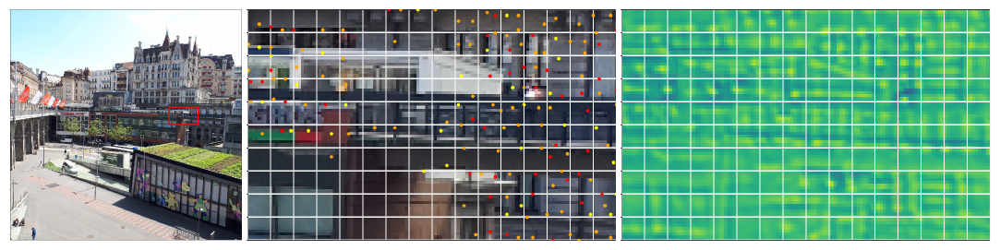
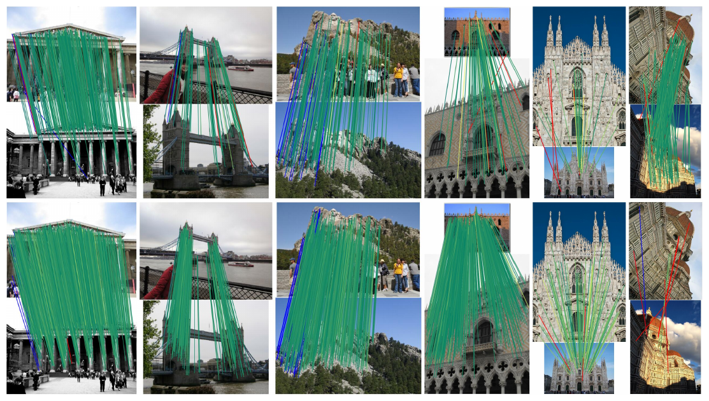
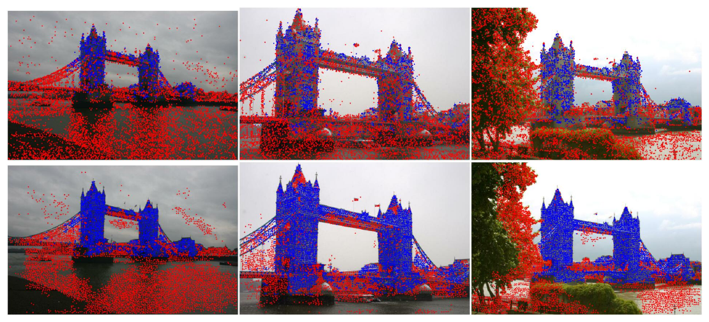
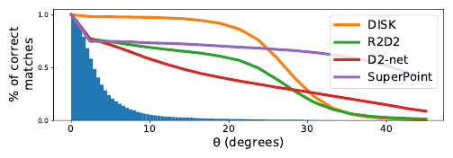
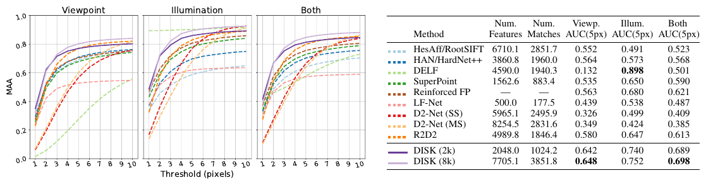

# DISK: Learning local features with policy gradient — конспект

**Оригинальное название:** *DISK: Learning local features with policy gradient*
**Авторы:** Michał J. Tyszkiewicz, Pascal Fua (EPFL), Eduard Trulls (Google Research, Zurich)
**Публикация:** NeurIPS 2020 (34th Conference on Neural Information Processing Systems), Ванкувер
**Код:** https://github.com/cvlab-epfl/disk
**Финансирование:** частично — Google Visual Positioning System (что прямо указывает на прикладную мотивацию: визуальное позиционирование).

## Суть в одном абзаце

DISK (от *DIScrete Keypoints*) — это детектор и дескриптор локальных признаков, обучаемый «от конца до конца» (end-to-end) напрямую на цель «получить как можно больше правильных сопоставлений». Главная трудность такой постановки — дискретность: выбор ключевых точек и решение «сопоставлять/не сопоставлять» недифференцируемы. Авторы обходят её средствами обучения с подкреплением (reinforcement learning, RL): и детекция, и сопоставление переформулируются как вероятностные политики, а градиент ожидаемой награды оценивается методом policy gradient (REINFORCE). Ключевой технический приём — модель сопоставления подобрана так, что вероятность каждой пары считается в замкнутом виде, поэтому вклад шага сопоставления в градиент вычисляется точно, без сэмплирования; дисперсия оценки остаётся только от выбора точек. Это даёт стабильное обучение с нуля (from scratch). Результат — очень плотные, но при этом различимые признаки (в т. ч. на «слабо текстурированных» участках), в 2–3 раза больше инлаеров/3D-точек, чем у конкурентов, и state-of-the-art на Image Matching Challenge 2020 (1-е место в категории 2k признаков среди методов со стандартным матчером), HPatches и ETH-COLMAP.

---

## 1. Введение: в чём проблема

- Локальные признаки (local features) со времён [SIFT](SIFT_конспект.md) — основа SfM (Structure-from-Motion), SLAM, релокализации и т. д. В 3D-реконструкции «ручные» разреженные методы долго оставались конкурентоспособными против обученных плотных.
- Причина: сложно построить дифференцируемую функцию потерь, которая хорошо соответствует целевой задаче (downstream task).
- Дескрипторы на заранее заданных точках учить легко (патч-дескрипторы: [HardNet](HardNet_конспект.md), SOSNet и пр.). А вот **совместная** детекция + сопоставление трудно релаксируется:
  1. Комбинаторика: сопоставление множеств $F_A$ и $F_B$ стоит $O(|F_A|\cdot|F_B|)$, а кандидатом может быть каждый пиксель.
  2. «Качество» признака зависит от остальных: точка, похожая на многие другие, малоинформативна. Это не локальное свойство, его трудно учесть в loss.
- Идея авторов: сблизить режимы обучения и инференса. Сеть выдаёт карту детекции («heatmap») и плотные дескрипторы; из карты **сэмплируются** дискретные точки, по их дескрипторам строится **распределение** над сопоставлениями, геометрическая разметка даёт награду за каждое совпадение, и максимизируется ожидаемая награда $\mathbb{E}\sum_{(i,j)\in M_{A\leftrightarrow B}} r(i\leftrightarrow j)$. Это и есть policy gradient.
- Обычная беда вероятностной релаксации — шумные Монте-Карло-оценки градиента. Авторы конструируют модель так, чтобы значительная часть градиента считалась аналитически.

*Рис. 1 (из оригинальной статьи). Реконструкция «Sacre Coeur» (1179 снимков, COLMAP): (a) Upright Root-SIFT — 179k 3D-точек, 22.3 наблюдения на точку; (b) DISK — 190k точек, 30.0 наблюдения на точку. Для каждого метода — облако точек и один снимок с ключевыми точками: синие вошли в реконструкцию, красные — нет.*

**Рис. 1 ([SIFT](SIFT_конспект.md) vs DISK в SfM).** Реконструкция сцены «Sacre Coeur» по 1179 снимкам в COLMAP. Для каждого метода показаны облако 3D-точек и один кадр с ключевыми точками; точки, ставшие частью реконструкции, синие, остальные красные. На кадре видно: у [SIFT](SIFT_конспект.md) синие точки разрежены и сосредоточены на деталях фасада, у DISK практически весь собор (включая гладкие купола) плотно покрыт синими точками; красные точки у обоих методов приходятся в основном на деревья и газон. Главное наблюдение: DISK извлекает и успешно сопоставляет точки на участках, которые выглядят бестекстурными и где [SIFT](SIFT_конспект.md) ничего не находит. Это ставит под сомнение привычное представление о том, что такое «хорошая» ключевая точка (угол/блоб).

## 2. Связанные работы

Классический конвейер: (1) детекция точки, (2) оценка ориентации, (3) вычисление дескриптора.

| Группа | Примеры | Что делают / ограничение |
|---|---|---|
| Ручные | [SIFT](SIFT_конспект.md), [SURF](SURF_конспект.md) | Много эвристик |
| Обученные патч-дескрипторы на точках [SIFT](SIFT_конспект.md)/DoG | MatchNet, L2-Net, [HardNet](HardNet_конспект.md), SOSNet, LogPolarDesc, GeoDesc | Сильные дескрипторы, но детектор не обучается |
| Обученные детекторы / ориентации | TILDE, Quad-Networks, Key.Net; learned orientations; IMIP | Решают только один этап |
| End-to-end | [LIFT](LIFT_конспект.md), [SuperPoint](SuperPoint_конспект.md), LF-Net, [D2-Net](D2-Net_конспект.md), [R2D2](R2D2_конспект.md) | Либо неточные приближения цели ([SuperPoint](SuperPoint_конспект.md), [R2D2](R2D2_конспект.md)), либо разрыв дифференцируемости (LF-Net), либо сильные допущения ([D2-Net](D2-Net_конспект.md): экстремумы в пространстве дескрипторов = хорошие точки) |

Наиболее близкие по духу (RL / «разрыв обучения и инференса»):

- **GLAMpoints** — гомографии на изображениях сетчатки; RL (Q-learning) ищет точки, хорошо сопоставляемые дескрипторами [SIFT](SIFT_конспект.md). Сопоставление детерминировано, поэтому регрессируется ожидаемая награда точки, а не оптимизация в пространстве политик. Дескриптор ручной (требование вращательной эквивариантности в медицинском домене) — это ограничивает метод.
- **SIPs** — тоже ручные дескрипторы, предсказывает для каждого пикселя вероятность успешного сопоставления; наследует ограничения GLAMpoints.
- **Reinforced Feature Points (RFP)** — оптимизирует общую недифференцируемую цель (точность позы) с [RANSAC](RANSAC_конспект.md) в цикле. Минус: одна награда на все решения детекции и сопоставления → слабый сигнал (типичная проблема RL), поэтому метод только дообучает предобученный [SuperPoint](SuperPoint_конспект.md). **DISK можно рассматривать как релаксацию RFP**: вместо точности позы — суррогатная цель «много правильных соответствий». Это позволяет устойчиво учиться с нуля и даёт лучшие итоговые результаты.

## 3. Метод

### 3.1 Общая вероятностная постановка

Для изображений $A$, $B$ нужно получить множества признаков $F_A$, $F_B$ и затем сопоставления $M_{A\leftrightarrow B}$. Оба шага делаются вероятностными:

- $P(F_I \mid I, \theta_F)$ — распределение над множествами признаков изображения $I$ при параметрах детектора/дескриптора $\theta_F$;
- $P(M_{A\leftrightarrow B}\mid F_A, F_B, \theta_M)$ — распределение над сопоставлениями при параметрах сопоставления $\theta_M$.

Полная вероятность $P(M_{A\leftrightarrow B}\mid A,B,\theta)$ требует интегрирования по всем возможным $F_A, F_B$ — это нереально. Но градиент ожидаемой награды

$$\nabla_\theta\, \mathbb{E}_{M_{A\leftrightarrow B}\sim P(M_{A\leftrightarrow B}\mid A,B,\theta)}\, R(M_{A\leftrightarrow B})$$

можно оценить сэмплированием по Монте-Карло и делать градиентный подъём.

### 3.2 Распределение признаков $P(F_I\mid I,\theta_F)$

- Сеть (U-Net) выдаёт $1$ канал детекции $K$ и $N=128$ каналов дескриптора $D$ (128 — для прямого сравнения с [SIFT](SIFT_конспект.md) и большинством современных дескрипторов).
- Карта $K$ разбивается на сетку ячеек $h\times h$; в каждой ячейке выбирается **не более одной** точки (по аналогии с [SuperPoint](SuperPoint_конспект.md)).
- Сэмплирование в ячейке $u$ — двухступенчатое:
  1. **Предложение (proposal)** — пиксель $p$ выбирается из softmax по ячейке:
     $$P_s(p\mid K^u) = \operatorname{softmax}(K^u)_p$$
  2. **Принятие (acceptance)** — предложение принимается с вероятностью
     $$P_a(\text{accept}_p\mid K^u) = \sigma(K^u_p)$$
  где $K^u$ — фрагмент карты детекции в ячейке $u$, $K^u_p$ — значение в пикселе $p$, $\sigma$ — сигмоида.
- Итоговая вероятность получить точку в $p$:
  $$P(p\mid K^u) = \operatorname{softmax}(K^u)_p\cdot \sigma(K^u_p)$$
- Интерпретация: softmax задаёт **относительное** предпочтение между позициями внутри ячейки, сигмоида — **абсолютное** качество позиции (можно и вовсе ничего не выбрать в ячейке, например на небе).
- К каждой точке приписывается $\ell_2$-нормированный дескриптор: $F_I=\{(p_1, D(p_1)), (p_2, D(p_2)),\dots\}$.
- **Инференс:** softmax → $\arg\max$, сигмоида → функция знака (точка принимается, если $K^u_p>0$). Отличие от [SuperPoint](SuperPoint_конспект.md): сохраняется пространственная структура ячейки и одна и та же карта используется и в «относительном», и в «абсолютном» смысле — вместо дополнительного «мусорного» канала (dustbin/reject bin).

### 3.3 Распределение сопоставлений $P(M_{A\leftrightarrow B}\mid F_A,F_B,\theta_M)$

- Считается матрица $\ell_2$-расстояний $d$ между дескрипторами $F_A$ и $F_B$.
- Для качественного обучения важно **не** сопоставлять неоднозначные точки (повторяющиеся структуры). Стандартные инструменты — взаимная проверка (cycle-consistent / mutual nearest neighbour matching) и ratio test Лоу; оба недифференцируемы.
- Решение — **релаксация взаимной проверки**:
  - «прямое» сопоставление $A\to B$: для признака $i$ из $A$ сэмплируем $j$ из категориального распределения по строке $d$:
    $$P_{A\to B}(j\mid d, i) = \operatorname{softmax}\big(-\theta_M\, d(i,\cdot)\big)_j$$
  - «обратное» $A\leftarrow B$ — аналогично по столбцам ($d^\top$);
  - пара $(i,j)$ считается сопоставленной, только если **оба** сэмпла согласованы.
  - $\theta_M$ — единственный параметр матчера, обратная температура softmax.
- Вероятность конкретного соответствия при известных $F_A,F_B$ считается **точно**:
  $$P(i\leftrightarrow j) = P_{A\to B}(j\mid d,i)\cdot P_{A\leftarrow B}(i\mid d,j)$$
- Если награда раскладывается в сумму по парам, $R(M_{A\leftrightarrow B})=\sum_{(i,j)\in M} r(i\leftrightarrow j)$, то градиенты ожидаемой награды по дескрипторам $D$ и $\theta_M$ вычисляются точно, без сэмплирования. Значит, шаг сопоставления **не добавляет дисперсии** в оценку градиента (в отличие от RFP) — по мнению авторов, это ключ к хорошей сходимости.
- Можно было бы заменить эту релаксацию невероятностной функцией потерь (как triplet/hard-negative loss в [HardNet](HardNet_конспект.md)) — для одних дескрипторов это, возможно, даже лучше. Но вероятностная трактовка делает гиперпараметры $\lambda_{tp},\lambda_{fp},\lambda_{kp}$ интуитивными и естественно стыкуется с policy gradient для детектора.

### 3.4 Функция награды $R(M_{A\leftrightarrow B})$

Награда намеренно простая и **аддитивная по парам** (это нужно для замкнутых формул). Разметка — по известным позам и картам глубины (pixel-to-pixel соответствия):

| Тип пары | Условие | Награда |
|---|---|---|
| Правильная (correct) | глубина есть в обеих точках $p_{A,i}$, $p_{B,j}$, и обе лежат в пределах $\epsilon$ пикселей от своих репроекций | $\lambda_{tp}$ |
| Правдоподобная (plausible) | глубины нет хотя бы в одной точке, но эпиполярное расстояние $<\epsilon$ пикселей | $0$ (ни награды, ни штрафа) |
| Неправильная (incorrect) | все остальные случаи | $\lambda_{fp}$ (отрицательная) |

Плюс штраф $\lambda_{kp}$ за **каждую** засэмплированную точку (см. ниже). Конкретное значение $\epsilon$ не приводится ни в основном тексте, ни в приложении arXiv-версии; в обучающем скрипте официального репозитория используется порог **$\epsilon = 1.5$ px** (параметр `th=1.5` у класса награды; значение по умолчанию в самом классе — 2 px) — (по коду train.py и disk/loss/rewards.py в официальном репозитории). Там же видно, что для «правильной» пары репроекция проверяется в обе стороны ($A\to B$ и $B\to A$), а эпиполярное расстояние для «правдоподобной» — тоже симметрично.

### 3.5 Оценка градиента (policy gradient / REINFORCE)

При $F_A\sim P(F_A\mid A,\theta_F)$, $F_B\sim P(F_B\mid B,\theta_F)$:

$$\nabla_\theta\, \mathbb{E}_{M_{A\leftrightarrow B}} R(M_{A\leftrightarrow B}) = \mathbb{E}_{F_A,F_B}\Big[\sum_{i,j} P(i\leftrightarrow j\mid F_A,F_B,\theta_M)\cdot r(i\leftrightarrow j)\cdot \nabla_\theta \Gamma_{ij}\Big] \tag{1}$$

$$\Gamma_{ij} = \log P(i\leftrightarrow j\mid F_A,F_B,\theta_M) + \log P(F_{A,i}\mid A,\theta_F) + \log P(F_{B,j}\mid B,\theta_F)$$

Пояснения:

- $\Gamma_{ij}$ — суммарный логарифм вероятности «траектории»: точка $i$ выбрана в $A$, точка $j$ выбрана в $B$, и они сопоставлены. Это стандартный log-derivative trick REINFORCE (Williams, 1992).
- Сумма не учитывает случай «$i$ ни с кем не сопоставлен» — ему соответствует нулевая награда, так что в градиент он ничего не вносит.
- Внутренняя сумма по $(i,j)$ вычисляется **точно** (а не эмпирическим средним по сэмплированным сопоставлениям, как в общем REINFORCE). Остаются лишь два источника дисперсии: эффекты мини-батча и эмпирическая аппроксимация матожидания по выбору $F_A,F_B$.
- На практике сумма — это $|F_A|\times|F_B|$ слагаемых, т. е. операция над плотной матрицей, хорошо ложащаяся на GPU.

**Важное свойство — «нейтральность» несопоставленных точек.** Сеть-экстрактор получает сигнал **только** через качество сопоставлений, в которых участвуют её точки. Точка, которая ни с чем не сопоставилась, не штрафуется — это правильно, так как она может быть просто не видна на втором снимке. Обратная сторона: сеть может «насорить» точками на облаках и прочих неинформативных областях — они бесполезны для задачи, но раздувают матрицу сопоставления. Поэтому вводится малый штраф $\lambda_{kp}$ за каждую засэмплированную точку — регуляризатор разреженности.

### 3.6 Инференс

- Вероятностный матчер выбрасывается; используется стандартная взаимная проверка ближайших соседей + ratio test с порогом, подобранным на валидации.
- Ограничения сетки на обучении: (1) не более одной точки на ячейку; (2) ячейка «не видит» соседей — две смежные точки на границе ячеек могут оказаться отдельными ключевыми точками.
- На инференсе вместо сетки применяют **NMS** (non-maxima suppression) по карте $K$ и берут все локальные максимумы. Это устраняет оба недостатка ценой рассогласования обучения и инференса (проверено в абляции, раздел 4.4).

*Рис. 2 (из оригинальной статьи). Слева — снимок с отмеченной красной рамкой областью; в центре — точки, выбранные NMS, поверх фрагмента с сеткой 8×8; справа — карта детекции $K$ того же фрагмента с сеткой. Цвет точек — по скору (красные — верхняя треть, оранжевые — средняя, жёлтые — остальные).*

**Рис. 2 (NMS vs сетка).** На фрагменте изображения (красная рамка на левом снимке) показаны точки, выбранные NMS, и сама heatmap $K$ с наложенной сеткой. Видно, что максимумы карты могут разрезаться границами ячеек; точки раскрашены по «скору» (верхняя треть — красные, средняя — оранжевые, остальные — жёлтые), и в каждой ячейке не больше двух очень сильных (красных) точек. Мораль: сеть училась «под сетку», но её карта содержит полезные максимумы, которые NMS извлекает лучше.

## 4. Реализация и обучение

### 4.1 Данные

- **MegaDepth**: подмножество из **135 сцен, ~63k изображений**; позы и плотная глубина получены COLMAP → соответствия пиксель-в-пиксель.
- Исключены сцены, пересекающиеся с тестом Image Matching Challenge.
- Пары/тройки подбираются простой эвристикой ковидимости (co-visibility). Подробности (по приложению arXiv-версии): для пары $A,B$ считается отношение $r = |L_A\cap L_B| / \min(|L_A|,|L_B|)$, где $L_I$ — множество 3D-точек COLMAP, видимых на снимке $I$; берутся пары с $0.15 \le r \le 0.8$ (отсекаются и неперекрывающиеся, и слишком лёгкие пары). Тройка строится так: случайное «опорное» изображение $A$ плюс два его партнёра $B, C$ (ковидимость $B$ и $C$ между собой не требуется); около 10k троек на сцену, всего ≈133k троек.
- Из обучения исключены (по приложению arXiv-версии): 8 сцен теста IMC (British Museum, Lincoln Memorial Statue, London Bridge, Mount Rushmore, Sagrada Familia, Piazza San Marco, Florence Cathedral, Milan Cathedral), 2 сцены валидации IMC (St. Peter's Square, Sacre Coeur), 16 сцен с плохими картами глубины и сцены, давшие меньше 10k ковидимых троек. Датасет выложен по адресу https://datasets.epfl.ch/disk-data/index.html.
- Аугментации данных **нет** (что объясняет слабость к поворотам, см. ниже).

### 4.2 Архитектура (вариант U-Net)

| Параметр | Значение |
|---|---|
| Базовая архитектура | U-Net |
| Число блоков | 4 down + 4 up |
| Свёрток в блоке | **1** (а не 2, как в стандартном U-Net), ядро $5\times5$ |
| Нормализация | Instance Normalization (вместо BatchNorm) |
| Нелинейность | PReLU |
| Выходы | 1 канал детекции $K$ + 128 каналов дескриптора $D$ |
| Параметров | **~1.1M** |
| Формальное рецептивное поле | $219\times219$ пикселей |
| Разрешение выходных карт | полное (дескриптор и score для каждого пикселя) |

Почему так: U-Net даёт полное разрешение на выходе (точная локализация) при большом рецептивном поле (контекст — именно он позволяет различать точки в «бестекстурных» зонах). InstanceNorm позволяет накапливать градиенты по маленьким батчам без искажения статистик.

### 4.3 Оптимизация и гиперпараметры

| Параметр | Значение / комментарий |
|---|---|
| Батч | 2 сцены × 3 ковидимых изображения ($A,B,C$) |
| Пары в тройке | $A\leftrightarrow B$, $A\leftrightarrow C$, $B\leftrightarrow C$ — 3 пары из 3 изображений (две независимые пары потребовали бы 4) → больше соответствий при меньшей памяти GPU |
| Размер входа | длинная сторона 768 px, короткая дополняется нулями до квадрата |
| Ячейка сетки $h$ | 8 px |
| $\lambda_{tp}$ | $+1$ |
| $\lambda_{fp}$ | $-0.25$ |
| $\lambda_{kp}$ | $-0.001$ |
| Отжиг (annealing) | $\lambda_{fp}$ и $\lambda_{kp}$ линейно растут от 0 до полного значения за первые **5 эпох**. В коде (по train.py в официальном репозитории) «эпоха» — это псевдоэпоха из 5000 батчей (`--chunk-size`), первая укорочена до 250 шагов (`--warmup`); множитель штрафов: 0 в эпоху 0, 0.1 в эпоху 1, далее $\min(1,\,0.1+0.2e)$ — полное значение с 5-й эпохи |
| $\theta_M$ (обратная температура) | не обучается градиентом, увеличивается по фиксированному расписанию. В статье и приложении чисел нет; по train.py в официальном репозитории: $\theta_M = 15 + 35\cdot\min(1,\,0.05e)$, т. е. линейно от **15 до 50** за первые 20 псевдоэпох ($e$ — номер псевдоэпохи), затем постоянно 50 |
| Оптимизатор | Adam, lr $=10^{-4}$ |
| Выбор чекпойнта | каждые 5k шагов (10k троек) — mAA@10° позы в stereo (DEGENSAC) на подмножестве валидации; лучшая модель получена после **300k шагов** (по приложению arXiv-версии). В коде по умолчанию 50 псевдоэпох × 5000 батчей (по train.py) |
| Вычислительная стоимость | PyTorch, одна NVIDIA V100, FP32: обучение на 768×768 — ≈1.2 с на шаг из двух троек (по приложению arXiv-версии) |
| Накопление градиентов | возможно (благодаря InstanceNorm), если не хватает памяти |

**Зачем отжиг штрафов.** Случайно инициализированная сеть даёт в основном неправильные сопоставления, т. е. средняя ценность точки отрицательна. Оптимизатор быстро нашёл бы вырожденный локальный максимум — вообще перестать выдавать точки (награда 0). Поэтому вначале штрафы нулевые: сеть сперва учится находить хоть какие-то верные пары, и только потом включается наказание за ошибки и за лишние точки.

**Фиксированный бюджет признаков.** DISK выдаёт переменное число точек; для сравнения при фиксированном бюджете (2k/8k) точки сортируются по «скору» — значению $K$ в точке — и берутся лучшие.

## 5. Эксперименты

### 5.1 Image Matching Challenge 2020 (IMC) — Табл. 1, Рис. 3–4

**Протокол.** Две задачи: *stereo* (пары → [RANSAC](RANSAC_конспект.md) → относительная поза) и *multiview* (COLMAP по подмножествам из 5, 10, 25 изображений). Метрика — mAA (mean Average Accuracy) точности позы до порога 10°. Ценность бенчмарка — оценка по итоговой задаче, а не по промежуточным метрикам. Две категории: до 2k и до 8k признаков на изображение.

**Гиперпараметры инференса (подобраны на валидации «Sacre Coeur» и «St. Peter's Square»):** длинная сторона 1024 px; взаимные сопоставления + ratio test с порогом 0.95; для stereo — DEGENSAC с порогом инлаеров 0.75 px.

Ключевые числа (NM — число соответствий, NI — инлаеры [RANSAC](RANSAC_конспект.md), NL — 3D-точки, TL — длина трека):

| Метод | 2k: stereo NI | 2k: stereo mAA | 2k: multiview mAA | 8k: stereo mAA | 8k: multiview mAA |
|---|---|---|---|---|---|
| Upright Root-SIFT | 112.3 | 0.3986 | 0.5623 | 0.5075 | 0.6792 |
| Upright [HardNet](HardNet_конспект.md) | 152.7 | 0.4609 | 0.6354 | 0.5728 | 0.7231 |
| Upright SOSNet | 171.2 | 0.4505 | 0.6359 | 0.5738 | 0.7129 |
| Upright LogPolarDesc | 162.2 | 0.4567 | 0.6370 | 0.5510 | 0.7109 |
| [SuperPoint](SuperPoint_конспект.md) | 126.8 | 0.2964 | 0.5464 | – | – |
| LF-Net | 106.5 | 0.2344 | 0.5141 | – | – |
| [D2-Net](D2-Net_конспект.md) (SS) | 188.4 | 0.1813 | 0.3943 | 0.2228 | 0.4598 |
| [R2D2](R2D2_конспект.md) | 213.9 | 0.3346 | 0.6149 | 0.4437 | 0.6832 |
| Лучшая чужая сабмиссия | 270.0 (#609) | 0.4690 (#609) | 0.6812 (#609) | 0.5887 (#611) | 0.7513 (#611) |
| **DISK** | **404.2** | **0.5132** | **0.7271** | 0.5585 | 0.7502 |

Дополнительно для DISK (2k): NM 514.2, NL 2428, TL 5.55; (8k): NI 1238.5, NL 7484, TL 5.92. Разбивка по сценам IMC приведена в таблицах 6–7 приложения arXiv-версии (сабмиссии #708 и #709).

**Интерпретация:**

- 2k: DISK лучше всех на **+9.4%** (отн.) в stereo и **+6.7%** в multiview; инлаеров почти на 50% больше лучшего конкурента.
- 8k: в среднем по двум задачам лучше всех бейзлайнов, но немного уступает топ-3 пользовательским сабмиссиям (stereo −5.4%, multiview ≈ −0.1%).
- DISK находит в 2–3 раза больше инлаеров [RANSAC](RANSAC_конспект.md) / 3D-точек, чем другие методы, и заметно более длинные треки.
- Признаки 2k — это подмножество признаков 8k, т. е. увеличенный бюджет используется, вероятно, неоптимально; авторы предполагают, что поможет обучение на больших изображениях или с меньшей ячейкой.
- Сравнение — только с решениями на стандартном $\ell_2$-матчере. Если учитывать и обученные матчеры, DISK всё равно #2 в категории 2k, уступая лишь [SuperGlue](SuperGlue_конспект.md) ([SuperPoint](SuperPoint_конспект.md)+[SuperGlue](SuperGlue_конспект.md)) и обгоняя все прочие решения с обученными матчерами.

*Рис. 3 (из оригинальной статьи). Шесть пар снимков из теста IMC (судя по снимкам — British Museum, Tower Bridge, Mount Rushmore, Piazza San Marco, Milan Cathedral, Florence Cathedral). Верхний ряд — DoG + Upright [HardNet](HardNet_конспект.md), нижний — DISK; линии — инлаеры DEGENSAC (зелёный→жёлтый — правильные, 0–5 px; красный — ошибочные, >5 px; синий — нет глубины в GT).*

**Рис. 3 (stereo, 2k).** Верхний ряд — DoG + Upright [HardNet](HardNet_конспект.md), нижний — DISK. Показаны инлаеры после DEGENSAC: от зелёного к жёлтому — правильные (ошибка репроекции 0–5 px), красные — ошибочные (>5 px), синие — без глубины в GT. На первых пяти парах у DISK пучок инлаеров заметно плотнее; он справляется с большими изменениями масштаба (4-й и 5-й столбцы — вид издалека против крупного плана). В 6-м столбце (Флорентийский собор, второй снимок сильно повёрнут в плоскости) [HardNet](HardNet_конспект.md) ещё находит много верных пар, а у DISK остаются лишь единичные красные/синие линии — **метод ломается при сильном повороте в плоскости**.

*Рис. 4 (из оригинальной статьи). Сцена «London Bridge» (реконструкция COLMAP по 25 снимкам), показаны три кадра. Верхний ряд — DoG + Upright [HardNet](HardNet_конспект.md), нижний — DISK; синие — точки, зарегистрированные COLMAP, красные — остальные.*

**Рис. 4 (multiview, 8k, сцена «London Bridge», 25 снимков).** Точки, зарегистрированные COLMAP, — синие, остальные — красные. Визуально у DISK мост почти сплошь покрыт синими точками, а у [HardNet](HardNet_конспект.md) синие точки разрежены и перемешаны с красными; красные точки DISK сосредоточены на воде, небе и деревьях. DISK покрывает изображение равномернее и даёт на 76% больше 3D-точек с на 30% более длинными треками, чем [HardNet](HardNet_конспект.md). Точки на воде и деревьях имеют низкий скор и почти не попадают в топ-2k, но появляются при 8k — т. е. метод близок к оптимуму уже на малом бюджете, а «лишние» точки большого бюджета малоценны.

**Инвариантность к повороту (Рис. 6).** 36 случайных изображений из валидации IMC сопоставляются со своими копиями, повёрнутыми на угол $\theta$; считается доля правильных соответствий (порог 3 px). Сравнение с методами, тоже не оценивающими ориентацию ([R2D2](R2D2_конспект.md), [D2-Net](D2-Net_конспект.md), [SuperPoint](SuperPoint_конспект.md)). Поверх — гистограмма относительных поворотов в данных.

*Рис. 6 (из оригинальной статьи). Доля правильных соответствий между изображением и его копией, повёрнутой на $\theta$ (0–45°), для DISK, [R2D2](R2D2_конспект.md), [D2-Net](D2-Net_конспект.md) и [SuperPoint](SuperPoint_конспект.md); синяя гистограмма — распределение относительных поворотов в плоскости в валидации IMC 2020.*

По графику: гистограмма поворотов в данных сосредоточена в пределах нескольких градусов (основная масса — до ~10°). DISK держит долю верных соответствий около 1.0 примерно до 15–20°, затем резко падает и к ~35° почти обнуляется; [SuperPoint](SuperPoint_конспект.md) держится около 0.7 до ~30°, [R2D2](R2D2_конспект.md) и [D2-Net](D2-Net_конспект.md) деградируют плавнее с малых углов, а при больших углах [D2-Net](D2-Net_конспект.md) даже обгоняет остальных. Вывод: DISK исключительно устойчив **в диапазоне поворотов, встречавшихся при обучении** (небольшие углы, типичные для снимков с рук), и быстро деградирует за его пределами. Авторы считают, что это лечится аугментацией.

### 5.2 HPatches — Рис. 5

*Рис. 5 (из оригинальной статьи). Слева — MMA в зависимости от порога 1–10 px для подмножеств Viewpoint, Illumination и обоих вместе; справа — таблица: число признаков, соответствий и AUC MMA до 5 px. Сплошные фиолетовые линии — DISK (2k и 8k), пунктир — бейзлайны. Для RFP числа признаков/соответствий нет (результаты предоставлены авторами RFP).*

**Протокол** (как в [D2-Net](D2-Net_конспект.md)): 116 планарных сцен по 6 изображений, только смена ракурса (viewpoint) или только освещения (illumination); GT — гомографии; 8 сцен с высоким разрешением исключены. Первое изображение сопоставляется с остальными пятью (взаимные NN). Метрика — MMA (Mean Matching Accuracy): доля соответствий с ошибкой репроекции ниже порога 1…10 px; сводка — AUC до 5 px. DISK использован с теми же моделями и гиперпараметрами, без донастройки.

| Метод | Признаков | Соответствий | Viewp. AUC@5 | Illum. AUC@5 | Оба AUC@5 |
|---|---|---|---|---|---|
| HesAff/RootSIFT | 6710 | 2852 | 0.552 | 0.491 | 0.523 |
| HAN/HardNet++ | 3861 | 1960 | 0.564 | 0.573 | 0.568 |
| DELF | 4590 | 1940 | 0.132 | **0.898** | 0.501 |
| [SuperPoint](SuperPoint_конспект.md) | 1563 | 883 | 0.535 | 0.650 | 0.590 |
| Reinforced FP | – | – | 0.563 | 0.680 | 0.621 |
| LF-Net | 500 | 178 | 0.439 | 0.538 | 0.487 |
| [D2-Net](D2-Net_конспект.md) (SS) | 5965 | 2496 | 0.326 | 0.499 | 0.409 |
| [D2-Net](D2-Net_конспект.md) (MS) | 8255 | 2832 | 0.349 | 0.424 | 0.385 |
| [R2D2](R2D2_конспект.md) | 4990 | 1846 | 0.580 | 0.647 | 0.613 |
| **DISK (2k)** | 2048 | 1024 | 0.642 | 0.740 | 0.689 |
| **DISK (8k)** | 7705 | 3852 | **0.648** | 0.752 | **0.698** |

**Интерпретация:** на графиках кривые DISK (особенно 8k) лежат выше всех при малых порогах на Viewpoint и Both; на Illumination выше всех стартует DELF. #1 на сменах ракурса (за ним [R2D2](R2D2_конспект.md)), #2 на освещении (после DELF, который при этом провален по ракурсу). В сумме — на 12% (отн.) лучше ближайшего конкурента RFP. Примечательно, что модель обучалась на непланарных данных без сильных аффинных искажений.

### 5.3 ETH-COLMAP — Табл. 2

Статистики крупномасштабного SfM на трёх небольших сценах. Бенчмарк не фиксирует число признаков, поэтому DISK извлекается в полном разрешении и берётся ~12k лучших точек (для сопоставимости с [SIFT](SIFT_конспект.md)); без ограничения на «Fountain» получается 67k 3D-точек.

| Сцена | Метод | NL (3D-точки) | TL (длина трека) | Ошибка репроекции, px |
|---|---|---|---|---|
| Fountain | Root-SIFT | 15k | 4.70 | 0.41 |
| | [SuperPoint](SuperPoint_конспект.md) | 31k | 4.75 | 0.97 |
| | RFP | 9k | 4.86 | 0.87 |
| | **DISK** | 18k | **5.52** | 0.50 |
| Herzjesu | Root-SIFT | 8k | 4.22 | 0.46 |
| | [SuperPoint](SuperPoint_конспект.md) | 21k | 4.10 | 0.95 |
| | RFP | 7k | 4.32 | 0.82 |
| | **DISK** | 11k | **4.71** | 0.48 |
| South Building | Root-SIFT | 113k | 5.92 | 0.58 |
| | [SuperPoint](SuperPoint_конспект.md) | 160k | 7.83 | 0.92 |
| | RFP | 102k | 7.86 | 0.88 |
| | **DISK** | 115k | **9.91** | 0.59 |

**Интерпретация:** больше точек, чем у [SIFT](SIFT_конспект.md), самые длинные треки и ошибка репроекции на уровне [SIFT](SIFT_конспект.md) (≈0.5 px) — заметно точнее [SuperPoint](SuperPoint_конспект.md) и RFP (≈0.9 px). То есть плотность не достигается ценой точности локализации.

### 5.4 Абляции и обсуждение

**Супервизия без глубины (Табл. 3).** Вариант награды только на эпиполярных ограничениях (как у Wang et al., 2020) вместо глубины. mAA на валидации IMC:

| Вариант | 2k stereo | 2k multiview | 8k stereo | 8k multiview |
|---|---|---|---|---|
| Глубина | **0.7218** | 0.8325 | **0.7767** | 0.8628 |
| Эпиполярная | 0.7145 | **0.8465** | 0.7718 | **0.8749** |

Stereo чуть хуже, multiview чуть лучше. Качественно: появляются точки на бестекстурных областях за границами объектов (вероятно, из-за большого рецептивного поля). Вывод: DISK обучается почти так же эффективно со значительно более слабой разметкой (нужны только позы камер).

**NMS вместо сетки на инференсе (Табл. 4)** — все признаки, без отсечения по бюджету, валидация IMC:

| Вариант | Признаков | Соответствий | Stereo mAA@10° | Multiview mAA@10° |
|---|---|---|---|---|
| 1-per-cell (как на обучении) | 5457 | 797 | 0.7477 | 0.8469 |
| NMS 3×3 | 8435 | 1700 | **0.7783** | 0.8686 |
| NMS 5×5 | 7656 | 1548 | 0.7766 | **0.8762** |
| NMS 7×7 | 6423 | 1271 | 0.7707 | 0.8564 |
| NMS 9×9 | 4946 | 942 | 0.7556 | 0.8536 |

NMS явно выгоднее, несмотря на рассогласование с обучением: вдвое больше соответствий и +3 п.п. stereo-mAA.

**Размер сетки × размер NMS (Табл. 5)**, mAA, бюджет 2k:

| Сетка \ NMS | 3×3 | 5×5 | 7×7 | 9×9 |
|---|---|---|---|---|
| 8×8 | 0.7751 | **0.7824** | 0.7778 | 0.7586 |
| 12×12 | 0.7576 | 0.7580 | 0.7502 | 0.7431 |
| 16×16 | 0.7213 | 0.7214 | 0.7120 | 0.6999 |

Меньшая ячейка при обучении лучше, но даёт больше признаков → большие матрицы расстояний и более дорогое обучение/сопоставление. Оптимум в эксперименте: сетка 8×8, NMS 5×5.

**Дубликаты на границах ячеек.** 19.9% точек, выбранных сеткой при обучении, имеют соседа ближе 2 px — по сути двойные детекции. Возможные последствия: (1) лишние вычисления и память; (2) $\lambda_{kp}$ действует сильнее, чем интуитивно задумано (при строгом дублировании прямая и обратная вероятности «делятся пополам», суммарная вероятность сопоставления сохраняется, так что динамика обучения не меняется, кроме усиленного штрафа); (3) поскольку дубликаты на деле лишь близки, обучение идёт в режиме, где неточные соответствия встречаются чаще, чем на инференсе, — это может излишне поощрять инвариантность дескриптора к сдвигу. Однако результаты на HPatches (в т. ч. при пороге 1 px) и низкая ошибка репроекции на ETH-COLMAP показывают, что на практике это не критично.

## 6. Выводы авторов

- Предложен новый вероятностный подход к end-to-end обучению локальных признаков через policy gradient.
- Обучается с нуля без проблем, даёт намного больше соответствий, чем конкуренты.
- SOTA в точности поз для stereo и 3D-реконструкции; #1 в категории 2k на IMC 2020 среди методов со стандартным матчером.
- Планы: заменить релаксацию сопоставления обученными матчерами (вида CNe / [SuperGlue](SuperGlue_конспект.md)).
- В разделе Broader impact авторы упоминают риски: локализация фотографий без согласия пользователя (приватность), военное применение, усиление крупных игроков с доступом к данным.

---

## Сильные стороны и ограничения

**Сильные стороны**

- Цель обучения близка к целевой задаче: награда напрямую за правильные соответствия, а не за повторяемость/суррогатные метрики детектора.
- Низкая дисперсия градиента: вклад сопоставления считается аналитически, дисперсия — только от сэмплирования точек и мини-батча. Отсюда стабильное обучение с нуля (в отличие от RFP).
- Очень простая и интерпретируемая награда (3 числа: $\lambda_{tp},\lambda_{fp},\lambda_{kp}$), понятный механизм принятия/отклонения точки.
- Несопоставленные точки нейтральны → нет штрафа за отсутствие ковидимости.
- Плотные и при этом различимые признаки, много инлаеров, длинные треки, ровное покрытие изображения; точки и в слабо текстурированных зонах.
- Хорошая субпиксельная точность (ошибка репроекции в SfM на уровне [SIFT](SIFT_конспект.md)).
- Компактная сеть (~1.1M параметров), 128-мерный дескриптор — совместимость со стандартными конвейерами.
- Работает и со слабой разметкой (только эпиполярная геометрия / позы).

**Ограничения**

- **Нет инвариантности к повороту в плоскости** — устойчивость только в диапазоне поворотов из обучающих данных; аугментация при обучении не использовалась.
- Рассогласование обучения и инференса: сетка 1-per-cell на обучении vs NMS на инференсе; дубликаты на границах ячеек (~20%).
- Нет явной многомасштабности: устойчивость к масштабу берётся только из данных и большого рецептивного поля.
- Неоптимальное использование большого бюджета (8k ≈ надмножество 2k, проигрыш лучшим сабмиссиям в категории 8k).
- Полноразмерная U-Net на каждом пикселе — тяжелее по памяти/вычислениям на высоких разрешениях, чем, например, [SuperPoint](SuperPoint_конспект.md) с выходом 1/8. В основном тексте скорость не приводится; по приложению arXiv-версии инференс — ≈7 кадров/с для входа 1024×1024 на NVIDIA V100 в FP32 (≈140 мс на кадр), с накоплением градиентов обучение помещается на GPU с 12 ГБ памяти.
- Зависимость от разметки MegaDepth (глубина COLMAP): награда только там, где глубина надёжна, что может вносить смещения (частично снимается эпиполярным вариантом).
- Обучение квадратично по числу точек: матрица $|F_A|\times|F_B|$ на каждую пару.
- Матчер в обучении — простой (взаимные NN с температурой); выигрыш от обученных матчеров в статье не исследован.

## Значение для задачи визуального позиционирования

- **Зачем DISK в VPS/релокализации.** Позиционирование по картам (SfM-модель + запросное изображение) упирается в число и надёжность 2D–3D соответствий. DISK как раз оптимизирован на «много правильных соответствий» и даёт длинные треки — это повышает долю успешно локализованных запросов и устойчивость PnP+[RANSAC](RANSAC_конспект.md), особенно в бедных текстурой сценах (фасады, интерьеры, однотонные стены).
- **Связка с [LightGlue](LightGlue_конспект.md).** Авторы сами ожидали выигрыша от обученных матчеров; на практике DISK + [LightGlue](LightGlue_конспект.md) — одна из стандартных конфигураций. Проверено: в официальном репозитории [LightGlue](LightGlue_конспект.md) (cvg/LightGlue) выложены веса [LightGlue](LightGlue_конспект.md) под DISK (`LightGlue(features='disk')`), а экстрактор `DISK` там — обёртка над `kornia.feature.DISK.from_pretrained("depth")` с настройками по умолчанию: NMS 5×5, порог детекции 0, resize длинной стороны до 1024 px; в примере README используется `max_num_keypoints=2048`. В документации Kornia (`kornia.feature`) перечислены и DISK, и [LightGlue](LightGlue_конспект.md). В hloc есть конфигурация экстрактора `disk` (до 5000 точек, длинная сторона до 1600 px) и матчера `disk+lightglue`. Рекомендация «~2k–4k точек» — практическая эвристика (не из статьи); по README [LightGlue](LightGlue_конспект.md) на RTX 3080 матчинг идёт ≈150 FPS при 1024 точках и ≈50 FPS при 4096 точках на изображение (с компиляцией и адаптивностью).
- **Скорость.** Сеть маленькая по параметрам (~1.1M), но работает в полном разрешении. Единственная авторская цифра (по приложению arXiv-версии): ≈7 кадров/с (≈140 мс) на 1024×1024 на V100 в FP32 — т. е. не «десятки миллисекунд», как можно было бы ожидать. Цифр для CPU/edge (Jetson и т. п.) и прямого сравнения с [SuperPoint](SuperPoint_конспект.md)/ALIKED по скорости в статье и приложении нет — оценку «заметно медленнее» стоит проверить собственным замером. Разумные меры: уменьшать входное разрешение (например, 640–1024 px по длинной стороне), FP16/TensorRT (эффект для DISK не измерялся). Стоимость матчинга растёт как $O(N^2)$ по числу точек — бюджет признаков нужно ограничивать по скору (top-k по $K$).
- **Устойчивость.** Хорошо держит смену освещения и ракурса/масштаба (MegaDepth — интернет-фото с разным временем суток и погодой). Слабое место — **повороты в плоскости**: для дронов, камер с произвольной ориентацией или сильного крена нужно либо выравнивать изображение по гравитации (IMU), либо проверять несколько поворотов запроса, либо дообучать с аугментацией поворотом.
- **Плотность vs полезность.** Точки на воде, листве, небе получают низкий скор; для карты стоит хранить top-k по скору, чтобы не раздувать базу. Длинные треки DISK улучшают триангуляцию и сокращают число 3D-точек «одного наблюдения».
- **Обучение под свой домен.** Достаточно поз камер (эпиполярная награда), плотная глубина не обязательна — удобно для дообучения на собственных данных (аэросъёмка, внутренние помещения). Стоит добавить аугментацию поворотом и, возможно, меньшую ячейку сетки, если вычисления позволяют.
- **Инференсные настройки по статье:** NMS 5×5 (или 3×3; в `detect.py` официального репозитория по умолчанию окно NMS = 5), взаимные NN + ratio test 0.95 (для $\ell_2$-матчера), DEGENSAC с порогом ~0.75 px на 1024 px изображениях. При использовании [LightGlue](LightGlue_конспект.md) ratio test не нужен.

## Глоссарий (англ. → рус.)

| Термин (англ.) | Перевод / пояснение |
|---|---|
| Local features | Локальные признаки (точка + дескриптор) |
| Keypoint | Ключевая точка |
| Descriptor | Дескриптор (вектор описания окрестности) |
| Detection map / heatmap | Карта детекции, «тепловая карта» скоров точек |
| End-to-end training | Сквозное обучение (от входа до целевой метрики) |
| Reinforcement learning (RL) | Обучение с подкреплением |
| Policy gradient | Градиент по политике |
| REINFORCE / log-derivative trick | Алгоритм Уильямса; приём «градиент логарифма вероятности» |
| Reward / penalty | Награда / штраф |
| Expected reward | Ожидаемая награда |
| Variance of gradient estimator | Дисперсия оценки градиента |
| Monte Carlo sampling | Сэмплирование методом Монте-Карло |
| Softmax temperature (inverse) | (Обратная) температура softmax |
| Proposal / acceptance | Предложение / принятие (двухэтапное сэмплирование точки) |
| Grid cell | Ячейка сетки |
| Non-maxima suppression (NMS) | Подавление немаксимумов |
| Cycle-consistent / mutual nearest neighbour matching | Взаимно-согласованное сопоставление (взаимные ближайшие соседи) |
| Ratio test | Тест отношения расстояний (Лоу) |
| Distance matrix | Матрица расстояний |
| Correct / plausible / incorrect match | Правильное / правдоподобное / ошибочное соответствие |
| Reprojection error | Ошибка репроекции |
| Epipolar distance | Эпиполярное расстояние (до эпиполярной линии) |
| Co-visibility | Ковидимость (взаимная видимость сцены на снимках) |
| Ground truth (GT) | Эталонная разметка |
| Annealing | Отжиг (постепенное включение) |
| Instance normalization | Нормализация по экземпляру |
| Receptive field | Рецептивное поле |
| Structure-from-Motion (SfM) | Восстановление структуры по движению |
| Landmark / track length | 3D-точка карты / длина трека (число наблюдений точки) |
| Inliers | Инлаеры (согласованные с моделью соответствия) |
| mAA (mean Average Accuracy) | Средняя точность оценки позы до порога ошибки |
| MMA (Mean Matching Accuracy) | Средняя доля правильных соответствий при пороге |
| AUC (Area under the Curve) | Площадь под кривой |
| DEGENSAC | Вариант [RANSAC](RANSAC_конспект.md), устойчивый к доминирующей плоскости |
| Upright descriptor | «Вертикальный» дескриптор без оценки ориентации |
| In-plane rotation | Поворот в плоскости изображения |
| Rotation invariance / equivariance | Инвариантность / эквивариантность к повороту |
| Feature budget | Бюджет (лимит) числа признаков на изображение |
| Downstream task | Целевая (итоговая) задача |
| Learned matcher | Обучаемый матчер ([SuperGlue](SuperGlue_конспект.md), [LightGlue](LightGlue_конспект.md)) |
