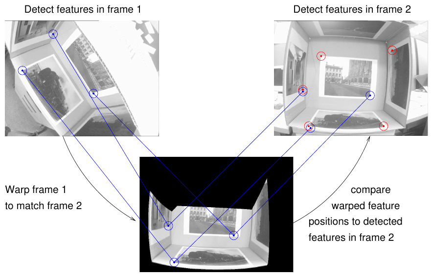
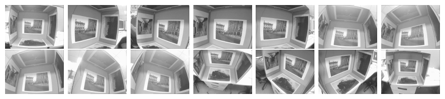
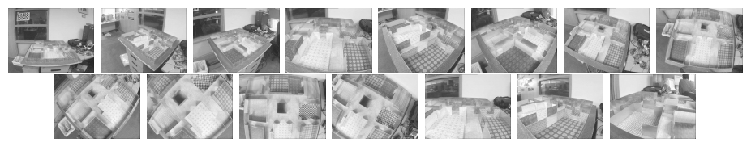
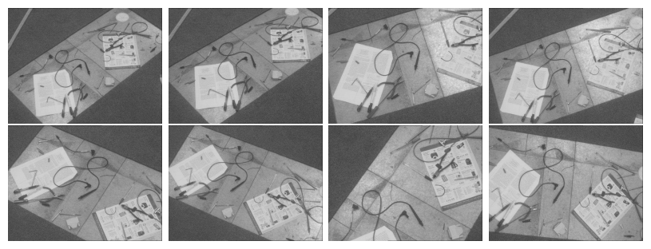
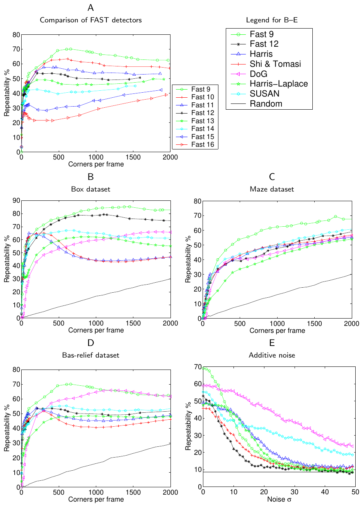

# Machine learning for high-speed corner detection (FAST) — конспект

**Авторы:** Edward Rosten, Tom Drummond (Department of Engineering, Cambridge University, UK)
**Площадка:** ECCV 2006 (European Conference on Computer Vision), сборник Springer LNCS, т. 3951, с. 430–443, DOI 10.1007/11744023_34 (библиографические данные — по записи Springer; в самом PDF указаны только название, авторы и аффилиация).
**Источник PDF:** авторская копия на домашней странице первого автора — https://www.edwardrosten.com/work/rosten_2006_machine.pdf ; локально: [../original/FAST_Rosten_2006.pdf](../original/FAST_Rosten_2006.pdf)
**Лицензия и режим:** статья опубликована Springer (все права защищены; авторская копия — не под свободной лицензией) → конспект своими словами, а не перевод.
**Расширенная версия:** E. Rosten, R. Porter, T. Drummond, «Faster and better: a machine learning approach to corner detection», IEEE TPAMI 32(1):105–119, 2010; препринт arXiv:0810.2434 (лицензия arXiv по умолчанию — non-exclusive distribution). В ней добавлен детектор FAST-ER (оптимизация повторяемости, а не только скорости) и более широкая оценка. Этот конспект описывает **первичную статью ECCV 2006**; отличия PAMI-версии здесь не разбираются.
**Код (из статьи):** http://mi.eng.cam.ac.uk/~er258/work/fast.html и библиотека libCVD (ссылки 2006 г., сейчас могут быть недоступны).

> **Суть в одном абзаце.** Авторы берут свой ранее предложенный «тест сегмента» (segment test): пиксель $p$ считается углом, если на окружности Брезенхэма из 16 пикселей вокруг него есть дуга из $n$ подряд идущих пикселей, которые все заметно ярче или все заметно темнее $p$. Затем они **обучают дерево решений** (алгоритм ID3), которое задаёт вопросы о пикселях окружности в оптимальном по информативности порядке и тем самым воспроизводит этот тест с минимальным числом обращений к памяти; дерево компилируется в C-код из вложенных `if-else`. Получается FAST (Features from Accelerated Segment Test) — детектор, обрабатывающий PAL-видео (768×288, 50 полей/с) за **< 7 %** доступного времени, тогда как Harris требует 120 %, а детектор DoG из SIFT — 300 %. Вторая часть работы — сравнение детекторов по **повторяемости (repeatability)** на трёх наборах с настоящей 3D-геометрией (а не только плоских сценах). Неожиданный итог: FAST с $n = 9$ оказался не только самым быстрым, но и самым повторяемым (при > ~200 углах на кадр), хотя чувствителен к шуму.

---

## 1. Введение: постановка проблемы

- Детекция углов — первый шаг трекинга, SLAM (simultaneous localisation and mapping), локализации, сопоставления изображений, распознавания.
- В задачах реального времени (SLAM на живом видео) вычислительный бюджет мал: существующие детекторы съедают почти всё время кадра и не оставляют ресурсов на остальной конвейер.
- Два вклада:
  1. **скорость:** переработка ранее предложенного детектора с помощью машинного обучения — большой выигрыш по времени и обобщение на разные $n$ (семейство детекторов);
  2. **качество:** сравнение детекторов по критерию Шмид (Schmid): при разных ракурсах 3D-сцены детектор должен находить точки, соответствующие одним и тем же физическим точкам. Оценка делается на сценах с известной приблизительной 3D-моделью поверхности.

## 1.1. Обзор предшествующих работ

Большинство детекторов вычисляют **функцию отклика угла (corner response function)** $C$ по всему изображению и оставляют пиксели, где $C$ выше порога и локально максимальна.

**Моравец (Moravec):** $C$ — минимальная сумма квадратов разностей (SSD) между патчем вокруг кандидата и его сдвинутыми копиями.

**Харрис (Harris):** аппроксимация второй производной SSD по сдвигу через матрицу

$$
H = \begin{bmatrix} \widehat{I_x^2} & \widehat{I_x I_y} \\ \widehat{I_x I_y} & \widehat{I_y^2} \end{bmatrix},
\qquad
C = |H| - k\,(\operatorname{trace} H)^2,
$$

- $I_x, I_y$ — производные яркости по $x$ и $y$;
- $\widehat{\cdot}$ — усреднение по патчу (можно гладким круговым окном — отклик менее шумный и изотропный);
- $|H|$ — определитель, $k$ — эмпирическая константа.
- $C$ велико, когда оба собственных значения $H$ велики; явного вычисления собственных значений не требуется.

**Ши–Томази (Shi & Tomasi):** в предположении аффинной деформации лучше брать $C = \min(\lambda_1, \lambda_2)$ — меньшее собственное значение $H$. Разные варианты (Harris, Shi–Tomasi, Noble и др.) эквивалентны разным матричным нормам $H$.

**DoG / LoG (Lowe, [SIFT](SIFT_конспект.md)):** инвариантность к масштабу за счёт свёртки с разностью гауссиан (Difference of Gaussians, DoG) на многих масштабах; DoG — быстрая аппроксимация лапласиана гауссианы (LoG). Есть Harris-Laplace (Харрис на многих масштабах + максимум LoG по масштабу) и аффинно-инвариантные расширения.

**Методы по цепочкам контуров (edge chaining):** ищут максимумы кривизны / изменения направления контура.

**Методы «похож ли патч на угол»** — без производных, а значит без предварительного сглаживания; поэтому очень быстрые, но хуже работают на размытых изображениях с крупномасштабными структурами. К этому классу относится и FAST.
- **SUSAN** (Smith & Brady): доля пикселей в диске, близких по яркости к центру («ядру», nucleus) — USAN (Univalue Segment Assimilating Nucleus); малое значение USAN означает угол.
- **Trajkovic & Hedley:** на окружности сравнивают центральный пиксель $f_C$ с парами диаметрально противоположных пикселей $f_P, f_{P'}$:
  $$C = \min_P \left[(f_P - f_C)^2 + (f_{P'} - f_C)^2\right],$$
  $C$ велико только на углу; сначала грубая проверка по горизонтали и вертикали, затем полная, плюс интерполяция между дискретными направлениями.
- Быстрое радиально-симметричное преобразование (Loy & Zelinsky).
- Машинное обучение: трёхслойная нейросеть, распознающая углы с рёбрами под углами, кратными 45°, в окне 8×8 (Dias et al.).

## 2. Высокоскоростная детекция углов

### 2.1. FAST: Features from Accelerated Segment Test

*Рис. 1 (из оригинальной статьи). Тест сегмента на окружности из 16 пикселей вокруг кандидата $p$; выделенные квадраты — пиксели, участвующие в тесте. Пунктирная дуга проходит через 12 подряд идущих пикселей, которые ярче $p$ больше чем на порог.*

**Критерий теста сегмента (segment test):**
- рассматривается окружность Брезенхэма (Bresenham circle) из 16 пикселей вокруг кандидата $p$ (радиус 3, пиксели пронумерованы 1..16 по часовой стрелке, 1 — сверху);
- $p$ — угол, если существует **дуга из $n$ подряд идущих пикселей** окружности, которые все ярче $I_p + t$ или все темнее $I_p - t$, где $I_p$ — яркость кандидата, $t$ — порог.

**Исходный (ручной) детектор** (из более ранних работ авторов) использовал $n = 12$, потому что это позволяет быстрый предварительный тест:
1. проверить только 4 пикселя «по сторонам света» — 1, 5, 9, 13;
2. если $p$ — угол, то хотя бы **три** из них должны быть все ярче $I_p + t$ или все темнее $I_p - t$; иначе $p$ отбрасывается;
3. для оставшихся кандидатов проверяется полный критерий на всех 16 пикселях.

**Слабости ручного детектора** (их и устраняет работа):
1. быстрый предварительный тест плохо обобщается на $n < 12$;
2. выбор и порядок проверяемых пикселей неявно предполагают определённое распределение внешнего вида признаков;
3. результаты первых 4 проверок затем выбрасываются (не используются повторно);
4. несколько срабатываний находятся рядом друг с другом (нет подавления немаксимумов).

### 2.2. Обучение детектора углов

Пункты 1–3 решаются машинным обучением, пункт 4 — в разд. 2.3. Процесс в два этапа.

**Этап 1 — сбор данных.** На наборе изображений (желательно из целевой области применения) медленным «прямым» алгоритмом (проверка всех 16 пикселей для каждого пикселя изображения) находятся углы для выбранного $n$ и удобного порога $t$.

**Этап 2 — построение дерева.** Для каждой позиции на окружности $x \in \{1..16\}$ пиксель $p \to x$ (пиксель окружности на позиции $x$ относительно $p$) может быть в одном из трёх состояний:

$$
S_{p\to x} =
\begin{cases}
d, & I_{p\to x} \le I_p - t \quad \text{(темнее, darker)} \\
s, & I_p - t < I_{p\to x} < I_p + t \quad \text{(похож, similar)} \\
b, & I_p + t \le I_{p\to x} \quad \text{(ярче, brighter)}
\end{cases}
$$

- $P$ — множество всех пикселей всех обучающих изображений;
- выбор позиции $x$ разбивает $P$ на три подмножества $P_d, P_s, P_b$ по значению $S_{p\to x}$;
- $K_p$ — булева метка: истина, если $p$ — угол.

Используется алгоритм ID3 (Quinlan): выбирается $x$, дающий максимум информации о $K_p$. Энтропия множества:

$$
H(P) = (c + \bar c)\log_2(c + \bar c) - c\log_2 c - \bar c\log_2 \bar c,
$$

- $c = |\{p \mid K_p \text{ истинно}\}|$ — число углов;
- $\bar c = |\{p \mid K_p \text{ ложно}\}|$ — число не-углов.

(Это ненормированная энтропия — энтропия Шеннона, умноженная на размер множества.)

Прирост информации от выбора $x$:

$$
H(P) - H(P_d) - H(P_s) - H(P_b).
$$

**Алгоритм:**
1. Выбрать $x$ с максимальным приростом информации; разбить $P$ на $P_d, P_s, P_b$.
2. Рекурсивно повторить для каждого подмножества — для каждого ищется **своя** лучшая позиция ($x_b$ для $P_b$, $x_s$ для $P_s$ и т.д.).
3. Остановиться, когда энтропия подмножества равна нулю (все пиксели в нём — углы или все не-углы). Это гарантированно достижимо, так как $K$ — детерминированная функция обучающих данных.
4. Полученное дерево решений сконвертировать в C-код — длинную цепочку вложенных `if-then-else` — и скомпилировать.
5. Для полной оптимизации компилировать дважды: сначала собрать профиль на тестовых изображениях, затем перекомпилировать с профилированием ветвлений (arc-profiling), чтобы компилятор переупорядочил код.
6. Если два из трёх поддеревьев совпадают, разделяющую их проверку удалить.

**Замечание авторов:** обучающие данные не покрывают всех возможных конфигураций, поэтому обученный детектор **не точно совпадает** с тестом сегмента. Дерево можно было бы доработать до полной эквивалентности, но любой детектор — эвристика, и обученный — лишь «очень слегка другая» эвристика.

### 2.3. Подавление немаксимумов (non-maximal suppression)

Тест сегмента не вычисляет функцию отклика, поэтому для NMS вводится функция оценки $V$ для каждого найденного угла; угол удаляется, если у соседнего угла $V$ больше. Варианты:
1. максимальное $n$, при котором $p$ ещё угол;
2. максимальное $t$, при котором $p$ ещё угол;
3. сумма абсолютных разностей между пикселями непрерывной дуги и центром.

Варианты 1 и 2 сильно квантованы (у многих пикселей одинаковое значение). Ради скорости используется слегка изменённый вариант 3:

$$
V = \max\left(\sum_{x\in S_\text{bright}} \bigl(|I_{p\to x} - I_p| - t\bigr),\ \sum_{x\in S_\text{dark}} \bigl(|I_p - I_{p\to x}| - t\bigr)\right),
$$

$$
S_\text{bright} = \{x \mid I_{p\to x} \ge I_p + t\},\qquad S_\text{dark} = \{x \mid I_{p\to x} \le I_p - t\}.
$$

- суммирование идёт по **всем** ярким (тёмным) пикселям окружности, а не только по дуге.

### 2.4. Время работы

Условия: 1500 монохромных полей PAL-видео 768×288; процессоры Opteron 2.6 ГГц и Pentium III 850 МГц; около 500 признаков на поле. Процент — доля бюджета времени на одно поле (PAL, NTSC, DV и 30-Гц VGA имеют близкую пиксельную скорость, так что проценты применимы широко).

| Детектор | Opteron 2.6 ГГц, мс | % | Pentium III 850 МГц, мс | % |
|---|---|---|---|---|
| FAST $n=9$ (с NMS) | 1.33 | 6.65 | 5.29 | 26.5 |
| FAST $n=9$ (без NMS) | 1.08 | 5.40 | 4.34 | 21.7 |
| FAST $n=12$ (с NMS) | 1.34 | 6.70 | 4.60 | 23.0 |
| FAST $n=12$ (без NMS) | 1.17 | 5.85 | 4.31 | 21.5 |
| Исходный FAST $n=12$ (с NMS) | 1.59 | 7.95 | 9.60 | 48.0 |
| Исходный FAST $n=12$ (без NMS) | 1.49 | 7.45 | 9.25 | 48.5 |
| Harris | 24.0 | 120 | 166 | 830 |
| DoG | 60.1 | 301 | 345 | 1280 |
| SUSAN | 7.58 | 37.9 | 27.5 | 137.5 |

*(Таблица 1 статьи. Значение 1280 % для DoG на Pentium III приведено как в оригинале, хотя 345 мс при бюджете 20 мс даёт ~1725 % — вероятно, опечатка в статье.)*

**Интерпретация:**
- обученный FAST до 2× быстрее ручного, и, главное, удалось получить эффективный детектор для $n = 9$, который (разд. 4) оказался самым надёжным;
- на маломощном процессоре FAST — единственный из протестированных, способный работать в темпе видео;
- в среднем дерево задаёт **2.26** вопроса на пиксель для $n=9$ и **2.39** для $n=12$; ручной детектор — 2.8;
- на Opteron выигрыш меньше, чем на Pentium III: по мнению авторов, стоимость обращения к пикселю на Opteron убывает (кэш), а модель обучения предполагает одинаковую стоимость всех обращений.

## 3. Сравнение повторяемости детекторов

**Существующие метрики и их проблемы:**
- Mohanna & Mokhtarian: «согласованность числа углов» $\mathrm{CCN} = 100 \times 1.1^{-|n_w - n_o|}$ ($n_w$, $n_o$ — число признаков на деформированном и исходном изображении) и точность $\mathrm{ACU} = 100 \times \frac{n_a/n_o + n_a/n_g}{2}$ ($n_g$ — число «эталонных» углов, размеченных людьми; $n_a$ — число совпавших с эталоном). Минус — субъективная ручная разметка.
- Trajkovic & Hedley: «стабильность» — доля «сильных» совпадений (прослеженных на трёх кадрах) от всех углов; зависит от алгоритмов трекинга и сопоставления.

**Принятый критерий (Schmid et al.):** важно, находятся ли **одни и те же физические точки** с разных ракурсов.
- Признак «обнаружен», если он извлечён на одном изображении и его точка видна на втором; «повторён», если на втором изображении рядом с проекцией тоже найден признак.
- **Повторяемость (repeatability)** = число повторённых / число обнаруженных признаков.
- У Шмид тест проводится на плоских сценах (связь — гомография, вычисляется по проецируемым маркерам). Это проверяет в основном аффинные деформации, что плохо соответствует целевой задаче авторов.

**Подход авторов:** использовать **3D-модель поверхности**, чтобы вычислить, где признак должен появиться в другом ракурсе (Рис. 2). Это позволяет оценивать признаки, порождённые геометрией (углы многогранников, окклюзии, T-образные сочленения), а также рельеф (bas-relief), моделируемый плоскостью, — т.е. неаффинные деформации.

*Рис. 2 (из оригинальной статьи). Признаки детектируются на кадрах 1 и 2; кадр 1 деформируется по геометрической модели так, чтобы совпасть с кадром 2, и перенесённые позиции признаков сравниваются с найденными на кадре 2.*

**Допуск по расстоянию** нужен потому, что: (1) совмещение неидеально; (2) модель неидеальна; (3) модель камеры (особенно радиальная дисторсия) неидеальна; (4) детектор может найти максимум на немного другой части угла — тем вероятнее, чем сильнее меняется ракурс и форма угла. Конкретная величина допуска в статье ECCV 2006 явно не указана.

**Совмещение модели со сценой:**
- без маркеров: 3D-модель вручную совмещается со сценой, затем уточняется смесью имитации отжига (simulated annealing) и градиентного спуска, минимизирующей SSD между всеми парами кадров и перепроекциями;
- для SSD между кадром $i$ и перепроецированным кадром $j$ изображения фильтруются полосовым фильтром (высокие частоты убираются ради шума, низкие — ради изменений освещения);
- для скорости SSD считается по 1000 случайных точек.

**Протокол:**
- повторяемость строится как функция числа углов на кадр;
- базовая линия — случайные точки (если каждый пиксель — угол, повторяемость 100 %, поэтому сравнение нужно при одинаковом числе точек);
- устойчивость к шуму: к набору bas-relief добавляется гауссов шум возрастающей силы (поверх уже присутствующего шума камеры).

**Наборы данных** (выложены авторами):

| Набор | Содержание | Что проверяет |
|---|---|---|
| Box | фотографии, наклеенные внутри куба; сильная перспектива, изменение масштаба, сильная радиальная дисторсия | плоские текстуры |
| Maze | реквизит для приложения дополненной реальности | текстурные признаки при проективных деформациях + геометрические признаки, значительные изменения масштаба |
| Bas-relief | модель — плоскость, но на ней много объектов с заметным рельефом | неаффинное изменение вида признаков |

*Рис. 3 (из оригинальной статьи). Набор Box: снимки испытательного стенда (фотографии внутри кубоида) с сильной перспективой, изменением масштаба и большой радиальной дисторсией.*

*Рис. 4 (из оригинальной статьи). Набор Maze: снимки макета для приложения дополненной реальности; текстурные признаки при проективных деформациях и геометрические признаки, значительные изменения масштаба.*

*Рис. 5 (из оригинальной статьи). Набор Bas-relief: модель — плоскость, но многие объекты имеют заметный рельеф, поэтому вид признаков меняется неаффинно.*

**Сравниваемые детекторы:** FAST ($n$ от 9 до 16), Harris, Shi & Tomasi, DoG, Harris-Laplace, SUSAN, случайные точки.

## 4. Результаты и обсуждение

*Рис. 6 (из оригинальной статьи). A: сравнение детекторов FAST с разным $n$ — наиболее повторяем $n = 9$; при $n \le 8$ детектор начинает сильно реагировать на рёбра. B, C, D: повторяемость на наборах Box, Maze, Bas-relief в зависимости от числа признаков на кадр. E: повторяемость на Bas-relief (500 признаков на кадр) в зависимости от уровня добавленного гауссова шума σ. Для FAST и SUSAN число признаков нельзя задать произвольно — берётся ближайшее к 500.*

Точные числа в статье приведены только графически (Рис. 6); по графикам (приблизительно, считано с рисунка):

| Набор | Лидер | Примечание |
|---|---|---|
| Box | FAST-9 (~80–85 % при 1000–1500 точках) | Harris и Shi–Tomasi падают до ~45 % после ~500 точек |
| Maze | FAST-9 (~60–70 %) | остальные детекторы близки друг к другу |
| Bas-relief | FAST-9 (~70 % при ~500–600 точках) | DoG догоняет при большом числе точек |
| Шум (Bas-relief) | при малом шуме — FAST-9, при σ ≳ 5–10 — DoG | FAST и Harris/Shi быстро деградируют |

*(Значения в этой таблице — визуальная оценка по Рис. 6, не числа из текста статьи.)*

**Выводы авторов по сравнению:**
- **Shi–Tomasi vs Harris.** Shi–Tomasi выведен в предположении аффинной деформации. На Box и Maze (где предположение выполняется) Shi–Tomasi лучше Harris; на Bas-relief (где не выполняется) — наоборот, Harris лучше.
- **Harris-Laplace** (Mikolajczyk & Schmid утверждали, что он повторяемее DoG и Harris на плоских сценах): на Box подтверждается примерно до 1000 точек на кадр; на остальных наборах, с непроективными изменениями, менее убедительно.
- **[SIFT](SIFT_конспект.md):** в эталонной реализации получается около 1000 точек на изображение — авторы согласны, что это хороший выбор: примерно здесь кривая повторяемости DoG выходит на плато.
- **SUSAN** действительно устойчив к шуму (не считает производных): повторяемость сначала быстро падает с ростом шума, затем выравнивается и превосходит все, кроме DoG.
- **Главный сюрприз:** FAST, спроектированный только ради скорости, **превосходит остальные детекторы** на этих данных (если нужно больше ~200 углов на кадр). Оптимален $n = 9$ (Рис. 6A), поэтому далее показываются только FAST-9 и исходный FAST-12.
- **DoG очень устойчив к шуму:** свёртка с симметричным ядром DoG эквивалентна согласованной фильтрации (matched filtering) объектов такой формы, а она оптимальна при аддитивном гауссовом шуме.
- **FAST неустойчив к шуму** — ожидаемо: высокая скорость достигается анализом минимального числа пикселей, поэтому шум почти не усредняется.

## 5. Выводы авторов

Преимущества:
- во много раз быстрее существующих детекторов углов;
- высокая повторяемость при больших изменениях ракурса и для разных типов признаков.

Недостатки:
- неустойчивость к сильному шуму;
- может реагировать на линии шириной 1 пиксель под определёнными углами, когда дискретная окружность «промахивается» мимо линии;
- зависит от порога $t$.

Кроме того, методика оценки повторяемости на 3D-сценах подтвердила ряд утверждений из других работ и показала, что оценивать детекторы только на плоских сценах недостаточно.

---

## Сводка алгоритма FAST (по статье)

1. Для каждого пикселя $p$ (кроме полосы шириной 3 у границы) — пройти обученное дерево решений: на каждом узле сравнить пиксель окружности $p\to x$ с $I_p \pm t$ и перейти в ветвь $d$/$s$/$b$.
2. Лист дерева сообщает «угол / не угол» (приближение теста сегмента «$n$ подряд ярче или темнее»).
3. Для найденных углов вычислить $V$ по формуле (8).
4. Подавить немаксимумы: удалить угол, если у соседнего угла $V$ больше.

### Параметры

| Параметр | Значение в статье | Комментарий |
|---|---|---|
| Окружность | 16 пикселей (окружность Брезенхэма радиуса 3) | |
| $n$ (длина дуги) | 9..16; рекомендован **9** | $n \le 8$ — отклик на рёбра; $n = 12$ — исходный вариант с быстрым тестом 1/5/9/13 |
| $t$ (порог) | «удобный» при обучении; на этапе детекции — параметр | конкретное значение для экспериментов в статье не указано |
| Обучение | ID3, условие останова — нулевая энтропия | данные — изображения из целевой области |
| Функция оценки для NMS | формула (8) | |
| Среднее число вопросов на пиксель | 2.26 ($n=9$), 2.39 ($n=12$) | ручной FAST-12 — 2.8 |

---

## Сильные стороны и ограничения

### Сильные стороны
- **Экстремальная скорость:** ~1 мс на поле 768×288 на CPU 2006 г.; на порядок быстрее Harris и DoG. Фактически стандартный детектор для систем реального времени (PTAM, ORB-SLAM, VINS и т.п. используют FAST или его варианты — замечание вне статьи).
- **Высокая повторяемость** при изменениях ракурса на реальных 3D-сценах (а не только при гомографиях).
- **Обобщаемость подхода:** дерево можно переобучить под другое $n$, другую окружность или домен.
- **Методологический вклад:** оценка повторяемости с 3D-моделью сцены, включая неаффинные деформации.

### Ограничения
- **Чувствительность к шуму** (явно показано на Рис. 6E).
- **Нет масштаба и ориентации:** FAST — детектор одного масштаба, без ориентации и без дескриптора; для сопоставления нужны пирамида, оценка ориентации и дескриптор (именно это добавляет [ORB](ORB_конспект.md)).
- **Сильный отклик на рёбрах** (особенно при малых $n$) и отклик на тонкие линии; нет «меры углового качества» — для ранжирования точек обычно дополнительно применяют меру Harris (как в [ORB](ORB_конспект.md)).
- **Зависимость от порога $t$**: число точек нельзя задать напрямую (видно в экспериментах, где для FAST подбирается ближайшее к 500 число).
- **Отсутствие субпиксельной точности** — позиции целочисленные.
- Обученное дерево не в точности эквивалентно тесту сегмента; его поведение зависит от обучающих изображений.
- Тайминги привязаны к процессорам 2006 г.; современные реализации используют SIMD и другие оптимизации.

---

## Значение для задачи визуального позиционирования

**Роль в конвейере.** FAST — детектор, а не признак целиком: в задачах визуального позиционирования он используется как быстрый источник точек для (а) трекинга между соседними кадрами (визуальная одометрия, VIO), (б) дескрипторов вроде [BRIEF](BRIEF_конспект.md)/ORB при сопоставлении с картой. Для глобальной локализации по спутниковой/аэроподложке «голый» FAST без масштаба и ориентации мало пригоден, но в составе [ORB](ORB_конспект.md) — частый лёгкий базовый вариант.

**Практические заметки** *(не из статьи, если не указано иное):*
- **OpenCV `cv::FastFeatureDetector::create`** (проверено по заголовку `features2d.hpp`, ветка 4.x): `threshold=10`, `nonmaxSuppression=true`, `type=TYPE_9_16` (также доступны `TYPE_7_12`, `TYPE_5_8`). То есть по умолчанию — FAST-9 на окружности из 16 пикселей, что соответствует рекомендации статьи.
- **Оценка для NMS в OpenCV** отличается от формулы (8): по коду `fast_score.cpp` OpenCV вычисляет score как наибольший порог, при котором точка ещё проходит тест сегмента (вариант 2 из разд. 2.3), а не сумму разностей.
- **Порог.** Для изображений 8 бит типичны значения 10–30; для текстурно бедных сцен (поля, вода, снег на аэроснимках) порог приходится снижать, что усиливает шумовые срабатывания. Распространённый приём — адаптивный порог или сетка ячеек с отдельным порогом/лимитом на ячейку для равномерного покрытия (так делает, например, ORB-SLAM).
- **Шум и размытие.** Учитывая выявленную в статье чувствительность к шуму, на ночных/тепловизионных/сильно сжатых кадрах с дрона полезно предварительное лёгкое сглаживание или переход к детекторам, устойчивым к шуму (DoG, обучаемые детекторы).
- **Масштаб.** Для сопоставления кадра с картой иного разрешения (разный GSD — ground sampling distance) FAST нужно запускать на пирамиде изображений.
- **Скорость на встраиваемых платформах.** FAST остаётся одним из самых дешёвых детекторов; есть реализации на NEON и CUDA (например, в OpenCV CUDA, VPI на Jetson — проверять по документации конкретной платформы).
- **Как базовая линия.** В современных сравнениях (HPatches и др.) FAST/ORB обычно служат нижней планкой качества при высокой скорости — полезно включать их в бенчмарки на своих данных.

---

## Глоссарий (англ. → рус.)

| English | Русский |
|---|---|
| corner detector | детектор углов |
| feature / interest point | признак / особая точка |
| segment test | тест сегмента |
| FAST (Features from Accelerated Segment Test) | признаки на основе ускоренного теста сегмента |
| Bresenham circle | окружность Брезенхэма (дискретная окружность) |
| contiguous arc | непрерывная дуга (подряд идущие пиксели) |
| threshold | порог |
| corner response function | функция отклика угла |
| cornerness | «угловатость», сила угла |
| decision tree | дерево решений |
| ID3 | алгоритм ID3 построения дерева решений (Quinlan) |
| entropy / information gain | энтропия / прирост информации |
| non-maximal suppression (NMS) | подавление немаксимумов |
| score function | функция оценки |
| repeatability | повторяемость |
| viewpoint change | изменение ракурса |
| affine / projective warp | аффинная / проективная деформация |
| bas-relief | барельеф (рельефная поверхность) |
| T-junction | T-образное сочленение |
| fiducial marker | реперная метка |
| simulated annealing | имитация отжига |
| bandpass filter | полосовой фильтр |
| matched filtering | согласованная фильтрация |
| Difference of Gaussians (DoG) | разность гауссиан |
| Laplacian of Gaussian (LoG) | лапласиан гауссианы |
| SUSAN / USAN | SUSAN / USAN (область, сходная по яркости с ядром) |
| SSD (sum of squared differences) | сумма квадратов разностей |
| PAL field | поле (полукадр) PAL-видео |
| frame rate | частота кадров |
| SLAM | одновременная локализация и построение карты |
| radial distortion | радиальная дисторсия |
