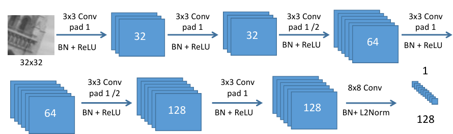
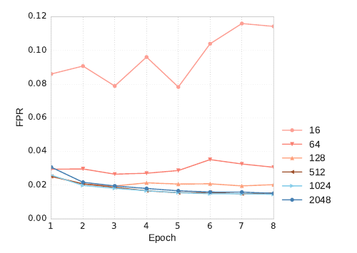
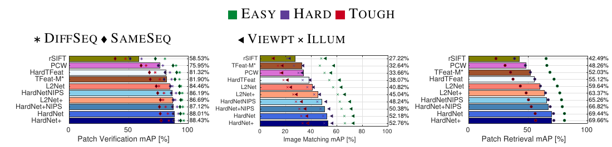
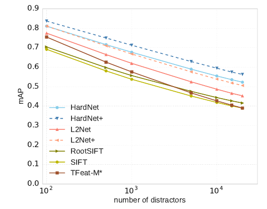
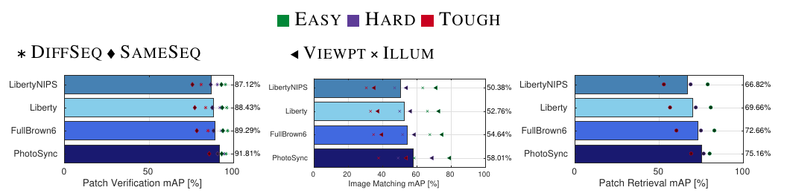
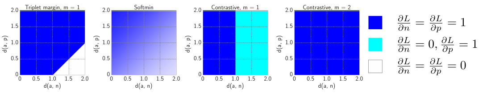
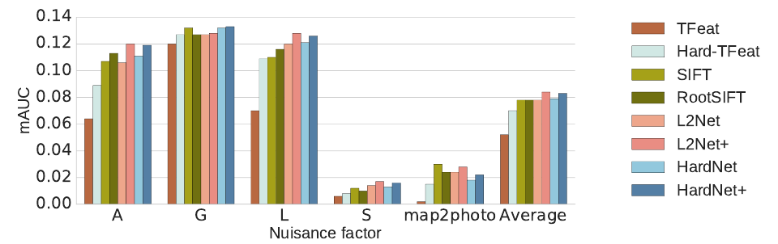

# Working hard to know your neighbor's margins: Local descriptor learning loss (HardNet) — конспект

**Авторы:** Anastasiya Mishchuk (Szkocka Research Group, Украина), Dmytro Mishkin, Filip Radenović, Jiří Matas (Visual Recognition Group, ЧВУТ в Праге / CTU in Prague)
**Площадка:** NIPS 2017 (31st Conference on Neural Information Processing Systems, Лонг-Бич; ныне NeurIPS). Препринт: arXiv:1705.10872 (используется v4 от 12.01.2018 — содержит «Post-NIPS update» с переобученными моделями и обновлёнными числами).
**Источник PDF:** https://arxiv.org/pdf/1705.10872 (arXiv v4) · локальная копия: [../original/HardNet_Mishchuk_2017.pdf](../original/HardNet_Mishchuk_2017.pdf)
**Код и веса:** `DagnyT/hardnet` (PyTorch); HardNet также входит в Kornia (`kornia.feature.HardNet`).
**Лицензия статьи и режим документа:** arXiv non-exclusive distribution license 1.0 (не CC) → конспект своими словами, а не перевод.

> **Суть в одном абзаце.** Авторы предлагают простую функцию потерь для обучения дескриптора локальных патчей, имитирующую критерий сопоставления [SIFT](SIFT_конспект.md) (тест отношения Лоу, Lowe's ratio test): в каждом мини-батче из $n$ пар соответствующих патчей строится матрица расстояний $n \times n$, для каждой пары находится **ближайший несоответствующий** дескриптор («самый трудный в батче», hardest-in-batch), и триплетная потеря с порогом 1 требует, чтобы расстояние до соответствия было меньше расстояния до этого ближайшего «чужого» хотя бы на 1. Архитектура не новая — L2Net (7 свёрток, вход 32×32, выход 128-D, как у [SIFT](SIFT_конспект.md)). Без дополнительных регуляризаторов L2Net (глубокое обучение промежуточных слоёв, штраф за корреляцию каналов) получившийся дескриптор **HardNet** становится лучшим на Brown/UBC, HPatches, W1BS, в широкобазовом стерео и в поиске изображений (Oxford5k/Paris6k). Главная причина успеха, по абляции, — именно стратегия выборки «hardest-in-batch».

*Рис. 1 (из оригинальной статьи). Процедура выборки: патчи описываются текущей сетью, считается матрица расстояний; для каждого якоря a_i и позитива p_i выбирается ближайший несоответствующий дескриптор (красный); из двух кандидатов берётся более трудный. Всё — за один прямой проход.*

---

## 1. Введение

- Локальные соответствия нужны в поиске изображений, склейке панорам, широкобазовом стерео (wide baseline stereo), 3D-реконструкции. Несмотря на попытки сквозного обучения (end-to-end) всего конвейера, классические детекторы и дескрипторы остаются в ходу из-за надёжности, скорости и интеграции в существующие системы.
- Обучаемые дескрипторы ([LIFT](LIFT_конспект.md), MatchNet, DeepCompare) хорошо выглядели на задаче верификации патчей, но **в реальных задачах проигрывали [SIFT](SIFT_конспект.md)** и его вариантам (RootSIFT-PCA, DSP-SIFT) — в сопоставлении изображений, небольшом поиске и 3D-реконструкции. Одна из версий объяснения: существующие датасеты патчей слишком малы и однообразны.
- Авторы показывают обратное: **стандартных данных (Brown/UBC) достаточно**, если правильно сформулировать потерю. Новый дескриптор HardNet превосходит и ручные, и обучаемые дескрипторы в реальных задачах.

## 2. Связанные работы

- **Классический критерий [SIFT](SIFT_конспект.md):** найти ближайшего соседа и сравнить отношение расстояний 1-го и 2-го соседей с порогом (ratio test). Ни одна обучаемая потеря до этого, по словам авторов, не воспроизводила такой критерий напрямую.
- Simonyan & Zisserman — обучаемые фильтры и пулинг через выпуклую оптимизацию.
- MatchNet (Han et al.) — сиамская сеть + сеть-сравниватель; сравниватель улучшает точность, но **ломает быстрый поиск** ближайших соседей (kd-tree и т.п.). DeepCompare (Zagoruyko & Komodakis) — близкий подход.
- DeepDesc (Simo-Serra et al.) — hard negative mining в мелкой сети с парной потерей.
- Ближе всего к [SIFT](SIFT_конспект.md)-схеме:
  - **TFeat** (Balntas et al.) — триплетные потери, но негативы выбираются **случайно**;
  - **UCN** (Choy et al.) — матрица расстояний для майнинга позитивов и негативов + контрастная потеря;
  - **L2Net** (Tian et al.) — $n$ пар в батче дают $n^2 - n$ негативов; требуется, чтобы соответствие было минимумом в своей строке и столбце; плюс штраф за корреляцию каналов дескриптора и глубокое обучение промежуточных слоёв (deep supervision). Архитектура L2Net взята за основу HardNet.

## 3. Предлагаемый дескриптор

### 3.1. Выборка и функция потерь

**Батч.** $\mathcal{X} = (A_i, P_i)_{i=1..n}$ — $n$ пар соответствующих патчей: $A$ — якорь (anchor), $P$ — позитив (positive), оба — проекции одной точки 3D-поверхности. В батче **ровно одна пара на каждую 3D-точку** (иначе «негатив» мог бы оказаться той же точкой).

**Матрица расстояний.** Все $2n$ патчей проходят через сеть; для L2-нормированных дескрипторов $a_i$, $p_j$:

$$
D = \mathrm{cdist}(a, p), \qquad d(a_i, p_j) = \sqrt{2 - 2\, a_i^\top p_j}, \quad i, j = 1..n
$$

- $D$ — матрица $n \times n$ евклидовых расстояний; формула следует из $\lVert a - p \rVert^2 = 2 - 2a^\top p$ для единичных векторов.

**Ближайшие несоответствующие** (по сути, «второй ближайший сосед», если первый — правильный):

$$
j_{\min} = \arg\min_{j \ne i} d(a_i, p_j), \qquad k_{\min} = \arg\min_{k \ne i} d(a_k, p_i)
$$

- $p_{j_{\min}}$ — ближайший «чужой» дескриптор к якорю $a_i$ (минимум по строке);
- $a_{k_{\min}}$ — ближайший «чужой» дескриптор к позитиву $p_i$ (минимум по столбцу).

**Триплет.** Из четвёрки $(a_i, p_i, p_{j_{\min}}, a_{k_{\min}})$ берётся более трудный негатив: триплет $(a_i, p_i, p_{j_{\min}})$, если $d(a_i, p_{j_{\min}}) < d(a_{k_{\min}}, p_i)$, иначе $(p_i, a_i, a_{k_{\min}})$.

**Потеря** — триплетная с порогом (triplet margin loss) по $n$ триплетам:

$$
L = \frac{1}{n} \sum_{i=1}^{n} \max\Big(0,\; 1 + d(a_i, p_i) - \min\big(d(a_i, p_{j_{\min}}),\, d(a_{k_{\min}}, p_i)\big)\Big)
$$

- $d(a_i, p_i)$ — расстояние до правильного соответствия;
- $\min(\cdot)$ — расстояние до самого трудного негатива (уже посчитано при построении триплета);
- 1 — порог (margin).

**Почему так:** это прямая «обучаемая» версия ratio test — сеть учат делать правильное соответствие **заметно ближе ближайшего неправильного**, т.е. увеличивать «зазор до соседа» (отсюда название статьи — «знать запасы своего соседа», neighbor's margins).

**Стоимость:** по сравнению со случайными триплетами добавляется лишь расчёт матрицы расстояний на GPU и минимумы по строкам/столбцам. Нужна **двухпоточная** (а не трёхпоточная) сеть → примерно на 30% меньше памяти и вычислений, чем при обычном обучении на триплетах.

**Чего нет (в отличие от L2Net):** ни глубокого обучения промежуточных слоёв, ни штрафа за корреляцию каналов. Значимого переобучения авторы не наблюдали.

### 3.2. Архитектура

*Рис. 2 (из оригинальной статьи). Архитектура, заимствованная из L2Net: вход 32×32, шесть свёрток 3×3 (32-32-64-64-128-128, две — с шагом 2), финальная свёртка 8×8 → 128-D, L2-нормировка. После каждого слоя, кроме последнего, — BatchNorm + ReLU; перед последним — Dropout.*

| Слой | Конфигурация | Выход |
|---|---|---|
| Вход | патч 32×32, grayscale; вычитание среднего и деление на СКО **по каждому патчу** | 32×32×1 |
| Conv1 | 3×3, pad 1, 32 канала, BN + ReLU | 32×32×32 |
| Conv2 | 3×3, pad 1, 32 канала, BN + ReLU | 32×32×32 |
| Conv3 | 3×3, pad 1, **stride 2**, 64 канала, BN + ReLU | 16×16×64 |
| Conv4 | 3×3, pad 1, 64 канала, BN + ReLU | 16×16×64 |
| Conv5 | 3×3, pad 1, **stride 2**, 128 каналов, BN + ReLU | 8×8×128 |
| Conv6 | 3×3, pad 1, 128 каналов, BN + ReLU | 8×8×128 |
| Dropout | 0.1 (в версии NIPS) / 0.3 (post-NIPS) | — |
| Conv7 | 8×8, без паддинга, 128 каналов, BN (без ReLU) | 1×1×128 |
| L2Norm | нормировка до единичной длины | 128-D |

- Пулингов нет — по наблюдению авторов они ухудшают дескриптор; пространство уменьшается свёртками с шагом.
- Размерность 128 — как у [SIFT](SIFT_конспект.md), что удобно для замены [SIFT](SIFT_конспект.md) в существующих системах.

### 3.3. Обучение и гиперпараметры

| Параметр | Версия NIPS | Post-NIPS (итоговая) |
|---|---|---|
| Оптимизатор | SGD, momentum 0.9 | SGD (по коду: `--optimizer sgd`) |
| Learning rate | 0.1 | **10** (по коду: «ten is not typo») |
| Расписание lr | линейное затухание до 0 за 10 эпох | то же (по коду: 10 эпох) |
| Weight decay | $10^{-4}$ | $10^{-4}$ |
| Dropout | 0.1 | 0.3 |
| Инициализация | ортогональная, gain 0.6; смещения 0.01 | — |
| Порог потери | 1 | 1 (по коду: `--margin 1.0`) |
| Размер батча | исследуется (разд. 3.4) | 1024 (по коду) |
| Триплетов за эпоху | — | 5 000 000 (по коду: `--n-triplets`) |
| Аугментация «+» | flip + случайный поворот на 90° | по коду `--fliprot` |
| Фреймворк | PyTorch | PyTorch |

- **Post-NIPS update.** После двух крупных обновлений PyTorch результаты статьи не воспроизводились; поиск гиперпараметров показал, что lr = 10 и dropout = 0.3 дают **лучшие** результаты, воспроизводимые на разных машинах. Модели «NIPS» и «post-NIPS» в таблицах обозначены отдельно (HardNetNIPS vs HardNet).
- Обозначения версий: **HardNet** — без аугментации; **HardNet+** — с аугментацией flip/поворот на 90°; **HardNet++** — обучен на объединении Brown и HPatches (поэтому на HPatches не оценивается).

### 3.4. Обучающие данные и результат на Brown (UBC Phototour)

- **Brown / UBC Phototour:** три подмножества — Liberty, Notre Dame, Yosemite, примерно по 400 тыс. нормированных патчей 64×64; точки найдены детектором DoG и проверены по 3D-модели. Тест — 100 тыс. пар (соответствующих и нет) на каждое подмножество; стандартно обучают на одном, тестируют на двух других.
- Метрика: **FPR95** — доля ложноположительных при полноте (true positive rate) 95%. Авторы отмечают, что часть работ (MatchNet, TFeat) из-за ошибки в коде сообщала FDR (false discovery rate) вместо FPR, и пересчитывают их числа (помечены \*).
- Далее в статье везде используется дескриптор, обученный на **Liberty** (как TFeat и L2Net).

Таблица 1 статьи — FPR95, % (меньше — лучше):

| Обучение → тест | Notredame→Liberty | Yosemite→Liberty | Liberty→Notredame | Yosemite→Notredame | Liberty→Yosemite | Notredame→Yosemite | Среднее FPR |
|---|---|---|---|---|---|---|---|
| [SIFT](SIFT_конспект.md) | 29.84 | | 22.53 | | 27.29 | | 26.55 |
| MatchNet\* | 7.04 | 11.47 | 3.82 | 5.65 | 11.6 | 8.7 | 8.05 |
| TFeat-M\* | 7.39 | 10.31 | 3.06 | 3.8 | 8.06 | 7.24 | 6.64 |
| PCW | 7.44 | 9.84 | 3.48 | 3.54 | 6.56 | 5.02 | 5.98 |
| L2Net | 3.64 | 5.29 | 1.15 | 1.62 | 4.43 | 3.30 | 3.24 |
| HardNetNIPS | 3.06 | 4.27 | 0.96 | 1.4 | 3.04 | 2.53 | 2.54 |
| **HardNet** | **1.47** | 2.67 | 0.62 | 0.88 | 2.14 | **1.65** | 1.57 |
| *С аугментацией (flip, поворот 90°):* | | | | | | | |
| GLoss+ | 3.69 | 4.91 | 0.77 | 1.14 | 3.09 | 2.67 | 2.71 |
| DC2ch2st+ | 4.85 | 7.2 | 1.9 | 2.11 | 5.00 | 4.10 | 4.19 |
| L2Net+ | 2.36 | 4.7 | 0.72 | 1.29 | 2.57 | 1.71 | 2.23 |
| HardNet+NIPS | 2.28 | 3.25 | 0.57 | 0.96 | 2.13 | 2.22 | 1.9 |
| **HardNet+** | 1.49 | **2.51** | **0.53** | **0.78** | **1.96** | 1.84 | **1.51** |

*([SIFT](SIFT_конспект.md) не обучается, поэтому у него одно число на тестовое подмножество.)*

- Мультимасштабные патчи и архитектуры «центр–окружение» (center-surround) авторы сознательно не включают: они улучшают числа на Brown, но, по данным L2Net и др., **ухудшают** сопоставление в более реалистичных условиях (например, Oxford-Affine).

### 3.5. Влияние размера батча

- Чем больше батч, тем больше трудных негативов видит потеря. Проверены 16, 64, 128, 512, 1024, 2048 (обучение на Liberty, валидация — среднее FPR95 по Notredame и Yosemite).
- Качество растёт с размером батча, но **выше 512 прирост незначителен**.

*Рис. 3 (из оригинальной статьи). FPR95 (среднее по Notredame и Yosemite) по эпохам для разных размеров батча: при 16 — около 0.08–0.12, при 512 и более — около 0.015.*

## 4. Эмпирическая оценка

Хорошие числа на Brown не гарантируют хорошего сопоставления ближайшим соседом (наблюдение Balntas et al.), поэтому основная оценка — на «реальных» задачах. Основные соперники: RootSIFT, PCW, TFeat-M\*, L2Net.

### 4.1. HPatches

- **HPatches:** 116 последовательностей по 6 изображений; 59 — сильная смена ракурса (viewpoint), 57 — сильная смена освещения (illumination, естественная и искусственная). Точки (DoG, Hessian, Harris) находятся на опорном изображении и переносятся на остальные с тремя уровнями геометрического шума: **Easy, Hard, Tough**.
- Три задачи: верификация пар патчей (patch verification), сопоставление изображений (image matching), поиск патчей (patch retrieval). Все дескрипторы обучены на Liberty (или ручные); на HPatches никто не обучался.

*Рис. 5 (из оригинальной статьи). Слева направо: верификация, сопоставление, поиск на HPatches (mAP, %). Цвет маркера — уровень шума Easy/Hard/Tough; тип маркера — источник негативов (DiffSeq/SameSeq) или тип последовательностей (Viewpt/Illum). HardNet и HardNet+ — post-NIPS версии.*

Средний mAP, % (по подписям столбцов рис. 5):

| Дескриптор | Верификация | Сопоставление | Поиск |
|---|---|---|---|
| rSIFT (RootSIFT) | 58.53 | 27.22 | 42.49 |
| PCW | 75.95 | 33.66 | 48.26 |
| TFeat-M\* | 81.90 | 32.64 | 52.03 |
| HardTFeat (архитектура TFeat + потеря HardNet) | 81.32 | 38.07 | 55.12 |
| L2Net | 84.46 | 40.82 | 59.64 |
| L2Net+ | 86.69 | 45.04 | 63.37 |
| HardNetNIPS | 86.19 | 48.24 | 65.26 |
| HardNet+NIPS | 87.12 | 50.38 | 66.82 |
| **HardNet** | 88.01 | 52.18 | 69.44 |
| **HardNet+** | **88.43** | **52.76** | **69.66** |

**Выводы:**
- В верификации L2Net и HardNet близки (небольшое преимущество HardNet).
- В **сопоставлении** даже HardNet без аугментации заметно лучше L2Net+ с аугментацией; разрыв больше на уровнях Hard и Tough.
- Последовательности с освещением сложнее геометрических для всех дескрипторов.
- **HardTFeat** (та же мелкая архитектура TFeat, но новая потеря) лучше оригинального TFeat в сопоставлении и поиске — потеря работает и для мелких сетей.

**Поиск с дистракторами.** При росте числа «отвлекающих» (несоответствующих) патчей качество TFeat быстро падает и около 10 000 дистракторов опускается ниже [SIFT](SIFT_конспект.md); HardNet деградирует слабо, и отрыв растёт с усложнением задачи. Это объясняет слабость TFeat на Oxford5k/Paris6k, где дистракторов ~12M и ~15M.

*Рис. 4 (из оригинальной статьи). mAP поиска патчей на HPatches в зависимости от числа дистракторов (10²–10⁴+): HardNet+ и HardNet деградируют медленнее всех; TFeat-M\* падает ниже [SIFT](SIFT_конспект.md).*

**Post-NIPS: влияние обучающих данных.** Сравнены Liberty (DoG), полный Brown (Liberty + Notredame + Yosemite, патчи DoG и Harris, «FullBrown6») и новый крупный датасет PhotoSync (Mitra et al.):

| Обучающие данные | Верификация | Сопоставление | Поиск |
|---|---|---|---|
| Liberty (NIPS) | 87.12 | 50.38 | 66.82 |
| Liberty | 88.43 | 52.76 | 69.66 |
| FullBrown6 | 89.29 | 54.64 | 72.66 |
| PhotoSync | **91.81** | **58.01** | **75.16** |

*Рис. 6 (из оригинальной статьи). Версии HardNet, обученные на Liberty, полном Brown (FullBrown6) и PhotoSync: больше и разнообразнее данные — выше качество во всех трёх задачах HPatches.*

### 4.2. Абляция: выборка и функция потерь

Средний mAP на задаче сопоставления HPatches при замене одного компонента (архитектура везде L2Net). CPR — штраф за корреляцию каналов из L2Net; «hard negative mining» — классический отбор ближайших негативов по **всему** обучающему набору раз в эпоху.

| Выборка \ Потеря | Softmin | Triplet margin, m=1 | Contrastive, m=1 | Contrastive, m=2 |
|---|---|---|---|---|
| Random | переобучение | переобучение | переобучение | переобучение |
| Hard negative mining | переобучение | переобучение | переобучение | переобучение |
| Random + CPR | 0.349 | 0.286 | 0.007 | 0.083 |
| Hard negative mining + CPR | 0.391 | 0.346 | 0.055 | 0.279 |
| **Hardest in batch (HardNet)** | 0.474 | **0.482** | 0.444 | **0.482** |

*(В таблице статьи слово «overfit» стоит одним значением на строку для случайной выборки и классического майнинга; в тексте сказано, что переобучение наблюдалось со всеми потерями.)*

**Выводы:**
- Стратегия **hardest-in-batch — главная причина** качества HardNet: она лучше всех остальных при любой потере.
- Случайная выборка и классический майнинг по всему набору дают сильное переобучение: потеря на обучении высокая, качество на тесте низкое и сильно скачет от запуска к запуску. Нормальные результаты с ними получаются только с CPR.
- Плохой результат классического майнинга удивителен; авторы объясняют его **шумом разметки**: «трудные негативы» по всему датасету часто оказываются на самом деле позитивами (подтверждено визуально). Внутри батча (одна пара на 3D-точку, случайные точки) такое маловероятно.
- По потерям: softmin стабильнее всех при любой выборке, но при hardest-in-batch чуть уступает triplet margin и контрастной с большим порогом.

**Объяснение через градиенты** (рис. 7): у triplet margin и контрастной потери с большим порогом градиент по позитиву и негативу **постоянен и ненулевой** почти везде; у контрастной с малым порогом многие негативы ($d(a,n) > m$) не дают градиента; у softmin градиент быстро затухает, как только $d(a,n) > d(a,p)$.

*Рис. 7 (из оригинальной статьи). Величина вклада позитива и негатива в градиент в осях d(a,n) (по горизонтали) и d(a,p) (по вертикали): синий — обе производные равны 1, голубой — только по позитиву, белый — нулевые. Triplet margin и contrastive с m=2 ведут себя почти одинаково.*

### 4.3. Широкобазовое стерео (wide baseline stereo)

**W1BS** — 40 пар изображений, в каждой одно «экстремальное» отличие:
- **A** (appearance) — сезон, погода, окклюзии;
- **G** (geometry) — масштаб, положение камеры и объекта;
- **L** (illumination) — интенсивность, спектр источника света;
- **S** (sensor) — разные сенсоры (ИК, МРТ);
- **map2photo** — спутниковый снимок против карты.

Точки найдены MSER, Hessian-Affine и FOCI (а не DoG, на котором учились дескрипторы); патчи перепроецированы без геометрического шума. Протокол — как в задаче сопоставления HPatches.

*Рис. 8 (из оригинальной статьи). Средняя площадь под PR-кривой (mAUC) на W1BS по факторам A, G, L, S, map2photo и в среднем. HardNet и L2Net близки; оба лишь немного лучше [SIFT](SIFT_конспект.md); TFeat проигрывает [SIFT](SIFT_конспект.md), HardTFeat — заметно лучше TFeat.*

- HardNet лучше на изменениях геометрии и внешнего вида, L2Net — немного лучше на map2photo и видимый-vs-ИК.
- Учитывая огромный сдвиг домена, все дескрипторы работают прилично; TFeat сильно проигрывает [SIFT](SIFT_конспект.md), а HardTFeat его значительно обходит — снова в пользу новой потери.

**Регистрация пар в матчере MODS** (протокол из работы о WxBS; из MODS убраны первые быстрые шаги с [ORB](ORB_конспект.md)). Таблица 3 статьи — число успешно сопоставленных пар / среднее число инлайеров (inl.) на пару (в заголовке — число пар в наборе):

| Дескриптор | EF (33) | inl. | EVD (15) | inl. | OxAff (40) | inl. | SymB (46) | inl. | GDB (22) | inl. | WxBS (37) | inl. | LTLL (172) | inl. |
|---|---|---|---|---|---|---|---|---|---|---|---|---|---|---|
| RootSIFT | 33 | 32 | 15 | 34 | 40 | 169 | **45** | 43 | **21** | 52 | **11** | **93** | 123 | 27 |
| TFeat-M\* | 32 | 30 | 15 | 37 | 40 | 265 | 40 | 45 | 16 | 72 | 10 | 62 | 96 | 29 |
| L2Net+ | 33 | 34 | 15 | 34 | 40 | 304 | 43 | 46 | 19 | **78** | 9 | 51 | **127** | 26 |
| **HardNet+** | 33 | **35** | 15 | **41** | 40 | **316** | 44 | **47** | **21** | 75 | **11** | 54 | **127** | **31** |

- EF (Edge Foci), EVD (Extreme View), Oxford Affine — «насыщены»: все дескрипторы регистрируют все пары; HardNet даёт немного больше инлайеров.
- SymB, GDB, WxBS, LTLL — пары из «нефотографических» доменов (рисунок–рисунок) или кросс-доменные (рисунок–фото, старое–новое фото): HardNet лучше обучаемых конкурентов и **наравне с RootSIFT**, хотя под такие домены не обучался.

### 4.4. Поиск изображений (image retrieval)

- Oxford5k (5062 изобр.) и Paris6k (6300 изобр.), по 11 достопримечательностей и по 55 запросов (5 областей на объект); метрика — mAP.
- Признаки: многомасштабные Hessian-affine, одни и те же для всех дескрипторов (128-D). Словарь из 1M визуальных слов (k-means + приближённый ближайший сосед) обучается на **независимом** наборе (для Oxford — на Paris и наоборот), представление bag-of-words (BoW) + инвертированный файл; дополнительно — пространственная верификация (SV, spatial verification) и расширение запроса (QE, query expansion).

Таблица 4 статьи — mAP:

| Дескриптор | Oxford5k BoW | +SV | +QE | Paris6k BoW | +SV | +QE |
|---|---|---|---|---|---|---|
| TFeat-M\* | 46.7 | 55.6 | 72.2 | 43.8 | 51.8 | 65.3 |
| RootSIFT | 55.1 | 63.0 | 78.4 | 59.3 | 63.7 | 76.4 |
| L2Net+ | 59.8 | 67.7 | 80.4 | 63.0 | 66.6 | 77.2 |
| HardNet | 59.0 | 67.6 | 83.2 | 61.4 | 67.4 | 77.5 |
| HardNet+ | 59.8 | 68.8 | 83.0 | 61.0 | 67.0 | 77.5 |
| **HardNet++** | **60.8** | **69.6** | **84.5** | **65.0** | **70.3** | **79.1** |

- HardNet+ и L2Net+ близки (среднее по всем ячейкам 69.5 против 69.1); RootSIFT, долго бывший лучшим для поиска, отстаёт (66.0).
- HardNet++ (обучен на Brown + HPatches) лучше всех — больше данных → лучше.

**Сравнение с лучшими системами поиска на локальных признаках** (Таблица 5 статьи; все — со SV и QE, словарь на независимом наборе; SA/MA — одиночное/множественное назначение слов):

| Метод | Размер словаря | Oxford5k SA | Oxford5k MA | Paris6k SA | Paris6k MA |
|---|---|---|---|---|---|
| [SIFT](SIFT_конспект.md)–BoW | 1M | 78.4 | 82.2 | – | – |
| [SIFT](SIFT_конспект.md)–BoW-fVocab | 16M | 74.0 | 84.9 | 73.6 | 82.4 |
| RootSIFT–HQE | 65k | 85.3 | 88.0 | 81.3 | 82.8 |
| **HardNet++–HQE** | 65k | **86.8** | **88.3** | **82.8** | **84.9** |

- HardNet++–HQE: тот же конвейер, что RootSIFT–HQE (словарь 65k + Hamming embedding со 128-битной подписью, взвешивание голосов по расстоянию Хэмминга, подавление «вспышек» (burstiness), множественное назначение, QE с агрегацией признаков), но с заменой RootSIFT на HardNet++. Лучший результат на обоих наборах при независимом словаре и том же числе признаков (12.5M).

## 5. Выводы авторов

- Предложена потеря, основанная на майнинге трудных негативов **внутри мини-батча** и максимизации зазора между ближайшим позитивом и ближайшим негативом.
- Эта выборка лучше классического hard negative mining и случайной выборки для softmin, triplet margin и contrastive потерь.
- Дескриптор компактен (128-D, как [SIFT](SIFT_конспект.md)), быстр на GPU и показывает state-of-the-art в сопоставлении, верификации и поиске. Код и модели — открыты.

---

## Описание ключевых рисунков

*Рисунки вставлены в соответствующие разделы выше (Рис. 1 — после аннотации, 2 — разд. 3.2, 3 — разд. 3.5, 4–6 — разд. 4.1, 7 — разд. 4.2, 8 — разд. 4.3). Здесь — сводка.*

- **Рис. 1** — механика hardest-in-batch: батч пар патчей → дескрипторы → матрица расстояний $D$; на диагонали — позитивы, в строке и столбце ищется ближайший «чужой»; из двух кандидатов берётся ближайший, и формируется один триплет на пару.
- **Рис. 2** — архитектура L2Net/HardNet: 32×32 → 7 свёрток → 128-D L2-нормированный вектор.
- **Рис. 3** — зависимость FPR95 от размера батча: 16 и 64 заметно хуже, начиная с 512 кривые почти совпадают.
- **Рис. 4** — устойчивость к числу дистракторов в поиске патчей: HardNet деградирует медленно, TFeat — быстро.
- **Рис. 5** — сводка HPatches (верификация / сопоставление / поиск) для всех дескрипторов.
- **Рис. 6** — эффект обучающих данных: Liberty < FullBrown6 < PhotoSync.
- **Рис. 7** — карты производных потерь: почему triplet margin и контрастная с большим порогом учат лучше, чем softmin и контрастная с малым порогом.
- **Рис. 8** — W1BS: устойчивость к сезонам, геометрии, освещению, сенсору и map2photo.

---

## Сильные стороны и ограничения

### Сильные стороны
- **Простота:** одна потеря с одним гиперпараметром (порог 1), без вспомогательных регуляризаторов; реализация — несколько строк поверх матрицы расстояний.
- **Дешёвый майнинг:** трудные негативы ищутся в батче на GPU, без отдельного прохода по датасету; двухпоточная схема экономит ~30% памяти и вычислений.
- **Устойчивость к шуму разметки** по сравнению с глобальным hard negative mining.
- Потеря универсальна: улучшает и глубокую (L2Net), и мелкую (TFeat) архитектуру.
- **Совместимость с [SIFT](SIFT_конспект.md)-конвейерами:** 128-D, евклидово расстояние, патч 32×32 → можно подставить в COLMAP, BoW-поиск, MODS и т.д. без изменений.
- Сильные результаты на реальных задачах (широкобазовое стерео, поиск изображений), а не только на Brown.
- Обучаемая потеря стала стандартом: hardest-in-batch triplet loss использована во многих последующих дескрипторах и детекторах-дескрипторах (в т.ч. [D2-Net](D2-Net_конспект.md) и [R2D2](R2D2_конспект.md)-подобных схемах — как идея майнинга).

### Ограничения
- **Только дескриптор:** детектор, масштаб и ориентация — внешние (DoG, Hessian-Affine и т.п.); качество системы ограничено детектором. Для аффинной формы позже предложен AffNet (те же авторы).
- **Обучение на Brown (Liberty)** — патчи DoG трёх туристических сцен; узкий домен. Рост качества при переходе на FullBrown6/PhotoSync показывает, что данные — узкое место.
- Число в батче ограничено: одна пара на 3D-точку; при малых батчах мало трудных негативов (рис. 3).
- **Воспроизводимость:** исходные числа NIPS не воспроизвелись после обновлений PyTorch; итоговые гиперпараметры (lr = 10) необычны и чувствительны.
- На кросс-модальных и картографических данных (map2photo, ИК) — лишь небольшой выигрыш над [SIFT](SIFT_конспект.md), иногда проигрыш L2Net.
- Нет оценки времени работы и итоговой точности позы камеры.
- Отрицательное майнинг-окно не учитывает пространственную близость (в отличие от [D2-Net](D2-Net_конспект.md), где близкие к правильной позиции негативы исключаются): для патчей это не проблема, для плотных карт — важно.

---

## Значение для задачи визуального позиционирования

**Роль в конвейере.** HardNet — дескриптор патчей, т.е. звено «описание» в схеме «детектор → дескриптор → сопоставление → [RANSAC](RANSAC_конспект.md)/PnP». В hloc и Kornia есть готовые связки вроде DoG/Hessian + AffNet + HardNet; в соревнованиях Image Matching Challenge (2019–2020) связки на основе HardNet были среди сильнейших «классических» решений *(по общеизвестным результатам соревнований, не из статьи)*.

**Практические заметки** *(не из статьи):*
- **Где полезен.** Если в системе уже есть надёжный детектор (DoG/SIFT, Hessian-Affine, KeyNet, [ORB](ORB_конспект.md)/FAST для скорости) и нужно поднять качество сопоставления без смены всей архитектуры — HardNet подставляется вместо [SIFT](SIFT_конспект.md)-дескриптора. Вход — патч 32×32, нормированный по масштабу и ориентации детектора.
- **Скорость.** Сеть маленькая (~1.3M параметров *(оценка по архитектуре)*), батчами по тысячам патчей хорошо работает на GPU и встраиваемых платформах; основная стоимость — вырезание и нормализация патчей.
- **Ratio test.** Поскольку потеря учит «зазор до второго соседа», HardNet особенно хорошо сочетается с тестом отношения Лоу / взаимным ближайшим соседом; типичный порог ratio для HardNet в практике ~0.8–0.9 *(эмпирика, подбирать на своих данных)*.
- **Аэро/спутник ↔ кадр БПЛА.** Результат на W1BS map2photo показывает, что кросс-доменное сопоставление «карта/ортофото ↔ фото» остаётся трудным. Для позиционирования по спутниковой подложке стоит дообучить HardNet (та же hardest-in-batch потеря) на своих парах «кадр ↔ ортофото», полученных по известной позе/геометрии — рис. 6 показывает, насколько сильно качество зависит от данных.
- **Поворот.** Инвариантность к повороту обеспечивает детектор (ориентация патча); при надирной съёмке с известным курсом можно выравнивать патчи по IMU и использовать «upright»-режим.
- **Идея для своих моделей.** Hardest-in-batch triplet loss — хороший выбор по умолчанию для обучения любого дескриптора соответствий (включая плотные/полуплотные), но при плотном майнинге нужно исключать пространственно близкие к правильной позиции негативы.
- **Лицензия.** Код репозитория `DagnyT/hardnet` — MIT *(по репозиторию; проверить перед коммерческим использованием, как и лицензию данных обучения)*.

---

## Глоссарий (англ. → рус.)

| English | Русский |
|---|---|
| local descriptor | локальный дескриптор |
| metric learning | обучение метрики |
| patch | патч, фрагмент изображения |
| anchor / positive / negative | якорь / позитив / негатив |
| triplet margin loss | триплетная потеря с порогом |
| contrastive loss | контрастная потеря |
| softmin loss | потеря softmin |
| margin | порог (зазор) |
| hard negative mining | отбор трудных негативов |
| hardest-in-batch sampling | выбор самого трудного примера в батче |
| distance matrix | матрица расстояний |
| Lowe's ratio test / matching criterion | тест отношения Лоу / критерий сопоставления [SIFT](SIFT_конспект.md) |
| nearest neighbor (NN), second nearest neighbor | ближайший сосед, второй ближайший сосед |
| deep supervision | глубокое обучение промежуточных слоёв (доп. потери на них) |
| correlation penalty (CPR) | штраф за корреляцию каналов дескриптора |
| strided convolution | свёртка с шагом |
| batch normalization | пакетная нормализация |
| dropout | дропаут (случайное отключение нейронов) |
| orthogonal initialization | ортогональная инициализация |
| weight decay | затухание весов (L2-регуляризация) |
| data augmentation | аугментация данных |
| false positive rate at 95% recall (FPR95) | доля ложноположительных при полноте 95% |
| false discovery rate (FDR) | доля ложных открытий |
| patch verification / image matching / patch retrieval | верификация патчей / сопоставление изображений / поиск патчей |
| distractor | дистрактор (отвлекающий пример) |
| wide baseline stereo | широкобазовое стерео |
| nuisance factor | мешающий фактор |
| inlier | инлайер (согласующееся с моделью соответствие) |
| image retrieval | поиск изображений |
| bag-of-words (BoW) / visual vocabulary | мешок слов / визуальный словарь |
| inverted file | инвертированный файл (индекс) |
| spatial verification (SV) | пространственная верификация |
| query expansion (QE) | расширение запроса |
| Hamming embedding (HE) | вложение Хэмминга (бинарная подпись) |
| burstiness | «вспышки» (повторяющиеся признаки) |
| multiple assignment | множественное назначение (слов) |
| over-fitting | переобучение |
| label noise | шум разметки |
| domain shift | сдвиг домена |
