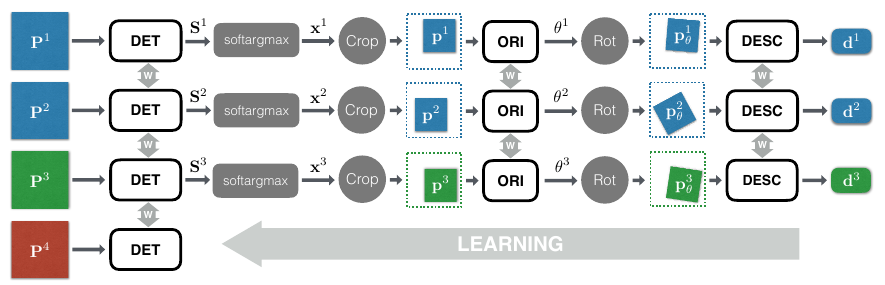
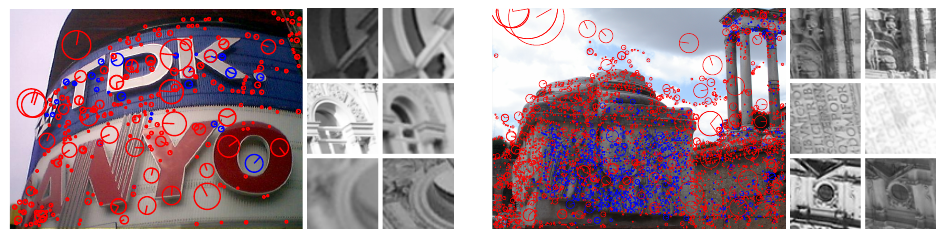
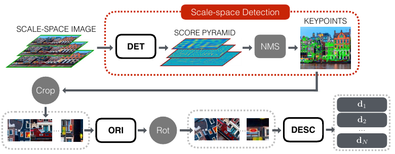
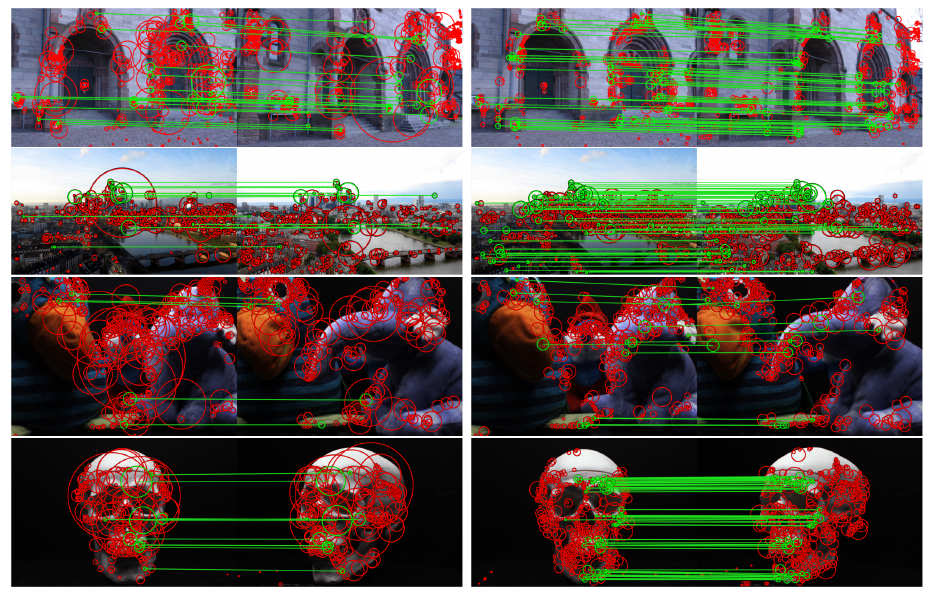
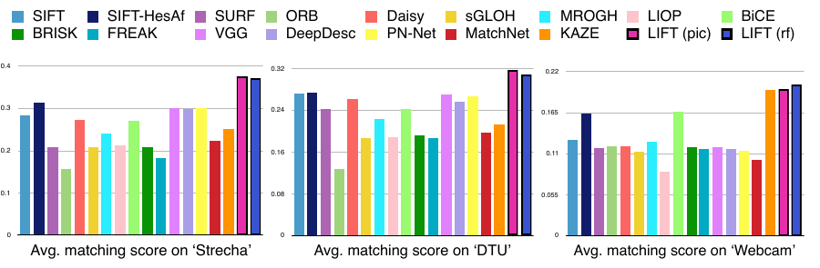

# LIFT: Learned Invariant Feature Transform — конспект

**Авторы:** Kwang Moo Yi\*, Eduard Trulls\*, Vincent Lepetit, Pascal Fua (\* — равный вклад; EPFL CVLab и TU Graz)
**Площадка:** ECCV 2016 (European Conference on Computer Vision), Амстердам. Препринт: arXiv:1603.09114 (v2 — 29.07.2016).
**Источник PDF:** https://arxiv.org/pdf/1603.09114 (arXiv v2) · локальная копия: [../original/LIFT_Yi_2016.pdf](../original/LIFT_Yi_2016.pdf)
**Код и веса:** `cvlab-epfl/LIFT` (Theano/Lasagne; в README: «software is patented and is strictly for academic purposes only»).
**Лицензия статьи и режим документа:** arXiv non-exclusive distribution license 1.0 (не CC) → конспект своими словами, а не перевод.

> **Суть в одном абзаце.** LIFT — первая работа, в которой весь классический конвейер локальных признаков — **детектор (Detector) → оценка ориентации (Orientation Estimator) → дескриптор (Descriptor)** — реализован тремя свёрточными сетями, соединёнными **дифференцируемыми** операциями: soft argmax вместо NMS (non-maximum suppression) и пространственные трансформеры (Spatial Transformers) для вырезания и поворота патча. Обучение — сиамская сеть с четырьмя ветвями на патчах, полученных из SfM-реконструкций (Structure-from-Motion) туристических фото (Piccadilly, Roman Forum). Обучить всё «с нуля» сразу не удалось, поэтому части обучаются по очереди в обратном порядке: сначала дескриптор, затем ориентация (под готовый дескриптор), затем детектор (через весь конвейер). При инференсе детектор прогоняется по пирамиде масштабов всего изображения с обычным NMS, а ориентация и дескриптор считаются только в найденных точках. На Strecha, DTU и Webcam LIFT превосходит [SIFT](SIFT_конспект.md) и 15+ других комбинаций детектор/дескриптор по matching score.

*Рис. 1 (из оригинальной статьи). Интегрированный конвейер: детектор (DET) строит карту откликов (score map), softargmax выбирает точку, Crop вырезает патч, ORI оценивает ориентацию, Rot поворачивает патч, DESC вычисляет вектор-дескриптор. Все звенья дифференцируемы.*

---

## 1. Введение: постановка проблемы

- Локальные признаки — основа сопоставления изображений, SfM, SLAM и т.п. Долгое время лучшими были «ручные» (hand-crafted) методы: [SIFT](SIFT_конспект.md), [SURF](SURF_конспект.md), [ORB](ORB_конспект.md), DAISY.
- Методы глубокого обучения к 2016 г. уже обгоняли классику, но **каждый — только на одном шаге** конвейера: TILDE — детектор, работа Yi et al. (CVPR 2016) — ориентация, DeepDesc / MatchNet / DeepCompare / PN-Net — дескриптор.
- Идея авторов: обучить **все три шага совместно**, чтобы каждый был оптимизирован с учётом остальных. Отсюда название LIFT — Learned Invariant Feature Transform (обучаемый аналог [SIFT](SIFT_конспект.md) — Scale-Invariant Feature Transform).
- Технические ключи:
  - **Spatial Transformer** (Jaderberg et al., 2015) — дифференцируемое вырезание и поворот патча по выходу детектора и ориентационной сети;
  - **soft argmax** вместо NMS — дифференцируемая «мягкая» замена выбора максимума;
  - **поэтапное обучение** (descriptor → orientation → detector), т.к. обучение целиком с нуля не сходилось: компоненты «тянут» в разные стороны.
- При тесте детектор отделяется и работает в масштабном пространстве (scale space) по всему изображению, а ориентационная сеть и дескриптор — только на ключевых точках.

## 2. Связанные работы

Авторы разбирают три элемента конвейера по отдельности.

**Детекторы ключевых точек (feature point detectors).**
- Классика: Harris, Moravec (углы через аппроксимацию первого порядка), [FAST](FAST_конспект.md) (ML лишь для ускорения поиска углов), [SIFT](SIFT_конспект.md) (блобы в масштабном пространстве, DoG — Difference of Gaussians), [SURF](SURF_конспект.md) (фильтры Хаара), MSER (области), аффинно-инвариантные детекторы, SFOP (сочленения и блобы), Edge Foci (рёбра; устойчивость к освещению), SIFER и др.
- Обучаемые: ранние попытки (Sochman & Matas, Trujillo & Olague); **TILDE** — обучаемые кусочно-линейные свёрточные фильтры, устойчивые к освещению и сезонам, но только для одного масштаба и без смены ракурса. LIFT берёт TILDE за основу детектора и существенно его расширяет.

**Оценка ориентации (orientation estimation).**
- Де-факто стандарт — гистограмма градиентов [SIFT](SIFT_конспект.md); в [ORB](ORB_конспект.md) — центроид интенсивности (intensity centroid).
- Yi et al. (CVPR 2016) — первая обучаемая ориентация с заметным выигрышем; LIFT использует её архитектуру, но меняет способ обучения.

**Дескрипторы (feature descriptors).**
- Классика: [SIFT](SIFT_конспект.md) (гистограммы ориентаций градиентов), [SURF](SURF_конспект.md) (интегральные изображения), DAISY (для плотных дескрипторов).
- Обучаемые: от хеширования и LDA до выпуклой оптимизации (VGG-дескриптор Simonyan et al.) и CNN на сырых патчах: MatchNet (сиамская сеть + обучаемая метрика), DeepCompare, Žbontar & LeCun (стерео), **DeepDesc** (Simo-Serra et al., hard negative mining, евклидово расстояние), PN-Net (триплеты).
- LIFT выбирает архитектуру DeepDesc, т.к. её дескрипторы сравниваются **обычным евклидовым расстоянием** — это шире применимо, чем обучаемая метрика (не мешает быстрому поиску ближайших соседей).

## 3. Метод

### 3.1. Постановка задачи

- Обучение идёт **на патчах, а не на целых изображениях**: большая часть изображения точек не содержит, а патчи делают обучение масштабируемым. Патчи берутся вокруг точек, уцелевших в SfM-реконструкции, и достаточно малы, чтобы в каждом на данном масштабе была **одна доминирующая** особенность — задача сводится к поиску самой «характерной» точки в патче.
- **Сиамская архитектура с четырьмя ветвями** (общие веса), на вход — четвёрка (quadruplet) патчей:
  - $\mathbf{P}^1, \mathbf{P}^2$ — разные виды **одной** 3D-точки (положительная пара для дескриптора);
  - $\mathbf{P}^3$ — проекция **другой** 3D-точки (отрицательный пример для дескриптора);
  - $\mathbf{P}^4$ — область **без** характерных точек (отрицательный пример только для детектора).

*Рис. 2 (из оригинальной статьи). Сиамская архитектура с четырьмя ветвями: P¹ и P² (синие) — одна физическая точка с разных видов, P³ (зелёный) — другая 3D-точка, P⁴ (красный) — патч без особенностей, используемый только для обучения детектора. Детектор + softargmax + Crop дают малый патч p, ORI + Rot — повёрнутый патч p_θ, DESC — дескриптор d.*

Каждая ветвь (кроме четвёртой) работает так:
1. Детектор по патчу $\mathbf{P}$ строит карту откликов $\mathbf{S}$.
2. soft argmax по $\mathbf{S}$ даёт положение $\mathbf{x}$ одной кандидатной точки.
3. Spatial Transformer **Crop** вырезает меньший патч $\mathbf{p}$ с центром в $\mathbf{x}$.
4. Ориентационная сеть предсказывает угол $\theta$.
5. Spatial Transformer **Rot** поворачивает патч → $\mathbf{p}_\theta$.
6. Дескрипторная сеть выдаёт вектор $\mathbf{d}$.

Важные замечания:
- слои Spatial Transformer здесь **не обучаются** — они лишь дифференцируемо геометрически преобразуют патчи;
- положение $\mathbf{x}$ и ориентация $\theta$ трактуются **неявно** (как скрытые переменные): сеть сама находит устойчивые положения и ориентации, а не подгоняется под SfM-координаты;
- обучение целиком с нуля **не удалось**, поэтому порядок такой: дескриптор (разд. 3.3) → ориентация с учётом дескриптора (3.4) → детектор с учётом обоих (3.5).

### 3.2. Обучающие данные

- Нужны изображения одной сцены при разных ракурсах и освещении → туристические фотоколлекции (photo-tourism) из работы Wilson & Snavely (1DSfM). 3D-реконструкция — VisualSFM (на [SIFT](SIFT_конспект.md)-точках).

| Набор | Изображений | Уникальных 3D-точек | Среднее число наблюдений точки |
|---|---|---|---|
| Piccadilly (Лондон) | 3384 | 59k | 6.5 |
| Roman-Forum (Рим) | 1658 | 51k | 5.2 |

- Разбиение на обучение/валидацию без пересечения точек.
- Положительные примеры — только точки, **уцелевшие в SfM**. Патчи без особенностей ($\mathbf{P}^4$) — случайные области, где нет ни одной [SIFT](SIFT_конспект.md)-точки (включая не использованные SfM).
- Патчи извлекаются в градациях серого с учётом масштаба $\sigma$ точки:

| Параметр | Значение |
|---|---|
| Область поддержки большого патча $\mathbf{P}$ | $24\sigma \times 24\sigma$ |
| Размер $\mathbf{P}$ после нормировки | $S \times S$, $S = 128$ px |
| Размер малых патчей $\mathbf{p}$, $\mathbf{p}_\theta$ | $s \times s$, $s = 64$ px (≈ область поддержки дескриптора [SIFT](SIFT_конспект.md), $12\sigma$) |
| Случайный сдвиг положения патча | равномерно, в пределах 20% ($4.8\sigma$) — чтобы не «подсказывать» центр |
| Нормировка | вычитание среднего и деление на СКО по всему обучающему набору |

*Рис. 3 (из оригинальной статьи). Примеры изображений и патчей Piccadilly (слева) и Roman-Forum (справа). Синим — точки, уцелевшие в SfM-реконструкции, красным — остальные.*

### 3.3. Дескриптор

- Сеть — по DeepDesc (Simo-Serra et al., ICCV 2015): **три свёрточных слоя** с гиперболическим тангенсом (tanh), $\ell_2$-пулингом (l2 pooling) и локальной вычитающей нормализацией (local subtractive normalization). Метрика не обучается — используется евклидово расстояние.

$$
\mathbf{d} = h_\rho(\mathbf{p}_\theta)
$$

- $h$ — дескрипторная CNN, $\rho$ — её параметры, $\mathbf{p}_\theta$ — повёрнутый патч.
- На этом этапе детектора и ориентации ещё нет → патчи строятся по **SfM-положениям и SfM-ориентациям** (т.е. по [SIFT](SIFT_конспект.md)).

**Потеря** — шарнирная потеря вложения (hinge embedding loss) по евклидову расстоянию:

$$
\mathcal{L}_{\text{desc}}(\mathbf{p}^k_\theta, \mathbf{p}^l_\theta) =
\begin{cases}
\lVert h_\rho(\mathbf{p}^k_\theta) - h_\rho(\mathbf{p}^l_\theta) \rVert_2, & \text{положительная пара},\\
\max\left(0,\; C - \lVert h_\rho(\mathbf{p}^k_\theta) - h_\rho(\mathbf{p}^l_\theta) \rVert_2\right), & \text{отрицательная пара},
\end{cases}
$$

- положительные пары — $(\mathbf{p}^1_\theta, \mathbf{p}^2_\theta)$, отрицательные — $(\mathbf{p}^1_\theta, \mathbf{p}^3_\theta)$;
- $C = 4$ — порог (margin): отрицательные пары «расталкиваются» до расстояния не меньше $C$.

**Hard mining** (критичен по DeepDesc): прогоняется $K_f$ пар, а градиент считается только по $K_b$ парам с наибольшей потерей; $r = K_f / K_b \ge 1$ — коэффициент майнинга (mining ratio).
- В DeepDesc: предобучение без майнинга, затем дообучение с $r = 8$.
- В LIFT: **нарастающий майнинг** — старт с $r = 1$, удвоение $r$ каждые 5000 батчей.
- Сбалансированные батчи: 128 положительных + 128 отрицательных пар, майнинг для каждой группы отдельно.

*Детали архитектуры сети (из DeepDesc, в тексте LIFT не приведены):* три свёртки 32@7×7 → 64@6×6 → 128@5×5 с tanh, $\ell_2$-пулингом и нормализацией, выход — 128-мерный дескриптор, вход 64×64 (по статье DeepDesc; в LIFT указано лишь «три свёрточных слоя»). В официальном репозитории LIFT дескриптор импортируется из готовой модели `new-CNN3-picc-iter-56k.h5` (по коду).

### 3.4. Оценка ориентации

- Основа — сеть из Yi et al. (CVPR 2016). Но там для обучения нужно было **заранее** считать дескрипторы при многих ориентациях (численный якобиан по углу) — это невозможно, когда положение точки задаётся детектором неявно и меняется при обучении.
- Решение — **Spatial Transformer**: поворот патча делается дифференцируемо, градиент от дескриптора течёт к углу напрямую.

$$
\theta = g_\phi(\mathbf{p}), \qquad \mathbf{p}_\theta = \mathrm{Rot}(\mathbf{P}, \mathbf{x}, \theta)
$$

- $g$ — ориентационная CNN, $\phi$ — её параметры; $\mathbf{P}$ — исходный большой патч, $\mathbf{x}$ — положение точки.

**Потеря** — расстояние между дескрипторами **только для соответствующих** пар (уже обученный дескриптор фиксирован, положения — из SfM):

$$
\mathcal{L}_{\text{orientation}}(\mathbf{P}^1, \mathbf{x}^1, \mathbf{P}^2, \mathbf{x}^2) =
\lVert h_\rho(G(\mathbf{P}^1, \mathbf{x}^1)) - h_\rho(G(\mathbf{P}^2, \mathbf{x}^2)) \rVert_2,
$$

$$
G(\mathbf{P}, \mathbf{x}) = \mathrm{Rot}\big(\mathbf{P}, \mathbf{x}, g_\phi(\mathrm{Crop}(\mathbf{P}, \mathbf{x}))\big)
$$

- $G$ — патч с центром в $\mathbf{x}$ после коррекции ориентации;
- $\mathbf{x}^1, \mathbf{x}^2$ — репроекции одной 3D-точки;
- пары разных точек не используются: их ориентации никак не связаны.

**Почему так:** ориентация оптимизируется не под «правильный угол» (его нет), а под то, чтобы *итоговые дескрипторы* двух видов совпали — т.е. напрямую под задачу сопоставления.

*Архитектура (по официальному коду `cvpr16.py`, в статье не приведена):* Conv 10@5×5 → MaxPool 2 → Conv 20@5×5 → MaxPool 2 → Conv 50@3×3 → MaxPool 2 → два полносвязных слоя с активацией GHH (generalized hinging hyperplanes) на 100 выходов с параметрами 4×4 (по коду).

### 3.5. Детектор

- Один свёрточный слой + кусочно-линейная активация, как в TILDE:

$$
\mathbf{S} = f_\mu(\mathbf{P}) = \sum_{n=1}^{N} \delta_n \max_{m=1..M}\left(\mathbf{W}_{mn} * \mathbf{P} + b_{mn}\right)
$$

- $\mathbf{S}$ — карта откликов (score map) патча $\mathbf{P}$;
- $\mathbf{W}_{mn}$, $b_{mn}$ — обучаемые фильтры и смещения ($\mu$ — их совокупность); $*$ — свёртка;
- $\delta_n = +1$ для нечётных $n$ и $-1$ для чётных (разность максимумов даёт кусочно-линейную аппроксимацию произвольной функции);
- $N, M$ — гиперпараметры сложности активации. В статье значения не указаны; в официальном коде $N = M = 4$ (16 фильтров) размером 25×25 (по коду `tilde.py` и конфигу `nFilterSize = 25`).

**Отличие от TILDE:** положение точки — **скрытая переменная**, а не фиксированные SfM-координаты. Это позволяет детектору найти более надёжные и легче обучаемые точки; прямое принуждение к SfM-положениям в ранних экспериментах вредило.

**soft argmax** (дифференцируемый аналог NMS) — центр масс с весами softmax:

$$
\mathbf{x} = \mathrm{softargmax}(\mathbf{S}) = \frac{\sum_{\mathbf{y}} \exp(\beta\, \mathbf{S}(\mathbf{y}))\, \mathbf{y}}{\sum_{\mathbf{y}} \exp(\beta\, \mathbf{S}(\mathbf{y}))}
$$

- $\mathbf{y}$ — позиции на карте $\mathbf{S}$; $\beta = 10$ — «жёсткость» (чем больше, тем ближе к обычному argmax).
- Затем $\mathbf{p} = \mathrm{Crop}(\mathbf{P}, \mathbf{x})$ подаётся в ориентационную сеть.

**Потеря детектора** (ориентация и дескриптор уже обучены, градиент идёт через весь конвейер):

$$
\mathcal{L}_{\text{detector}}(\mathbf{P}^1, \mathbf{P}^2, \mathbf{P}^3, \mathbf{P}^4) = \gamma\, \mathcal{L}_{\text{class}} + \mathcal{L}_{\text{pair}}
$$

$$
\mathcal{L}_{\text{class}} = \sum_{i=1}^{4} \alpha_i \max\left(0,\; 1 - \mathrm{softmax}\big(f_\mu(\mathbf{P}^i)\big)\, y_i\right)^2
$$

$$
\mathcal{L}_{\text{pair}}(\mathbf{P}^1, \mathbf{P}^2) = \left\lVert h_\rho\big(G(\mathbf{P}^1, \mathrm{softargmax}(f_\mu(\mathbf{P}^1)))\big) - h_\rho\big(G(\mathbf{P}^2, \mathrm{softargmax}(f_\mu(\mathbf{P}^2)))\big) \right\rVert_2
$$

- $\mathcal{L}_{\text{class}}$ — классификационная часть: в патчах с особенностью ($i = 1..3$, $y_i = +1$) максимальный отклик должен быть высоким, в «пустом» патче ($i = 4$, $y_i = -1$) — низким;
- веса $\alpha_i = 1/6$ для $i = 1..3$ и $\alpha_4 = 3/6$ — баланс положительных и отрицательных;
- $\mathrm{softmax}$ здесь — «лог-среднее-экспонента» (log-mean-exponential), т.е. мягкий максимум по карте откликов;
- $\gamma$ — баланс двух слагаемых (значение в статье не указано);
- $\mathcal{L}_{\text{pair}}$ — дескрипторы двух видов, полученные через **весь** конвейер с точками, найденными детектором, должны совпадать;
- hard mining с фиксированным $r = 4$.

**Предобучение детектора.** Дескриптор уже частично инвариантен, и детектору трудно «нащупать» новые точки. Поэтому сначала вместо $\mathcal{L}_{\text{pair}}$ используется геометрическая потеря $\tilde{\mathcal{L}}_{\text{pair}}$, требующая, чтобы предложенные патчи двух видов **перекрывались**:

$$
\tilde{\mathcal{L}}_{\text{pair}}(\mathbf{P}^1, \mathbf{P}^2) = 1 - \frac{\mathbf{p}^1 \cap \mathbf{p}^2}{\mathbf{p}^1 \cup \mathbf{p}^2} + \frac{\max\left(0,\; \lVert \mathbf{x}^1 - \mathbf{x}^2 \rVert_1 - 2s\right)}{\sqrt{\mathbf{p}^1 \cup \mathbf{p}^2}}
$$

- $\mathbf{x}^j = \mathrm{softargmax}(f_\mu(\mathbf{P}^j))$, $\mathbf{p}^j = \mathrm{Crop}(\mathbf{P}^j, \mathbf{x}^j)$;
- первое слагаемое — $1 - \mathrm{IoU}$ (пересечение над объединением) площадей патчей; второе штрафует патчи, которые вообще не пересекаются, пропорционально $\ell_1$-расстоянию между центрами;
- $s = 64$ — сторона малого патча;
- равна 0 при точном совпадении патчей. После предобучения обучение продолжается с настоящей $\mathcal{L}_{\text{pair}}$.

*(Форма знаменателя второго слагаемого восстановлена по вёрстке формулы (11) в PDF.)*

### 3.6. Конвейер при инференсе

- Применять обученный на патчах конвейер скользящим окном ко всему изображению слишком дорого. Но ориентация и дескриптор нужны **только в локальных максимумах**, поэтому:
  1. детектор (одна свёртка + кусочно-линейная активация) применяется к изображению **на нескольких разрешениях** → пирамида карт откликов (масштабное пространство);
  2. softargmax заменяется **классическим NMS**, похожим на [SIFT](SIFT_конспект.md), по масштабному пространству;
  3. ORI и DESC применяются только к патчам вокруг найденных максимумов.

*Рис. 4 (из оригинальной статьи). Архитектура при инференсе: детектор отделён и работает по масштабной пирамиде изображения с обычным NMS (выделено красным); ориентационная сеть и дескриптор применяются только к патчам в найденных точках.*

## 4. Эксперименты

### 4.1. Данные и протокол

| Набор | Содержание | Что проверяет |
|---|---|---|
| Strecha | 19 изображений двух сцен с нарастающей сменой ракурса | ракурс |
| DTU | 60 последовательностей объектов, разные ракурсы и освещение | ракурс |
| Webcam | 710 изображений 6 сцен, сильная естественная смена освещения, ракурс фиксирован | освещение |

- До 1000 ключевых точек на изображение; протокол Mikolajczyk & Schmid на общей области видимости.
- Метрики:
  - **Repeatability (Rep.)** — доля точек, повторно найденных в общей области (качество детектора);
  - **NN mAP** — площадь под PR-кривой (precision-recall) при сопоставлении ближайшим соседом с варьированием порога расстояния (различимость дескриптора);
  - **Matching Score (M. Score)** — доля эталонных соответствий, восстановленных **всем конвейером**, к числу точек в общей области (итоговое качество).
- Базовые линии (числа — из реализаций авторов соответствующих работ): [SIFT](SIFT_конспект.md), [SIFT](SIFT_конспект.md) с Hessian-Affine, [SURF](SURF_конспект.md), KAZE, [ORB](ORB_конспект.md), Daisy ([SIFT](SIFT_конспект.md)-детектор), sGLOH, MROGH, LIOP (все три — Harris-affine), BiCE (Edge Foci), BRISK, FREAK (BRISK-детектор), VGG, DeepDesc, PN-Net, MatchNet (все — на [SIFT](SIFT_конспект.md)/DoG-точках, т.к. обучены на DoG-данных).
- Две модели: **LIFT (pic)** — обучена на Piccadilly, **LIFT (rf)** — на Roman-Forum. Подробности реализации — в дополнительных материалах (supplementary, в arXiv-PDF не включены).

### 4.2. Качественные примеры

*Рис. 5 (из оригинальной статьи). Сопоставление 500 точек: слева [SIFT](SIFT_конспект.md), справа LIFT (Piccadilly). Зелёные линии — верные соответствия, красные окружности — области поддержки дескриптора. Строки: Herz-Jesu-P8 (Strecha), Frankfurt (Webcam), Scene 7 и Scene 19 (DTU). Сцены DTU совсем не похожи на обучающие туристические фото.*

- LIFT даёт больше верных соответствий; на DTU это особенно показательно — хорошее обобщение на сильно отличающиеся данные.

### 4.3. Итоговое сравнение (matching score)

Таблица 1 статьи — средний matching score (выбранные столбцы):

| Метод | Strecha | DTU | Webcam |
|---|---|---|---|
| [SIFT](SIFT_конспект.md) | .283 | .272 | .128 |
| SIFT-HesAff | .314 | .274 | .164 |
| [SURF](SURF_конспект.md) | .208 | .244 | .117 |
| [ORB](ORB_конспект.md) | .157 | .127 | .120 |
| Daisy | .272 | .262 | .120 |
| BiCE | .270 | .242 | .166 |
| VGG | .300 | .271 | .118 |
| MatchNet | .223 | .198 | .101 |
| DeepDesc | .298 | .257 | .116 |
| PN-Net | .300 | .267 | .114 |
| KAZE | .250 | .213 | .195 |
| **LIFT (pic)** | **.374** | **.317** | .196 |
| **LIFT (rf)** | .369 | .308 | **.202** |

*(Полная таблица включает также sGLOH, MROGH, LIOP, BRISK, FREAK — все ниже LIFT.)*

*Рис. 6 (из оригинальной статьи). Средний matching score всех методов на Strecha, DTU и Webcam (столбцы LIFT — справа в каждой группе).*

**Интерпретация авторов:**
- обе модели LIFT заметно лучше всех на Strecha и DTU и на уровне лучших на Webcam;
- KAZE, лучший конкурент на Webcam, слаб на двух других наборах;
- на DTU лучшим из конкурентов остаётся **[SIFT](SIFT_конспект.md)** — даже обучаемые DeepDesc и PN-Net его не обгоняют; на Strecha разрыв между [SIFT](SIFT_конспект.md) и VGG/DeepDesc/PN-Net невелик;
- вывод: компонент, лучший «в изоляции», не обязательно хорош в составе конвейера → **оценивать и обучать нужно конвейер целиком**.

### 4.4. Вклад отдельных компонентов

**Дообучение детектора** (Таблица 2 статьи, Strecha):

| Детектор | Piccadilly: Rep. | Piccadilly: M.Score | Roman-Forum: Rep. | Roman-Forum: M.Score |
|---|---|---|---|---|
| Только предобучен ($\tilde{\mathcal{L}}_{\text{pair}}$) | .436 | .367 | .447 | .368 |
| Полностью обучен | .446 | .374 | .447 | .369 |

- Предобученный детектор уже хорош (геометрическая потеря имитирует идеальный дескриптор), полное обучение добавляет немного.
- На Roman-Forum выигрыш меньше: там мало «пустых» областей, сеть быстро переобучалась. Попытка дообучить весь конвейер целиком тоже приводила к переобучению — авторы считают, что поэтапная стратегия уже даёт хорошее решение.

**Замена компонентов на [SIFT](SIFT_конспект.md)** (Таблица 3 статьи, Strecha):

| Детектор | Ориентация | Дескриптор | Pic: Rep. | Pic: NN mAP | Pic: M.Score | RF: Rep. | RF: NN mAP | RF: M.Score |
|---|---|---|---|---|---|---|---|---|
| [SIFT](SIFT_конспект.md) | [SIFT](SIFT_конспект.md) | [SIFT](SIFT_конспект.md) | .428 | .517 | .282 | .428 | .517 | .282 |
| [SIFT](SIFT_конспект.md) | LIFT | [SIFT](SIFT_конспект.md) | .428 | .671 | .341 | .428 | .662 | .338 |
| [SIFT](SIFT_конспект.md) | [SIFT](SIFT_конспект.md) | LIFT | .428 | .568 | .290 | .428 | .581 | .295 |
| [SIFT](SIFT_конспект.md) | LIFT | LIFT | .428 | .685 | .344 | .428 | .688 | .342 |
| LIFT | [SIFT](SIFT_конспект.md) | [SIFT](SIFT_конспект.md) | .446 | .540 | .325 | .447 | .545 | .319 |
| LIFT | LIFT | [SIFT](SIFT_конспект.md) | .446 | .644 | .372 | .447 | .630 | .360 |
| LIFT | [SIFT](SIFT_конспект.md) | LIFT | .446 | .629 | .339 | .447 | .644 | .337 |
| **LIFT** | **LIFT** | **LIFT** | **.446** | **.686** | **.374** | **.447** | **.683** | **.369** |

*(Rep. зависит только от детектора: .428 — [SIFT](SIFT_конспект.md); .446/.447 — LIFT.)*

- Любая замена на [SIFT](SIFT_конспект.md) ухудшает результат → важен каждый компонент.
- Обучаемая ориентация помогает при любом детекторе и дескрипторе (самый крупный одиночный прирост NN mAP: .517 → .671).
- Детектор LIFT улучшает не только повторяемость, но и NN mAP и matching score — он учится находить точки, которые **легко сопоставлять**, а не просто часто находимые.

## 5. Выводы авторов

- Предложена сеть, объединяющая три компонента классического конвейера в один дифференцируемый граф (Spatial Transformers + softargmax).
- Обучение с нуля теоретически возможно, но практически не работает — предложена эффективная поэтапная стратегия.
- Интегрированный подход превосходит state-of-the-art.
- Дальше: эффективнее использовать обучаемость целиком, в частности **hard negative mining по всему изображению**, а не по заранее вырезанным патчам, — для более различимых фильтров и дескрипторов.

---

## Описание ключевых рисунков

*Рисунки вставлены в соответствующие разделы выше (Рис. 1 — после аннотации, 2 и 3 — разд. 3.1–3.2, 4 — разд. 3.6, 5 и 6 — разд. 4). Здесь — сводка.*

- **Рис. 1** — общая схема LIFT: изображение → DET → score map → softargmax → Crop → ORI → Rot → DESC → дескриптор; все звенья дифференцируемы.
- **Рис. 2** — четырёхветвевая сиамская схема обучения: P¹/P² — одна точка (позитив), P³ — другая точка (негатив для дескриптора), P⁴ — «пустой» патч (негатив для детектора); общие веса W во всех ветвях.
- **Рис. 3** — обучающие данные: изображения Piccadilly и Roman-Forum с точками (синие — уцелели в SfM, красные — нет) и примеры патчей.
- **Рис. 4** — инференс: детектор по масштабной пирамиде + классический NMS, затем ORI и DESC только в ключевых точках.
- **Рис. 5** — визуальное сравнение [SIFT](SIFT_конспект.md) и LIFT на Strecha, Webcam, DTU: у LIFT больше верных соответствий.
- **Рис. 6** — столбчатые диаграммы matching score для всех базовых линий на трёх наборах.

---

## Сильные стороны и ограничения

### Сильные стороны
- **Первый полностью дифференцируемый конвейер** «детектор + ориентация + дескриптор»: компоненты оптимизируются под итоговое сопоставление, а не каждый под свою метрику.
- Изящные технические приёмы — softargmax как дифференцируемый NMS и Spatial Transformer для патчей — стали стандартными строительными блоками (LF-Net, ряд последующих работ).
- **Учитель из SfM** на реальных фото: реальные изменения ракурса и освещения, а не синтетические гомографии.
- Положение точки — **скрытая переменная**: детектор сам ищет «удобные для сопоставления» точки.
- Хорошее обобщение: обучено на туристических фото, работает на DTU (объекты в лаборатории) и Webcam (освещение).
- Абляция наглядно показывает вклад каждой части; особенно полезна обучаемая ориентация.

### Ограничения
- **Обучение по частям**, а не end-to-end целиком (с нуля не сходится; совместное дообучение переобучается).
- **Патч-ориентированная схема (detect-then-describe)**: три отдельные сети, на инференсе — пирамида + NMS + вырезание патчей → медленно; время работы в статье не приводится. Последующие работы ([SuperPoint](SuperPoint_конспект.md), [D2-Net](D2-Net_конспект.md)) уходят к единой полностью свёрточной сети на всё изображение.
- Детектор — **один свёрточный слой** (как TILDE), т.е. по сути очень мелкая модель.
- Обучающие данные: точки — только те, что нашёл **[SIFT](SIFT_конспект.md)** и сохранил SfM → смещение в сторону DoG-подобных структур; два набора данных, оба — городская архитектура.
- Датасеты оценки малы (Strecha — 19 изображений, Webcam — фиксированный ракурс); нет оценки на задачах позиционирования/SfM.
- По README официальной модели: данные Piccadilly не содержат сильных поворотов, поэтому релизная модель **слаба при больших поворотах в плоскости** (по README репозитория).
- Код патентован и только для академического использования; устаревший стек (Theano/Lasagne).
- Ряд гиперпараметров ($\gamma$, оптимизатор, lr, число итераций, архитектуры подсетей) вынесен в supplementary и в тексте статьи отсутствует.

---

## Значение для задачи визуального позиционирования

**Историческая роль.** LIFT — отправная точка всего направления «обучаемых локальных признаков»: [SuperPoint](SuperPoint_конспект.md), LF-Net, [D2-Net](D2-Net_конспект.md), [R2D2](R2D2_конспект.md), [DISK](DISK_конспект.md), [ALIKED](ALIKED_конспект.md) сравниваются с ним или прямо развивают его идеи (дифференцируемый выбор точек, учитель из SfM). В современных системах позиционирования LIFT как таковой практически не используется.

**Практические заметки** *(не из статьи, а оценка применимости):*
- **Для продакшена не рекомендуется**: медленный патч-ориентированный инференс, устаревший стек, патентные/академические ограничения. Для конвейера «глобальный поиск (NetVLAD/MixVPR/AnyLoc) → локальные признаки → сопоставление → [RANSAC](RANSAC_конспект.md)/PnP» разумнее брать [SuperPoint](SuperPoint_конспект.md)/ALIKED/DISK + [LightGlue](LightGlue_конспект.md) или детектор + [HardNet](HardNet_конспект.md)-подобный дескриптор.
- **Полезные идеи для своих разработок:**
  - учитель из **SfM-реконструкции своей местности** (в т.ч. мультисезонной/аэро) вместо синтетических гомографий — тот же принцип используют [D2-Net](D2-Net_конспект.md) и [DISK](DISK_конспект.md) на MegaDepth;
  - **обучаемая ориентация** — актуальна для БПЛА с произвольным курсом: абляция LIFT показывает, что именно ориентация даёт самый большой прирост различимости; альтернатива — компенсация курса по IMU/компасу;
  - softargmax — удобный способ получить субпиксельную дифференцируемую координату точки.
- **Метрика.** Вывод авторов «оценивать надо весь конвейер, а не компоненты по отдельности» напрямую применим к выбору признаков для позиционирования: сравнивать стоит по итоговой точности позы/доле локализованных кадров на своих данных, а не по повторяемости или mAP на HPatches.
- **Масштаб.** LIFT строит масштабное пространство явно (пирамида), как [SIFT](SIFT_конспект.md); при большой разнице GSD кадра и карты пирамида необходима и для современных однопроходных сетей.

---

## Глоссарий (англ. → рус.)

| English | Русский |
|---|---|
| local feature | локальный признак |
| feature point / keypoint | ключевая (особая) точка |
| detector | детектор |
| orientation estimator | оценщик ориентации |
| descriptor | дескриптор |
| hand-crafted features | признаки, сконструированные вручную |
| end-to-end differentiability | сквозная дифференцируемость |
| Spatial Transformer | пространственный трансформер (дифференцируемое геометрическое преобразование) |
| soft argmax | мягкий argmax (взвешенный центр масс) |
| non-maximum suppression (NMS) | подавление немаксимумов |
| score map | карта откликов |
| scale space | масштабное пространство |
| Siamese network | сиамская сеть (ветви с общими весами) |
| quadruplet | четвёрка (патчей) |
| patch | патч, фрагмент изображения |
| support region | область поддержки |
| Structure-from-Motion (SfM) | восстановление структуры по движению |
| photo-tourism dataset | набор туристических фотографий |
| hinge embedding loss | шарнирная потеря вложения |
| margin | порог (зазор) |
| hard (negative) mining | отбор трудных (отрицательных) примеров |
| mining ratio | коэффициент майнинга |
| piecewise linear activation | кусочно-линейная активация |
| latent variable | скрытая переменная |
| log-mean-exponential | логарифм среднего экспонент (мягкий максимум) |
| l2 pooling | $\ell_2$-пулинг |
| local subtractive normalization | локальная вычитающая нормализация |
| repeatability | повторяемость |
| NN mAP (nearest neighbor mean Average Precision) | средняя точность при сопоставлении ближайшим соседом |
| matching score | доля успешных сопоставлений |
| precision-recall curve | кривая точность–полнота |
| generalization | обобщающая способность |
| over-fitting | переобучение |
| ablation | абляционный анализ (по-компонентное исследование) |
| Difference of Gaussians (DoG) | разность гауссиан |
