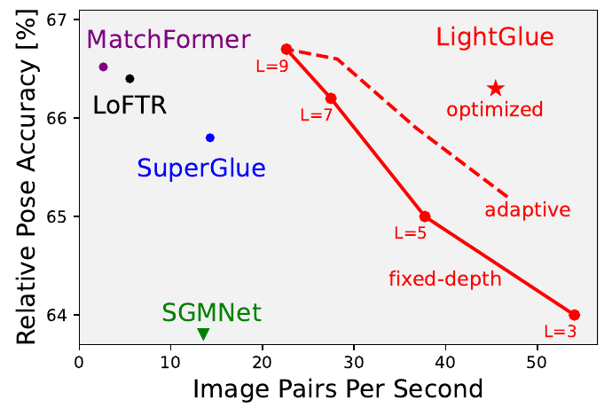
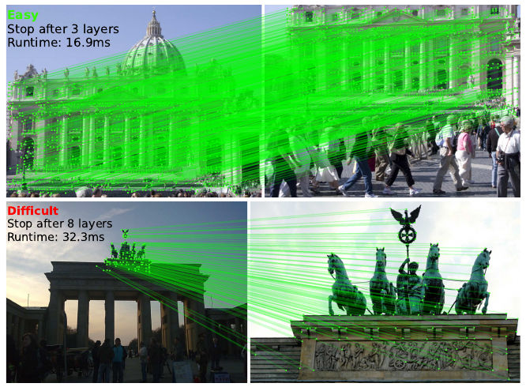
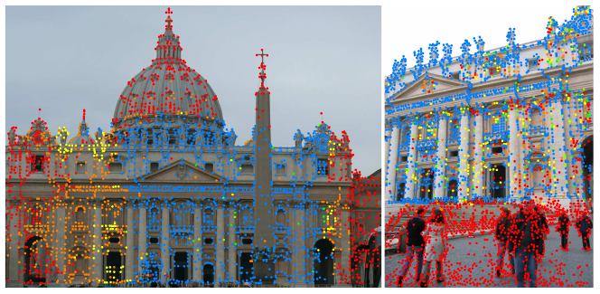
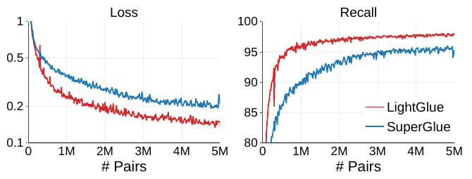
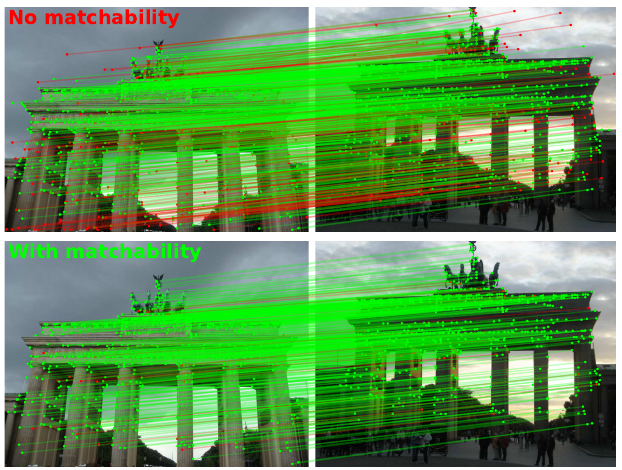
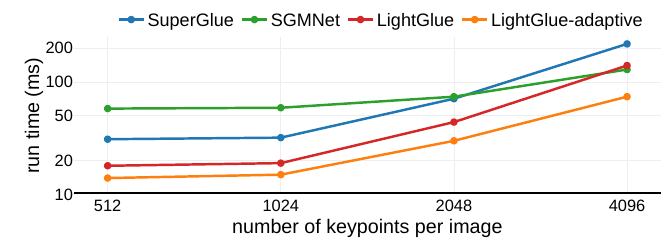

# LightGlue: Local Feature Matching at Light Speed — конспект

**Авторы:** Philipp Lindenberger, Paul-Edouard Sarlin (ETH Zurich), Marc Pollefeys (ETH Zurich; Microsoft Mixed Reality & AI Lab)
**Площадка:** ICCV 2023 (IEEE/CVF International Conference on Computer Vision), с. 17627–17638 по колонтитулам CVF-версии. Препринт: arXiv:2306.13643 (v1 — 23.06.2023), в arXiv-версии есть приложение (Appendix, разделы A–E), которого нет в CVF-PDF.
**Источник PDF:** [CVF Open Access](https://openaccess.thecvf.com/content/ICCV2023/papers/Lindenberger_LightGlue_Local_Feature_Matching_at_Light_Speed_ICCV_2023_paper.pdf); локальная копия — `../original/LightGlue_Lindenberger_2023.pdf`. Приложение — по arXiv-версии https://arxiv.org/pdf/2306.13643, локально `../original/LightGlue_Lindenberger_2023_arXiv.pdf`.
**Лицензия и формат:** на arXiv статья опубликована под стандартной неисключительной лицензией arXiv (не CC), CVF-версия — без открытой лицензии, поэтому здесь не перевод, а конспект своими словами с короткими цитатами.
**Код и веса:** `github.com/cvg/LightGlue` (код и веса LightGlue — Apache-2.0; веса [SuperPoint](SuperPoint_конспект.md) в том же репозитории — под ограничительной лицензией Magic Leap); обучение — библиотека `cvg/glue-factory`.

> **Суть в одном абзаце.** LightGlue — глубокий сопоставитель (deep matcher) разреженных локальных признаков, переработанный [SuperGlue](SuperGlue_конспект.md). Авторы пересмотрели его архитектурные решения и получили модель, которая точнее, быстрее, экономнее по памяти и намного проще в обучении. Ключевые изменения: (1) **относительное** ротационное позиционное кодирование (rotary encoding) в каждом слое self-attention вместо абсолютного MLP-кодирования на входе; (2) **двунаправленное** cross-attention, где матрица сходства считается один раз для обоих направлений; (3) лёгкая голова сопоставления: **двойной softmax** по матрице сходства × сигмоидная **«сопоставимость» (matchability)** точки — вместо дорогого алгоритма Синхорна (Sinkhorn) и «корзины» (dustbin); (4) благодаря дешёвой голове — **глубокий контроль (deep supervision)** на каждом слое; (5) **адаптивность**: классификатор уверенности позволяет остановиться на раннем слое (адаптивная глубина), а заведомо несопоставимые точки отбрасываются по ходу (адаптивная ширина). На простых парах (большое перекрытие, слабые изменения внешнего вида) вывод заметно быстрее, чем на трудных. По точности LightGlue не хуже или лучше [SuperGlue](SuperGlue_конспект.md) и приближается к плотному [LoFTR](LoFTR_перевод.md) при многократно меньшем времени.

*Рис. 1 (из оригинальной статьи). Точность относительной позы (MegaDepth) против числа пар изображений в секунду. Сплошная линия — LightGlue с фиксированной глубиной L = 3…9 слоёв, пунктир — адаптивный вариант, звезда — оптимизированная реализация (эффективное self-attention). По словам авторов, оптимизированная модель близка по точности к плотному [LoFTR](LoFTR_перевод.md) при примерно в 8 раз большей скорости.*

---

## 1. Введение: мотивация

- Стандартный путь сопоставления изображений — разреженные ключевые точки (sparse interest points) с высокоразмерными дескрипторами. Описать точку одновременно **устойчиво** (robust) к ракурсу/освещению и **уникально** (discriminative) при симметриях и слабой текстуре трудно — две цели противоречат друг другу.
- [SuperGlue](SuperGlue_конспект.md) предложил новую парадигму: сеть, которая видит **оба набора точек сразу** и совместно сопоставляет и отбрасывает выбросы (Transformer + оптимальный транспорт). Это дало большую устойчивость (в т.ч. визуальная локализация в трудных условиях, аэросъёмка, оценка позы объектов).
- Проблемы [SuperGlue](SuperGlue_конспект.md): (а) вычислительно дорог — сложность растёт квадратично с числом точек, что мешает задачам с низкой задержкой (трекинг, SLAM) или большим объёмом (крупномасштабное картирование); (б) **тяжело обучается** — нужны ресурсы, недоступные многим; последователи (SGMNet, ClusterGNN) так и не достигли качества оригинала.
- Цель LightGlue — модель точнее, эффективнее и проще в обучении, собранная из многих простых изменений с учётом прогресса в трансформерах после 2020 г. Авторы формулируют «рецепт» обучения сильного матчера за несколько GPU-дней.
- Новое свойство — **адаптивность к трудности пары**: после каждого блока сеть предсказывает соответствия и сама оценивает, нужны ли ещё вычисления; несопоставимые точки отбрасываются рано, внимание сосредотачивается на общей (covisible) области.
- LightGlue позиционируется как замена [SuperGlue](SuperGlue_конспект.md) «один в один» (plug-and-play / drop-in replacement).

*Рис. 2 (из оригинальной статьи). Адаптивность по глубине: на простой паре (сверху) сеть останавливается после 3 слоёв (16.9 мс), на трудной (снизу) — после 8 слоёв (32.3 мс).*

## 2. Связанные работы

- **Локальные признаки.** Классика ([SIFT](SIFT_конспект.md), Harris, [SURF](SURF_конспект.md), [FAST](FAST_конспект.md)) и CNN-признаки для детекции ([SuperPoint](SuperPoint_конспект.md), [D2-Net](D2-Net_конспект.md), [R2D2](R2D2_конспект.md), [DISK](DISK_конспект.md) и др.) и описания ([HardNet](HardNet_конспект.md) и др.). Признаки различаются: одни лучше локализованы, другие повторяемы, дёшевы в хранении ([ORB](ORB_конспект.md)), инвариантны к определённым изменениям или игнорируют ненадёжные объекты ([DISK](DISK_конспект.md)).
- **Классическое сопоставление:** ближайший сосед в пространстве дескрипторов, затем эвристики (ratio test Лоу, взаимная проверка — mutual check), обучаемые классификаторы инлаеров, робастная подгонка геометрии ([RANSAC](RANSAC_конспект.md)). Требует ручной настройки и ломается в трудных условиях.
- **Глубокие матчеры:** [SuperGlue](SuperGlue_конспект.md) — Transformer + оптимальный транспорт для задачи частичного назначения (partial assignment); сильные априорные знания о геометрии сцены. Ускорения: SGMNet (внимание только через небольшой набор «затравочных» соответствий — seed matches), ClusterGNN (внимание внутри кластеров похожих точек) — выигрывают лишь при большом числе точек и теряют устойчивость. LightGlue вместо урезания ёмкости **динамически адаптирует размер сети**.
- **Плотные матчеры** ([LoFTR](LoFTR_перевод.md), MatchFormer, ASpanFormer) сопоставляют точки на плотной сетке: очень устойчивы, но медленны, что ограничивает разрешение входа и, следовательно, точность локализации соответствий.
- **Эффективные трансформеры:** линейное внимание, латентные «бутылочные горлышки», экономия памяти (checkpointing), оптимизация доступа к памяти (FlashAttention); адаптивная глубина (ранний выход, early exit) — в NLP (CALM, Depth-Adaptive Transformer) и CNN; относительные позиционные кодирования (RoFormer и др.) стабилизируют обучение.

## 3. Метод: быстрое сопоставление признаков

### 3.1. Постановка задачи

- Даны два набора локальных признаков изображений $A$ и $B$. Признак $i$: позиция $\mathbf{p}_i = (x, y)_i \in [0,1]^2$ (нормирована по размеру изображения) и дескриптор $\mathbf{d}_i \in \mathbb{R}^d$.
- $M$ и $N$ — число признаков в $A$ и $B$; индексы $\mathcal{A} = \{1..M\}$, $\mathcal{B} = \{1..N\}$.
- Цель — множество соответствий $\mathcal{M} = \{(i,j)\} \subset \mathcal{A}\times\mathcal{B}$. Каждая точка сопоставляется не более чем с одной (порождена одной 3D-точкой); часть точек несопоставима (окклюзия, неповторяемость детектора). Поэтому ищется **мягкая матрица частичного назначения** $\mathbf{P} \in [0,1]^{M\times N}$.

*Рис. 3 (из оригинальной статьи). Архитектура: входные признаки $(\mathbf{d}, \mathbf{p})$ обоих изображений проходят через $L$ одинаковых слоёв (self-attention с позиционным кодированием ⊙ и cross-attention). После каждого слоя классификатор уверенности $c$ решает, можно ли остановиться; если нет — уверенно несопоставимые точки отсекаются (pruning) и вывод идёт дальше. В конце голова вычисляет назначение из попарного сходства (similarity) и унарной сопоставимости (matchability).*

### 3.2. Трансформерный остов (Transformer backbone)

Каждой точке $i$ изображения $I \in \{A,B\}$ сопоставлено состояние $\mathbf{x}^I_i \in \mathbb{R}^d$, инициализируемое дескриптором: $\mathbf{x}^I_i \leftarrow \mathbf{d}^I_i$. **Слой** = один блок self-attention + один блок cross-attention.

**Блок внимания (attention unit).** Состояние обновляется MLP по «сообщению» $\mathbf{m}^{I\leftarrow S}_i$ от изображения-источника $S$:

$$
\mathbf{x}^I_i \leftarrow \mathbf{x}^I_i + \mathrm{MLP}\big([\mathbf{x}^I_i \,|\, \mathbf{m}^{I\leftarrow S}_i]\big),
$$

где $[\cdot|\cdot]$ — конкатенация. В self-attention $S = I$, в cross-attention $S$ — другое изображение. Сообщение — взвешенное среднее состояний изображения $S$:

$$
\mathbf{m}^{I\leftarrow S}_i = \sum_{j\in\mathcal{S}} \operatorname*{Softmax}_{k\in\mathcal{S}}\big(a^{IS}_{ik}\big)_j\, \mathbf{W}\mathbf{x}^S_j,
$$

где $\mathbf{W}$ — проекционная матрица (значения, value), $a^{IS}_{ij}$ — оценка внимания (attention score) между точками $i$ и $j$; её вид различается для self- и cross-attention.

**Self-attention с ротационным кодированием.** Из состояния линейными (разными) преобразованиями получаются запрос $\mathbf{q}_i$ и ключ $\mathbf{k}_i$. Оценка:

$$
a_{ij} = \mathbf{q}_i^\top\, \mathbf{R}(\mathbf{p}_j - \mathbf{p}_i)\, \mathbf{k}_j,
$$

где $\mathbf{R}(\cdot) \in \mathbb{R}^{d\times d}$ — **ротационное кодирование (rotary encoding, как в RoFormer)** относительного положения. Пространство разбивается на $d/2$ двумерных подпространств, каждое поворачивается на угол, равный проекции позиции на обучаемый базис $\mathbf{b}_k \in \mathbb{R}^2$ (в духе обучаемых Fourier Features):

$$
\mathbf{R}(\mathbf{p}) = \operatorname{diag}\Big(\hat{\mathbf{R}}(\mathbf{b}_1^\top\mathbf{p}),\ \dots,\ \hat{\mathbf{R}}(\mathbf{b}_{d/2}^\top\mathbf{p})\Big),\qquad
\hat{\mathbf{R}}(\theta) = \begin{pmatrix}\cos\theta & -\sin\theta\\ \sin\theta & \cos\theta\end{pmatrix}.
$$

Обозначения: $\mathbf{p}$ — 2D-позиция; $\mathbf{b}_k$ — обучаемые векторы частот; $\theta$ — угол поворота в $k$-м подпространстве.

Почему относительное кодирование: в проективной геометрии положения наблюдений **эквивариантны** к сдвигу камеры в плоскости изображения — точки одной фронто-параллельной плоскости сдвигаются одинаково, их взаимные расстояния сохраняются. Значит, кодировать нужно относительное, а не абсолютное положение. Свойства:
- модель может «искать» точки $j$, расположенные на выученном относительном смещении от $i$;
- кодирование применяется только к запросам и ключам, **не** к значениям $\mathbf{v}_j$, поэтому позиция «не протекает» в состояние;
- кодирование одинаково для всех слоёв — вычисляется один раз и кэшируется.

**Двунаправленное cross-attention (bidirectional attention).** Для каждой точки считается только ключ $\mathbf{k}_i$, без запроса:

$$
a^{IS}_{ij} = {\mathbf{k}^I_i}^\top \mathbf{k}^S_j \;=\; a^{SI}_{ji}.
$$

Матрица сходства симметрична, поэтому считается **один раз** для сообщений в обоих направлениях ($I\leftarrow S$ и $S\leftarrow I$) — экономия примерно в 2 раза на самом дорогом шаге со сложностью $O(NMd)$. Позиционное кодирование в cross-attention не используется: относительные положения между разными изображениями смысла не имеют.

### 3.3. Предсказание соответствий (лёгкая голова)

Голова может вычислить назначение по состояниям **на любом слое**.

**Матрица сходства (assignment scores):**

$$
\mathbf{S}_{ij} = \mathrm{Linear}(\mathbf{x}^A_i)^\top\, \mathrm{Linear}(\mathbf{x}^B_j)\qquad \forall (i,j)\in\mathcal{A}\times\mathcal{B},
$$

$\mathrm{Linear}$ — обучаемое линейное преобразование со смещением; $\mathbf{S}_{ij}$ — «сродство» пары, т.е. насколько вероятно, что это проекции одной 3D-точки.

**Сопоставимость (matchability)** каждой точки:

$$
\sigma_i = \mathrm{Sigmoid}\big(\mathrm{Linear}(\mathbf{x}_i)\big) \in [0,1],
$$

— вероятность, что у точки вообще есть пара; для точки, не обнаруженной на другом изображении (например, заслонённой), $\sigma_i \to 0$.

**Мягкое частичное назначение** — произведение сопоставимостей и **двойного softmax** (dual-softmax) по строке и столбцу:

$$
\mathbf{P}_{ij} = \sigma^A_i\, \sigma^B_j\, \operatorname*{Softmax}_{k\in\mathcal{A}}(\mathbf{S}_{kj})_i\, \operatorname*{Softmax}_{k\in\mathcal{B}}(\mathbf{S}_{ik})_j .
$$

Пара $(i,j)$ становится соответствием, если $\mathbf{P}_{ij}$ больше порога $\tau$ и больше всех остальных элементов своей строки и столбца (т.е. взаимный максимум). В приложении: используется взаимная проверка и порог $\tau = 0.1$; линейные слои в формуле сходства отображают $d \to d$ и **не разделяются между слоями**.

Интерпретация авторов (из абляции): матрица сходства предлагает много правдоподобных пар, а сопоставимость отфильтровывает ошибочные — это сочетание взаимного ближайшего соседа и обученного классификатора инлаеров, и оно намного быстрее оптимального транспорта.

*Рис. 4 (из оригинальной статьи). Отсечение точек (point pruning): часть точек (красные) сеть рано признаёт несопоставимыми и исключает из последующих слоёв; другие неповторяемые точки отсекаются позже (оранжевые → жёлтые → зелёные). Синие — оставшееся пространство поиска.*

### 3.4. Адаптивная глубина и ширина

Два механизма экономии: (i) число слоёв зависит от трудности пары; (ii) уверенно отвергнутые точки отбрасываются рано.

**Классификатор уверенности (confidence classifier).** На простых парах предсказания ранних слоёв уже совпадают с предсказаниями последних. В конце каждого слоя для каждой точки оценивается уверенность в её назначении:

$$
c_i = \mathrm{Sigmoid}\big(\mathrm{MLP}(\mathbf{x}_i)\big) \in [0,1].
$$

Большое $c_i$ означает, что представление точки «окончательно»: она уверенно сопоставлена либо уверенно несопоставима. Компактный MLP добавляет в худшем случае около 2% времени вывода. (В приложении уточнено: фактически это линейный слой + сигмоида; уверенности предсказываются на слоях $1..L{-}1$, на последнем по определению равны 1; градиенты классификатора **не** проходят в состояния.)

**Критерий выхода (exit criterion).** Точка уверенна на слое $\ell$, если $c_i > \lambda_\ell$. Вывод останавливается, если доля уверенных точек обоих изображений больше $\alpha$:

$$
\mathrm{exit} = \left(\frac{1}{N+M}\sum_{I\in\{A,B\}}\ \sum_{i\in\mathcal{I}} [\![\, c^I_i > \lambda_\ell \,]\!]\right) > \alpha,
$$

где $[\![\cdot]\!]$ — индикатор (скобка Айверсона). Классификаторы ранних слоёв менее уверены, поэтому порог $\lambda_\ell$ убывает по слоям; в приложении он задан явно:

$$
\lambda_\ell = 0.8 + 0.1\, e^{-4\ell/L}.
$$

$\alpha$ напрямую управляет компромиссом «точность ↔ время»; в экспериментах $\alpha = 95\%$.

**Отсечение точек (point pruning).** Если критерий выхода не выполнен, точки, которые одновременно **уверенны и несопоставимы**, вряд ли помогут другим точкам на следующих слоях (например, точки вне общей зоны видимости). Их убирают, и следующий слой работает с меньшим набором — при квадратичной сложности внимания это существенная экономия, по утверждению авторов без потери точности. Правило из приложения:

$$
\mathrm{unmatchable}(i) = \big(c^\ell_i > \lambda_\ell\big)\ \wedge\ \big(\sigma^\ell_i < \beta\big),\qquad \beta = 0.01 .
$$

Отсечение добавляет накладные расходы на gather/scatter в каждом слое, но выигрывает тем сильнее, чем больше точек. По рис. 11 приложения уже через несколько слоёв исключается более 30% точек.

### 3.5. Обучение (supervision)

Два этапа: сначала сеть учится предсказывать соответствия, затем — **отдельно** — обучается классификатор уверенности (поэтому он не влияет ни на точность последнего слоя, ни на сходимость).

**Разметка соответствий.** По гомографии или по попиксельной глубине и относительной позе точки переносятся из $A$ в $B$ и обратно. Истинные пары $\mathcal{M}$ — точки с малой ошибкой репроекции в обоих изображениях и согласованной глубиной. Несопоставимые $\bar{\mathcal{A}} \subseteq \mathcal{A}$, $\bar{\mathcal{B}} \subseteq \mathcal{B}$ — точки, у которых ошибка репроекции/глубины велика со всеми точками.

**Функция потерь** — отрицательное логарифмическое правдоподобие назначения, усреднённое по **всем слоям** (deep supervision), сбалансированное между положительными и отрицательными метками:

$$
\mathcal{L} = -\frac{1}{L}\sum_{\ell}\left(
\frac{1}{|\mathcal{M}|}\sum_{(i,j)\in\mathcal{M}} \log {}^\ell\mathbf{P}_{ij}
+ \frac{1}{2|\bar{\mathcal{A}}|}\sum_{i\in\bar{\mathcal{A}}} \log\big(1 - {}^\ell\sigma^A_i\big)
+ \frac{1}{2|\bar{\mathcal{B}}|}\sum_{j\in\bar{\mathcal{B}}} \log\big(1 - {}^\ell\sigma^B_j\big)
\right),
$$

где ${}^\ell\mathbf{P}$, ${}^\ell\sigma$ — предсказания на слое $\ell$; $L$ — число слоёв. Потери на каждом слое подталкивают сеть давать правильные соответствия как можно раньше.

**Обучение классификатора уверенности.** Пусть ${}^\ell m^A_i \in \mathcal{B}\cup\{\bullet\}$ — индекс точки в $B$, сопоставленной с $i$ на слое $\ell$ ($\bullet$ — «несопоставима»). Целевая бинарная метка — $[\![\, {}^\ell m^A_i = {}^L m^A_i \,]\!]$, т.е. «совпадает ли предсказание слоя $\ell$ с финальным»; аналогично для $B$. Минимизируется бинарная кросс-энтропия классификаторов слоёв $\ell = 1..L{-}1$.

### 3.6. Отличия от SuperGlue

| Аспект | [SuperGlue](SuperGlue_конспект.md) | LightGlue | Эффект (по статье) |
|---|---|---|---|
| Позиционное кодирование | абсолютные позиции через MLP, складываются с дескриптором один раз на входе — сеть «забывает» позицию в глубоких слоях | относительное ротационное кодирование в **каждом** self-attention | точнее, особенно глубокие слои |
| Cross-attention | обычное (запрос/ключ) | двунаправленное, матрица сходства одна на оба направления | ~20% экономии времени без потери точности (абляция) |
| Голова назначения | дифференцируемый оптимальный транспорт, алгоритм Синхорна (много итераций нормировок строк/столбцов) + «корзина» (dustbin) | dual-softmax + унарная сопоставимость (sigmoid) | дешевле по времени и памяти; авторы считают, что dustbin «перепутывает» сходства всех точек и ухудшает динамику обучения, а разделение даёт «более чистые» градиенты |
| Контроль | только на последнем слое (Синхорн слишком дорог) | на каждом слое | быстрее сходимость + возможность раннего выхода |
| Адаптивность | нет | ранний выход + отсечение точек | ускорение на простых парах |

*Рис. 5 (из оригинальной статьи). Сходимость предобучения на синтетических гомографиях: функция потерь (слева, лог. шкала) и полнота сопоставления (справа) для LightGlue (красный) и [SuperGlue](SuperGlue_конспект.md) (синий). После 5 млн пар (около 2 GPU-дней) LightGlue имеет на 33% меньшие потери на последнем слое и +4% полноты; [SuperGlue](SuperGlue_конспект.md), по словам авторов, требуется более 7 дней обучения для сопоставимой точности.*

## 4. «Детали, которые важны»: рецепт обучения

**Схема (как у [SuperGlue](SuperGlue_конспект.md)):**
1. **Предобучение** на синтетических гомографиях реальных изображений (выборка из 1 млн изображений Oxford-Paris distractors). Даёт полную и бесшумную разметку, но требует аккуратной настройки аугментаций.
2. **Дообучение** на MegaDepth (≈1 млн краудсорсинговых снимков 196 туристических достопримечательностей; позы — из SfM, плотная глубина — из MVS). Предобучение критично для обобщения: большие модели легко переобучаются на столь характерных сценах (последователи SGMNet и ClusterGNN этот этап опускали).

**Важные приёмы:**
- карты глубины MegaDepth часто неполны → точки с большой **эпиполярной ошибкой** тоже помечаются несопоставимыми;
- тщательная настройка и затухание (annealing) скорости обучения заметно повышают точность;
- больше точек при обучении лучше: 2k на изображение вместо 1k;
- размер батча важен: gradient checkpointing + смешанная точность (mixed precision) позволяют уместить 32 пары на одну GPU с 24 ГБ.

**Архитектурные гиперпараметры (основной текст + приложение arXiv):**

| Параметр | Значение |
|---|---|
| Число слоёв $L$ | 9 (каждый: self + cross) |
| Головы внимания | 4 |
| Размерность $d$ | 256 |
| MLP обновления | 1 скрытый слой размерности $2d$ → LayerNorm → GELU → Linear $(2d \to d)$ со смещением (прил. C.1) |
| Проекции в attention | Q, K, V + выходная проекция; в двунаправленном cross-attention проекции запроса и ключа общие (прил. C.1) |
| Позиции для кодирования | координаты нормируются в $[-1, 1]$ с сохранением соотношения сторон; линейная проекция в частоты, кэш на все слои (прил. C.1) |
| Порог матча $\tau$ | 0.1 + взаимная проверка (прил. C.1) |
| Порог уверенности $\lambda_\ell$ | $0.8 + 0.1e^{-4\ell/L}$ (прил. C.1) |
| Доля уверенных для выхода $\alpha$ | 95% (прил. C.1) |
| Порог сопоставимости для отсечения $\beta$ | 0.01 (прил. C.1) |
| Входные признаки | [SuperPoint](SuperPoint_конспект.md), [SIFT](SIFT_конспект.md), [DISK](DISK_конспект.md); для [SIFT](SIFT_конспект.md)/DISK добавлена линейная проекция дескриптора в $d = 256$; ориентация и масштаб [SIFT](SIFT_конспект.md) в позиционном кодировании **не** используются (прил. C.2) |
| «Optimized» в таблицах | эффективное self-attention (FlashAttention) |

**Режимы обучения (приложение arXiv, C.3–C.4):**

| | Предобучение на гомографиях | Дообучение на MegaDepth |
|---|---|---|
| Данные | 170k изображений Oxford-Paris 1M distractors: 150k/10k/10k (train/val/test) | MegaDepth, сцены IMC исключены: 368/5/24 сцен (train/val/test), 100 пар на сцену за эпоху, бининг по перекрытию [0.1,0.3], [0.3,0.5], [0.5,0.7] (как у [LoFTR](LoFTR_перевод.md)) |
| Разрешение | 640×480 | большая сторона 1024, дополнение нулями до 1024×1024 |
| Аугментации | сильные фотометрические (размытие, тон, насыщенность, резкость, освещённость, гамма, шум) + случайные «тени»; гомографии — по 4 случайным углам в четвертях кадра (выпуклость) + повороты/сдвиги | — |
| Ключевых точек | 512 ([SuperPoint](SuperPoint_конспект.md)) / 1024 ([SIFT](SIFT_конспект.md)) / 1024 ([DISK](DISK_конспект.md)), top-k по отклику детектора, при нехватке — случайные дополнения | top-2048 на изображение |
| Разметка | инлаер: ошибка репроекции ≤ 3 px (симметрично); аутлайер: нет соответствия под порогом | инлаер: репроекция ≤ 3 px и взаимно ближайшие; аутлайер: ближайшее > 5 px, а также точки без глубины, у которых нет соответствия с ошибкой Сэмпсона < 3 px |
| Батч | 64 | 32 |
| Скорость обучения | 1e-4; ×0.8 каждую эпоху после 20-й; 40 эпох (6M пар) | 1e-5; ×0.95 каждую эпоху после 10-й; 50 эпох |
| Ресурсы | ≈2 дня на 2× RTX 3090 ([SuperPoint](SuperPoint_конспект.md)) | ≈2 дня на 2× RTX 3090; кэш признаков ≈200 ГБ |

Дополнительно: при предобучении достигается >99% полноты и >90% точности на val/test; предобучение можно остановить уже через 1 день с небольшой потерей; сэмплирование изображений из MegaDepth для гомографий заметной разницы не дало.

## 5. Эксперименты

Все замеры времени (приложение D): одна RTX 3080 (10 ГБ), учитывается **только** сопоставление (без извлечения признаков и [RANSAC](RANSAC_конспект.md)). Если не указано «optimized», FlashAttention и смешанная точность в замерах не используются.

### 5.1. Оценка гомографии — HPatches

Протокол: изображения приведены к меньшей стороне 480 px; 1024 точки [SuperPoint](SuperPoint_конспект.md); точность (P) и полнота (R) относительно истинных пар при пороге репроекции 3 px; AUC средней ошибки углов при 1 и 5 px для робастного ([RANSAC](RANSAC_конспект.md); в приложении — OpenCV USAC MAGSAC) и нелинейного/неробастного (взвешенный DLT) решателей. Порог инлаеров настраивался для каждого метода отдельно. Плотные методы — топ-1024 соответствий.

| Признаки + матчер | R | P | AUC [RANSAC](RANSAC_конспект.md) @1px | @5px | AUC DLT @1px | @5px |
|---|:-:|:-:|:-:|:-:|:-:|:-:|
| *плотные:* [LoFTR](LoFTR_перевод.md) | – | 92.7 | 41.5 | 78.8 | 38.5 | 70.6 |
| MatchFormer | – | 92.8 | 41.3 | 78.1 | 38.3 | 70.0 |
| ASpanFormer | – | 93.7 | 39.0 | 77.6 | 37.3 | 73.5 |
| [SuperPoint](SuperPoint_конспект.md) + NN+mutual | 72.7 | 67.2 | 35.0 | 75.3 | 0.0 | 2.0 |
| [SuperPoint](SuperPoint_конспект.md) + [SuperGlue](SuperGlue_конспект.md) | 94.9 | 87.4 | 38.3 | 79.3 | 33.8 | 76.7 |
| [SuperPoint](SuperPoint_конспект.md) + SGMNet | **95.5** | 83.0 | **38.6** | 79.0 | 31.7 | 76.0 |
| [SuperPoint](SuperPoint_конспект.md) + **LightGlue** | 94.3 | **88.9** | 38.3 | **79.6** | **35.9** | **78.6** |

*(Таблица 1 статьи.)* Вывод: точность соответствий выше, полнота сравнима; с LightGlue даже простой DLT конкурирует с дорогим LO-RANSAC; при пороге 5 px LightGlue точнее [LoFTR](LoFTR_перевод.md).

### 5.2. Относительная поза — MegaDepth-1500

Протокол: 1500 пар двух сцен (собор Св. Петра, Рейхстаг), сбалансированы по перекрытию. Существенная матрица — обычным [RANSAC](RANSAC_конспект.md) и LO-RANSAC с LM-уточнением (PoseLib); порог инлаеров настраивался на тесте для каждого метода (для плотных и [SuperGlue](SuperGlue_конспект.md) лучшим оказался 0.5 при обычном [RANSAC](RANSAC_конспект.md); ранее для [SuperGlue](SuperGlue_конспект.md) использовали 1.0). Ошибка позы — максимум угловых ошибок поворота и переноса; AUC при 5°/10°/20°. Разреженные: 2048 точек, большая сторона 1600 px. Плотные: большая сторона 840 px ([LoFTR](LoFTR_перевод.md), MatchFormer) или 1152 px (ASpanFormer).

| Признаки + матчер | [RANSAC](RANSAC_конспект.md) AUC 5°/10°/20° | LO-RANSAC AUC 5°/10°/20° | Время, мс |
|---|---|---|:-:|
| [LoFTR](LoFTR_перевод.md) | 52.8 / 69.2 / 81.2 | 66.4 / 78.6 / 86.5 | 181 |
| MatchFormer | 53.3 / 69.7 / 81.8 | 66.5 / 78.9 / 87.5 | 388 |
| ASpanFormer | **55.3 / 71.5 / 83.1** | **69.4 / 81.1 / 88.9** | 369 |
| [DISK](DISK_конспект.md) + NN+ratio | 38.1 / 55.4 / 69.6 | 57.2 / 69.5 / 78.6 | 7.4 |
| [DISK](DISK_конспект.md) + **LightGlue** | **43.5 / 61.0 / 75.3** | **61.3 / 74.3 / 83.8** | 44.5 |
| [SuperPoint](SuperPoint_конспект.md) + NN+mutual | 31.7 / 46.8 / 60.1 | 51.0 / 54.1 / 73.6 | 5.7 |
| [SuperPoint](SuperPoint_конспект.md) + [SuperGlue](SuperGlue_конспект.md) | 49.7 / 67.1 / **80.6** | 65.8 / 78.7 / 87.5 | 70.0 |
| [SuperPoint](SuperPoint_конспект.md) + SGMNet | 43.2 / 61.6 / 75.6 | 59.8 / 74.1 / 83.9 | 73.8 |
| [SuperPoint](SuperPoint_конспект.md) + **LightGlue** | **49.9** / 67.0 / 80.1 | **66.7 / 79.3 / 87.9** | 44.2 |
| ↳ адаптивный | 49.4 / **67.2** / 80.1 | 66.3 / 79.0 / **87.9** | 31.4 |

*(Таблица 2 статьи; жирным — лучшее в группе, как в оригинале.)* Выводы: на [SuperPoint](SuperPoint_конспект.md) LightGlue точнее [SuperGlue](SuperGlue_конспект.md) и SGMNet и на ~30% быстрее; адаптивный вариант более чем в 2 раза быстрее [SuperGlue](SuperGlue_конспект.md)/SGMNet при почти той же точности. LightGlue обычно даёт чуть меньше соответствий, чем [SuperGlue](SuperGlue_конспект.md), но они точнее. С LO-RANSAC LightGlue обходит [LoFTR](LoFTR_перевод.md) и MatchFormer, которые в 5–11 раз медленнее; самый точный из плотных — ASpanFormer.

### 5.3. SfM целиком — Image Matching Challenge

**IMC 2021, PhotoTourism** (стандартный конвейер IMC; stereo — DEGENSAC; multiview — инкрементальный SfM на небольших подмножествах; AUC при 5°/10°):

| Признаки + матчер | Stereo | Multiview | Среднее |
|---|---|---|---|
| SP + SGMNet | 29.6 / 43.0 | 60.2 / 71.6 | 44.9 / 57.3 |
| SP + [SuperGlue](SuperGlue_конспект.md) | 36.5 / 50.5 | 63.3 / 73.8 | 49.9 / 62.2 |
| SP + **LightGlue** | **36.7 / 50.7** | **63.6 / 74.4** | **50.2 / 62.6** |
| [DISK](DISK_конспект.md) + NN+ratio | 36.3 / 48.5 | 61.5 / 71.6 | 48.9 / 60.1 |
| [DISK](DISK_конспект.md) + **LightGlue** | **43.1 / 56.6** | **66.2 / 76.2** | **54.7 / 66.4** |
| [DISK](DISK_конспект.md) (8K) + NN+ratio* | 43.4 / 55.8 | 65.0 / 74.4 | 54.8 / 65.3 |
| SP + [SuperGlue](SuperGlue_конспект.md)* | 44.6 / 58.6 | 66.8 / 77.1 | 55.7 / 67.9 |
| LoFTR-SfM | 48.4 / 60.9 | 66.4 / 76.1 | 57.4 / 68.5 |
| [DISK](DISK_конспект.md) (8K) + **LightGlue** | **48.7 / 61.8** | **68.9 / 78.2** | **58.8 / 70.0** |

*(Таблица 3 статьи. \* — с аугментацией на этапе теста (test-time augmentation); LightGlue — без неё, вместо этого просто больше точек — 8K. LoFTR-SfM кластеризует плотные соответствия по детекциям [SuperPoint](SuperPoint_конспект.md). В arXiv-версии в этой таблице для [DISK](DISK_конспект.md) (8K)+NN+ratio в Stereo указано 44.6 / 56.2 вместо 43.4 / 55.8 в CVF-версии — расхождение версий; здесь приведено по CVF.)* [DISK](DISK_конспект.md)+LightGlue лучше [SuperPoint](SuperPoint_конспект.md)+LightGlue, поскольку [DISK](DISK_конспект.md) детектирует более повторяемые точки. LightGlue сопоставляет значительно быстрее всех, кроме [DISK](DISK_конспект.md)+NN+ratio.

**IMC 2023** (конвейер hloc по умолчанию, 50 пар на изображение через NetVLAD, среднее по 3 запускам): [SuperPoint](SuperPoint_конспект.md)+[SuperGlue](SuperGlue_конспект.md) — 36.1 / 43.8 % (публичный / приватный лидерборд), [SuperPoint](SuperPoint_конспект.md)+LightGlue — **38.4 / 46.1** % (+2.3%). Ансамбль [DISK](DISK_конспект.md)+LightGlue и [SuperPoint](SuperPoint_конспект.md)+LightGlue повышает результат ещё (число не приводится).

### 5.4. Визуальная локализация на улице — Aachen Day-Night

Протокол: иерархическая локализация в hloc; разреженная 3D-модель триангулируется COLMAP по 4328 дневным эталонным снимкам с известными позами; для каждого из 824 дневных и 98 ночных запросов — 50 кандидатов от NetVLAD, сопоставление, поза через [RANSAC](RANSAC_конспект.md) + PnP. До 4096 точек [SuperPoint](SuperPoint_конспект.md). Метрика — доля запросов, локализованных в пределах порогов, и пропускная способность шага сопоставления (пар/с), усреднённая по картированию и локализации.

| [SuperPoint](SuperPoint_конспект.md) + матчер | День: (0.25 м,2°) / (0.5 м,5°) / (1 м,10°) | Ночь: те же пороги | Пар/с |
|---|---|---|:-:|
| [SuperGlue](SuperGlue_конспект.md) | 88.2 / **95.5 / 98.7** | 86.7 / 92.9 / **100** | 6.5 |
| SGMNet | 86.8 / 94.2 / 97.7 | 83.7 / 91.8 / 99.0 | 10.2 |
| ClusterGNN | **89.4 / 95.5** / 98.5 | 81.6 / **93.9 / 100** | 13* |
| **LightGlue** (адаптивный) | 89.2 / 95.4 / 98.5 | **87.8 / 93.9 / 100** | **17.2** / *26.1* |

*(Таблица 4 статьи. \* — оценка времени от авторов ClusterGNN (кода нет). 26.1 — оптимизированная версия.)* Точность на уровне [SuperGlue](SuperGlue_конспект.md) при пропускной способности в 2.5 раза выше (в 4 раза — с эффективным self-attention); по словам авторов, LightGlue сопоставляет до 4096 точек в реальном времени.

### 5.5. Абляции и анализ

Абляция — после предобучения на трудных синтетических гомографиях с экстремальными фотометрическими аугментациями; [SuperPoint](SuperPoint_конспект.md), 5M образцов, все варианты в пределах 4 GPU-дней; 512 точек на изображение; [SuperGlue](SuperGlue_конспект.md) обучен в той же постановке.

| Архитектура | Точность | Полнота | Время, мс |
|---|:-:|:-:|:-:|
| [SuperGlue](SuperGlue_конспект.md) | 74.6 | 90.5 | 29.1 |
| **LightGlue (полный)** | **86.8** | 96.3 | 19.4 |
| а) без сопоставимости (matchability) | 67.4 | **97.0** | 18.9 |
| б) абсолютные позиции вместо ротационных | 84.2 | 94.7 | 18.7 |
| в) обычное (полное) cross-attention | 86.6 | 96.1 | 22.8 |
| г) выход на раннем слое (5 из 9) | 78.1 | 92.7 | **11.9** |

*(Таблица 5 статьи.)* Выводы:
- В той же постановке LightGlue сходится заметно быстрее [SuperGlue](SuperGlue_конспект.md): +4% полноты, +12% точности. Авторы оговаривают, что при достаточно долгом обучении [SuperGlue](SuperGlue_конспект.md) может достичь сходной точности — выигрыш прежде всего в практичности обучения на новых данных.
- **Без сопоставимости** сеть теряет способность отличать хорошие пары от плохих (точность падает до 67.4) — см. рис. 6.
- **Ротационное кодирование** точнее абсолютного при небольшой цене (поворот запросов/ключей в каждом слое); «напоминание» о позициях на каждом слое даёт +2% точности; сеть учится сопоставлять геометрические узоры.
- **Двунаправленное cross-attention** так же точно, но на 20% быстрее; узкое место — softmax по двум измерениям (специализированное ядро могло бы убрать лишние вычисления).
- **Глубокий контроль:** уже после 5 слоёв полнота >90%; последние слои в основном отбрасывают выбросы, повышая точность.

*Рис. 6 (из оригинальной статьи). Без предсказания сопоставимости (сверху) остаются визуально похожие, но ложные пары (красные); с ней (снизу) остаются только инлаеры (зелёные).*

**Адаптивность на MegaDepth по трудности пар (таблица 6 статьи):**

| Метрика | Лёгкие | Средние | Трудные | Среднее |
|---|:-:|:-:|:-:|:-:|
| Средний индекс слоя остановки ↓ | 4.7 | 5.5 | 6.9 | 5.7 |
| Доля несопоставимых (отсечённых) точек, % ↑ | 19.8 | 23.4 | 27.9 | 23.7 |
| Ускорение относительно неадаптивной версии ↑ | 1.86 | 1.33 | 1.16 | 1.45 |

Простые пары (например, соседние кадры видео) сходятся за несколько слоёв (ускорение 1.86×); при малом перекрытии (например, замыкание цикла — loop closure) нужно больше слоёв, но зато больше точек отсекается. В целом адаптивная глубина и ширина сокращают время на 33%.

**Ранний выход: выбор $\alpha$ (таблица 11 приложения arXiv, MegaDepth, [SuperPoint](SuperPoint_конспект.md)):**

| Вариант | #соотв. | P | AUC 5° / 10° / 20° | Время, % |
|---|:-:|:-:|---|:-:|
| LightGlue (все 9 слоёв) | 613 | 96.2 | 66.7 / 79.3 / 87.9 | 100.0 |
| ↳ выход на слое 7/9 | 705 | 96.0 | 66.2 / 79.1 / 88.0 | 82.4 |
| ↳ слой 5/9 | 702 | 94.5 | 65.0 / 77.8 / 87.0 | 60.0 |
| ↳ слой 3/9 | 687 | 90.0 | 64.0 / 76.7 / 85.8 | 41.9 |
| ↳ уверенность $\alpha$ = 98% | 610 | 96.2 | 66.6 / 79.3 / 88.0 | 80.5 |
| ↳ $\alpha$ = 95% (по умолчанию) | 608 | 95.4 | 66.3 / 79.0 / 87.9 | 70.6 |
| ↳ $\alpha$ = 90% | 607 | 94.5 | 65.9 / 78.5 / 87.2 | 61.5 |
| ↳ $\alpha$ = 80% | 605 | 92.6 | 65.2 / 77.8 / 86.7 | 48.4 |

Адаптивный выход по уверенности даёт лучший компромисс, чем просто обрезка числа слоёв; ранний выход жертвует в основном точностью (precision). При $\alpha = 95\%$ — в среднем около 25% экономии времени почти без потерь на целевых задачах.

*Рис. 7 (из оригинальной статьи). Время сопоставления (мс, лог. шкала) против числа точек на изображение (512–4096) для [SuperGlue](SuperGlue_конспект.md), SGMNet, LightGlue и адаптивного LightGlue. Полная модель LightGlue на 35% быстрее [SuperGlue](SuperGlue_конспект.md), адаптивная — ещё быстрее; SGMNet сопоставим по скорости лишь при ≥4k точек.*

**Эффективность:** до 2K точек на изображение (типичный режим для визуальной локализации) LightGlue быстрее и [SuperGlue](SuperGlue_конспект.md), и SGMNet; адаптивное отсечение уменьшает время при любом размере входа. По разбивке времени (рис. 13 приложения) основной выигрыш по умолчанию — от намного более быстрой головы назначения и от повторного использования вычислений в двунаправленном cross-attention (по приложению D — −33% времени cross-attention). Оптимальный транспорт [SuperGlue](SuperGlue_конспект.md) при обучении требует 100 итераций Синхорна для стабильности.

### Дополнительные результаты (только в приложении arXiv)

- **MegaDepth-1800** — новый сплит из 4 сцен, не пересекающихся с обучением [SuperGlue](SuperGlue_конспект.md) (Sagrada Familia, Lincoln Memorial Statue, London Castle, British Museum), 150 пар на бин перекрытия ([10,30]%, [30,50]%, [50,70]%) на сцену, тот же протокол, что в таблице 2 (LO-RANSAC); P — доля пар с эпиполярной ошибкой < 3 px. Оригинальные веса [SuperGlue](SuperGlue_конспект.md) для [SIFT](SIFT_конспект.md) не опубликованы, поэтому с [SIFT](SIFT_конспект.md) сравниваются только ratio test и SGMNet:

| Признаки + матчер | #соотв. | P | AUC 5° / 10° / 20° | Время, мс |
|---|:-:|:-:|---|:-:|
| [LoFTR](LoFTR_перевод.md) | 2231 | 89.8 | 66.4 / 79.1 / 87.6 | 181 |
| MatchFormer | 2416 | 91.2 | 65.2 / 78.1 / 87.4 | 388 |
| ASpanFormer | 4299 | 94.7 | 68.0 / 80.4 / 88.7 | 239 |
| [SIFT](SIFT_конспект.md) + NN+ratio | 160 | 82.3 | 48.3 / 62.2 / 73.2 | 5.7 |
| [SIFT](SIFT_конспект.md) + SGMNet | 405 | 82.5 | 50.7 / 66.6 / 76.5 | 71.7 |
| [SIFT](SIFT_конспект.md) + **LightGlue** | 383 | 84.1 | 57.0 / 71.3 / 81.8 | 44.3 |
| [SuperPoint](SuperPoint_конспект.md) + NN+mutual | 697 | 49.4 | 37.7 / 50.9 / 62.3 | 5.6 |
| [SuperPoint](SuperPoint_конспект.md) + [SuperGlue](SuperGlue_конспект.md) | 712 | 93.0 | 64.8 / 77.5 / 86.6 | 70.0 |
| [SuperPoint](SuperPoint_конспект.md) + SGMNet | 725 | 89.8 | 61.7 / 74.3 / 83.4 | 74.0 |
| [SuperPoint](SuperPoint_конспект.md) + **LightGlue** | 709 | 94.5 | 65.5 / 77.8 / 86.9 | 44.2 |

*(Таблица 8 приложения arXiv.)* Плотные матчеры остаются лучшими, но, по словам авторов, разрыв — лишь около 2% AUC@5°.
- **Aachen v1.1** (таблица 9 приложения): датасет «насыщен», все методы близки. День / ночь при (0.25 м,2°)/(0.5 м,5°)/(1 м,10°): SP+[SuperGlue](SuperGlue_конспект.md) 89.8 / 96.1 / 99.4 и 77.0 / 90.6 / 100 (6.4 пар/с); SP+LightGlue 90.2 / 96.0 / 99.4 и 77.0 / 91.1 / 100 (17.3 пар/с); [LoFTR](LoFTR_перевод.md) 88.7 / 95.6 / 99.0 и 78.5 / 90.6 / 99.0; ASpanFormer 89.4 / 95.6 / 99.0 и 77.5 / 91.6 / 99.5 (время для плотных не указано).
- **InLoc (помещения):** паритет с [SuperGlue](SuperGlue_конспект.md) в пределах разброса датасета (205/151 запросов в DUC1/DUC2, разница 1.5% ≈ 3 запроса); SP+LightGlue: DUC1 49.0 / 68.2 / 79.3, DUC2 55.0 / 74.8 / 79.4 против SP+[SuperGlue](SuperGlue_конспект.md) 47.0 / 69.2 / 79.8 и 53.4 / 77.1 / 80.9 (пороги (0.25 м,10°)/(0.5 м,10°)/(1 м,10°)). Типичный отказ — сопоставление повторяющихся объектов с сильной текстурой (например, мусорных баков) вместо геометрической структуры сцены.
- **IMC 2020 (валидационные сцены PhotoTourism):** SP+LightGlue сравним с SP+[SuperGlue](SuperGlue_конспект.md), но в 2.5 раза быстрее (43.4 против 16.2 пар/с); [DISK](DISK_конспект.md)+LightGlue заметно лучше [DISK](DISK_конспект.md)+NN+ratio и SP+LightGlue; с [DISK](DISK_конспект.md) соответствий на 30% больше, чем с [SuperPoint](SuperPoint_конспект.md).

## 6. Выводы авторов

- LightGlue объединяет механизм внимания, знания о природе задачи сопоставления и свежие приёмы трансформеров и даёт модели возможность **оценивать уверенность собственных предсказаний**.
- Отсюда схема, которая подстраивает объём вычислений под трудность пары: ранний выход по глубине и отбрасывание несопоставимых точек по ширине.
- Итог: быстрее, точнее и проще в обучении, чем [SuperGlue](SuperGlue_конспект.md); по формулировке авторов — замена «только с преимуществами».

## Описание ключевых рисунков

- **Рис. 1** — Парето-фронт точность/скорость на MegaDepth: LightGlue (фиксированная глубина, адаптивный, оптимизированный) против [SuperGlue](SuperGlue_конспект.md), SGMNet, [LoFTR](LoFTR_перевод.md), MatchFormer.
- **Рис. 2** — ранний выход: простая пара — 3 слоя, трудная — 8.
- **Рис. 3** — схема архитектуры: self/cross-attention, классификатор уверенности, отсечение, голова «сходство + сопоставимость».
- **Рис. 4** — визуализация отсечения точек по слоям.
- **Рис. 5** — кривые сходимости предобучения LightGlue против [SuperGlue](SuperGlue_конспект.md).
- **Рис. 6** — эффект предсказания сопоставимости на выбросы.
- **Рис. 7** — время работы против числа точек.

---

## Сильные стороны и ограничения

### Сильные стороны
- **Скорость при том же или лучшем качестве**, чем у [SuperGlue](SuperGlue_конспект.md): на ~30–35% быстрее в полной конфигурации, в 2+ раза — в адаптивной, в 4 раза по пропускной способности с FlashAttention (Aachen).
- **Адаптивность**: вычисления масштабируются под трудность пары — особенно выгодно для последовательных кадров (трекинг, SLAM, одометрия), где большинство пар «лёгкие».
- **Управляемый компромисс** через $\alpha$ (depth confidence) и порог отсечения — без переобучения.
- **Простота обучения**: сходимость в разы быстрее [SuperGlue](SuperGlue_конспект.md); открытые код обучения и рецепт (glue-factory) — реально обучить под свой экстрактор и свой домен.
- **Независимость от конкретного экстрактора**: обучены версии для [SuperPoint](SuperPoint_конспект.md), [DISK](DISK_конспект.md), [SIFT](SIFT_конспект.md) (+ [ALIKED](ALIKED_конспект.md) и др. в репозитории).
- **Более «чистые» соответствия**: высокая точность (precision) даже позволяет использовать простой DLT вместо LO-RANSAC в задачах с гомографией.
- **Конкурентоспособность с плотными матчерами** ([LoFTR](LoFTR_перевод.md), MatchFormer) при многократно меньшем времени, особенно с хорошо настроенным LO-RANSAC.
- **Разрешительная лицензия** (Apache-2.0) на код и веса LightGlue.

### Ограничения
- **Разреженность:** качество ограничено повторяемостью и точностью локализации входных точек ([SuperPoint](SuperPoint_конспект.md) — с пиксельной точностью, зависит от разрешения). В малотекстурных сценах и при экстремальных изменениях внешнего вида плотные матчеры (ASpanFormer, [LoFTR](LoFTR_перевод.md)) остаются точнее.
- **Квадратичная сложность внимания** сохраняется: при 4096 точках время растёт в разы (рис. 7); отсечение лишь смягчает это.
- **Привязка к экстрактору:** веса обучены под конкретный детектор/дескриптор; смена экстрактора (или его дообучение) требует переобучения матчера.
- **Нет явной инвариантности к повороту**: позиционное кодирование относительное по смещению, но не по вращению; инвариантность определяется входными дескрипторами и аугментациями обучения (в статье не исследуется — это вывод из конструкции).
- **Повторяющиеся структуры:** на InLoc LightGlue иногда уверенно сопоставляет повторяющиеся объекты с сильной текстурой (по приложению).
- **Эффективность адаптивности зависит от железа/реализации:** отсечение добавляет накладные расходы gather/scatter и выгодно только при достаточно большом числе точек (в официальном коде отсечение по умолчанию на CPU отключено — см. ниже).
- **Обучение и оценка — на фототуристических данных** (MegaDepth, Aachen, IMC); специфические домены (аэро-, спутниковая съёмка, ИК, межсенсорное сопоставление) в статье не рассматриваются.
- Часть деталей (точные гиперпараметры, сплиты, дополнительные таблицы) есть только в приложении arXiv-версии.

---

## Значение для задачи визуального позиционирования

**Роль в конвейере.** В иерархической схеме «глобальный поиск кандидатов (NetVLAD и т.п.) → локальные признаки → сопоставление → [RANSAC](RANSAC_конспект.md) + PnP / гомография» LightGlue занимает место сопоставителя и на сегодня — фактически стандартная быстрая замена [SuperGlue](SuperGlue_конспект.md). Статья сама демонстрирует такой конвейер в hloc на Aachen Day-Night и IMC 2023.

**Практические заметки** (всё, что ниже помечено «по официальному коду», взято из репозиториев `cvg/LightGlue` и `cvg/Hierarchical-Localization`, а не из статьи):
- **Какие экстракторы.** Официальные веса LightGlue есть для [SuperPoint](SuperPoint_конспект.md), [DISK](DISK_конспект.md), [ALIKED](ALIKED_конспект.md), [SIFT](SIFT_конспект.md) и DoGHardNet; в коде также фигурируют веса `raco_aliked_lightglue` (по официальному коду). Для [SIFT](SIFT_конспект.md) и DoGHardNet в коде включён флаг `add_scale_ori` (масштаб и ориентация подаются в модель), хотя в статье для [SIFT](SIFT_конспект.md) ориентация/масштаб не использовались (по официальному коду). Матчер жёстко связан с экстрактором: `LightGlue(features='superpoint')` нельзя использовать с другими дескрипторами.
- **hloc.** Готовые конфигурации `superpoint+lightglue`, `disk+lightglue`, `aliked+lightglue` (по официальному коду hloc); стандартный экстрактор для Aachen — `superpoint_aachen` (до 4096 точек, большая сторона 1024 px, grayscale) (по официальному коду hloc).
- **Параметры по умолчанию** (по официальному коду): `n_layers = 9`, `num_heads = 4`, `descriptor_dim = 256`, `filter_threshold = 0.1` (= $\tau$), `depth_confidence = 0.95` (= $\alpha$, ранний выход; −1 — отключить), `width_confidence = 0.99` (отсечение: точка сохраняется, если сопоставимость > 1 − 0.99 = 0.01, т.е. $\beta = 0.01$; −1 — отключить), `flash = True`, `mp = False` (смешанная точность). Порог уверенности по слоям — та же формула $0.8 + 0.1e^{-4\ell/L}$.
- **Когда отсечение включается** (по официальному коду): только если точек больше порога — 1024 на CUDA, 1536 при доступном FlashAttention; на CPU и MPS отсечение отключено. README рекомендует подобрать порог под своё железо с помощью `benchmark.py`.
- **Режимы из README** (по официальному коду): максимум точности — все точки (`max_num_keypoints=None`) и `depth_confidence=-1, width_confidence=-1`; больше скорости — 1024 точки и `depth_confidence=0.9, width_confidence=0.95`. Есть `matcher.compile(mode='reduce-overhead')` (PyTorch ≥ 2.0): до 1536 точек компилируется без отсечения, выше — eager-режим с отсечением.
- **Скорость** (по README, не из статьи): на RTX 3080 с компиляцией и адаптивностью ~150 FPS при 1024 точках и ~50 FPS при 4096; на CPU i7-10700K ~20 FPS при 512 точках. Для встраиваемых платформ (Jetson и т.п.) есть сторонний экспорт `LightGlue-ONNX` (ONNX/TensorRT/OpenVINO) — упоминается в README, скорость там не проверялась.
- **Ввод [SuperPoint](SuperPoint_конспект.md) в репозитории LightGlue** (по официальному коду): `extract()` по умолчанию масштабирует изображение до 1024 px по большей стороне (`resize=None` — отключить), `detection_threshold = 0.0005`, `nms_radius = 4`.
- **LightGlue также доступен в Hugging Face Transformers** (упомянуто в README).
- **Онлайн-позиционирование с камеры БПЛА/робота:** последовательные кадры и запросы к ближайшим ракурсам карты — это «лёгкие» пары, где ранний выход даёт наибольшее ускорение (до 1.86× по таблице 6). Для трудных пар «кадр ↔ ортофото/спутник» (другой сезон, время суток, сенсор, сильный масштаб) ускорение меньше, а надёжность упирается в экстрактор — такие случаи стоит проверять на своих данных и при необходимости сравнивать с плотными матчерами ([LoFTR](LoFTR_перевод.md) и последователи).
- **Поворот и масштаб.** Для надирных снимков с произвольным курсом ни [SuperPoint](SuperPoint_конспект.md), ни LightGlue не дают инвариантности к повороту «из коробки» (вывод из конструкции, не из статьи) — компенсировать курс по IMU/компасу или использовать ротационно-устойчивые признаки (например, [SIFT](SIFT_конспект.md)+LightGlue, где учитывается ориентация). Масштабы кадра и карты лучше приводить к сопоставимому GSD.
- **Дообучение под свой домен.** Благодаря быстрой сходимости и открытому glue-factory реально переобучить LightGlue под свой экстрактор и данные (например, синтетические гомографии на аэроснимках целевой местности + дообучение на парах с известной геометрией). Предобучение на гомографиях авторы называют критичным для обобщения.
- **Лицензии.** Код и веса LightGlue — Apache-2.0; но веса и файл инференса [SuperPoint](SuperPoint_конспект.md) в том же репозитории — под ограничительной лицензией Magic Leap; [DISK](DISK_конспект.md) — Apache-2.0, [ALIKED](ALIKED_конспект.md) — BSD-3-Clause (по README). Для коммерческого продукта разумная пара — [ALIKED](ALIKED_конспект.md)/DISK + LightGlue.

---

## Глоссарий (англ. → рус.)

| English | Русский |
|---|---|
| local feature matching | сопоставление локальных признаков |
| sparse / dense matcher | разреженный / плотный сопоставитель (матчер) |
| deep matcher | глубокий (обучаемый) матчер |
| keypoint / interest point | ключевая точка |
| descriptor | дескриптор |
| correspondence / match | соответствие / пара |
| partial assignment | частичное назначение |
| soft assignment matrix | мягкая матрица назначения |
| matchability | сопоставимость (вероятность наличия пары у точки) |
| similarity / affinity score | оценка сходства / сродства |
| dual-softmax (double softmax) | двойной softmax (по строкам и по столбцам) |
| mutual nearest neighbor / mutual check | взаимный ближайший сосед / взаимная проверка |
| ratio test | тест отношения расстояний (тест Лоу) |
| optimal transport | оптимальный транспорт |
| Sinkhorn algorithm | алгоритм Синхорна (итеративная нормировка строк/столбцов) |
| dustbin | «корзина» для несопоставимых точек |
| self-attention / cross-attention | самовнимание / перекрёстное внимание |
| bidirectional attention | двунаправленное внимание |
| query / key / value | запрос / ключ / значение |
| attention head | голова внимания |
| message passing | передача сообщений |
| positional encoding | позиционное кодирование |
| rotary encoding (RoPE) | ротационное позиционное кодирование |
| Fourier features | фурье-признаки |
| equivariance | эквивариантность |
| fronto-parallel plane | фронто-параллельная плоскость |
| covisible area | общая (совместно видимая) область |
| adaptive depth / width | адаптивная глубина / ширина |
| early exit / early stopping | ранний выход / ранняя остановка |
| confidence classifier | классификатор уверенности |
| exit criterion | критерий выхода |
| point pruning | отсечение точек |
| deep supervision | глубокий контроль (функция потерь на каждом слое) |
| log-likelihood | логарифмическое правдоподобие |
| binary cross-entropy | бинарная кросс-энтропия |
| reprojection error | ошибка репроекции |
| epipolar error / Sampson error | эпиполярная ошибка / ошибка Сэмпсона |
| homography | гомография |
| essential matrix | существенная матрица |
| relative pose | относительная поза |
| AUC (area under the curve) | площадь под кривой накопленной ошибки |
| precision / recall | точность / полнота |
| [RANSAC](RANSAC_конспект.md) / LO-RANSAC / DEGENSAC / MAGSAC | робастные оценщики модели по случайным выборкам (варианты) |
| DLT (Direct Linear Transform) | прямое линейное преобразование (линейный МНК-решатель) |
| PnP (Perspective-n-Point) | задача оценки позы по n 2D–3D соответствиям |
| LM refinement (Levenberg–Marquardt) | уточнение методом Левенберга–Марквардта |
| SfM (Structure-from-Motion) | восстановление структуры по движению |
| MVS (multi-view stereo) | многовидовое стерео |
| visual localization | визуальная локализация |
| hierarchical localization (hloc) | иерархическая локализация |
| image retrieval | поиск изображений (поиск кандидатов) |
| loop closure | замыкание цикла |
| pre-training / fine-tuning | предобучение / дообучение |
| photometric augmentation | фотометрическая аугментация |
| gradient checkpointing | контрольные точки градиента (экономия памяти) |
| mixed precision | смешанная точность |
| FlashAttention / efficient self-attention | эффективная реализация внимания (оптимизация доступа к памяти) |
| throughput | пропускная способность |
| drop-in / plug-and-play replacement | прямая замена без переделки конвейера |
| Pareto-optimal | Парето-оптимальный |
| test-time augmentation | аугментация на этапе теста |
