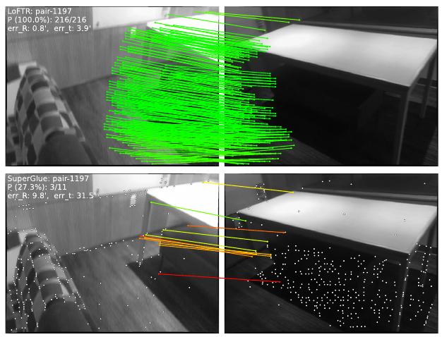
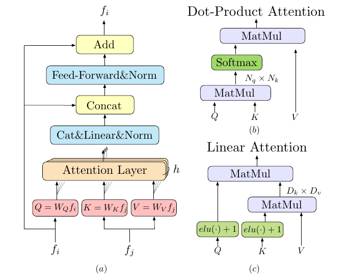
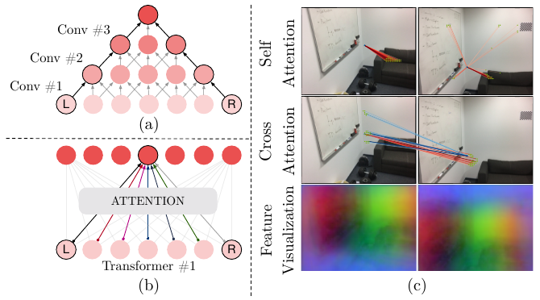
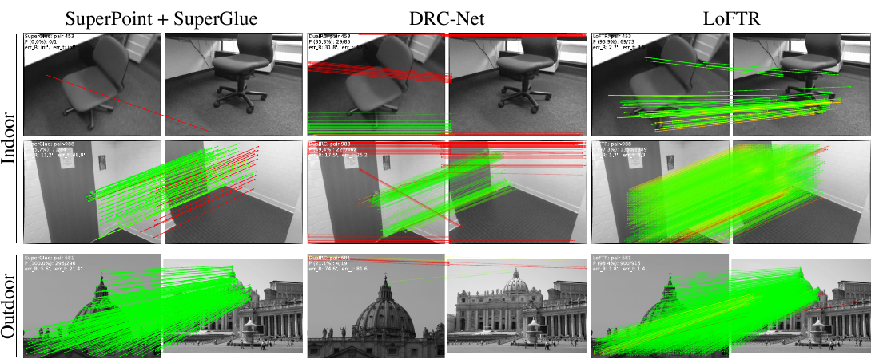
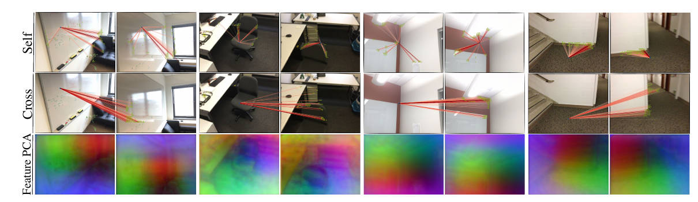

# LoFTR: Detector-Free Local Feature Matching with Transformers — перевод

> **Это перевод на русский язык**, а не оригинальный текст. Переведена версия arXiv:2104.00680v1 (1 апреля 2021).
>
> **Оригинал:** *LoFTR: Detector-Free Local Feature Matching with Transformers*
> **Авторы:** Jiaming Sun¹²\*, Zehong Shen¹\*, Yuang Wang¹\*, Hujun Bao¹, Xiaowei Zhou¹† — ¹Чжэцзянский университет (Zhejiang University), ²SenseTime Research. \*Равный вклад; †автор для переписки.
> **Площадка:** CVPR 2021 (IEEE/CVF Conference on Computer Vision and Pattern Recognition).
> **Источники:** arXiv — https://arxiv.org/abs/2104.00680 (PDF: https://arxiv.org/pdf/2104.00680v1), локальная копия `../original/LoFTR_Sun_2021_arXiv.pdf`; версия CVF Open Access — https://openaccess.thecvf.com/content/CVPR2021/papers/Sun_LoFTR_Detector-Free_Local_Feature_Matching_With_Transformers_CVPR_2021_paper.pdf, локальная копия `../original/LoFTR_Sun_2021.pdf` (текст совпадает с arXiv v1 с точностью до вёрстки — проверено сравнением извлечённого текста).
> **Страница проекта / код:** https://zju3dv.github.io/loftr/ , https://github.com/zju3dv/LoFTR
> **Лицензия:** версия на arXiv распространяется по лицензии **Creative Commons Attribution 4.0 (CC BY 4.0)**, http://creativecommons.org/licenses/by/4.0/ (указано на странице arXiv:2104.00680). Лицензия CC BY относится именно к arXiv-версии; данный перевод выполнен с неё.
> **Изменения относительно оригинала:** текст переведён на русский; рисунки вырезаны из PDF и вставлены заново; таблицы перенесены в формат Markdown, формулы — в LaTeX; английские термины даны в скобках; в квадратных скобках с пометкой «прим. перев.» — примечания переводчика. Разделы после «Литературы» (сильные стороны и ограничения, значение для визуального позиционирования, глоссарий) **не входят в статью** и написаны переводчиком.

---

## Аннотация

Мы представляем новый метод сопоставления локальных признаков изображений (local image feature matching). Вместо того чтобы последовательно выполнять детекцию признаков, их описание и сопоставление, мы предлагаем сначала установить попиксельные плотные соответствия (pixel-wise dense matches) на грубом уровне, а затем уточнить хорошие соответствия на точном уровне. В отличие от плотных методов, которые используют объём стоимости (cost volume) для поиска соответствий, мы используем слои самовнимания и перекрёстного внимания (self and cross attention layers) трансформера (Transformer), чтобы получить дескрипторы признаков, обусловленные обоими изображениями. Глобальное рецептивное поле (global receptive field), которое обеспечивает трансформер, позволяет нашему методу получать плотные соответствия в слаботекстурированных областях, где детекторам признаков обычно трудно выделить повторяемые ключевые точки. Эксперименты на данных внутри помещений и на открытом воздухе показывают, что LoFTR значительно превосходит современные методы. LoFTR также занимает первое место среди опубликованных методов на двух публичных бенчмарках визуальной локализации. Код доступен на странице проекта: https://zju3dv.github.io/loftr/.

*Рис. 1 (из оригинальной статьи). **Сравнение предложенного метода LoFTR и метода на основе детектора [SuperGlue](SuperGlue_конспект.md) [37].** Этот пример показывает, что LoFTR способен находить соответствия на бестекстурной стене и на полу с повторяющимся узором, где методам на основе детектора трудно найти повторяемые ключевые точки.¹*

¹ *Показаны только соответствия-инлайеры после [RANSAC](RANSAC_конспект.md). Зелёный цвет обозначает соответствие с эпиполярной ошибкой меньше $5 \times 10^{-4}$ (в нормализованных координатах изображения).*

## 1. Введение

Сопоставление локальных признаков между изображениями — краеугольный камень многих задач трёхмерного компьютерного зрения, включая восстановление структуры по движению (structure from motion, SfM), одновременную локализацию и построение карты (simultaneous localization and mapping, SLAM), визуальную локализацию (visual localization) и т. д. Для двух сопоставляемых изображений большинство существующих методов состоит из трёх отдельных этапов: детекции признаков (feature detection), описания признаков (feature description) и сопоставления признаков (feature matching). На этапе детекции из каждого изображения сначала выделяются заметные точки, например углы, — ключевые точки (interest points). Затем в окрестностях этих ключевых точек извлекаются локальные дескрипторы. Этапы детекции и описания дают два набора ключевых точек с дескрипторами, точечные соответствия между которыми затем находятся поиском ближайшего соседа (nearest neighbor search) или более сложными алгоритмами сопоставления.

Использование детектора признаков сокращает пространство поиска при сопоставлении, а получаемых разреженных соответствий достаточно для большинства задач, например для оценки позы камеры. Однако детектор может не извлечь достаточного числа ключевых точек, повторяемых между изображениями, из-за различных факторов: бедной текстуры, повторяющихся узоров, изменения точки обзора, изменения освещения и размытия при движении (motion blur). Эта проблема особенно заметна внутри помещений, где слаботекстурированные области или повторяющиеся узоры иногда занимают большую часть поля зрения. Пример показан на рис. 1. Без повторяемых ключевых точек невозможно найти правильные соответствия даже при идеальных дескрипторах.

В ряде недавних работ [34, 33, 19] пытались решить эту проблему, устанавливая попиксельные плотные соответствия. Из плотных соответствий можно выбрать соответствия с высокой оценкой уверенности и таким образом обойтись без детекции признаков. Однако плотные признаки, извлекаемые свёрточными нейронными сетями (convolutional neural networks, CNN) в этих работах, имеют ограниченное рецептивное поле, что может не позволить различать невыразительные (indistinctive) области. Человек же находит соответствия в таких невыразительных областях, опираясь не только на *локальную* окрестность, но и на более широкий *глобальный* контекст. Например, слаботекстурированные области на рис. 1 можно различить по их положению относительно краёв. Это наблюдение говорит о том, что большое рецептивное поле сети извлечения признаков имеет решающее значение.

Исходя из этих наблюдений, мы предлагаем Local Feature TRansformer (LoFTR) — новый подход к сопоставлению локальных признаков без детектора (detector-free). Вдохновлённые основополагающей работой [SuperGlue](SuperGlue_конспект.md) [37], мы используем трансформер [48] со слоями самовнимания и перекрёстного внимания, чтобы обрабатывать (преобразовывать) плотные локальные признаки, извлечённые свёрточной базовой сетью (convolutional backbone). Сначала между двумя наборами преобразованных признаков извлекаются плотные соответствия на низком разрешении признаков (1/8 размера изображения). Из этих плотных соответствий выбираются соответствия с высокой уверенностью, которые затем уточняются до субпиксельного уровня с помощью корреляционного подхода. Глобальное рецептивное поле и позиционное кодирование (positional encoding) трансформера делают преобразованные представления признаков зависящими от контекста и от положения. Многократно чередуя слои самовнимания и перекрёстного внимания, LoFTR выучивает априорные знания о сопоставлении (matching priors) — плотно расположенные и глобально согласованные (globally-consented) — которые проявляются в эталонных соответствиях. Также используется линейный трансформер (linear transformer), чтобы снизить вычислительную сложность до приемлемого уровня.

Мы оцениваем предложенный метод на нескольких задачах сопоставления изображений и оценки позы камеры на данных внутри помещений и на открытом воздухе. Эксперименты показывают, что LoFTR со значительным отрывом превосходит базовые методы сопоставления как на основе детектора, так и без него. LoFTR также достигает лучших на сегодня результатов и занимает первое место среди опубликованных методов на двух публичных бенчмарках визуальной локализации. По сравнению с базовыми методами на основе детектора LoFTR способен давать качественные соответствия даже в невыразительных областях со слабой текстурой, размытием при движении или повторяющимися узорами.

## 2. Связанные работы

**Сопоставление локальных признаков на основе детектора (detector-based).** Методы на основе детектора были доминирующим подходом к сопоставлению локальных признаков. Ещё до эпохи глубокого обучения многие известные работы по традиционным, сконструированным вручную (hand-crafted) локальным признакам достигали хороших результатов. [SIFT](SIFT_конспект.md) [26] и [ORB](ORB_конспект.md) [35], пожалуй, самые успешные вручную сконструированные локальные признаки, широко применяемые во многих задачах трёхмерного компьютерного зрения. Устойчивость локальных признаков к большим изменениям точки обзора и освещения можно существенно повысить с помощью обучаемых методов. В частности, [LIFT](LIFT_конспект.md) [51] и MagicPoint [8] — одни из первых успешных обучаемых локальных признаков. Они используют схему с детектором, как в вручную сконструированных методах, и достигают хороших результатов. [SuperPoint](SuperPoint_конспект.md) [9] строится на основе MagicPoint и предлагает метод самообучения (self-supervised training) через гомографическую адаптацию (homographic adaptation). Многие обучаемые локальные признаки этого направления [32, 11, 25, 28, 47] также используют схему с детектором.

Перечисленные локальные признаки используют поиск ближайшего соседа, чтобы находить соответствия между извлечёнными ключевыми точками. Недавно [SuperGlue](SuperGlue_конспект.md) [37] предложил обучаемый подход к сопоставлению локальных признаков. [SuperGlue](SuperGlue_конспект.md) принимает на вход два набора ключевых точек с их дескрипторами и выучивает соответствия между ними с помощью графовой нейронной сети (graph neural network, GNN), которая является общей формой трансформеров [16]. Поскольку априорные знания о сопоставлении признаков можно выучить из данных, [SuperGlue](SuperGlue_конспект.md) достигает впечатляющих результатов и устанавливает новое state of the art в сопоставлении локальных признаков. Однако как метод, зависящий от детектора, он имеет принципиальный недостаток — неспособность обнаруживать повторяемые ключевые точки в невыразительных областях. Область действия внимания в [SuperGlue](SuperGlue_конспект.md) также ограничена лишь обнаруженными ключевыми точками. Наша работа вдохновлена [SuperGlue](SuperGlue_конспект.md) в части использования самовнимания и перекрёстного внимания в GNN для передачи сообщений (message passing) между двумя наборами дескрипторов, но мы предлагаем схему без детектора, чтобы избежать недостатков детекторов признаков. Кроме того, мы используем эффективный вариант слоёв внимания трансформера, чтобы снизить вычислительные затраты.

**Сопоставление локальных признаков без детектора (detector-free).** Методы без детектора убирают этап детекции признаков и напрямую выдают плотные дескрипторы или плотные соответствия признаков. Идея плотного сопоставления признаков восходит к [SIFT](SIFT_конспект.md) Flow [23]. Работы [6, 39] — первые обучаемые подходы, которые выучивают попиксельные дескрипторы признаков с контрастной функцией потерь (contrastive loss). Как и в методах с детектором, для сопоставления плотных дескрипторов обычно используется поиск ближайшего соседа в качестве постобработки. NCNet [34] предложил иной подход — непосредственно выучивать плотные соответствия сквозным (end-to-end) образом. Он строит четырёхмерные объёмы стоимости (4D cost volumes), перебирающие все возможные соответствия между изображениями, и использует четырёхмерные свёртки, чтобы регуляризовать объём стоимости и обеспечить согласованность окрестностей (neighborhood consensus) среди всех соответствий. Sparse NCNet [33] улучшает NCNet и делает его эффективнее за счёт разреженных свёрток. Одновременно с нашей работой DRC-Net [19] продолжает это направление и предлагает подход «от грубого к точному» (coarse-to-fine) для получения более точных плотных соответствий. Хотя в 4D-объёме стоимости рассматриваются все возможные соответствия, рецептивное поле 4D-свёртки по-прежнему ограничено окрестностью каждого соответствия. Помимо согласованности окрестностей, наша работа нацелена на достижение глобальной согласованности (global consensus) между соответствиями с помощью глобального рецептивного поля трансформеров, которое не используется в NCNet и последующих работах. В [24] предложен конвейер плотного сопоставления для SfM по эндоскопическим видео. С нашей работой также связано недавнее направление исследований [46, 45, 44, 15], которое стремится объединить задачи сопоставления локальных признаков и оценки оптического потока (optical flow).

**Трансформеры в задачах, связанных со зрением.** Трансформер [48] стал стандартом де-факто для моделирования последовательностей в обработке естественного языка (natural language processing, NLP) благодаря своей простоте и вычислительной эффективности. В последнее время трансформеры привлекают всё больше внимания и в задачах компьютерного зрения, таких как классификация изображений [10], детекция объектов [3] и семантическая сегментация [49]. Одновременно с нашей работой в [20] предложено использовать трансформер для оценки диспаратности (disparity). Вычислительная стоимость классического (vanilla) трансформера растёт квадратично с длиной входной последовательности из-за перемножения векторов запросов и ключей. В контексте обработки длинных текстовых последовательностей недавно предложено много эффективных вариантов [42, 18, 17, 5]. Поскольку в этих работах не делается предположений о входных данных, они хорошо подходят и для обработки изображений.

## 3. Методы

Для пары изображений $I^A$ и $I^B$ существующие методы сопоставления локальных признаков используют детектор признаков для извлечения ключевых точек. Мы предлагаем решить проблему повторяемости детекторов признаков с помощью схемы без детектора. Общий вид предложенного метода LoFTR представлен на рис. 2.

*Рис. 2 (из оригинальной статьи). **Общая схема предложенного метода.** LoFTR состоит из четырёх компонентов. **1.** Свёрточная сеть локальных признаков (local feature CNN) извлекает из пары изображений $I^A$ и $I^B$ карты признаков грубого уровня $\tilde F^A$ и $\tilde F^B$, а также карты признаков точного уровня $\hat F^A$ и $\hat F^B$ (раздел 3.1). **2.** Грубые карты признаков разворачиваются в одномерные векторы, к ним прибавляется позиционное кодирование. Полученные признаки затем обрабатываются модулем Local Feature TRansformer (LoFTR), который содержит $N_c$ слоёв самовнимания и перекрёстного внимания (раздел 3.2). **3.** Для сопоставления преобразованных признаков используется дифференцируемый слой сопоставления (differentiable matching layer), на выходе которого получается матрица уверенности $\mathcal{P}_c$. Соответствия в $\mathcal{P}_c$ отбираются по порогу уверенности и критерию взаимного ближайшего соседа (mutual nearest neighbor), что даёт предсказание соответствий грубого уровня $\mathcal{M}_c$ (раздел 3.3). **4.** Для каждого отобранного грубого предсказания $(\tilde i, \tilde j) \in \mathcal{M}_c$ из карты признаков точного уровня вырезается локальное окно размером $w \times w$. Грубые соответствия уточняются внутри этого локального окна до субпиксельного уровня — это и есть итоговое предсказание соответствий $\mathcal{M}_f$ (раздел 3.4).*

### 3.1. Извлечение локальных признаков

Мы используем стандартную свёрточную архитектуру с FPN (Feature Pyramid Network, пирамида признаков) [22] (далее — свёрточная сеть локальных признаков, local feature CNN), чтобы извлечь многоуровневые признаки из обоих изображений. Через $\tilde F^A$ и $\tilde F^B$ обозначаются признаки грубого уровня с разрешением 1/8 от исходного размера изображения, через $\hat F^A$ и $\hat F^B$ — признаки точного уровня с разрешением 1/2 от исходного размера.

Свёрточные нейронные сети обладают индуктивным смещением (inductive bias) в виде эквивариантности к сдвигу (translation equivariance) и локальности, что хорошо подходит для извлечения *локальных* признаков. Понижение разрешения (downsampling), которое вносит CNN, также сокращает длину входа модуля LoFTR, что принципиально важно для приемлемой вычислительной стоимости.

### 3.2. Модуль Local Feature Transformer (LoFTR)

После извлечения локальных признаков $\tilde F^A$ и $\tilde F^B$ пропускаются через модуль LoFTR, чтобы получить локальные признаки, зависящие от положения и контекста. Интуитивно модуль LoFTR преобразует признаки в такие представления, которые легко сопоставлять. Преобразованные признаки обозначим $\tilde F^A_{tr}$ и $\tilde F^B_{tr}$.

**Предварительные сведения: трансформер [48].** Сначала кратко опишем трансформер в качестве справочной информации. Энкодер трансформера состоит из последовательно соединённых слоёв энкодера (encoder layers). На рис. 3(a) показана архитектура слоя энкодера.

*Рис. 3 (из оригинальной статьи). **Слой энкодера и слой внимания в LoFTR.** (a) Слой энкодера трансформера; $h$ — число голов внимания (multiple heads of attention). (b) Классическое внимание на основе скалярного произведения (dot-product attention) со сложностью $O(N^2)$. (c) Слой линейного внимания (linear attention) со сложностью $O(N)$. Масштабирующий множитель для простоты опущен.*

Ключевой элемент слоя энкодера — слой внимания (attention layer). Входные векторы слоя внимания по традиции называются запросом (query), ключом (key) и значением (value). По аналогии с информационным поиском вектор запроса $Q$ извлекает информацию из вектора значений $V$ в соответствии с весом внимания, вычисленным из скалярного произведения $Q$ и вектора ключа $K$, соответствующего каждому значению $V$. Граф вычислений слоя внимания представлен на рис. 3(b). Формально слой внимания записывается как

$$
\mathrm{Attention}(Q, K, V) = \mathrm{softmax}(QK^T)\,V.
$$

Интуитивно операция внимания отбирает релевантную информацию, измеряя сходство между элементом запроса и каждым элементом ключа. Выходной вектор — это сумма векторов значений, взвешенных оценками сходства. В результате, если сходство велико, из вектора значений извлекается релевантная информация. В графовых нейронных сетях этот процесс также называют «передачей сообщений» (message passing).

**Линейный трансформер (Linear Transformer).** Обозначим длину $Q$ и $K$ через $N$, а размерность их признаков через $D$. Скалярное произведение $Q$ и $K$ в трансформере приводит к вычислительной стоимости, растущей квадратично ($O(N^2)$) с длиной входной последовательности. Непосредственно применять классический трансформер в задаче сопоставления локальных признаков непрактично даже тогда, когда длина входа сокращена свёрточной сетью локальных признаков. Чтобы решить эту проблему, мы предлагаем использовать эффективный вариант классического слоя внимания трансформера. Linear Transformer [17] снижает вычислительную сложность трансформера до $O(N)$, заменяя экспоненциальное ядро, используемое в исходном слое внимания, альтернативной ядерной функцией $\mathrm{sim}(Q, K) = \phi(Q) \cdot \phi(K)^T$, где $\phi(\cdot) = \mathrm{elu}(\cdot) + 1$. Эта операция показана графом вычислений на рис. 3(c). Благодаря ассоциативности матричного произведения умножение $\phi(K)^T$ на $V$ можно выполнить первым. Поскольку $D \ll N$, вычислительная стоимость снижается до $O(N)$.

[*Прим. перев.: в явном виде, по [17], для $i$-го запроса* $\;\mathrm{LinAttn}(Q,K,V)_i = \dfrac{\phi(Q_i)^T \sum_{j} \phi(K_j) V_j^T}{\phi(Q_i)^T \sum_{j} \phi(K_j)}$, *где суммы по $j$ вычисляются один раз для всех $i$. В статье LoFTR эта формула не выписана.*]

**Позиционное кодирование (Positional Encoding).** Мы используем двумерное расширение стандартного позиционного кодирования трансформеров вслед за DETR [3]. В отличие от DETR, мы прибавляем его к выходу базовой сети (backbone) только один раз. Формальное определение позиционного кодирования приведено в дополнительных материалах. Интуитивно позиционное кодирование придаёт каждому элементу уникальную информацию о положении в синусоидальной форме. Благодаря прибавлению позиционного кодирования к $\tilde F^A$ и $\tilde F^B$ преобразованные признаки становятся зависящими от положения, что критически важно для способности LoFTR находить соответствия в невыразительных областях. Как видно в нижнем ряду рис. 4(c), хотя входной RGB-цвет на белых стенах однороден, преобразованные признаки $\tilde F^A_{tr}$ и $\tilde F^B_{tr}$ *уникальны* для каждой позиции, что демонстрируют плавные цветовые градиенты. Дополнительные визуализации приведены на рис. 6.

[*Прим. перев.: дополнительные материалы в arXiv v1 не входят. По официальному коду (`src/loftr/utils/position_encoding.py`, класс `PositionEncodingSine`) кодирование для канала $c$ и позиции $(x, y)$ на карте 1/8 задаётся так: каналы с индексами $4k, 4k{+}1, 4k{+}2, 4k{+}3$ равны $\sin(x\,\omega_k), \cos(x\,\omega_k), \sin(y\,\omega_k), \cos(y\,\omega_k)$, где $\omega_k = \exp\!\big(-2k \ln 10000 / (d/2)\big)$, $d$ — размерность признака; в README упоминается, что в первой версии кода была ошибка в вычислении $\omega_k$ (флаг `temp_bug_fix`), почти не влиявшая на результат.*]

**Слои самовнимания и перекрёстного внимания.** В слоях самовнимания входные признаки $f_i$ и $f_j$ (см. рис. 3) совпадают (это либо $\tilde F^A$, либо $\tilde F^B$). В слоях перекрёстного внимания входные признаки $f_i$ и $f_j$ — это либо ($\tilde F^A$ и $\tilde F^B$), либо ($\tilde F^B$ и $\tilde F^A$) в зависимости от направления перекрёстного внимания. Вслед за [37] мы чередуем слои самовнимания и перекрёстного внимания в модуле LoFTR $N_c$ раз. Веса внимания слоёв самовнимания и перекрёстного внимания в LoFTR визуализированы в первых двух рядах рис. 4(c).

*Рис. 4 (из оригинальной статьи). **Иллюстрация рецептивного поля (a) свёрток и (b) трансформеров.** Предположим, что цель — установить связь между элементами L и R, чтобы извлечь их совместное представление. Из-за локальной связности свёрток необходимо наложить друг на друга много свёрточных слоёв, чтобы достичь этой связи. Глобальное рецептивное поле трансформеров позволяет установить эту связь всего одним слоем внимания. **(c)** Визуализация весов внимания и преобразованных плотных признаков. Мы снижаем размерность преобразованных признаков $\tilde F^A_{tr}$ и $\tilde F^B_{tr}$ методом главных компонент (PCA) и визуализируем результат в цветах RGB. Для деталей увеличьте изображение.*

### 3.3. Установление соответствий грубого уровня

В LoFTR можно использовать два типа дифференцируемых слоёв сопоставления: слой оптимального транспорта (optimal transport, OT), как в [37], либо оператор двойного софтмакса (dual-softmax) [34, 47]. Сначала вычисляется матрица оценок $\mathcal{S}$ между преобразованными признаками:

$$
\mathcal{S}(i, j) = \frac{1}{\tau} \cdot \big\langle \tilde F^A_{tr}(i),\; \tilde F^B_{tr}(j) \big\rangle .
$$

[*Прим. перев.: $\langle\cdot,\cdot\rangle$ — скалярное произведение, $\tau$ — температура; $i$, $j$ — индексы ячеек грубой сетки 1/8 в изображениях A и B. По официальному коду $\tau = 0.1$ (`DSMAX_TEMPERATURE`), а признаки перед произведением дополнительно делятся на $\sqrt{d}$ каждый, т.е. фактически $\mathcal{S} = \langle f^A, f^B\rangle / (d\,\tau)$; в статье это не указано.*]

При сопоставлении через OT матрицу $-\mathcal{S}$ можно использовать как матрицу стоимости задачи частичного назначения (partial assignment problem), как в [37]. Можно также применить софтмакс по обоим измерениям $\mathcal{S}$ (далее — двойной софтмакс, dual-softmax), чтобы получить вероятность мягкого взаимного ближайшего соседа (soft mutual nearest neighbor). Формально при использовании dual-softmax вероятность сопоставления $\mathcal{P}_c$ вычисляется как

$$
\mathcal{P}_c(i, j) = \mathrm{softmax}\big(\mathcal{S}(i, \cdot)\big)_j \cdot \mathrm{softmax}\big(\mathcal{S}(\cdot, j)\big)_i .
$$

**Отбор соответствий (Match Selection).** На основе матрицы уверенности $\mathcal{P}_c$ мы отбираем соответствия с уверенностью выше порога $\theta_c$ и дополнительно применяем критерий взаимного ближайшего соседа (mutual nearest neighbor, MNN), который отфильтровывает возможные ошибочные грубые соответствия. Предсказанные соответствия грубого уровня обозначаются так:

$$
\mathcal{M}_c = \big\{ (\tilde i, \tilde j) \;\big|\; \forall (\tilde i, \tilde j) \in \mathrm{MNN}(\mathcal{P}_c),\; \mathcal{P}_c(\tilde i, \tilde j) \ge \theta_c \big\}.
$$

### 3.4. Модуль «от грубого к точному» (Coarse-to-Fine Module)

После установления грубых соответствий они уточняются до исходного разрешения изображения модулем «от грубого к точному». Вдохновившись [50], мы используем для этого корреляционный подход. Для каждого грубого соответствия $(\tilde i, \tilde j)$ мы сначала находим его положение $(\hat i, \hat j)$ на картах признаков точного уровня $\hat F^A$ и $\hat F^B$, а затем вырезаем два набора локальных окон размером $w \times w$. Затем меньший модуль LoFTR преобразует вырезанные признаки внутри каждого окна $N_f$ раз, давая две преобразованные локальные карты признаков $\hat F^A_{tr}(\hat i)$ и $\hat F^B_{tr}(\hat j)$ с центрами в $\hat i$ и $\hat j$ соответственно. Затем мы коррелируем центральный вектор $\hat F^A_{tr}(\hat i)$ со всеми векторами $\hat F^B_{tr}(\hat j)$ и таким образом получаем тепловую карту (heatmap), представляющую вероятность совпадения каждого пикселя окрестности $\hat j$ с $\hat i$. Вычисляя математическое ожидание по этому распределению вероятностей, мы получаем итоговое положение $\hat j'$ с субпиксельной точностью на $I^B$. Совокупность всех соответствий $\{(\hat i, \hat j')\}$ даёт итоговые соответствия точного уровня $\mathcal{M}_f$.

[*Прим. перев.: в обозначениях рис. 2 корреляция нормализуется софтмаксом (correlation & softmax), а ожидание $E(\cdot)$ даёт $\hat j' = \sum_{k} p(k)\,x_k$, где $x_k$ — координаты пикселей окна, $p(k)$ — софтмакс-нормированная корреляция.*]

### 3.5. Обучение (Supervision)

Итоговая функция потерь состоит из потерь грубого и точного уровня:

$$
\mathcal{L} = \mathcal{L}_c + \mathcal{L}_f .
$$

**Обучение грубого уровня.** Функция потерь грубого уровня — отрицательное логарифмическое правдоподобие (negative log-likelihood) по матрице уверенности $\mathcal{P}_c$, которую возвращает либо слой оптимального транспорта, либо оператор dual-softmax. Вслед за [SuperGlue](SuperGlue_конспект.md) [37] мы используем позы камер и карты глубины, чтобы во время обучения вычислять эталонные метки (ground-truth labels) для матрицы уверенности. Эталонные грубые соответствия $\mathcal{M}^{gt}_c$ определяются как взаимные ближайшие соседи двух наборов ячеек сетки разрешения 1/8. Расстояние между двумя ячейками измеряется расстоянием перепроецирования (re-projection distance) их центров. Подробности приведены в дополнительных материалах. При использовании слоя оптимального транспорта мы используем ту же формулировку функции потерь, что и в [37]. При использовании dual-softmax для сопоставления мы минимизируем отрицательное логарифмическое правдоподобие по ячейкам из $\mathcal{M}^{gt}_c$:

$$
\mathcal{L}_c = -\frac{1}{|\mathcal{M}^{gt}_c|} \sum_{(\tilde i, \tilde j) \in \mathcal{M}^{gt}_c} \log \mathcal{P}_c(\tilde i, \tilde j).
$$

**Обучение точного уровня.** Для точного уточнения мы используем функцию потерь $\ell_2$. Вслед за [50] для каждой точки-запроса $\hat i$ мы также оцениваем её неопределённость, вычисляя полную дисперсию (total variance) $\sigma^2(\hat i)$ соответствующей тепловой карты. Цель — оптимизировать уточнённое положение с низкой неопределённостью, что приводит к итоговой взвешенной функции потерь:

$$
\mathcal{L}_f = \frac{1}{|\mathcal{M}_f|} \sum_{(\hat i, \hat j') \in \mathcal{M}_f} \frac{1}{\sigma^2(\hat i)} \big\lVert \hat j' - \hat j'_{gt} \big\rVert_2 ,
$$

где $\hat j'_{gt}$ вычисляется переносом (warping) каждой точки $\hat i$ из $\hat F^A_{tr}(\hat i)$ в $\hat F^B_{tr}(\hat j)$ с использованием эталонной позы камеры и глубины. При вычислении $\mathcal{L}_f$ пара $(\hat i, \hat j')$ игнорируется, если перенесённое положение $\hat i$ выходит за пределы локального окна $\hat F^B_{tr}(\hat j)$. При обучении градиент через $\sigma^2(\hat i)$ не распространяется.

[*Прим. перев.: в официальном коде по умолчанию для грубого уровня используется фокальная функция потерь (focal loss, $\alpha = 0.25$, $\gamma = 2$; `LOSS.COARSE_TYPE = 'focal'`), а для точного — `'l2_with_std'` с весом $1/\sigma$ (обратное стандартное отклонение), нормированным по батчу. Это отличается от формул статьи; см. `src/config/default.py` и `src/losses/loftr_loss.py`.*]

### 3.6. Детали реализации

Модель LoFTR для помещений обучается на датасете ScanNet [7], а модель для открытого воздуха — на MegaDepth [21] вслед за [37]. На ScanNet модель обучается оптимизатором Adam с начальной скоростью обучения (learning rate) $1 \times 10^{-3}$ и размером батча 64. Она сходится за 24 часа обучения на 64 GPU GTX 1080Ti. В качестве базовой сети свёрточная сеть локальных признаков использует модифицированную версию ResNet-18 [12]. Вся модель обучается сквозным образом со случайно инициализированными весами. $N_c$ задано равным 4, $N_f$ — 1. $\theta_c$ выбрано равным 0.2. Размер окна $w$ равен 5. В реализации $\tilde F^A_{tr}$ и $\tilde F^B_{tr}$ перед прохождением через LoFTR точного уровня повышаются по разрешению (upsampled) и конкатенируются с $\hat F^A$ и $\hat F^B$. Полная модель с сопоставлением dual-softmax работает за 116 мс на пару изображений 640×480 на RTX 2080Ti. В варианте с оптимальным транспортом мы используем три итерации алгоритма Синкхорна (Sinkhorn), и модель работает за 130 мс. Более подробные сведения об обучении и анализ времени работы приведены в дополнительных материалах.

[*Прим. перев.: сводка гиперпараметров (из статьи и, где отмечено, по официальному коду `src/config/default.py`).*]

| Параметр | Значение | Источник |
|---|---|---|
| Базовая сеть | модифицированная ResNet-18 + FPN, выходы 1/8 и 1/2 | статья |
| Размерность признаков грубого / точного уровня | 256 / 128 | по официальному коду |
| Число голов внимания | 8 | по официальному коду |
| $N_c$ (пар «self + cross», грубый уровень) | 4 | статья |
| $N_f$ (точный уровень) | 1 | статья |
| Тип внимания | линейное, $\phi = \mathrm{elu}+1$ | статья |
| Порог уверенности $\theta_c$ | 0.2 | статья |
| Окно уточнения $w$ | 5 | статья |
| Температура dual-softmax $\tau$ | 0.1 | по официальному коду |
| Итерации Синкхорна (вариант OT) | 3 | статья |
| Оптимизатор / LR / батч (ScanNet) | Adam / $10^{-3}$ / 64 | статья (в коде по умолчанию — AdamW) |
| Обучение (ScanNet) | 24 ч на 64 × GTX 1080Ti | статья |
| Время инференса, 640×480, RTX 2080Ti | 116 мс (DS), 130 мс (OT) | статья |

## 4. Эксперименты

### 4.1. Оценка гомографии

В первом эксперименте мы оцениваем LoFTR на широко используемом датасете HPatches [1] для оценки гомографии. HPatches содержит 52 последовательности со значительными изменениями освещения и 56 последовательностей с большими изменениями точки обзора.

**Протокол оценки.** В каждой тестовой последовательности одно опорное изображение сопоставляется с остальными пятью. Размер всех изображений меняется так, чтобы меньшая сторона равнялась 480. Для каждой пары изображений мы извлекаем набор соответствий с помощью LoFTR, обученного на MegaDepth [21]. Для оценки гомографии мы используем OpenCV с [RANSAC](RANSAC_конспект.md) в качестве робастного оценщика. Чтобы честно сравнивать методы, выдающие разное число соответствий, в качестве критерия правильности мы, как в [9], вычисляем ошибку углов (corner error) между изображениями, преобразованными оценённой гомографией $\hat{\mathcal{H}}$ и эталонной $\mathcal{H}$. Вслед за [37] мы приводим площадь под кумулятивной кривой (area under the cumulative curve, AUC) ошибки углов до пороговых значений 3, 5 и 10 пикселей. Мы приводим результаты LoFTR с максимум 1K выходных соответствий.

**Базовые методы.** Мы сравниваем LoFTR с тремя категориями методов: 1) локальные признаки на основе детектора — [R2D2](R2D2_конспект.md) [32], D2Net [11] и [DISK](DISK_конспект.md) [47]; 2) сопоставитель (matcher) локальных признаков на основе детектора — [SuperGlue](SuperGlue_конспект.md) [37] поверх признаков [SuperPoint](SuperPoint_конспект.md) [9]; 3) сопоставители без детектора — Sparse-NCNet [33] и DRC-Net [19]. Для локальных признаков мы извлекаем максимум 2K признаков, из которых в качестве итоговых соответствий берутся взаимные ближайшие соседи. Для методов, напрямую выдающих соответствия, мы ограничиваем их число максимум 1K, как и для LoFTR. Для всех базовых методов используются гиперпараметры по умолчанию из их оригинальных реализаций.

**Результаты.** Табл. 1 показывает, что LoFTR заметно превосходит другие базовые методы при всех порогах ошибки со значительным отрывом. В частности, разрыв между LoFTR и другими методами увеличивается при более строгом пороге правильности. Мы объясняем лучший результат большим числом кандидатов в соответствия, которое обеспечивает схема без детектора, и глобальным рецептивным полем, которое даёт трансформер. Кроме того, модуль «от грубого к точному» также вносит вклад в точность оценки, уточняя соответствия до субпиксельного уровня.

**Таблица 1. Оценка гомографии на HPatches [7].** Приведена AUC ошибки углов в процентах. Суффикс DS обозначает дифференцируемое сопоставление с dual-softmax. [*Прим. перев.: в оригинальной подписи ссылка [7] (ScanNet), по-видимому, ошибочна — HPatches в списке литературы имеет номер [1].*]

| Категория | Метод | AUC @3px | AUC @5px | AUC @10px | Число соответствий |
|---|---|---|---|---|---|
| С детектором | D2Net [11] + NN | 23.2 | 35.9 | 53.6 | 0.2K |
| | [R2D2](R2D2_конспект.md) [32] + NN | 50.6 | 63.9 | 76.8 | 0.5K |
| | [DISK](DISK_конспект.md) [47] + NN | 52.3 | 64.9 | 78.9 | 1.1K |
| | SP [9] + [SuperGlue](SuperGlue_конспект.md) [37] | 53.9 | 68.3 | 81.7 | 0.6K |
| Без детектора | Sparse-NCNet [33] | 48.9 | 54.2 | 67.1 | 1.0K |
| | DRC-Net [19] | 50.6 | 56.2 | 68.3 | 1.0K |
| | **LoFTR-DS** | **65.9** | **75.6** | **84.6** | 1.0K |

### 4.2. Оценка относительной позы

**Датасеты.** Чтобы продемонстрировать эффективность LoFTR для оценки позы, мы используем ScanNet [7] и MegaDepth [21] — для сцен внутри помещений и на открытом воздухе соответственно.

ScanNet содержит 1613 монокулярных последовательностей с эталонными позами и картами глубины. Следуя процедуре [SuperGlue](SuperGlue_конспект.md) [37], мы выбираем для обучения 230M пар изображений с оценкой перекрытия (overlap score) от 0.4 до 0.8. Метод оценивается на 1500 тестовых парах из [37]. Размер всех изображений и карт глубины приводится к 640 × 480. Этот датасет содержит пары изображений с широкой базой (wide baselines) и обширными бестекстурными областями.

MegaDepth состоит из 1M интернет-изображений 196 различных сцен на открытом воздухе. Авторы датасета также предоставляют разреженную реконструкцию, полученную COLMAP [40], и карты глубины, вычисленные многовидовой стереореконструкцией (multi-view stereo). Вслед за [DISK](DISK_конспект.md) [47] мы используем для валидации только сцены «Sacre Coeur» и «St. Peter’s Square», из которых для честного сравнения выбираем 1500 пар. Размер изображений меняется так, чтобы бо́льшая сторона равнялась 840 при обучении и 1200 при валидации. Основная трудность на MegaDepth — сопоставление при экстремальных изменениях точки обзора и повторяющихся узорах.

**Протокол оценки.** Вслед за [37] мы приводим AUC ошибки позы при порогах (5°, 10°, 20°), где ошибка позы определяется как максимум из угловых ошибок поворота и переноса. Для восстановления позы камеры мы решаем задачу оценки существенной матрицы (essential matrix) по предсказанным соответствиям с помощью [RANSAC](RANSAC_конспект.md). Мы не сравниваем точность (precision) сопоставления LoFTR и других методов на основе детектора, поскольку для методов сопоставления изображений без детектора нет чётко определённой метрики (например, matching score или recall [13, 30]). Мы считаем DRC-Net [19] современным лучшим методом среди подходов без детектора [34, 33].

**Результаты оценки позы в помещениях.** LoFTR достигает лучшей точности позы по сравнению со всеми конкурентами (см. табл. 2 и рис. 5). Использование в LoFTR оптимального транспорта или dual-softmax в качестве дифференцируемого слоя сопоставления даёт сопоставимые результаты. Поскольку опубликованная модель DRC-Net† обучена на MegaDepth, для честного сравнения мы приводим результаты LoFTR†, обученного на MegaDepth. LoFTR† также со значительным отрывом превосходит DRC-Net† в этой оценке (см. рис. 5), что демонстрирует обобщающую способность нашей модели между датасетами.

**Таблица 2. Оценка позы в помещениях на ScanNet [7].** Приведена AUC ошибки позы в процентах. LoFTR значительно улучшает результаты современных методов. † обозначает модели, обученные на MegaDepth. Суффиксы OT и DS обозначают дифференцируемое сопоставление с оптимальным транспортом и dual-softmax соответственно.

| Категория | Метод | AUC @5° | AUC @10° | AUC @20° |
|---|---|---|---|---|
| С детектором | [ORB](ORB_конспект.md) [35] + GMS [2] | 5.21 | 13.65 | 25.36 |
| | [D2-Net](D2-Net_конспект.md) [11] + NN | 5.25 | 14.53 | 27.96 |
| | ContextDesc [27] + Ratio Test [26] | 6.64 | 15.01 | 25.75 |
| | SP [9] + NN | 9.43 | 21.53 | 36.40 |
| | SP [9] + PointCN [52] | 11.40 | 25.47 | 41.41 |
| | SP [9] + OANet [53] | 11.76 | 26.90 | 43.85 |
| | SP [9] + [SuperGlue](SuperGlue_конспект.md) [37] | 16.16 | 33.81 | 51.84 |
| Без детектора | DRC-Net† [19] | 7.69 | 17.93 | 30.49 |
| | LoFTR-OT† | 16.88 | 33.62 | 50.62 |
| | **LoFTR-OT** | 21.51 | 40.39 | **57.96** |
| | **LoFTR-DS** | **22.06** | **40.8** | 57.62 |

**Результаты оценки позы на открытом воздухе.** Как показано в табл. 3, LoFTR превосходит метод без детектора DRC-Net на 61% по AUC@10°, что демонстрирует эффективность трансформера. Для [SuperGlue](SuperGlue_конспект.md) мы используем настройки из открытого набора инструментов локализации HLoc [36]. LoFTR со значительным отрывом (13% по AUC@10°) превосходит [SuperGlue](SuperGlue_конспект.md), что демонстрирует эффективность схемы без детектора. В отличие от сцен в помещениях, на MegaDepth LoFTR-DS работает лучше, чем LoFTR-OT. Дополнительные качественные результаты приведены на рис. 5.

**Таблица 3. Оценка позы на открытом воздухе на MegaDepth [21].** Сопоставление с помощью LoFTR даёт лучшие результаты в задаче оценки позы на открытом воздухе.

| Категория | Метод | AUC @5° | AUC @10° | AUC @20° |
|---|---|---|---|---|
| С детектором | SP [9] + [SuperGlue](SuperGlue_конспект.md) [37] | 42.18 | 61.16 | 75.96 |
| Без детектора | DRC-Net [19] | 27.01 | 42.96 | 58.31 |
| | **LoFTR-OT** | 50.31 | 67.14 | 79.93 |
| | **LoFTR-DS** | **52.8** | **69.19** | **81.18** |

*Рис. 5 (из оригинальной статьи). **Качественные результаты.** LoFTR сравнивается с [SuperGlue](SuperGlue_конспект.md) [37] и DRC-Net [19] в помещениях (Indoor) и на открытом воздухе (Outdoor). LoFTR получает больше правильных соответствий и меньше ошибочных, успешно справляясь со слаботекстурированными областями и большими изменениями точки обзора и освещения. Красный цвет обозначает эпиполярную ошибку больше $5 \times 10^{-4}$ для сцен в помещениях и $1 \times 10^{-4}$ для сцен на открытом воздухе (в нормализованных координатах изображения). Дополнительные качественные результаты — на веб-странице проекта.*

### 4.3. Визуальная локализация

**Визуальная локализация.** Помимо конкурентоспособных результатов в оценке относительной позы, LoFTR может быть полезен и для визуальной локализации — задачи оценки 6DoF-поз заданных изображений относительно соответствующей трёхмерной модели сцены. Мы оцениваем LoFTR на бенчмарке Long-Term Visual Localization Benchmark [43] (далее — бенчмарк VisLoc). Он нацелен на сравнение методов визуальной локализации в изменяющихся условиях, например при смене дня и ночи, изменениях геометрии сцены и в помещениях с большим количеством бестекстурных областей. Таким образом, задача визуальной локализации опирается на очень устойчивые методы сопоставления изображений.

**Оценка.** Мы оцениваем LoFTR на двух треках VisLoc, состоящих из нескольких испытаний (challenges). Во-первых, трек «визуальная локализация для портативных устройств» (visual localization for handheld devices) требует полного конвейера локализации. Он включает два датасета: Aachen-Day-Night [38, 54] со сценами на открытом воздухе и InLoc [41] со сценами в помещениях. Мы используем открытый конвейер локализации HLoc [36] с соответствиями, извлечёнными LoFTR. Во-вторых, трек «локальные признаки для долговременной локализации» (local features for long-term localization) предоставляет фиксированный конвейер локализации, чтобы оценивать сами экстракторы локальных признаков и, опционально, сопоставители. Этот трек использует датасет Aachen v1.1 [54]. Детали тестирования LoFTR на VisLoc приведены в дополнительных материалах.

**Результаты.** Результаты оценки LoFTR приведены в табл. 4 и табл. 5. Мы оценили LoFTR в паре как со слоем оптимального транспорта, так и с оператором dual-softmax и приводим лучший результат. LoFTR-DS превосходит все базовые методы в треке локальных признаков, демонстрируя устойчивость к смене дня и ночи. Далее, в треке визуальной локализации для портативных устройств LoFTR-OT превосходит все опубликованные методы на сложном датасете InLoc, который содержит обширные изменения внешнего вида, больше бестекстурных областей, симметричные и повторяющиеся элементы. Мы объясняем это превосходство использованием трансформера и слоя оптимального транспорта, которые используют глобальную информацию и совместно привносят глобальную согласованность в итоговые соответствия. Схема без детектора также играет решающую роль, избавляя от проблемы повторяемости методов на основе детектора в слаботекстурированных областях. LoFTR-OT работает наравне с лучшим современным методом [SuperPoint](SuperPoint_конспект.md) + [SuperGlue](SuperGlue_конспект.md) на ночных запросах датасета Aachen v1.1 и немного хуже на дневных запросах.

**Таблица 4. Визуальная локализация на бенчмарке Aachen Day-Night [54] v1.1.** Приведены результаты как в треке оценки локальных признаков, так и в треке полной визуальной локализации. Значения — доля локализованных запросов (%) при порогах (0.25 м, 2°) / (0.5 м, 5°) / (1.0 м, 10°).

| Метод | День | Ночь |
|---|---|---|
| *Оценка локальных признаков на ночных запросах* | | |
| [R2D2](R2D2_конспект.md) [32] + NN | – | 71.2 / 86.9 / 98.9 |
| LISRD [31] + SP [9] + AdaLam [4] | – | **73.3** / 86.9 / 97.9 |
| ISRF [29] + NN | – | 69.1 / 87.4 / 98.4 |
| SP [9] + [SuperGlue](SuperGlue_конспект.md) [37] | – | **73.3** / 88.0 / 98.4 |
| **LoFTR-DS** | – | 72.8 / **88.5** / **99.0** |
| *Полная визуальная локализация с HLoc* | | |
| SP [9] + [SuperGlue](SuperGlue_конспект.md) [37] | **89.8 / 96.1 / 99.4** | 77.0 / **90.6** / **100.0** |
| **LoFTR-OT** | 88.7 / 95.6 / 99.0 | **78.5** / **90.6** / 99.0 |

**Таблица 5. Визуальная локализация на бенчмарке InLoc [41].** Значения — доля локализованных запросов (%) при порогах (0.25 м, 10°) / (0.5 м, 10°) / (1.0 м, 10°).

| Метод | DUC1 | DUC2 |
|---|---|---|
| ISRF [29] | 39.4 / 58.1 / 70.2 | 41.2 / 61.1 / 69.5 |
| KAPTURE [14] + [R2D2](R2D2_конспект.md) [32] | 41.4 / 60.1 / 73.7 | 47.3 / 67.2 / 73.3 |
| HLoc [36] + SP [9] + [SuperGlue](SuperGlue_конспект.md) [37] | **49.0** / 68.7 / 80.8 | 53.4 / **77.1** / 82.4 |
| HLoc [36] + **LoFTR-OT** | 47.5 / **72.2** / **84.8** | **54.2** / 74.8 / **85.5** |

### 4.4. Понимание LoFTR

**Абляционное исследование (Ablation Study).** Чтобы полностью понять роль различных модулей LoFTR, мы оцениваем пять различных вариантов; результаты показаны в табл. 6. 1) Замена модуля LoFTR свёрткой с сопоставимым числом параметров, как и ожидалось, приводит к значительному падению AUC. 2) Использование уменьшенной версии LoFTR с картами признаков разрешения 1/16 и 1/4 на грубом и точном уровнях соответственно даёт время работы 104 мс и ухудшает точность оценки позы. 3) Использование архитектуры трансформера в стиле DETR [3] с позиционным кодированием в каждом слое приводит к заметному ухудшению результата. 4) Увеличение ёмкости модели удвоением числа слоёв LoFTR до $N_c = 8$ и $N_f = 2$ почти не меняет результатов. Эти эксперименты проводятся с теми же протоколами обучения и оценки, что и оценка позы в помещениях на ScanNet, со слоем оптимального транспорта для сопоставления.

**Таблица 6. Абляционное исследование.** Пять вариантов LoFTR обучены и оценены на датасете ScanNet. AUC ошибки позы (%).

| Вариант | AUC @5° | AUC @10° | AUC @20° |
|---|---|---|---|
| 1) замена LoFTR на свёртку | 14.98 | 32.04 | 49.92 |
| 2) грубое разрешение 1/16 + точное 1/4 | 16.75 | 34.82 | 54.0 |
| 3) позиционное кодирование в каждом слое | 18.02 | 35.64 | 52.77 |
| 4) бо́льшая модель, $N_c = 8$, $N_f = 2$ | **20.87** | 40.23 | 57.56 |
| **Полная** ($N_c = 4$, $N_f = 1$) | 20.06 | **40.8** | **57.62** |

**Визуализация внимания.** Веса внимания визуализированы на рис. 6.

*Рис. 6 (из оригинальной статьи). **Визуализация весов самовнимания (Self) и перекрёстного внимания (Cross) и преобразованных признаков (Feature PCA).** В первых двух примерах точка-запрос из слаботекстурированной области способна гибко агрегировать окружающую глобальную информацию. Например, точка на стуле «смотрит» на край стула. В последних двух примерах точка-запрос из выразительной области также может использовать более богатую информацию из других областей. Визуализация признаков методом PCA дополнительно показывает, что LoFTR выучивает представление признаков, зависящее от положения.*

## 5. Заключение

В этой статье представлен новый подход к сопоставлению без детектора, названный LoFTR, который способен устанавливать точные полуплотные (semi-dense) соответствия с помощью трансформеров по схеме «от грубого к точному». Предложенный модуль LoFTR использует слои самовнимания и перекрёстного внимания трансформеров, чтобы сделать локальные признаки зависящими от контекста и положения, что критически важно для получения LoFTR качественных соответствий в невыразительных областях со слабой текстурой или повторяющимися узорами. Наши эксперименты показывают, что LoFTR достигает лучших на сегодня результатов в оценке относительной позы и визуальной локализации на нескольких датасетах. Мы считаем, что LoFTR открывает новое направление для методов сопоставления локальных признаков изображений без детектора и может быть расширен на более сложные сценарии, например сопоставление изображений с сильными сезонными изменениями.

**Благодарности.** Авторы благодарят за поддержку Национальную программу ключевых исследований и разработок Китая (National Key Research and Development Program of China, № 2020AAA0108901), NSFC (№ 61806176) и совместную лабораторию трёхмерного зрения ZJU-SenseTime (ZJU-SenseTime Joint Lab of 3D Vision).

*Сноска к списку авторов в оригинале: первые три автора внесли равный вклад. Авторы связаны с State Key Lab of CAD&CG и ZJU-SenseTime Joint Lab of 3D Vision. Автор для переписки — Xiaowei Zhou.*

## Литература

*(Приведена в оригинальном виде, без перевода.)*

[1] Vassileios Balntas, Karel Lenc, Andrea Vedaldi, and Krystian Mikolajczyk. HPatches: A benchmark and evaluation of handcrafted and learned local descriptors. In CVPR, 2017.
[2] JiaWang Bian, Wen-Yan Lin, Yasuyuki Matsushita, Sai-Kit Yeung, Tan-Dat Nguyen, and Ming-Ming Cheng. GMS: Grid-based motion statistics for fast, ultra-robust feature correspondence. In CVPR, 2017.
[3] Nicolas Carion, Francisco Massa, Gabriel Synnaeve, Nicolas Usunier, Alexander Kirillov, and Sergey Zagoruyko. End-to-end object detection with transformers. In ECCV, 2020.
[4] Luca Cavalli, Viktor Larsson, Martin Ralf Oswald, Torsten Sattler, and Marc Pollefeys. Handcrafted Outlier Detection Revisited. In ECCV, 2020.
[5] Krzysztof Choromanski, Valerii Likhosherstov, David Dohan, Xingyou Song, Andreea Gane, Tamas Sarlos, Peter Hawkins, Jared Davis, Afroz Mohiuddin, Lukasz Kaiser, et al. Rethinking attention with performers. ICLR, 2021.
[6] Christopher B Choy, JunYoung Gwak, Silvio Savarese, and Manmohan Chandraker. Universal correspondence network. NeurIPS, 2016.
[7] Angela Dai, Angel X Chang, Manolis Savva, Maciej Halber, Thomas Funkhouser, and Matthias Nießner. ScanNet: Richly-annotated 3d reconstructions of indoor scenes. In CVPR, 2017.
[8] Daniel DeTone, Tomasz Malisiewicz, and Andrew Rabinovich. Toward geometric deep slam. arXiv:1707.07410.
[9] Daniel DeTone, Tomasz Malisiewicz, and Andrew Rabinovich. [SuperPoint](SuperPoint_конспект.md): Self-supervised interest point detection and description. In CVPRW, 2018.
[10] Alexey Dosovitskiy, Lucas Beyer, Alexander Kolesnikov, Dirk Weissenborn, Xiaohua Zhai, Thomas Unterthiner, Mostafa Dehghani, Matthias Minderer, Georg Heigold, Sylvain Gelly, et al. An image is worth 16x16 words: Transformers for image recognition at scale. ICLR, 2021.
[11] Mihai Dusmanu, Ignacio Rocco, Tomas Pajdla, Marc Pollefeys, Josef Sivic, Akihiko Torii, and Torsten Sattler. [D2-Net](D2-Net_конспект.md): A trainable cnn for joint detection and description of local features. CVPR, 2019.
[12] Kaiming He, Xiangyu Zhang, Shaoqing Ren, and Jian Sun. Deep residual learning for image recognition. In CVPR, 2016.
[13] Jared Heinly, Enrique Dunn, and Jan-Michael Frahm. Comparative evaluation of binary features. In ECCV, 2012.
[14] Martin Humenberger, Yohann Cabon, Nicolas Guerin, Julien Morat, Jérôme Revaud, Philippe Rerole, Noé Pion, Cesar de Souza, Vincent Leroy, and Gabriela Csurka. Robust Image Retrieval-based Visual Localization using Kapture. arXiv:2007.13867.
[15] Wei Jiang, Eduard Trulls, Jan Hosang, Andrea Tagliasacchi, and Kwang Moo Yi. COTR: Correspondence Transformer for Matching Across Images, 2021.
[16] Chaitanya Joshi. Transformers are Graph Neural Networks. https://thegradient.pub/transformers-are-graph-neural-networks/, 2020.
[17] Angelos Katharopoulos, Apoorv Vyas, Nikolaos Pappas, and François Fleuret. Transformers are RNNs: Fast autoregressive transformers with linear attention. In ICML, 2020.
[18] Nikita Kitaev, Łukasz Kaiser, and Anselm Levskaya. Reformer: The efficient transformer. ICLR, 2020.
[19] Xinghui Li, Kai Han, Shuda Li, and Victor Prisacariu. Dual-resolution correspondence networks. NeurIPS, 2020.
[20] Zhaoshuo Li, Xingtong Liu, Francis X Creighton, Russell H Taylor, and Mathias Unberath. Revisiting Stereo Depth Estimation From a Sequence-to-Sequence Perspective with Transformers. arXiv:2011.02910.
[21] Zhengqi Li and Noah Snavely. Megadepth: Learning single-view depth prediction from internet photos. In CVPR, 2018.
[22] Tsung-Yi Lin, Piotr Dollár, Ross B. Girshick, Kaiming He, Bharath Hariharan, and Serge J. Belongie. Feature Pyramid Networks for Object Detection. CVPR, 2017.
[23] Ce Liu, Jenny Yuen, and Antonio Torralba. [SIFT](SIFT_конспект.md) Flow: Dense correspondence across scenes and its applications. TPAMI, 2010.
[24] X. Liu, Y. Zheng, B. Killeen, M. Ishii, G. D. Hager, R. H. Taylor, and M. Unberath. Extremely Dense Point Correspondences Using a Learned Feature Descriptor. In CVPR, 2020.
[25] Yuan Liu, Zehong Shen, Zhixuan Lin, Sida Peng, Hujun Bao, and Xiaowei Zhou. GIFT: Learning transformation-invariant dense visual descriptors via group cnns. NeurIPS, 2019.
[26] David G Lowe. Distinctive image features from scale-invariant keypoints. IJCV, 2004.
[27] Zixin Luo, Tianwei Shen, Lei Zhou, Jiahui Zhang, Yao Yao, Shiwei Li, Tian Fang, and Long Quan. ContextDesc: Local Descriptor Augmentation with Cross-Modality Context. CVPR, 2019.
[28] Zixin Luo, Lei Zhou, Xuyang Bai, Hongkai Chen, Jiahui Zhang, Yao Yao, Shiwei Li, Tian Fang, and Long Quan. ASLFeat: Learning local features of accurate shape and localization. In CVPR, 2020.
[29] Iaroslav Melekhov, Gabriel J Brostow, Juho Kannala, and Daniyar Turmukhambetov. Image Stylization for Robust Features. arXiv:2008.06959.
[30] Krystian Mikolajczyk and Cordelia Schmid. A performance evaluation of local descriptors. T-PAMI, 2005.
[31] Rémi Pautrat, Viktor Larsson, Martin R Oswald, and Marc Pollefeys. Online Invariance Selection for Local Feature Descriptors. In ECCV, 2020.
[32] Jerome Revaud, Philippe Weinzaepfel, César De Souza, Noe Pion, Gabriela Csurka, Yohann Cabon, and Martin Humenberger. [R2D2](R2D2_конспект.md): repeatable and reliable detector and descriptor. NeurIPS, 2019.
[33] Ignacio Rocco, Relja Arandjelović, and Josef Sivic. Efficient neighbourhood consensus networks via submanifold sparse convolutions. In ECCV, 2020.
[34] Ignacio Rocco, Mircea Cimpoi, Relja Arandjelović, Akihiko Torii, Tomas Pajdla, and Josef Sivic. Neighbourhood consensus networks. NeurIPS, 2018.
[35] Ethan Rublee, Vincent Rabaud, Kurt Konolige, and Gary Bradski. [ORB](ORB_конспект.md): An efficient alternative to [SIFT](SIFT_конспект.md) or [SURF](SURF_конспект.md). In ICCV, 2011.
[36] Paul-Edouard Sarlin, Cesar Cadena, Roland Siegwart, and Marcin Dymczyk. From coarse to fine: Robust hierarchical localization at large scale. In CVPR, 2019.
[37] Paul-Edouard Sarlin, Daniel DeTone, Tomasz Malisiewicz, and Andrew Rabinovich. [SuperGlue](SuperGlue_конспект.md): Learning feature matching with graph neural networks. In CVPR, 2020.
[38] Torsten Sattler, Tobias Weyand, Bastian Leibe, and Leif Kobbelt. Image Retrieval for Image-Based Localization Revisited. In BMVC, 2012.
[39] Tanner Schmidt, Richard Newcombe, and Dieter Fox. Self-supervised visual descriptor learning for dense correspondence. RAL, 2016.
[40] Johannes L Schonberger and Jan-Michael Frahm. Structure-from-Motion revisited. In CVPR, 2016.
[41] Hajime Taira, Masatoshi Okutomi, Torsten Sattler, Mircea Cimpoi, Marc Pollefeys, Josef Sivic, Tomas Pajdla, and Akihiko Torii. InLoc: Indoor visual localization with dense matching and view synthesis. In CVPR, 2018.
[42] Yi Tay, Mostafa Dehghani, Dara Bahri, and Donald Metzler. Efficient transformers: A survey. arXiv:2009.06732.
[43] Carl Toft, Will Maddern, Akihiko Torii, Lars Hammarstrand, Erik Stenborg, Daniel Safari, Masatoshi Okutomi, Marc Pollefeys, Josef Sivic, Tomas Pajdla, et al. Long-Term Visual Localization Revisited. T-PAMI, 2020.
[44] Prune Truong, Martin Danelljan, L. Gool, and R. Timofte. Learning Accurate Dense Correspondences and When to Trust Them. ArXiv, abs/2101.01710, 2021.
[45] Prune Truong, Martin Danelljan, Luc Van Gool, and Radu Timofte. GOCor: Bringing Globally Optimized Correspondence Volumes into Your Neural Network. In NeurIPS, 2020.
[46] Prune Truong, Martin Danelljan, and Radu Timofte. GLU-Net: Global-Local Universal Network for dense flow and correspondences. In CVPR, 2020.
[47] Michał Tyszkiewicz, Pascal Fua, and Eduard Trulls. [DISK](DISK_конспект.md): Learning local features with policy gradient. NeurIPS, 2020.
[48] Ashish Vaswani, Noam Shazeer, Niki Parmar, Jakob Uszkoreit, Llion Jones, Aidan N Gomez, Lukasz Kaiser, and Illia Polosukhin. Attention is all you need. NeurIPS, 2017.
[49] Huiyu Wang, Yukun Zhu, Bradley Green, Hartwig Adam, Alan Yuille, and Liang-Chieh Chen. Axial-Deeplab: Stand-alone axial-attention for panoptic segmentation. In ECCV, 2020.
[50] Qianqian Wang, Xiaowei Zhou, Bharath Hariharan, and Noah Snavely. Learning feature descriptors using camera pose supervision. In ECCV, 2020.
[51] Kwang Moo Yi, Eduard Trulls, Vincent Lepetit, and Pascal Fua. [LIFT](LIFT_конспект.md): Learned invariant feature transform. In ECCV, 2016.
[52] Kwang Moo Yi, Eduard Trulls, Yuki Ono, Vincent Lepetit, Mathieu Salzmann, and Pascal Fua. Learning to find good correspondences. In CVPR, 2018.
[53] Jiahui Zhang, Dawei Sun, Zixin Luo, Anbang Yao, Lei Zhou, Tianwei Shen, Yurong Chen, Long Quan, and Hongen Liao. Learning Two-View Correspondences and Geometry Using Order-Aware Network. ICCV, 2019.
[54] Zichao Zhang, Torsten Sattler, and Davide Scaramuzza. Reference Pose Generation for Long-term Visual Localization via Learned Features and View Synthesis. IJCV, 2020.

---
---

# Приложения переводчика (не из статьи)

> Разделы ниже написаны переводчиком и не являются частью оригинальной статьи. Сведения из кода помечены «по официальному коду» (репозиторий `zju3dv/LoFTR`, реализация `kornia.feature.LoFTR`, конвейер `cvg/Hierarchical-Localization`; проверено по состоянию на октябрь 2026). Оценки, не подкреплённые статьёй или кодом, помечены как мнение переводчика.

## Сильные стороны и ограничения

### Сильные стороны
- **Нет зависимости от повторяемости детектора.** Соответствия ищутся по всей грубой сетке 1/8, поэтому метод работает на бестекстурных стенах, полах с повторяющимся узором, при размытии — там, где детектор + дескриптор не находят общих точек (рис. 1, 5; табл. 2, 5).
- **Глобальный контекст.** Самовнимание и перекрёстное внимание по всему изображению плюс позиционное кодирование делают признак зависимым от положения и контекста (рис. 4c, 6); абляция подтверждает вклад трансформера (свёртка вместо LoFTR: 32.04 против 40.8 AUC@10° на ScanNet).
- **Субпиксельная точность** за счёт уточнения в окне 5×5 на карте 1/2 — особенно заметно при строгих порогах на HPatches (65.9 против 53.9 AUC@3px у [SuperPoint](SuperPoint_конспект.md) + [SuperGlue](SuperGlue_конспект.md)).
- **Линейное внимание** делает плотный трансформер на сетке 1/8 вычислительно осуществимым ($O(N)$ вместо $O(N^2)$).
- **Простая постановка:** один сквозной обучаемый конвейер, без отдельного детектора; два взаимозаменяемых слоя сопоставления (dual-softmax / OT) с близким качеством.
- **Сильные результаты в локализации:** первое место на InLoc среди опубликованных на момент статьи, паритет с [SuperPoint](SuperPoint_конспект.md) + [SuperGlue](SuperGlue_конспект.md) на ночных запросах Aachen v1.1.

### Ограничения
- **Скорость и память.** 116–130 мс на пару 640×480 на RTX 2080Ti (по статье) — существенно медленнее разреженных матчеров на том же GPU; память и время растут с разрешением, т.к. число токенов $N = HW/64$. (Мнение переводчика: на встраиваемых платформах это заметное ограничение.)
- **Нет переиспользуемых признаков.** Признаки обусловлены парой изображений, поэтому их нельзя посчитать один раз для базы и затем сопоставлять с каждым запросом — каждую пару нужно прогонять заново. Для поиска по большой базе/карте это дорого (мнение переводчика, следует из архитектуры).
- **Соответствия «привязаны к сетке».** В изображении A точки — центры ячеек 1/8 (по официальному коду: координаты кратны 8, сдвиг только в B), поэтому для многовидовой реконструкции/трекинга одна и та же 3D-точка в разных парах получает разные 2D-позиции; в hloc это решается квантованием и объединением точек (по официальному коду hloc, параметры `cell_size`, `max_error`).
- **Не более одного соответствия на ячейку 8×8** грубого уровня (критерий MNN) и окно уточнения 5×5 на 1/2 (±4 px по исходному изображению — по документации kornia): ошибки грубого уровня уточнением не исправляются.
- **Нет явной инвариантности к повороту и масштабу:** обучение на ScanNet/MegaDepth, где сильных поворотов в плоскости мало; при больших поворотах качество падает (мнение переводчика; в статье не исследовано).
- **Разделение моделей по доменам:** отдельные веса для помещений (ScanNet) и улицы (MegaDepth); в табл. 2 модель, обученная на MegaDepth, на ScanNet заметно хуже (33.62 против 40.39 AUC@10°).
- **Отсутствие единой метрики точности сопоставления** для методов без детектора (признано авторами) затрудняет прямое сравнение precision с разреженными методами.
- **Расхождения статьи и кода:** в коде по умолчанию фокальная функция потерь и AdamW, в статье — NLL и Adam (см. примечания в разделе 3.5–3.6).

## Значение для задачи визуального позиционирования

**Место в конвейере.** Типичная иерархическая схема: глобальный поиск кандидатов (NetVLAD, MixVPR, AnyLoc и т.п.) → сопоставление запроса с кандидатами → [RANSAC](RANSAC_конспект.md) + PnP или гомография. LoFTR занимает место связки «экстрактор + матчер» (например, [SuperPoint](SuperPoint_конспект.md) + [SuperGlue](SuperGlue_конспект.md) / [LightGlue](LightGlue_конспект.md)): на вход — два изображения, на выход — соответствия с уверенностью. В статье он так и использовался — через HLoc на Aachen и InLoc.

**Практические заметки:**
- **Интеграция в hloc** (по официальному коду hloc, `hloc/match_dense.py`): конфигурации `loftr` (веса `outdoor`, grayscale, `resize_max: 1024`, размер кратен 8, `cell_size: 1`, `max_error: 1`; комментарий в коде — «лучшее качество, но очень много точек, только для малых сцен»), `loftr_aachen` (`cell_size: 8`, `max_error: 2` — полумасштабируемый вариант) и `loftr_superpoint` (использование точек [SuperPoint](SuperPoint_конспект.md) как «якорей»). Плотные соответствия квантуются в общие ключевые точки, чтобы их можно было триангулировать в SfM.
- **kornia** (по официальному коду `kornia.feature.LoFTR`): `pretrained='outdoor' | 'indoor' | 'indoor_new'`; вход — пара grayscale-тензоров $(N,1,H,W)$ в $[0,1]$; на выходе `keypoints0`, `keypoints1`, `confidence`, `batch_indexes`; пороги из конфигурации по умолчанию — `thr = 0.2`, температура dual-softmax 0.1, окно 5. Оригинальная реализация ожидает размеры, кратные 8.
- **Какие веса брать.** Для аэро/спутниковых и уличных сцен — `outdoor` (MegaDepth); `indoor` — для помещений (ScanNet). Для своей области (БПЛА ↔ ортофото) — оценивать на своих данных, при необходимости дообучать (мнение переводчика).
- **Скорость.** По статье — 116 мс (DS) / 130 мс (OT) на 640×480 на RTX 2080Ti; вариант 1/16–1/4 — 104 мс, но хуже. Для онлайн-позиционирования на борту это дорого; разумная схема (мнение переводчика) — разреженный быстрый матчер ([SuperPoint](SuperPoint_конспект.md)/DISK/ALIKED + [LightGlue](LightGlue_конспект.md)) в основном цикле и LoFTR как «тяжёлая» проверка трудных кадров (низкая текстура, повторяющиеся узоры: поля, вода, однородные крыши), либо LoFTR в офлайн-построении карты.
- **Нет кэширования признаков базы**: каждое сравнение «запрос — кандидат» требует полного прогона сети, поэтому число кандидатов из глобального поиска нужно держать небольшим (мнение переводчика).
- **Сезонные и междоменные изменения** авторы прямо называют направлением на будущее — LoFTR не был на них проверен. Для «дрон ↔ спутник» стоит сравнивать с более новыми плотными/полуплотными методами (например, RoMa, eLoFTR) на собственных данных (мнение переводчика).
- **Поворот.** Перед сопоставлением компенсировать курс (по IMU/компасу) или перебирать несколько поворотов изображения запроса (мнение переводчика).
- **Масштаб.** Приводить изображения к сопоставимому GSD (ground sampling distance) — сеть не многомасштабна, окно уточнения мало.
- **Лицензия.** Код `zju3dv/LoFTR` — Apache-2.0 (по официальному репозиторию), однако файлы оптимального транспорта авторы берут из `SuperGluePretrainedNetwork` с некоммерческой лицензией и не включают в репозиторий (по README). Отдельной лицензии на веса в README не указано; веса обучены на ScanNet и MegaDepth, у которых свои условия использования — для коммерческого применения требуется отдельная проверка (мнение переводчика).

## Глоссарий (англ. → рус.)

| English | Русский |
|---|---|
| local feature matching | сопоставление локальных признаков |
| detector-free | без детектора (бездетекторный) |
| detector-based | на основе детектора |
| interest point / keypoint | ключевая точка |
| repeatability | повторяемость |
| descriptor | дескриптор |
| dense / semi-dense matches | плотные / полуплотные соответствия |
| coarse-to-fine | от грубого к точному |
| coarse level / fine level | грубый / точный уровень |
| cost volume | объём стоимости |
| 4D convolution | четырёхмерная свёртка |
| neighborhood consensus | согласованность окрестностей |
| global consensus | глобальная согласованность |
| receptive field | рецептивное поле |
| backbone | базовая сеть |
| FPN (Feature Pyramid Network) | пирамида признаков |
| Transformer | трансформер |
| self-attention / cross-attention | самовнимание / перекрёстное внимание |
| query / key / value | запрос / ключ / значение |
| multi-head attention | многоголовое внимание |
| linear attention / linear transformer | линейное внимание / линейный трансформер |
| ELU (exponential linear unit) | экспоненциальная линейная функция активации |
| positional encoding | позиционное кодирование |
| message passing | передача сообщений |
| GNN (graph neural network) | графовая нейронная сеть |
| differentiable matching layer | дифференцируемый слой сопоставления |
| score matrix / confidence matrix | матрица оценок / матрица уверенности |
| dual-softmax | двойной софтмакс |
| optimal transport (OT) | оптимальный транспорт |
| Sinkhorn iterations | итерации Синкхорна |
| partial assignment | частичное назначение |
| mutual nearest neighbor (MNN) | взаимный ближайший сосед |
| temperature | температура (масштаб логитов) |
| heatmap | тепловая карта |
| expectation | математическое ожидание |
| sub-pixel accuracy | субпиксельная точность |
| total variance | полная дисперсия |
| negative log-likelihood | отрицательное логарифмическое правдоподобие |
| focal loss | фокальная функция потерь |
| ground truth | эталон (эталонная разметка) |
| re-projection distance | расстояние перепроецирования |
| warping | перенос (деформация) по геометрии |
| inductive bias | индуктивное смещение |
| translation equivariance | эквивариантность к сдвигу |
| homography estimation | оценка гомографии |
| corner error | ошибка углов |
| AUC (area under the curve) | площадь под кривой |
| relative pose estimation | оценка относительной позы |
| essential matrix | существенная матрица |
| epipolar error | эпиполярная ошибка |
| wide baseline | широкая база |
| overlap score | оценка перекрытия |
| visual localization | визуальная локализация |
| 6DoF pose | поза с 6 степенями свободы |
| handheld devices | портативные (ручные) устройства |
| long-term localization | долговременная локализация |
| ablation study | абляционное исследование |
| PCA (principal component analysis) | метод главных компонент |
| SfM (structure from motion) | восстановление структуры по движению |
| SLAM | одновременная локализация и построение карты |
| [RANSAC](RANSAC_конспект.md) | [RANSAC](RANSAC_конспект.md) (робастная оценка модели по случайным выборкам) |
| GSD (ground sampling distance) | пространственное разрешение на местности |
