# ORB: an efficient alternative to SIFT or SURF — конспект

**Авторы:** Ethan Rublee, Vincent Rabaud, Kurt Konolige, Gary Bradski (Willow Garage, Menlo Park, California)
**Площадка:** ICCV 2011 (IEEE International Conference on Computer Vision), Барселона; с. 2564–2571, DOI 10.1109/ICCV.2011.6126544.
**Источник PDF:** авторская версия, размещавшаяся на сайте Willow Garage (место работы всех авторов) — `http://www.willowgarage.com/sites/default/files/orb_final.pdf`; сайт закрыт, файл взят из архивной копии Internet Archive: https://web.archive.org/web/20160304002202/http://www.willowgarage.com/sites/default/files/orb_final.pdf ; локально: [../original/ORB_Rublee_2011.pdf](../original/ORB_Rublee_2011.pdf). ICCV 2011 не входит в CVF Open Access (архив CVF начинается с 2013 г.). Нумерация страниц в этой версии — 1–8, а не по сборнику.
**Лицензия и режим:** статья опубликована IEEE (все права защищены) → конспект своими словами, а не перевод.
**Код (из статьи):** реализация ORB под лицензией BSD вошла в OpenCV 2.3.

> **Суть в одном абзаце.** ORB (Oriented [FAST](FAST_конспект.md) and Rotated [BRIEF](BRIEF_конспект.md)) — быстрый детектор + двоичный дескриптор, задуманный как замена [SIFT](SIFT_конспект.md)/SURF для реального времени и слабых устройств (и свободный от патентных ограничений [SIFT](SIFT_конспект.md) и [SURF](SURF_конспект.md)). Детектор — **oFAST**: [FAST](FAST_конспект.md)-9 на пирамиде изображений, ранжированный мерой Harris, плюс **ориентация по центроиду яркости (intensity centroid)** — направление от точки к «центру масс» яркости патча. Дескриптор — **rBRIEF**: [BRIEF](BRIEF_конспект.md), тесты которого поворачиваются по ориентации точки («steered [BRIEF](BRIEF_конспект.md)»), но с **обученным** набором 256 тестов, выбранных жадным поиском так, чтобы каждый бит имел среднее около 0.5 (максимальная дисперсия) и биты были слабо коррелированы. Это возвращает различимость, потерянную при «повороте» [BRIEF](BRIEF_конспект.md), и делает LSH-поиск в больших базах эффективнее. ORB на два порядка быстрее [SIFT](SIFT_конспект.md) (15.3 мс против 5228.7 мс на кадр 640×480 при ~1000 точек; [SURF](SURF_конспект.md) — 217.3 мс), устойчив к повороту и шуму и во многих сценариях сопоставим с [SIFT](SIFT_конспект.md).

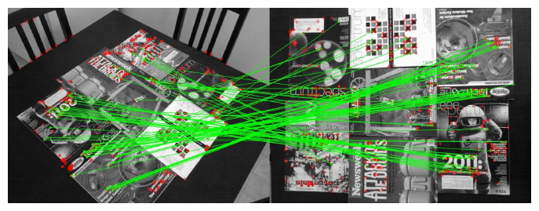

*Рис. 1 (из оригинальной статьи). Типичный результат сопоставления ORB на реальных изображениях со сменой ракурса. Зелёные линии — верные соответствия, красные окружности — несопоставленные точки.*

---

## 1. Введение

- [SIFT](SIFT_конспект.md), несмотря на возраст, крайне успешен (распознавание объектов, сшивка панорам, визуальное картирование), но вычислительно тяжёл для систем реального времени (визуальная одометрия) и слабых устройств (телефоны). Лучшая облегчённая альтернатива — [SURF](SURF_конспект.md); есть также ускорение [SIFT](SIFT_конспект.md) на GPU.
- Цель: дескриптор с качеством сопоставления как у [SIFT](SIFT_конспект.md), меньшей чувствительностью к шуму и производительностью реального времени — для сшивки панорам и трекинга патчей на устройствах без GPU и для ускорения детекции объектов на обычных ПК.
- ORB строится на [FAST](FAST_конспект.md) и [BRIEF](BRIEF_конспект.md); устраняются их недостатки относительно [SIFT](SIFT_конспект.md), прежде всего **отсутствие инвариантности к повороту у [BRIEF](BRIEF_конспект.md)**.

**Вклады:**
1. быстрое и точное определение ориентации для [FAST](FAST_конспект.md);
2. эффективное вычисление ориентированных [BRIEF](BRIEF_конспект.md)-признаков;
3. анализ дисперсии и корреляции ориентированных [BRIEF](BRIEF_конспект.md)-признаков;
4. метод обучения для декорреляции [BRIEF](BRIEF_конспект.md)-тестов при вращательной инвариантности — лучше для поиска ближайших соседей.

Дополнительно: ORB свободен от лицензионных ограничений [SIFT](SIFT_конспект.md) и [SURF](SURF_конспект.md).

## 2. Связанные работы

- **Ключевые точки.** [FAST](FAST_конспект.md) и его варианты — выбор для систем реального времени (например, PTAM — Parallel Tracking and Mapping). Нужно дополнять пирамидой для масштаба и (в ORB) фильтром Harris для отсева рёбер и получения осмысленной оценки.
- **Ориентация.** У [SIFT](SIFT_конспект.md) и [SURF](SURF_конспект.md) есть оператор ориентации на основе гистограмм градиентов ([SIFT](SIFT_конспект.md)) или блочных приближений ([SURF](SURF_конспект.md)): либо дорого, либо ([SURF](SURF_конспект.md)) грубо. Обзор Rosin даёт анализ способов измерения ориентации углов; ORB берёт оттуда **метод центроида**. В отличие от [SIFT](SIFT_конспект.md) (который может дать несколько ориентаций на точку), центроид даёт одну доминирующую.
- **Дескрипторы.** [BRIEF](BRIEF_конспект.md) — двоичные тесты на сглаженном патче; по многим свойствам близок к [SIFT](SIFT_конспект.md) (устойчивость к освещению, размытию, перспективе), но **очень чувствителен к повороту в плоскости**. [BRIEF](BRIEF_конспект.md) вырос из работ по классификационным деревьям на двоичных тестах (сигнатуры точек).
- **Декорреляция.** Классика — PCA (например, PCA-SIFT), но пространство всех двоичных тестов слишком велико для PCA → используется исчерпывающий (жадный) поиск. Методы визуальных словарей (offline-кластеризация) тоже могли бы помочь.
- **Ближайшая система** — MOPS (Brown, Winder, Szeliski): многомасштабные Harris-точки + ориентированный патч-дескриптор для сшивки; хорошая инвариантность, но менее эффективна.

## 3. oFAST: FAST с ориентацией

### 3.1. Детектор FAST

- Используется **[FAST](FAST_конспект.md)-9** (дуга из 9 пикселей на окружности радиуса 3 — в статье сказано «circular radius of 9», что по смыслу означает [FAST](FAST_конспект.md)-9 на стандартной окружности из 16 пикселей).
- Параметр [FAST](FAST_конспект.md) — порог разности яркости между центром и пикселями окружности.
- [FAST](FAST_конспект.md) не даёт меры «угловатости» и сильно откликается на рёбрах → точки **ранжируются мерой Harris**:
  1. для целевого числа точек $N$ порог [FAST](FAST_конспект.md) ставится достаточно низким, чтобы получить больше $N$ точек;
  2. точки сортируются по отклику Harris;
  3. берутся лучшие $N$.
- [FAST](FAST_конспект.md) не многомасштабный → строится **пирамида изображений**, и [FAST](FAST_конспект.md) (с фильтром Harris) запускается на каждом уровне.

### 3.2. Ориентация по центроиду яркости (intensity centroid)

Предположение: яркость угла смещена относительно его центра, и вектор смещения задаёт ориентацию. Моменты патча (по Rosin):

$$
m_{pq} = \sum_{x,y} x^p\, y^q\, I(x, y),
$$

- $I(x,y)$ — яркость в точке патча; $(x, y)$ — координаты относительно центра точки;
- $p, q \in \{0, 1\}$ — порядки момента.

Центроид:

$$
C = \left(\frac{m_{10}}{m_{00}},\ \frac{m_{01}}{m_{00}}\right).
$$

Вектор $\vec{OC}$ от центра угла $O$ к центроиду $C$ задаёт ориентацию:

$$
\theta = \operatorname{atan2}(m_{01}, m_{10}),
$$

- $\operatorname{atan2}$ — арктангенс с учётом квадранта.

Детали:
- Rosin различает тёмные и светлые углы; для ORB это не нужно — угол согласован при любом типе угла.
- Для лучшей вращательной инвариантности моменты считаются по **круговой** области радиуса $r$ ($x, y \in [-r, r]$); эмпирически $r$ берётся равным размеру патча.
- При $|C| \to 0$ мера неустойчива, но для углов [FAST](FAST_конспект.md) это, по опыту авторов, редкость.

**Сравнение с градиентными методами** (градиенты по $x$ и $y$ на сглаженном изображении):
- **MAX** — направление наибольшего градиента в патче;
- **BIN** — гистограмма направлений градиентов с шагом 10°, выбирается максимальный бин (похоже на [SIFT](SIFT_конспект.md), но одна ориентация).

На синтетике (повороты в плоскости + шум) центроид (IC) даёт равномерно хорошую ориентацию даже при сильном шуме, оба градиентных метода — заметно хуже.

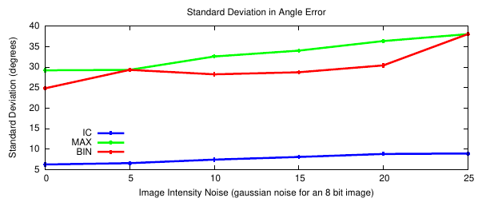

*Рис. 2 (из оригинальной статьи). Стандартное отклонение ошибки угла в зависимости от уровня гауссова шума (8-битное изображение) для центроида яркости (IC), MAX и BIN. IC лучше всех восстанавливает ориентацию искусственно повёрнутых зашумлённых патчей.*

По графику (оценка с рисунка): у IC стандартное отклонение ~6–9° во всём диапазоне шума 0–25, у MAX и BIN — ~25–38°.

## 4. rBRIEF: BRIEF с учётом поворота

### 4.1. Эффективный поворот оператора BRIEF

**Напоминание [BRIEF](BRIEF_конспект.md).** Тест на сглаженном патче $\mathbf{p}$:

$$
\tau(\mathbf{p}; \mathbf{x}, \mathbf{y}) :=
\begin{cases}
1, & \mathbf{p}(\mathbf{x}) < \mathbf{p}(\mathbf{y}), \\
0, & \mathbf{p}(\mathbf{x}) \ge \mathbf{p}(\mathbf{y}),
\end{cases}
\qquad
f_n(\mathbf{p}) := \sum_{1 \le i \le n} 2^{i-1}\, \tau(\mathbf{p}; \mathbf{x}_i, \mathbf{y}_i).
$$

- $\mathbf{p}(\mathbf{x})$ — яркость сглаженного патча в точке $\mathbf{x}$;
- $n$ — число тестов.

**Выбор ORB:** гауссово распределение тестов вокруг центра патча (один из лучших вариантов из статьи [BRIEF](BRIEF_конспект.md)), $n = 256$. Сглаживание — через **интегральное изображение**: каждая «точка» теста — это подокно **5×5** внутри патча **31×31** (выбрано по собственным экспериментам и результатам статьи [BRIEF](BRIEF_конспект.md)).

**Steered [BRIEF](BRIEF_конспект.md).** Качество [BRIEF](BRIEF_конспект.md) резко падает при повороте больше нескольких градусов (Рис. 7). Вместо дорогого вычисления [BRIEF](BRIEF_конспект.md) для множества поворотов патча предлагается «повернуть» сами тесты. Для набора из $n$ тестов в точках $(\mathbf{x}_i, \mathbf{y}_i)$ определим матрицу $2\times 2n$ координат

$$
\mathbf{S} = \begin{pmatrix} \mathbf{x}_1, \mathbf{y}_1, \ldots, \mathbf{x}_n, \mathbf{y}_n \end{pmatrix}
$$

*(в статье записано как $2 \times n$ матрица с элементами $x_1..x_n$ и $y_1..y_n$; по смыслу — все координаты точек тестов, столбцами).* С ориентацией патча $\theta$ и матрицей поворота $\mathbf{R}_\theta$:

$$
\mathbf{S}_\theta = \mathbf{R}_\theta \mathbf{S},
\qquad
g_n(\mathbf{p}, \theta) := f_n(\mathbf{p}) \mid (\mathbf{x}_i, \mathbf{y}_i) \in \mathbf{S}_\theta,
$$

- $g_n$ — steered [BRIEF](BRIEF_конспект.md): тот же дескриптор, но с тестами в повёрнутых позициях.

Реализация: угол дискретизируется с шагом $2\pi/30$ (**12°**), заранее строится таблица повёрнутых паттернов. Пока ориентация согласована между видами, используется правильный набор $\mathbf{S}_\theta$.

### 4.2. Дисперсия и корреляция

- Полезное свойство [BRIEF](BRIEF_конспект.md): каждый бит имеет большую дисперсию и среднее около 0.5 (среднее 0.5 даёт максимальную выборочную дисперсию 0.25 для бинарного признака). Высокая дисперсия → бит различимее.
- Желательно также, чтобы тесты были **некоррелированы** — тогда каждый вносит свой вклад.
- **Наблюдение:** после ориентации по направлению точки (steered [BRIEF](BRIEF_конспект.md)) средние бит «расползаются» от 0.5 (Рис. 3): ориентированные углы выглядят для тестов более однообразно.
- PCA по откликам на 100k точек (Рис. 4, 40 старших собственных значений): у [BRIEF](BRIEF_конспект.md) и steered [BRIEF](BRIEF_конспект.md) большие первые собственные значения → сильная корреляция, почти вся информация в первых 10–15 компонентах. У steered [BRIEF](BRIEF_конспект.md) собственные значения ниже → меньше дисперсия → хуже различимость. Видимо, [BRIEF](BRIEF_конспект.md) «выигрывает» от случайной ориентации точек.
- Распределения расстояний между соответствующими (inliers) и несоответствующими точками (Рис. 5): у steered [BRIEF](BRIEF_конспект.md) среднее для выбросов смещено влево и сильнее перекрывается с инлаерами.

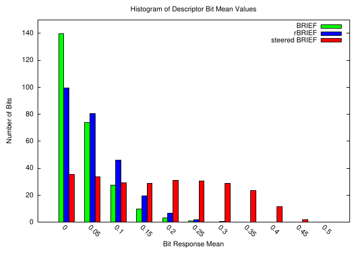

*Рис. 3 (из оригинальной статьи). Гистограмма средних значений бит для [BRIEF](BRIEF_конспект.md), steered [BRIEF](BRIEF_конспект.md) и rBRIEF (256 бит, 100k точек). По оси X — расстояние среднего от 0.5. У [BRIEF](BRIEF_конспект.md) и rBRIEF большинство бит близки к 0.5, у steered [BRIEF](BRIEF_конспект.md) средние «расползаются».*

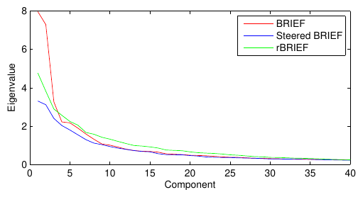

*Рис. 4 (из оригинальной статьи). Распределение собственных значений PCA-разложения по 100k точек для [BRIEF](BRIEF_конспект.md), steered [BRIEF](BRIEF_конспект.md) и rBRIEF. У rBRIEF собственные значения выше и спадают медленнее — биты менее коррелированы.*

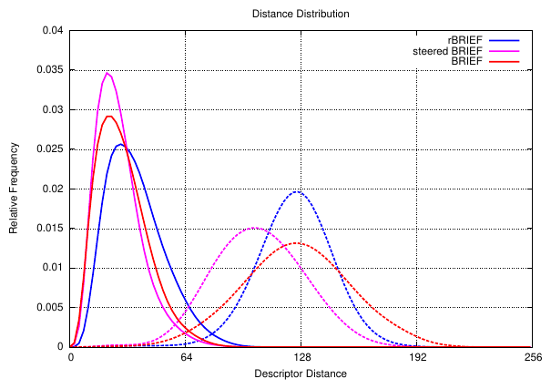

*Рис. 5 (из оригинальной статьи). Распределения расстояний до выбросов (пунктир) и между верными соответствиями (сплошные) для [BRIEF](BRIEF_конспект.md), steered [BRIEF](BRIEF_конспект.md) и rBRIEF. У rBRIEF распределения разделены лучше всего.*

### 4.3. Обучение хороших двоичных тестов

Цель — вернуть дисперсию и снизить корреляцию. PCA-подобное построение новых признаков как комбинаций тестов было бы медленнее steered [BRIEF](BRIEF_конспект.md), поэтому ищется **подмножество** исходных тестов с высокой дисперсией (среднее близко к 0.5) и малой корреляцией.

**Данные:**
- ~300k точек из изображений PASCAL VOC 2006;
- все возможные тесты в патче $w_p = 31$: каждый тест — пара подокон $w_t = 5$; число подокон $N = (w_p - w_t)^2$, пар — $\binom{N}{2}$; после удаления перекрывающихся тестов остаётся **$M = 205\,590$** тестов.

**Алгоритм (жадный поиск):**
1. Применить каждый тест ко всем обучающим патчам (повёрнутым по ориентации их точек).
2. Упорядочить тесты по удалённости их среднего от 0.5 → вектор $T$.
3. Жадный отбор:
   1. первый тест из $T$ переложить в результирующий вектор $R$;
   2. взять следующий тест из $T$ и сравнить со всеми тестами в $R$; если модуль корреляции с каким-либо из них больше порога — отбросить, иначе добавить в $R$;
   3. повторять, пока в $R$ не будет 256 тестов. Если тестов не хватило — **поднять порог** и начать заново.

Результат — **rBRIEF**. По сравнению со steered [BRIEF](BRIEF_конспект.md) заметно лучше дисперсия и корреляция: собственные значения PCA выше и убывают медленнее (Рис. 4). Визуально (Рис. 6): у тестов, отобранных только по дисперсии, выражен вертикальный тренд (вдоль оси ориентации) и они сильно коррелированы; обученные тесты разнообразнее и менее коррелированы. Значение порога корреляции в статье не указано.

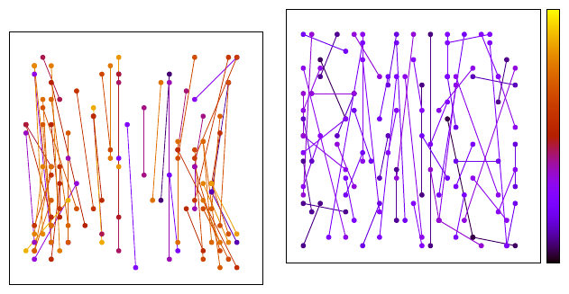

*Рис. 6 (из оригинальной статьи). Подмножество тестов, отобранных только по высокой дисперсии при ориентации (слева) и после обучения с декорреляцией (справа). Ориентация точки направлена вверх. Цвет — максимальная попарная корреляция теста (чёрный и фиолетовый — наименьшая). Обученные тесты распределены лучше и коррелированы слабее.*

### 4.4. Оценка

ORB = oFAST + rBRIEF. На каждое изображение — **500** точек; сопоставление — полным перебором (brute force); метрика — доля верных соответствий (процент инлаеров).

**Синтетические повороты** (повороты в плоскости + гауссов шум 10):
- стандартный [BRIEF](BRIEF_конспект.md) резко проваливается после ~10°;
- [SIFT](SIFT_конспект.md) лучше [SURF](SURF_конспект.md); у [SURF](SURF_конспект.md) провалы около углов, кратных 45°, из-за вейвлетов Хаара;
- **ORB — лучший, более 70 % инлаеров** при любом угле.

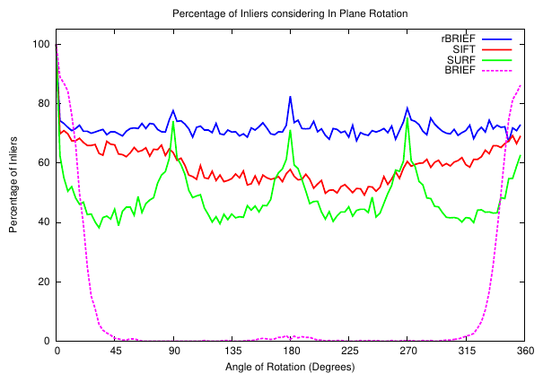

*Рис. 7 (из оригинальной статьи). Доля инлаеров для [SIFT](SIFT_конспект.md), [SURF](SURF_конспект.md), [BRIEF](BRIEF_конспект.md) (с [FAST](FAST_конспект.md)) и ORB (oFAST + rBRIEF) при синтетических поворотах в плоскости с гауссовым шумом 10.*

**Шум:** ORB относительно невосприимчив к гауссову шуму, в отличие от [SIFT](SIFT_конспект.md): [SIFT](SIFT_конспект.md) теряет примерно **10 %** инлаеров на каждые +5 уровня шума, ORB тоже деградирует, но гораздо медленнее.

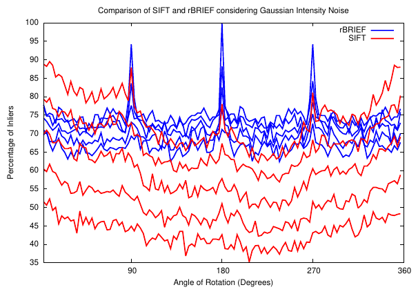

*Рис. 8 (из оригинальной статьи). Сопоставление при шуме для [SIFT](SIFT_конспект.md) и rBRIEF (уровни шума 0, 5, 10, 15, 20, 25) в зависимости от угла поворота. [SIFT](SIFT_конспект.md) быстро деградирует, rBRIEF почти не страдает.*

**Реальные изображения** (изменения масштаба, ракурса, освещения): свой набор «журналы на столе» (indoor) и уличная сцена (Boat). Протокол:
1. выбрать опорный вид $V_0$;
2. для всех $V_i$ найти гомографию $H_{i0}$, переводящую $V_i \to V_0$;
3. использовать $H_{i0}$ как эталон для проверки соответствий [SIFT](SIFT_конспект.md), [SURF](SURF_конспект.md) и ORB.

| Набор | Метод | Инлаеры, % | Число точек |
|---|---|---|---|
| Magazines | ORB | 36.180 | 548.50 |
| | [SURF](SURF_конспект.md) | **38.305** | 513.55 |
| | [SIFT](SIFT_конспект.md) | 34.010 | 584.15 |
| Boat | **ORB** | **45.8** | 789 |
| | [SURF](SURF_конспект.md) | 28.6 | 795 |
| | [SIFT](SIFT_конспект.md) | 30.2 | 714 |

- На уличной сцене ORB лучше [SIFT](SIFT_конспект.md) и [SURF](SURF_конспект.md); на indoor-наборе — примерно на уровне. Со ссылкой на [BRIEF](BRIEF_конспект.md): блоб-детекторы вроде [SIFT](SIFT_конспект.md) лучше на «граффити»-подобных изображениях.

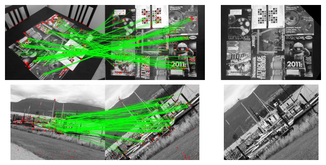

*Рис. 9 (из оригинальной статьи). Реальные данные: стол с журналами и уличная сцена. Изображения первого столбца сопоставлены с изображениями второго; последний столбец — результат деформации первого на второй.*

## 5. Масштабируемое сопоставление двоичных признаков

Цель — показать, что ORB лучше [SIFT](SIFT_конспект.md)/SURF при поиске ближайших соседей в больших базах. Ключевой фактор — **восстановленная дисперсия** бит.

### 5.1. LSH для rBRIEF

- Для двоичных признаков естественен **LSH (Locality Sensitive Hashing)**: дескрипторы хранятся в нескольких хеш-таблицах; по запросу извлекаются совпадающие корзины (buckets), и их элементы сравниваются перебором. Высокая вероятность найти ближайшего соседа при достаточном числе таблиц.
- Хеш-функция — просто **подмножество бит** сигнатуры (sub-signature): в корзине лежат дескрипторы с общей подсигнатурой; расстояние — Хэмминга.
- Используется **multi-probe LSH**: просматриваются и соседние корзины → можно обойтись меньшим числом таблиц (меньше памяти) и более длинной подсигнатурой (меньше корзины).

### 5.2. Корреляция и выравнивание корзин

- Менее коррелированные биты rBRIEF лучше разбивают данные → корзины **ровнее** (Рис. 10), что ускоряет запросы. У steered [BRIEF](BRIEF_конспект.md) и обычного [BRIEF](BRIEF_конспект.md) корзины в среднем гораздо больше.

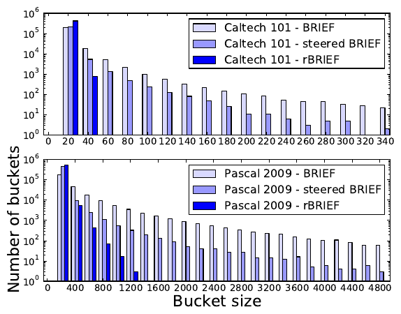

*Рис. 10 (из оригинальной статьи). LSH обучен на дескрипторах [BRIEF](BRIEF_конспект.md), steered [BRIEF](BRIEF_конспект.md) и rBRIEF на двух наборах (7818 изображений PASCAL 2009 и 9144 изображения низкого разрешения Caltech 101). Обучение занимает < 2 мин и ограничено дисковым вводом-выводом. У rBRIEF корзины наиболее однородны.*

### 5.3. Оценка

- Сравнение rBRIEF + LSH с kd-деревьями [SIFT](SIFT_конспект.md) в FLANN; обучение на PASCAL 2009, тест на деформированных версиях тех же изображений (аффинные преобразования как у Aly et al.).
- Реализация multi-probe LSH: битсеты для ускорения проверки наличия ключей; расстояние Хэмминга через popcount SSE 4.2.
- «Успешное» сопоставление тестового изображения — если в правильном изображении базы найдено > 50 дескрипторов.
- Параметры: для [SIFT](SIFT_конспект.md) — 1, 2 и 3 kd-дерева (автонастройка FLANN дала худший результат); для rBRIEF — 4–20 хеш-таблиц, для steered [BRIEF](BRIEF_конспект.md) — 16–40; подсигнатура 16 бит. Поиск по 1.6M записей [SIFT](SIFT_конспект.md) и 1.8M записей rBRIEF.
- **Вывод:** LSH с rBRIEF быстрее kd-деревьев с [SIFT](SIFT_конспект.md) (простота и скорость вычисления расстояния) и даёт гибкий компромисс скорость/точность (полезно для bag-of-features); steered [BRIEF](BRIEF_конспект.md) намного медленнее из-за неравномерных корзин.

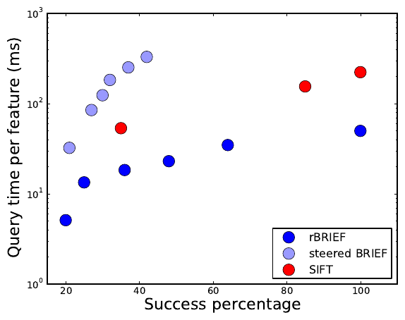

*Рис. 11 (из оригинальной статьи). Время запроса на один признак в зависимости от доли успешных распознаваний для rBRIEF (LSH), steered [BRIEF](BRIEF_конспект.md) (LSH) и [SIFT](SIFT_конспект.md) (kd-деревья FLANN).*

## 6. Приложения

### 6.1. Бенчмарки

Канонический ORB: oFAST и rBRIEF на **5 масштабах** с коэффициентом $\sqrt{2}$; прореживание (decimation) с интерполяцией по площади (area-based). Один поток, Intel i7 2.8 ГГц, кадр 640×480:

| Этап ORB | Пирамида | oFAST | rBRIEF |
|---|---|---|---|
| Время, мс | 4.43 | 8.68 | 2.12 |

- На 2686 изображениях при 5 масштабах — более $2\times10^6$ признаков за 42 с.
- Сравнение при одинаковом числе признаков (~1000) и одинаковом числе масштабов, среднее по 24 изображениям 640×480 из PASCAL:

| Детектор + дескриптор | ORB | [SURF](SURF_конспект.md) | [SIFT](SIFT_конспект.md) |
|---|---|---|---|
| Время на кадр, мс | **15.3** | 217.3 | 5228.7 |

ORB на порядок быстрее [SURF](SURF_конспект.md) и более чем на два порядка быстрее [SIFT](SIFT_конспект.md).

### 6.2. Детекция текстурированных объектов

- Конвейер в духе MOPED: oFAST + rBRIEF → сопоставление с базой → **PROSAC** + **EPnP** для оценки позы.
- База: 49 бытовых объектов, по 24 вида каждого (2D-камера и Kinect). Тест — 2D-изображения подмножеств этих объектов с других ракурсов и с окклюзиями. Засчитывается, если дескрипторы сопоставлены **и** поза вычислена.
- Результат: найдено **61 %** объектов.
- База 1.2M дескрипторов занимает 200 МБ; в среднем 14 мс на детекцию и 17 мс на LSH-сопоставление. Цель — показать осуществимость, конвейер можно ускорить.

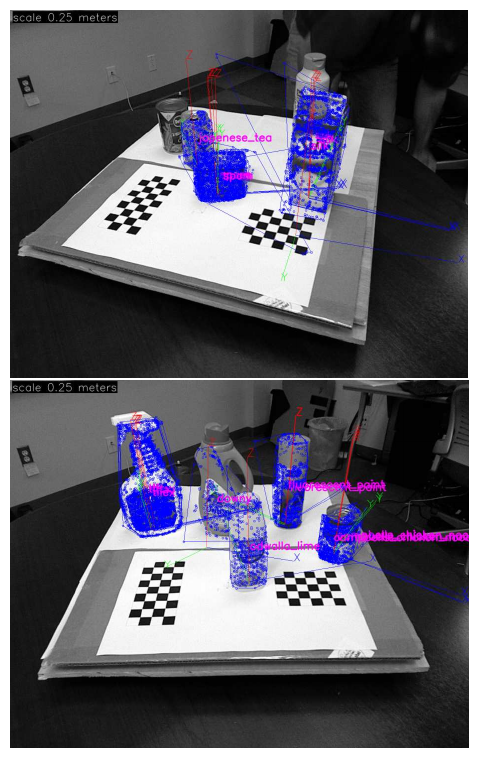

*Рис. 12 (из оригинальной статьи). Детекция текстурированных объектов с оценкой позы. Синие точки — обучающие признаки, наложенные на запрос по найденной позе; показаны оси и метки объектов. На верхнем изображении пропущены два объекта, на нижнем найдены все.*

### 6.3. Трекинг в реальном времени на телефоне

- Сопоставление живых кадров с ранее снятым ключевым кадром (предполагается плоская хорошо текстурированная поверхность); ORB на каждом кадре, полный перебор дескрипторов, гомография методом PROSAC.
- Существующие трекеры на телефонах обычно работают с очень маленькими изображениями (например, 120×160) и малым числом признаков; сопоставимые системы тратят > 1 с на изображение.
- ORB: **640×480 при 7 Гц** на телефоне с ARM 1 ГГц и 512 МБ ОЗУ (порт OpenCV для Android), ~400 точек на изображение:

| Этап | ORB | Сопоставление | Оценка $H$ |
|---|---|---|---|
| Время, мс | 66.6 | 72.8 | 20.9 |

## 7. Выводы авторов

- Предложен ориентированный дескриптор ORB, показаны его качество и эффективность относительно популярных признаков.
- Ключевым было исследование дисперсии при ориентации и декорреляция компонент — для хорошего поиска ближайших соседей.
- Реализация ORB под лицензией BSD внесена в OpenCV 2.3.
- Не до конца решена **инвариантность к масштабу**: используется пирамида, но не исследованы масштаб точки по глубине, настройка числа октав и т.п.
- Будущее: оптимизация на GPU/SSE, которая могла бы ускорить LSH ещё на порядок.

---

## Сводка алгоритма ORB (по статье)

1. **Пирамида:** 5 уровней с шагом $\sqrt{2}$ (area-based прореживание).
2. **oFAST на каждом уровне:** [FAST](FAST_конспект.md)-9 с низким порогом → ранжирование по отклику Harris → лучшие $N$ точек.
3. **Ориентация:** моменты $m_{10}, m_{01}$ в круговой области вокруг точки → $\theta = \operatorname{atan2}(m_{01}, m_{10})$.
4. **Сглаживание:** интегральное изображение; каждая точка теста — среднее подокна 5×5.
5. **rBRIEF:** 256 обученных тестов в патче 31×31, повёрнутых на $\theta$ (угол квантован с шагом 12°, паттерны из таблицы) → 256-битный (32-байтный) дескриптор.
6. **Сопоставление:** расстояние Хэмминга; перебор для малых наборов, multi-probe LSH для больших баз.

### Гиперпараметры (из статьи)

| Параметр | Значение |
|---|---|
| Детектор | [FAST](FAST_конспект.md)-9, ранжирование Harris |
| Пирамида | 5 масштабов, коэффициент $\sqrt{2}$ |
| Патч дескриптора | 31×31 |
| Подокно теста | 5×5 (через интегральное изображение) |
| Длина дескриптора | 256 бит |
| Квантование угла | $2\pi/30$ = 12° |
| Обучение тестов | ~300k точек PASCAL 2006, $M$ = 205 590 кандидатов, жадный отбор по корреляции |
| Порог корреляции | не указан (увеличивается, если не набралось 256 тестов) |
| Число точек в оценке | 500 на изображение (разд. 4.4); ~1000 в бенчмарке времени |
| LSH | multi-probe, подсигнатура 16 бит, 4–20 таблиц для rBRIEF |

---

## Сильные стороны и ограничения

### Сильные стороны
- **Скорость:** ~15 мс на VGA-кадр на одном ядре CPU 2011 г.; работает в реальном времени на ARM-телефонах.
- **Инвариантность к повороту** при сохранении двоичного формата и скорости [BRIEF](BRIEF_конспект.md).
- **Устойчивость к шуму** заметно выше, чем у [SIFT](SIFT_конспект.md) (по экспериментам статьи).
- **Компактность** (32 байта) и сопоставление по Хэммингу; хорошо масштабируется на большие базы с LSH.
- **Обоснованное обучение тестов** (дисперсия + декорреляция) — общая идея, полезная для любых двоичных дескрипторов.
- **Свободная лицензия и доступность**: BSD-реализация в OpenCV; не было патентных ограничений [SIFT](SIFT_конспект.md)/SURF (патент [SIFT](SIFT_конспект.md) истёк в 2020 г. — замечание вне статьи).
- Стал основой многих систем (ORB-SLAM, DBoW2 и др. — замечание вне статьи).

### Ограничения
- **Масштаб — только через пирамиду**, без истинной оценки масштаба точки (авторы сами это признают); при больших изменениях масштаба качество ниже, чем у [SIFT](SIFT_конспект.md).
- **Оценка на ограниченных данных:** синтетика + два собственных реальных набора; нет стандартных бенчмарков вроде полного Oxford affine, Mikolajczyk-протокола повторяемости/matching score.
- **На indoor-наборе** ORB не лучше [SURF](SURF_конспект.md)/SIFT; блоб-детекторы лучше на «граффити»-подобных изображениях.
- **Аффинные/перспективные искажения** и сильные изменения освещения специально не исследованы.
- **Кластеризация точек**: ранжирование по Harris без пространственного распределения даёт скопления точек в текстурных областях (это отмечено, например, в статье [SuperPoint](SuperPoint_конспект.md) — вне этой статьи; на практике решается сеткой/квадродеревом, как в ORB-SLAM).
- **Ориентация по центроиду** неустойчива в почти однородных патчах ($|C| \to 0$).
- Обученные тесты зависят от обучающего набора (PASCAL 2006); порог корреляции не опубликован.
- Отдельные детали изложены неформально (размер патча для моментов «равен размеру патча», радиус и т.п.), что затрудняет точное воспроизведение без кода OpenCV.

---

## Значение для задачи визуального позиционирования

**Роль в конвейере.** ORB — самый распространённый «классический» быстрый признак: стандарт де-факто для визуальной одометрии и SLAM на CPU (ORB-SLAM 1/2/3), для релокализации по мешку слов (DBoW2 на ORB) и как лёгкая базовая линия для сопоставления кадра БПЛА с картой. Для глобального позиционирования по спутниковым/ортофото подложкам ORB обычно уступает [SIFT](SIFT_конспект.md) и обучаемым признакам ([SuperPoint](SuperPoint_конспект.md), [DISK](DISK_конспект.md), [ALIKED](ALIKED_конспект.md), [XFeat](XFeat_конспект.md)) при больших междоменных различиях, но выигрывает по скорости и простоте развёртывания.

**Практические заметки** *(не из статьи, если не указано иное):*
- **OpenCV `cv::ORB::create`** (проверено по заголовку `features2d.hpp`, ветка 4.x): `nfeatures=500, scaleFactor=1.2f, nlevels=8, edgeThreshold=31, firstLevel=0, WTA_K=2, scoreType=ORB::HARRIS_SCORE, patchSize=31, fastThreshold=20`. Отличия от статьи: по умолчанию **8 уровней с шагом 1.2**, а не 5 уровней с шагом $\sqrt{2}$; `nfeatures` распределяется по уровням пирамиды геометрически (по коду `orb.cpp`).
- **Сглаживание в OpenCV** перед вычислением дескриптора — `GaussianBlur` 7×7, σ = 2 (по коду `orb.cpp`), а не подокна 5×5 через интегральное изображение, как в статье. Обученный паттерн тестов зашит в код (`bit_pattern_31_`), мера Harris — с $k = 0.04$, блок 7×7 (по коду).
- **`WTA_K`**: при 3 или 4 каждый «бит» — индекс максимума среди 3–4 точек (2 бита), сопоставлять нужно с `NORM_HAMMING2`; при `WTA_K=2` — обычный `NORM_HAMMING`.
- **Сопоставление:** `BFMatcher(NORM_HAMMING, crossCheck=true)` для небольших наборов; FLANN с `LshIndexParams` для больших баз; затем ratio test и [RANSAC](RANSAC_конспект.md)/MAGSAC (гомография для почти плоской надирной сцены, PnP — при наличии 3D-карты/DEM).
- **Равномерность точек:** для оценки геометрии полезно распределять точки по сетке (как в ORB-SLAM — квадродерево по ячейкам) вместо глобального top-N по Harris.
- **Масштаб и GSD:** при сопоставлении кадра с картой другого разрешения — сначала привести к сопоставимому GSD (по высоте полёта и параметрам камеры), иначе пирамиды 8×1.2 (≈ 3.6× по масштабу) может не хватить.
- **Ориентация по IMU:** если курс известен, можно повернуть кадр к ориентации карты; ORB при этом остаётся инвариантным к остаточному повороту, а влияние ошибок оценки ориентации снижается.
- **Междоменность:** при сопоставлении «кадр с дрона ↔ спутниковый снимок» (разное время, сезон, сенсор) двоичные тесты яркостей быстро теряют надёжность — ORB лучше использовать для межкадрового трекинга, а для привязки к карте сравнивать с обучаемыми признаками на своих данных.

---

## Глоссарий (англ. → рус.)

| English | Русский |
|---|---|
| ORB (Oriented [FAST](FAST_конспект.md) and Rotated [BRIEF](BRIEF_конспект.md)) | ориентированный [FAST](FAST_конспект.md) и повёрнутый [BRIEF](BRIEF_конспект.md) |
| oFAST | [FAST](FAST_конспект.md) с ориентацией |
| rBRIEF (rotation-aware [BRIEF](BRIEF_конспект.md)) | [BRIEF](BRIEF_конспект.md) с учётом поворота (с обученными тестами) |
| steered [BRIEF](BRIEF_конспект.md) | «повёрнутый» [BRIEF](BRIEF_конспект.md) (тесты поворачиваются по ориентации) |
| intensity centroid | центроид (центр масс) яркости |
| image moments | моменты изображения |
| orientation | ориентация (направление) точки |
| Harris corner measure | мера угла Харриса |
| scale pyramid | пирамида масштабов |
| decimation / area-based interpolation | прореживание / интерполяция по площади |
| binary test | двоичный тест |
| integral image | интегральное изображение |
| lookup table | таблица поиска (предвычисленная) |
| variance / correlation | дисперсия / корреляция |
| eigenvalue / PCA | собственное значение / метод главных компонент |
| greedy search | жадный поиск |
| de-correlation | декорреляция |
| inlier / outlier | инлаер (верное соответствие) / выброс |
| brute-force matching | сопоставление полным перебором |
| nearest neighbor search | поиск ближайшего соседа |
| Locality Sensitive Hashing (LSH) | хеширование, чувствительное к близости |
| multi-probe LSH | LSH с просмотром соседних корзин |
| hash table / bucket | хеш-таблица / корзина |
| sub-signature | подсигнатура (подмножество бит) |
| kd-tree / FLANN | kd-дерево / библиотека приближённого поиска соседей FLANN |
| bag-of-features | мешок признаков |
| PROSAC | PROSAC (прогрессивный вариант [RANSAC](RANSAC_конспект.md)) |
| EPnP | EPnP (эффективное решение задачи PnP) |
| homography | гомография |
| patch tracking | трекинг патчей |
| keyframe | ключевой кадр |
| in-plane rotation | поворот в плоскости изображения |
| BSD license | лицензия BSD |
