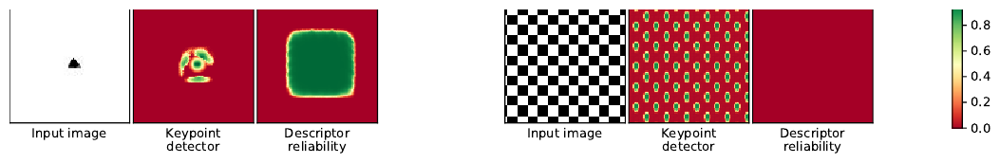
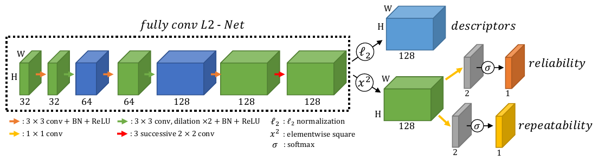
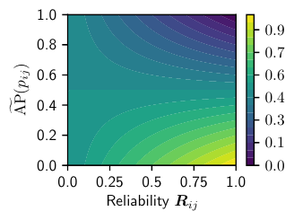
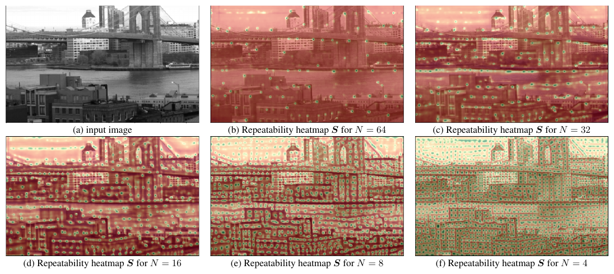
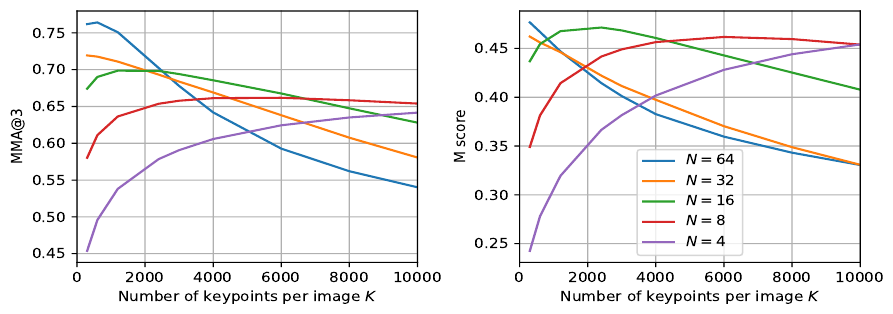
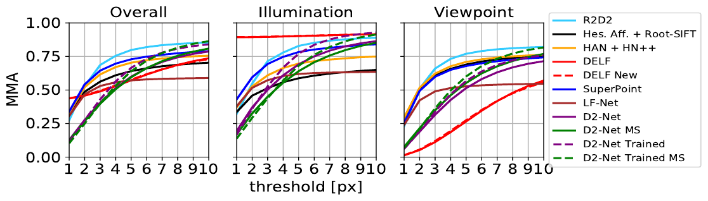
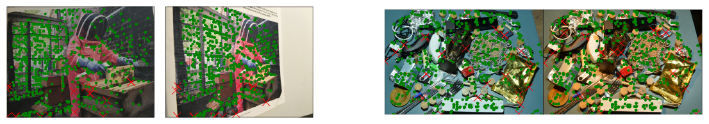

# R2D2: Repeatable and Reliable Detector and Descriptor — конспект

**Оригинальное название:** R2D2: Repeatable and Reliable Detector and Descriptor (на странице сборника NeurIPS — «R2D2: Reliable and Repeatable Detector and Descriptor»; это одна и та же работа)
**Авторы:** Jerome Revaud, Philippe Weinzaepfel, César De Souza, Martin Humenberger (NAVER LABS Europe)
**Площадка:** 33rd Conference on Neural Information Processing Systems (NeurIPS 2019), Ванкувер; Advances in Neural Information Processing Systems 32. Препринт: arXiv:1906.06195 (v2 — 17.06.2019; в препринте 7 авторов — дополнительно Noe Pion, Gabriela Csurka, Yohann Cabon).
**Источник PDF:** версия сборника NeurIPS — https://papers.neurips.cc/paper_files/paper/2019/file/3198dfd0aef271d22f7bcddd6f12f5cb-Paper.pdf (локально: `../original/R2D2_Revaud_NeurIPS2019.pdf`); препринт arXiv v2 — https://arxiv.org/pdf/1906.06195 (локально: `../original/R2D2_Revaud_2019.pdf`).
**Лицензия и режим:** конспект, а не перевод — препринт на arXiv распространяется по стандартной неисключительной лицензии arXiv (arXiv non-exclusive distribution license 1.0), версия NeurIPS — без открытой CC-лицензии; права на перевод не предоставлены.
**Код и веса:** `naver/r2d2` (лицензия CC BY-NC-SA 3.0 — только некоммерческое использование).

> **Основа конспекта** — финальная версия NeurIPS. Препринт arXiv v2 отличается в деталях (скорость обучения, радиусы позитивов/негативов, диапазон масштабов при инференсе, M-score и др.); расхождения отмечены в тексте как «arXiv v2».

> **Суть в одном абзаце.** Авторы утверждают, что **повторяемость (repeatability)** ключевой точки и **надёжность (reliability)** её дескриптора — разные свойства: шахматная доска, листва, окна небоскрёба или морские волны дают много повторяемых экстремумов, но сопоставить их однозначно нельзя из-за самоподобия. Поэтому R2D2 — небольшая полностью свёрточная сеть (fully-convolutional network, FCN, ~0.5 млн параметров), которая для каждого пикселя выдаёт 128-мерный дескриптор и **две отдельные карты уверенности**: карту повторяемости $S$ и карту надёжности $R$. Повторяемость обучается без учителя (self-supervised) локальной косинусной схожестью карт двух изображений плюс членом «пиковости»; дескриптор обучается списочной ранжирующей потерей (listwise ranking loss) — дифференцируемым приближением средней точности (Average Precision, AP), а надёжность обучается вместе с ним через модифицированную AP-потерю с порогом $\kappa$. Ключевые точки — локальные максимумы $S$, ранжируемые по произведению $S_{ij}R_{ij}$. На HPatches R2D2 превосходит [SuperPoint](SuperPoint_конспект.md), [D2-Net](D2-Net_конспект.md), LF-Net, DELF и др. по MMA почти на всех порогах, а на бенчмарке визуальной локализации Aachen Day-Night (на момент подачи) выходит на первое место при 128-мерных дескрипторах и в 15 раз меньшем числе весов, чем у [D2-Net](D2-Net_конспект.md).

*Рис. 1 (из оригинальной статьи). Игрушечные примеры. Слева: на белом фоне с чёрным треугольником повторяемые области есть только у треугольника, а все патчи, которые его содержат, одинаково надёжны. Справа: на шахматной доске каждый квадрат «заметен» и повторяем, но из-за самоподобия ни один не различим — карта надёжности почти нулевая.*

---

## 1. Введение: постановка проблемы

- Ключевые точки (keypoints) и их локальные дескрипторы — основа крупномасштабной визуальной локализации, SfM (Structure-from-Motion), 3D-реконструкции, оценки позы. Точки должны быть **разреженными (sparse), повторяемыми и различимыми (discriminative)**, чтобы минимизировать память и максимизировать точность сопоставления.
- Классический конвейер — «сначала детектировать, потом описать» (detect-then-describe): детектор ищет ковариантные к смене ракурса и инвариантные к фотометрии положения (углы, блобы), затем дескриптор ([SIFT](SIFT_конспект.md) и др.) описывает окрестность.
- Обучаемые методы до R2D2 делились на два лагеря: обучаемые детекторы, которые оптимизируют **только повторяемость**, и обучаемые дескрипторы (метрическое обучение, metric learning), которые обучаются **в точках, выданных детектором**. Последнее вредит, если точки повторяемы, но несопоставимы (повторяющиеся текстуры).
- Тезис авторов: детекция и описание «неразрывно переплетены» — хорошая точка должна быть не только повторяемой, но и **надёжной для сопоставления**. Надёжность следует оценивать отдельно и учить совместно с дескриптором.

**Три вклада:**
1. новая потеря без учителя для детектора: разреженные, повторяемые и равномерно покрывающие изображение точки;
2. новая потеря для дескриптора на основе AP, которая одновременно учит дескриптор и оценку его надёжности;
3. объединённый отбор точек, которые одновременно повторяемы и надёжны; лучшие на момент публикации результаты на HPatches и Aachen Day-Night.

## 2. Связанные работы

| Направление | Представители | Чем R2D2 отличается |
|---|---|---|
| Обучаемые дескрипторы на патчах/плотно | L2-Net, [HardNet](HardNet_конспект.md), TFeat, MatchNet, SOSNet, ContextDesc, UCN | Обычно triplet/contrastive loss — локальные сравнения 2–3 патчей. R2D2 использует **глобальную** AP-потерю (по He et al., CVPR 2018), но в полностью свёрточном виде и вместе с детектором и оценкой надёжности |
| Обучаемые детекторы | [FAST](FAST_конспект.md) (первый ML-детектор), KCNN, Key.Net, QuadNet, Zhang & Rusinkiewicz | Те опираются на «ручные» фильтры или ранжирование откликов; R2D2 — более простая формулировка: локальная схожесть карт значимости (saliency maps) |
| Совместные детектор + дескриптор | [LIFT](LIFT_конспект.md), [SuperPoint](SuperPoint_конспект.md), DELF, AffNet+[HardNet](HardNet_конспект.md) (Mishkin et al.), [D2-Net](D2-Net_конспект.md), LF-Net | [SuperPoint](SuperPoint_конспект.md) — детектор с учителем на синтетике (смещение к углам геометрических фигур); [D2-Net](D2-Net_конспект.md) — точки как максимумы по каналам дескрипторной карты; LF-Net — сложная асимметричная схема градиентов. R2D2 впервые **явно разделяет повторяемость и надёжность** на две карты |
| Предсказание «сопоставимости» | Hartmann et al. (Predicting matchability), Novotny et al. (probabilistic introspection) | У Hartmann — надёжность при фиксированных дескрипторах; у Novotny — уверенность с triplet loss, без интерпретируемого порога. В R2D2 надёжность и дескриптор связаны в одной AP-потере с порогом $\kappa$ |

## 3. Метод R2D2

### 3.1. Выходы сети

Для изображения $I$ размера $H\times W$ сеть выдаёт три тензора:

- $X \in \mathbb{R}^{H\times W\times D}$ — **плотные дескрипторы**, по одному $D$-мерному вектору на каждый пиксель ($D = 128$);
- $S \in [0,1]^{H\times W}$ — **карта повторяемости** (repeatability map); ключевые точки — только её локальные максимумы, что обеспечивает разреженность;
- $R \in [0,1]^{H\times W}$ — **карта надёжности** (reliability map): оценка того, что дескриптор $X_{ij}$ в пикселе $(i,j)$ хорош для сопоставления.

Здесь $i \in \{1..W\}$, $j \in \{1..H\}$ — координаты пикселя.

### 3.2. Архитектура

*Рис. 2 (из оригинальной статьи). Полностью свёрточная L2-Net без понижения разрешения: свёртки 3×3 (+BN+ReLU), часть — с дилатацией ×2; в конце три последовательные свёртки 2×2. 128-канальный выход идёт в три ветви: L2-нормировка → дескрипторы; поэлементный квадрат → 1×1 свёртка → softmax → надёжность; такая же ветвь → повторяемость.*

- **Основа (backbone)** — L2-Net (патчевый дескриптор Tian et al., 2017), превращённая в полностью свёрточную сеть с двумя отличиями:
  1. понижение разрешения (subsampling) заменено **дилатированными свёртками (dilated convolutions)** — разрешение входа сохраняется на всех стадиях, выход имеет размер $H\times W$;
  2. последняя свёртка 8×8 заменена **тремя последовательными свёртками 2×2** — число весов меньше в 5 раз при сопоставимой точности.
- **Головы:**
  - дескрипторы: L2-нормализация 128-канального выхода;
  - надёжность $R$: поэлементный квадрат $x^2$ → свёртка 1×1 (2 канала) → softmax (берётся вероятность «надёжен»);
  - повторяемость $S$: такая же отдельная ветвь.
- Возведение в квадрат перед 1×1-свёрткой делает уверенность функцией «энергии» каналов дескриптора, а не его знака.

| Слой (по Рис. 2 и коду `Quad_L2Net`) | Каналы | Ядро | Примечание |
|---|---|---|---|
| conv1 | 32 | 3×3 | BN + ReLU |
| conv2 | 32 | 3×3 | BN + ReLU |
| conv3 | 64 | 3×3 | дилатация (вместо stride 2), BN + ReLU |
| conv4 | 64 | 3×3 | BN + ReLU |
| conv5 | 128 | 3×3 | дилатация (вместо stride 2), BN + ReLU |
| conv6 | 128 | 3×3 | BN + ReLU |
| conv7–9 | 128 | 2×2 ×3 | замена свёртки 8×8 L2-Net; последний слой без BN/ReLU |
| Голова дескриптора | 128 | — | L2-нормировка |
| Головы $R$ и $S$ | 2 → 1 | 1×1 | после $x^2$; softmax |

*Каналы 32-32-64-64-128-128-128 — по Рис. 2; схема дилатаций и отсутствие BN/ReLU в последнем слое — по официальному коду (`nets/patchnet.py`). Замечание из кода: в выложенной реализации голова повторяемости на самом деле одноканальная с нормированным softplus ($x/(1+x)$), а не softmax — авторы кода признают это незамеченным расхождением.*

- **Размер:** 0.5 млн весов (базовая модель), 1.0 млн — «увеличенная» модель с удвоенным числом каналов во внутренних слоях. (В arXiv v2 упоминается «около 1 млн параметров».)

### 3.3. Обучение повторяемости (без учителя)

Пусть $I$ и $I'$ — два изображения одной сцены, $U\in\mathbb{R}^{H\times W\times 2}$ — эталонные соответствия: если пиксель $(i,j)$ в $I$ соответствует $(i',j')$ в $I'$, то $U_{ij} = (i',j')$. $U$ известен точно для синтетических пар (гомография) или оценивается оптическим потоком/стерео для реальных пар. $S, S'$ — карты повторяемости, $S'_U$ — карта $S'$, перенесённая (warped) по $U$.

**Идея:** все локальные максимумы $S$ должны совпадать с максимумами $S'_U$. Если максимизировать косинусную схожесть (cosine similarity) двух карт целиком, они станут идентичны — но окклюзии, артефакты деформации и краевые эффекты делают это нереалистичным. Поэтому схожесть усредняется по **множеству перекрывающихся локальных патчей** $\mathcal{P}$ размера $N\times N$:

$$
\mathcal{L}_{cosim}(I, I', U) = 1 - \frac{1}{|\mathcal{P}|}\sum_{p\in\mathcal{P}} \operatorname{cosim}\big(S[p],\, S'_U[p]\big)
$$

- $S[p]\in\mathbb{R}^{N^2}$ — развёрнутый в вектор патч $p$ карты $S$; аналогично $S'_U[p]$;
- $\operatorname{cosim}$ — косинусная схожесть двух векторов.

Эту потерю можно тривиально минимизировать константными картами. Чтобы этого избежать, добавляется **потеря пиковости (peakiness)** — разность максимума и среднего в каждом патче должна быть велика:

$$
\mathcal{L}_{peaky}(I) = 1 - \frac{1}{|\mathcal{P}|}\sum_{p\in\mathcal{P}}\Big(\max_{(i,j)\in p} S_{ij} - \operatorname*{mean}_{(i,j)\in p} S_{ij}\Big)
$$

Итоговая потеря повторяемости:

$$
\mathcal{L}_{rep}(I, I', U) = \mathcal{L}_{cosim}(I, I', U) + \tfrac{1}{2}\big(\mathcal{L}_{peaky}(I) + \mathcal{L}_{peaky}(I')\big)
$$

(в arXiv v2 вместо $\tfrac12$ стоит вес $\lambda$.)

**Почему это работает:** $\mathcal{L}_{peaky}$ требует примерно **одного выраженного максимума на окно $N\times N$**, а $\mathcal{L}_{cosim}$ — чтобы эти максимумы были ковариантны к преобразованию. Параметр $N$ напрямую задаёт пространственную частоту точек (плотность): чем меньше $N$, тем плотнее точки (см. разд. 5.1). Никакого заранее заданного «типа» точки (угол, блоб) нет — в отличие от [SuperPoint](SuperPoint_конспект.md), сеть сама находит удобные для повторения структуры.

### 3.4. Обучение дескриптора и надёжности (AP-потеря)

**Сопоставление как ранжирование.** Каждый пиксель $(i,j)$ первого изображения — центр патча $p_{ij}$ размера $M\times M$ с дескриптором $X_{ij}$; его сравнивают с дескрипторами $\{X'_{uv}\}$ всех патчей второго изображения. Зная $U$, можно посчитать среднюю точность (AP) ранжирования для запроса $p_{ij}$: насколько высоко в списке ближайших дескрипторов стоит правильный. Вместо локальных triplet/contrastive потерь оптимизируется **дифференцируемое приближение AP** $\widetilde{\mathrm{AP}}$ (по He et al., «Local descriptors optimized for average precision», CVPR 2018):

$$
\mathcal{L}_{AP} = \frac{1}{B}\sum_{ij}\Big(1 - \widetilde{\mathrm{AP}}(p_{ij})\Big)
$$

- $B$ — число патчей-запросов в батче;
- $\widetilde{\mathrm{AP}}(p_{ij})$ — гладкая аппроксимация AP для запроса $p_{ij}$.

*Как именно строится $\widetilde{\mathrm{AP}}$ (не расписано в статье; по He et al. и официальному коду `nets/ap_loss.py`):* сходства запроса со всеми кандидатами (в $[0,1]$) мягко раскладываются по $Q$ ячейкам гистограммы треугольными ядрами; по накопленным мягким счётчикам позитивов и всех кандидатов в ячейках вычисляются точность (precision) и прирост полноты (recall), и AP аппроксимируется суммой $\sum_{m} \mathrm{Prec}(m)\,\Delta\mathrm{Rec}(m)$. В коде R2D2 $Q = 20$.

**Надёжность.** Не все места изображения стоит делать различимыми: однородные области, вытянутые 1D-структуры (края), а также нестабильные текстуры (листва, волны) различимыми не станут, и «насильственная» оптимизация дескриптора там вредит. Поэтому AP-потеря расширяется картой надёжности $R$:

$$
\mathcal{L}_{AP,R} = \frac{1}{B}\sum_{ij}\Big(1 - \big[\widetilde{\mathrm{AP}}(p_{ij})\,R_{ij} + \kappa\,(1 - R_{ij})\big]\Big)
$$

- $R_{ij}\in[0,1]$ — предсказанная надёжность патча;
- $\kappa\in[0,1]$ — порог AP, выше которого патч считается надёжным; в статье $\kappa = 0.5$.

**Интерпретация.** Выражение в скобках — интерполяция между реальной AP и «гарантированной» $\kappa$. Если $\widetilde{\mathrm{AP}} > \kappa$, потерю выгодно уменьшать, повышая $R_{ij}$ и AP; если $\widetilde{\mathrm{AP}} < \kappa$, выгоднее снизить $R_{ij}$ к нулю. При $R_{ij}\approx 0$ градиент по дескриптору почти исчезает — сеть **не тратит усилия** на неразличимые области. В отличие от уверенности, обученной с triplet loss, порог $\kappa$ здесь имеет прямой смысл «минимально приемлемая AP».

*Рис. 3 (из оригинальной статьи). Значение $\mathcal{L}_{AP,R}$ для одного патча как функция $\widetilde{\mathrm{AP}}(p_{ij})$ (вертикальная ось) и надёжности $R_{ij}$ (горизонтальная). Выше линии $\widetilde{\mathrm{AP}}=\kappa=0.5$ потеря убывает при росте $R$ и AP, ниже — минимум достигается при $R\to 0$.*

**Итоговая функция потерь** (в статье явно не выписана; по официальному коду `train.py`): $\mathcal{L} = \mathcal{L}_{AP,R} + \mathcal{L}_{cosim} + \mathcal{L}_{peaky}$ с единичными весами.

### 3.5. Инференс

- **Многомасштабная обработка:** сеть запускается на пирамиде изображения: начиная с наибольшей стороны $L = 1024$ px, каждый следующий уровень уменьшается в $2^{1/4}$ раз, пока $L \ge 256$ px. (arXiv v2: начиная с исходного размера и до размера < 128 px.)
- На каждом масштабе берутся **локальные максимумы $S$** и дескрипторы $X$ в этих точках.
- Из всех масштабов оставляется шорт-лист из $K$ лучших точек по **оценке $S_{ij}\,R_{ij}$** — требуется одновременно повторяемость и надёжность.
- **Скорость:** изображение 1 Мпикс на Tesla P100-SXM2 — около **0.5 с** на одном масштабе (полное изображение) и около **1 с** для всех масштабов.

*Детали из официального кода (`extract.py`, не из статьи):* локальный максимум — через max-pooling 3×3; дополнительно отбрасываются точки с $S < 0.7$ или $R < 0.7$ (`--repeatability-thr`, `--reliability-thr`); по умолчанию `--top-k 5000`, `--scale-f 2^0.25`, `--min-size 256`, `--max-size 1024`. Вход — **RGB**, нормированный средним/СКО ImageNet. На выходе для каждой точки: $(x, y, \text{масштаб})$, 128-мерный L2-нормированный дескриптор и оценка.

## 4. Данные и детали обучения

### 4.1. Источники данных

| Тег | Источник | Как получаются пары | Объём |
|---|---|---|---|
| W | «Дистракторы» из датасета поиска Revisited Oxford/Paris (случайные веб-изображения) | синтетика: случайная гомография + цветовой джиттер (color jittering) | ~4000 изобр. (по коду: 3125) |
| A | Изображения днём из Aachen | то же | ~4000 (по коду: 4479) |
| S | «Ночные» версии дневных Aachen, полученные автоматическим переносом стиля (style transfer, FastPhotoStyle) | то же; используется для локализации | (по коду: 8115 изобр., 3636 пар) |
| F | Пары соседних реальных видов Aachen | псевдо-разметка оптическим потоком (см. ниже) | ~4000 (по коду: 4770 пар) |

Все источники представлены примерно поровну; изображения HPatches в обучении **не используются**.

### 4.2. Плотные эталонные соответствия для реальных пар

1. SfM (COLMAP) → 3D-точки и 6D-позы камер.
2. Для пар с достаточным перекрытием (общие 3D-точки) — фундаментальная матрица (fundamental matrix); в arXiv v2 отмечено, что оценка по 2D-соответствиям SfM надёжнее, чем по позам.
3. Плотные соответствия — **EpicFlow**, в первый этап которого (**DeepMatching**) добавлены эпиполярные ограничения.
4. Маска надёжности потока (поток определён даже в окклюзиях): граф согласованных соседей → остаются только связные компоненты не менее чем из 50 соответствий → маска = порог по ядерной оценке плотности (kernel density estimator) верифицированных соответствий.

### 4.3. Гиперпараметры

| Параметр | Значение |
|---|---|
| Оптимизатор | Adam |
| Эпохи | 25 |
| Скорость обучения | 0.0001, фиксированная (arXiv v2: 0.001) |
| Weight decay | 0.0005 |
| Батч | 8 пар изображений |
| Размер кропа | 192×192 |
| Размерность дескриптора $D$ | 128 |
| Размер окна повторяемости $N$ | 16 по умолчанию (также 8 для плотной версии) |
| Порог надёжности $\kappa$ | 0.5 |
| Запросы для AP | регулярная сетка с шагом 8 px в первом изображении |
| Позитив | один на запрос: самый похожий дескриптор в радиусе 3 px от $U_{ij}$ (arXiv v2: радиус 4 px) |
| Негативы | дальше 5 px от $U_{ij}$, сетка 8×8 (arXiv v2: дальше 8 px) |
| Размер патча $M$ | в статье численно не указан |
| Аугментации (по коду) | случайный масштаб 256–1024, ColorJitter(0.2, 0.2, 0.2, 0.1), случайный кроп 192 |
| Число ячеек гистограммы AP (по коду) | 20 |
| Время обучения (по README) | ~30 мин/эпоха на «современной GPU», ~12 ч на 25 эпох |

## 5. Эксперименты

### Метрики (HPatches: 116 сцен, 57 — освещение, 59 — ракурс)

- **Повторяемость (repeatability)** — по Mikolajczyk & Schmid: число соответствий точек между двумя изображениями, делённое на **минимальное** из чисел детекций в паре.
- **Matching score (M-score)** — по [SuperPoint](SuperPoint_конспект.md)/LIFT: средняя доля эталонных соответствий, восстановленных всем конвейером, относительно числа найденных точек в общей области обзора, в обе стороны.
- **MMA (Mean Matching Accuracy)** — по [D2-Net](D2-Net_конспект.md): средняя доля правильных сопоставлений в паре при разных пиксельных порогах; как в [D2-Net](D2-Net_конспект.md), исключены несколько последовательностей с чрезмерным разрешением. **MMA@3** — при пороге 3 px.

### 5.1. Влияние размера окна $N$

*Рис. 4 (из оригинальной статьи). Карты повторяемости $S$ одного изображения для сетей, обученных с $N$ = 64, 32, 16, 8, 4 (красный — низкие значения, зелёный — высокие). Чем меньше $N$, тем плотнее максимумы; при малых $N$ сеть даже заполняет небо регулярной «сеткой» точек, при больших — избегает его.*

*Рис. 5 (из оригинальной статьи). MMA@3 (слева) и M-score (справа) на HPatches в зависимости от числа оставленных точек $K$ для разных $N$.*

- При малом $K$ лучше модели с большим $N$ — их немногие точки качественнее.
- При росте $K$ модели с большим $N$ начинают отбирать слабые максимумы (небо, река), и качество падает.
- Для локализации важно иметь **много** точек (выше шанс, что хоть часть сопоставится несмотря на окклюзии), поэтому есть компромисс. По умолчанию: $N = 16$, $K = 5000$.

### 5.2. Разделение повторяемости и надёжности (абляция)

Агрегировано по 5 независимым запускам:

| Повторяемость | Надёжность | Оценка точки | MMA@3 | M-score |
|:-:|:-:|---|---|---|
| | ✓ | $R_{ij}$ | 0.588 ± 0.010 | 0.361 ± 0.011 |
| ✓ | | $S_{ij}$ | 0.639 ± 0.034 | 0.432 ± 0.033 |
| ✓ | ✓ | $R_{ij}S_{ij}$ | **0.688 ± 0.009** | **0.470 ± 0.011** |

*(Таблица 1 статьи. «Без повторяемости» — точки как максимумы $R$; «без надёжности» — дескриптор учится обычной AP-потерей $\mathcal{L}_{AP}$ на всех пикселях.)*

**Вывод:** повторяемость и надёжность слабо коррелируют; нужны обе карты. Для дальнейших экспериментов выбрана «средняя» модель с MMA@3 = 0.686.

*Рис. 6 (из оригинальной статьи). Сверху — входное изображение с лучшими точками (зелёные кресты); в середине — карта повторяемости; снизу — карта надёжности (цветовая шкала усилена). Сеть отвергает небо (a, d), искусственно наложенные повторяющиеся узоры, которых не было в обучении (c), реку и брусчатку, 1D-структуры, фасад с повторяющимися окнами.*

**Многомасштабность.** На одном масштабе (полное изображение) MMA@3 = 0.651 против 0.686 в многомасштабном режиме.

### 5.3. Повторяемость детектора на Oxford (подмножество HPatches)

Сравнение с QuadNet и DoG (детектор [SIFT](SIFT_конспект.md)) при разном числе точек $K$ (прочерк — значение в статье не приведено):

| Преобразование | Сцена | Метод | K=300 | K=600 | K=1200 | K=2400 | K=3000 |
|---|---|---|---|---|---|---|---|
| Ракурс (VP) | graf | DoG | 0.21 | «0.0.2» (опечатка в статье) | 0.18 | – | – |
| | | QuadNet | 0.17 | 0.19 | 0.21 | 0.24 | 0.25 |
| | | **R2D2** | **0.32** | **0.38** | **0.42** | **0.45** | **0.47** |
| | wall | DoG | 0.27 | 0.28 | 0.28 | – | – |
| | | QuadNet | 0.3 | 0.35 | 0.39 | 0.44 | 0.46 |
| | | **R2D2** | **0.62** | **0.62** | **0.65** | **0.70** | **0.71** |
| Масштаб + поворот (Z+R) | bark | DoG | 0.13 | 0.13 | – | – | – |
| | | QuadNet | 0.12 | 0.13 | 0.14 | 0.16 | 0.16 |
| | | **R2D2** | **0.27** | **0.33** | **0.37** | **0.44** | **0.47** |
| | boat | DoG | 0.26 | 0.25 | 0.2 | – | – |
| | | QuadNet | 0.21 | 0.24 | 0.28 | 0.28 | 0.29 |
| | | **R2D2** | **0.33** | **0.39** | **0.45** | **0.54** | **0.57** |
| Освещение (L) | leuven | DoG | 0.51 | 0.51 | 0.5 | – | – |
| | | QuadNet | **0.7** | **0.72** | **0.75** | 0.76 | 0.77 |
| | | R2D2 | 0.65 | 0.69 | 0.73 | 0.76 | 0.77 |
| Размытие (B) | bikes | DoG | 0.41 | 0.41 | 0.39 | – | – |
| | | QuadNet | 0.53 | 0.53 | 0.49 | 0.55 | 0.57 |
| | | **R2D2** | **0.66** | **0.67** | **0.71** | **0.75** | **0.76** |
| | trees | DoG | 0.29 | 0.3 | 0.31 | – | – |
| | | QuadNet | **0.36** | **0.39** | 0.44 | 0.49 | 0.5 |
| | | R2D2 | 0.28 | 0.36 | **0.45** | **0.55** | **0.6** |
| JPEG | ubc | DoG | **0.68** | 0.6 | – | – | – |
| | | QuadNet | 0.55 | **0.62** | **0.66** | **0.67** | 0.68 |
| | | R2D2 | 0.40 | 0.45 | 0.54 | 0.65 | 0.68 |

*(Таблица 2 статьи.)* R2D2 в целом заметно лучше, особенно при большом числе точек; хорошо держится на размытии и поворотах (bark, boat), хотя на такие случаи не обучался. Слабее при малом $K$ на JPEG-сжатии (ubc) и на trees. Авторы оговаривают, что обучение на Aachen, вероятно, помогает на уличных сценах.

### 5.4. MMA на HPatches

*Рис. 7 (из оригинальной статьи). MMA в зависимости от порога ошибки (1–10 px) на всём HPatches, на подмножестве с изменением освещения и с изменением ракурса. Сравниваются R2D2, Hessian-Affine + RootSIFT, HesAffNet + [HardNet](HardNet_конспект.md)++, DELF / DELF New, [SuperPoint](SuperPoint_конспект.md), LF-Net, [D2-Net](D2-Net_конспект.md) (одно- и многомасштабный, исходный и дообученный).*

- R2D2 значимо лучше почти на всех порогах; на малых порогах — особенно по сравнению с [D2-Net](D2-Net_конспект.md) (лучшая локализация точек благодаря совместному обучению повторяемости и надёжности).
- Исключение — DELF на подмножестве освещения: DELF использует фиксированную сетку точек, а в этом подмножестве нет геометрических изменений.
- Точные значения кривых в статье даны только графически.

**Matching score** при пороге 3 px: **0.453** у R2D2 против 0.335 у LF-Net и 0.288 у [SIFT](SIFT_конспект.md) (arXiv v2: 0.425).

*Рис. 8 (из оригинальной статьи). Сопоставление взаимным ближайшим соседом (reciprocal nearest neighbour): зелёные точки — правильные соответствия, красные кресты — ошибки. Слева — сильная смена ракурса, справа — смена освещения; соответствия покрывают всё изображение.*

### 5.5. Визуальная локализация: Aachen Day-Night

Протокол — «Visual Localization Benchmark», трек локальных признаков CVPR 2019: заданный конвейер на COLMAP строит SfM-модель по дневным снимкам с известными позами на признаках оцениваемого метода и регистрирует в ней **ночные** запросы; сопоставление — взаимный ближайший сосед. Метрика — доля успешно локализованных изображений при трёх допусках (позиция, ориентация).

| Метод | #точек | dim | #весов | 0.5 м, 2° | 1 м, 5° | 5 м, 10° |
|---|---|---|---|---|---|---|
| RootSIFT | 11K | 128 | – | 33.7 | 52.0 | 65.3 |
| HAN + HN | 11K | 128 | 2M | 37.8 | 54.1 | 75.5 |
| [SuperPoint](SuperPoint_конспект.md) | 7K | 256 | 1.3M | 42.8 | 57.1 | 75.5 |
| DELF (new) | 11K | 1024 | 9M | 39.8 | 61.2 | 85.7 |
| [D2-Net](D2-Net_конспект.md) | 19K | 512 | 15M | 44.9 | **66.3** | **88.8** |
| R2D2, N = 16 | 5K | 128 | 0.5M | **45.9** | 65.3 | 86.7 |
| R2D2, N = 8 (увелич. модель) | 10K | 128 | 1.0M | **45.9** | **66.3** | **88.8** |

*(Таблица 3 статьи. Последняя строка — модель с увеличенным числом каналов.)* R2D2 лидирует на момент подачи при **вдвое–вчетверо меньшем числе точек**, 128-мерных дескрипторах и до 15× меньшем числе весов. Важно (по README официального репозитория): эталонные позы и пороги ночных изображений Aachen позже были уточнены на сайте бенчмарка, поэтому эти числа сейчас **невоспроизводимы** напрямую.

**Абляция по обучающим данным** ($N = 16$, $K = 5000$):

| W | A | S | F | HPatches MMA@3 | 0.5 м, 2° | 1 м, 5° | 5 м, 10° |
|:-:|:-:|:-:|:-:|---|---|---|---|
| ✓ | | | | 0.669 | 43.9 | 61.2 | 77.6 |
| ✓ | ✓ | | | 0.689 | 42.9 | 60.2 | 78.6 |
| ✓ | ✓ | ✓ | | 0.667 | 42.9 | 61.2 | 84.7 |
| ✓ | ✓ | | ✓ | 0.686 | 43.9 | 63.3 | 86.7 |
| ✓ | ✓ | ✓ | ✓ | **0.719** | **45.9** | **65.3** | **86.7** |

*(Таблица 4 статьи; W — веб-изображения, A — Aachen днём, S — «ночь» через перенос стиля, F — реальные пары с оптическим потоком; для W, A, S — случайные гомографии.)*

- Уже **только веб-изображения с гомографиями** дают SOTA на HPatches и заметно лучше [SIFT](SIFT_конспект.md), HAN и [SuperPoint](SuperPoint_конспект.md) в локализации — хорошая обобщаемость при маленькой сети.
- Остальные источники добавляют небольшие приросты; стилизованная «ночь» (S) помогает на грубых порогах, реальные пары с потоком (F) — на всех; все четыре вместе — лучший результат.

## 6. Выводы авторов

- Предложен обучаемый метод, совместно детектирующий и описывающий точки; в отличие от «ручных» признаков он учит и повторяемость, и уверенность в надёжности из данных.
- Самообучение на смеси синтетических пар (известные преобразования) и реальных соответствий; перенос стиля повышает устойчивость к смене дня и ночи.
- Превосходство над SOTA на HPatches и в визуальной локализации на Aachen Day-Night.

---

## Описание ключевых рисунков

*Рисунки вставлены в соответствующие разделы выше (Рис. 1 — после аннотации, 2 — разд. 3.2, 3 — разд. 3.4, 4 и 5 — разд. 5.1, 6 — разд. 5.2, 7 и 8 — разд. 5.4).*

- **Рис. 1** — главный мотив работы: повторяемость ≠ надёжность (треугольник на белом фоне против шахматной доски).
- **Рис. 2** — архитектура: полностью свёрточная L2-Net с дилатациями без потери разрешения, три выхода (дескрипторы, надёжность, повторяемость).
- **Рис. 3** — ландшафт потери $\mathcal{L}_{AP,R}$ в осях (надёжность, AP): порог $\kappa = 0.5$ разделяет зоны «учить дескриптор» и «понизить надёжность».
- **Рис. 4–5** — как размер окна $N$ управляет плотностью точек и компромиссом «число точек — качество».
- **Рис. 6** — реальные карты $S$ и $R$: надёжность подавляет небо, воду, брусчатку, повторяющиеся фасады и синтетические узоры.
- **Рис. 7** — кривые MMA на HPatches против 10 конкурентов.
- **Рис. 8** — качественные сопоставления при сильной смене ракурса и освещения.

---

## Сильные стороны и ограничения

### Сильные стороны
- **Явное разделение повторяемости и надёжности** — концептуально важная идея: точки на повторяющихся текстурах (окна, листва, волны, брусчатка) получают низкий итоговый балл и не засоряют сопоставление; это прямо снижает долю ложных соответствий.
- **Нет «априорного» типа точки:** детектор учится без учителя, без синтетики углов и без «ручного» детектора-учителя (в отличие от [SuperPoint](SuperPoint_конспект.md)/LIFT/AffNet).
- **Глобальная AP-потеря** — каждый запрос сравнивается с тысячами кандидатов в батче, оптимизируется непосредственно метрика ранжирования.
- **Компактность:** 0.5–1.0 млн весов, 128-мерные float-дескрипторы (вдвое меньше [SuperPoint](SuperPoint_конспект.md), вчетверо — [D2-Net](D2-Net_конспект.md)).
- **Пиксельная плотность выхода** (без сетки 8×8, как у [SuperPoint](SuperPoint_конспект.md)) → хорошая локализация на малых порогах.
- **Регулируемая плотность** через $N$ и $K$; хорошо подходит для локализации, где нужно много точек.
- **Сильная обобщаемость:** даже обучение только на веб-изображениях с гомографиями даёт сильный результат.

### Ограничения
- **Скорость:** вся сеть работает на полном разрешении (дилатации вместо пулинга), плюс пирамида масштабов — ~0.5 с на один масштаб и ~1 с на всю пирамиду для 1 Мпикс на P100. Это на порядки медленнее [SuperPoint](SuperPoint_конспект.md)/ALIKE/XFeat и неприемлемо для онлайн-работы на встраиваемых платформах без упрощений (авторы позже выпустили Fast-R2D2 — по README, «значительно быстрее», с сопоставимой точностью; цифр скорости в статье нет).
- **Память:** плотные 128-мерные дескрипторы и карты на полном разрешении на каждом масштабе — большой расход видеопамяти на больших изображениях.
- **Нет инвариантности к повороту** в плоскости, кроме той, что дала гомографическая аугментация; оценок на сильных поворотах в статье нет.
- **Многомасштабность — «внешняя»** (пирамида), а не встроенная в сеть.
- **Сложная подготовка реальных данных** (SfM + EpicFlow + DeepMatching с эпиполярными ограничениями + маскирование).
- **Оценка ограничена:** HPatches и Aachen Day-Night; результаты Aachen в исходном виде сейчас невоспроизводимы из-за обновления эталона (по README). Нет сравнения скорости с конкурентами.
- **Расхождения статьи и кода** (softplus вместо softmax в голове повторяемости, пороги 0.7 при отборе) — нужно сверяться с кодом при воспроизведении.
- **Лицензия** кода и весов — CC BY-NC-SA 3.0, только некоммерческое использование.

---

## Значение для задачи визуального позиционирования

*Ниже — практические заметки; всё, что не взято из статьи, помечено как таковое.*

**Роль в конвейере.** В иерархической схеме (глобальный поиск кандидатов → локальные признаки → сопоставление → [RANSAC](RANSAC_конспект.md) + PnP/гомография, как в hloc) R2D2 занимает место экстрактора локальных признаков. Статья прямо демонстрирует применимость к задаче: SfM-карта по дневным снимкам + регистрация ночных запросов — близкий аналог «карта снята в одних условиях, запрос — в других».

**Практические заметки (не из статьи, если не указано иное):**
- **Надёжность особенно полезна для аэро-/спутниковых сцен**, где много повторяющихся структур: поля, крыши типовой застройки, лес, водная поверхность, разметка. Карта $R$ отсекает такие области до сопоставления. Идея «повторяемость × надёжность» стоит того, чтобы учитывать её и при выборе других экстракторов (например, порог по уверенности/score).
- **В hloc** есть готовая конфигурация `r2d2` (по коду hloc): `max_keypoints = 5000`, вход RGB, `resize_max = 1024`. Сопоставление — взаимный ближайший сосед (NN-mutual), как в статье; официальных весов [LightGlue](LightGlue_конспект.md)/SuperGlue для R2D2 нет (по репозиториям [LightGlue](LightGlue_конспект.md) и glue-factory на момент проверки), поэтому для обучаемого матчера его пришлось бы обучать самостоятельно.
- **Скорость** — главное препятствие для онлайн-позиционирования на борту: пирамида 1024→256 на полноразрешающей сети. Варианты: один масштаб (по статье MMA@3 падает с 0.686 до 0.651), уменьшенный вход, Fast-R2D2 (`faster2d2_WASF_N16.pt` из репозитория), экспорт в TensorRT/FP16. Для бортовых систем обычно практичнее [ALIKED](ALIKED_конспект.md)/XFeat/SuperPoint; R2D2 уместнее для офлайн-построения карты.
- **Какие веса брать** (по README): `r2d2_WASF_N16.pt` — модель для экспериментов по локализации (с «ночной» стилизацией; MMA@3 = 0.721 на HPatches); `r2d2_WASF_N8_big.pt` — больше точек (10K), полезно для локализации ценой небольшой потери MMA. README также отмечает, что расширение диапазона масштабов (`--min-size 0 --max-size 9999 --min-scale 0.3 --max-scale 1.0`) повышает MMA@3 примерно на 3–4 пункта ценой вычислений.
- **Дескрипторы L2-нормированы**, 128-D float: удобно для FAISS/взаимного NN; $\lVert\mathbf{d}-\mathbf{d}'\rVert^2 = 2 - 2\,\mathbf{d}^\top\mathbf{d}'$.
- **Междоменное сопоставление** (день/ночь, сезоны, дрон ↔ ортофото): приём из статьи — синтетическая «ночь» через перенос стиля — переносим на свой домен (например, стилизация ортофото под бортовую камеру), как и обучение на своих парах с гомографиями (источник W-типа на снимках целевой местности).
- **Плотность точек** регулируется $N$ при обучении и $K$ при инференсе; для глобального позиционирования с окклюзиями и сильной сменой ракурса выгоднее больше точек (вывод статьи для локализации).
- **Лицензия** CC BY-NC-SA 3.0 исключает коммерческое использование официальных весов и кода.

---

## Глоссарий (англ. → рус.)

| English | Русский |
|---|---|
| keypoint / interest point | ключевая (особая) точка |
| local descriptor | локальный дескриптор |
| detect-then-describe | «сначала детектировать, потом описать» |
| repeatability | повторяемость |
| reliability | надёжность (пригодность дескриптора для однозначного сопоставления) |
| discriminativeness | различимость |
| repeatability map / heatmap | карта повторяемости / тепловая карта |
| reliability map / confidence map | карта надёжности / карта уверенности |
| saliency map | карта значимости (заметности) |
| peakiness | пиковость (выраженность локальных максимумов) |
| cosine similarity (cosim) | косинусная схожесть |
| self-supervised learning | самообучение (без ручной разметки) |
| metric learning | метрическое обучение |
| ranking loss / listwise loss | ранжирующая / списочная функция потерь |
| triplet loss / contrastive loss | триплетная / контрастная функция потерь |
| Average Precision (AP) | средняя точность |
| differentiable approximation | дифференцируемое приближение |
| fully-convolutional network (FCN) | полностью свёрточная сеть |
| dilated convolution | дилатированная (разреженная) свёртка |
| backbone | основа сети, «хребет» |
| L2 normalization | L2-нормировка |
| ground-truth correspondences | эталонные соответствия |
| optical flow | оптический поток |
| epipolar constraint / fundamental matrix | эпиполярное ограничение / фундаментальная матрица |
| kernel density estimator | ядерная оценка плотности |
| style transfer | перенос стиля |
| color jittering | цветовой джиттер (случайные фотометрические искажения) |
| homography | гомография |
| image pyramid / multi-scale extraction | пирамида изображений / многомасштабное извлечение |
| non-maximum suppression (NMS) | подавление немаксимумов |
| Mean Matching Accuracy (MMA) | средняя точность сопоставления |
| matching score (M-score) | доля успешных сопоставлений |
| reciprocal (mutual) nearest neighbour | взаимный ближайший сосед |
| visual localization | визуальная локализация |
| Structure-from-Motion (SfM) | восстановление структуры по движению |
| self-similarity / repetitive pattern | самоподобие / повторяющийся узор |
