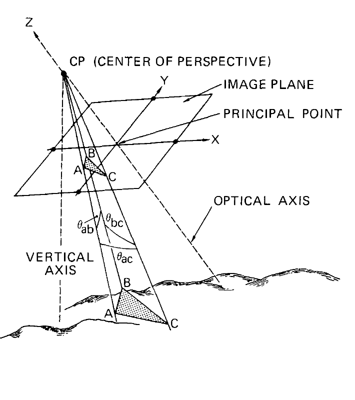
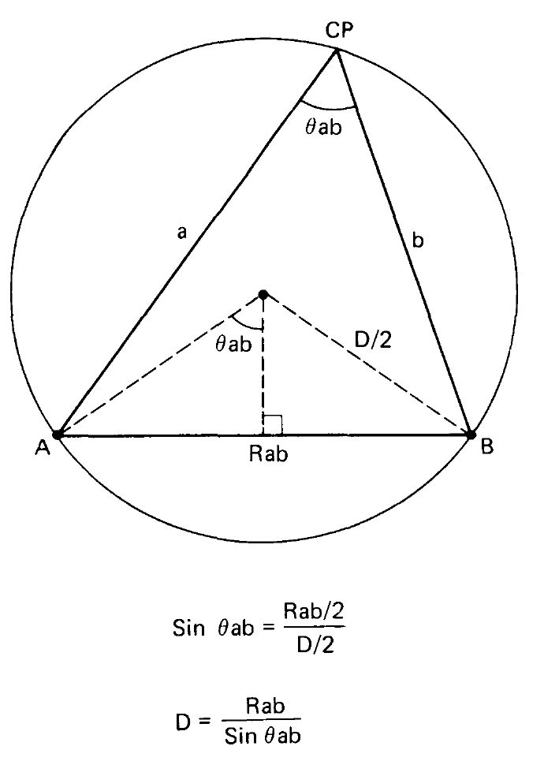
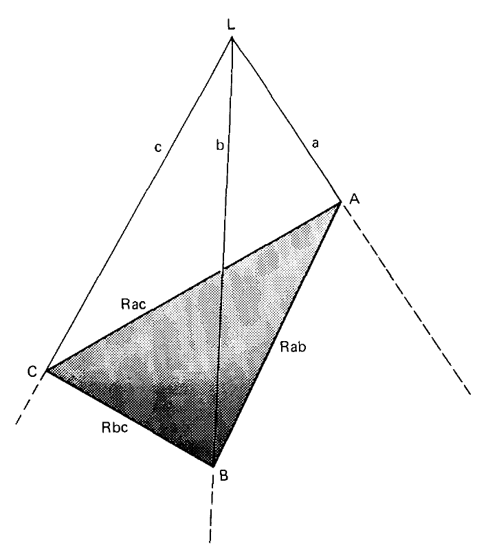
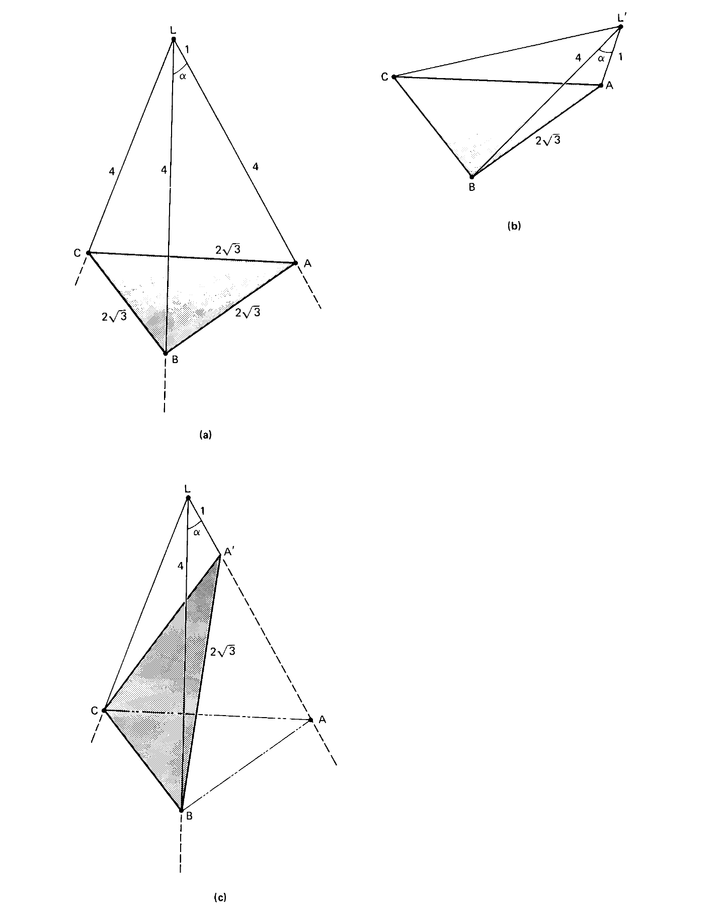
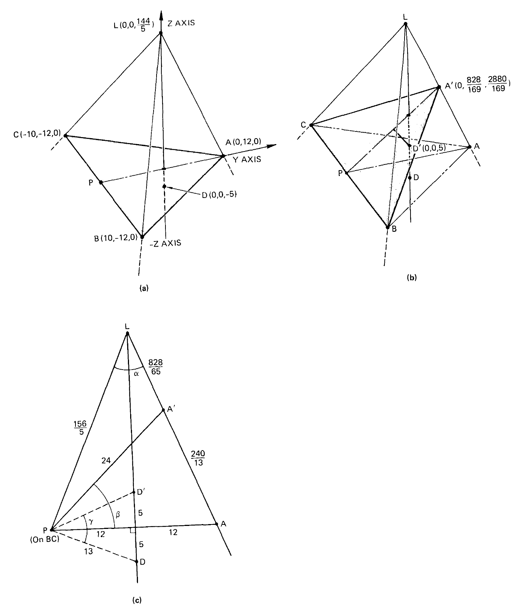
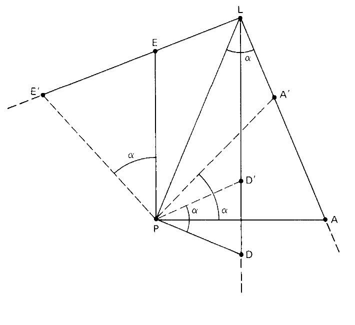
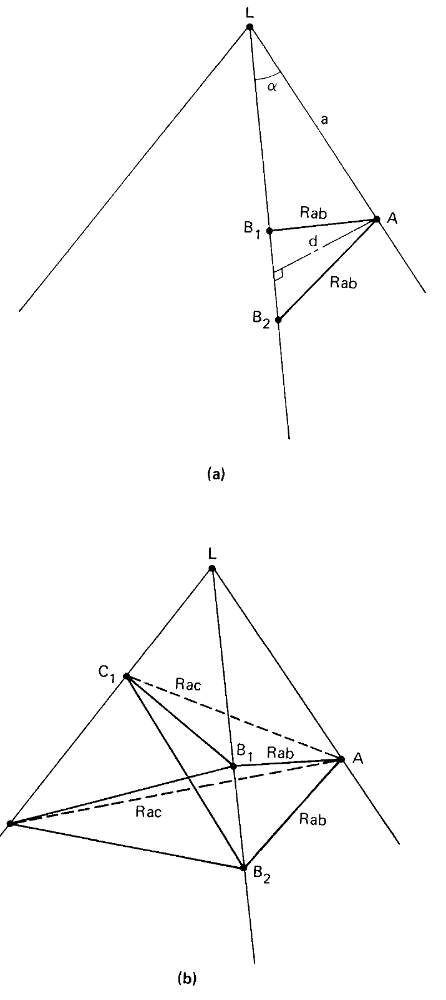
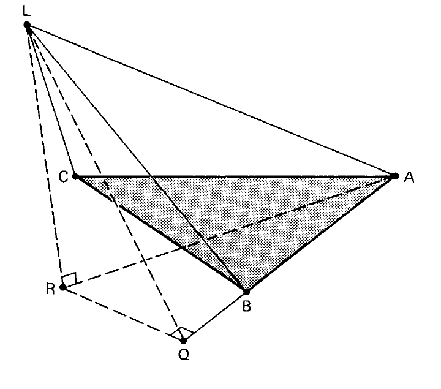
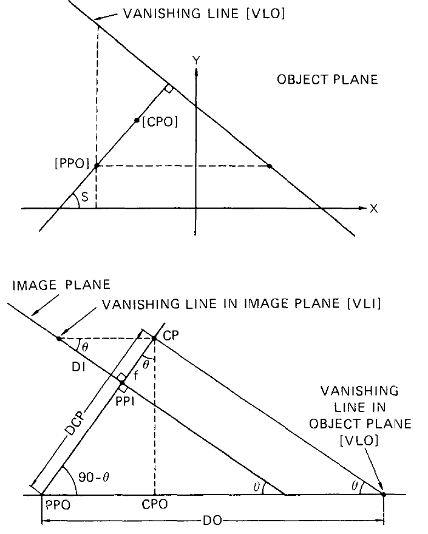

# Random Sample Consensus: A Paradigm for Model Fitting with Applications to Image Analysis and Automated Cartography — конспект

**Авторы:** Martin A. Fischler, Robert C. Bolles (SRI International, Artificial Intelligence Center, Menlo Park)
**Площадка:** Communications of the ACM, т. 24, № 6, июнь 1981, с. 381–395, DOI 10.1145/358669.358692 (рубрика Graphics and Image Processing, редактор J. D. Foley). Получено 4/80, доработано 1/81. Более ранняя версия — технический отчёт SRI (март 1980; по библиографическим базам — SRI TN 213, сам отчёт не проверялся).
**Источник PDF:** скан журнальной версии CACM, размещённый SRI International на странице публикации: https://www.sri.com/wp-content/uploads/2021/12/ransac-publication.pdf (страница: https://www.sri.com/publication/artificial-intelligence-pubs/random-sample-consensus-a-paradigm-for-model-fitting-with-applications-to-image-analysis-and-automated-cartography/). Локальная копия: `../original/RANSAC_Fischler_1981.pdf`.
**Лицензия:** © 1981 ACM (разрешено только некоммерческое копирование с сохранением уведомления ACM; не CC) → конспект своими словами, а не перевод.

> **Суть в одном абзаце.** Классические методы оценки параметров (метод наименьших квадратов, МНК) усредняют **все** данные и опираются на «предположение о сглаживании» (smoothing assumption): хороших точек достаточно, чтобы «замять» любые выбросы. Для данных от ненадёжных детекторов признаков это неверно: один грубый промах (gross error, «отравленная точка») может увести решение, и даже эвристика «выбросить точку с наибольшей невязкой и повторить» терпит неудачу. Авторы предлагают обратную стратегию — **RANSAC (Random Sample Consensus)**: взять **минимальную** случайную выборку точек, нужную для построения модели, построить модель, посчитать, сколько остальных точек с ней согласуются (**консенсусное множество, consensus set**), и повторять, пока не найдётся достаточно большой консенсус; лишь затем сглаживать (МНК) по согласованным точкам. Даны формулы для числа попыток $k$, допуска и порога консенсуса $t$. Вторая половина статьи — применение к **задаче определения положения камеры (Location Determination Problem, LDP)** по ориентирам с известными 3D-координатами: введена постановка **Perspective-n-Point (PnP)**, показано, что P3P имеет до 4 решений, выведено его замкнутое решение через уравнение 4-й степени, показаны неоднозначности P4P/P5P, единственность для 4 компланарных точек и для P6P; алгоритм RANSAC/LD проверен на синтетике и на реальном аэроснимке.

*Рис. 1 (из оригинальной статьи). Семь точек, шесть лежат на «идеальной» прямой, точка 7 = (10, 2) — грубый промах; допуск 0.8. МНК с итеративным отбрасыванием точки с наибольшей невязкой после 4 итераций оставляет 4 точки, **включая** промах (пунктирная прямая). Внизу — таблицы последовательных подгонок и невязок (звёздочкой отмечена отбрасываемая точка).*

---

## 1. Введение: почему усреднение не работает

- Интерпретация данных = (1) **классификация** — какая из моделей подходит, и (2) **оценка параметров** выбранной модели. На практике задачи связаны: чтобы классифицировать, часто нужно сначала оценить параметры.
- МНК и родственные методы оптимизируют согласие модели со **всеми** данными и не имеют встроенного механизма обнаружения грубых ошибок. Они опираются на *smoothing assumption*: максимальное отклонение любой точки от модели зависит от размера выборки, поэтому хорошие точки всегда «перевесят».
- Типичная эвристика — подогнать по всем данным, удалить точку, наиболее далёкую от модели, повторять, пока максимальная невязка не станет меньше порога. Рис. 1 показывает, что **одна** «отравленная точка» ломает и эту эвристику: на первой итерации промах так тянет прямую, что худшими кажутся хорошие точки, и удаляются именно они.
- Тезис авторов: **усреднять непроверенный набор данных — неправильно**.
- У локальных детекторов признаков два вида ошибок:
  - **ошибки измерения (measurement errors)** — признак найден верно, но его параметр (например, координата) немного неточен; распределены примерно нормально, к ним сглаживание применимо;
  - **ошибки классификации (classification errors)** — детектор принял за признак не то; это **грубые ошибки (gross errors)**, они не усредняются.
- Отсюда мотивация RANSAC и вторая часть статьи — LDP, где соответствия «ориентир ↔ точка на снимке» строятся автоматическими (ненадёжными) детекторами.

## 2. Парадигма RANSAC

### 2.1. Идея

Обратная классическому сглаживанию стратегия: вместо «взять как можно больше данных и потом выкидывать плохие» — **взять как можно меньше (минимальную выборку) и расширять только согласованными точками**.

Пример авторов: подгонка дуги окружности к 2D-точкам. Берём 3 случайные точки (столько нужно, чтобы задать окружность), вычисляем центр и радиус, считаем, сколько точек лежит достаточно близко к окружности. Если таких достаточно — уточняем параметры МНК по этому согласованному множеству.

### 2.2. Формальная формулировка

Пусть модель требует минимум $n$ точек для определения свободных параметров, а множество данных $P$ содержит $\#(P) \ge n$ точек.

1. Случайно выбрать подмножество $S_1$ из $n$ точек $P$ и построить по нему модель $M_1$.
2. Найти $S_1^*$ — точки $P$, лежащие в пределах допуска от $M_1$. $S_1^*$ — **консенсусное множество** выборки $S_1$.
3. Если $\#(S_1^*) \ge t$ (порог $t$ зависит от ожидаемого числа грубых ошибок в $P$) — по $S_1^*$ (например, МНК) вычислить уточнённую модель $M_1^*$.
4. Иначе — взять новую случайную выборку $S_2$ и повторить.
5. Если за заранее заданное число попыток консенсус размера $\ge t$ не найден — либо решать по наибольшему найденному консенсусу, либо завершиться неудачей.

Два «очевидных улучшения», названные в статье:
- если есть содержательная причина выбирать точки определённым образом — использовать **детерминированный** выбор вместо случайного;
- найдя подходящий консенсус $S^*$ и модель $M^*$, **добавить** в $S^*$ все точки $P$, согласующиеся с $M^*$, и пересчитать модель по расширенному множеству.

У парадигмы **три свободных параметра**: (1) допуск согласованности точки с моделью; (2) число пробуемых выборок; (3) порог $t$ размера консенсуса, достаточный, чтобы признать модель верной.

### 2.3. Допуск согласованности (error tolerance)

- Отклонение точки от модели складывается из ошибки самой точки и ошибки модели (которая зависит от ошибок точек, по которым модель построена).
- Если модель — простая функция данных, допуск можно оценить аналитически. Иначе — **экспериментально**: возмущать данные, строить модель, измерять получаемые ошибки; допуск ставить на 1–2 стандартных отклонения выше средней измеренной ошибки.
- Строго говоря, допуск должен быть свой у каждой точки, но разброс допусков обычно мал по сравнению с величиной грубой ошибки, поэтому **один общий допуск** обычно достаточен.

### 2.4. Число попыток $k$

Пусть $w$ — вероятность того, что случайно выбранная точка лежит в пределах допуска от модели (то есть **доля «хороших» точек, inliers**), $n$ — размер минимальной выборки. Вероятность, что вся выборка из $n$ точек «чистая» (при независимом выборе): $b = w^n$; положим $a = 1 - b$.

Число попыток до первой чистой выборки распределено геометрически:

$$
E(k) = b + 2(1-b)b + 3(1-b)^2 b + \dots = b\,(1 + 2a + 3a^2 + \dots + i\,a^{i-1} + \dots).
$$

Дифференцируя тождество для геометрического ряда $a/(1-a) = a + a^2 + a^3 + \dots$ по $a$, получаем $1/(1-a)^2 = 1 + 2a + 3a^2 + \dots$, откуда

$$
E(k) = \frac{b}{(1-a)^2} = \frac{1}{b} = w^{-n}.
$$

- $E(k)$ — ожидаемое число выборок до первой выборки без выбросов;
- $w$ — доля inliers; $n$ — число точек в минимальной выборке.

Таблица $E(k)$ из статьи:

| $w$ \ $n$ | 1 | 2 | 3 | 4 | 5 | 6 |
|---|---|---|---|---|---|---|
| 0.9 | 1.1 | 1.2 | 1.4 | 1.5 | 1.7 | 1.9 |
| 0.8 | 1.3 | 1.6 | 2.0 | 2.4 | 3.0 | 3.8 |
| 0.7 | 1.4 | 2.0 | 2.9 | 4.2 | 5.9 | 8.5 |
| 0.6 | 1.7 | 2.8 | 4.6 | 7.7 | 13 | 21 |
| 0.5 | 2.0 | 4.0 | 8.0 | 16 | 32 | 64 |
| 0.4 | 2.5 | 6.3 | 16 | 39 | 98 | 244 |
| 0.3 | 3.3 | 11 | 37 | 123 | 412 | — |
| 0.2 | 5.0 | 25 | 125 | 625 | — | — |

Стандартное отклонение $k$. Аналогично, дважды дифференцируя ряд ($2a/(1-a)^3 = \sum i(i-1)a^{i-1}$):

$$
E(k^2) = \sum_{i} b\, i^2 a^{i-1} = \frac{2-b}{b^2},
\qquad
SD(k) = \sqrt{E(k^2) - E(k)^2} = \frac{\sqrt{1 - w^n}}{w^n}.
$$

Вывод авторов: $SD(k) \approx E(k)$ (например, при $w = 0.5$, $n = 4$: $E(k) = 16$, $SD(k) \approx 15.5$), поэтому перед тем как сдаться, разумно сделать в 2–3 раза больше попыток, чем $E(k)$ (на 1–2 стандартных отклонения больше).

**Формула числа итераций с заданной гарантией** (именно она стала «канонической»). Если нужно с вероятностью $z$ получить хотя бы одну выборку без выбросов, то вероятность того, что все $k$ выборок «грязные», должна равняться $1 - z$:

$$
(1 - b)^k = 1 - z
\quad\Longrightarrow\quad
k = \frac{\log(1 - z)}{\log(1 - b)} = \frac{\log(1 - z)}{\log(1 - w^n)}.
$$

- $z$ — требуемая уверенность (confidence), например 0.9–0.99;
- $k$ — число случайных выборок по $n$ точек.

Пример из статьи: $w = 0.5$, $n = 4$ ⇒ $b = 1/16$; для $z = 0.9$: $k = \log 0.1 / \log(15/16) \approx 35.7$.

Асимптотика при $w^n \ll 1$: $k \approx -\ln(1 - z)\,E(k)$, т.е. $k \approx 2.3\,E(k)$ при $z = 0.90$ и $k \approx 3.0\,E(k)$ при $z = 0.95$.

### 2.5. Нижняя граница размера консенсуса $t$

Порог $t$ должен обеспечить две вещи:
1. найденная модель **действительно верная** (а не случайно совпавшая с частью данных);
2. согласованных точек **достаточно** для финального сглаживания.

Пусть $y$ — вероятность того, что произвольная точка случайно попадёт в допуск **неверной** модели. Тогда вероятность «ложного» консенсуса из $t$ точек (сверх $n$ точек самой выборки) порядка $y^{\,t-n}$, и её нужно сделать малой. Точно $y$ не определить, но разумно считать $y < w$. При $y < 0.5$ выбор

$$
t - n = 5
$$

даёт вероятность случайной совместимости с неверной моделью менее 5% ($0.5^5 \approx 0.03$). Для требований финального МНК авторы отсылают к формальным методам выбора числа точек под нужную точность.

### 2.6. Пример (Рис. 1, решённый RANSAC)

- Допуск 0.8 задан в условии; $w = 0.85$ согласуется с данными (6 из 7 точек хорошие); $n = 2$ (прямая).
- Финального сглаживания нет, поэтому хотим консенсус из всех 7 точек — его не найти (одна точка — промах), и алгоритм остановится на наибольшем найденном.
- Теория говорит, что подходящий консенсус найдётся за 2–3 попытки; при столь малом объёме данных можно перебрать все 21 пару. В любом случае легко находится консенсус из 6 хороших точек и их прямая.

### 2.7. Гиперпараметры RANSAC (сводка из статьи)

| Параметр | Смысл | Рекомендация статьи |
|---|---|---|
| $n$ | размер минимальной выборки | минимум точек, задающий модель (прямая — 2, окружность — 3, P3P — 3) |
| допуск | порог согласованности точки с моделью | аналитически или экспериментально: средняя ошибка + 1–2 СКО; обычно один на все точки |
| $w$ | априорная доля inliers | оценка пользователя |
| $k$ | число выборок | $E(k) = w^{-n}$, с запасом 2–3×; или $k = \log(1-z)/\log(1-w^n)$ |
| $z$ | требуемая вероятность хотя бы одной чистой выборки | пример: 0.90 / 0.95 |
| $t$ | минимальный размер консенсуса для остановки | $t - n \approx 5$ при $y < 0.5$, плюс требования финального МНК |
| финальная модель | уточнение по консенсусу | МНК по консенсусу; затем можно добавить новые согласованные точки и пересчитать |

## 3. Задача определения положения (Location Determination Problem, LDP)

*Рис. 2 (из оригинальной статьи). Центр проекции CP (center of perspective), плоскость изображения, главная точка (principal point), оптическая ось; ориентиры A, B, C на местности и их изображения; углы $\theta_{ab}, \theta_{ac}, \theta_{bc}$ между лучами из CP на пары ориентиров.*

### 3.1. Постановка

- Классическая задача фотограмметрии и картографии (внешнее ориентирование камеры, exterior orientation; «калибровка камеры»; соответствие «изображение — база данных»): по ориентирам (контрольным точкам, control points / landmarks) на снимке определить, **откуда** снимок сделан.
- В то время её решали МНК, а соответствия «точка на снимке ↔ 3D-координаты ориентира» устанавливал человек-оператор. В автоматической системе соответствия дают «посредственные» детекторы, и МНК не справляется с грубыми ошибками.
- **Формулировка LDP:** даны $m$ контрольных точек с известными 3D-координатами и снимок, на котором видна часть из них; найти положение (в системе координат контрольных точек), из которого получен снимок.
- Допущения: сначала соответствия между $n$ точками снимка и контрольными точками считаются известными (потом — с ошибками); известны **главная точка** и **фокусное расстояние** (т.е. камера внутренне откалибрована) — тогда по снимку можно вычислить угол между лучами из CP на любую пару контрольных точек; камера находится снаружи и выше выпуклой оболочки контрольных точек.
- Если знать длины лучей от CP до трёх контрольных точек, положение CP (и ориентацию плоскости изображения) можно найти напрямую (прил. A). Поэтому эквивалентная, более компактная постановка:

> **Perspective-n-Point (PnP).** Даны взаимные пространственные положения $n$ контрольных точек и угол между каждой парой точек, видимый из дополнительной точки — центра проекции. Найти длины отрезков («ног», legs) от CP до каждой контрольной точки.

Для RANSAC нужно знать **наименьшее $n$**, при котором PnP разрешима, — это и есть размер минимальной выборки.

### 3.2. Решение PnP при разных $n$

*Рис. 3 (из оригинальной статьи). P2P: при заданном угле $\theta_{ab}$ точка CP может лежать где угодно на окружности диаметра $D = R_{ab}/\sin\theta_{ab}$, проходящей через A и B, и на поверхности, полученной вращением этой окружности вокруг хорды AB.*

- **P1P** ($n = 1$) — ограничений нет, бесконечно много решений.
- **P2P** ($n = 2$) — тоже бесконечно много: CP на окружности диаметра $R_{ab}/\sin\theta_{ab}$, повёрнутой в пространстве вокруг хорды AB ($R_{ab}$ — расстояние между контрольными точками A и B, $\theta_{ab}$ — угол между лучами на них из CP).
- **P3P** ($n = 3$) — найти длины трёх «ног» тетраэдра, зная стороны основания и плоские углы противолежащего трёхгранного угла (Рис. 4). По теореме косинусов — система [A*]:

$$
\begin{aligned}
R_{ab}^2 &= a^2 + b^2 - 2ab\cos\theta_{ab},\\
R_{ac}^2 &= a^2 + c^2 - 2ac\cos\theta_{ac},\\
R_{bc}^2 &= b^2 + c^2 - 2bc\cos\theta_{bc},
\end{aligned}
$$

- $a, b, c$ — искомые расстояния от CP (вершины $L$) до контрольных точек A, B, C;
- $R_{ab}, R_{ac}, R_{bc}$ — известные расстояния между контрольными точками;
- $\theta_{ab}, \theta_{ac}, \theta_{bc}$ — углы между лучами, известные из снимка и внутренней калибровки.

*Рис. 4 (из оригинальной статьи). P3P: тетраэдр с вершиной L (центр проекции) и основанием ABC; «ноги» a, b, c, стороны основания $R_{ab}, R_{ac}, R_{bc}$.*

**Число решений P3P.** По теореме Безу (произведение степеней) у системы из трёх квадратных уравнений не более $2^3 = 8$ решений. Но все члены системы — либо константы, либо второй степени, поэтому каждому положительному решению соответствует симметричное отрицательное. Значит, **не более 4 положительных решений**, и пример на Рис. 5 показывает, что 4 действительно достижимо.

*Рис. 5 (из оригинальной статьи). (a) Тетраэдр с равносторонним основанием (сторона $2\sqrt3$) и равными «ногами» длины 4, $\cos\alpha = 5/8$ — первое решение. (b) Второе решение: L повёрнута вокруг BC, при этом $L'A = 1$ (из теоремы косинусов $(L'A-1)(L'A-4)=0$). (c) То же второе решение, показанное как перемещение основания по «ногам». В силу тройной симметрии ещё два решения получаются поворотами вокруг AB и AC — всего 4.*

- Замкнутое решение P3P (прил. A) — сведение системы к **уравнению четвёртой степени (biquadratic / quartic)** по отношению двух «ног».
- **P4P, четыре компланарные точки** (никакие три — не на одной прямой, плоскость не проходит через CP): решение **всегда единственно**, техника — прил. B.
- **P4P, точки в общем положении** — неожиданно, **единственность не гарантирована**: Рис. 6 даёт пример с двумя решениями. Практический способ — решить P3P для двух разных троек и взять общие решения (с точностью до неоднозначности, присущей самим данным).

*Рис. 6 (из оригинальной статьи). (a) Постановка P4P (точки A, B, C в плоскости, D вне её; L = (0, 0, 144/5)) и первое решение. (b) Второе решение — поворот основания вокруг BC, A переходит в A′, D — в D′. (c) Сечение плоскостью X = 0: $\cos\alpha = 119/169$; по теореме косинусов угол $\gamma = \beta$, значит, D′ лежит на луче LD.*

- Принцип построения неоднозначных примеров — тот же, что на Рис. 3: если CP и любое число контрольных точек лежат на одной окружности, угол между любой парой точек из CP не зависит от положения CP на окружности. Так строится **P5P с двумя решениями** (Рис. 7).

*Рис. 7 (из оригинальной статьи). К примеру P4P добавлена пятая точка E; E и её повёрнутое положение E′ построены как зеркальные отражения A′ и A относительно прямой LP, поэтому поворот на α вокруг P переводит E в E′. Два набора (A, B, C, D, E) и (A′, B, C, D′, E′) дают два разных положения L.*

- При шести и более точках тот же приём требует, чтобы четыре точки лежали в одной плоскости, т.е. точки уже не в общем положении.
- **P6P в общем положении — решение единственно.** Доказательство: по 6 соответствиям можно линейно найти матрицу $T$ размера $3\times 4$ (проекция из 3D в 2D в однородных координатах; каждое соответствие даёт 3 уравнения и 1 новую неизвестную — масштаб; итого 18 линейных уравнений на 18 неизвестных, из которых независимы не более 17). По $T$ строится синтетическая контрольная точка, компланарная с тремя данными, и применяется единственное решение компланарного P4P из прил. B. (По сути это прямое линейное преобразование, DLT, — термин в статье не используется.)

Сводка:

| $n$ | Конфигурация | Число решений |
|---|---|---|
| 1, 2 | любая | бесконечно много |
| 3 | любая (невырожденная) | до 4 (достижимо) |
| 4 | все 4 в одной плоскости | ровно 1 |
| 4 | общее положение | может быть ≥ 2 (максимум — открытый вопрос) |
| 5 | общее положение | может быть ≥ 2 (максимум — открытый вопрос) |
| ≥ 6 | общее положение | 1 |

## 4. Реализация и эксперименты

### 4.1. Алгоритм RANSAC/LD

**Вход:**
1. Список $L$ из $m$ шестёрок (6-tuples): 3D-координаты контрольной точки, её 2D-координаты на снимке и (необязательно) ожидаемая ошибка положения в пикселях.
2. Фокусное расстояние и координаты главной точки.
3. Вероятность $(1 - w)$ того, что шестёрка — грубое несоответствие (mismatch).
4. Число «уверенности» $G \in [0, 1]$, задающее внутренние пороги принятия промежуточных результатов: 1 — очень консервативное поведение, 0 — почти всё будет признано решением.

**Выход:** 3D-координаты центра проекции (центра объектива) с оценкой ошибки; пространственная ориентация плоскости изображения.

**Шаги:**
1. Выбрать из $L$ три шестёрки **квазислучайно**, так чтобы соответствующие контрольные точки были разумно разнесены в пространстве (выборка $S_1$).
2. Найти CP₁ замкнутым решением P3P (прил. A); несколько решений трактуются как результаты отдельных выборок.
3. Оценить ошибку положения CP₁: возмутить координаты трёх выбранных точек на снимке (на величину из шестёрок или по умолчанию на **1 пиксель**) и пересчитать CP₁.
4. По этой оценке построить для каждой контрольной точки из $L$ **эллипс ошибки** на снимке (размер — по числу уверенности); если наблюдаемая точка лежит внутри своего эллипса, шестёрка добавляется в консенсус $S_1/\text{CP}_1$. (Т.е. допуск здесь — не фиксированный порог, а свой для каждой точки, полученный распространением ошибки.)
5. Если $|S_1/\text{CP}_1| \ge t$ (номинально $t$ — между 7 и $m w$), консенсус передаётся в МНК для окончательного определения CP и ориентации снимка. Иначе — новая случайная выборка $S_2, S_3, \dots$
6. Если число итераций превысило
$$
k = \frac{\log(1 - G)}{\log(1 - w^3)},
$$
решение строится по наибольшему найденному консенсусу (или неудача, если в нём меньше 6 элементов).

Сноска авторов: вместо МНК можно усреднять параметры, вычисленные по случайным тройкам из консенсуса, попавшие (скажем) в центральные 50% гистограммы — робастная альтернатива финальному сглаживанию.

| Параметр RANSAC/LD | Значение в статье |
|---|---|
| минимальная выборка | 3 соответствия (P3P), квазислучайный выбор с пространственным разносом |
| возмущение для оценки ошибки | из входных данных или 1 пиксель по умолчанию |
| критерий inlier | попадание в эллипс ошибки, масштабируемый числом уверенности $G$ |
| порог консенсуса $t$ | номинально от 7 до $m w$ |
| максимум итераций | $k = \log(1-G)/\log(1-w^3)$ |
| минимальный итоговый консенсус | 6 точек |
| финальная оценка | МНК по консенсусу |

### 4.2. Эксперимент 1: провал «МНК с отсевом» на LDP

- 20 ориентиров, из них 5 — грубые ошибки (положение на снимке смещено более чем на 10 пикселей); хорошие точки — нормальный шум с СКО 1 пиксель.
- Эвристика: построить модель по всем соответствиям; удалить соответствие с наибольшим отклонением; построить модель без него; если новая модель даёт для удалённой точки нормированную ошибку больше 3 СКО — признать её промахом и продолжать, иначе вернуть модель, включающую её.
- Результат эвристики: удалила 2 промаха, а после удаления третьего решила, что ошибка «незначима», и вернула решение по 18 соответствиям, **3 из которых — промахи**.
- RANSAC нашёл верное решение **на второй выбранной тройке**; финальный консенсус — все хорошие соответствия и ни одного промаха.

### 4.3. Эксперимент 2: 50 синтетических LDP

- В каждой задаче 30 соответствий «ориентир — снимок»; доля промахов варьировалась; промах — смещение не менее 10 пикселей; хорошие точки — нормальный шум с СКО 1 пиксель.
- Две позиции камеры: строго вниз (надир) и наклонная.
- Отличия от описанного алгоритма: для P3P использовался **простой итеративный метод** (прил. A, п. 3) вместо замкнутого, и делался второй МНК для расширения финального консенсуса (как в «улучшении» из разд. 2).
- Во **всех** задачах RANSAC не включил ни одного промаха в итоговый консенсус. Время — около **1 с на каждое рассмотренное положение камеры** (на оборудовании того времени; конкретная машина не указана).

Таблица I (10 типичных задач):

| $w$ | Хороших соответствий | В итоговом консенсусе | Рассмотрено троек | Рассмотрено положений камеры |
|---|---|---|---|---|
| 0.8 | 22 | 19 | 6 | 10 |
| 0.8 | 23 | 23 | 1 | 3 |
| 0.8 | 19 | 19 | 2 | 3 |
| 0.8 | 25 | 25 | 1 | 2 |
| 0.8 | 24 | 23 | 3 | 8 |
| 0.6 | 21 | 20 | 11 | 21 |
| 0.6 | 17 | 17 | 1 | 1 |
| 0.6 | 17 | 16 | 6 | 8 |
| 0.6 | 18 | 16 | 9 | 21 |
| 0.6 | 21 | 18 | 9 | 15 |

**Интерпретация:** число рассмотренных троек мало (1–11) и растёт с уменьшением $w$, как предсказывает теория; положений камеры больше, чем троек, из-за множественных решений P3P. Итоговый консенсус иногда меньше числа хороших соответствий (часть хороших точек не попала в эллипсы ошибок), но промахов в нём нет.

### 4.4. Эксперимент 3: реальный аэроснимок

- Аэрофотоснимок с высоты около 4000 футов, объектив 6 дюймов; оцифровка 2000×2000 пикселей ⇒ разрешение на местности около 2 футов на пиксель.
- 25 ориентиров найдены **кросс-корреляцией**; 3 из них — грубые ошибки детектора.
- RANSAC нашёл консенсус из 17 точек **на первой же тройке**, после начального МНК расширил его до всех 22 хороших соответствий.
- Итоговые СКО параметров камеры:

| Параметр | СКО |
|---|---|
| X | 0.1 фут |
| Y | 6.4 фута |
| Z | 2.1 фута |
| Курс (heading) | 0.01° |
| Тангаж (pitch) | 0.10° |
| Крен (roll) | 0.12° |

## 5. Выводы авторов

- RANSAC — новая парадигма подгонки модели, способная интерпретировать/сглаживать данные со значительной долей грубых ошибок; идеальна для анализа изображений, где данные дают ошибающиеся детекторы.
- Большинство результатов о геометрии LDP новы или малоизвестны: фотограмметрическая литература того времени предлагала только варианты МНК и итеративный **метод Чёрча (Church method)** для P3P, без указания на возможность нескольких физически реальных решений — тем более при числе точек больше трёх.
- Поскольку множественные решения могут быть сколь угодно близки, даже хорошо инициализированный итеративный метод **не гарантирует** сходимости к нужному решению.
- Полностью охарактеризована P3P и дано замкнутое решение; показаны множественные решения P4P и P5P; единственность при 4 компланарных точках и для P6P в общем положении. Максимальное число решений P4P/P5P — **открытый вопрос**.

## Приложение A. Аналитическое решение P3P

### A.1. Длины «ног» тетраэдра

Дано: стороны основания $R_{ab}, R_{ac}, R_{bc}$ и углы $\theta_{ab}, \theta_{ac}, \theta_{bc}$; найти $a, b, c$ из системы (A1)–(A3) (та же, что [A*]).

Замена переменных — отношения «ног»:

$$
b = x\,a, \qquad c = y\,a. \tag{A4}
$$

Подстановка даёт (A5)–(A7):

$$
\begin{aligned}
R_{ac}^2 &= a^2\,(1 + y^2 - 2y\cos\theta_{ac}),\\
R_{ab}^2 &= a^2\,(1 + x^2 - 2x\cos\theta_{ab}),\\
R_{bc}^2 &= a^2\,(x^2 + y^2 - 2xy\cos\theta_{bc}).
\end{aligned}
$$

Исключая $a^2$ попарными отношениями, получаем два уравнения в $x, y$ (A8), (A9). Обозначим

$$
K_1 = \frac{R_{bc}^2}{R_{ac}^2}, \qquad K_2 = \frac{R_{bc}^2}{R_{ab}^2}. \tag{A10}
$$

Тогда оба уравнения квадратны по $y$:

$$
\begin{aligned}
0 &= y^2 (1 - K_1) + 2y\,(K_1\cos\theta_{ac} - x\cos\theta_{bc}) + (x^2 - K_1), \qquad &\text{(A11)}\\
0 &= y^2 + 2y\,(-x\cos\theta_{bc}) + \big[x^2(1 - K_2) + 2xK_2\cos\theta_{ab} - K_2\big], &\text{(A12)}
\end{aligned}
$$

т.е. имеют вид $m y^2 + p y + q = 0$ и $m' y^2 + p' y + q' = 0$ (A13, A14). Линейные комбинации этих уравнений исключают $y^2$ и свободный член:

$$
0 = (p m' - p' m)\,y + (m' q - m q'), \qquad\text{(A15)}
\qquad
0 = (m' q - m q')\,y + (p' q - p q'). \qquad\text{(A16)}
$$

Исключение $y$ из (A15)–(A16) даёт результант

$$
0 = (m' q - m q')^2 - (p m' - p' m)(p' q - p q'), \tag{A17}
$$

который после раскрытия скобок — **полином четвёртой степени по $x$**:

$$
0 = G_4 x^4 + G_3 x^3 + G_2 x^2 + G_1 x + G_0, \tag{A18}
$$

с коэффициентами (сокращения $c_{ab} = \cos\theta_{ab}$ и т.п.):

$$
\begin{aligned}
G_4 &= (K_1K_2 - K_1 - K_2)^2 - 4K_1K_2\,c_{bc}^2,\\
G_3 &= 4(K_1K_2 - K_1 - K_2)\,K_2(1 - K_1)\,c_{ab} + 4K_1 c_{bc}\big[(K_1K_2 + K_2 - K_1)\,c_{ac} + 2K_2\,c_{ab}c_{bc}\big],\\
G_2 &= \big[2K_2(1 - K_1)\,c_{ab}\big]^2 + 2(K_1K_2 + K_1 - K_2)(K_1K_2 - K_1 - K_2)\\
&\quad + 4K_1\big[(K_1 - K_2)\,c_{bc}^2 + (1 - K_2)K_1\,c_{ac}^2 - 2K_2(1 + K_1)\,c_{ab}c_{ac}c_{bc}\big],\\
G_1 &= 4(K_1K_2 + K_1 - K_2)\,K_2(1 - K_1)\,c_{ab} + 4K_1\big[(K_1K_2 - K_1 + K_2)\,c_{ac}c_{bc} + 2K_1K_2\,c_{ab}c_{ac}^2\big],\\
G_0 &= (K_1K_2 + K_1 - K_2)^2 - 4K_1^2K_2\,c_{ac}^2.
\end{aligned}
\tag{A19–A23}
$$

*(Коэффициенты переписаны со скана и сверены с изображением страниц; при реализации стоит проверять на примере ниже.)*

Корни (A18) находятся в замкнутой форме (формулы для уравнения 4-й степени) или итерационно. Для каждого положительного действительного корня $x$:

$$
a = \frac{R_{ab}}{\sqrt{x^2 - 2x\cos\theta_{ab} + 1}}, \qquad b = a\,x. \tag{A24, A25}
$$

Если $m' q \ne m q'$, то $y$ однозначно из (A16):

$$
y = \frac{p' q - p q'}{m q' - m' q}, \tag{A26}
$$

иначе из (A5) получаются два значения

$$
y = \cos\theta_{ac} \pm \sqrt{\cos^2\theta_{ac} + \frac{R_{ac}^2 - a^2}{a^2}}, \tag{A27}
$$

и $c = y\,a$ (A28). Решения, полученные через (A27), могут быть посторонними — их надо проверить подстановкой в (A3).

Важная оговорка авторов: каждый корень (A18) в принципе может дать два решения, поэтому само наличие уравнения 4-й степени **не доказывает** верхнюю границу в 4 решения — нужен отдельный аргумент (приведённый в основном тексте).

### A.2. Пример

Для тетраэдра Рис. 5: $R_{ab} = R_{ac} = R_{bc} = 2\sqrt3$, все $\cos\theta = 20/32 = 5/8$. Коэффициенты (A18): $[-0.5625,\ 3.515625,\ -5.90625,\ 3.515625,\ -0.5625]$, корни $[1, 1, 4, 0.25]$.

| Корень $x$ | $a$ | $b$ | $y$ | $c$ |
|---|---|---|---|---|
| 1 | 4 | 4 | 1 | 4 |
| 1 | 4 | 4 | 0.25 | 1 |
| 4 | 1 | 4 | 4 | 4 |
| 0.25 | 4 | 1 | 1 | 4 |

Четыре решения — ровно те, что показаны на Рис. 5 (двойной корень $x = 1$ даёт два разных решения через разные $y$).

### A.3. Итеративное решение P3P

*Рис. 8 (из оригинальной статьи). (a) При фиксированном положении A на её «ноге» (расстояние a от L) точка B может быть в одной из двух позиций B₁, B₂ на луче LB на расстоянии $R_{ab}$ от A (d — расстояние от A до прямой LB). (b) Аналогично две позиции C₁, C₂; итого до четырёх треугольников.*

Простая альтернатива замкнутому решению (её и использовали в эксперименте с 50 задачами): «скользить» вершиной A вдоль её луча; для каждого положения A есть не более двух точек на луче LB на расстоянии $R_{ab}$ от A и не более двух на луче LC на расстоянии $R_{ac}$ — до четырёх треугольников. Длина третьей стороны BC у них нелинейно меняется с положением A; итеративно подбирают положение A, при котором $|BC| = R_{bc}$.

### A.4. 3D-положение центра проекции

*Рис. 9 (из оригинальной статьи). Построение положения центра проекции L: Q — основание перпендикуляра из L на AB, R — проекция L на плоскость ABC.*

Зная 3D-координаты A, B, C и длины «ног»:
1. Плоскость $P_1$ ⟂ AB, проходящая через L: по теореме косинусов в треугольнике LAB находим угол LAB и проекцию $QA$ отрезка LA на AB; $P_1$ — плоскость, перпендикулярная AB через Q (L в ней лежит, хотя сама L ещё неизвестна).
2. Аналогично плоскость $P_2$ ⟂ AC через L.
3. $P_3$ — плоскость ABC.
4. Пересечение $P_1, P_2, P_3$ — точка R, ближайшая к L точка плоскости $P_3$.
5. По $|AR|$ и $|LA|$ находим $|RL|$ — расстояние от L до $P_3$.
6. Нормаль $\vec{AB} \times \vec{AC}$, масштабированная на $|RL|$ и отложенная от R, даёт L (знак нормали выбирается так, чтобы камера была «над» точками — по допущению из разд. 3.1).

### A.5. Ориентация плоскости изображения

Если известны фокусное расстояние и главная точка:
1. Вычислить CP (см. выше).
2. Найти 3D-координаты изображений трёх контрольных точек: на лучах CP → контрольная точка отложить расстояние от CP до плоскости изображения вдоль луча.
3. По трём точкам — уравнение плоскости изображения; нормаль через CP даёт главную точку (начало системы координат снимка) и ось Z.
4. Поворот снимка вокруг оси Z — по вектору от главной точки к любой из точек шага 2.

## Приложение B. Аналитическое решение P4P для четырёх компланарных точек

*Рис. 10 (из оригинальной статьи). Сверху — плоскость объекта: линия схода [VLO], точка [PPO] пересечения оптической оси с плоскостью объекта, проекция центра проекции [CPO], угол «панорамирования» S. Снизу — сечение: плоскость изображения, линия схода в плоскости изображения [VLI], расстояние DI от главной точки PPI до неё, фокусное расстояние f, угол наклона θ, расстояния DO и DCP.*

**Дано:** соответствие четырёх точек плоскости объекта ($Q_i$, плоскость $Z = 0$) и четырёх точек плоскости изображения ($P_i$, начало координат в главной точке PPI), фокусное расстояние $f$. **Найти:** 3D-положение центра проекции относительно плоскости объекта. Используются однородные координаты; штрих — транспонирование.

**Процедура:**
1. Найти матрицу коллинеации (collineation — по современной терминологии **гомографию**) $T$ размера 3×3: $[P_i] = T\,[Q_i]$, где $P_i = k_i\,[x_i, y_i, 1]'$, $Q_i = [X_i, Y_i, 1]'$.
2. Бесконечно удалённая прямая плоскости объекта $[0,0,1]'$ отображается в **линию схода на снимке**: $[VLI] = (T^{-1})'\,[0,0,1]' = [a_1, a_2, a_3]'$.
3. Расстояние от главной точки до неё: $D_I = \left|\dfrac{a_3}{\sqrt{a_1^2 + a_2^2}}\right|$.
4. **Угол наклона** (dihedral / tilt) между плоскостями: $\theta = \arctan(f / D_I)$.
5. Линия схода в плоскости объекта: $[VLO] = T'\,[0,0,1]' = [b_1, b_2, b_3]'$.
6. Точка пересечения оптической оси с плоскостью объекта $[PPO] = [c_1, c_2, c_3]'$ — образ главной точки снимка $[0,0,1]'$ в плоскости объекта, т.е. по смыслу $T^{-1}[0,0,1]'$. *(В оригинале (B2) и (B6) записаны одинаково, как $[\mathrm{inv}(T)]'[0,0,1]'$; по числовому примеру статьи VLI совпадает с третьим столбцом, а PPO — с третьей строкой напечатанной матрицы $[\mathrm{inv}(T)]'$, т.е. в (B6) подразумевается транспонирование другого порядка.)*
7. Расстояние от PPO до VLO: $D_O = \dfrac{|b_1c_1 + b_2c_2 + b_3c_3|}{c_3\sqrt{b_1^2 + b_2^2}}$.
8. **Угол «панорамирования» (pan)** — угол между нормалью к VLO и осью X: $S = \arctan(-b_2/b_1)$.
9. Знаки XSGN, YSGN — по тому, с какой стороны от PPO линия VLO пересекается прямыми, параллельными осям (условия по знаку $\frac{b_1c_1+b_2c_2+b_3c_3}{b_1c_3}$ и $\frac{\ldots}{b_2c_3}$).
10. Положение CP:
$$
\begin{aligned}
D_{CP} &= D_O \sin\theta,\\
X_{CP} &= \mathrm{XSGN}\,\big|D_{CP}\sin\theta\cos S\big| + c_1/c_3,\\
Y_{CP} &= \mathrm{YSGN}\,\big|D_{CP}\sin\theta\sin S\big| + c_2/c_3,\\
Z_{CP} &= D_{CP}\cos\theta.
\end{aligned}
$$
Если $[VLI] = [0,0,k]$, плоскости параллельны ($\theta = 0$) и решение находится из подобия треугольников.

**Вычисление $T$ по 4 точкам.** Составить матрицы $[Q] = [Q_1, Q_2, Q_3]'$ и $[P] = [P_1, P_2, P_3]'$ из трёх первых точек; для четвёртой: $V = (P^{-1})'P_4 = [v_1, v_2, v_3]'$, $R = (Q^{-1})'Q_4 = [r_1, r_2, r_3]'$; $w_1 = \dfrac{v_1 r_3}{r_1 v_3}$, $w_2 = \dfrac{v_2 r_3}{r_2 v_3}$, $W = \mathrm{diag}(w_1, w_2, 1)$. Тогда $T' = Q^{-1}\,W\,P$.

**Числовой пример** (f = 0.3048 м = 12 дюймов; 4 пары точек): получено $\theta = 0.872665$ рад (50°), $S = -0.523599$ рад (−30°), $D_O = 711.196$, $D_{CP} = 544.8081$, $X_{CP} = -400.202$, $Y_{CP} = -300.117$, $Z_{CP} = 350.196$.

---

## Описание ключевых рисунков

*Сами рисунки вставлены в соответствующие разделы конспекта выше (Рис. 1 — после аннотации, 2–7 — разд. 3, 8–9 — прил. A, 10 — прил. B). Здесь — сводное описание.*

- **Рис. 1 — мотивирующий пример.** Шесть точек на прямой и одна грубая ошибка; МНК с итеративным отбрасыванием худшей невязки удаляет хорошие точки и оставляет промах. Таблицы показывают, как меняется прямая и невязки на 4 итерациях.
- **Рис. 2 — геометрия LDP:** центр проекции, плоскость изображения, главная точка, оптическая ось, углы между лучами на ориентиры.
- **Рис. 3 — P2P:** геометрическое место CP — окружность (тор вращения вокруг AB), поэтому двух точек мало.
- **Рис. 4 — P3P:** тетраэдр «центр проекции + три ориентира».
- **Рис. 5 — четыре решения P3P** на симметричном тетраэдре.
- **Рис. 6, 7 — P4P и P5P с двумя решениями** в общем положении — контрпримеры к «интуитивной» единственности.
- **Рис. 8 — итеративный метод P3P** скольжением вершины по лучу.
- **Рис. 9 — восстановление 3D-положения L** через пересечение трёх плоскостей.
- **Рис. 10 — компланарный P4P** через линии схода и углы наклона/панорамирования.

---

## Сильные стороны и ограничения

### Сильные стороны
- **Простая и общая идея**: гипотеза по минимальной выборке → проверка консенсусом → уточнение. Применима к любой модели, для которой есть решатель по минимальной выборке (прямая, окружность, гомография, фундаментальная/существенная матрица, поза PnP, ...).
- **Устойчивость к большой доле выбросов** (при достаточном числе итераций можно работать и при $w < 0.5$), в отличие от МНК и эвристик отсева.
- **Явная вероятностная модель числа итераций**: формула $k = \log(1-z)/\log(1-w^n)$ до сих пор используется во всех реализациях (с адаптивным пересчётом $w$ по лучшему найденному консенсусу).
- **Отделение грубых ошибок от шума измерений**: шум сглаживается МНК, промахи отсекаются консенсусом.
- Вклад в геометрию: постановка **PnP**, полная характеристика P3P (до 4 решений), замкнутое решение через уравнение 4-й степени, контрпримеры неоднозначности P4P/P5P, единственность для компланарного P4P и P6P. Указание на опасность итеративных методов при близких решениях.
- Подтверждение на реальных данных (аэроснимок, ориентиры от кросс-корреляции).

### Ограничения
- **Число итераций растёт экспоненциально** с размером минимальной выборки и долей выбросов ($w^{-n}$): при $w = 0.2$, $n = 4$ ожидается 625 выборок, а с гарантией — в разы больше. Отсюда важность минимальных решателей (P3P вместо P6P, 4 точки для гомографии, 5 точек для существенной матрицы).
- **Критерий — простой подсчёт inliers** при жёстком пороге: качество чувствительно к выбору допуска; все inliers весят одинаково (позже — MSAC/MLESAC/MAGSAC с робастными функциями стоимости и маргинализацией порога).
- **Предполагается независимый равновероятный выбор точек**; не используется информация о качестве соответствий (позже — PROSAC, сортировка по уверенности матчинга) и пространственной локальности (NAPSAC, GC-RANSAC).
- **Нет локальной оптимизации** гипотез: лучший консенсус по «шумной» минимальной выборке может быть неполным (позже — LO-RANSAC); в статье частично решается финальным МНК и повторным расширением консенсуса.
- **Вырожденные конфигурации** (например, точки почти на одной прямой/плоскости) не обрабатываются явно; квазислучайный выбор с разносом точек в RANSAC/LD — лишь эвристика (позже — DEGENSAC).
- Порог $t$ и вероятность $y$ в статье задаются по сути на глаз; выбор параметров требует знания $w$, которое заранее обычно неизвестно.
- Эксперименты небольшие (20–30 соответствий, 50 синтетических задач, один реальный снимок); P3P требует **известной внутренней калибровки**.
- Верхняя граница числа решений P4P/P5P оставлена открытой.

---

## Значение для задачи визуального позиционирования

**Роль в конвейере.** RANSAC — стандартный этап **геометрической верификации** практически в любом конвейере визуальной локализации: глобальный поиск кандидатов (NetVLAD и т.п.) → локальные признаки ([SIFT](SIFT_конспект.md), [ORB](ORB_конспект.md), [SuperPoint](SuperPoint_конспект.md), ...) → сопоставление (ratio test, взаимный ближайший сосед, [SuperGlue](SuperGlue_конспект.md)/LightGlue) → **робастная оценка модели RANSAC'ом** (гомография / фундаментальная или существенная матрица / поза PnP) → уточнение по inliers. Сама LDP из статьи — это в точности задача **абсолютной локализации камеры по 2D–3D соответствиям** (снимок ↔ карта с известными 3D-координатами), а эксперимент с аэроснимком — прямой предок задачи «где находится дрон по снимку и ортофото/ЦМР».

**Практические заметки** (кроме специально отмеченного — **не из статьи**, а из современной практики и документации OpenCV; значения по умолчанию проверены по заголовку `calib3d.hpp` и `solvepnp.cpp` ветки OpenCV 4.x):

- **Абсолютная поза по 2D–3D (наследник RANSAC/LD):** `cv::solvePnPRansac(objectPoints, imagePoints, K, dist, rvec, tvec, useExtrinsicGuess=false, iterationsCount=100, reprojectionError=8.0, confidence=0.99, inliers, flags=SOLVEPNP_ITERATIVE)`. По коду OpenCV: при `flags=SOLVEPNP_P3P`/`SOLVEPNP_AP3P` минимальная выборка — 4 точки (P3P + 4-я точка для выбора одного из до 4 решений — та самая неоднозначность из статьи), в остальных случаях — 5 точек с решателем EPnP внутри RANSAC; затем финальное уточнение по inliers. Порог 8 px по умолчанию для высокоточной локализации крупный — обычно его уменьшают (2–4 px при хорошей калибровке; это эмпирика, не из статьи), а `iterationsCount=100` при низкой доле inliers мало — считайте по формуле $k$.
- **Гомография** (кадр ↔ ортофото для почти плоской местности/надирной съёмки): `cv::findHomography(src, dst, method=0, ransacReprojThreshold=3, mask, maxIters=2000, confidence=0.995)`. Важно: **по умолчанию `method=0` — обычный МНК по всем точкам, без RANSAC**; нужно явно передавать `cv::RANSAC`, `cv::RHO`, `cv::LMEDS` или `cv::USAC_*`.
- **Эпиполярная геометрия:** `findFundamentalMat(..., FM_RANSAC, ransacReprojThreshold=3., confidence=0.99)`; `findEssentialMat(..., method=RANSAC, prob=0.999, threshold=1.0)`; аффинная модель — `estimateAffine2D(..., RANSAC, ransacReprojThreshold=3, maxIters=2000, confidence=0.99, refineIters=10)`.
- **Современные варианты в OpenCV (USAC, с 4.5):** флаги `USAC_DEFAULT`, `USAC_PARALLEL`, `USAC_FAST`, `USAC_ACCURATE`, `USAC_PROSAC`, `USAC_MAGSAC` (MAGSAC++), `USAC_FM_8PTS`; структура `UsacParams` по умолчанию: `confidence=0.99`, `maxIterations=5000`, `threshold=1.5`, `score=SCORE_METHOD_MSAC`, `sampler=SAMPLING_UNIFORM`, `loMethod=LOCAL_OPTIM_INNER_LO`, `loIterations=5`, `loSampleSize=14`, финальная доводка `COV_POLISHER` (3 итерации). На практике MAGSAC++ / LO-RANSAC обычно точнее и менее чувствительны к порогу, чем классический RANSAC (оценка из литературы, а не из статьи).
- **Число итераций.** Формула статьи даёт ориентир: для P3P ($n = 3$) при доле inliers 20% и $z = 0.99$ нужно $k = \ln 0.01/\ln(1 - 0.008) \approx 573$ итерации; для гомографии ($n = 4$) при тех же условиях — около 2876 (расчёт по формуле статьи). Реализации адаптивно уменьшают $k$, пересчитывая $w$ по лучшему консенсусу.
- **Порог в пикселях** связан с точностью локализации ключевых точек и калибровки; при сопоставлении снимков разного разрешения (кадр БПЛА ↔ спутниковая подложка) порог задают в пикселях того изображения, где считается ошибка репроекции.
- **Критерий успеха.** Как и в статье, решение стоит принимать только при достаточном числе inliers (аналог порога $t$; практические значения — десятки inliers и/или доля inliers, подбираются на своих данных) — это защищает от ложной локализации в повторяющихся текстурах (поля, крыши, лес).
- **Неоднозначности P3P/P4P** реальны: при малом числе точек и плохой геометрии (точки почти на одной плоскости/окружности с камерой, узкое поле зрения с большой высоты) поза может быть плохо обусловлена — полезно проверять разнесённость inliers по кадру и ковариацию позы (как оценка эллипсов ошибок в RANSAC/LD).
- **Априорная информация** (GNSS, IMU: высота, крен/тангаж, курс) позволяет сократить минимальную выборку (например, P2P при известной вертикали) и резко уменьшить число итераций — идея «детерминированного/осмысленного выбора» уже упомянута в статье как улучшение.

---

## Глоссарий (англ. → рус.)

| English | Русский |
|---|---|
| RANSAC (Random Sample Consensus) | консенсус случайных выборок (метод робастной оценки) |
| consensus set | консенсусное множество (точки, согласующиеся с моделью) |
| inlier / outlier | «хорошая» точка / выброс |
| gross error | грубая ошибка, промах |
| poisoned point | «отравленная» точка (одиночный промах) |
| smoothing assumption | предположение о сглаживании |
| least squares | метод наименьших квадратов (МНК) |
| residual | невязка |
| error tolerance | допуск (порог) согласованности |
| minimal sample | минимальная выборка |
| classification error / measurement error | ошибка классификации / ошибка измерения |
| feature detector | детектор признаков |
| model fitting | подгонка модели |
| parameter estimation | оценка параметров |
| Location Determination Problem (LDP) | задача определения положения (камеры) |
| control point / landmark | контрольная точка / ориентир |
| center of perspective (CP) | центр проекции (перспективы) |
| principal point | главная точка |
| focal length | фокусное расстояние |
| image plane / object plane | плоскость изображения / плоскость объекта |
| exterior orientation | внешнее ориентирование |
| Perspective-n-Point (PnP) | задача перспективы n точек (PnP) |
| leg (of the tetrahedron) | «нога» — ребро от центра проекции до контрольной точки |
| trihedral angle | трёхгранный угол |
| law of cosines | теорема косинусов |
| biquadratic (quartic) polynomial | многочлен четвёртой степени |
| closed-form solution | решение в замкнутой форме |
| general position | общее положение (без вырождений) |
| collineation matrix | матрица коллинеации (гомография) |
| vanishing line | линия схода |
| tilt / pan angle | угол наклона / угол «панорамирования» (поворота) |
| heading / pitch / roll | курс / тангаж / крен |
| error ellipse | эллипс ошибок |
| confidence number | число уверенности |
| cross-correlation | кросс-корреляция |
| automated cartography | автоматизированная картография |
| homogeneous coordinates | однородные координаты |
