# Distinctive Image Features from Scale-Invariant Keypoints (SIFT) — конспект

**Автор:** David G. Lowe (Computer Science Department, University of British Columbia, Ванкувер)
**Площадка:** International Journal of Computer Vision, 2004, т. 60, № 2, с. 91–110, DOI 10.1023/B:VISI.0000029664.99615.94 (Kluwer Academic Publishers). Предшествующая конференционная версия — Lowe, «Object recognition from local scale-invariant features», ICCV 1999.
**Источник PDF:** авторский препринт с домашней страницы автора — https://www.cs.ubc.ca/~lowe/papers/ijcv04.pdf (28 с., датирован 5 января 2004 г., «Accepted for publication in the International Journal of Computer Vision, 2004»); локальная копия: `../original/SIFT_Lowe_2004.pdf`. Нумерация страниц, разделов и рисунков ниже — по этому препринту (журнальная вёрстка отличается).
**Лицензия / режим:** статья под копирайтом издателя (Kluwer / Springer, все права защищены), открытой лицензии нет → конспект своими словами, а не перевод; цитаты — только короткие.

> **Суть в одном абзаце.** Статья описывает SIFT (Scale Invariant Feature Transform) — метод, который превращает изображение в большое множество локальных признаков, инвариантных к масштабу и повороту и устойчивых к умеренным аффинным/ракурсным искажениям, шуму и изменению освещения. Признаки строятся каскадом: (1) поиск экстремумов в масштабном пространстве разности гауссианов (difference-of-Gaussian, DoG); (2) субпиксельное уточнение положения и масштаба и отбраковка точек с низким контрастом и точек на краях; (3) назначение одной или нескольких доминирующих ориентаций по гистограмме градиентов; (4) 128-мерный дескриптор — сетка 4×4 гистограмм ориентаций градиентов по 8 направлений, с нормировкой против изменений освещения. Типичное изображение 500×500 даёт порядка 2000 устойчивых точек. Вторая часть статьи — применение к распознаванию объектов: приближённый поиск ближайшего соседа (Best-Bin-First), тест отношения расстояний до первого и второго соседа (порог 0.8), кластеризация гипотез позы преобразованием Хафа (Hough transform), уточнение аффинной позы методом наименьших квадратов и вероятностная верификация. Вся система распознаёт объекты среди помех и перекрытий быстрее 0.3 с на Pentium 4 2 ГГц.

*Рис. 7 (из оригинальной статьи). Слева — градиенты в окрестности точки, взвешенные гауссовым окном (синий круг); справа — накопление их в гистограммы ориентаций по подобластям. Для наглядности показан дескриптор 2×2 из 8×8 отсчётов; в экспериментах используется 4×4 из 16×16.*

---

## 1. Введение: каскад вычислений

- Сопоставление изображений (image matching) лежит в основе распознавания объектов и сцен, восстановления 3D-структуры по нескольким видам, стереосопоставления и трекинга.
- Требования к признакам: инвариантность к масштабированию и повороту, частичная инвариантность к освещению и 3D-ракурсу, хорошая локализация и в пространственной, и в частотной области (меньше страдают от перекрытий, фона и шума), большое число признаков на изображение и высокая **различимость (distinctiveness)** — чтобы один признак с высокой вероятностью находил правильную пару в большой базе.
- Стоимость снижается за счёт **каскадной фильтрации (cascade filtering)**: дорогие операции выполняются только в местах, прошедших дешёвые предварительные проверки.
- Четыре этапа (они же структура статьи):
  1. **Поиск экстремумов в масштабном пространстве (scale-space extrema detection)** — DoG по всем масштабам и положениям.
  2. **Локализация ключевых точек (keypoint localization)** — подгонка модели для уточнения положения и масштаба, отбор по устойчивости.
  3. **Назначение ориентации (orientation assignment)** — по направлениям локальных градиентов; дальше все вычисления ведутся в системе координат, нормированной по положению, масштабу и ориентации.
  4. **Дескриптор ключевой точки (keypoint descriptor)** — представление локальных градиентов, допускающее заметные искажения формы и изменения освещения.
- Количество признаков принципиально: для надёжного распознавания маленького объекта на загромождённом фоне нужно минимум 3 правильно сопоставленных признака.
- Схема распознавания: признаки эталонных изображений хранятся в базе; признаки нового изображения сопоставляются по евклидову расстоянию дескрипторов; затем ищутся подмножества совпадений, согласованные по объекту, положению, масштабу и ориентации (обобщённое преобразование Хафа через хеш-таблицу); кластеры из ≥3 совпадений проходят уточнение аффинной позы, удаление выбросов и вероятностную проверку.

## 2. Связанные работы

- **Детекторы углов:** Moravec (1981, стерео) → Harris & Stephens (1988) — повторяемее при малых изменениях и вблизи краёв. Автор подчёркивает, что «угловые» детекторы на деле выбирают любые места с большими градиентами во всех направлениях на **заранее заданном масштабе**.
- **Сопоставление при больших изменениях:** Zhang et al. (1995) — корреляционные окна вокруг углов Харриса + отбраковка выбросов через фундаментальную матрицу; Torr (1995) — аналогично для движения.
- **Schmid & Mohr (1997)** — ключевой шаг: инвариантный к повороту дескриптор вокруг углов Харриса и поиск по большой базе изображений; распознавание через согласованные кластеры совпадений.
- Угол Харриса чувствителен к масштабу → Lowe (1999) добавил масштабную инвариантность и новый дескриптор; эта статья — подробное развитие той работы с улучшениями устойчивости.
- **Масштабное пространство:** Crowley & Parker (1984), Shokoufandeh et al. (1999), **Lindeberg** (1993, 1994) — теория выбора масштаба (scale selection), на которую опирается SIFT.
- **Аффинно-инвариантные признаки** (Baumberg 2000; Tuytelaars & Van Gool 2000; Mikolajczyk & Schmid 2002; Schaffalitzky & Zisserman 2002; Brown & Lowe 2002): ни один не является полностью аффинно-инвариантным (начальные масштаб и положение выбираются неинвариантно), аффинные рамки чувствительнее к шуму; по данным Mikolajczyk (2002) аффинные признаки выигрывают по повторяемости лишь при наклоне плоскости больше ~40°.
- Подход SIFT иной: дескриптор допускает значительный сдвиг относительных положений градиентов при малом изменении самого вектора — это даёт устойчивость к умеренным аффинным искажениям и к смене ракурса для неплоских поверхностей, быстрее и даёт больше признаков.
- Другие типы признаков (MSER — Matas et al. 2002; контурные признаки; фазовые признаки Carneiro & Jepson; гистограммы рецептивных полей Schiele & Crowley и др.) могут дополнять SIFT: лишние признаки почти не вредят, кроме стоимости вычислений.

## 3. Поиск экстремумов в масштабном пространстве

### 3.0. Масштабное пространство и DoG

По Koenderink (1984) и Lindeberg (1994), при разумных допущениях единственное допустимое ядро масштабного пространства (scale space) — гауссово. Масштабное пространство изображения:

$$
L(x, y, \sigma) = G(x, y, \sigma) * I(x, y), \qquad G(x, y, \sigma) = \frac{1}{2\pi\sigma^2} e^{-(x^2+y^2)/2\sigma^2}
$$

- $I(x,y)$ — входное изображение; $*$ — свёртка по $x, y$;
- $G$ — гауссиан со стандартным отклонением (масштабом) $\sigma$;
- $L$ — сглаженное изображение на масштабе $\sigma$.

Ключевые точки ищутся как экстремумы функции **разности гауссианов (difference-of-Gaussian, DoG)** — разности двух соседних масштабов с постоянным множителем $k$:

$$
D(x, y, \sigma) = \big(G(x, y, k\sigma) - G(x, y, \sigma)\big) * I(x, y) = L(x, y, k\sigma) - L(x, y, \sigma). \tag{1}
$$

**Почему DoG:**
1. Дёшево: сглаженные изображения $L$ всё равно нужны для дескриптора, а $D$ — просто вычитание.
2. DoG близко аппроксимирует **масштабно-нормированный лапласиан гауссиана** $\sigma^2\nabla^2 G$ (Lindeberg): нормировка множителем $\sigma^2$ нужна для истинной масштабной инвариантности, а по сравнению Mikolajczyk (2002) экстремумы $\sigma^2\nabla^2 G$ дают самые устойчивые признаки среди градиента, гессиана и функции Харриса.

**Связь с лапласианом** — через уравнение теплопроводности (в параметризации $\sigma$, а не $t=\sigma^2$):

$$
\frac{\partial G}{\partial \sigma} = \sigma \nabla^2 G, \qquad
\sigma\nabla^2 G \approx \frac{G(x,y,k\sigma) - G(x,y,\sigma)}{k\sigma - \sigma}
\;\Longrightarrow\;
G(x,y,k\sigma) - G(x,y,\sigma) \approx (k-1)\,\sigma^2 \nabla^2 G.
$$

- Множитель $(k-1)$ одинаков на всех масштабах и не влияет на положение экстремумов; нормировка $\sigma^2$ получается «бесплатно».
- Ошибка аппроксимации стремится к нулю при $k\to 1$, но, по наблюдениям автора, даже при $k=\sqrt2$ почти не сказывается на устойчивости детекции и локализации.

### 3.0а. Разбор на примере: DoG в матрицах и картинках

> Этого раздела нет в статье, он добавлен к конспекту. Все числа и рисунки посчитаны скриптом на синтетических данных: [`figures/sift/dog_example/dog_example.py`](figures/sift/dog_example/dog_example.py) (numpy + matplotlib). Его можно запустить заново с другими параметрами.

#### Шаг 1. Ядра: два гауссиана и их разность

Возьмём $\sigma = 1$, $k = \sqrt2$ и окно 7×7 (радиус 3). Значения гауссиана нормированы так, что сумма ядра равна 1.

**$G(x,y,\sigma{=}1.0)$** — узкий колокол, почти весь вес в центре 3×3:

| | −3 | −2 | −1 | 0 | +1 | +2 | +3 |
|---|---|---|---|---|---|---|---|
| **−3** | 0.000 | 0.000 | 0.001 | 0.002 | 0.001 | 0.000 | 0.000 |
| **−2** | 0.000 | 0.003 | 0.013 | 0.022 | 0.013 | 0.003 | 0.000 |
| **−1** | 0.001 | 0.013 | 0.059 | 0.097 | 0.059 | 0.013 | 0.001 |
| **0** | 0.002 | 0.022 | 0.097 | **0.159** | 0.097 | 0.022 | 0.002 |
| **+1** | 0.001 | 0.013 | 0.059 | 0.097 | 0.059 | 0.013 | 0.001 |
| **+2** | 0.000 | 0.003 | 0.013 | 0.022 | 0.013 | 0.003 | 0.000 |
| **+3** | 0.000 | 0.000 | 0.001 | 0.002 | 0.001 | 0.000 | 0.000 |

**$G(x,y,k\sigma{=}1.414)$** — колокол шире и ниже, вес «растёкся» к краям:

| | −3 | −2 | −1 | 0 | +1 | +2 | +3 |
|---|---|---|---|---|---|---|---|
| **−3** | 0.001 | 0.003 | 0.007 | 0.009 | 0.007 | 0.003 | 0.001 |
| **−2** | 0.003 | 0.011 | 0.023 | 0.030 | 0.023 | 0.011 | 0.003 |
| **−1** | 0.007 | 0.023 | 0.049 | 0.063 | 0.049 | 0.023 | 0.007 |
| **0** | 0.009 | 0.030 | 0.063 | **0.081** | 0.063 | 0.030 | 0.009 |
| **+1** | 0.007 | 0.023 | 0.049 | 0.063 | 0.049 | 0.023 | 0.007 |
| **+2** | 0.003 | 0.011 | 0.023 | 0.030 | 0.023 | 0.011 | 0.003 |
| **+3** | 0.001 | 0.003 | 0.007 | 0.009 | 0.007 | 0.003 | 0.001 |

**Ядро DoG $= G(k\sigma) - G(\sigma)$**, значения ×1000:

| | −3 | −2 | −1 | 0 | +1 | +2 | +3 |
|---|---|---|---|---|---|---|---|
| **−3** | 0.9 | 2.9 | 5.6 | 6.8 | 5.6 | 2.9 | 0.9 |
| **−2** | 2.9 | 8.1 | 10.3 | 8.4 | 10.3 | 8.1 | 2.9 |
| **−1** | 5.6 | 10.3 | −9.2 | −33.2 | −9.2 | 10.3 | 5.6 |
| **0** | 6.8 | 8.4 | −33.2 | **−77.8** | −33.2 | 8.4 | 6.8 |
| **+1** | 5.6 | 10.3 | −9.2 | −33.2 | −9.2 | 10.3 | 5.6 |
| **+2** | 2.9 | 8.1 | 10.3 | 8.4 | 10.3 | 8.1 | 2.9 |
| **+3** | 0.9 | 2.9 | 5.6 | 6.8 | 5.6 | 2.9 | 0.9 |

Что видно из ядра DoG:
- **Сумма элементов равна 0**: обе гауссианы нормированы, их разность — нет (−6·10⁻¹⁷, ноль с точностью float). Значит, на ровном участке (постоянная яркость) отклик DoG нулевой. DoG реагирует только на **структуру**, а не на уровень яркости.
- **Отрицательный центр и положительное кольцо.** Это «перевёрнутая мексиканская шляпа» (inverted Mexican hat). Знак меняется на радиусе $r \approx 1.67$. Ядро работает как детектор пятен: «центр минус окрестность» с обратным знаком.
- Знак берётся из порядка вычитания в (1): $L(k\sigma) - L(\sigma)$. Поэтому **светлое пятно на тёмном фоне даёт минимум** $D$, а тёмное пятно на светлом фоне — максимум. SIFT ищет и те, и другие.

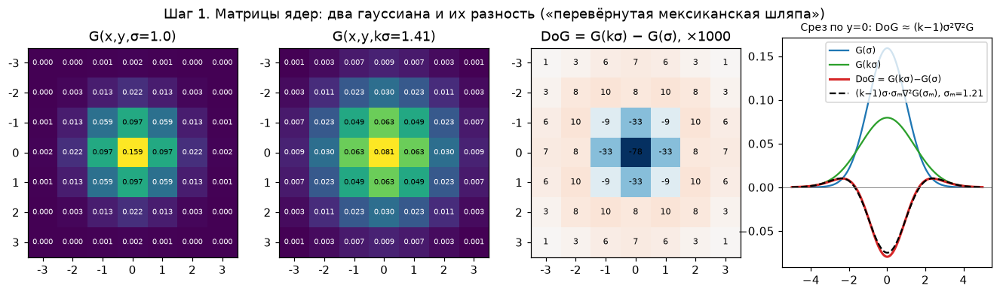

*Рисунок к шагу 1 (свой расчёт). Слева направо: $G(\sigma)$, $G(k\sigma)$, ядро DoG (синее < 0, красное > 0) и срез по $y=0$. Пунктир — масштабно-нормированный лапласиан $(k-1)\sigma\,\sigma_m\nabla^2 G(\sigma_m)$, взятый в середине интервала $\sigma_m = (1+k)\sigma/2 \approx 1.21$. Он почти совпадает с красной кривой DoG: так выглядит аппроксимация $G(k\sigma)-G(\sigma) \approx (k-1)\sigma^2\nabla^2 G$ из формулы выше.*

#### Шаг 2. Свёртка на числах: что DoG делает с пятном

Изображение 11×11: фон яркостью 20, в центре светлое пятно 3×3 яркостью 200. Ниже центральный фрагмент 7×7.

**Исходное $I$:**

| | −3 | −2 | −1 | 0 | +1 | +2 | +3 |
|---|---|---|---|---|---|---|---|
| **−3** | 20 | 20 | 20 | 20 | 20 | 20 | 20 |
| **−2** | 20 | 20 | 20 | 20 | 20 | 20 | 20 |
| **−1** | 20 | 20 | 200 | 200 | 200 | 20 | 20 |
| **0** | 20 | 20 | 200 | **200** | 200 | 20 | 20 |
| **+1** | 20 | 20 | 200 | 200 | 200 | 20 | 20 |
| **+2** | 20 | 20 | 20 | 20 | 20 | 20 | 20 |
| **+3** | 20 | 20 | 20 | 20 | 20 | 20 | 20 |

**$L_1 = G(\sigma{=}1) * I$**: пятно размылось, пик упал с 200 до 160:

| | −3 | −2 | −1 | 0 | +1 | +2 | +3 |
|---|---|---|---|---|---|---|---|
| **−3** | 20.6 | 23.2 | 27.3 | 29.3 | 27.3 | 23.2 | 20.6 |
| **−2** | 23.2 | 36.3 | 57.6 | 67.8 | 57.6 | 36.3 | 23.2 |
| **−1** | 27.3 | 57.6 | 107.0 | 130.5 | 107.0 | 57.6 | 27.3 |
| **0** | 29.3 | 67.8 | 130.5 | **160.4** | 130.5 | 67.8 | 29.3 |
| **+1** | 27.3 | 57.6 | 107.0 | 130.5 | 107.0 | 57.6 | 27.3 |
| **+2** | 23.2 | 36.3 | 57.6 | 67.8 | 57.6 | 36.3 | 23.2 |
| **+3** | 20.6 | 23.2 | 27.3 | 29.3 | 27.3 | 23.2 | 20.6 |

**$L_2 = G(k\sigma{=}1.41) * I$**: размыто сильнее, пик ещё ниже (116), а края поднялись:

| | −3 | −2 | −1 | 0 | +1 | +2 | +3 |
|---|---|---|---|---|---|---|---|
| **−3** | 23.3 | 28.7 | 34.9 | 37.7 | 34.9 | 28.7 | 23.3 |
| **−2** | 28.7 | 43.0 | 59.4 | 66.9 | 59.4 | 43.0 | 28.7 |
| **−1** | 34.9 | 59.4 | 87.6 | 100.5 | 87.6 | 59.4 | 34.9 |
| **0** | 37.7 | 66.9 | 100.5 | **115.9** | 100.5 | 66.9 | 37.7 |
| **+1** | 34.9 | 59.4 | 87.6 | 100.5 | 87.6 | 59.4 | 34.9 |
| **+2** | 28.7 | 43.0 | 59.4 | 66.9 | 59.4 | 43.0 | 28.7 |
| **+3** | 23.3 | 28.7 | 34.9 | 37.7 | 34.9 | 28.7 | 23.3 |

**$D = L_2 - L_1$**:

| | −3 | −2 | −1 | 0 | +1 | +2 | +3 |
|---|---|---|---|---|---|---|---|
| **−3** | 2.7 | 5.5 | 7.6 | 8.5 | 7.6 | 5.5 | 2.7 |
| **−2** | 5.5 | 6.7 | 1.8 | −0.8 | 1.8 | 6.7 | 5.5 |
| **−1** | 7.6 | 1.8 | −19.4 | −30.0 | −19.4 | 1.8 | 7.6 |
| **0** | 8.5 | −0.8 | −30.0 | **−44.5** | −30.0 | −0.8 | 8.5 |
| **+1** | 7.6 | 1.8 | −19.4 | −30.0 | −19.4 | 1.8 | 7.6 |
| **+2** | 5.5 | 6.7 | 1.8 | −0.8 | 1.8 | 6.7 | 5.5 |
| **+3** | 2.7 | 5.5 | 7.6 | 8.5 | 7.6 | 5.5 | 2.7 |

Как это читать:
- В центре пятна сильное размытие «съедает» яркость сильнее слабого: $115.9 - 160.4 = -44.5$. Это **минимум** $D$.
- Вокруг пятна, наоборот, сильное размытие приносит больше яркости: кольцо положительных значений (+5…+8.5).
- Далеко от пятна оба размытия дают 20, и $D \to 0$ (крайние столбцы полного 11×11 — нули).
- Проверка вручную: свернуть исходный фрагмент 7×7 с ядром DoG из шага 1, то есть $\sum \text{DoG}_{ij}\cdot I_{ij}$, даёт тот же **−44.49**. Это и есть равенство в (1): $(G(k\sigma)-G(\sigma))*I = L(k\sigma)-L(\sigma)$. На практике считают правую часть: $L$ всё равно нужны дальше, а вычитание бесплатно.

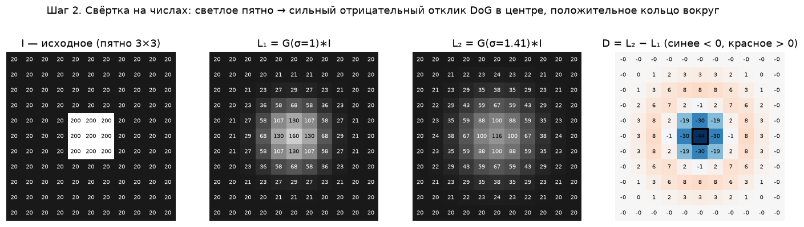

*Рисунок к шагу 2 (свой расчёт). Полное изображение 11×11: $I$, $L_1$, $L_2$ и $D$. Рамкой отмечен центр, минимум $D$.*

#### Шаг 3. Стопка масштабов: одна октава

Теперь синтетическое изображение 200×360 на сером фоне (0.5):
- три светлых диска радиусов 3, 6 и 12;
- тёмный диск радиуса 9;
- светлый прямоугольник, у которого есть края и углы;
- 1% равномерного шума, как в экспериментах статьи.

Параметры как в статье: $s = 3$, $k = 2^{1/3} \approx 1.26$, $\sigma_0 = 1.6$.

| Уровень $L_i$ | 0 | 1 | 2 | 3 | 4 | 5 |
|---|---|---|---|---|---|---|
| $\sigma_i = 1.6\cdot k^i$ | 1.60 | 2.02 | 2.54 | 3.20 | 4.03 | 5.08 |

Из $s+3 = 6$ изображений $L$ получаются $s+2 = 5$ изображений DoG, по одному на каждую пару соседей.

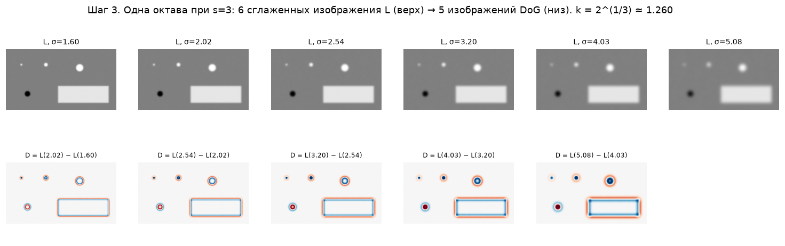

*Рисунок к шагу 3 (свой расчёт). Верхний ряд — $L$ с растущим σ, нижний — $D$ соседних пар. Маленький диск ярче всего на первых DoG и гаснет. Отклик большого диска, наоборот, растёт с масштабом. Края прямоугольника светятся на всех масштабах: на краях DoG отвечает сильно, отсюда нужен тест из разд. 4.1.*

#### Шаг 4. Почему это даёт масштаб: отклик DoG как функция σ

Для наглядности продолжим стопку на три октавы без прореживания: σ от 1.6 до 20.3. Будем смотреть на значение $D$ **в центре каждого диска** при разных σ:

| Радиус диска $r$ | Диск | σ, где $\lvert D\rvert$ максимален | Теория $r/\sqrt2$ | $D$ в пике |
|---|---|---|---|---|
| 3 | светлый | 2.02 | 2.12 | −0.079 |
| 6 | светлый | 4.03 | 4.24 | −0.083 |
| 12 | светлый | 8.06 | 8.49 | −0.083 |
| 9 | тёмный | 6.40 | 6.36 | +0.082 |

Пик приходится на σ ≈ $r/\sqrt2$, то есть **масштаб точки пропорционален размеру структуры**. Если изображение уменьшить вдвое, пик сдвинется ровно на октаву, а σ на 1.6 так и останется первым уровнем. Это и есть масштабная инвариантность. Высота пика у всех дисков почти одинакова (≈0.08): это работает нормировка $\sigma^2$, которая «бесплатно» встроена в DoG. Без неё большие пятна давали бы систематически более слабый отклик.

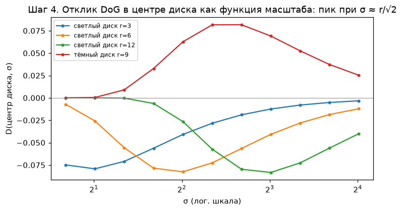

*Рисунок к шагу 4 (свой расчёт). $D$ в центре диска как функция σ (лог. шкала). Экстремум каждой кривой — характерный масштаб (characteristic scale) этого диска. Светлые диски дают минимум, тёмный — максимум.*

#### Шаг 5. Поиск экстремумов по 26 соседям и тест краёв

Каждый отсчёт $D_i(x,y)$ сравнивается с 26 соседями: 8 в своём слое 3×3 и по 9 в слоях выше и ниже (Рис. 2). Ниже реальная окрестность точки в центре диска $r=6$ ($y=50$, $x=130$, σ = 4.03), значения $D$ ×1000:

| масштаб ниже, σ=3.20 | | | | тот же масштаб, σ=4.03 | | | | масштаб выше, σ=5.08 | | |
|---|---|---|---|---|---|---|---|---|---|---|
| −74.8 | −76.6 | −74.8 | | −78.1 | −80.3 | −78.1 | | −69.3 | −70.9 | −69.4 |
| −76.7 | −78.5 | −76.6 | | −80.3 | **−82.6** | −80.4 | | −70.9 | −72.6 | −71.0 |
| −74.9 | −76.7 | −74.8 | | −78.2 | −80.4 | −78.2 | | −69.4 | −71.0 | −69.4 |

Центр −82.6 меньше всех 26 соседей, значит это локальный минимум и по пространству, и по масштабу. Обратите внимание: соседи по масштабу (−78.5 ниже, −72.6 выше) тоже близки к пику. Поэтому статья потом уточняет положение и масштаб квадратичной интерполяцией (разд. 4).

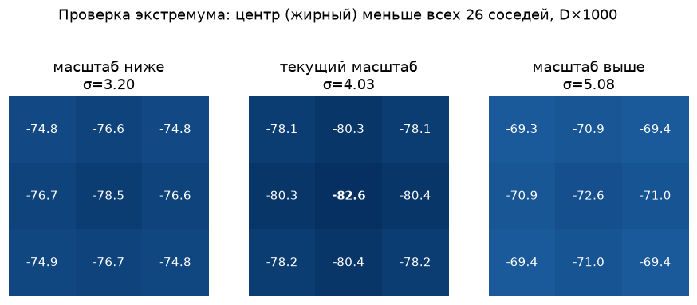

*Рисунок (свой расчёт). Окрестность 3×3×3 найденной точки.*

На всём изображении с порогом $|D| > 0.01$ экстремумов **156**. Почти все они сидят на краях прямоугольника и немного на шуме. Тест краёв из разд. 4.1 с $r = 10$ требует $\operatorname{Tr}(H)^2/\operatorname{Det}(H) < (r+1)^2/r = 12.1$:

| Точка | $D_{xx}$ | $D_{yy}$ | $D_{xy}$ | $\operatorname{Tr}^2/\operatorname{Det}$ | Итог |
|---|---|---|---|---|---|
| центр диска $r=6$ | 0.00443 | 0.00444 | 0.00000 | **4.0** (минимум, обе кривизны равны) | оставить |
| точка на краю (σ = 2.02) | −0.00037 | −0.00851 | −0.00108 | **40.2** (кривизна поперёк края в ~20 раз больше) | отбросить |

После теста остаётся **20** точек: все 4 диска и по несколько масштабов в 4 углах прямоугольника. Углы проходят тест, потому что яркость там меняется в двух направлениях.

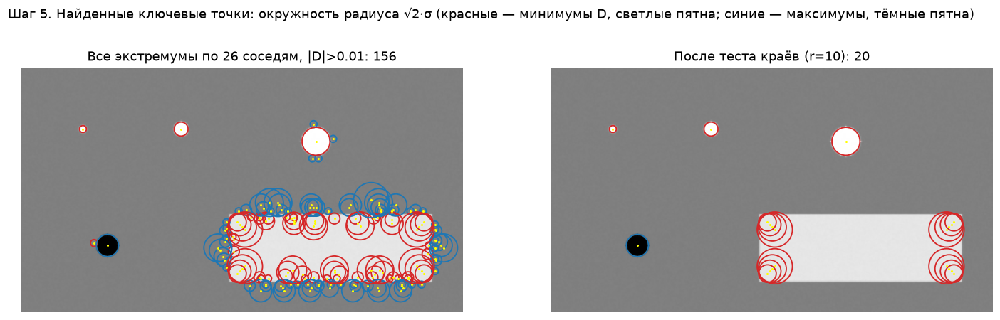

*Рисунок к шагу 5 (свой расчёт). Окружность радиуса $\sqrt2\,\sigma$ вокруг каждой точки: красные — минимумы $D$ (светлые пятна), синие — максимумы (тёмные пятна). Слева все экстремумы, справа после теста краёв. Размер окружности совпадает с размером диска: масштаб найден правильно.*

**Упрощения в этом примере по сравнению со статьёй:**
- нет удвоения входного изображения;
- нет прореживания между октавами (здесь все σ на одном разрешении);
- нет субпиксельной интерполяции;
- порог контраста задан прямо на $|D|$ (0.01), а не на интерполированном $|D(\hat{\mathbf x})| < 0.03$ из разд. 4.

На суть не влияет: так видна чистая работа DoG.

### Построение пирамиды (Рис. 1)

- Каждая **октава (octave)** — удвоение $\sigma$ — делится на целое число $s$ интервалов, так что $k = 2^{1/s}$.
- В стопке гауссианов на октаву нужно $s+3$ изображения, чтобы поиск экстремумов покрыл октаву целиком; соседние изображения вычитаются → $s+2$ изображения DoG.
- После обработки октавы гауссово изображение с удвоенным начальным $\sigma$ (второе сверху в стопке) прореживается в 2 раза (каждый второй пиксель по строкам и столбцам) и служит началом следующей октавы — точность выборки относительно $\sigma$ не меняется, а вычислений гораздо меньше.

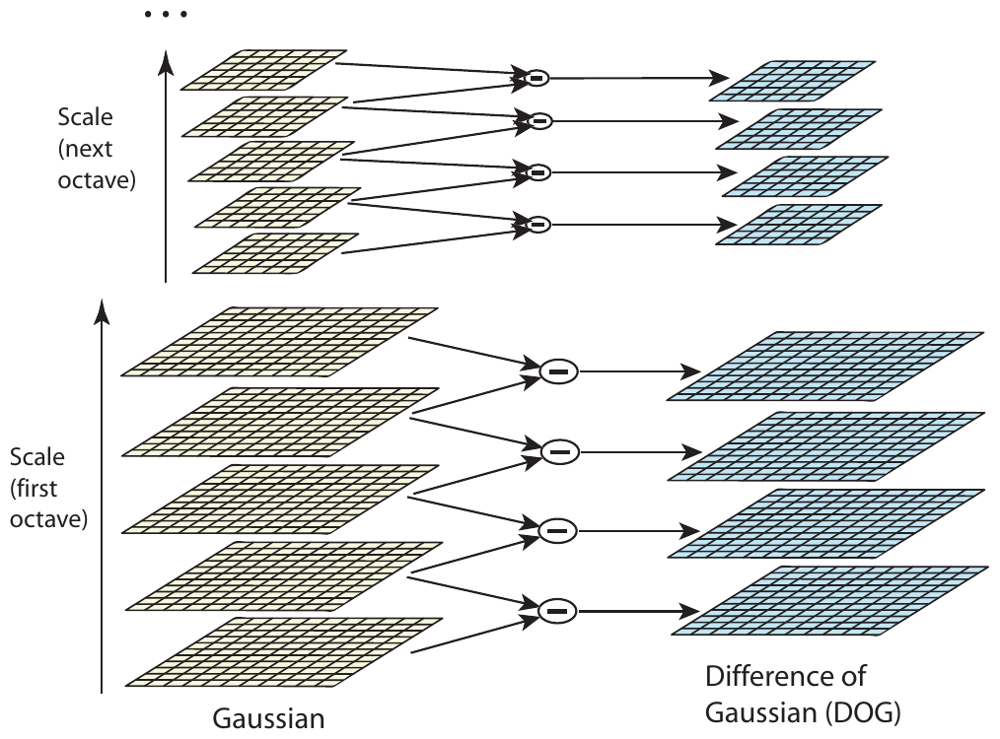

*Рис. 1 (из оригинальной статьи). В каждой октаве изображение последовательно сглаживается гауссианами (слева), соседние уровни вычитаются, давая изображения DoG (справа); после октавы гауссово изображение уменьшается вдвое и процесс повторяется.*

### 3.1. Поиск локальных экстремумов

- Каждый отсчёт $D$ сравнивается с 26 соседями: 8 в своём изображении (3×3) и по 9 в соседних масштабах выше и ниже. Точка отбирается, если она больше всех соседей или меньше всех.
- Проверка дешёвая: большинство точек отсеиваются после первых нескольких сравнений.
- Нет такой частоты дискретизации, при которой находятся все экстремумы: они могут быть сколь угодно близки (пример автора — переход вытянутого эллипса от одного максимума к двум). Но близкие экстремумы и неустойчивы, поэтому частота выбирается экспериментально как компромисс эффективность/полнота.

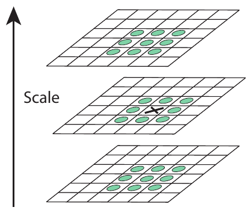

*Рис. 2 (из оригинальной статьи). Экстремум DoG: пиксель X сравнивается с 26 соседями в окнах 3×3 на текущем и двух соседних масштабах (кружки).*

### 3.2. Частота дискретизации по масштабу

**Протокол экспериментов** (используется в большинстве симуляций статьи): 32 реальных изображения разных типов (улица, лица, **аэрофотоснимки**, промышленные сцены — тип изображений почти не влиял на результат); синтетические преобразования — поворот, масштаб, аффинное растяжение, яркость и контраст, шум. Поскольку преобразования известны, можно точно предсказать, где должна оказаться каждая точка.

- Здесь: случайный поворот, масштаб от 0.2 до 0.9 исходного размера, 1% шума (равномерная добавка из $[-0.01, 0.01]$ при яркостях в $[0,1]$, т. е. чуть меньше 6 бит точности).
- **Совпадение масштаба** — в пределах множителя $\sqrt2$; **совпадение положения** — в пределах $\sigma$ пикселей ($\sigma$ — масштаб точки).
- Нижняя кривая — доля точек, чей дескриптор верно сопоставился с базой из **40 000** ключевых точек (метод из разд. 7).

**Результат:** наибольшая повторяемость — при **3 масштабах на октаву**; дальше повторяемость немного падает: экстремумов становится больше, но они в среднем менее устойчивы. При этом абсолютное число верно сопоставленных точек продолжает расти — для задач, где важнее количество совпадений, выгодно брать больше масштабов, но это дороже. В статье везде $s=3$.

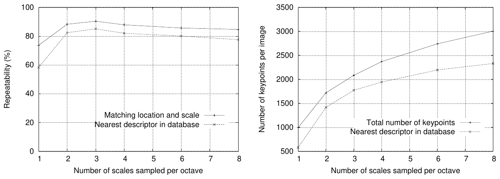

*Рис. 3 (из оригинальной статьи). Слева — повторяемость (положение и масштаб) и доля верных совпадений с базой в зависимости от числа масштабов на октаву (максимум при 3); справа — общее число точек и число верно сопоставленных точек на типичном изображении.*

### 3.3. Частота дискретизации в пространстве

- Подбирается **предварительное сглаживание** $\sigma$ первого уровня каждой октавы. Повторяемость монотонно растёт с $\sigma$, но растёт и стоимость → выбрано $\sigma = 1.6$ (почти оптимальная повторяемость).
- Предсглаживание отбрасывает высокие частоты, поэтому вход **увеличивается вдвое** линейной интерполяцией перед построением первой октавы.
- Допущение: исходное изображение уже имеет размытие не менее $\sigma = 0.5$ (минимум против сильного алиасинга) → удвоенное имеет $\sigma = 1.0$ в новых пикселях, и до 1.6 нужно досглаживать немного.
- Удвоение увеличивает число устойчивых точек почти в **4 раза**; большее увеличение заметного выигрыша не дало.

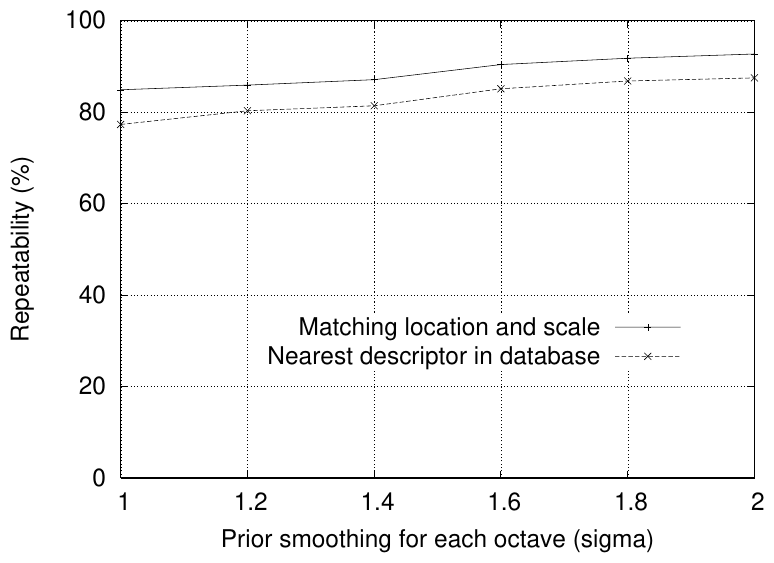

*Рис. 4 (из оригинальной статьи). Повторяемость и доля верных совпадений с базой в зависимости от сглаживания первого уровня октавы σ (выбрано 1.6).*

## 4. Точная локализация ключевых точек

Метод Brown & Lowe (2002): разложение $D$ в ряд Тейлора до квадратичных членов в окрестности отсчёта:

$$
D(\mathbf{x}) = D + \frac{\partial D}{\partial \mathbf{x}}^{\!\top}\mathbf{x} + \frac12\,\mathbf{x}^\top \frac{\partial^2 D}{\partial \mathbf{x}^2}\,\mathbf{x} \tag{2}
$$

- $\mathbf{x} = (x, y, \sigma)^\top$ — смещение от текущего отсчёта (по положению и масштабу);
- $D$ и производные берутся в отсчёте и оцениваются конечными разностями соседних отсчётов.

Положение экстремума — из условия равенства нулю производной:

$$
\hat{\mathbf{x}} = -\left(\frac{\partial^2 D}{\partial \mathbf{x}^2}\right)^{-1} \frac{\partial D}{\partial \mathbf{x}}. \tag{3}
$$

- Это система 3×3 — решается очень дёшево.
- Если смещение $\hat{\mathbf{x}}$ больше 0.5 по любой координате, экстремум ближе к другому отсчёту: центр переносится туда и интерполяция повторяется. Итоговое смещение добавляется к координатам отсчёта (субпиксельная и «субмасштабная» точность).
- По Брауну, такая интерполяция существенно улучшает сопоставление и устойчивость по сравнению с версией 1999 г., где точка бралась в центре отсчёта.

**Отбраковка по контрасту.** Значение в экстремуме (подстановка (3) в (2)):

$$
D(\hat{\mathbf{x}}) = D + \frac12 \frac{\partial D}{\partial \mathbf{x}}^{\!\top}\hat{\mathbf{x}}.
$$

Все экстремумы с $|D(\hat{\mathbf{x}})| < 0.03$ (яркость в $[0,1]$) отбрасываются как неустойчивые к шуму.

### 4.1. Устранение откликов на краях

DoG сильно откликается вдоль краёв, где положение вдоль края определено плохо. У такого пика большая главная кривизна поперёк края и малая — вдоль. Кривизны оцениваются по гессиану 2×2 в точке и масштабе ключевой точки:

$$
\mathbf{H} = \begin{bmatrix} D_{xx} & D_{xy} \\ D_{xy} & D_{yy} \end{bmatrix} \tag{4}
$$

Собственные значения $\mathbf{H}$ пропорциональны главным кривизнам. Как у Harris & Stephens, явно их вычислять не нужно — важно только отношение. Пусть $\alpha$ — большее по модулю собственное значение, $\beta$ — меньшее, $\alpha = r\beta$:

$$
\operatorname{Tr}(\mathbf{H}) = D_{xx} + D_{yy} = \alpha + \beta, \qquad
\operatorname{Det}(\mathbf{H}) = D_{xx}D_{yy} - D_{xy}^2 = \alpha\beta,
$$

$$
\frac{\operatorname{Tr}(\mathbf{H})^2}{\operatorname{Det}(\mathbf{H})} = \frac{(r+1)^2}{r}.
$$

- Величина $(r+1)^2/r$ минимальна при равных собственных значениях и растёт с $r$.
- **Критерий:** точка сохраняется, если $\dfrac{\operatorname{Tr}(\mathbf{H})^2}{\operatorname{Det}(\mathbf{H})} < \dfrac{(r+1)^2}{r}$; в статье $r = 10$.
- Если $\operatorname{Det}(\mathbf{H}) < 0$ (кривизны разных знаков — седло), точка отбрасывается.
- Стоимость — меньше 20 операций с плавающей точкой на точку.

**Пример (Рис. 5):** изображение 233×189 → 832 исходных экстремума → 729 после порога контраста → 536 после проверки на край.

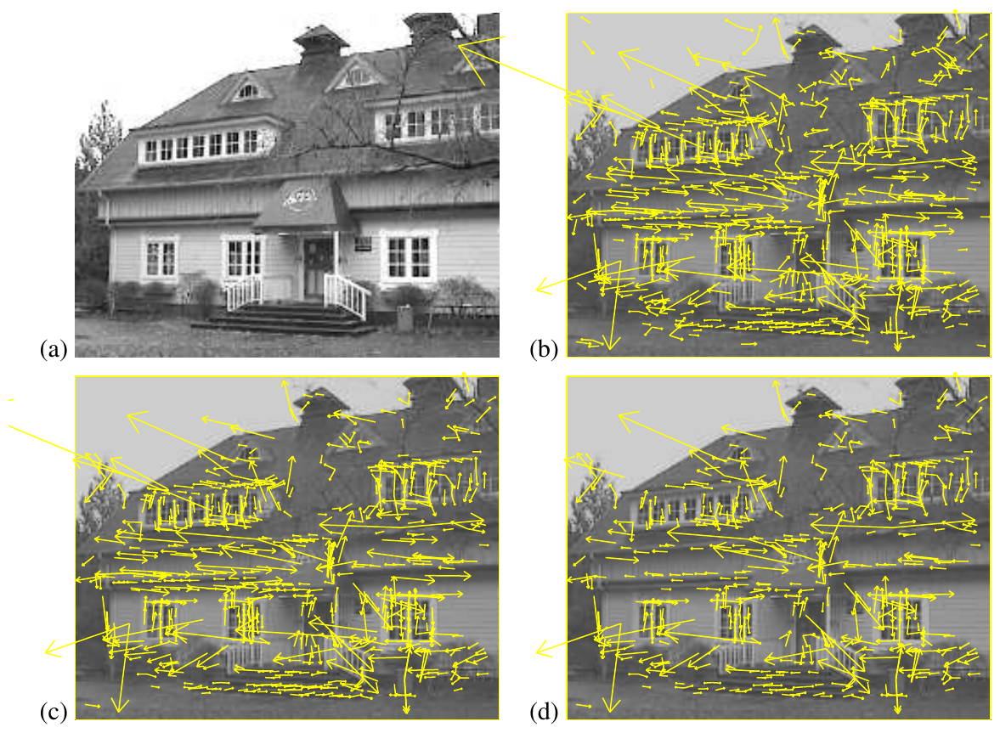

*Рис. 5 (из оригинальной статьи). (a) исходное изображение 233×189; (b) 832 исходных экстремума DoG (векторы показывают масштаб, ориентацию и положение); (c) 729 точек после порога минимального контраста; (d) 536 точек после порога на отношение главных кривизн.*

## 5. Назначение ориентации

Идея: дескриптор строится относительно назначенной ориентации, поэтому инвариантен к повороту. В отличие от инвариантных к повороту мер Schmid & Mohr, это не ограничивает выбор дескриптора и не выбрасывает информацию.

- По масштабу точки выбирается ближайшее гауссово изображение $L$ — все вычисления масштабно-инвариантны.
- Для каждого пикселя $L$ предвычисляются модуль и направление градиента конечными разностями:

$$
m(x,y) = \sqrt{\big(L(x+1,y) - L(x-1,y)\big)^2 + \big(L(x,y+1) - L(x,y-1)\big)^2},
$$

$$
\theta(x,y) = \operatorname{atan}\!\left(\frac{L(x,y+1) - L(x,y-1)}{L(x+1,y) - L(x-1,y)}\right).
$$

- **Гистограмма ориентаций** в окрестности точки: 36 бинов на 360° (по 10°); вклад каждого отсчёта взвешивается модулем градиента и круговым гауссовым окном с $\sigma$, в **1.5 раза** большим масштаба точки.
- Берётся наивысший пик; **любой другой локальный пик выше 80% от максимума** порождает ещё одну ключевую точку с тем же положением и масштабом, но своей ориентацией. Таких точек около 15%, но они заметно повышают устойчивость сопоставления.
- Положение пика уточняется параболой по трём ближайшим значениям гистограммы.

**Устойчивость (Рис. 6):** ориентация остаётся верной (в пределах 15°) в 95% случаев даже при шуме ±10% (меньше 3 бит точности камеры); дисперсия ориентации у верных совпадений около 2.5°, при 10% шума — 3.9°. Главный источник ошибок — исходная детекция положения и масштаба, а не ориентация и не дескриптор.

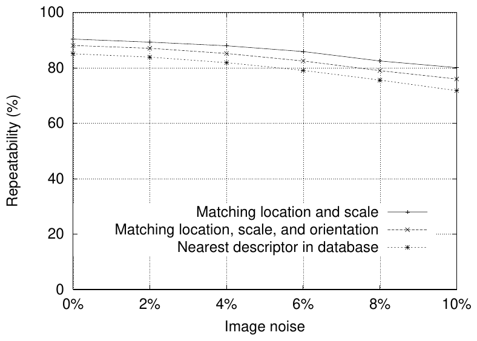

*Рис. 6 (из оригинальной статьи). Повторяемость положения и масштаба, то же с учётом ориентации и доля верных совпадений дескрипторов с базой в зависимости от уровня шума (0–10%).*

## 6. Локальный дескриптор

Положение, масштаб и ориентация задают повторяемую локальную 2D-систему координат. Теперь нужен дескриптор, максимально различимый и инвариантный к оставшимся изменениям (освещение, 3D-ракурс).

- Прямая корреляция патчей чувствительна к рассогласованию отсчётов (аффинные и ракурсные изменения, нежёсткие деформации).
- Вдохновение — модель **сложных клеток (complex cells)** первичной зрительной коры (Edelman, Intrator, Poggio 1997): нейрон реагирует на градиент определённой ориентации и пространственной частоты, но допускает сдвиг его положения в пределах рецептивного поля. В их экспериментах для 3D-объектов, повёрнутых на 20° по глубине, точность распознавания выросла с 35% (корреляция градиентов) до 94% (модель сложных клеток). SIFT реализует ту же идею другим механизмом.

### 6.1. Представление дескриптора

1. Модули и ориентации градиентов берутся в окрестности точки на гауссовом изображении, соответствующем её масштабу (предвычислены для всей пирамиды, см. разд. 5).
2. **Инвариантность к повороту:** координаты дескриптора и ориентации градиентов поворачиваются относительно ориентации точки.
3. **Гауссово взвешивание** с $\sigma$, равным половине ширины окна дескриптора: нет резких изменений при малых сдвигах окна, и меньше веса у дальних градиентов, сильнее всего страдающих от рассогласования.
4. **Гистограммы ориентаций по подобластям 4×4 отсчёта**, 8 направлений в каждой: градиент может сместиться до 4 позиций и всё ещё попасть в ту же гистограмму — это и даёт устойчивость к локальным сдвигам.
5. **Трилинейная интерполяция (trilinear interpolation):** каждый градиент распределяется по соседним бинам (по двум пространственным координатам и по ориентации) с весом $1-d$ по каждому измерению, где $d$ — расстояние до центра бина в единицах шага бина. Это устраняет скачки, когда отсчёт плавно переходит из одного бина в другой.
6. Вектор — все значения гистограмм: $4\times4\times8 = 128$ элементов.

**Нормировка против изменений освещения:**
- нормировка вектора на единичную длину → инвариантность к **контрасту** (умножение пикселей на константу умножает все градиенты на ту же константу);
- к **яркости** (прибавление константы) вектор инвариантен изначально — градиенты считаются по разностям;
- итого — инвариантность к аффинным изменениям освещения;
- **нелинейные** изменения (насыщение камеры, разное освещение по-разному ориентированных 3D-поверхностей) сильно меняют модули отдельных градиентов, но слабее — их направления. Поэтому все компоненты единичного вектора **обрезаются сверху значением 0.2**, после чего вектор снова нормируется. Так распределение ориентаций получает больший вес, чем точные модули больших градиентов. Порог 0.2 подобран экспериментально на изображениях одних и тех же 3D-объектов при разном освещении.

### 6.2. Выбор размера дескриптора

Два параметра: число ориентаций $r$ в гистограмме и ширина $n$ сетки $n\times n$; длина вектора $rn^2$. Более сложный дескриптор лучше различает в большой базе, но чувствительнее к искажениям формы и перекрытиям.

Эксперимент (Рис. 8): плоскость наклонена на 50° от наблюдателя + 4% шума (на границе надёжного сопоставления), доля точек, чей ближайший сосед в базе из 40 000 — верный.

- $n = 1$ (одна гистограмма) различает очень плохо;
- качество растёт до сетки **4×4 с 8 ориентациями**; дальнейшее увеличение (больше ориентаций или шире сетка) может ухудшать результат из-за чувствительности к искажениям;
- в более простых условиях качество иногда растёт и дальше (5×5 и больше), но с уже высокого уровня.

Итог: $4\times4\times8 = 128$ измерений; по опыту автора стабильно лучше низкоразмерных дескрипторов, а стоимость сопоставления остаётся низкой благодаря приближённому поиску соседей.

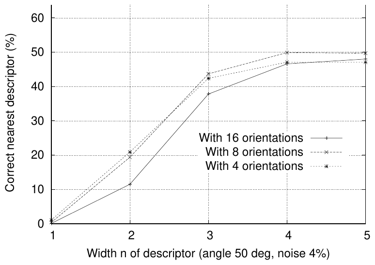

*Рис. 8 (из оригинальной статьи). Доля верных ближайших соседей в базе из 40 000 точек в зависимости от ширины n сетки n×n и числа ориентаций (4, 8, 16); наклон 50°, шум 4%.*

### 6.3. Чувствительность к аффинным изменениям

- Каждый этап (положение/масштаб, ориентация, сопоставление с базой) теряет повторяемость с ростом аффинного искажения, но итоговая точность сопоставления **остаётся выше 50% до поворота плоскости на 50°** (Рис. 9).
- Для более широких ракурсов можно использовать аффинно-инвариантные детекторы (Harris-affine по Mikolajczyk 2002 уступает SIFT до ~50°, но сохраняет около 40% повторяемости до 70°) — ценой гораздо большей стоимости, меньшего числа точек и худшей устойчивости при малых искажениях.
- Для 3D-объектов допустимый поворот всё равно меньше, чем для плоскостей, так что аффинная инвариантность обычно не узкое место.
- Простой приём для заведомо плоских поверхностей (Pritchard & Heidrich 2003): дополнительно извлекать SIFT из 4 аффинно преобразованных версий эталонного изображения (соответствуют смене ракурса на 60°) — база растёт примерно в 3 раза, а обработка запроса не дорожает.

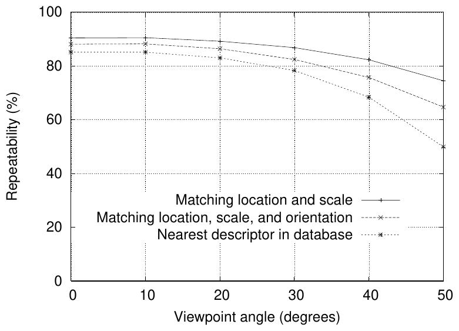

*Рис. 9 (из оригинальной статьи). Устойчивость детекции положения и масштаба, ориентации и итогового сопоставления с базой в зависимости от аффинного искажения, выраженного как угол поворота плоскости по глубине.*

### 6.4. Сопоставление с большими базами

- База из 112 изображений, поворот по глубине 30°, шум 2%, плюс случайные поворот и масштаб.
- Доля верных ближайших соседей падает с ростом числа «отвлекающих» признаков (логарифмическая шкала от одного изображения до ~100 000 точек), но медленно — верные совпадения будут находиться и в очень больших базах.
- Разрыв между кривой «точка найдена в правильном положении, масштабе и ориентации» и кривой «верный ближайший дескриптор» мал: **ошибки в основном из-за исходной локализации и ориентации, а не из-за недостатка различимости дескриптора**.

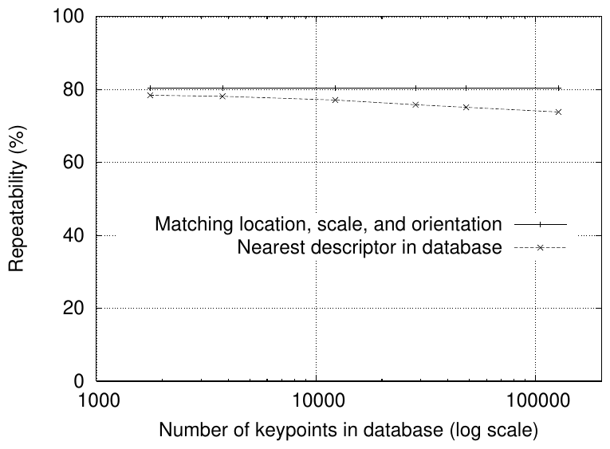

*Рис. 10 (из оригинальной статьи). Пунктир — доля верных совпадений с базой в зависимости от её размера (лог. шкала); сплошная — доля точек с верными положением, масштабом и ориентацией. Случайные масштаб и поворот, аффинное искажение 30°, шум 2%.*

## 7. Применение к распознаванию объектов

Каждая точка запроса независимо сопоставляется с базой точек эталонных изображений; затем ищутся кластеры из ≥3 совпадений, согласованных по объекту и позе, и каждый кластер проверяется детальной геометрической подгонкой.

### 7.1. Сопоставление точек и тест отношения расстояний

- Лучший кандидат — ближайший сосед по евклидову расстоянию 128-мерных дескрипторов.
- Многие точки запроса вообще не имеют пары (фон, не найдены на эталоне). Глобальный порог на расстояние работает плохо: одни дескрипторы различимее других.
- **Тест отношения расстояний (ratio test):** сравнивается расстояние до ближайшего соседа с расстоянием до второго ближайшего:

$$
\frac{d_1}{d_2} = \frac{\lVert \mathbf{f} - \mathbf{f}_{(1)} \rVert}{\lVert \mathbf{f} - \mathbf{f}_{(2)} \rVert} < 0.8,
$$

где $\mathbf{f}$ — дескриптор запроса, $\mathbf{f}_{(1)}, \mathbf{f}_{(2)}$ — первый и второй ближайшие дескрипторы базы. Если в базе несколько изображений одного объекта, «вторым» считается ближайший сосед, заведомо принадлежащий **другому** объекту.
- **Интуиция:** у верного совпадения ближайший сосед должен быть заметно ближе любого неверного; у ложного рядом, как правило, много других ложных на сходных расстояниях (высокая размерность). Второй сосед служит оценкой плотности ложных совпадений в этой области пространства признаков.
- **Результат:** отбрасывание совпадений с отношением > 0.8 убирает **90% ложных** совпадений и теряет **менее 5% верных** (база 40 000 точек, случайные масштаб/поворот, поворот по глубине 30°, шум 2%).

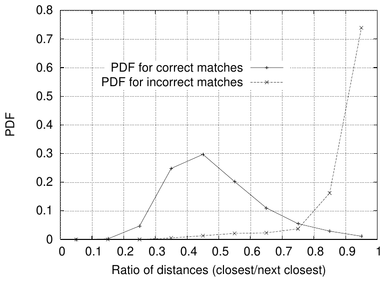

*Рис. 11 (из оригинальной статьи). Плотности распределения отношения расстояний «ближайший / второй ближайший» для верных (сплошная) и неверных (пунктир) совпадений; база 40 000 точек.*

### 7.2. Приближённый поиск ближайшего соседа (Best-Bin-First)

- Точных алгоритмов поиска соседей в высоких размерностях, быстрее полного перебора, неизвестно; k-d дерево не даёт выигрыша уже выше ~10 измерений.
- **Best-Bin-First (BBF)** (Beis & Lowe 1997): модифицированный порядок обхода k-d дерева — ячейки просматриваются в порядке их расстояния от запроса (приоритетная очередь на куче, ср. Arya & Mount 1993); поиск обрывается после фиксированного числа просмотренных кандидатов.
- В реализации — обрыв после **200** кандидатов. Для базы 100 000 точек — ускорение примерно на **2 порядка** относительно точного поиска при потере менее **5%** верных совпадений.
- BBF особенно хорошо сочетается с ratio test: самые трудные случаи (много соседей на почти одинаковых расстояниях) всё равно отбрасываются, и решать их точно не нужно.

### 7.3. Кластеризация преобразованием Хафа

- Хочется распознавать объекты по минимальному числу совпадений — надёжно уже по 3. На изображении 2000+ признаков из разных объектов и фона; даже после ratio test может оставаться **менее 1% верных совпадений среди 99% выбросов**.
- Автор прямо отмечает, что [RANSAC](RANSAC_конспект.md) и LMedS (Least Median of Squares) работают плохо, когда доля верных совпадений сильно ниже 50%, — поэтому используется **кластеризация в пространстве поз преобразованием Хафа (Hough transform)**.
- Каждое совпадение задаёт 4 параметра (2D-положение, масштаб, ориентация) и голосует за позу модели (подобие — similarity transform), предсказанную по параметрам точки в эталоне. Это лишь приближение к 6-DoF позе 3D-объекта и не учитывает нежёсткие деформации → широкие бины:

| Параметр позы | Размер бина Хафа |
|---|---|
| Ориентация | 30° |
| Масштаб | множитель 2 |
| Положение | 0.25 × максимальный проецированный размер эталонного изображения (с учётом предсказанного масштаба) |
| Голосование | в 2 ближайших бина по каждому измерению → 16 голосов на гипотезу |

- Вместо многомерного массива (почти пустого, со взаимозависимыми границами бинов) — **хеш-таблица**: псевдослучайный хеш от значений бина в одномерную таблицу, коллизии легко обнаруживаются.

### 7.4. Решение для аффинных параметров

- Все бины Хафа с ≥3 голосами проходят геометрическую проверку: наименьшими квадратами ищется **аффинное преобразование** эталон → запрос.
- Аффинная модель точна для поворота плоскости при ортографической проекции и приближённа для неплоских объектов. Фундаментальная матрица точнее, но требует ≥7 соответствий (на практике больше), а аффинная — 3. Ошибки аффинного приближения компенсируются допуском на невязку до 0.25 проецированного размера объекта (поворот описанной сферы на 30° сдвигает любую точку не более чем на 0.25 проецированного диаметра).

Модель для точки модели $[x\ y]^\top$ и точки изображения $[u\ v]^\top$:

$$
\begin{bmatrix} u \\ v \end{bmatrix} = \begin{bmatrix} m_1 & m_2 \\ m_3 & m_4 \end{bmatrix}\begin{bmatrix} x \\ y \end{bmatrix} + \begin{bmatrix} t_x \\ t_y \end{bmatrix}
$$

- $m_1..m_4$ — аффинные поворот, масштаб и растяжение; $t_x, t_y$ — сдвиг.

Перегруппировка неизвестных в вектор (каждое соответствие даёт две строки):

$$
\begin{bmatrix} x & y & 0 & 0 & 1 & 0 \\ 0 & 0 & x & y & 0 & 1 \\ & & \cdots & & & \end{bmatrix}
\begin{bmatrix} m_1 \\ m_2 \\ m_3 \\ m_4 \\ t_x \\ t_y \end{bmatrix} =
\begin{bmatrix} u \\ v \\ \vdots \end{bmatrix},
\qquad A\mathbf{x} = \mathbf{b},
\qquad \mathbf{x} = (A^\top A)^{-1}A^\top \mathbf{b}.
$$

- Решение нормальных уравнений минимизирует сумму квадратов расстояний от проецированных точек модели до соответствующих точек изображения.

**Итеративная очистка и верификация:**
1. Выбросы удаляются: каждое совпадение должно согласовываться с решением в пределах **половины** допуска бинов Хафа.
2. Решение пересчитывается по оставшимся точкам; процесс повторяется. Если осталось < 3 точек — гипотеза отвергается.
3. **Сверху-вниз (top-down)** добавляются совпадения, согласные с проецированной моделью, но не попавшие в бин Хафа.
4. Окончательное решение — вероятностная модель из Lowe (2001): оценивается ожидаемое число ложных совпадений для данной позы (по размеру проекции модели, числу признаков в области и точности подгонки), затем байесовский анализ даёт вероятность присутствия объекта. Модель принимается при вероятности **> 0.98**. Для маленьких объектов может хватить 3 совпадений, для крупных на сильно текстурированном изображении — до 10.

## 8. Примеры распознавания

- **Рис. 12:** игрушечный поезд и лягушка находятся на загромождённом изображении 600×480 с сильными перекрытиями. Параллелограмм — граница эталонного изображения под найденным аффинным преобразованием; квадраты — использованные точки (размер = область дескриптора).
- **Рис. 13 — распознавание места (place recognition):** эталоны — участки сцены (даже малотекстурные: деревянная стена, дерево с мусорными баками); тестовое изображение 640×315 снято с ракурса, повёрнутого примерно на 30°, — все места распознаны. Автор прямо указывает это как приложение для мобильного устройства или транспорта, определяющего своё местоположение.
- **Время:** распознавание всех объектов на Рис. 12 или 13 — **меньше 0.3 с** на Pentium 4 2 ГГц.
- **Практические пределы (по опыту автора):** текстурированные плоские поверхности распознаются надёжно при повороте по глубине **до 50°** почти при любом достаточном освещении без сильных бликов; для 3D-объектов — лишь **около 30°**, и освещение влияет сильнее → для 3D-объектов лучше объединять признаки нескольких видов (view clustering, Lowe 2001).
- **Локализация робота и картирование (SLAM-подобная задача)** (Se, Lowe, Little 2001, 2002): тринокулярное стерео даёт 3D-положения точек (используются только точки, найденные во всех трёх изображениях с согласованными диспаратностями — очень мало выбросов); робот локализуется по совпадениям с 3D-картой и дополняет её, уточняя положения фильтром Калмана; решена и задача глобальной локализации («включили где угодно на большой карте») — по сути 3D-вариант распознавания объектов.

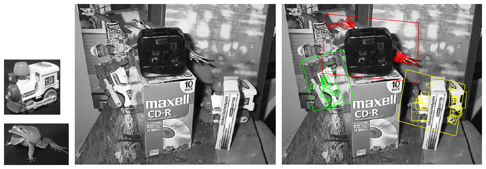

*Рис. 12 (из оригинальной статьи). Слева — эталонные изображения двух объектов; в центре — загромождённая сцена с перекрытиями; справа — результат: параллелограммы — границы эталонов под найденным аффинным преобразованием, квадраты — использованные ключевые точки.*

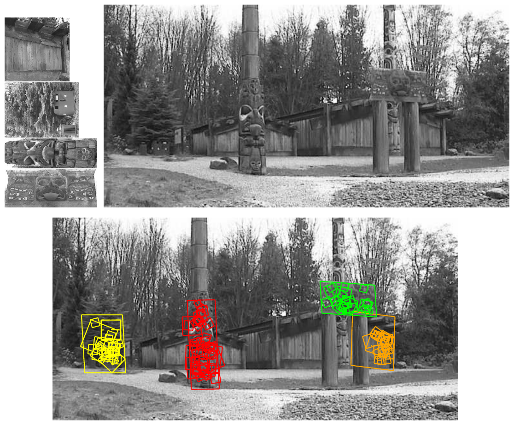

*Рис. 13 (из оригинальной статьи). Сверху слева — эталонные изображения участков сцены, сверху справа — тестовое изображение 640×315 с другого ракурса; снизу — распознанные области (квадраты — ключевые точки, параллелограммы — границы эталонов под аффинным преобразованием).*

## 9. Выводы автора

- Главное достоинство SIFT — различимость: верная пара находится в большой базе за счёт высокоразмерного вектора локальных градиентов.
- Признаки инвариантны к повороту и масштабу и устойчивы к значительным аффинным искажениям, шуму и освещению; их много, что помогает находить маленькие объекты среди помех; полный диапазон масштабов: мелкие точки — для маленьких и перекрытых объектов, крупные — для шума и размытия.
- Вычисления эффективны — тысячи точек почти в реальном времени на ПК того времени.
- Возможные применения: сопоставление видов для 3D-реконструкции, трекинг, сегментация движения, **локализация роботов**, сшивка панорам, эпиполярная калибровка.
- Направления: систематические тесты с полными 3D-изменениями ракурса и освещения; цветовые инвариантные дескрипторы (сейчас — только яркость); текстурные меры; обучение признаков под конкретные классы объектов; комбинация многих типов признаков.

---

## Сводка гиперпараметров (по статье)

| Параметр | Значение | Где в статье |
|---|---|---|
| Масштабов (интервалов) на октаву $s$ | 3 ($k = 2^{1/3}$) | разд. 3.2 |
| Изображений гауссианов на октаву | $s + 3 = 6$ (→ 5 DoG) | разд. 3 |
| Сглаживание первого уровня октавы $\sigma$ | 1.6 | разд. 3.3 |
| Предполагаемое размытие входа | $\sigma = 0.5$ | разд. 3.3 |
| Удвоение входного изображения | да, линейная интерполяция | разд. 3.3 |
| Соседей при поиске экстремума | 26 (3×3×3 − 1) | разд. 3.1 |
| Порог контраста $\lvert D(\hat{\mathbf{x}})\rvert$ | 0.03 (яркость в [0,1]) | разд. 4 |
| Порог смещения для смены отсчёта | 0.5 | разд. 4 |
| Порог отношения кривизн $r$ | 10 | разд. 4.1 |
| Бинов гистограммы ориентаций | 36 (по 10°) | разд. 5 |
| $\sigma$ окна ориентации | 1.5 × масштаб точки | разд. 5 |
| Порог дополнительных ориентаций | 80% от максимума | разд. 5 |
| Сетка дескриптора | 4×4 подобласти по 4×4 отсчёта (16×16) | разд. 6.1 |
| Ориентаций в гистограмме дескриптора | 8 | разд. 6.1 |
| Размерность дескриптора | 128 | разд. 6.1 |
| $\sigma$ окна дескриптора | 0.5 × ширина окна дескриптора | разд. 6.1 |
| Порог обрезки компонент | 0.2 (затем перенормировка) | разд. 6.1 |
| Порог ratio test | 0.8 | разд. 7.1 |
| Число кандидатов BBF | 200 | разд. 7.2 |
| Бины Хафа | 30°; ×2 по масштабу; 0.25 размера по положению; 2 бина на измерение | разд. 7.3 |
| Минимум совпадений в кластере | 3 | разд. 7.4 |
| Порог вероятности принятия объекта | 0.98 | разд. 7.4 |

**Не указано в статье** (для воспроизведения нужны внешние источники): точный радиус окна гистограммы ориентаций; размер подобласти дескриптора в пикселях относительно масштаба точки (статья говорит лишь об отсчётах на «масштабе точки»); максимальное число итераций интерполяции; ширина отступа от границы изображения; число октав. Эти значения задаются в конкретных реализациях (см. ниже про OpenCV).

## Ключевые численные результаты (по статье)

| Эксперимент | Результат |
|---|---|
| Число точек на изображении 500×500 | ~2000 (зависит от содержимого и параметров) |
| Отбор точек на изображении 233×189 | 832 экстремума → 729 (контраст) → 536 (края) |
| Удвоение входного изображения | почти ×4 устойчивых точек |
| Точек с несколькими ориентациями | ~15% |
| Ориентация при шуме ±10% | верна (±15°) в 95% случаев; дисперсия 2.5° → 3.9° |
| Сопоставление при повороте плоскости на 50° | > 50% верных совпадений с базой |
| Ratio test 0.8 | −90% ложных, −<5% верных совпадений |
| BBF, 200 кандидатов, база 100 000 точек | ускорение ~×100, потеря < 5% верных совпадений |
| Распознавание (Рис. 12/13) | < 0.3 с на Pentium 4 2 ГГц |
| Надёжный диапазон ракурсов | плоские текстурированные — до 50°; 3D-объекты — ~30° |

---

## Описание ключевых рисунков

*Рисунки вставлены в соответствующие разделы конспекта выше (Рис. 7 — после аннотации, 1–2 — разд. 3, 3 — разд. 3.2, 4 — разд. 3.3, 5 — разд. 4.1, 6 — разд. 5, 8–10 — разд. 6, 11 — разд. 7.1, 12–13 — разд. 8). Здесь — сводное описание.*

- **Рис. 1 — построение пирамиды.** Две октавы: слева стопка гауссовых изображений с растущим масштабом, справа — их попарные разности (DoG); следующая октава строится из прореженного вдвое изображения.
- **Рис. 2 — экстремум в 3D-окрестности.** Пиксель сравнивается с 8 соседями на своём уровне и по 9 на соседних уровнях масштаба.
- **Рис. 3, 4 — выбор частоты дискретизации.** Пик повторяемости при 3 масштабах на октаву; повторяемость монотонно растёт с предсглаживанием, выбран компромисс 1.6.
- **Рис. 5 — каскад отбора точек.** Видно, что пороги контраста и отношения кривизн убирают в основном слабые точки и точки на протяжённых краях.
- **Рис. 6, 9, 10 — устойчивость** к шуму, аффинному искажению и размеру базы: на всех графиках основной провал — на этапе детекции положения/масштаба, разрыв до итогового сопоставления невелик.
- **Рис. 7 — дескриптор.** Градиенты, взвешенные гауссовым окном, накапливаются в гистограммы ориентаций подобластей.
- **Рис. 8 — размер дескриптора.** Оптимум — 4×4 и 8 ориентаций; 16 ориентаций не помогают.
- **Рис. 11 — обоснование ratio test.** Распределение отношения для верных совпадений сосредоточено около 0.3–0.6, для неверных — резко растёт к 1; порог 0.8 разделяет их.
- **Рис. 12, 13 — распознавание объектов и мест** в загромождённых сценах с перекрытиями и сменой ракурса.

---

## Сильные стороны и ограничения

### Сильные стороны
- **Инвариантность к масштабу и повороту** «по построению» (пирамида DoG + назначение ориентации) и хорошая устойчивость к освещению (нормировка + обрезка 0.2), шуму и умеренным ракурсным изменениям.
- **Высокая различимость** 128-мерного дескриптора — работает при поиске по базам в десятки и сотни тысяч точек.
- **Много признаков** по всему изображению и диапазону масштабов — устойчивость к перекрытиям.
- **Точная субпиксельная локализация** (квадратичная интерполяция по $x, y, \sigma$). Позднейшие сравнения (например, в статье [SuperPoint](SuperPoint_конспект.md), вне этой статьи) показывают у SIFT наименьшую ошибку локализации среди сравниваемых методов и лучший результат оценки гомографии при строгом пороге 1 px.
- **Не требует обучения** и не зависит от домена данных: в экспериментах тип изображений (включая аэрофотоснимки) почти не влиял на результат.
- Каждое проектное решение обосновано контролируемыми экспериментами с известной геометрией; многие из найденных приёмов (ratio test, обрезка дескриптора, многоориентационные точки) стали стандартом.

### Ограничения
- **Скорость:** гауссова пирамида с удвоением изображения и 128-мерные float-дескрипторы дороги для встраиваемых систем и реального времени на больших изображениях; это мотивировало [SURF](SURF_конспект.md), [ORB](ORB_конспект.md) и другие быстрые методы.
- **Нет полной аффинной инвариантности:** надёжно до ~50° для плоских поверхностей и ~30° для 3D-объектов; дальше нужны аффинные расширения (ASIFT, синтез видов и т. п.).
- **Только яркость:** цвет не используется (автор сам указывает это как направление развития).
- **Чувствительность к сильным нелинейным изменениям внешнего вида** (день/ночь, сезоны, разные сенсоры) — обрезка 0.2 помогает лишь частично; это область, где обучаемые признаки обычно сильнее.
- **Ориентация по доминирующему градиенту** может ошибаться на повторяющихся/симметричных структурах; ошибки детекции, а не дескриптора — главный источник промахов (по экспериментам самой статьи).
- **Оценка в основном синтетическая** (известные преобразования 32 изображений); систематической проверки на реальных 3D-изменениях ракурса и освещения нет — автор сам называет это направлением будущей работы.
- **Ratio test и Хаф** рассчитаны на сценарий «распознавание объектов по базе»; для двухвидового сопоставления многие детали (Хаф по 4 параметрам, вероятностная модель Lowe 2001) обычно заменяют на [RANSAC](RANSAC_конспект.md) по гомографии/фундаментальной матрице.
- Многие детали реализации (размер окон в пикселях, число итераций интерполяции, границы) в статье не зафиксированы → реализации (VLFeat, OpenCV и др.) немного различаются.

---

## Значение для задачи визуального позиционирования

**Роль в конвейере.** SIFT — классический базовый уровень (baseline) для сопоставления кадра с картой, ортофотоподложкой или базой геопривязанных изображений: локальные признаки → сопоставление (ratio test / взаимный ближайший сосед) → геометрическая проверка и оценка позы ([RANSAC](RANSAC_конспект.md) + гомография или PnP). Сама статья уже демонстрирует распознавание места (Рис. 13) и глобальную локализацию робота по SIFT-карте (Se, Lowe, Little), а в экспериментах использовались аэрофотоснимки. В современных системах иерархической локализации (глобальный поиск кандидатов → локальные признаки → проверка) SIFT остаётся опорой SfM-конвейеров (COLMAP по умолчанию использует SIFT — *не из статьи*) и честной точкой сравнения для обучаемых признаков ([SuperPoint](SuperPoint_конспект.md), [DISK](DISK_конспект.md), [ALIKED](ALIKED_конспект.md), [XFeat](XFeat_конспект.md)).

**Практические заметки** (всё в этом блоке, кроме явно оговорённого, — *не из статьи*):
- **OpenCV.** Патент на SIFT (US 6,711,293, Университет Британской Колумбии) истёк в марте 2020 г. (по Google Patents — «Expired - Lifetime»), и с OpenCV 4.4.0 (по примечаниям к выпуску) класс `cv2.SIFT_create` находится в основном модуле `features2d`. Сигнатура по исходникам OpenCV 4.x (`features2d.hpp`, проверено): `SIFT_create(nfeatures=0, nOctaveLayers=3, contrastThreshold=0.04, edgeThreshold=10, sigma=1.6, enable_precise_upscale=false)`.
  - `nOctaveLayers=3` и `sigma=1.6` совпадают со статьёй; `edgeThreshold=10` — это $r = 10$ из разд. 4.1.
  - **Порог контраста отличается:** по документации OpenCV `contrastThreshold` делится на `nOctaveLayers`, т. е. по умолчанию фактический порог ≈ 0.04/3 ≈ 0.013 — мягче, чем 0.03 в статье. В документации прямо сказано: чтобы получить порог статьи 0.03 при 3 слоях, нужно задать `contrastThreshold=0.09`.
  - Внутренние константы OpenCV (по `sift.simd.hpp`): 36 бинов ориентации, окно ориентации $1.5\sigma$, порог пика 0.8, обрезка 0.2 — как в статье; ширина подобласти дескриптора $3\sigma$ (`SIFT_DESCR_SCL_FCTR = 3`), допущение о начальном размытии 0.5, отступ от границы 5 px, до 5 итераций интерполяции; дескриптор после нормировки масштабируется на 512 и насыщается до диапазона байта (`SIFT_INT_DESCR_FCTR`), т. е. абсолютные расстояния в OpenCV не совпадают с «единичными» векторами из статьи (ratio test от этого не зависит).
  - По умолчанию OpenCV удваивает входное изображение (`firstOctave = -1`), как в статье.
- **Ratio test** 0.75–0.8 (`knnMatch(k=2)`) — фактически стандарт; при сопоставлении с большой картой с повторяющимися текстурами (поля, крыши, лес) полезно сочетать его с взаимной проверкой и геометрической верификацией.
- **RootSIFT** (Arandjelović & Zisserman, 2012 — *не из статьи*): L1-нормировка и поэлементный квадратный корень дескриптора дают заметный прирост при поиске с евклидовой метрикой почти бесплатно.
- **Скорость.** Время работы на CPU сильно зависит от разрешения и числа точек; конкретные цифры для своей платформы нужно измерять. Основные рычаги: уменьшать разрешение входа (удвоение изображения в OpenCV задано внутри и через Python API не отключается — по исходникам `firstOctave = -1`), ограничивать `nfeatures`, использовать GPU-реализации SIFT (их наличие и скорость в рамках этого конспекта не проверялись).
- **Аэро- и спутниковая подложка.** Инвариантность к повороту полезна для надирной съёмки с произвольным курсом (в отличие от многих обучаемых признаков). Сильная разница масштаба (GSD) компенсируется пирамидой, но лучше заранее привести кадр и подложку к близкому GSD по высоте. Перспективные искажения при наклонной камере выходят за ~30–50° → рассмотреть ортотрансформацию кадра по ориентации или ASIFT-подобный синтез видов.
- **Междоменное сопоставление** (разные сезоны, время суток, сенсоры, дрон ↔ спутник) — слабое место SIFT; здесь обучаемые признаки/матчеры обычно выигрывают, но SIFT нужно держать как базовый уровень при сравнении на своих данных.
- **Геометрическая проверка.** Статья использует Хаф + аффинную модель, т. к. доля выбросов может быть < 1%. Для двухвидового позиционирования обычно применяют [RANSAC](RANSAC_конспект.md)/MAGSAC по гомографии (плоская подложка) или PnP (3D-карта); при очень высокой доле выбросов предварительная фильтрация (ratio test, согласованность масштаба/ориентации совпадений — та же идея, что в Хафе) заметно повышает надёжность [RANSAC](RANSAC_конспект.md).

---

## Глоссарий (англ. → рус.)

| English | Русский |
|---|---|
| SIFT (Scale Invariant Feature Transform) | масштабно-инвариантное преобразование признаков |
| keypoint / interest point | ключевая (особая) точка |
| local feature | локальный признак |
| descriptor | дескриптор (описатель окрестности точки) |
| distinctiveness | различимость (отличительность) |
| invariance / robustness | инвариантность / устойчивость |
| cascade filtering | каскадная фильтрация |
| scale space | масштабное пространство |
| octave | октава (удвоение масштаба) |
| Gaussian kernel / blur | гауссово ядро / размытие |
| difference-of-Gaussian (DoG) | разность гауссианов |
| scale-normalized Laplacian of Gaussian | масштабно-нормированный лапласиан гауссиана |
| heat diffusion equation | уравнение теплопроводности (диффузии) |
| scale selection | выбор масштаба |
| local extremum (maxima / minima) | локальный экстремум (максимумы / минимумы) |
| subpixel interpolation | субпиксельная интерполяция |
| Taylor expansion | разложение Тейлора |
| Hessian matrix | матрица Гессе (гессиан) |
| principal curvature | главная кривизна |
| edge response | отклик на краю |
| contrast threshold | порог контраста |
| orientation assignment | назначение ориентации |
| orientation histogram | гистограмма ориентаций |
| gradient magnitude / orientation | модуль / направление градиента |
| trilinear interpolation | трилинейная интерполяция |
| complex cells (visual cortex) | сложные клетки (зрительной коры) |
| affine distortion / affine invariance | аффинное искажение / аффинная инвариантность |
| viewpoint change / rotation in depth | смена ракурса / поворот по глубине |
| repeatability | повторяемость |
| nearest neighbor | ближайший сосед |
| ratio test (distance ratio) | тест отношения расстояний |
| k-d tree | k-d дерево |
| Best-Bin-First (BBF) | поиск «сначала лучший бин» (приближённый поиск соседей) |
| approximate nearest neighbor | приближённый ближайший сосед |
| Hough transform | преобразование Хафа |
| pose space / pose clustering | пространство поз / кластеризация поз |
| hash table | хеш-таблица |
| similarity transform | преобразование подобия |
| affine transformation | аффинное преобразование |
| least squares / normal equations | наименьшие квадраты / нормальные уравнения |
| fundamental matrix | фундаментальная матрица |
| outlier / inlier | выброс / верное соответствие (инлайер) |
| top-down matching | сопоставление «сверху вниз» (по предсказанию модели) |
| clutter / occlusion | загромождённый фон / перекрытие |
| place recognition | распознавание места |
| robot localization and mapping | локализация робота и построение карты |
| [RANSAC](RANSAC_конспект.md) / LMedS | [RANSAC](RANSAC_конспект.md) / метод наименьшей медианы квадратов |
