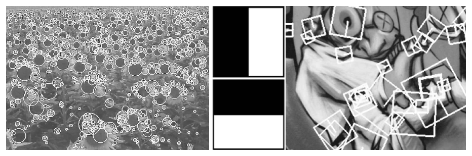
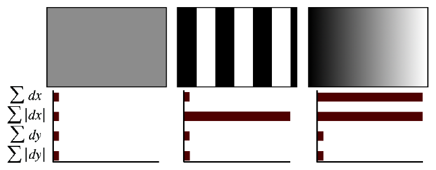
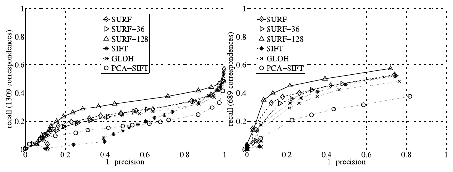
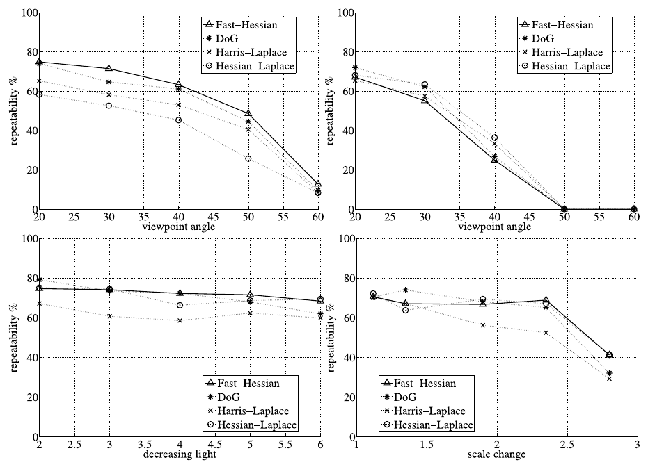
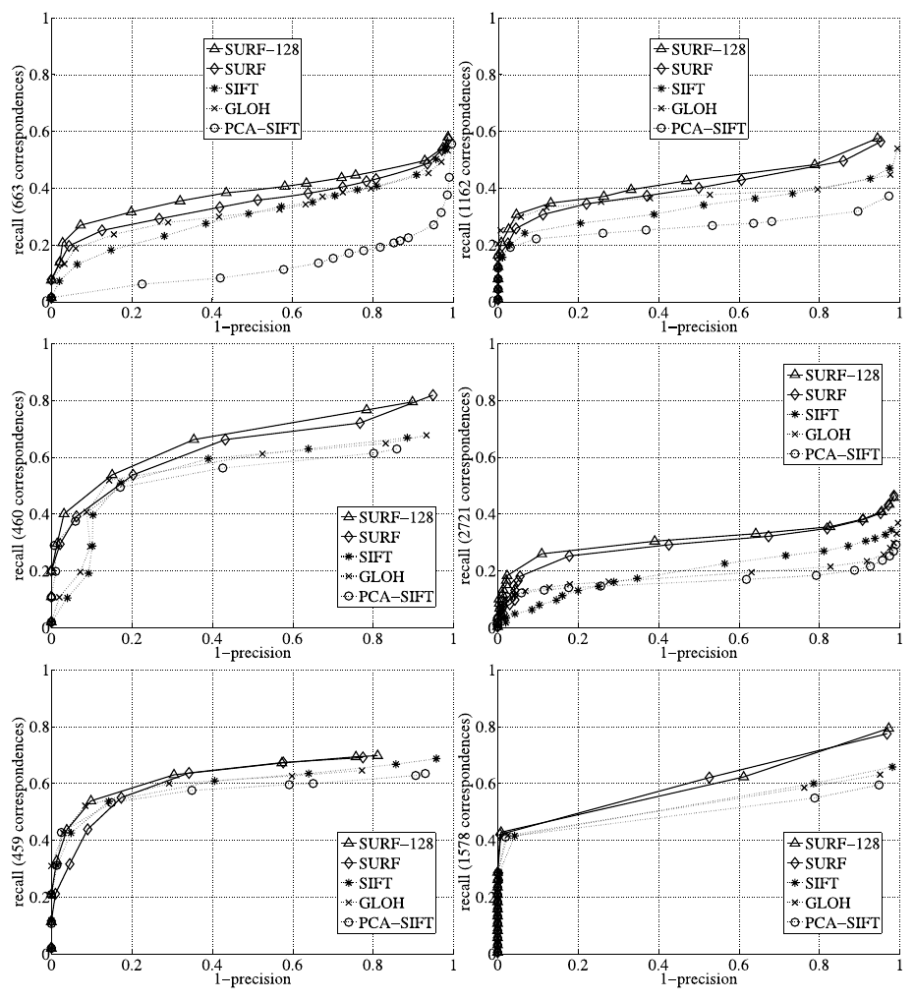
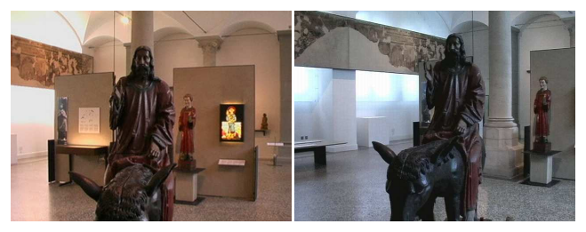

# SURF: Speeded Up Robust Features — конспект

**Авторы:** Herbert Bay (ETH Zurich), Tinne Tuytelaars (K.U. Leuven), Luc Van Gool (ETH Zurich, K.U. Leuven)
**Площадка:** ECCV 2006 (9th European Conference on Computer Vision, Грац), Springer LNCS 3951, с. 404–417. Расширенная журнальная версия: Bay, Ess, Tuytelaars, Van Gool, «Speeded-Up Robust Features (SURF)», CVIU 110(3), 2008 — в этом конспекте **не** используется (конспект строго по версии ECCV 2006).
**Источник PDF:** авторская страница SURF в ETH Zurich — https://people.ee.ethz.ch/~surf/eccv06.pdf (препринт авторов, 14 с.); локальная копия: [../original/SURF_Bay_2006.pdf](../original/SURF_Bay_2006.pdf).
**Лицензия / режим:** авторские права Springer (LNCS), открытой лицензии нет → конспект своими словами, а не перевод.

> **Суть в одном абзаце.** SURF — классический детектор и дескриптор локальных признаков, инвариантный к масштабу и повороту, задуманный как более быстрая альтернатива [SIFT](SIFT_конспект.md) без потери качества. Скорость достигается тремя приёмами: (1) **интегральное изображение (integral image)** позволяет считать сумму по любому прямоугольнику за 4 обращения к памяти, независимо от его размера; (2) детектор **Fast-Hessian** ищет блобы по детерминанту матрицы Гессе, а вторые производные гауссиана грубо аппроксимируются **прямоугольными (box) фильтрами**, так что масштабное пространство строится увеличением фильтра, а не уменьшением изображения; (3) дескриптор — суммы откликов **вейвлетов Хаара (Haar wavelets)** в сетке 4×4 подобластей, всего **64 числа** (вдвое короче [SIFT](SIFT_конспект.md)). Дополнительно знак лапласиана используется как бесплатный индекс при сопоставлении. На наборе Mikolajczyk детектор в ~3 раза быстрее DoG при сопоставимой повторяемости, а дескриптор превосходит [SIFT](SIFT_конспект.md), GLOH и PCA-SIFT по кривым recall–(1−precision); полный цикл «детектор+дескриптор» — 354 мс против 1036 мс у [SIFT](SIFT_конспект.md) на изображении 800×640 (Pentium IV 3 ГГц).

---

## 1. Введение: постановка задачи

- Поиск соответствий между изображениями (калибровка камеры, 3D-реконструкция, регистрация изображений, распознавание объектов) авторы раскладывают на три шага:
  1. **детекция ключевых точек (interest points)** в характерных местах — углы, блобы (blobs), T-образные сочленения; главное свойство детектора — **повторяемость (repeatability)**;
  2. **описание окрестности** вектором-дескриптором, который должен быть одновременно различимым (distinctive) и устойчивым к шуму, ошибкам детекции, геометрическим и фотометрическим искажениям;
  3. **сопоставление** дескрипторов по расстоянию (евклидову или Махаланобиса); размерность дескриптора напрямую влияет на скорость, поэтому желательна меньшая.
- Цель — ускорить **все три шага** по сравнению с современными им методами, не теряя в качестве.
- **Уровень инвариантности.** Выбрана инвариантность к масштабу и повороту в плоскости. Скос (skew), анизотропное масштабирование и перспективу авторы считают эффектами второго порядка, которые частично покрываются общей устойчивостью дескриптора. Полная аффинная инвариантность, как отмечал и Lowe, часто ухудшает устойчивость и окупается только при очень больших изменениях ракурса.
- **U-SURF (upright SURF)** — версия без инвариантности к повороту: если камера в основном вращается лишь вокруг вертикальной оси (мобильные роботы, туристические гиды), отказ от «избыточной» инвариантности даёт и скорость, и **бо́льшую различимость**.
- Фотометрическая модель — линейная: масштаб (контраст) + сдвиг (яркость). **Цвет не используется.**

## 2. Связанные работы

**Детекторы.**
- Harris (1988) — по собственным числам матрицы вторых моментов (second-moment matrix), но не инвариантен к масштабу.
- Lindeberg — **автоматический выбор масштаба (automatic scale selection)**; использовал детерминант гессиана и лапласиан (след гессиана) для поиска блобов.
- Mikolajczyk & Schmid — Harris-Laplace и Hessian-Laplace: положение по Harris-мере или детерминанту гессиана, масштаб — по лапласиану.
- Lowe — аппроксимация LoG (Laplacian of Gaussian) разностью гауссианов DoG (Difference of Gaussians) ради скорости.
- Прочие (Kadir–Brady salient regions, edge-based регионы Jurie и др.) хуже поддаются ускорению; аффинно-инвариантные детекторы вне рамок статьи.

Два вывода, на которых построен SURF:
1. детекторы на основе гессиана стабильнее и повторяемее, чем Harris-подобные; при этом **детерминант** гессиана лучше следа (лапласиана), так как меньше срабатывает на вытянутых, плохо локализованных структурах;
2. грубые аппроксимации (как DoG) дают выигрыш в скорости ценой небольшой потери точности.

**Дескрипторы.** Сравнения Mikolajczyk–Schmid показали, что дескрипторы-распределения (по типу [SIFT](SIFT_конспект.md): гистограммы ориентаций градиентов, 4×4 пространственные ячейки × 8 направлений = 128 чисел) лучше дифференциальных инвариантов, моментов, steerable-фильтров и др. Варианты: PCA-SIFT (36 чисел, быстро сопоставлять, но менее различим и дольше считается), GLOH (различимее [SIFT](SIFT_конспект.md), но дороже). Главный недостаток [SIFT](SIFT_конспект.md) для онлайн-применений — высокая размерность на этапе сопоставления; приближённый поиск best-bin-first ускоряет, но снижает точность.

**Интегральное изображение** (по Viola & Jones). Значение в точке $\mathbf{x}=(x,y)$ — сумма всех пикселей прямоугольника от начала координат до $\mathbf{x}$:

$$
I_\Sigma(\mathbf{x}) = \sum_{i=0}^{i\le x}\sum_{j=0}^{j\le y} I(i,j).
$$

- $I(i,j)$ — яркость исходного изображения; $I_\Sigma$ — интегральное изображение.
- После однократного вычисления $I_\Sigma$ сумма по любому прямоугольнику со сторонами, параллельными осям, считается за **четыре** обращения (три сложения/вычитания) — **независимо от размера прямоугольника**. Это основа всей скорости SURF.

## 3. Детектор Fast-Hessian

### 3.1. Детерминант гессиана

Для точки $\mathbf{x}=(x,y)$ изображения $I$ на масштабе $\sigma$ матрица Гессе:

$$
\mathcal{H}(\mathbf{x},\sigma) =
\begin{bmatrix}
L_{xx}(\mathbf{x},\sigma) & L_{xy}(\mathbf{x},\sigma)\\
L_{xy}(\mathbf{x},\sigma) & L_{yy}(\mathbf{x},\sigma)
\end{bmatrix}
$$

- $L_{xx}(\mathbf{x},\sigma)$ — свёртка изображения со второй производной гауссиана $\frac{\partial^2}{\partial x^2}g(\sigma)$ в точке $\mathbf{x}$; аналогично $L_{xy}$, $L_{yy}$.
- В отличие от Hessian-Laplace, где положение и масштаб выбираются разными мерами, SURF использует **детерминант гессиана и для положения, и для масштаба**.

### 3.2. Аппроксимация прямоугольными фильтрами

Аргументация авторов: гауссиан теоретически оптимален для масштабного пространства, но на практике его всё равно дискретизируют и обрезают, при прореживании возникает алиасинг, а свойство «на грубых масштабах не появляются новые структуры» в 2D не выполняется. Раз гауссовы фильтры всё равно неидеальны, а DoG показал успех грубых аппроксимаций, можно пойти дальше — заменить вторые производные гауссиана **box-фильтрами** с постоянными весами по прямоугольным областям. Их отклик через интегральное изображение вычисляется за постоянное время при любом размере.

*Рис. 1 (из оригинальной статьи). Слева направо: дискретизированные и обрезанные вторые производные гауссиана по $y$ ($L_{yy}$) и по $xy$ ($L_{xy}$); их аппроксимации box-фильтрами 9×9 ($D_{yy}$ с весами 1/−2/1 и $D_{xy}$ с весами ±1). Серые области — нулевые веса.*

- Фильтры 9×9 соответствуют гауссиану с $\sigma = 1.2$ — это самый мелкий масштаб (наибольшее пространственное разрешение).
- Аппроксимации обозначаются $D_{xx}, D_{yy}, D_{xy}$.
- Чтобы скомпенсировать грубость весов, в детерминант вводится балансирующий коэффициент, полученный из отношения норм Фробениуса:

$$
w = \frac{\lvert L_{xy}(1.2)\rvert_F\,\lvert D_{xx}(9)\rvert_F}{\lvert L_{xx}(1.2)\rvert_F\,\lvert D_{xy}(9)\rvert_F} = 0.912\ldots \approx 0.9,
$$

$$
\det(\mathcal{H}_\text{approx}) = D_{xx}D_{yy} - (0.9\,D_{xy})^2 .
$$

- $\lvert\cdot\rvert_F$ — норма Фробениуса; $D_{\cdot\cdot}(9)$ — отклик box-фильтра 9×9.
- Отклики фильтров **нормируются на размер маски**, чтобы норма Фробениуса была одинаковой для фильтров любого размера.

### 3.3. Масштабное пространство без пирамиды изображений

- Классически масштабное пространство — пирамида: изображение многократно сглаживают и прореживают.
- В SURF изображение **не уменьшается**: вместо этого растёт размер фильтра, который применяется прямо к исходному (интегральному) изображению. Время на фильтр не зависит от размера; уровни можно считать даже параллельно (в статье параллелизм не использовался).
- Первый уровень — фильтр 9×9, масштаб $s = 1.2$. Далее размеры: 9, 15, 21, 27, … (шаг 6 в первой октаве — следствие дискретности интегрального изображения и структуры фильтров).
- В каждой следующей октаве шаг между размерами фильтра удваивается (6 → 12 → 24); одновременно можно удваивать и шаг сэмплирования точек.
- Пропорции фильтра сохраняются, поэтому масштаб растёт линейно с размером: $s = 1.2\cdot\frac{\text{размер фильтра}}{9}$; например, фильтр 27×27 ↔ $\sigma = 3\cdot 1.2 = 3.6 = s$. Благодаря постоянной норме Фробениуса отклики уже **нормированы по масштабу (scale-normalised)**.

### 3.4. Локализация точек

1. Отбор кандидатов по порогу на $\det(\mathcal{H}_\text{approx})$.
2. **Подавление немаксимумов (non-maximum suppression)** в окрестности 3×3×3 (по $x$, $y$ и масштабу).
3. **Интерполяция** максимума по положению и масштабу методом Brown & Lowe (квадратичная аппроксимация). Интерполяция по масштабу особенно важна, потому что разница масштабов между первыми уровнями каждой октавы довольно велика.

*Рис. 2 (из оригинальной статьи). Слева: точки Fast-Hessian на поле подсолнухов — хорошо видна «блобовая» природа гессиан-детекторов. В центре: два типа вейвлетов Хаара (по $x$ и по $y$). Справа: фрагмент сцены Graffiti с ориентированными окнами дескриптора разного размера (размер окна пропорционален масштабу точки).*

## 4. Дескриптор SURF

Идея наследуется от [SIFT](SIFT_конспект.md) — грубо локализованная пространственная информация + распределение градиентоподобных признаков, — но вычисления упрощены ещё сильнее. Два шага: (1) воспроизводимая ориентация по круговой окрестности; (2) квадратное окно вдоль этой ориентации и извлечение дескриптора. В U-SURF первый шаг пропускается.

### 4.1. Назначение ориентации (Orientation Assignment)

1. В круговой окрестности радиуса $6s$ вокруг точки ($s$ — масштаб детекции) с шагом сэмплирования $s$ вычисляются отклики вейвлетов Хаара по $x$ и $y$ (сторона вейвлета $4s$; через интегральное изображение — 6 операций на отклик при любом масштабе).
2. Отклики взвешиваются гауссианом с $\sigma = 2.5s$ с центром в точке.
3. Каждый отклик рассматривается как точка $(d_x, d_y)$ на плоскости.
4. **Скользящее окно ориентации** шириной $\pi/3$ (60°) обходит круг; внутри окна суммируются горизонтальные и вертикальные отклики → получается вектор.
5. Ориентация точки = направление **самого длинного** такого вектора.

Ширина окна подобрана экспериментально: слишком узкое срабатывает на одиночные сильные отклики, слишком широкое даёт невыраженные максимумы — в обоих случаях ориентация нестабильна.

### 4.2. Компоненты дескриптора

1. Строится квадратное окно со стороной $20s$ с центром в точке, повёрнутое по найденной ориентации (в U-SURF — без поворота).
2. Окно делится на **4×4** квадратные подобласти — так сохраняется пространственная информация.
3. В каждой подобласти берутся **5×5** регулярно расположенных отсчётов; в них вычисляются отклики вейвлетов Хаара $d_x$ (горизонтальный) и $d_y$ (вертикальный) размера $2s$; «горизонталь» и «вертикаль» — относительно ориентации точки.
4. Отклики взвешиваются гауссианом с $\sigma = 3.3s$ с центром в точке (устойчивость к деформациям и ошибкам локализации).
5. Для каждой подобласти формируется 4-мерный вектор:

$$
\mathbf{v} = \Bigl(\textstyle\sum d_x,\ \sum d_y,\ \sum \lvert d_x\rvert,\ \sum \lvert d_y\rvert\Bigr).
$$

- $\sum d_x$, $\sum d_y$ — суммы откликов (знак отражает направление перепада яркости);
- $\sum\lvert d_x\rvert$, $\sum\lvert d_y\rvert$ — суммы модулей (несут информацию о «количестве» изменений, в т.ч. о полярности перепадов).

6. Конкатенация по 4×4 подобластям → **64-мерный** вектор.
7. Отклики вейвлетов инвариантны к сдвигу яркости (offset); инвариантность к контрасту (масштабному множителю) обеспечивается **нормированием вектора до единичной длины**.

*Рис. 3 (из оригинальной статьи). Значения четырёх компонент для трёх типов узоров внутри подобласти. Однородная область — все значения малы. Частые полосы вдоль $x$ — велико только $\sum\lvert d_x\rvert$. Плавный рост яркости вдоль $x$ — велики и $\sum d_x$, и $\sum\lvert d_x\rvert$.*

**Как выбирались параметры.** Авторы перебирали меньше/больше вейвлетных признаков, $d_x^2$ и $d_y^2$, вейвлеты высших порядков, PCA, медианы, средние значения и т.п. — предложенный набор оказался лучшим. Варьировалось число отсчётов и подобластей:
- **4×4** — лучший результат;
- более мелкое разбиение — менее устойчиво и слишком замедляет сопоставление;
- **SURF-36** (3×3 подобласти) — хуже, но очень быстрое сопоставление и всё ещё приемлемое качество на фоне других дескрипторов.

### 4.3. Расширенный дескриптор SURF-128

- Те же суммы, но с дополнительным разбиением по знаку: $\sum d_x$ и $\sum\lvert d_x\rvert$ считаются отдельно для $d_y<0$ и $d_y\ge 0$; аналогично $\sum d_y$ и $\sum\lvert d_y\rvert$ — по знаку $d_x$. Число признаков удваивается → 128.
- Различимее и вычисляется почти так же быстро, но сопоставление медленнее из-за размерности.

*Рис. 4 (из оригинальной статьи). Recall в зависимости от (1−precision) для SURF, SURF-36, SURF-128, [SIFT](SIFT_конспект.md), GLOH и PCA-SIFT на сцене Graffiti (изображения 1 и 3, смена ракурса 30°); точки во всех случаях — от Fast-Hessian. Слева — сопоставление по порогу сходства, справа — по отношению расстояний до ближайших соседей. SURF-128 лучший, SURF близок к нему, оба превосходят остальные дескрипторы.*

Graffiti — самая трудная сцена набора Mikolajczyk: поворот вне плоскости, поворот в плоскости и изменение яркости одновременно. Поскольку точки не аффинно-инвариантны, результаты нельзя напрямую сравнивать с опубликованными в обзоре Mikolajczyk–Schmid.

### 4.4. Индексирование по знаку лапласиана

- Для каждой точки сохраняется знак следа гессиана (лапласиана): он различает **светлый блоб на тёмном фоне** и **тёмный блоб на светлом**.
- Знак уже посчитан на этапе детекции — **бесплатно**.
- При сопоставлении сравниваются только точки с одинаковым типом контраста → быстрее и немного точнее.

## 5. Эксперименты

Все методы в сравнении — оригинальные реализации авторов. Во всех экспериментах (включая распознавание объектов) используется **один и тот же** набор параметров и порогов. Время измерялось на обычном Linux-ПК (Pentium IV, 3 ГГц).

### 5.1. Стандартная оценка (набор Mikolajczyk)

**Детектор.** Метрика — повторяемость (repeatability) по Mikolajczyk et al.: доля точек, найденных на обоих изображениях, относительно меньшего из двух чисел точек (в общей видимой области). Сцены: Graffiti и Wall (смена ракурса), Boat (зум + поворот), Leuven (освещение). Конкуренты: DoG (Lowe), Harris-Laplace и Hessian-Laplace (Mikolajczyk).

| Детектор | Порог | Число точек | Время, мс |
|---|---|---|---|
| **Fast-Hessian** | 600 | 1418 | **120** |
| Hessian-Laplace | 1000 | 1979 | 650 |
| Harris-Laplace | 2500 | 1664 | 1800 |
| DoG | по умолчанию | 1520 | 400 |

*(Таблица 1 статьи: первое изображение Graffiti, 800×640.)*

- Fast-Hessian **более чем в 3 раза быстрее DoG** и в 5 раз быстрее Hessian-Laplace.
- Повторяемость сопоставима (Graffiti, Leuven, Boat) или лучше (Wall). Graffiti и Wall содержат поворот вне плоскости (аффинные искажения), с которыми масштабно-поворотно-инвариантные детекторы справляются лишь за счёт общей устойчивости.

*Рис. 6 (из оригинальной статьи). Повторяемость (%) для Fast-Hessian, DoG, Harris-Laplace и Hessian-Laplace: сверху — Wall и Graffiti (угол обзора 20–60°), снизу — Leuven (уменьшение освещённости) и Boat (изменение масштаба с поворотом). Fast-Hessian на уровне конкурентов, на Wall — лучше.*

**Дескриптор.** Кривые recall–(1−precision); пары: 1-е и 4-е изображения последовательностей, кроме Graffiti (1 и 3, ~30°) и Wall (1 и 5, ~50°). Все дескрипторы считаются на точках Fast-Hessian. Сравнение с GLOH, [SIFT](SIFT_конспект.md), PCA-SIFT; на Рис. 7 — сопоставление по порогу сходства (по мнению авторов, лучше отражает распределение дескрипторов и чаще применяется).

- SURF систематически лучше остальных, иногда **более чем на 10% по recall** при той же точности.
- SURF-128 немного лучше SURF, но медленнее при сопоставлении.

*Рис. 7 (из оригинальной статьи). Recall в зависимости от (1−precision) для SURF-128, SURF, [SIFT](SIFT_конспект.md), GLOH и PCA-SIFT; слева направо и сверху вниз: смена ракурса 50° (Wall), масштаб ×2 (Boat), размытие (Bikes и Trees), изменение яркости (Leuven), JPEG-сжатие (Ubc).*

**Время полного цикла «детектор + дескриптор»** (первое изображение Graffiti; пороги подобраны так, чтобы все методы давали одинаковое число точек):

| | U-SURF | SURF | SURF-128 | [SIFT](SIFT_конспект.md) |
|---|---|---|---|---|
| Время, мс | **255** | 354 | 391 | 1036 |

*(Таблица 2 статьи. По словам авторов, соотношения скоростей типичны и для других изображений.)*

### 5.2. Распознавание объектов в музее

- База: 216 эталонных изображений 22 художественных объектов; тест: 116 изображений в тяжёлых условиях — сильные перепады освещения, объекты за отражающим стеклом витрин, смена ракурса, зум, разные камеры. Изображения маленькие (320×240) — много деталей теряется.
- Процедура: тестовое изображение сопоставляется со всеми эталонными; объект с эталона, давшего **больше всего соответствий**, считается распознанным.
- Сопоставление: евклидово расстояние между дескрипторами; пара принимается, если расстояние до ближайшего соседа меньше **0.7** расстояния до второго ближайшего (nearest neighbour ratio). Геометрическая верификация намеренно **не** применяется, чтобы не маскировать недостатки самих дескрипторов.

| Дескриптор | Доля распознавания |
|---|---|
| **SURF-128** | **85.7%** |
| U-SURF | 83.8% |
| SURF | 82.6% |
| GLOH | 78.3% |
| [SIFT](SIFT_конспект.md) | 78.1% |
| PCA-SIFT | 72.3% |

Примечательно, что U-SURF (без инвариантности к повороту) обгоняет обычный SURF — в этом приложении камера почти горизонтальна, и лишняя инвариантность только мешает.

*Рис. 5 (из оригинальной статьи). Эталонное (слева) и тестовое (справа) изображения одного объекта — заметна разница в ракурсе и цвете.*

## 6. Выводы авторов

- Предложена схема детекции и описания, которая, по утверждению авторов, превосходит state-of-the-art и по скорости, и по точности.
- Дескриптор легко расширяется на аффинно-инвариантные регионы.
- Дальнейшая работа — оптимизация кода; бинарник выложен на сайте авторов (www.vision.ee.ethz.ch/~surf/).

---

## Сводка гиперпараметров (по статье)

### Детектор Fast-Hessian

| Параметр | Значение |
|---|---|
| Мера отклика | $\det(\mathcal{H}_\text{approx}) = D_{xx}D_{yy} - (0.9D_{xy})^2$ |
| Начальный фильтр / масштаб | 9×9, $s = 1.2$ |
| Размеры фильтров 1-й октавы | 9, 15, 21, 27, … (шаг 6) |
| Шаг размера по октавам | 6 → 12 → 24 (удваивается) |
| Шаг сэмплирования | удваивается с каждой октавой (допускается) |
| Связь размера и масштаба | $s = 1.2\cdot N/9$ для фильтра $N\times N$ |
| NMS | 3×3×3 (пространство × масштаб) |
| Субпиксельное уточнение | интерполяция по Brown & Lowe |
| Порог в экспериментах | 600 (Табл. 1) |
| Число октав / уровней в октаве | **в версии ECCV 2006 явно не указано** |

### Дескриптор

| Параметр | Значение |
|---|---|
| Ориентация: радиус окрестности | $6s$, шаг $s$ |
| Ориентация: размер вейвлета Хаара | $4s$ |
| Ориентация: гауссов вес | $\sigma = 2.5s$ |
| Ориентация: скользящее окно | $\pi/3$ (60°); шаг перебора угла в статье не указан |
| Окно дескриптора | квадрат $20s$, по ориентации |
| Подобласти | 4×4 (SURF-36: 3×3) |
| Отсчёты в подобласти | 5×5 |
| Размер вейвлета дескриптора | $2s$ |
| Гауссов вес дескриптора | $\sigma = 3.3s$ |
| Компоненты на подобласть | $\sum d_x, \sum d_y, \sum\lvert d_x\rvert, \sum\lvert d_y\rvert$ (SURF-128: 8, с разбиением по знаку) |
| Размерность | 64 (SURF-36: 36; SURF-128: 128) |
| Нормировка | до единичной длины (L2) |
| Индекс при сопоставлении | знак лапласиана (±1) |
| Ratio test (распознавание объектов) | 0.7 |

---

## Описание ключевых рисунков

*Рисунки вставлены в соответствующие разделы выше (Рис. 1 — разд. 3.2, Рис. 2 — разд. 3.4, Рис. 3 — разд. 4.2, Рис. 4 — разд. 4.3, Рис. 6 и 7 — разд. 5.1, Рис. 5 — разд. 5.2). Здесь — сводное описание.*

- **Рис. 1** — главный «трюк» детектора: гладкие гауссовы ядра вторых производных заменяются кусочно-постоянными box-фильтрами (веса 1, −2, 1 для $D_{yy}$; ±1 по квадрантам для $D_{xy}$), которые через интегральное изображение считаются за константное время.
- **Рис. 2** — что находит детектор (блобы разных размеров, круги радиуса ~масштаба), какие вейвлеты Хаара используются (две «половинки» по $x$ и по $y$) и как размер и поворот окна дескриптора следуют за масштабом и ориентацией точки.
- **Рис. 3** — интуиция дескриптора: четыре суммы различают однородную область, осциллирующую текстуру и плавный градиент.
- **Рис. 4** — обоснование выбора 4×4 и 64 измерений: SURF-36 хуже, SURF-128 лучше, но дороже в сопоставлении; все варианты SURF обходят [SIFT](SIFT_конспект.md)/GLOH/PCA-SIFT на Graffiti при обеих стратегиях сопоставления.
- **Рис. 5** — характер музейного набора: смена ракурса и цветового баланса.
- **Рис. 6** — повторяемость Fast-Hessian на уровне DoG/Hessian-Laplace/Harris-Laplace на четырёх типах искажений.
- **Рис. 7** — превосходство дескриптора SURF на шести сценах (ракурс, масштаб, размытие, освещение, JPEG).

---

## Сильные стороны и ограничения

### Сильные стороны
- **Скорость при качестве уровня [SIFT](SIFT_конспект.md) (на 2006 г.):** полный цикл ~в 3 раза быстрее [SIFT](SIFT_конспект.md); детектор — в ~3 раза быстрее DoG.
- **Интегральное изображение + box-фильтры:** стоимость фильтрации не зависит от масштаба; масштабное пространство без пирамиды изображений, хорошо параллелится (в т.ч. на GPU/FPGA).
- **Компактный дескриптор** (64 float): быстрее сопоставление и меньше память, чем у [SIFT](SIFT_конспект.md) (128).
- **Знак лапласиана** — бесплатный фильтр кандидатов, сокращающий перебор при сопоставлении примерно вдвое (оценка составителя: при равной доле светлых и тёмных блобов) и немного повышающий точность.
- **U-SURF** — честное признание, что инвариантность к повороту не всегда нужна; без неё — быстрее и различимее.
- Устойчивость к размытию и изменению освещения по результатам Рис. 7.

### Ограничения
- **Только масштаб + поворот:** аффинные и перспективные искажения покрываются лишь «общей устойчивостью»; при углах обзора 50–60° повторяемость резко падает (Рис. 6, Graffiti — до нуля при 50°).
- **Грубая аппроксимация гауссиана:** box-фильтры не изотропны; детектор и ориентация предположительно чувствительны к поворотам на углы, не кратные 90° (фильтры выровнены по осям) — оценка составителя, в статье этот эффект не исследован.
- **Детектор блобов по детерминанту гессиана** — мало точек на чисто угловых структурах; в бедных текстурой сценах точек мало.
- **Плотность сэмплирования на грубых октавах** снижается (удвоение шага) — хуже локализация крупных точек; частично компенсируется интерполяцией.
- **Оценка ограничена:** набор Mikolajczyk (в основном плоские сцены) и небольшая музейная база (22 объекта); нет экспериментов с SfM/SLAM/локализацией камеры.
- **Не указаны** число октав и уровней по умолчанию, шаг перебора угла ориентации — детали реализации в ECCV-версии опущены (частично есть в CVIU 2008).
- **Только яркость**, цвет не используется.
- **Патентные ограничения** (вне статьи): SURF был запатентован, из-за чего в OpenCV вынесен в модуль non-free (см. ниже).

---

## Значение для задачи визуального позиционирования

**Роль в конвейере.** SURF — классический «ручной» (handcrafted) признак, историческое звено между [SIFT](SIFT_конспект.md) и бинарными/обучаемыми признаками ([ORB](ORB_конспект.md), BRISK, [SuperPoint](SuperPoint_конспект.md), [DISK](DISK_конспект.md), [ALIKED](ALIKED_конспект.md), [XFeat](XFeat_конспект.md)). В современной схеме глобального позиционирования (глобальный поиск кандидатов → локальные признаки → сопоставление → [RANSAC](RANSAC_конспект.md) + PnP/гомография) SURF уместен как **быстрый CPU-базлайн** и как признак для сценариев, где нельзя использовать нейросети; по качеству в тяжёлых условиях (день/ночь, сезоны, дрон ↔ ортофото) он, как и [SIFT](SIFT_конспект.md), обычно уступает обучаемым признакам — это стоит проверять на своих данных (замечание составителя, не из статьи).

**Практические заметки** (не из статьи, если не указано иное):
- **Доступность в OpenCV.** SURF находится в `opencv_contrib`, модуль `xfeatures2d`, и компилируется только при CMake-опции `OPENCV_ENABLE_NONFREE`; иначе вызов падает с сообщением «This algorithm is patented and is excluded in this configuration» (проверено по исходникам `opencv_contrib/modules/xfeatures2d/src/surf.cpp`, ветка 4.x). Стандартные pip-сборки `opencv-contrib-python` собраны без non-free — понадобится собственная сборка. Статус патента здесь не проверялся; в исходниках OpenCV 4.x SURF по-прежнему помечен как non-free.
- **Параметры OpenCV** (по `nonfree.hpp`, ветка 4.x): `cv2.xfeatures2d.SURF_create(hessianThreshold=100, nOctaves=4, nOctaveLayers=3, extended=False, upright=False)`. `extended=True` — SURF-128, `upright=True` — U-SURF. Порог OpenCV не следует напрямую сопоставлять со значением 600 из статьи (нормировка откликов в реализациях может отличаться — не проверялось).
- В реализации OpenCV (по исходникам): детерминант считается как `dx*dy - 0.81f*dxy*dxy` (т.е. $0.9^2$, как в статье); гауссовы веса ориентации и дескриптора — 2.5 и 3.3 (как в статье); окно ориентации 60° перебирается с шагом 5°; **знак лапласиана записывается в `KeyPoint.class_id`** (±1) — его можно использовать для фильтрации кандидатов при сопоставлении вручную.
- **Сопоставление:** дескрипторы float32 L2-нормированы → `BFMatcher(NORM_L2)` или FLANN (KD-деревья); ratio test 0.7–0.8 (0.7 — значение из статьи) + [RANSAC](RANSAC_конспект.md).
- **U-SURF для надирной съёмки.** Если поворот кадра относительно карты известен по IMU/компасу, имеет смысл повернуть изображение к северу и использовать `upright=True`: быстрее и, как показывает музейный эксперимент статьи, различимее. Без компенсации курса нужна полная версия с ориентацией.
- **Масштаб.** Инвариантность обеспечивается в пределах числа октав; для больших перепадов GSD (ground sampling distance) между кадром и картой лучше заранее привести их к сопоставимому разрешению.
- **Скорость на современных платформах.** Цифры статьи (Pentium IV, 2006) устарели; существуют GPU-реализации (в `opencv_contrib` есть CUDA-вариант SURF, также non-free). Для встраиваемых систем при сопоставимом бюджете часто выбирают [ORB](ORB_конспект.md) (бинарный, без патентных ограничений) или лёгкие обучаемые признаки — сравнивать на целевых данных.

---

## Глоссарий (англ. → рус.)

| English | Русский |
|---|---|
| interest point / keypoint | ключевая (особая) точка |
| detector / descriptor | детектор / дескриптор |
| repeatability | повторяемость |
| distinctiveness | различимость |
| integral image | интегральное изображение |
| box filter | прямоугольный (box) фильтр |
| Hessian matrix | матрица Гессе (гессиан) |
| determinant / trace of the Hessian | детерминант / след гессиана |
| Laplacian of Gaussian (LoG) | лапласиан гауссиана |
| Difference of Gaussians (DoG) | разность гауссианов |
| Fast-Hessian detector | детектор Fast-Hessian (быстрый гессиан) |
| scale space | масштабное пространство |
| octave | октава |
| scale-normalised | нормированный по масштабу |
| automatic scale selection | автоматический выбор масштаба |
| non-maximum suppression (NMS) | подавление немаксимумов |
| Frobenius norm | норма Фробениуса |
| aliasing | алиасинг (наложение спектров) |
| blob | блоб (пятно) |
| Haar wavelet | вейвлет Хаара |
| orientation assignment | назначение ориентации |
| sliding orientation window | скользящее окно ориентации |
| sub-region | подобласть |
| upright SURF (U-SURF) | SURF без инвариантности к повороту |
| sign of the Laplacian | знак лапласиана |
| nearest neighbour ratio matching | сопоставление по отношению расстояний до ближайших соседей (ratio test) |
| similarity-threshold matching | сопоставление по порогу сходства |
| recall / precision | полнота / точность |
| out-of-plane rotation | поворот вне плоскости изображения |
| affine invariance | аффинная инвариантность |
| second-moment matrix | матрица вторых моментов |
| best-bin-first | поиск best-bin-first (приближённый поиск ближайшего соседа) |
| PCA-SIFT, GLOH | варианты дескриптора [SIFT](SIFT_конспект.md) (с PCA; с лог-полярной сеткой) |
| GSD (ground sampling distance) | пространственное разрешение на местности |
| non-free (OpenCV) | несвободный (патентованный) модуль OpenCV |
