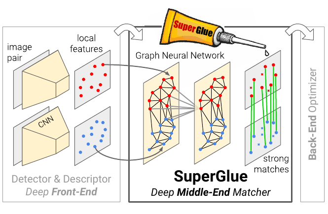
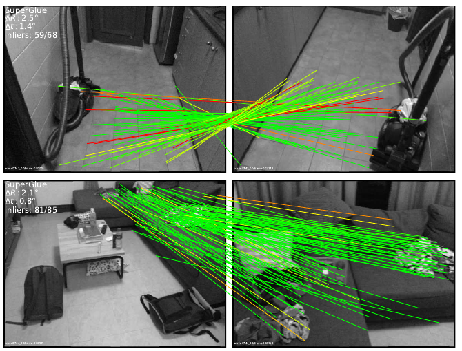
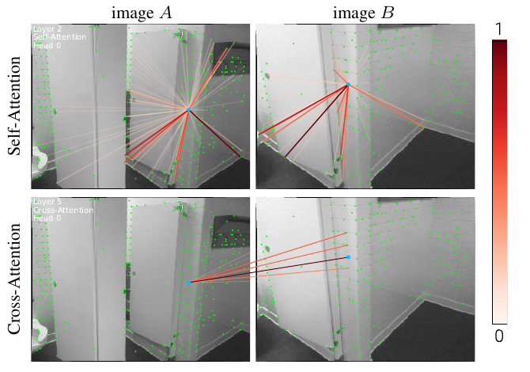
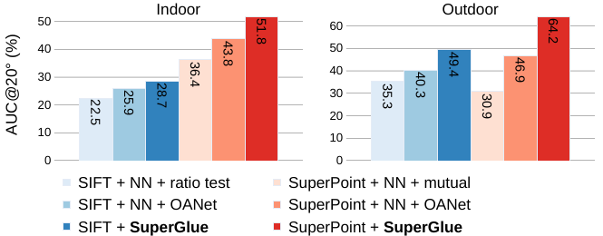
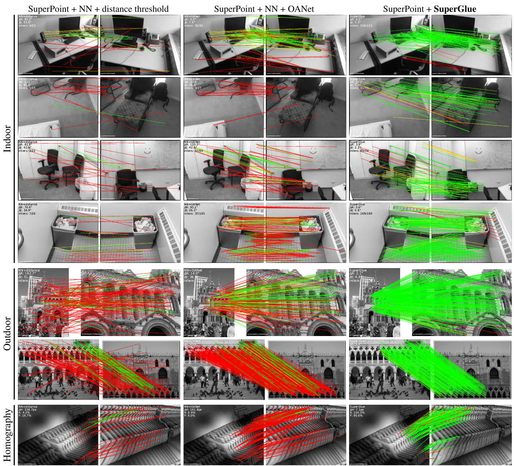
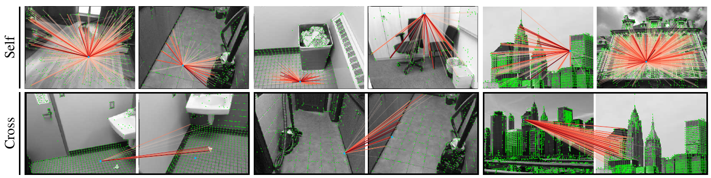
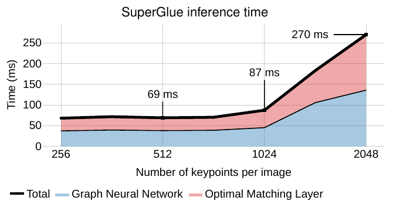
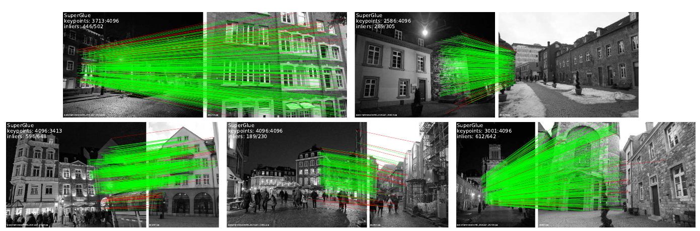

# SuperGlue: Learning Feature Matching with Graph Neural Networks — конспект

**Авторы:** Paul-Edouard Sarlin (ETH Zurich; работа выполнена в Magic Leap в рамках магистерской диссертации), Daniel DeTone, Tomasz Malisiewicz, Andrew Rabinovich (Magic Leap, Inc.)
**Площадка:** CVPR 2020 (IEEE/CVF Conference on Computer Vision and Pattern Recognition), с. 4938–4947 по колонтитулам CVF-версии. Препринт: arXiv:1911.11763 (расширенная версия с приложениями A–E).
**Источник PDF:** CVF Open Access — https://openaccess.thecvf.com/content_CVPR_2020/papers/Sarlin_SuperGlue_Learning_Feature_Matching_With_Graph_Neural_Networks_CVPR_2020_paper.pdf; локально `../original/SuperGlue_Sarlin_2020.pdf`. Приложения (детали обучения, тайминги, визуальная локализация) — по arXiv-версии https://arxiv.org/pdf/1911.11763, локально `../original/SuperGlue_Sarlin_2020_arXiv.pdf`.
**Код и веса:** `magicleap/SuperGluePretrainedNetwork` (веса `indoor` и `outdoor`; лицензия — только некоммерческие исследования).
**Лицензия статьи:** arXiv — стандартная неисключительная лицензия arXiv (nonexclusive-distrib 1.0), CVF — права у авторов/IEEE; не CC → поэтому здесь конспект своими словами, а не перевод.

> **Суть в одном абзаце.** SuperGlue — обучаемый **сопоставитель (matcher)** локальных признаков, который встраивается между извлечением признаков (front-end: [SuperPoint](SuperPoint_конспект.md), [SIFT](SIFT_конспект.md) и т.п.) и геометрическим бэкендом ([RANSAC](RANSAC_конспект.md), bundle adjustment) — авторы называют его «обучаемым middle-end». Вместо «ближайший сосед + эвристики» (ratio test, взаимная проверка) задача ставится как поиск **частичного назначения (partial assignment)** между двумя множествами точек. Сначала **графовая нейросеть с вниманием (attentional GNN)** обогащает каждую точку контекстом: чередующиеся слои **self-attention** (внутри изображения) и **cross-attention** (между изображениями) с учётом и дескриптора, и координат точки. Затем **слой оптимального сопоставления (optimal matching layer)** строит матрицу сходств, добавляет строку/столбец **«корзины» (dustbin)** для несопоставимых точек и решает энтропийно-регуляризованную задачу **оптимального транспорта (optimal transport)** дифференцируемым **алгоритмом Синкхорна (Sinkhorn)**. Всё обучается сквозным образом по эталонным соответствиям (из гомографий или поз+глубины). Результат: резкий рост точности относительной позы на ScanNet (AUC@20° 51.84 против 43.85 у лучшего конкурента с [SuperPoint](SuperPoint_конспект.md)) и PhotoTourism (64.16 против 46.88), 15 FPS на GTX 1080 для пары внутри помещения.

*Рис. 1 (из оригинальной статьи). SuperGlue строит соответствия из готовых локальных признаков: он находится между фронтендом (детектор и дескриптор, ручной или обучаемый) и бэкендом-оптимизатором. Графовая сеть с вниманием решает задачу назначения и естественно обрабатывает частичную видимость и окклюзии, выдавая частичное назначение.*

---

## 1. Введение: постановка проблемы

- Соответствия между точками изображений — основа SLAM и SfM (Structure-from-Motion). Обычно их получают **сопоставлением локальных признаков** — это «ассоциация данных (data association)». Трудности: большие изменения ракурса и освещения, окклюзии, размытие, бедная текстура.
- Типичный SLAM делится на **фронтенд** (извлечение признаков) и **бэкенд** (bundle adjustment / оценка позы). SuperGlue помещается **между ними** — обучаемый **middle-end**.
- Ключевая смена парадигмы: вместо того чтобы учить всё более хорошие «универсальные» дескрипторы и сопоставлять их простыми эвристиками, предлагается **учить сам процесс сопоставления** поверх уже существующих признаков.
- Формально — частичное назначение между двумя множествами точек. Классическое графовое сопоставление ставится как **квадратичная задача о назначениях (quadratic assignment problem)** — она NP-трудна. Авторы используют **линейную** задачу о назначениях, ослабленную до задачи оптимального транспорта, которая решается дифференцируемо. Стоимость (cost) для неё предсказывает GNN.
- Вдохновение — Transformer: self- и cross-attention используют и пространственные отношения точек, и их внешний вид.

*Рис. 2 (из оригинальной статьи). Соответствия SuperGlue для двух трудных пар внутри помещений (ScanNet): поза восстанавливается точно (ΔR 2.5°/Δt 1.4° и ΔR 2.1°/Δt 0.8°), тогда как другие обучаемые и ручные методы ошибаются. Цвет линий — эпиполярная ошибка.*

## 2. Связанные работы

- **Классический конвейер (2000-е):** детекция → дескрипторы (часто [SIFT](SIFT_конспект.md)) → поиск ближайшего соседа (NN) → фильтрация (ratio test Лоу, взаимная проверка (mutual check), согласованность окрестностей (neighborhood consensus)) → робастная оценка ([RANSAC](RANSAC_конспект.md)).
- **Глубокие локальные признаки** ([SuperPoint](SuperPoint_конспект.md), [D2-Net](D2-Net_конспект.md), LF-Net, [R2D2](R2D2_конспект.md), [LIFT](LIFT_конспект.md)) улучшают детекторы/дескрипторы; ContextDesc и log-polar-патчи расширяют контекст дескриптора.
- **Обучаемые фильтры выбросов** (PointCN, OANet, NG-RANSAC, DFE) классифицируют уже найденные NN-соответствия на inliers/outliers. Минус: работают по множеству NN-пар, игнорируют структуру назначения и отбрасывают визуальную информацию.
- **Графовое сопоставление:** квадратичные постановки дороги; Caetano et al. учили стоимость линейного назначения, но мелкой моделью. Оптимальный транспорт — обобщённое линейное назначение с простым приближённым решением (Синкхорн).
- **Глубокое обучение на множествах (deep learning for sets):** PointNet, DeepSets (глобальный пулинг), instance normalization, локальные окрестности (PointNet++, DGCNN). Внимание гибче: может делать и глобальную, и зависящую от данных локальную агрегацию. Self-attention = частный случай **message passing GNN** на полном графе; авторы применяют его к графу с несколькими типами рёбер.

## 3. Архитектура SuperGlue

*Рис. 3 (из оригинальной статьи). Два блока: (слева) графовая сеть с вниманием — кодировщик точек объединяет позицию $\mathbf{p}$ и дескриптор $\mathbf{d}$ в один вектор, затем $L$ раз чередуются self- и cross-attention, давая «сопоставительные дескрипторы» $\mathbf{f}$; (справа) слой оптимального сопоставления — матрица оценок $M\times N$, дополненная корзинами, и алгоритм Синкхорна ($T$ итераций), выдающий частичное назначение.*

### 3.0. Мотивация и формулировка

**Априорные закономерности мира**, которые хочется использовать: 3D-мир в основном гладкий и часто кусочно-плоский; для статичной сцены все соответствия пары связаны одним эпиполярным преобразованием; одни позы вероятнее других. Физические ограничения на соответствия:
1. точка имеет **не более одного** соответствия в другом изображении;
2. часть точек **не имеет пары** (окклюзия, сбой детектора).

**Обозначения.** Изображения $A$ и $B$ содержат $M$ и $N$ локальных признаков, индексы $\mathcal{A} = \{1..M\}$, $\mathcal{B} = \{1..N\}$. Каждый признак — пара (позиция, дескриптор):
- $\mathbf{p}_i := (x, y, c)_i$ — координаты на изображении и **уверенность детекции** $c$;
- $\mathbf{d}_i \in \mathbb{R}^D$ — визуальный дескриптор ([SuperPoint](SuperPoint_конспект.md), [SIFT](SIFT_конспект.md) и т.п.).

**Частичное мягкое назначение.** Матрица $\mathbf{P} \in [0,1]^{M\times N}$ с ограничениями

$$
\mathbf{P}\mathbf{1}_N \le \mathbf{1}_M, \qquad \mathbf{P}^\top \mathbf{1}_M \le \mathbf{1}_N, \tag{1}
$$

т.е. суммы по строкам и столбцам не больше 1 (каждая точка распределяет не более единичной «массы» соответствий). Цель — сеть, предсказывающая $\mathbf{P}$ по двум множествам признаков.

### 3.1. Графовая нейросеть с вниманием (Attentional Graph Neural Network)

Интуиция: человек, сопоставляя неоднозначную точку, «смотрит туда-обратно» между изображениями, перебирает кандидатов и ищет контекстные подсказки. Контекст полезен двух видов: внутри изображения (соседние, характерные, самоподобные точки) и между изображениями (сравнение кандидатов, оценка глобального фотометрического/геометрического преобразования).

**Кодировщик точек (Keypoint Encoder).** Начальное состояние каждой точки — дескриптор плюс закодированная MLP позиция:

$$
{}^{(0)}\mathbf{x}_i = \mathbf{d}_i + \mathrm{MLP}_{\text{enc}}(\mathbf{p}_i). \tag{2}
$$

Это аналог «позиционного кодирования» из NLP: дальше сеть рассуждает одновременно о внешнем виде и положении. Вход MLP — $(x, y, c)$; координаты заранее нормализуются по наибольшей стороне изображения (прил. E). *По официальному коду:* координаты центрируются и делятся на $0.7\cdot\max(W,H)$.

**Мультиплексный граф (multiplex graph).** Один полный граф, вершины — точки обоих изображений; два типа неориентированных рёбер:
- $\mathcal{E}_{\text{self}}$ — внутри изображения (каждая точка со всеми точками того же изображения);
- $\mathcal{E}_{\text{cross}}$ — между изображениями (каждая точка со всеми точками другого).

**Обновление с передачей сообщений (residual message passing).** Пусть ${}^{(\ell)}\mathbf{x}^A_i$ — представление точки $i$ изображения $A$ на слое $\ell$, а $\mathbf{m}_{\mathcal{E}\to i}$ — сообщение, агрегированное по всем $j$, для которых $(i,j)\in\mathcal{E}$. Тогда

$$
{}^{(\ell+1)}\mathbf{x}^A_i = {}^{(\ell)}\mathbf{x}^A_i + \mathrm{MLP}\!\left(\left[{}^{(\ell)}\mathbf{x}^A_i \,\|\, \mathbf{m}_{\mathcal{E}\to i}\right]\right), \tag{3}
$$

где $[\cdot\|\cdot]$ — конкатенация. То же делается одновременно для точек $B$. Слоёв $L$, у каждого свои параметры; тип рёбер чередуется: при нечётном $\ell$ — $\mathcal{E}_{\text{self}}$, при чётном — $\mathcal{E}_{\text{cross}}$ (нумерация с $\ell=1$).

**Агрегация вниманием (Attentional Aggregation).** Сообщение — взвешенное среднее «значений» (values):

$$
\mathbf{m}_{\mathcal{E}\to i} = \sum_{j:(i,j)\in\mathcal{E}} \alpha_{ij}\,\mathbf{v}_j, \qquad \alpha_{ij} = \mathrm{Softmax}_j\!\left(\mathbf{q}_i^\top \mathbf{k}_j\right). \tag{4}
$$

Как в поиске по базе данных: **запрос (query)** $\mathbf{q}_i$ точки $i$ сравнивается с **ключами (keys)** $\mathbf{k}_j$ и извлекает **значения (values)** $\mathbf{v}_j$. Если точка-запрос лежит в изображении $Q$, а точки-источники — в $S$, $(Q,S)\in\{A,B\}^2$:

$$
\mathbf{q}_i = \mathbf{W}_1\,{}^{(\ell)}\mathbf{x}^Q_i + \mathbf{b}_1, \qquad
\begin{bmatrix}\mathbf{k}_j\\ \mathbf{v}_j\end{bmatrix} =
\begin{bmatrix}\mathbf{W}_2\\ \mathbf{W}_3\end{bmatrix}{}^{(\ell)}\mathbf{x}^S_j +
\begin{bmatrix}\mathbf{b}_2\\ \mathbf{b}_3\end{bmatrix}. \tag{5}
$$

- Self-attention: $Q=S$; cross-attention: $Q\neq S$.
- Проекции свои на каждом слое, но **общие для точек обоих изображений** (сиамская симметрия).
- На практике — **многоголовое внимание (multi-head attention)**, 4 головы.
- Поскольку $\mathbf{x}_i$ содержит и внешний вид, и позицию, сеть может, например, смотреть на соседние точки и «извлекать» относительное положение похожих/характерных точек — так возникает представление о геометрическом преобразовании и о назначении.

**Финальные сопоставительные дескрипторы (matching descriptors)** — линейная проекция после $L$ слоёв:

$$
\mathbf{f}^A_i = \mathbf{W}\cdot{}^{(L)}\mathbf{x}^A_i + \mathbf{b}, \quad \forall i\in\mathcal{A}, \tag{6}
$$

и аналогично для $B$.

*Рис. 4 (из оригинальной статьи). Внимание строит динамический граф между точками; веса $\alpha_{ij}$ показаны лучами (темнее — больше). Self-attention (сверху, слой 2) может смотреть куда угодно в своём изображении, в том числе на характерные удалённые места; cross-attention (снизу, слой 5) смотрит на кандидатов в другом изображении с похожим внешним видом.*

### 3.2. Слой оптимального сопоставления (Optimal Matching Layer)

Стандартная постановка графового сопоставления: при матрице оценок $\mathbf{S}\in\mathbb{R}^{M\times N}$ максимизировать $\sum_{i,j}\mathbf{S}_{i,j}\mathbf{P}_{i,j}$ при ограничениях (1) — это линейная задача о назначениях.

**Предсказание оценок.** Строить отдельное представление для каждой из $M\times N$ пар слишком дорого, поэтому оценка — скалярное произведение сопоставительных дескрипторов:

$$
\mathbf{S}_{i,j} = \langle \mathbf{f}^A_i, \mathbf{f}^B_j\rangle, \quad \forall (i,j)\in\mathcal{A}\times\mathcal{B}. \tag{7}
$$

В отличие от обычных дескрипторов, $\mathbf{f}$ **не нормированы**: их норма может меняться и отражает уверенность. *По официальному коду:* оценки дополнительно делятся на $\sqrt{D}$ (в статье этого нет).

**Окклюзии и видимость: корзины (dustbins).** Каждое множество дополняется «корзиной», куда явно назначаются несопоставимые точки (приём из графового сопоставления; в [SuperPoint](SuperPoint_конспект.md) корзина означала «в ячейке нет точки»). Матрица $\mathbf{S}$ расширяется до $\bar{\mathbf{S}}$ размера $(M{+}1)\times(N{+}1)$ новой строкой и столбцом, заполненными **одним обучаемым скаляром** $z$:

$$
\bar{\mathbf{S}}_{i,N+1} = \bar{\mathbf{S}}_{M+1,j} = \bar{\mathbf{S}}_{M+1,N+1} = z \in \mathbb{R}. \tag{8}
$$

Точка из $A$ назначается либо одной точке из $B$, либо корзине; а корзина может принять столько точек, сколько их в другом множестве ($N$ для корзины $A$, $M$ для корзины $B$). Векторы «ёмкостей»:

$$
\mathbf{a} = \begin{bmatrix}\mathbf{1}_M^\top & N\end{bmatrix}^\top, \qquad \mathbf{b} = \begin{bmatrix}\mathbf{1}_N^\top & M\end{bmatrix}^\top,
$$

и ограничения на расширенное назначение $\bar{\mathbf{P}}$ становятся равенствами:

$$
\bar{\mathbf{P}}\,\mathbf{1}_{N+1} = \mathbf{a}, \qquad \bar{\mathbf{P}}^\top \mathbf{1}_{M+1} = \mathbf{b}. \tag{9}
$$

**Алгоритм Синкхорна.** Задача (максимизация $\sum \bar{\mathbf{S}}\odot\bar{\mathbf{P}}$ при (9)) — это **оптимальный транспорт** между дискретными распределениями $\mathbf{a}$ и $\mathbf{b}$ с «выигрышем» $\bar{\mathbf{S}}$. Её **энтропийно-регуляризованная** версия даёт как раз мягкое назначение и эффективно решается на GPU алгоритмом Синкхорна — дифференцируемым аналогом венгерского алгоритма. Алгоритм итеративно нормирует $\exp(\bar{\mathbf{S}})$ по строкам и столбцам (как поочерёдные softmax по строкам и столбцам). После $T$ итераций корзины отбрасываются: $\mathbf{P} = \bar{\mathbf{P}}_{1:M,\,1:N}$.

*Стандартная запись (не из статьи; так реализовано в официальном коде, в лог-пространстве для численной устойчивости).* Энтропийно-регуляризованная задача:

$$
\max_{\bar{\mathbf{P}}\ge 0}\; \sum_{i,j}\bar{\mathbf{S}}_{ij}\bar{\mathbf{P}}_{ij} - \sum_{i,j}\bar{\mathbf{P}}_{ij}\log\bar{\mathbf{P}}_{ij}\quad \text{при (9)},
$$

решение имеет вид $\bar{\mathbf{P}}_{ij} = \exp(\bar{\mathbf{S}}_{ij} + u_i + v_j)$, а дуальные переменные $\mathbf{u},\mathbf{v}$ обновляются поочерёдно:

$$
u_i \leftarrow \log a_i - \log\sum_j \exp(\bar{\mathbf{S}}_{ij} + v_j), \qquad
v_j \leftarrow \log b_j - \log\sum_i \exp(\bar{\mathbf{S}}_{ij} + u_i).
$$

*По официальному коду:* $\log\mathbf{a}$ и $\log\mathbf{b}$ дополнительно нормированы на $M+N$ (распределения суммируются в 1), а результат умножается обратно на $M+N$.

**Извлечение соответствий на тесте** (разд. 4): из мягкого назначения оставляются пары с уверенностью выше порога (авторы выбирают **0.2**), либо все пары используются с весами (например, во взвешенной оценке позы). *По официальному коду:* пара принимается, если она является взаимным максимумом по строке и столбцу $\mathbf{P}$ и её оценка > `match_threshold = 0.2`.

### 3.3. Функция потерь

Обе части — GNN и слой сопоставления — дифференцируемы, поэтому градиент проходит от соответствий до визуальных дескрипторов. Обучение с учителем по эталонным соответствиям $\mathcal{M} = \{(i,j)\}\subset\mathcal{A}\times\mathcal{B}$, полученным из истинных относительных преобразований (поза + карта глубины или гомография). Это же позволяет пометить **несопоставимые точки** $\mathcal{I}\subseteq\mathcal{A}$ и $\mathcal{J}\subseteq\mathcal{B}$ — у которых рядом нет репроекции. Минимизируется отрицательное логарифмическое правдоподобие назначения:

$$
\mathrm{Loss} = -\sum_{(i,j)\in\mathcal{M}} \log\bar{\mathbf{P}}_{i,j}
\;-\; \sum_{i\in\mathcal{I}} \log\bar{\mathbf{P}}_{i,N+1}
\;-\; \sum_{j\in\mathcal{J}} \log\bar{\mathbf{P}}_{M+1,j}. \tag{10}
$$

Первое слагаемое повышает **полноту (recall)** (истинные пары получают массу), вторые два — **точность (precision)** (точки без пары уходят в корзины). Из-за нормировки Синкхорна неправильные пары подавляются неявно.

**Генерация разметки (прил. E).** Строится $M\times N$ матрица ошибок репроекции между всеми найденными точками. Соответствие — элемент, минимальный одновременно по строке и столбцу и с ошибкой ниже порога: 3 px (гомографии), 5 px (помещения), 3 px (улица). Несопоставимые: для гомографий — все не вошедшие в $\mathcal{M}$; для помещений и улицы — дополнительно минимальная ошибка репроекции должна быть > 15 px и > 5 px соответственно. Точки «между» порогами остаются **без метки** (неоднозначные из-за ошибок позы/глубины), но всё равно получают косвенный сигнал через нормировку Синкхорна.

### 3.4. Сравнение с близкими подходами

- **Эквивариантность к перестановкам** точек внутри изображения и — в отличие от других методов — к **перестановке самих изображений** (A↔B): отражает симметрию задачи и даёт полезное индуктивное смещение.
- Оптимальный транспорт обеспечивает **взаимность (reciprocity)** пар — мягкий аналог mutual check, встроенный в обучение.
- **vs. instance normalization** (PointCN, OANet и др.): нормализация обрабатывает все точки одинаково, внимание гибче и мощнее.
- **vs. ContextDesc:** SuperGlue совместно рассуждает о внешнем виде и позиции; ContextDesc — это фронтенд с дополнительным региональным экстрактором и отдельной потерей; SuperGlue же — прямая замена (drop-in) существующего матчера.
- **vs. Transformer:** self-attention заимствовано, но встроено в GNN, и добавлено **симметричное cross-attention**, что упрощает архитектуру и улучшает повторное использование признаков между слоями.

## 4. Детали реализации

- Работает с любыми признаками, но особенно хорошо — с **[SuperPoint](SuperPoint_конспект.md)** (повторяемые и разреженные точки → эффективное сопоставление). Дескрипторы [SuperPoint](SuperPoint_конспект.md) **билинейно** сэмплируются из полуплотной карты.
- Для честного сравнения с другими матчерами сеть дескрипторов **не дообучается** (если не оговорено иное).
- [SuperPoint](SuperPoint_конспект.md) детектирует и описывает точки «на лету» прямо в батчах обучения (чтобы работали аугментации); к найденным точкам **добавляются случайные точки** — для равного числа точек в батче и для робастности.

### Архитектура (разд. 4 и прил. E)

| Параметр | Значение |
|---|---|
| Размерность всех представлений (ключи, запросы, значения, дескрипторы) $D$ | 256 (как у [SuperPoint](SuperPoint_конспект.md)) |
| Кодировщик точек $\mathrm{MLP}_{\text{enc}}$ | 5 слоёв, размерности (32, 64, 128, 256, $D$), ≈100 тыс. параметров |
| Число слоёв GNN | $L = 9$ пар «self + cross» (в прил. E: «18 слоёв») |
| Головы внимания | 4 на слой; плюс выходная проекция $\mathbf{W}_O$ для объединения голов |
| MLP обновления сообщения (eq. 3) | 2 слоя, размерности ($2D$, $D$); BatchNorm + ReLU |
| Параметров на слой | ≈0.66 млн |
| Всего параметров | ≈12 млн |
| Итераций Синкхорна $T$ | 100 |
| Порог уверенности на тесте | 0.2 |
| Реализация | PyTorch |
| Скорость | 69 мс (≈15 FPS) на пару внутри помещения, NVIDIA GTX 1080 |

### Обучение (прил. E)

| Параметр | Гомографии | Помещения (ScanNet) | Улица (MegaDepth) |
|---|---|---|---|
| Оптимизатор | Adam | Adam | Adam |
| Постоянный LR $10^{-4}$ до итерации | 200k | 100k | 50k |
| Далее экспоненциальное затухание (множитель на итерацию) | 0.999998 | 0.999992 | 0.999992 |
| Всего итераций | 900k | 900k | 900k |
| Батч (пар), [SuperPoint](SuperPoint_конспект.md) | 32 | 64 | 16 |
| Точек на изображение, [SuperPoint](SuperPoint_конспект.md) | 512 | 400 | 1024 |
| Батч / точки для [SIFT](SIFT_конспект.md) | 24 пары / 1024 точки | 24 / 1024 | 24 / 1024 |
| Порог «соответствие» (репроекция) | 3 px | 5 px | 3 px |
| Порог «несопоставима» (мин. репроекция >) | — (всё вне $\mathcal{M}$) | 15 px | 5 px |
| Инициализация | с нуля | не указано | веса гомографической модели (мало обучающих сцен) |

Время обучения и тип GPU для обучения в статье **не указаны**.

## 5. Эксперименты

### 5.1. Оценка гомографии (синтетика на реальных изображениях)

- **Данные:** случайные гомографии и фотометрические искажения поверх реальных изображений (1M «дистракторов» Oxford/Paris), разбиение train/val/test. Тест — 1024 пары 640×480; гомографии из случайной перспективы, масштаба, поворота и сдвига. Пары генерируются «на лету» — одна и та же пара не встречается дважды.
- **Признаки:** 512 лучших точек [SuperPoint](SuperPoint_конспект.md), NMS радиус 4 px.
- **Метрики:** точность (P) и полнота (R) соответствий (верно — ошибка репроекции < 3 px); гомография через [RANSAC](RANSAC_конспект.md) (OpenCV `findHomography`, 3000 итераций, порог 3 px) и через **DLT (Direct Linear Transform)** — МНК без робастности; ошибка — средняя репроекция четырёх углов, AUC до 10 px.
- **Конкуренты:** NN, NN+mutual, PointCN, OANet (все обучаемые — на тех же данных).

| Признаки | Матчер | AUC [RANSAC](RANSAC_конспект.md) | AUC DLT | P | R |
|---|---|---:|---:|---:|---:|
| [SuperPoint](SuperPoint_конспект.md) | NN | 39.47 | 0.00 | 21.7 | 65.4 |
| | NN + mutual | 42.45 | 0.24 | 43.8 | 56.5 |
| | NN + PointCN | 43.02 | 45.40 | 76.2 | 64.2 |
| | NN + OANet | 44.55 | 52.29 | 82.8 | 64.7 |
| | **SuperGlue** | **53.67** | **65.85** | **90.7** | **98.3** |

*(Таблица 1 статьи.)* SuperGlue находит почти все возможные соответствия (полнота 98%) при высокой точности; соответствия настолько чистые, что **DLT без [RANSAC](RANSAC_конспект.md) работает лучше [RANSAC](RANSAC_конспект.md)**. Фильтры выбросов (PointCN, OANet) не могут найти больше верных пар, чем сам NN — они ограничены исходными дескрипторами.

**Обобщение на реальные данные — HPatches (прил. A.1, табл. 5),** модели обучены на синтетике:

| Матчер ([SuperPoint](SuperPoint_конспект.md)) | Viewpoint P | Viewpoint R | Illumination P | Illumination R |
|---|---:|---:|---:|---:|
| NN | 39.7 | 81.7 | 51.1 | 84.9 |
| NN + mutual | 65.6 | 77.1 | 74.2 | 80.7 |
| NN + PointCN | 87.6 | 80.7 | 94.5 | 82.6 |
| NN + OANet | 90.4 | 81.2 | **96.3** | 83.5 |
| **SuperGlue** | **91.4** | **95.7** | 89.1 | **91.7** |

Полнота у SuperGlue заметно выше; оставшийся разрыв авторы объясняют парами, где [SuperPoint](SuperPoint_конспект.md) находит мало повторяемых точек.

### 5.2. Оценка позы внутри помещений (ScanNet)

- **Почему трудно:** мало текстуры, много самоподобий, сложная 3D-геометрия, большие смены ракурса.
- **Данные:** ScanNet (монокулярные последовательности с позами и глубиной). Вместо отбора пар по времени или SfM-ковидимости (обычно на [SIFT](SIFT_конспект.md) — это занижает сложность) авторы считают **оценку перекрытия (overlap score)** по истинным позам и глубине для всех пар последовательности и берут пары с перекрытием в [0.4, 0.8] → широкая база (wide baseline). **230M** обучающих и **1500** тестовых пар; изображения 640×480. Тест: прореживание последовательностей в 15 раз, по 15 случайных пар из каждой из 300 последовательностей. В обучении — 200 пар на сцену на эпоху.
- **Почему ScanNet, а не SUN3D (прил. E):** позы ScanNet точнее (RGB-D-слияние против SIFT-SfM); пары SUN3D из OANet имеют малую базу и малые повороты → вырожденная оценка существенной матрицы.
- **Признаки:** до 1024 точек [SuperPoint](SuperPoint_конспект.md) (NMS 4) или 2048 [SIFT](SIFT_конспект.md) (OpenCV, root-normalized [SIFT](SIFT_конспект.md)).
- **Метрики:** AUC ошибки позы при порогах 5°/10°/20°, где ошибка позы = максимум угловых ошибок поворота и направления сдвига. Поза — существенная матрица (OpenCV `findEssentialMat`, [RANSAC](RANSAC_конспект.md) с порогом 1 px / фокусное) + `recoverPose`. AUC считается точным интегрированием (а не грубой гистограммой, как в прежних работах). P — доля верных среди найденных пар; **MS (matching score)** — доля верных пар от числа всех детектированных точек. Пара верна, если эпиполярное расстояние < $5\cdot10^{-4}$.
- **Конкуренты:** «ручные» — mutual check, ratio test, порог по расстоянию дескрипторов, GMS; «обучаемые» — PointCN, OANet (переобучены на ScanNet для [SIFT](SIFT_конспект.md) и [SuperPoint](SuperPoint_конспект.md)), NG-RANSAC (оригинальная модель). Методы графового сопоставления не включены — на >500 точек они на порядки медленнее. Справочно: [ORB](ORB_конспект.md)+GMS, [D2-Net](D2-Net_конспект.md), ContextDesc.

| Признаки | Матчер | AUC@5° | AUC@10° | AUC@20° | P | MS |
|---|---|---:|---:|---:|---:|---:|
| [ORB](ORB_конспект.md) | NN + GMS | 5.21 | 13.65 | 25.36 | 72.0 | 5.7 |
| [D2-Net](D2-Net_конспект.md) | NN + mutual | 5.25 | 14.53 | 27.96 | 46.7 | 12.0 |
| ContextDesc | NN + ratio test | 6.64 | 15.01 | 25.75 | 51.2 | 9.2 |
| [SIFT](SIFT_конспект.md) | NN + ratio test | 5.83 | 13.06 | 22.47 | 40.3 | 1.0 |
| [SIFT](SIFT_конспект.md) | NN + NG-RANSAC | 6.19 | 13.80 | 23.73 | 61.9 | 0.7 |
| [SIFT](SIFT_конспект.md) | NN + OANet | 6.00 | 14.33 | 25.90 | 38.6 | 4.2 |
| [SIFT](SIFT_конспект.md) | **SuperGlue** | **6.71** | **15.70** | **28.67** | **74.2** | **9.8** |
| [SuperPoint](SuperPoint_конспект.md) | NN + mutual | 9.43 | 21.53 | 36.40 | 50.4 | 18.8 |
| [SuperPoint](SuperPoint_конспект.md) | NN + distance + mutual | 9.82 | 22.42 | 36.83 | 63.9 | 14.6 |
| [SuperPoint](SuperPoint_конспект.md) | NN + GMS | 8.39 | 18.96 | 31.56 | 50.3 | 19.0 |
| [SuperPoint](SuperPoint_конспект.md) | NN + PointCN | 11.40 | 25.47 | 41.41 | 71.8 | 25.5 |
| [SuperPoint](SuperPoint_конспект.md) | NN + OANet | 11.76 | 26.90 | 43.85 | 74.0 | 25.7 |
| [SuperPoint](SuperPoint_конспект.md) | **SuperGlue** | **16.16** | **33.81** | **51.84** | **84.4** | **31.5** |

*(Таблица 2 статьи, все значения в %.)*

- SuperGlue значительно точнее и ручных, и обучаемых матчеров, работает и с [SIFT](SIFT_конспект.md), и с [SuperPoint](SuperPoint_конспект.md).
- С [SIFT](SIFT_конспект.md) находит **до 10 раз больше** верных пар, чем ratio test: он работает на полном множестве возможных пар, а не на ограниченном множестве ближайших соседей.
- [SuperPoint](SuperPoint_конспект.md) + SuperGlue — state of the art (на момент публикации) для оценки позы в помещениях: повторяемые точки дают возможность найти много верных пар даже в очень трудных ситуациях.

*Рис. 5 (из оригинальной статьи). AUC@20° (%) для ScanNet (Indoor) и PhotoTourism (Outdoor): SuperGlue с [SIFT](SIFT_конспект.md) или [SuperPoint](SuperPoint_конспект.md) стабильно и с большим отрывом превосходит OANet — лучший на тот момент обучаемый фильтр выбросов.*

### 5.3. Оценка позы на улице (PhotoTourism)

- **Данные:** обучение на **MegaDepth** (глубина из MVS); тестовые сцены PhotoTourism из обучения исключены. Пары для обучения — с перекрытием (доля триангулированных точек, видимых в обоих изображениях) в [0.1, 0.7]. Тест — PhotoTourism (часть CVPR'19 Image Matching Challenge, подмножество YFCC100M), все 11 сцен, перекрытие по боксам Ono et al. в [0.1, 0.4].
- Изображения масштабируются до 1600 px по длинной стороне и **поворачиваются «вертикально» по EXIF**. 2048 точек и для [SIFT](SIFT_конспект.md), и для [SuperPoint](SuperPoint_конспект.md) (NMS 3). Эпиполярный порог верности $10^{-4}$.

| Признаки | Матчер | AUC@5° | AUC@10° | AUC@20° | P | MS |
|---|---|---:|---:|---:|---:|---:|
| ContextDesc | NN + ratio test | 20.16 | 31.65 | 44.05 | 56.2 | 3.3 |
| [SIFT](SIFT_конспект.md) | NN + ratio test | 15.19 | 24.72 | 35.30 | 43.4 | 1.7 |
| [SIFT](SIFT_конспект.md) | NN + NG-RANSAC | 15.61 | 25.28 | 35.87 | 64.4 | 1.9 |
| [SIFT](SIFT_конспект.md) | NN + OANet | 18.02 | 28.76 | 40.31 | 55.0 | 3.7 |
| [SIFT](SIFT_конспект.md) | **SuperGlue** | **23.68** | **36.44** | **49.44** | **74.1** | **7.2** |
| [SuperPoint](SuperPoint_конспект.md) | NN + mutual | 9.80 | 18.99 | 30.88 | 22.5 | 4.9 |
| [SuperPoint](SuperPoint_конспект.md) | NN + GMS | 13.96 | 24.58 | 36.53 | 47.1 | 4.7 |
| [SuperPoint](SuperPoint_конспект.md) | NN + OANet | 21.03 | 34.08 | 46.88 | 52.4 | 8.4 |
| [SuperPoint](SuperPoint_конспект.md) | **SuperGlue** | **34.18** | **50.32** | **64.16** | **84.9** | **11.1** |

*(Таблица 3 статьи.)* Точность сопоставления 84.9% — отсюда метафора «клея» (glue).

**YFCC100M на парах OANet (прил. A.3, табл. 6)** — для сопоставимости с прежними работами; «exact AUC» — авторский точный расчёт, «approx. AUC» — гистограммный, как в OANet; (*) — OANet, переобученный на их же обучающей выборке:

| Признаки | Матчер | Exact 5° | 10° | 20° | Approx. 5° | 10° | 20° |
|---|---|---:|---:|---:|---:|---:|---:|
| ContextDesc | NN + ratio | 26.09 | 45.52 | 63.07 | 53.00 | 63.13 | 73.00 |
| [SIFT](SIFT_конспект.md) | NN + ratio | 24.09 | 40.71 | 58.14 | 45.12 | 55.81 | 67.20 |
| [SIFT](SIFT_конспект.md) | NN + OANet* | 28.76 | 48.42 | 66.18 | 55.50 | 65.94 | 76.17 |
| [SIFT](SIFT_конспект.md) | NN + OANet | 29.15 | 48.12 | 65.08 | 55.06 | 64.97 | 74.83 |
| [SIFT](SIFT_конспект.md) | **SuperGlue** | **30.49** | **51.29** | **69.72** | **59.25** | **70.38** | **80.44** |
| [SuperPoint](SuperPoint_конспект.md) | NN + mutual | 16.94 | 30.39 | 45.72 | 35.00 | 43.12 | 54.05 |
| [SuperPoint](SuperPoint_конспект.md) | NN + OANet | 26.82 | 45.04 | 62.17 | 50.94 | 61.41 | 71.77 |
| [SuperPoint](SuperPoint_конспект.md) | **SuperGlue** | **38.72** | **59.13** | **75.81** | **67.75** | **77.41** | **85.70** |

Для [SIFT](SIFT_конспект.md) выигрыш над OANet меньше — пары OANet проще (больше перекрытие). Приближённый AUC завышает точность, но ранжирование методов то же.

### 5.4. Понимание SuperGlue

**Абляция (ScanNet, [SuperPoint](SuperPoint_конспект.md), табл. 4):**

| Вариант | AUC@20° | P | MS |
|---|---:|---:|---:|
| NN + mutual (база) | 36.40 | 50.4 | 18.8 |
| Без GNN (одна линейная проекция; кодировщик точек и слой OT сохранены) | 38.56 | 66.0 | 17.2 |
| Без cross-attention (все слои — self; та же ёмкость, «сиамская» сеть) | 42.57 | 74.0 | 25.3 |
| Без позиционного кодирования (только дескрипторы на входе) | 47.12 | 75.8 | 26.6 |
| Меньше: 3 слоя | 46.93 | 79.9 | 30.0 |
| **Полная (9 слоёв)** | **51.84** | **84.4** | **31.5** |

Выводы: один лишь слой оптимального транспорта уже лучше NN, но **основной выигрыш — от GNN**; cross-attention и позиционное кодирование критичны; более глубокая сеть повышает точность.

**Сквозное обучение с дескриптором.** Если пропускать градиент из SuperGlue в сеть дескрипторов [SuperPoint](SuperPoint_конспект.md) (детектор заморожен, дополнительных потерь нет), AUC@20° растёт с 51.84 до **53.38** — SuperGlue пригоден для сквозного обучения не только матчера.

**Визуализация внимания.** Шаблоны self- и cross-attention очень разнообразны: глобальный или локальный контекст, самоподобия, характерные точки, кандидаты на сопоставление.

*Рис. 6 (из оригинальной статьи). [SuperPoint](SuperPoint_конспект.md) + NN + порог расстояния, [SuperPoint](SuperPoint_конспект.md) + NN + OANet и [SuperPoint](SuperPoint_конспект.md) + SuperGlue в трёх средах (помещения, улица, гомография). SuperGlue даёт больше верных пар (зелёные) и меньше ошибок (красные) при повторяющейся текстуре, большой смене ракурса и освещения.*

*Рис. 7 (из оригинальной статьи). Веса self- и cross-attention $\alpha_{ij}$ на разных слоях и головах: сеть может фокусироваться на глобальном или локальном контексте, на самоподобных или характерных местах, на кандидатах в соответствия.*

**Анализ внимания (прил. D).** «Размах внимания (attention span)» — средневзвешенное по $\alpha_{ij}$ расстояние в пикселях (для self — от точки-запроса; для cross — от итогового найденного соответствия). По 100 парам ScanNet размах и self-, и cross-attention **уменьшается более чем в 10 раз от первого слоя к последнему**: сначала сеть смотрит на большую область, затем self-attention сужается до малой окрестности точки, а cross-attention — до окрестности истинной пары. Промежуточные слои «осциллируют» (например, слой 11 снова смотрит дальше — авторы предполагают поиск дополнительного контекста для трудных случаев). Лёгкие точки сопоставляются уже к слою ~9, трудные — только к последнему.

### Время работы (прил. C)

*Рис. 8 (из arXiv-версии статьи, рис. 11). Время SuperGlue на GTX 1080 (среднее по 500 запускам) в зависимости от числа точек на изображение: вклад GNN (синий) и слоя оптимального сопоставления (красный) сопоставим.*

| Точек на изображение | Время (GTX 1080) | FPS |
|---|---:|---:|
| 512 | 69 мс | ≈14.5 |
| 1024 | 87 мс | ≈11.5 |
| 2048 | 270 мс | ≈3.7 (рассчитано из времени) |

Сложность внимания — квадратичная по числу точек ($O(MN)$ для cross и $O(M^2)$ для self), что видно по резкому росту при 2048 точках. Измерение — со 100 итерациями Синкхорна.

### Визуальная локализация: Aachen Day-Night (прил. B)

Протокол: до 4096 точек [SuperPoint](SuperPoint_конспект.md) на изображение, сопоставление SuperGlue, триангуляция SfM-модели по дневным изображениям базы с известными позами, регистрация ночных запросов через 2D-2D соответствия в COLMAP; метрика — доля запросов, локализованных в пределах порогов (расстояние/угол), сервер visuallocalization.net.

| Метод | 0.5 м / 2° | 1 м / 5° | 5 м / 10° | Число точек |
|---|---:|---:|---:|---:|
| [R2D2](R2D2_конспект.md) | **46.9** | 66.3 | **88.8** | 20k |
| [D2-Net](D2-Net_конспект.md) | 45.9 | 68.4 | **88.8** | 15k |
| UR2KID | **46.9** | 67.3 | **88.8** | 15k |
| [SuperPoint](SuperPoint_конспект.md) + NN + mutual | 43.9 | 59.2 | 76.5 | 4k |
| **[SuperPoint](SuperPoint_конспект.md) + SuperGlue** | 45.9 | **70.4** | **88.8** | 4k |

*(Таблица 7 arXiv-версии.)* SuperGlue сильно поднимает [SuperPoint](SuperPoint_конспект.md) (76.5 → 88.8 на самом грубом пороге) и выходит на уровень лучших методов при **в 4–5 раз меньшем числе точек**. Ночных изображений в обучающей выборке мало, но обобщение на экстремальную смену освещения хорошее.

*Рис. 9 (из arXiv-версии статьи, рис. 10). Соответствия SuperGlue между ночными запросами и дневными изображениями базы Aachen Day-Night (зелёные — инлаеры [RANSAC](RANSAC_конспект.md), красные — выбросы). Сеть справляется и с экстремальной сменой освещения, и с повторяющимися элементами фасадов (окна).*

**Случаи отказа (прил. A, рис. 14–15 arXiv).** Неправдоподобное движение камеры, нехватка повторяемых точек (SuperGlue ничего не находит), «залипание» на неверное самоподобие.

## 6. Выводы авторов

- Графовая сеть с вниманием — мощный инструмент для сопоставления локальных признаков: self-attention расширяет рецептивное поле дескрипторов, cross-attention реализует «взгляд туда-обратно» между изображениями.
- Частичное назначение и окклюзии изящно обрабатываются через оптимальный транспорт с корзинами.
- Существенное улучшение относительной позы на экстремальных парах с широкой базой (помещения и улица), реальное время, работа и с классическими, и с обучаемыми признаками.
- Обучаемый middle-end одновременно делает агрегацию контекста, сопоставление и фильтрацию; вместе с глубоким фронтендом — шаг к сквозному «глубокому SLAM».

---

## Сильные стороны и ограничения

### Сильные стороны
- **Качественный скачок над NN + эвристиками** и над обучаемыми фильтрами выбросов: точность соответствий 84–91%, высокая полнота; на гомографиях результат настолько чистый, что не нужен [RANSAC](RANSAC_конспект.md).
- **Принципиальная постановка:** частичное назначение + оптимальный транспорт с корзинами — взаимность и «одна пара на точку» встроены в модель, несопоставимые точки отбрасываются явно.
- **Совместное использование внешнего вида и геометрии** (позиции + уверенности детектора) через внимание; контекст по всему изображению, а не только по локальному патчу.
- **Совместимость с любыми признаками** ([SIFT](SIFT_конспект.md), [SuperPoint](SuperPoint_конспект.md)), прямая замена матчера; модель симметрична к перестановке точек и изображений.
- **Сильное обобщение:** синтетика → HPatches, MegaDepth → Aachen ночью; на Aachen Day-Night уровень SOTA при ~4k точек.
- **Мягкие уверенности** соответствий можно использовать для взвешенной оценки позы.

### Ограничения
- **Квадратичная сложность** по числу точек и фиксированная глубина: 69 мс при 512 точках, 270 мс при 2048 на GTX 1080; лёгкие и трудные пары обрабатываются одинаково долго. Это мотивировало последующие работы ([LightGlue](LightGlue_конспект.md) с адаптивной глубиной/шириной).
- **Синкхорн дорог**: 100 итераций — сопоставимо по времени со всей GNN; на практике число итераций уменьшают (по коду hloc — 50 или 5), с некоторой потерей качества (не оценено в статье).
- **Привязка к экстрактору:** веса обучаются под конкретные признаки (официально выпущены только для [SuperPoint](SuperPoint_конспект.md), `indoor`/`outdoor`); смена экстрактора требует переобучения. Обучающий код официально **не опубликован** (в репозитории — только инференс и оценка), обучение сложное и долгое (900k итераций).
- **Абсолютные позиции точек** в позиционном кодировании → нет встроенной инвариантности к повороту изображения; в оценке на улице изображения специально выравнивались по EXIF. Плюс [SuperPoint](SuperPoint_конспект.md) сам не инвариантен к повороту.
- **Не плотный метод:** если детектор не нашёл повторяемых точек (однородные текстуры, сильные изменения внешнего вида), SuperGlue не поможет — это видно в случаях отказа.
- **Лицензия** кода и весов Magic Leap — только некоммерческие исследования.
- Оценка — в основном на относительной позе; влияние на полный SLAM в статье не показано (несмотря на мотивацию).

---

## Значение для задачи визуального позиционирования

**Роль в конвейере.** Типовая схема глобального визуального позиционирования: глобальный поиск кандидатов (NetVLAD, MixVPR, AnyLoc и т.п.) → локальные признаки ([SuperPoint](SuperPoint_конспект.md)) → **сопоставление (SuperGlue / [LightGlue](LightGlue_конспект.md))** → геометрическая верификация и поза ([RANSAC](RANSAC_конспект.md) + PnP по 2D-3D или гомография/существенная матрица по 2D-2D). Это ровно конвейер hloc (Hierarchical Localization, тот же первый автор — P.-E. Sarlin), где [SuperPoint](SuperPoint_конспект.md) + SuperGlue долго были эталонной парой для бенчмарков визуальной локализации (Aachen Day-Night, InLoc и др.; это — не из статьи); сама статья показывает пригодность для локализации только на Aachen Day-Night (прил. B).

**Практические заметки (не из статьи, если не указано иное):**
- **Какие экстракторы.** Официальные веса SuperGlue — только для [SuperPoint](SuperPoint_конспект.md) (`indoor` — обучен на ScanNet, `outdoor` — на MegaDepth; по официальному коду). С [SIFT](SIFT_конспект.md) статья показывает хорошие результаты, но веса для [SIFT](SIFT_конспект.md) не опубликованы. Для [DISK](DISK_конспект.md), [ALIKED](ALIKED_конспект.md), [SIFT](SIFT_конспект.md) и других экстракторов — используйте [LightGlue](LightGlue_конспект.md), где есть официальные веса под них (по репозиторию cvg/LightGlue).
- **Параметры по умолчанию (по официальному коду `magicleap/SuperGluePretrainedNetwork`):** `sinkhorn_iterations = 100` в модели, но в скрипте `match_pairs.py` — 20; `match_threshold = 0.2`; `max_keypoints = 1024`, `keypoint_threshold = 0.005`, `nms_radius = 4`, `resize = 640×480`. Пара принимается при взаимном максимуме и оценке > порога.
- **hloc (по коду `cvg/Hierarchical-Localization`, `match_features.py`):** конфигурация `superglue` — веса `outdoor`, 50 итераций Синкхорна; `superglue-fast` — 5 итераций. Альтернатива без обучаемого матчера — `NN-superpoint` (mutual check, порог расстояния 0.7).
- **Скорость.** По статье — 69 мс/пара для 512 точек на GTX 1080, квадратичный рост при увеличении числа точек. Для онлайн-позиционирования на борту (Jetson и т.п.) это ощутимо; на практике [LightGlue](LightGlue_конспект.md) быстрее при сопоставимой или лучшей точности (по статье [LightGlue](LightGlue_конспект.md)) — для новых систем предпочтительнее [LightGlue](LightGlue_конспект.md). Рычаги: меньше точек (512–1024), меньше итераций Синкхорна, FP16.
- **Ориентация.** Позиционное кодирование использует абсолютные координаты, а [SuperPoint](SuperPoint_конспект.md) не инвариантен к повороту → для надирной съёмки с БПЛА при произвольном курсе нужно предварительно выравнивать изображения по курсу (IMU/компас) или перебирать несколько поворотов. В самой статье outdoor-изображения выравнивались по EXIF.
- **Масштаб.** Сеть обучена на парах с умеренным различием масштаба (MegaDepth, ресайз до 1600 px); при сопоставлении кадра БПЛА с ортофото стоит приводить изображения к сопоставимому GSD.
- **Междоменное сопоставление** (дрон ↔ спутник, сезон, день/ночь). Результат на Aachen ночью обнадёживает, но спутник/дрон — другой домен; проверять на своих данных и сравнивать с плотными матчерами ([LoFTR](LoFTR_перевод.md), RoMa).
- **Уверенности.** Мягкие оценки $\mathbf{P}$ полезны для взвешенного PnP/RANSAC и для ранжирования кандидатов из глобального поиска (число уверенных совпадений — хороший критерий переранжирования).
- **Лицензия.** Код и веса Magic Leap — только некоммерческие исследования. Для продукта — [LightGlue](LightGlue_конспект.md): по README репозитория cvg/LightGlue код и веса [LightGlue](LightGlue_конспект.md) под Apache-2.0, [DISK](DISK_конспект.md) — тоже, [ALIKED](ALIKED_конспект.md) — BSD-3-Clause, а [SuperPoint](SuperPoint_конспект.md) (веса и файл инференса) — под ограничительной лицензией Magic Leap. То есть открытая связка — [DISK](DISK_конспект.md)/ALIKED + [LightGlue](LightGlue_конспект.md).

---

## Глоссарий (англ. → рус.)

| English | Русский |
|---|---|
| feature matching | сопоставление признаков |
| local features (keypoints + descriptors) | локальные признаки (точки + дескрипторы) |
| data association | ассоциация данных |
| front-end / middle-end / back-end | фронтенд / промежуточное звено / бэкенд |
| partial assignment | частичное назначение |
| soft assignment matrix | матрица мягкого назначения |
| linear assignment problem | линейная задача о назначениях |
| quadratic assignment problem | квадратичная задача о назначениях |
| graph matching | графовое сопоставление |
| optimal transport | оптимальный транспорт |
| entropy regularization | энтропийная регуляризация |
| Sinkhorn algorithm | алгоритм Синкхорна (поочерёдная нормировка строк и столбцов) |
| Hungarian algorithm | венгерский алгоритм |
| dustbin | «корзина» (для несопоставимых точек) |
| score matrix | матрица оценок (сходств) |
| matching descriptor | сопоставительный дескриптор (выход GNN) |
| Graph Neural Network (GNN) | графовая нейросеть |
| message passing | передача сообщений |
| multiplex graph | мультиплексный граф (несколько типов рёбер) |
| self-attention / cross-attention | самовнимание (внутри изображения) / перекрёстное внимание (между изображениями) |
| multi-head attention | многоголовое внимание |
| query / key / value | запрос / ключ / значение |
| attention span | размах внимания |
| keypoint encoder / positional encoding | кодировщик точек / позиционное кодирование |
| permutation equivariance | эквивариантность к перестановкам |
| inductive bias | индуктивное смещение |
| mutual check / mutual nearest neighbor | взаимная проверка / взаимный ближайший сосед |
| ratio test | тест отношения расстояний (Лоу) |
| outlier rejection / inlier classification | отбраковка выбросов / классификация инлаеров |
| negative log-likelihood | отрицательное логарифмическое правдоподобие |
| ground truth correspondences | эталонные соответствия |
| reprojection error | ошибка репроекции |
| epipolar distance | эпиполярное расстояние |
| essential matrix | существенная матрица |
| relative pose | относительная поза |
| wide baseline | широкая база (сильная смена ракурса) |
| overlap score | оценка перекрытия |
| covisibility | совместная видимость |
| Direct Linear Transform (DLT) | прямое линейное преобразование (МНК-оценка гомографии) |
| AUC (area under the curve) | площадь под кривой |
| precision / recall | точность / полнота |
| matching score (MS) | доля верных пар от всех точек |
| end-to-end training | сквозное обучение |
| visual localization | визуальная локализация |
| SfM / SLAM | восстановление структуры по движению / одновременная локализация и картирование |
