# SuperPoint: Self-Supervised Interest Point Detection and Description — конспект

**Авторы:** Daniel DeTone, Tomasz Malisiewicz, Andrew Rabinovich (Magic Leap)
**Площадка:** CVPR 2018 Workshops — воркшоп Deep Learning for Visual SLAM (DL4VSLAM 2018, секция W9 в CVF Open Access); сборник IEEE/CVF CVPRW 2018, с. 224–236, DOI 10.1109/CVPRW.2018.00060 (проверено: метаданные PDF «2018 IEEE Conference on Computer Vision and Pattern Recognition Workshops», страница статьи в CVF Open Access `content_cvpr_2018_workshops/w9`, комментарий к arXiv:1712.07629v4 «Camera-ready version for CVPR 2018 Deep Learning for Visual SLAM Workshop»; страницы и DOI — по библиографической записи CVPRW). Внутренняя нумерация в колонтитулах CVF-PDF (337–349) отличается от страниц сборника. Препринт: arXiv:1712.07629 (v1 — 20.12.2017, v4 — 19.04.2018).
**Код и веса:** `magicleap/SuperPointPretrainedNetwork` (официальные веса, некоммерческая лицензия); популярные открытые переобучения — `rpautrat/SuperPoint` и др.

> **Суть в одном абзаце.** Авторы предлагают полностью свёрточную сеть (fully-convolutional network), которая за один прямой проход по целому изображению выдаёт и карту ключевых точек, и плотную карту дескрипторов. Главная проблема — нет разметки «правильных» ключевых точек на реальных фото: понятие «интересной точки» семантически не определено, и человек не может её разметить. Решение — самообучение (self-supervision) в три этапа: (1) обучить базовый детектор **MagicPoint** на синтетических геометрических фигурах, где углы известны точно; (2) с помощью **Homographic Adaptation** — прогона детектора на множестве случайно гомографически деформированных копий реального изображения и усреднения обратно спроецированных откликов — получить псевдо-разметку (pseudo-ground truth) для немаркированного датасета MS-COCO; (3) совместно обучить детектор и дескриптор на парах изображений, связанных известной гомографией. Итоговая модель работает ~70 FPS на 480×640 (Titan X) и на HPatches превосходит [LIFT](LIFT_конспект.md) и [ORB](ORB_конспект.md), а по оценке гомографии сопоставима с [SIFT](SIFT_конспект.md) (лучше при допуске 3 и 5 px).

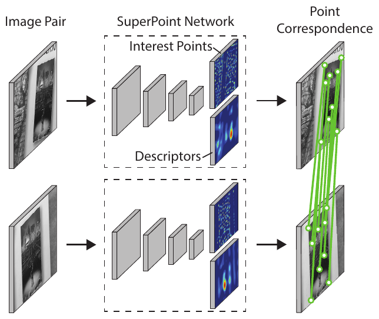

*Рис. 1 (из оригинальной статьи). Пара изображений проходит через одну и ту же сеть SuperPoint; на выходе — ключевые точки и дескрипторы, по которым строятся соответствия (зелёные линии). Работает ~70 FPS на 480×640.*

---

## 1. Введение: постановка проблемы

- Почти любая задача геометрического зрения — SLAM, SfM (Structure-from-Motion), калибровка камеры, сопоставление изображений — начинается с извлечения **ключевых точек (interest points / keypoints)**: 2D-позиций, которые стабильно и повторяемо находятся при смене освещения и ракурса.
- Свёрточные сети уже доминируют в задачах предсказания «ключевых точек» с явной семантикой (поза человека, раскладка комнаты, детекция объектов), но там есть большой размеченный датасет: «угол рта», «левая лодыжка». Для геометрических ключевых точек такой семантики нет — **задача плохо определена (ill-defined)**, поэтому классическое обучение с учителем неприменимо напрямую.
- Идея авторов: вместо ручной разметки — **самообучение (self-training)**. Детектор сам размечает реальные изображения, а разметка улучшается за счёт геометрической согласованности относительно гомографий.
- Три вклада, которые затем повторяются в выводах:
  1. перенос знаний с синтетики на реальные изображения (synthetic-to-real) работает;
  2. разреженную детекцию и описание точек можно уложить в **одну** эффективную сеть;
  3. результат хорошо работает в задачах геометрического сопоставления (оценка гомографии).
- Название: MagicPoint после Homographic Adaptation находит более повторяемые точки и откликается на более широкий класс структур — отсюда «Super»Point.

*Рис. 2 (из оригинальной статьи). Схема самообучения: (a) предобучение базового детектора на размеченной синтетике (разд. 4); (b) авторазметка немаркированных изображений через Homographic Adaptation (разд. 5); (c) совместное обучение детектора и дескриптора на паре «изображение — его гомографическая деформация» (разд. 3).*

## 2. Связанные работы

Авторы позиционируют SuperPoint относительно классики и ранних обучаемых методов:

| Метод | Точки | Дескрипторы | Целое изображение на входе | Одна сеть | Реальное время |
|---|:-:|:-:|:-:|:-:|:-:|
| **SuperPoint** | ✓ | ✓ | ✓ | ✓ | ✓ |
| [LIFT](LIFT_конспект.md) | ✓ | ✓ | | | |
| UCN (Universal Correspondence Network) | | ✓ | ✓ | ✓ | |
| TILDE | ✓ | | | | ✓ |
| DeepDesc | | ✓ | | ✓ | |
| [SIFT](SIFT_конспект.md) | ✓ | ✓ | | | |
| [ORB](ORB_конспект.md) | ✓ | ✓ | | | ✓ |

*(Таблица 1 статьи — качественное сравнение.)*

Ключевые соседи:
- **[FAST](FAST_конспект.md)** — первый детектор углов, сформулированный как задача машинного обучения; **[SIFT](SIFT_конспект.md)** — эталон классического дескриптора.
- **UCN, DeepDesc** — обучаемые дескрипторы без детектора.
- **[LIFT](LIFT_конспект.md)** — обучаемая замена [SIFT](SIFT_конспект.md), но в классической патч-ориентированной схеме «детектировать → оценить ориентацию → описать» (detect-then-describe), с тремя отдельными сетями и учителем в виде классической SfM-реконструкции.
- **Quad-Networks** — обучение детектора без учителя, но на патчах и неглубокой сетью.
- **TILDE** — близкий по духу принцип (инвариантность к изменениям), но без мощи больших полностью свёрточных сетей.
- Самообучение на синтетических трансформациях: «equivariant landmark transform» (Honari et al.), Geometric Matching Networks, Deep Image Homography Estimation (предыдущая работа тех же авторов) — но они оценивают глобальные преобразования, а не точечные соответствия, которые нужны SLAM/SfM.

## 3. Архитектура SuperPoint

Общая схема: **общий энкодер (shared encoder)** + две «головы»-декодера (heads): детектор и дескриптор. Большая часть параметров — общая, в отличие от классических конвейеров, где детекция и описание не разделяют вычислений.

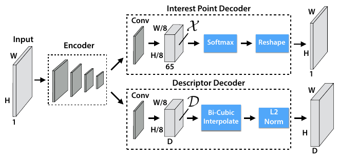

*Рис. 3 (из оригинальной статьи). Общий энкодер и две головы на представлении H/8×W/8: детектор (65 каналов → softmax → reshape в H×W) и дескриптор (D каналов → бикубическая интерполяция → L2-нормировка). Апсемплинг в обеих головах необучаемый.*

### 3.1. Общий энкодер

- VGG-подобный энкодер: 8 свёрток 3×3 с числом каналов 64-64-64-64-128-128-128-128, после каждой пары — max-pooling 2×2 (всего три пулинга, после последней пары пулинга нет).
- Все свёртки — с ReLU и BatchNorm.
- Вход: одноканальное (grayscale) изображение $I \in \mathbb{R}^{H\times W}$.
- Выход: $\mathcal{B} \in \mathbb{R}^{H_c\times W_c\times F}$, где $H_c = H/8$, $W_c = W/8$. Каждый пиксель выходной карты соответствует **ячейке (cell)** 8×8 исходного изображения.

### 3.2. Декодер ключевых точек (Interest Point Decoder)

- Голова: свёртка 3×3 на 256 каналов → свёртка 1×1 на **65** каналов. Выход $\mathcal{X} \in \mathbb{R}^{H_c\times W_c\times 65}$.
- 65 = 64 позиции внутри ячейки 8×8 + 1 канал **«корзина» (dustbin)** — «в этой ячейке точки нет».
- Softmax по каналам → отбрасываем dustbin → перестановка $\mathbb{R}^{H_c\times W_c\times 64} \Rightarrow \mathbb{R}^{H\times W}$ (операция depth-to-space / pixel shuffle / sub-pixel convolution — без обучаемых параметров).
- **Почему так:** стандартный энкодер-декодер с обучаемым апсемплингом (up-convolution, как в SegNet) дорог и порождает «шахматные» артефакты (checkerboard artifacts). Явный «декодер» через reshape дешёв и даёт пиксельную точность.
- Следствие конструкции: softmax по ячейке подразумевает **не более одной точки на ячейку 8×8** (если в одну ячейку попали два угла разметки — берётся случайный из них).

### 3.3. Декодер дескрипторов (Descriptor Decoder)

- Голова: свёртка 3×3 на 256 → свёртка 1×1 на $D = 256$ каналов. Выход $\mathcal{D} \in \mathbb{R}^{H_c\times W_c\times D}$ — **полуплотная (semi-dense)** сетка дескрипторов, по одному на каждые 8 пикселей (идея как в UCN).
- Затем — бикубическая интерполяция до $\mathbb{R}^{H\times W\times D}$ и L2-нормализация до единичной длины. Этот этап также не обучается.
- **Почему semi-dense:** обучение плотных дескрипторов на полном разрешении слишком требовательно по памяти и времени; при инференсе достаточно интерполировать дескрипторы только в найденных точках.

### 3.4. Функции потерь

Итоговая потеря на паре изображений $(I, I')$, связанных гомографией $\mathcal{H}$:

$$
\mathcal{L}(\mathcal{X}, \mathcal{X}', \mathcal{D}, \mathcal{D}'; Y, Y', S) = \mathcal{L}_p(\mathcal{X}, Y) + \mathcal{L}_p(\mathcal{X}', Y') + \lambda\, \mathcal{L}_d(\mathcal{D}, \mathcal{D}', S)
$$

- $\mathcal{X}, \mathcal{X}'$ — выходы детектора (65-канальные логиты) для двух изображений;
- $\mathcal{D}, \mathcal{D}'$ — полуплотные дескрипторы;
- $Y, Y'$ — псевдо-разметка точек (для каждой ячейки — индекс 1..65, где 65 = «нет точки»);
- $S$ — множество соответствий между ячейками, индуцированное гомографией;
- $\lambda$ — вес дескрипторной потери.

**Потеря детектора** — кросс-энтропия по ячейкам (по сути, классификация «в какой из 64 позиций точка, или её нет»):

$$
\mathcal{L}_p(\mathcal{X}, Y) = \frac{1}{H_c W_c} \sum_{h=1}^{H_c}\sum_{w=1}^{W_c} l_p(\mathbf{x}_{hw}; y_{hw}),
\qquad
l_p(\mathbf{x}_{hw}; y) = -\log\left(\frac{\exp(x_{hwy})}{\sum_{k=1}^{65}\exp(x_{hwk})}\right)
$$

- $\mathbf{x}_{hw} \in \mathbb{R}^{65}$ — вектор логитов ячейки $(h,w)$; $y_{hw}$ — правильный класс.

**Соответствие ячеек** (кто «положительная пара»):

$$
s_{hwh'w'} =
\begin{cases}
1, & \text{если } \lVert \widehat{\mathcal{H}\mathbf{p}_{hw}} - \mathbf{p}_{h'w'} \rVert \le 8, \\
0, & \text{иначе}
\end{cases}
$$

- $\mathbf{p}_{hw}$ — координата центрального пикселя ячейки $(h,w)$;
- $\widehat{\mathcal{H}\mathbf{p}_{hw}}$ — центр ячейки, переведённый гомографией с делением на последнюю однородную координату;
- порог 8 пикселей = размер ячейки.

**Потеря дескриптора** — шарнирная (hinge loss) по **всем** парам ячеек двух изображений:

$$
\mathcal{L}_d(\mathcal{D}, \mathcal{D}', S) = \frac{1}{(H_c W_c)^2} \sum_{h=1}^{H_c}\sum_{w=1}^{W_c}\sum_{h'=1}^{H_c}\sum_{w'=1}^{W_c} l_d(\mathbf{d}_{hw}, \mathbf{d}'_{h'w'}; s_{hwh'w'})
$$

$$
l_d(\mathbf{d}, \mathbf{d}'; s) = \lambda_d \cdot s \cdot \max(0, m_p - \mathbf{d}^\top\mathbf{d}') + (1-s)\cdot\max(0, \mathbf{d}^\top\mathbf{d}' - m_n)
$$

- $\mathbf{d}^\top\mathbf{d}'$ — скалярное произведение (косинусное сходство, т.к. векторы нормированы);
- $m_p$ — положительный порог: соответствующие дескрипторы «тянутся» к сходству $\ge m_p$;
- $m_n$ — отрицательный порог: несоответствующие «отталкиваются» до сходства $\le m_n$;
- $\lambda_d$ — вес положительных пар, компенсирующий их редкость (на 240×320 имеем $30\times40=1200$ ячеек, т.е. ~1.44 млн пар, из которых положительных — порядка единиц на ячейку).

**Почему так:** известная гомография даёт «бесплатные» точные соответствия, а значит детектор и дескриптор можно оптимизировать одновременно на одной паре без какой-либо внешней разметки соответствий.

## 4. Синтетическое предобучение: Synthetic Shapes и MagicPoint

### 4.1. Датасет Synthetic Shapes

- Большой базы реальных изображений с разметкой ключевых точек не существует, поэтому авторы рендерят **синтетику с однозначными положениями точек**: треугольники, четырёхугольники, линии, кубы, шахматные доски, звёзды, сетки из четырёхугольников, эллипсы.
- Точки определяются однозначно: Y-, L-, T-образные сочленения (junctions), центры маленьких эллипсов, концы отрезков.
- Есть и «негативные» изображения без углов (эллипсы, случайный шум).
- Всего 10 категорий (см. Рис. 9 ниже).
- Аугментация гомографиями; данные генерируются **на лету**, ни один пример не повторяется.
- Синтетика покрывает лишь подмножество реальных типов точек, но для старта этого хватает.

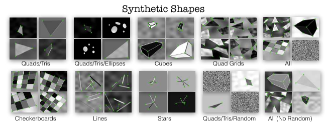

*Рис. 9 (из оригинальной статьи, прил. B). Десять категорий датасета Synthetic Shapes (зелёным — эталонные точки), включая «отрицательные» примеры со случайным шумом и эллипсами.*

### 4.2. MagicPoint

- MagicPoint = SuperPoint без дескрипторной головы (энкодер + детектор), обучен на Synthetic Shapes.
- Обучение — 200 000 итераций.
- Сравнение на 1000 отложенных синтетических изображениях:

| Метрика | MagicPoint (L) | MagicPoint (S) | [FAST](FAST_конспект.md) | Harris | Shi-Tomasi |
|---|---|---|---|---|---|
| mAP, без шума | **0.979** | 0.980 | 0.405 | 0.678 | 0.686 |
| mAP, с шумом | **0.971** | 0.939 | 0.061 | 0.213 | 0.157 |
| MLE, без шума (px) | **0.860** | 0.922 | 1.656 | 1.245 | 1.188 |
| MLE, с шумом (px) | **1.012** | 1.078 | 1.766 | 1.409 | 1.383 |

*(Таблицы 2 и 5. MagicPointS — «маленькая» версия с каналами 9-9-16-16-32-32-32-32-32.)*

**Интерпретация.** Классические детекторы резко деградируют при шуме (особенно спекл-шум — speckle), сеть — почти нет. Даже крошечная MagicPointS работает почти так же хорошо: задача на синтетике простая, ёмкость не узкое место.

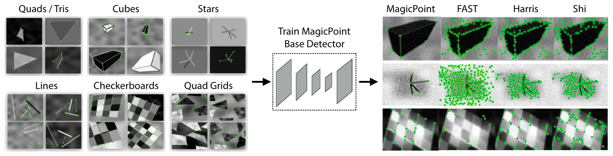

*Рис. 4 (из оригинальной статьи). Слева — примеры Synthetic Shapes, в центре — обучение базового детектора MagicPoint, справа — сравнение детекций MagicPoint, [FAST](FAST_конспект.md), Harris и Shi на зашумлённых изображениях: классические детекторы дают массу ложных срабатываний на шуме, MagicPoint — нет.*

**Но:** на реальных изображениях MagicPoint работает приемлемо на «угловатых» сценах (столы, стулья, окна), однако в среднем по естественным изображениям **уступает классическим детекторам по повторяемости при смене ракурса** — сказывается разрыв доменов (domain gap). Это и мотивирует Homographic Adaptation.

## 5. Homographic Adaptation

### 5.1. Формулировка

Почему гомографии:
- они точно (или почти точно) описывают преобразование изображения при вращении камеры вокруг центра, при удалённых сценах и для плоских сцен; мир «в основном достаточно плоский» локально;
- не требуют 3D-информации — их можно сэмплировать и применять к любому 2D-изображению (по сути, билинейная интерполяция).

Пусть $f_\theta(\cdot)$ — исходный детектор, $I$ — изображение, $\mathbf{x}$ — найденные точки, $\mathcal{H}$ — гомография:

$$
\mathbf{x} = f_\theta(I).
$$

Идеальный детектор **ковариантен (covariant)** к гомографиям — точки «переезжают» вместе с изображением:

$$
\mathcal{H}\mathbf{x} = f_\theta(\mathcal{H}(I)) \quad\Longrightarrow\quad \mathbf{x} = \mathcal{H}^{-1} f_\theta(\mathcal{H}(I)).
$$

($\mathcal{H}\mathbf{x}$ — применение матрицы к точкам, $\mathcal{H}(I)$ — деформация всего изображения.)

Реальный детектор не ковариантен: разные $\mathcal{H}$ дают разные точки. Идея — **эмпирически усреднить** по большой выборке случайных гомографий; так получается улучшенный «супер-детектор»:

$$
\hat{F}(I; f_\theta) = \frac{1}{N_h}\sum_{i=1}^{N_h} \mathcal{H}_i^{-1} f_\theta(\mathcal{H}_i(I)).
$$

На практике $f_\theta$ — это тепловая карта (heatmap) вероятностей; карты, вычисленные на деформированных копиях, «разворачиваются» обратно (unwarp) и усредняются, после чего из агрегированной карты извлекаются точки — это и есть псевдо-разметка.

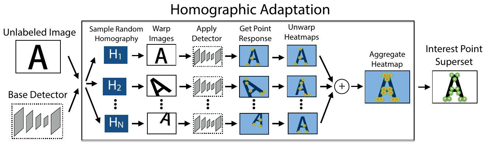

*Рис. 5 (из оригинальной статьи). Немаркированное изображение деформируется случайными гомографиями H₁…H_N, на каждой копии запускается базовый детектор, тепловые карты разворачиваются обратно и суммируются; из агрегированной карты извлекается «надмножество» ключевых точек.*

### 5.2. Выбор гомографий

- Не любая матрица 3×3 даёт правдоподобное преобразование камеры. Поэтому гомография строится как **композиция простых преобразований** с параметрами из усечённого нормального распределения (truncated normal) в заданных диапазонах:
  1. исходный центральный кроп (root center crop) — чтобы избежать артефактов на границах;
  2. сдвиг (translation);
  3. масштаб (scale);
  4. поворот в плоскости (in-plane rotation);
  5. симметричное перспективное искажение (symmetric perspective distortion).
- Первая гомография всегда тождественная, так что $N_h = 1$ = «без адаптации».
- Конкретные диапазоны параметров (сдвиг, масштаб, угол, перспектива) и параметры усечённых нормальных распределений **в статье (включая приложение) не приводятся**; официальный репозиторий содержит только код инференса, без обучения, поэтому авторские значения неизвестны (в открытых переобучениях, например `rpautrat/SuperPoint`, используются собственные значения).

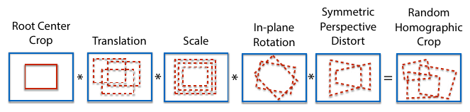

*Рис. 6 (из оригинальной статьи). Случайная гомография как композиция: центральный кроп × сдвиг × масштаб × поворот в плоскости × симметричное перспективное искажение.*

Выбор $N_h$ (отложенная часть MS-COCO):

| $N_h$ | Повторяемость |
|---|---|
| 1 (без адаптации) | 0.67 |
| 100 | прирост ~21% |
| 1000 | прирост ~22% |

**Вывод:** после ~100 гомографий отдача насыщается; в экспериментах используется $N_h = 100$.

### 5.3. Итеративная адаптация

Процедуру можно повторять: обученная на псевдо-разметке модель становится новым базовым детектором и порождает лучшую разметку. В статье — **два раунда**. Модель после адаптации и называется SuperPoint.

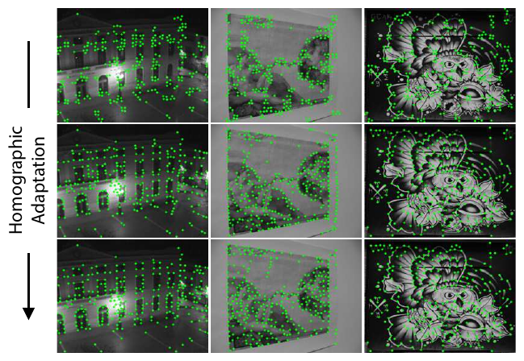

*Рис. 7 (из оригинальной статьи). Верхний ряд — исходный MagicPoint находит мало повторяемых точек; средний и нижний ряды — после дальнейшего обучения с Homographic Adaptation детекции становятся плотнее и устойчивее.*

### Приложение C: агрегация внутри масштаба и между масштабами

- **Внутри масштаба (within-scale):** повороты/сдвиги не должны создавать или уничтожать точки — агрегирование по смыслу похоже на **пересечение** множеств; используется среднее.
- **Между масштабами (across-scale):** на грубом разрешении часть точек исчезает — агрегирование похоже на **объединение**; можно брать максимум, а среднее по масштабам — как меру «многомасштабной надёжности». Уровни с высоким разрешением стоит взвешивать сильнее (у точек с низкого разрешения хуже локализация). Число масштабов $N_s$ — гиперпараметр.
- **Результат:** наибольший эффект на повторяемость даёт именно агрегация внутри масштаба (Рис. 14).

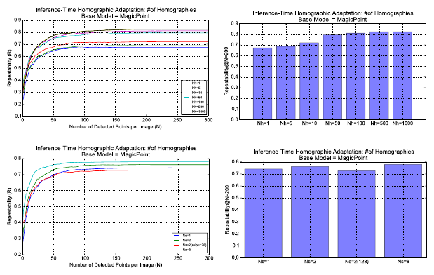

*Рис. 14 (из оригинальной статьи, прил. C). Сверху — повторяемость MagicPoint в зависимости от числа гомографий $N_h$ (1…1000; насыщение примерно после 100); снизу — эффект многомасштабной агрегации ($N_s$ = 1, 2, 8), заметно меньший, чем у агрегации внутри масштаба.*

## 6. Детали обучения

### Архитектура

| Компонент | Конфигурация |
|---|---|
| Энкодер | 8 × Conv 3×3: 64-64-64-64-128-128-128-128, MaxPool 2×2 после каждых двух слоёв (×3) |
| Голова детектора | Conv 3×3 (256) → Conv 1×1 (65) → softmax → убрать dustbin → depth-to-space |
| Голова дескриптора | Conv 3×3 (256) → Conv 1×1 (256) → бикубическая интерполяция → L2-норма |
| Нелинейность / нормализация | ReLU + BatchNorm после каждой свёртки |
| Размер ячейки | 8×8 px |

### Этапы и данные

| Этап | Данные | Детали |
|---|---|---|
| 1. MagicPoint | Synthetic Shapes, рендер на лету | 200 000 итераций |
| 2. Псевдо-разметка | MS-COCO 2014 train (80 000 изобр.), 240×320, grayscale | Homographic Adaptation, $N_h = 100$; два раунда |
| 3. Совместное обучение | те же COCO 240×320, grayscale | на каждый пример — случайная гомография из **более узкого** распределения (без экстремальных поворотов, редких в HPatches) |

### Гиперпараметры

| Параметр | Значение |
|---|---|
| Размерность дескриптора $D$ | 256 |
| Вес положительных пар $\lambda_d$ | 250 |
| Положительный порог $m_p$ | 1 |
| Отрицательный порог $m_n$ | 0.2 |
| Баланс потерь $\lambda$ | 0.0001 |
| Оптимизатор | Adam, lr = 0.001, $\beta = (0.9, 0.999)$ |
| Размер батча | 32 |
| Фреймворк | PyTorch (время измерено в Caffe) |
| Фотометрические аугментации | гауссов шум, размытие движения (motion blur), изменение яркости |

## 7. Эксперименты

Протокол оценки — по Mikolajczyk & Schmid, с одним отличием: поскольку модель не работает с патчами, корректность определяется **расстоянием между 2D-центрами точек**, а не перекрытием патчей. Для многомасштабных методов ([SIFT](SIFT_конспект.md), [ORB](ORB_конспект.md)) — на самом высоком разрешении.

### Метрики (Приложение A)

- **Корректность детекции:** $\mathrm{Corr}(\mathbf{x}) = \left(\min_j \lVert \mathbf{x} - \hat{\mathbf{x}}_j\rVert\right) \le \varepsilon$, где $\hat{\mathbf{x}}_j$ — эталонные точки, $\varepsilon$ — порог в пикселях.
- **Ошибка локализации (Localization Error, LE / MLE)** — средняя ошибка только по корректным детекциям:
  $\mathrm{LE} = \frac{1}{N}\sum_{i:\,\mathrm{Corr}(\mathbf{x}_i)} \min_{j} \lVert \mathbf{x}_i - \hat{\mathbf{x}}_j \rVert$, лежит в $[0, \varepsilon]$, меньше — лучше.
- **Повторяемость (Repeatability):** доля точек, найденных и на втором изображении (после переноса по эталонной гомографии), симметрично:
  $\mathrm{Rep} = \frac{1}{N_1 + N_2}\left(\sum_i \mathrm{Corr}(\mathbf{x}_i) + \sum_j \mathrm{Corr}(\mathbf{x}_j)\right)$.
- **NN mAP** — площадь под PR-кривой при сопоставлении ближайшим соседом с варьируемым порогом расстояния дескрипторов; характеризует различимость (discriminativeness) дескриптора.
- **Matching Score (M. Score)** — доля эталонных соответствий, восстановленных всем конвейером, относительно числа предложенных точек в общей области обзора; оценивает детектор и дескриптор вместе.
- **Оценка гомографии:** сравниваются не матрицы (у элементов разные масштабы), а положения 4 углов изображения, перенесённых эталонной $\mathcal{H}$ и оценённой $\hat{\mathcal{H}}$:
  $$
  \mathrm{Corr}_H = \frac{1}{N}\sum_{i=1}^{N}\left(\frac{1}{4}\sum_{j=1}^{4}\lVert \mathbf{c}'_{ij} - \hat{\mathbf{c}}'_{ij}\rVert \le \varepsilon\right).
  $$

### 7.1. Время работы

- Прямой проход на 480×640: **~11.15 мс** (Titan X) — даёт точки и полуплотные дескрипторы.
- Интерполяция и нормализация дескрипторов только в ~1000 найденных точках: **~1.5 мс** на CPU.
- Итого **~13 мс ≈ 70 FPS**.

### 7.2. Повторяемость на HPatches

HPatches: 116 сцен, 696 изображений; 57 сцен — сильные изменения освещения, 59 — сильные изменения ракурса. Условия: 240×320, 300 точек на изображение, $\varepsilon = 3$ px, варьируется радиус NMS (подавление немаксимумов, non-maximum suppression).

| Детектор | Освещение, NMS=4 | Освещение, NMS=8 | Ракурс, NMS=4 | Ракурс, NMS=8 |
|---|---|---|---|---|
| **SuperPoint** | **.652** | **.631** | .503 | **.484** |
| MagicPoint | .575 | .507 | .322 | .260 |
| [FAST](FAST_конспект.md) | .575 | .472 | .503 | .404 |
| Harris | .620 | .533 | **.556** | .461 |
| Shi | .606 | .511 | .552 | .453 |
| Random | .101 | .103 | .100 | .104 |

**Интерпретация:**
- Homographic Adaptation даёт огромный прирост относительно MagicPoint, особенно при смене ракурса (.322 → .503, .260 → .484).
- SuperPoint — лучший при смене освещения; при смене ракурса — на уровне классики (уступает Harris/Shi при NMS=4, лидирует при NMS=8).
- Более сильное NMS даёт равномерное распределение точек — важно для систем вроде ORB-SLAM, которые требуют минимум точек в каждой ячейке грубой сетки; SuperPoint теряет при этом меньше остальных.

### 7.3. Оценка гомографии на HPatches

Условия: до 1000 точек на изображение, 480×640, $\varepsilon = 3$ px для Rep/MLE/NN mAP/M.Score; сопоставление ближайшим соседом (nearest neighbor) по всем точкам, затем `cv2.findHomography()` с [RANSAC](RANSAC_конспект.md). [LIFT](LIFT_конспект.md) — предобученная модель «Piccadilly»; [SIFT](SIFT_конспект.md) и [ORB](ORB_конспект.md) — реализации OpenCV по умолчанию.

| Метод | Гомография $\varepsilon$=1 | $\varepsilon$=3 | $\varepsilon$=5 | Rep. | MLE ↓ | NN mAP | M. Score |
|---|---|---|---|---|---|---|---|
| **SuperPoint** | .310 | **.684** | **.829** | .581 | 1.158 | **.821** | **.470** |
| [LIFT](LIFT_конспект.md) | .284 | .598 | .717 | .449 | 1.102 | .664 | .315 |
| [SIFT](SIFT_конспект.md) | **.424** | .676 | .759 | .495 | **0.833** | .694 | .313 |
| [ORB](ORB_конспект.md) | .150 | .395 | .538 | **.641** | 1.157 | .735 | .266 |

**Интерпретация:**
- SuperPoint лучше [LIFT](LIFT_конспект.md) и [ORB](ORB_конспект.md) по оценке гомографии и сопоставим с [SIFT](SIFT_конспект.md): лидирует при $\varepsilon$ = 3 и 5 px, но уступает [SIFT](SIFT_конспект.md) при субпиксельной точности ($\varepsilon$ = 1).
- У [SIFT](SIFT_конспект.md) наименьшая ошибка локализации — по мнению авторов, благодаря явному субпиксельному уточнению, которого у остальных методов нет.
- У [ORB](ORB_конспект.md) наибольшая повторяемость, но точки сбиваются в кластеры, что плохо для оценки гомографии. Важный методологический вывод: **оптимизация одной лишь повторяемости не гарантирует лучшего сопоставления** на следующих этапах конвейера.
- По дескрипторным метрикам (NN mAP .821, M. Score .470) SuperPoint заметно впереди — подтверждается тезис о превосходстве обучаемых дескрипторов.
- [LIFT](LIFT_конспект.md), вероятно, проигрывает из-за обучения на одной уличной последовательности, тогда как SuperPoint обучен на сотнях тысяч деформированных изображений COCO, по разнообразию близких к HPatches.

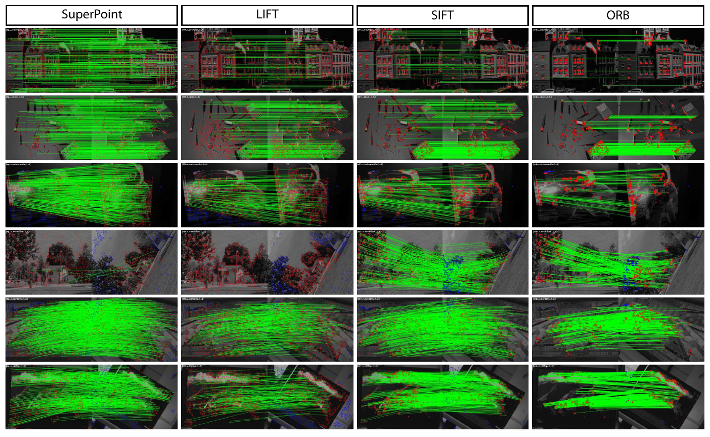

*Рис. 8 (из оригинальной статьи). Сопоставления SuperPoint, [LIFT](LIFT_конспект.md), [SIFT](SIFT_конспект.md) и [ORB](ORB_конспект.md) на парах HPatches; зелёные линии — верные соответствия. У SuperPoint их больше и они равномерно покрывают изображение, у [ORB](ORB_конспект.md) точки кластеризуются. Четвёртая строка — отказ SuperPoint и [LIFT](LIFT_конспект.md) при сильном повороте в плоскости.*

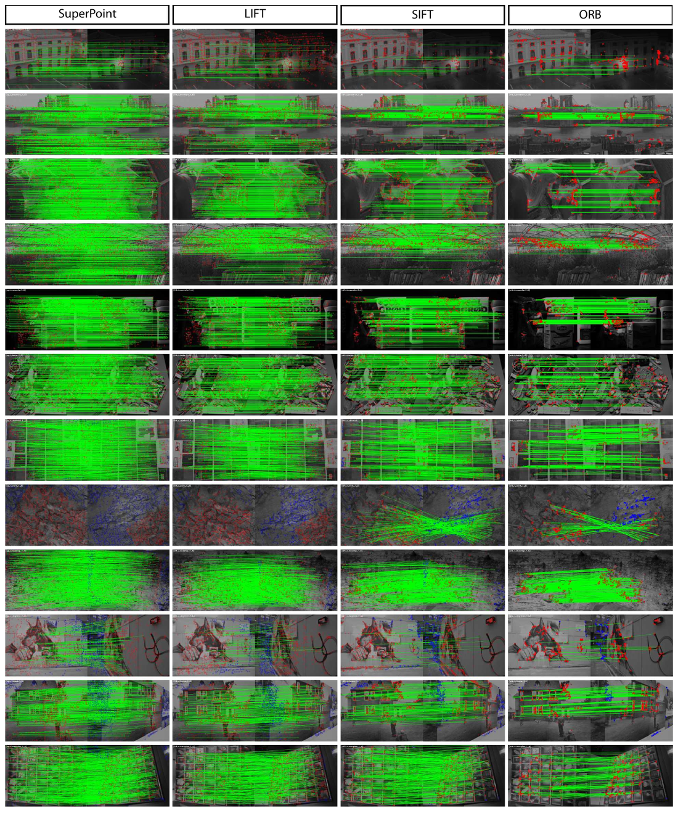

*Рис. 15 (из оригинальной статьи, прил. D). Дополнительные примеры в том же формате, что и Рис. 8.*

### Дополнительные эксперименты на синтетике (Приложение B)

- **По категориям** (Рис. 10): MagicPoint лучше классики во всех 10 категориях; разрыв по mAP при шуме значителен везде; категории со случайным шумом особенно тяжелы для классических детекторов.
- **Сила шума** (Рис. 11): интерполяция чистое → зашумлённое ($s=0\to1$) → чистый шум ($s=2$). MagicPoint деградирует плавно, классика — резко.
- **Тип шума** (Рис. 12): 8 категорий (яркость, гауссов, motion blur, спекл, тени и т.п.); спекл-шум особенно разрушителен для классических детекторов.
- **Детекция «блобов» (blob detection)** (Рис. 13): если добавить в обучение центры фигур, сеть уверенно находит центр квадрата шириной 11–43 px, менее уверенно — 43–71 px, и не находит при >71 px. Отсюда оценка: **рецептивное поле (receptive field) не меньше ~71 px**. Однако уверенность для блобов ниже, чем для углов, их трудно совместить в одной системе, поэтому в основных экспериментах блобы не используются.

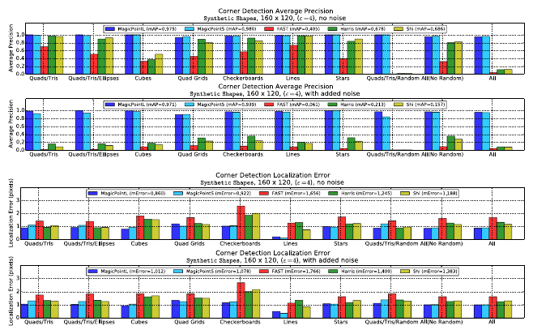

*Рис. 10 (из оригинальной статьи, прил. B). Средняя точность (AP) и ошибка локализации MagicPointL/S, [FAST](FAST_конспект.md), Harris и Shi по категориям Synthetic Shapes, без шума и с шумом.*

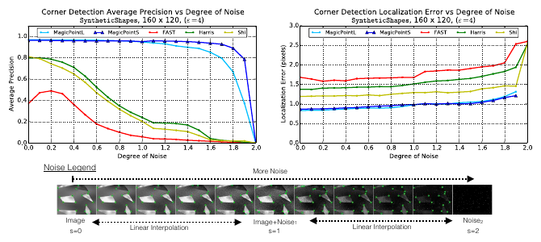

*Рис. 11 (из оригинальной статьи, прил. B). AP и ошибка локализации при плавном переходе от чистого изображения ($s=0$) к зашумлённому ($s=1$) и к чистому шуму ($s=2$); внизу — легенда уровней шума.*

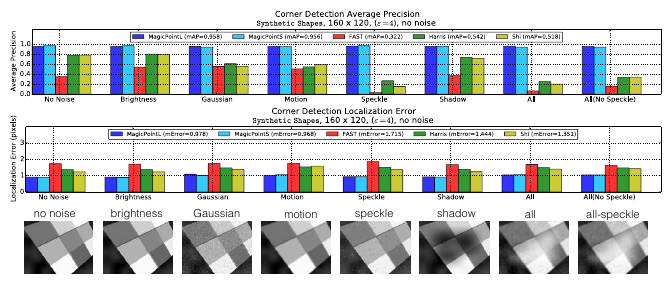

*Рис. 12 (из оригинальной статьи, прил. B). AP и ошибка локализации для восьми типов искажений (яркость, гауссов шум, размытие движения, спекл, тени, их комбинации); внизу — примеры каждого типа.*

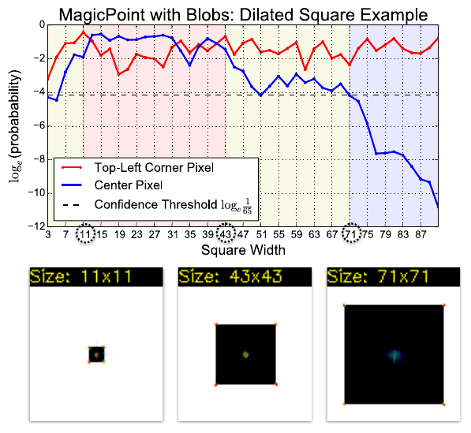

*Рис. 13 (из оригинальной статьи, прил. B). Лог-вероятность детекции угла (красная) и центра квадрата (синяя) в зависимости от ширины квадрата; внизу — примеры 11×11, 43×43, 71×71. После ~71 px центр перестаёт находиться — оценка рецептивного поля.*

## 8. Выводы авторов

- Знания можно перенести с синтетического датасета на реальные изображения.
- Детекцию и описание разреженных точек можно реализовать одной эффективной свёрточной сетью.
- Система хорошо работает в задачах геометрического сопоставления.
- Планы: применить Homographic Adaptation к сегментации (SegNet) и детекции (SSD); исследовать взаимную пользу задач детекции и описания; использовать SuperPoint как обучаемый фронтенд (front-end) визуального SLAM для робототехники и AR.

---

## Описание ключевых рисунков

*Сами рисунки вставлены в соответствующие разделы конспекта выше (Рис. 1 — после аннотации, 2 — разд. 1, 3 — разд. 3, 4 и 9 — разд. 4, 5–7 и 14 — разд. 5, 8 и 15 — разд. 7.3, 10–13 — прил. B). Здесь — сводное описание.*

- **Рис. 1 — общая идея.** Пара изображений проходит через одну сеть SuperPoint, которая выдаёт точки и дескрипторы; по ним строятся соответствия (линии между изображениями). Подпись фиксирует главный практический аргумент — 70 FPS на 480×640.
- **Рис. 2 — три этапа самообучения.** (a) Предобучение базового детектора на размеченных синтетических изображениях; (b) самостоятельная разметка немаркированных изображений через Homographic Adaptation; (c) совместное обучение: исходное изображение и его гомографически деформированная версия вместе с перенесённой псевдо-разметкой подаются в SuperPoint, и одновременно считаются две потери детектора и потеря дескриптора.
- **Рис. 3 — декодеры.** Обе головы работают на общем представлении размера $H/8 \times W/8$. Детектор: 65 каналов → softmax → reshape обратно в $H\times W$. Дескриптор: $D$ каналов → бикубическая интерполяция → L2-нормализация. Оба способа апсемплинга необучаемые, чтобы модель была быстрой и легко обучалась.
- **Рис. 4 — синтетическое предобучение.** Примеры фигур (четырёхугольники/треугольники, кубы, звёзды, линии, шахматные доски, сетки) и сравнение детекций MagicPoint с [FAST](FAST_конспект.md), Harris, Shi на зашумлённых изображениях: классические детекторы выдают много ложных срабатываний на шуме или пропускают углы, MagicPoint стабилен.
- **Рис. 5 — схема Homographic Adaptation.** Немаркированное изображение деформируется $N$ случайными гомографиями $\mathcal{H}_1..\mathcal{H}_N$, детектор запускается на каждой копии, тепловые карты разворачиваются обратными гомографиями и суммируются; из агрегированной карты извлекается «надмножество» точек (interest point superset).
- **Рис. 6 — генерация случайной гомографии** как композиции центрального кропа, сдвига, масштаба, поворота в плоскости и симметричного перспективного искажения.
- **Рис. 7 — итеративная адаптация** на изображениях HPatches: в верхнем ряду MagicPoint находит мало повторяемых точек; в следующих рядах (после раундов адаптации) точки становятся плотнее и устойчивее.
- **Рис. 8 и 15 — качественное сопоставление на HPatches.** Зелёные линии — верные соответствия. У SuperPoint больше верных соответствий, и они плотно покрывают изображение; у [ORB](ORB_конспект.md) точки кластеризуются. Четвёртая строка Рис. 8 — **отказ** SuperPoint и [LIFT](LIFT_конспект.md) при экстремальном повороте в плоскости, которого не было в обучающих данных.
- **Рис. 9–12 — подробности синтетики:** 10 категорий данных, AP и ошибка локализации по категориям, зависимость от силы и типа шума.
- **Рис. 13 — детекция центров блобов** в зависимости от размера квадрата (оценка рецептивного поля ≥71 px).
- **Рис. 14 — Homographic Adaptation:** сверху — повторяемость в зависимости от $N_h$ (насыщение после 100), снизу — изолированный эффект многомасштабной агрегации (вклад меньше, чем у агрегации внутри масштаба).

---

## Сильные стороны и ограничения

### Сильные стороны
- **Единая сеть, общий энкодер:** детектор и дескриптор считаются за один проход, без извлечения патчей — быстро и просто в развёртывании.
- **Реальное время** уже на GPU 2017 года (~70 FPS на VGA); легко экспортируется в ONNX/TensorRT.
- **Самообучение без ручной разметки** — элегантный ответ на «плохо определённую» задачу; Homographic Adaptation — общий приём, который применим к любому детектору и любому немаркированному домену (в том числе для дообучения на своих данных).
- **Устойчивость к освещению и шуму** — лучшая повторяемость при изменении освещения на HPatches.
- **Сильный дескриптор:** NN mAP и Matching Score заметно выше, чем у [SIFT](SIFT_конспект.md)/ORB/LIFT.
- **Равномерное плотное покрытие** изображения точками (особенно с NMS), что полезно для оценки геометрии.

### Ограничения
- **Нет инвариантности к повороту:** обучение на гомографиях без больших поворотов в плоскости → отказ при сильных поворотах (явно показано в статье). Для БПЛА / надирной съёмки с произвольным курсом это критично (решения: поворот изображений по известному курсу, тест на нескольких поворотах, или rotation-equivariant варианты).
- **Нет явной многомасштабности:** одна сеть на одном разрешении; рецептивное поле ограничено (~71 px и более); при сильных изменениях масштаба нужны пирамиды изображений.
- **Ограниченная субпиксельная точность** (MLE 1.16 px против 0.83 у [SIFT](SIFT_конспект.md); хуже при $\varepsilon = 1$): сетка 8×8 и отсутствие уточнения. Для высокоточной геометрии стоит добавлять субпиксельное уточнение.
- **Не более одной точки на ячейку 8×8** — ограничение плотности по конструкции.
- **Модель мира — гомография:** обучающий сигнал не моделирует параллакс, окклюзии, нежёсткие изменения и сильные сезонные/дневные перемены внешнего вида; это закрывается последующими работами, обученными на реальных 3D-соответствиях ([D2-Net](D2-Net_конспект.md), [R2D2](R2D2_конспект.md), [DISK](DISK_конспект.md), [ALIKED](ALIKED_конспект.md) и др.).
- **Оценка ограничена:** в основном HPatches (почти плоские сцены); нет экспериментов с реальным SLAM/SfM/локализацией.
- **Псевдо-разметка наследует смещения** базового детектора (MagicPoint «любит» углы геометрических фигур); бедные текстурой сцены остаются сложными.
- **Лицензия официальных весов** Magic Leap — только некоммерческое использование; для продукта нужны открытые переобучения или собственное обучение.

---

## Значение для задачи визуального позиционирования

**Роль в конвейере.** Для глобального визуального позиционирования (сопоставление кадра с картой / спутниковой или аэроподложкой / базой изображений) типичная схема иерархическая: глобальный поиск кандидатов (NetVLAD, AnyLoc, MixVPR и т.п.) → **локальные признаки (SuperPoint)** → сопоставление (**[SuperGlue](SuperGlue_конспект.md) / [LightGlue](LightGlue_конспект.md)**) → геометрическая верификация и оценка позы ([RANSAC](RANSAC_конспект.md) + PnP или гомография) — как в hloc (Hierarchical Localization). SuperPoint — де-факто стандартный локальный признак в этой связке.

**Практические заметки:**
- **Скорость.** Основная стоимость — VGG-энкодер на полном разрешении: время растёт примерно линейно с числом пикселей. На современных GPU — единицы миллисекунд для VGA; на встраиваемых (Jetson Orin и т.п.) с TensorRT FP16 реально получить десятки FPS. Разрешение входа — главный рычаг скорость/точность.
- **Типовые параметры инференса.** Официальный `demo_superpoint.py` (по официальному коду): `conf_thresh = 0.015`, `nms_dist = 4`, отбрасывание точек у границы `border_remove = 4` px, порог сопоставления дескрипторов в демо-трекере `nn_thresh = 0.7`, вход по умолчанию 120×160. В [SuperGlue](SuperGlue_конспект.md) по умолчанию порог уверенности 0.005, в [LightGlue](LightGlue_конспект.md) — 0.0005 (по коду этих репозиториев); число точек ограничивают `max_keypoints` порядка 1024–4096. Дескрипторы в точках официальный код сэмплирует **билинейно** (`grid_sample` с режимом по умолчанию), а не бикубически, как описано в статье (по официальному коду).
- **Вход — grayscale**, делённый на 255, т.е. в [0, 1] (по официальному коду); размеры желательно кратны 8.
- **С матчерами.** [SuperGlue](SuperGlue_конспект.md) (DeTone — соавтор) и [LightGlue](LightGlue_конспект.md) изначально обучались именно на SuperPoint и учитывают как дескрипторы, так и координаты/уверенности точек; в паре они намного устойчивее, чем ближайший сосед + ratio test. [LightGlue](LightGlue_конспект.md) быстрее [SuperGlue](SuperGlue_конспект.md) за счёт адаптивной глубины и раннего отсечения точек — предпочтителен для онлайн-позиционирования. Важно: матчеры обучены под конкретные веса SuperPoint — при замене/дообучении экстрактора матчер тоже нужно переобучать.
- **Сопоставление без обучаемого матчера** (быстро, на CPU): взаимный ближайший сосед (mutual NN) по косинусному сходству + [RANSAC](RANSAC_конспект.md)/MAGSAC. Дескрипторы L2-нормированы, так что $\lVert\mathbf{d}-\mathbf{d}'\rVert^2 = 2 - 2\mathbf{d}^\top\mathbf{d}'$.
- **Поворот.** Для аэро/надирных снимков с произвольным курсом — компенсировать поворот (по IMU/компасу) до извлечения признаков или прогонять несколько поворотов изображения; иначе при поворотах >~30–45° качество резко падает.
- **Масштаб.** При большом различии масштаба между кадром и картой — приводить изображения к сопоставимому GSD (ground sampling distance) или использовать пирамиду.
- **Междоменное сопоставление** (дрон ↔ ортофото, день ↔ ночь, разные сезоны) — слабое место «гомографического» обучения; здесь помогают дообучение на своём домене (та же Homographic Adaptation на немаркированных снимках целевой местности), фотометрические аугментации, либо более новые признаки/плотные матчеры ([DISK](DISK_конспект.md), [ALIKED](ALIKED_конспект.md), [LoFTR](LoFTR_перевод.md), RoMa) — их стоит сравнивать на своих данных.
- **Точность позы.** Из-за ограниченной субпиксельной точности для высокоточной оценки позы полезно уточнение (например, PixSfM-подобная доводка признаков или субпиксельная параболическая аппроксимация пика тепловой карты).
- **Лицензия.** Для коммерческого применения — не использовать официальные веса Magic Leap/SuperGlue без лицензии; рассматривать открытые переобучения SuperPoint или альтернативы ([ALIKED](ALIKED_конспект.md), [DISK](DISK_конспект.md)) с [LightGlue](LightGlue_конспект.md).

---

## Глоссарий (англ. → рус.)

| English | Русский |
|---|---|
| interest point / keypoint | ключевая (особая, интересная) точка |
| interest point detector | детектор ключевых точек |
| descriptor | дескриптор (описатель окрестности точки) |
| self-supervised learning / self-training | самообучение (обучение без ручной разметки) |
| pseudo-ground truth | псевдо-эталонная разметка |
| homography | гомография (проективное преобразование плоскости) |
| Homographic Adaptation | гомографическая адаптация |
| covariant detector | ковариантный детектор (точки преобразуются вместе с изображением) |
| repeatability | повторяемость |
| localization error (LE/MLE) | ошибка локализации (средняя) |
| matching score | доля успешных сопоставлений |
| nearest neighbor (NN) matching | сопоставление по ближайшему соседу |
| mean Average Precision (mAP) | средняя точность (площадь под PR-кривой) |
| fully-convolutional network | полностью свёрточная сеть |
| shared encoder | общий энкодер |
| decoder head | голова-декодер |
| cell | ячейка (блок 8×8 пикселей) |
| dustbin | «корзина», канал «нет точки» |
| depth-to-space / pixel shuffle / sub-pixel convolution | перестановка каналов в пространство |
| semi-dense descriptors | полуплотные дескрипторы |
| bicubic interpolation | бикубическая интерполяция |
| hinge loss | шарнирная функция потерь |
| margin (positive / negative) | порог (положительный / отрицательный) |
| cross-entropy loss | кросс-энтропийная функция потерь |
| non-maximum suppression (NMS) | подавление немаксимумов |
| heatmap | тепловая карта |
| warp / unwarp | деформировать / обратно развернуть |
| truncated normal distribution | усечённое нормальное распределение |
| in-plane rotation | поворот в плоскости изображения |
| perspective distortion | перспективное искажение |
| within-scale / across-scale aggregation | агрегация внутри масштаба / между масштабами |
| receptive field | рецептивное поле |
| domain adaptation (synthetic-to-real) | адаптация домена (с синтетики на реальные данные) |
| domain gap | разрыв доменов |
| junction (Y/L/T) | сочленение (Y-, L-, T-образное) |
| blob | блоб (пятно, компактная область) |
| speckle noise | спекл-шум |
| motion blur | размытие движения |
| SLAM (Simultaneous Localization and Mapping) | одновременная локализация и построение карты |
| SfM (Structure-from-Motion) | восстановление структуры по движению |
| front-end (of SLAM) | фронтенд (передняя часть конвейера SLAM) |
| [RANSAC](RANSAC_конспект.md) | [RANSAC](RANSAC_конспект.md) (робастная оценка модели по случайным выборкам) |
