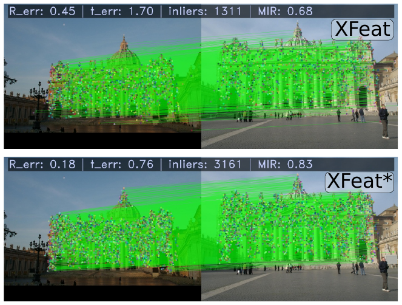
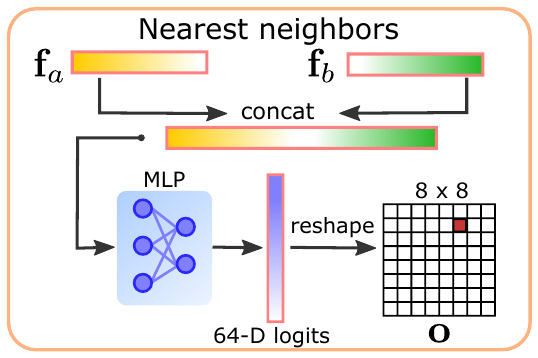
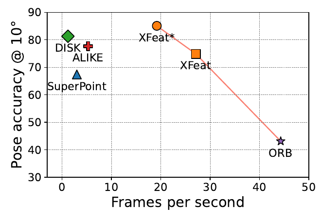
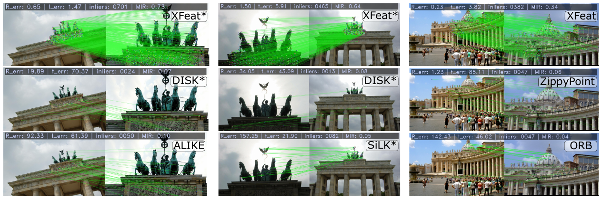

# XFeat: Accelerated Features for Lightweight Image Matching

**Авторы:** Guilherme Potje, Felipe Cadar, André Araujo, Renato Martins, Erickson R. Nascimento
(Universidade Federal de Minas Gerais; Université de Bourgogne; Google Research; Université de Lorraine / LORIA / Inria; Microsoft)

**Площадка / год:** CVPR 2024 (Open Access версия CVF). Код и веса: `verlab.dcc.ufmg.br/descriptors/xfeat_cvpr24` (также репозиторий `verlab/accelerated_features` на GitHub).

> Это конспект своими словами, а не перевод. Нумерация формул совпадает с оригиналом.

## Суть в одном абзаце

XFeat — очень лёгкая свёрточная сеть (CNN), которая одним проходом выдаёт три карты: тепловую карту ключевых точек (keypoint heatmap), плотную карту 64-мерных дескрипторов на разрешении 1/8 и карту «надёжности» (reliability map). Главный инженерный приём — не уменьшать разрешение входа (оно критично для точности сопоставления), а сделать первые слои, работающие на полном разрешении, предельно «тонкими» по числу каналов (начиная с 4), и наращивать каналы быстрее обычного (в ~3 раза при каждом уменьшении разрешения вдвое). Детектор вынесен в отдельную минималистичную ветку из 1×1-свёрток над изображением, «нарезанным» на блоки 8×8, и обучается дистилляцией из ALIKE-Tiny. Одна и та же сеть работает в двух режимах: разреженном (XFeat, до 4096 точек, MNN-сопоставление) и полуплотном (XFeat*, до 10 000 признаков с уточнением совпадений до пикселя маленьким MLP). На ноутбучном CPU без GPU XFeat даёт ~27 FPS на VGA — в 5 раз быстрее [ALIKE](ALIKE_конспект.md) и в 9 раз быстрее [SuperPoint](SuperPoint_конспект.md) — при точности, сравнимой с [SuperPoint](SuperPoint_конспект.md)/DISK, а XFeat* по ряду метрик позы обгоняет [DISK](DISK_конспект.md) при 16-кратном ускорении.

---

## 1. Введение: мотивация и вклад

**Проблема.** Современные методы сопоставления изображений (image matching) — [LoFTR](LoFTR_перевод.md), ASpanFormer, DKM, PDC-Net+ — сильно подняли точность, но ценой большого объёма вычислений и сложности реализации. Для мобильных роботов, AR, портативных устройств, где вычислительный бюджет делится между многими задачами, это неприемлемо. Существующие пути ускорения:
- аппаратно-специфичная оптимизация (квантизация/бинаризация, как в ZippyPoint) — работает, но привязана к конкретному железу и сложна в практике;
- архитектурные облегчения ([ALIKE](ALIKE_конспект.md)) — встречаются редко и всё ещё дорого стоят на высоком разрешении.

**Идея XFeat.** Переосмыслить базовые решения в дизайне CNN для детекции, описания и сопоставления локальных признаков так, чтобы сеть была аппаратно-независимой (hardware-agnostic) и быстрой «из коробки», при этом не исключая дальнейших аппаратных оптимизаций.

**Двойной режим.** Одна сеть поддерживает:
- *разреженное* сопоставление по ключевым точкам — удобно для визуальной локализации по SfM-картам (HLoc);
- *полуплотное* (semi-dense) сопоставление грубой карты признаков — полезно для оценки относительной позы в слабо текстурированных сценах и для 3D-реконструкции.

*Рис. 2 (из оригинальной статьи). Одна и та же пара снимков (собор Св. Петра): сверху — разреженные совпадения XFeat по ключевым точкам (1311 инлаеров, MIR 0.68), снизу — полуплотные совпадения XFeat\* (3161 инлаер, MIR 0.83, ошибки поворота/сдвига меньше). Разреженный режим удобен для локализации по картам, полуплотный даёт больше ограничений для оценки позы и 3D-реконструкции.*

**Три заявленных вклада:**
1. Новая лёгкая CNN-архитектура, пригодная для ресурсно-ограниченных платформ без трудоёмкой аппаратной оптимизации; может заменить как ручные ([ORB](ORB_конспект.md)), так и тяжёлые ([SuperPoint](SuperPoint_конспект.md), [DISK](DISK_конспект.md)) и лёгкие ([ALIKE](ALIKE_конспект.md)) нейросетевые признаки.
2. Минималистичная обучаемая ветка детекции ключевых точек, подходящая для маленьких backbone-сетей.
3. Новый модуль уточнения совпадений (match refinement), который получает пиксельные смещения из грубых полуплотных совпадений, используя *только сами локальные дескрипторы* — без карт признаков высокого разрешения (в отличие от [LoFTR](LoFTR_перевод.md)/ASpanFormer). Это и делает XFeat первым методом, предлагающим полуплотное сопоставление действительно эффективно.

## 2. Связанные работы

**Сопоставление изображений.** Спектр подходов:
- классические детекторы (Harris, [SIFT](SIFT_конспект.md)/DoG) + обучаемые дескрипторы патчей ([HardNet](HardNet_конспект.md), AffNet и др.);
- совместная детекция и описание в одном CNN-бэкбоне ([SuperPoint](SuperPoint_конспект.md), [R2D2](R2D2_конспект.md), [DISK](DISK_конспект.md), DALF);
- «middle-end» — обучаемые сопоставители (learned matchers): [SuperGlue](SuperGlue_конспект.md), [LightGlue](LightGlue_конспект.md), LFM-3D;
- end-to-end полуплотные ([LoFTR](LoFTR_перевод.md), ASpanFormer) и плотные (DKM, PDC-Net+) методы, часто на трансформерах.

Авторы отмечают, что последние группы гонятся за точностью и робастностью на широкобазовых парах (wide-baseline), раздувая вычисления даже для систем с умеренным GPU, и плохо масштабируются на визуальную локализацию, SLAM и SfM. Тезис статьи: можно резко снизить вычисления как для разреженных точек, так и для пиксельно-точного полуплотного сопоставления, сохранив (или превзойдя) качество.

**Эффективное описание и сопоставление:**
| Метод | Что делает | Слабое место (по мнению авторов) |
|---|---|---|
| [SuperPoint](SuperPoint_конспект.md) | самообучаемая CNN, детекция + описание | заметная стоимость на типичных для matching разрешениях |
| SiLK | упрощённая схема обучения точек и дескрипторов | дескрипторы на полном разрешении → медленный инференс |
| [ALIKE](ALIKE_конспект.md) | лёгкая сеть, дифференцируемая детекция, neural reprojection loss | финальная карта на исходном разрешении → память и вычисления |
| ZippyPoint | квантизация и бинаризация CNN | нужна кастомная компиляция и специфичная арифметика процессора |
| Key.Net | сочетание фиксированных ручных и обучаемых фильтров | — |
| [LightGlue](LightGlue_конспект.md) | ускоренный [SuperGlue](SuperGlue_конспект.md) | трансформер всё ещё дорог для критичных к скорости задач |

Цель XFeat — повсеместное развёртывание: от дешёвых плат и встраиваемых систем до смартфонов и облака.

## 3. Архитектура XFeat

### 3.1. «Сверхлёгкий» бэкбон (Featherweight Network Backbone)

**Исходная предпосылка.** Точность локальных признаков сильно зависит от разрешения входа: для позы, локализации и SfM нужны соответствия с пиксельной точностью. Но подача высокого разрешения в даже маленький VGG-подобный бэкбон (как у [SuperPoint](SuperPoint_конспект.md)) дорога.

Вход — полутоновое изображение $I \in \mathbb{R}^{H \times W \times C}$, $C=1$.

Стоимость свёрточного слоя (stride 1, padding, без bias, ядро $k\times k$) в операциях с плавающей точкой:

$$F_{ops} = H_i \cdot W_i \cdot C_i \cdot C_{i+1} \cdot k^2 \qquad (1)$$

где $H_i, W_i$ — пространственный размер карты на $i$-м блоке, $C_i, C_{i+1}$ — входные и выходные каналы, $k$ — размер ядра.

**Рассуждение авторов:**
- Главный «пожиратель» вычислений — множитель $H_i \cdot W_i$, т.е. ранние слои на высоком разрешении.
- Наивное равномерное урезание каналов по всей сети (как делают [SuperPoint](SuperPoint_конспект.md) и [ALIKE](ALIKE_конспект.md)) бьёт по робастности к освещению и ракурсу (подтверждено абляцией (ii)).
- Depthwise-separable свёртки (MobileNet, ShuffleNet) дают до 9× экономии для ядра 3×3, но в неглубоких сетях на высоком разрешении для локальных признаков они менее эффективны, чем в классификации/детекции: падает выразительность, а выигрыш в скорости небольшой. Поэтому их **не используют**.

**Решение — перераспределение глубины:**
- в первых слоях (высокое разрешение) — минимальное число каналов, начиная с $C=4$;
- вместо VGG-правила «удвоить каналы при уменьшении разрешения вдвое» — примерно **утраивать** каналы, пока не будет достигнуто достаточное значение (128, типичное для бэкбонов локальных признаков);
- финальный блок энкодера: $C=128$ при разрешении $H/32 \times W/32$.

Так вычисления в ранних слоях резко падают, а потеря параметров компенсируется более глубокими поздними слоями на малом разрешении.

**Строительные элементы:**
- *basic layer*: 2D-свёртка с ядром от 1×1 до 3×3 + ReLU + BatchNorm; stride 2 там, где нужно уменьшить разрешение;
- *convolutional block*: композиция нескольких basic layers;
- 6 блоков энкодера, каждый уменьшает разрешение и наращивает глубину: каналы $\{4, 8, 24, 64, 64, 128\}$;
- плюс fusion block для объединения многомасштабных признаков.

**Детали из supplementary (рис. 6 там):** ядра только $k=1$ или $k=3$; каждый блок — 2 или 3 basic layers, первый слой блока делает понижение разрешения (stride 2); помимо шести блоков энкодера есть ещё два блока — fusion block и reliability head. Всего в бэкбоне 23 свёрточных слоя, т.е. сеть *глубже* [SuperPoint](SuperPoint_конспект.md) и [ALIKE](ALIKE_конспект.md) по числу слоёв, но быстрее за счёт раннего понижения разрешения. В итоговую архитектуру добавлено одно skip-соединение (AvgPool 4×4 + 1×1 conv), которое в предварительных экспериментах слегка улучшило качество (по supplementary).

### 3.2. Извлечение локальных признаков

#### Голова дескрипторов (Descriptor head)

- Выход: плотная карта $\mathbf{F} \in \mathbb{R}^{H/8 \times W/8 \times 64}$.
- Используется идея пирамиды признаков (Feature Pyramid Network): последовательные блоки доводят разрешение до 1/32, что дёшево увеличивает рецептивное поле — важно для робастности к изменению ракурса, и, по словам авторов, ключевой ингредиент для работы маленьких бэкбонов.
- Промежуточные представления с масштабов $\{1/8, 1/16, 1/32\}$ проецируются (1×1 conv) и билинейно апсемплятся до $H/8 \times W/8 \times 64$, затем **поэлементно суммируются**.
- *Fusion block* из трёх basic layers сводит их в финальную карту $\mathbf{F}$.

#### Голова надёжности (Reliability head)

- Отдельный свёрточный блок поверх объединённых признаков регрессирует карту $\mathbf{R} \in \mathbb{R}^{H/8 \times W/8}$.
- $\mathbf{R}_{i,j}$ — безусловная вероятность того, что дескриптор $\mathbf{F}_{i,j}$ будет уверенно сопоставлен (идейно близко к reliability в [R2D2](R2D2_конспект.md)).
- Используется и для отбора точек в разреженном режиме, и для выбора top-K регионов в полуплотном.

#### Голова ключевых точек (Keypoint head) — ключевая новинка

Базовая идея заимствована у [SuperPoint](SuperPoint_конспект.md): на разрешении 1/8 классифицировать положение точки внутри ячейки 8×8 (64 класса) + «мусорный» класс (dustbin) «точки нет». Это самый быстрый известный способ получить пиксельные координаты.

**Отличие XFeat:** детектор — это **отдельная параллельная ветка**, работающая с низкоуровневой структурой изображения, а не голова поверх дескрипторных признаков.
- Входное изображение разрезается (unfold) на сетку ячеек 8×8 пикселей; каждая ячейка превращается в 64-мерный вектор → тензор $H/8 \times W/8 \times 64$. Так сохраняется пиксельная детализация внутри ячейки, а дальше можно применять дешёвые 1×1-свёртки.
- Четыре 1×1-свёрточных слоя дают $\mathbf{K} \in \mathbb{R}^{H/8 \times W/8 \times (64+1)}$ — логиты распределения положения точки в ячейке $\mathbf{k}_{i,j} \in \mathbb{R}^{65}$ (64 позиции + dustbin).
- На инференсе dustbin отбрасывается, 64 канала «складываются» (fold) обратно в ячейку 8×8 → полноразмерная тепловая карта.
- Рецептивное поле детектора — ровно 8×8 пикселей: он видит только локальную структуру (углы, линии, блобы).

**Почему так:** абляция (iii) показывает, что если в маленькой сети совместно обучать дескриптор и детектор на общем эмбеддинге, полуплотное сопоставление заметно деградирует — ёмкости компактных промежуточных признаков не хватает на обе задачи.

*Рис. 3 (из оригинальной статьи). Архитектура: две ветки от одного входа $H\times W\times 1$. Верхняя (Keypoint Head): разрезание на блоки 8×8 → $H/8\times W/8\times 64$ → четыре 1×1-свёртки → $H/8\times W/8\times 65$ → «складывание» обратно в тепловую карту $\mathbf{K}$ полного размера. Нижняя (Descriptor Head): энкодер с быстрым понижением разрешения до $H/32\times W/32\times 128$; признаки с 1/8, 1/16, 1/32 проецируются, апсемплятся и поэлементно суммируются, fusion block даёт дескрипторы $\mathbf{F}$ ($H/8\times W/8\times 64$), отдельная reliability head — карту надёжности $\mathbf{R}$.*

#### Полуплотное сопоставление и модуль уточнения (XFeat*)

Отличия от детектор-свободных методов ([LoFTR](LoFTR_перевод.md) и т.п.):
1. Память и вычисления контролируются выбором top-K регионов по $\mathbf{R}_{i,j}$; их можно кэшировать для последующих сопоставлений (удобно для ключевых кадров/карты).
2. Уточнение от грубого к точному (coarse-to-fine) делает маленький MLP, без карт признаков высокого разрешения.

Пусть $\mathbf{f}_a \in \mathbf{F}_1$, $\mathbf{f}_b \in \mathbf{F}_2$ — пара, найденная обычным поиском ближайших соседей на грубой карте (1/8). Предсказываются логиты смещений:

$$\mathbf{o} = \mathrm{MLP}(\mathrm{concat}(\mathbf{f}_a, \mathbf{f}_b)), \quad \mathbf{o} \in \mathbb{R}^{8\times 8}$$

$$(x, y) = \operatorname*{arg\,max}_{i \in \{1..8\},\ j \in \{1..8\}} \mathbf{o}(i,j) \qquad (2)$$

- $\mathbf{o}$ — логиты распределения по 64 возможным пиксельным смещениям внутри ячейки 8×8 на исходном разрешении;
- $(x,y)$ — выбранное смещение, уточняющее грубое совпадение до пикселя.

Смещение — это **классификация**, а не регрессия. Модуль обучается end-to-end вместе с бэкбоном, что заставляет 64-мерный дескриптор кодировать тонкую пространственную информацию внутри ячейки. Предсказание условно по паре $(\mathbf{f}_a, \mathbf{f}_b)$, что сужает пространство поиска.

*Рис. 4 (из оригинальной статьи). Модуль уточнения: два дескриптора-соседа $\mathbf{f}_a$ и $\mathbf{f}_b$ конкатенируются и проходят через MLP; 64 выходных логита переупаковываются в сетку 8×8 ($\mathbf{o}$), выделенная клетка (argmax) — предсказанное пиксельное смещение. На вход идут только грубые признаки с разрешения 1/8, поэтому экономятся и память, и вычисления.*

По supplementary (рис. 7, i7-6700K), стоимость шага уточнения пренебрежимо мала: так как уточнение выполняется уже после поиска ближайших соседей, время сопоставления XFeat\* близко к XFeat при том же числе точек.

### 3.3. Обучение и функции потерь

Обучение с учителем по пиксельным соответствиям. Для пары $(I_1, I_2)$ задано $N$ соответствий $\mathbf{M}_{I_1\leftrightarrow I_2} \in \mathbb{R}^{N\times 4}$: первые два столбца — $(x,y)$ в $I_1$, последние два — в $I_2$.

#### Дескрипторы: dual-softmax NLL

Из плотных карт выбираются $\mathbf{F}_1, \mathbf{F}_2 \in \mathbb{R}^{N\times 64}$, где $i$-е строки — дескрипторы одной и той же физической точки. Матрица сходства $\mathbf{S} = \mathbf{F}_1 \mathbf{F}_2^{\mathsf{T}} \in \mathbb{R}^{N\times N}$; правильные пары — на диагонали. С учётом симметрии сопоставления (как в [LoFTR](LoFTR_перевод.md)) используются оба направления:

$$\mathcal{L}_{ds} = -\sum_i \log\big(\mathrm{softmax}_r(\mathbf{S})_{ii}\big) - \sum_i \log\big(\mathrm{softmax}_r(\mathbf{S}^{\mathsf{T}})_{ii}\big) \qquad (3)$$

- $\mathrm{softmax}_r$ — softmax по строкам;
- по сути — контрастивная потеря: правильный партнёр должен «побеждать» все остальные $N-1$ кандидатов в обе стороны (остальные строки батча работают как отрицательные примеры).

#### Надёжность (reliability)

Уверенность сопоставления определяется через dual-softmax: $\bar{\mathbf{R}}_1 = \max_r(\mathrm{softmax}_r(\mathbf{S}))$, $\bar{\mathbf{R}}_2 = \max_r(\mathrm{softmax}_r(\mathbf{S}^{\mathsf{T}}))$, $\bar{\mathbf{R}} \in \mathbb{R}^N$. Интуиция: по мере обучения различимые (distinctive) признаки получают высокую уверенность. Карта надёжности обучается L1-регрессией к этой величине:

$$\mathcal{L}_{rel} = \big|\sigma(\mathbf{R}_1) - \bar{\mathbf{R}}_1 \odot \bar{\mathbf{R}}_2\big| + \big|\sigma(\mathbf{R}_2) - \bar{\mathbf{R}}_1 \odot \bar{\mathbf{R}}_2\big| \qquad (4)$$

- $\sigma$ — сигмоида, $\odot$ — поэлементное произведение (Hadamard);
- градиент идёт **только через $\mathbf{R}$** (цель $\bar{\mathbf{R}}$ отсоединена — stop-gradient), чтобы голова надёжности не «портила» дескрипторы.

#### Пиксельные смещения (fine matching)

Для каждой пары соответствующих дескрипторов $\mathbf{F}_1(i,\cdot), \mathbf{F}_2(i,\cdot)$ из $\mathbf{M}$ вычисляется истинное смещение $(\bar{x}_i, \bar{y}_i)$ внутри ячейки на исходном разрешении; потеря — NLL по логитам $\mathbf{o}_i$:

$$\mathcal{L}_{fine} = -\sum_i \log\big(\mathrm{softmax}(\mathbf{o}_i)\big)_{\bar{y}_i, \bar{x}_i} \qquad (5)$$

#### Ключевые точки: дистилляция знаний (knowledge distillation)

Вместо специализированных потерь детекции ([R2D2](R2D2_конспект.md), [DISK](DISK_конспект.md), [ALIKE](ALIKE_конспект.md)) детектор учится имитировать учителя — **[ALIKE](ALIKE_конспект.md) с самым маленьким бэкбоном (ALIKE-Tiny)**. Обоснование: маленький учитель тоже концентрируется на низкоуровневых структурах (углы, линии, блобы), что согласуется с рецептивным полем 8×8 ветки XFeat.

- координаты точки учителя $(t_x, t_y)$ внутри ячейки $\mathbf{k}_{i,j}$ переводятся в линейный индекс $t_{idx} = t_x + 8\,t_y,\ t_{idx}\in\{0..63\}$;
- если в ячейке нет точки, $t_{idx} = 64$ (dustbin);
- число «пустых» ячеек в выборке ограничено сверху, чтобы бороться с дисбалансом классов.

$$\mathcal{L}_{kp} = -\sum_k \log\big(\mathrm{softmax}(\mathbf{k}_{i,j})\big)_{t_{idx}} \qquad (6)$$

#### Итоговая потеря

$$\mathcal{L} = \alpha\,\mathcal{L}_{ds} + \beta\,\mathcal{L}_{rel} + \gamma\,\mathcal{L}_{fine} + \delta\,\mathcal{L}_{kp} \qquad (7)$$

$\{\alpha,\beta,\gamma,\delta\}$ — веса. Ни в основном тексте, ни в supplementary (arXiv 2404.19174) численные значения **не приводятся**. В официальном коде обучения они заданы множителями внутри функций потерь (по коду `modules/training/train.py` и `losses.py`):

| Вес | Потеря | Значение в коде | Где задано |
|---|---|---|---|
| $\alpha$ | $\mathcal{L}_{ds}$ | 1 | `dual_softmax_loss` (без множителя) |
| $\beta$ | $\mathcal{L}_{rel}$ | 3 (на каждое изображение пары) | `keypoint_loss`: `L1 * 3.0` |
| $\gamma$ | $\mathcal{L}_{fine}$ | 2 | `coordinate_classification_loss`: `loss * 2.` |
| $\delta$ | $\mathcal{L}_{kp}$ | 2 (сумма по двум изображениям × 2) | `train.py`: `(loss_kp_pos1 + loss_kp_pos2)*2.0` |

Затем четыре слагаемых усредняются по элементам батча (`torch.cat(loss_items).mean()`). Дополнительные детали реализации, которых нет в статье (по коду `losses.py`/`train.py`):
- в dual-softmax матрица сходства умножается на коэффициент 0.2 (`temp = 0.2`) перед softmax;
- $\mathcal{L}_{fine}$ взвешивается по парам нормированной уверенностью dual-softmax ($\bar{\mathbf{R}}_1\odot\bar{\mathbf{R}}_2$), т.е. надёжные пары вносят больший вклад;
- в $\mathcal{L}_{kp}$ на каждые 32 ячейки с точкой учителя берётся не более одной «пустой» (dustbin) ячейки — это и есть «верхний предел» для класса без точки, упомянутый в статье;
- норма градиента обрезается до 1.0 (`clip_grad_norm_`).

Учтите: это значения из опубликованного кода, авторы в статье не утверждают, что именно они использовались для весов из статьи (хотя остальные дефолты кода совпадают с supplementary).

#### Сводка потерь

| Потеря | Что обучает | Тип | Цель |
|---|---|---|---|
| $\mathcal{L}_{ds}$ | дескрипторы $\mathbf{F}$ | NLL, dual-softmax | истинные пары по GT-соответствиям |
| $\mathcal{L}_{rel}$ | карта $\mathbf{R}$ | L1 | $\bar{\mathbf{R}}_1\odot\bar{\mathbf{R}}_2$ (без градиента в цель) |
| $\mathcal{L}_{fine}$ | MLP уточнения (+ бэкбон) | NLL по 64 классам | GT-смещение внутри ячейки 8×8 |
| $\mathcal{L}_{kp}$ | ветка ключевых точек | NLL по 65 классам | точки ALIKE-Tiny (дистилляция) |

## 4. Эксперименты

### 4.0. Детали обучения и инференса

**Обучение:**
| Параметр | Значение |
|---|---|
| Фреймворк | PyTorch |
| Данные | MegaDepth + синтетически деформированные (warped) изображения COCO, соотношение 6:4 |
| Размер изображений | 800 × 600 (W × H) (в коде по умолчанию 800 × 608 — кратно 32, по коду train.py) |
| Батч | 10 пар изображений (в коде: 4 синтетические + 6 MegaDepth, по коду train.py) |
| Оптимизатор | Adam |
| Начальный lr | $3\cdot10^{-4}$ (по supplementary; совпадает с дефолтом train.py) |
| Расписание lr | умножение на 0.5 каждые 30 000 шагов (по supplementary; в коде `StepLR(step_size=30000, gamma=0.5)`) |
| Число итераций | 160 000 (по supplementary; дефолт `n_steps` в train.py) |
| Обрезка градиента | норма ≤ 1.0 (по коду train.py; в статье не упоминается) |
| Время / железо | сходимость ~36 ч на одной NVIDIA RTX 4090 |
| Память GPU | ~6.5 ГБ VRAM, включая синтетические варпы на GPU «на лету» (по supplementary); авторы отмечают, что XFeat\* можно обучить на одной 8-ГБ видеокарте |
| Узкое место | дисковый ввод-вывод (чтение MegaDepth в исходном разрешении) (по supplementary) |
| Веса потерь $\alpha,\beta,\gamma,\delta$ | 1 / 3 / 2 / 2 (по коду losses.py/train.py, см. §3.3) |

Гибридное обучение (реальные + синтетические пары) улучшает обобщение — согласуется с наблюдениями [LightGlue](LightGlue_конспект.md).

**Инференс:**
| | XFeat (sparse) | XFeat* (semi-dense) |
|---|---|---|
| Бэкбон | тот же предобученный | тот же |
| Число признаков | до 4096 | top-10 000 по надёжности $\mathbf{R}$ |
| Отбор | score $= \mathbf{K}_{i,j}\cdot\mathbf{R}_{i,j}$ (в коде перед этим NMS 5×5 с порогом 0.05 по тепловой карте — по коду `modules/xfeat.py`) | по $\mathbf{R}$ |
| Масштабы | 1 | 2 масштаба: ×0.65 и ×1.3 (ресайз внутри) |
| Дескрипторы | бикубическая интерполяция из $\mathbf{F}$ в точках | ячейки $\mathbf{F}$ |
| Сопоставление | MNN (взаимный ближайший сосед) | MNN + модуль уточнения смещений |
| Фильтр | — | уверенность смещения > 0.2 |

**Базовые методы (baselines):** [DISK](DISK_конспект.md) (точный, но тяжёлый), SiLK (VGGnp-µ — самый малый), [SuperPoint](SuperPoint_конспект.md), ZippyPoint (без аппаратной компиляции — «как есть»), [ALIKE](ALIKE_конспект.md) (ALIKE-Tiny), [ORB](ORB_конспект.md) (верхняя граница скорости). Везде top-4096 точек, у отмеченных * — 10 000; сопоставление MNN.

**Железо для измерения скорости:** бюджетный ноутбук без GPU, Intel Core i5-1135G7 @ 2.40 GHz, разрешение VGA (640×480), среднее по 30 кадрам.

### 4.1. Оценка относительной позы (relative pose estimation)

**Протокол:** тестовые наборы MegaDepth-1500 (уличные достопримечательности, сильные изменения ракурса и освещения, повторяющиеся структуры) и ScanNet-1500 (помещения); сцены не пересекаются с обучением. Существенная матрица — LO-RANSAC (PoseLib), порог подбирается для каждого метода. MegaDepth — ресайз до 1200 px по большей стороне, ScanNet — VGA.

**Метрики:** AUC ошибки позы при порогах 5°/10°/20°; Acc@10° — доля пар с максимальной угловой ошибкой < 10°; MIR (mean inlier ratio) — доля инлаеров после [RANSAC](RANSAC_конспект.md); #inliers; FPS; тип и размерность дескриптора (f — float, b — бинарный).

**Таблица 1 (MegaDepth-1500, ключевые числа):**
| Метод | AUC@5° | AUC@10° | AUC@20° | Acc@10° | MIR | #inl | dim | FPS (CPU) |
|---|---|---|---|---|---|---|---|---|
| SiLK | 14.7 | 21.5 | 29.3 | 31.9 | 0.17 | 235 | 32-f | 2.8 |
| [SuperPoint](SuperPoint_конспект.md) | 37.3 | 50.1 | 61.5 | 67.4 | 0.35 | 495 | 256-f | 3.0 |
| [DISK](DISK_конспект.md) | 53.8 | 65.9 | 75.0 | 81.3 | 0.72 | 1231 | 128-f | 1.2 |
| [DISK](DISK_конспект.md)* (10k) | **55.2** | **66.8** | 75.3 | 81.3 | 0.71 | 1997 | 128-f | 1.2 |
| [ORB](ORB_конспект.md) | 17.9 | 27.6 | 39.0 | 43.1 | 0.25 | 288 | 256-b | **44.3** |
| ZippyPoint | 23.6 | 34.9 | 46.3 | 51.8 | 0.23 | 192 | 256-b | 1.8 |
| [ALIKE](ALIKE_конспект.md) (Tiny) | 49.4 | 61.8 | 71.4 | 77.7 | 0.47 | 333 | 64-f | 5.3 |
| **XFeat** | 42.6 | 56.4 | 67.7 | 74.9 | 0.55 | 892 | 64-f | **27.1** |
| **XFeat*** | 50.2 | 65.4 | **77.1** | **85.1** | **0.74** | 1885 | 64-f | 19.2 |

**Интерпретация:**
- XFeat в ~5× быстрее [ALIKE](ALIKE_конспект.md) (самого быстрого нейросетевого конкурента), в ~9× быстрее [SuperPoint](SuperPoint_конспект.md) и при этом заметно точнее [SuperPoint](SuperPoint_конспект.md) (AUC@10° 56.4 против 50.1). ALIKE-Tiny по AUC всё же выше разреженного XFeat (61.8 против 56.4), но у XFeat выше MIR и почти втрое больше инлаеров.
- XFeat* при сравнимом числе дескрипторов (10k) — лучший по AUC@20°, Acc@10° и MIR, обходя [DISK](DISK_конспект.md)* при ~16× ускорении. На строгом пороге AUC@5° [DISK](DISK_конспект.md)* остаётся впереди (55.2 против 50.2).
- Авторы объясняют отставание на строгих порогах тем, что дескрипторы интерполируются, а смещения предсказываются с грубого разрешения 1/8 — пиксельная точность ограничена.
- [ORB](ORB_конспект.md) быстрее (44 FPS), но кратно хуже по качеству; XFeat лежит на Парето-фронте скорость/точность (рис. 1).
- 64-мерный float-дескриптор делает само сопоставление дешевле, чем у [DISK](DISK_конспект.md) (128) и [SuperPoint](SuperPoint_конспект.md) (256).

*Рис. 1 (из оригинальной статьи). Компромисс скорость/точность на MegaDepth-1500: по оси X — FPS на CPU ноутбука (i5-1135G7, VGA), по оси Y — Acc@10°. [DISK](DISK_конспект.md), [ALIKE](ALIKE_конспект.md) и [SuperPoint](SuperPoint_конспект.md) сосредоточены слева (1–5 FPS), [ORB](ORB_конспект.md) — справа, но низко (~43%). XFeat (~27 FPS) и XFeat\* (~19 FPS) образуют Парето-фронт (оранжевая линия): XFeat\* выше [DISK](DISK_конспект.md) по Acc@10°, XFeat в разы быстрее [SuperPoint](SuperPoint_конспект.md) и [ALIKE](ALIKE_конспект.md).*

*Рис. 5 (из оригинальной статьи). Трудные пары MegaDepth-1500 (сильная смена ракурса и освещения; над каждой парой — ошибки поворота/сдвига, число инлаеров и MIR). На Бранденбургских воротах XFeat\* находит сотни верных соответствий и правильную позу, тогда как [DISK](DISK_конспект.md)\*, [ALIKE](ALIKE_конспект.md) и SiLK\* дают единицы-десятки инлаеров и большие ошибки; на соборе Св. Петра разреженный XFeat заметно лучше ZippyPoint и [ORB](ORB_конспект.md).*

**Сравнение с обучаемыми сопоставителями (по supplementary, табл. 6, MegaDepth-1500, 1200 px, CPU i7-6700K):**
| Метод | Тип | AUC@5° | AUC@10° | AUC@20° | Acc@10° | MIR | #inl | пар/с |
|---|---|---|---|---|---|---|---|---|
| [LoFTR](LoFTR_перевод.md) | обучаемый матчер | 68.3 | 80.0 | 88.0 | 93.9 | 0.93 | 3009 | 0.06 |
| [LightGlue](LightGlue_конспект.md) | обучаемый матчер | 61.4 | 75.0 | 84.8 | 91.8 | 0.92 | 475 | 0.31 |
| Patch2Pix | coarse-to-fine | 47.8 | 61.0 | 71.0 | 77.8 | 0.59 | 536 | 0.05 |
| XFeat\* | coarse-to-fine | 50.2 | 65.4 | 77.1 | 85.1 | 0.74 | 1885 | 1.33 |

Трансформерные матчеры точнее, но XFeat\* в 4–22 раза быстрее на CPU; авторы подчёркивают, что подходы дополняют друг друга ([LightGlue](LightGlue_конспект.md) можно обучить поверх признаков XFeat).

**Таблица 2 (ScanNet-1500, AUC; никто не дообучался):**
| AUC | [SuperPoint](SuperPoint_конспект.md) | [DISK](DISK_конспект.md) (4k/10k) | [ORB](ORB_конспект.md) | [ALIKE](ALIKE_конспект.md) | XFeat / XFeat* |
|---|---|---|---|---|---|
| @5° | 12.5 | 9.6 / 11.3 | 9.0 | 8.0 | **16.7 / 18.4** |
| @10° | 24.4 | 19.3 / 22.3 | 18.5 | 16.4 | **32.6 / 34.7** |
| @20° | 36.7 | 30.4 / 33.9 | 29.9 | 25.9 | **47.8 / 50.3** |

Вывод: [DISK](DISK_конспект.md) и [ALIKE](ALIKE_конспект.md) «смещены» в сторону уличных датасетов с достопримечательностями (обучались на MegaDepth), а XFeat лучше обобщается на помещения — вероятно, благодаря синтетическим парам из COCO в обучении.

### 4.2. Оценка гомографии (HPatches)

**Протокол:** HPatches — плоские сцены с изменением освещения или ракурса. Гомография — MAGSAC++. Метрика по протоколу [ALIKE](ALIKE_конспект.md) — MHA (Mean Homography Accuracy): доля пар, где средняя ошибка четырёх углов (переносимых истинной и оценённой гомографией) меньше порога 3/5/7 px.

**Таблица 3 (ключевые числа):**
| Метод | Illum @3 | @5 | @7 | View @3 | @5 | @7 |
|---|---|---|---|---|---|---|
| SiLK | 78.5 | 82.3 | 83.8 | 48.6 | 59.6 | 62.5 |
| [SuperPoint](SuperPoint_конспект.md) | 94.6 | 98.5 | 98.8 | **71.1** | 79.6 | 83.9 |
| [DISK](DISK_конспект.md) | 94.6 | **98.8** | **99.6** | 66.4 | 77.5 | 81.8 |
| [ORB](ORB_конспект.md) | 74.6 | 84.6 | 85.4 | 63.2 | 71.4 | 78.6 |
| ZippyPoint | 94.2 | 96.9 | 98.5 | 66.1 | 76.8 | 80.7 |
| [ALIKE](ALIKE_конспект.md) | 94.6 | 98.5 | 99.6 | 68.2 | 77.5 | 81.4 |
| **XFeat** | **95.0** | 98.1 | 98.8 | 68.6 | **81.1** | **86.1** |

Почти все методы хороши благодаря [RANSAC](RANSAC_конспект.md); [ORB](ORB_конспект.md) и SiLK «ломаются» на сильных изменениях освещения/ракурса. XFeat на уровне лучших, а на мягких порогах ракурсной части — лучший.

### 4.3. Визуальная локализация (Aachen Day-Night)

**Протокол:** конвейер HLoc: по GT-позам триангулируется SfM-карта, затем запросные снимки (день и ночь) локализуются по соответствиям точек. Изображения — до 1024 px по большей стороне, top-4096 точек у всех. Метрика — доля поз, попавших в пороги (0.25 м, 2°), (0.5 м, 5°), (5 м, 10°).

**Таблица 4:**
| Метод | День 0.25м/2° | 0.5м/5° | 5м/10° | Ночь 0.25м/2° | 0.5м/5° | 5м/10° |
|---|---|---|---|---|---|---|
| [SuperPoint](SuperPoint_конспект.md) | **87.4** | 93.2 | 97.0 | 77.6 | 85.7 | 95.9 |
| [DISK](DISK_конспект.md) | 86.9 | **95.1** | **97.8** | **83.7** | **89.8** | **99.0** |
| [ORB](ORB_конспект.md) | 66.9 | 76.1 | 81.7 | 10.2 | 12.2 | 19.4 |
| ZippyPoint | 80.7 | 88.6 | 93.7 | 61.2 | 70.4 | 79.6 |
| [ALIKE](ALIKE_конспект.md) | 85.7 | 92.4 | 96.7 | 81.6 | 88.8 | 99.0 |
| **XFeat** | 84.7 | 91.5 | 96.5 | 77.6 | **89.8** | 98.0 |

Интерпретация: XFeat близок к [SuperPoint](SuperPoint_конспект.md) и [DISK](DISK_конспект.md) (на ночи при 0.5 м/5° совпадает с [DISK](DISK_конспект.md)), будучи минимум в 9× быстрее и с более компактным дескриптором. На самом строгом пороге уступает 2–3 п.п. [ORB](ORB_конспект.md) на ночных снимках практически не работает. Авторы делают вывод, что для прикладных задач не обязательно брать большие модели.

### 4.4. Абляции (MegaDepth-1500, AUC@5°)

| Конфигурация | XFeat | XFeat* |
|---|---|---|
| По умолчанию | 42.6 | 50.2 |
| (i) без синтетических данных (только MegaDepth) | 41.5 | **33.9** |
| (ii) меньшая модель (последние 3 блока: 32 канала вместо 64) | 37.4 | 40.7 |
| (iii) совместная детекция (детектор поверх дескрипторов, как в [SuperPoint](SuperPoint_конспект.md)) | 42.9 | 39.7 |
| (iv) без модуля уточнения | — | 38.6 |

Выводы:
- (i) Синтетические варпы почти не влияют на разреженный режим, но критичны для полуплотного (−16 п.п.).
- (ii) Каналы урезать дальше нельзя — страдают оба режима; текущая ширина близка к минимально допустимой.
- (iii) Совместная голова даже чуть лучше для sparse (42.9), но ощутимо проваливает semi-dense: в маленькой сети общие промежуточные эмбеддинги теряют выразительность в неповторяемых (non-repeatable) регионах, что вредит уточнению смещений. Параллельная ветка — компромисс в пользу обоих режимов.
- (iv) Уточнение критично для XFeat* (+11.6 п.п.) и стоит лишь ~11% дополнительного времени относительно MNN при ~10 000 дескрипторов.

## 5. Выводы авторов

XFeat показывает, что быстрое и точное сопоставление изображений — разреженное и полуплотное — достижимо без низкоуровневых аппаратных оптимизаций, за счёт продуманного распределения вычислений по архитектуре. Это противопоставляется тренду на всё более крупные модели. Целевые области — AR и мобильная робототехника.

---

## Где рисунки

Рисунки из статьи вставлены по месту обсуждения: рис. 2 — §1, рис. 3 и 4 — §3.2, рис. 1 и 5 — §4.1. Рисунки 6–9 из supplementary (поблочная схема бэкбона, тайминги по шагам, дополнительные качественные примеры MegaDepth/ScanNet) в конспект не включены — их содержание пересказано текстом.

---

## Сильные стороны и ограничения

**Сильные стороны**
- Реальное время на обычном CPU (27 FPS VGA) без квантизации, специальных компиляторов и GPU; аппаратно-независимая архитектура из стандартных операций (conv, BN, ReLU), что в принципе упрощает экспорт в ONNX/TensorRT/OpenVINO (в официальном репозитории на момент проверки готового скрипта экспорта нет — авторы просят о таком вкладе в README; есть сторонние порты).
- Одна сеть — два режима (sparse и semi-dense), переключение без переобучения.
- Компактный дескриптор 64-f: дешёвое хранение карт и быстрый MNN.
- Хорошее обобщение на помещения (ScanNet) без дообучения — лучше, чем у [DISK](DISK_конспект.md)/ALIKE.
- Простое обучение: ~36 ч и ~6.5 ГБ VRAM на одном GPU (по supplementary), детектор через дистилляцию.
- Возможность кэшировать top-K признаков по надёжности.

**Ограничения**
- На строгих порогах (AUC@5°, локализация 0.25 м/2°) уступает [DISK](DISK_конспект.md)/ALIKE — из-за грубого разрешения 1/8 и интерполяции дескрипторов.
- Детектор зависит от учителя (ALIKE-Tiny): качество точек ограничено сверху поведением учителя; рецептивное поле 8×8 — нет «семантической» избирательности.
- Сеть не инвариантна к сильному вращению в плоскости (специальных механизмов нет; в обучении — гомографические варпы COCO).
- Простейший сопоставитель (MNN, без контекста); в основной статье сочетание с [LightGlue](LightGlue_конспект.md) не исследуется (в supplementary — только сравнение XFeat\* с [LoFTR](LoFTR_перевод.md)/LightGlue/Patch2Pix, см. §4.1). Позже авторы выложили в репозитории связку XFeat + LighterGlue — уменьшенный [LightGlue](LightGlue_конспект.md), обученный через GlueFactory, по README ~в 3 раза быстрее оригинального [LightGlue](LightGlue_конспект.md) (в коде: 6 слоёв, 1 голова внимания, внутренняя размерность 96). По README на MegaDepth-1500 (AUC@5/10/20): 44.4/61.0/74.6 при 640 px и 1300 точках, 56.4/71.0/81.9 при 1024 px и 4096 точках — чуть ниже [SuperPoint](SuperPoint_конспект.md) + [LightGlue](LightGlue_конспект.md) (46.9/63.3/76.2 и 59.1/73.8/84.1) (по README репозитория).
- Измерения скорости в основном тексте — на одном конкретном CPU; в supplementary есть лишь один замер на ARM (Orange Pi Zero 3), энергопотребление не оценивается.
- Гиперпараметры обучения (lr, расписание) приведены только в supplementary, а веса потерь $\alpha..\delta$ — только в коде.

## Значение для задачи визуального позиционирования

- **CPU/встраиваемые платформы.** XFeat — один из лучших кандидатов на роль фронтенда локальных признаков там, где нет GPU или GPU занят: ~27 FPS VGA на мобильном i5, что даёт запас для SLAM/VO и локализации. Единственный ARM-замер авторов (по supplementary): Orange Pi Zero 3 (Cortex-A53, около 28 долл.), вход 480×360, «чистый» PyTorch без оптимизаций — XFeat 1.8 FPS против 0.58 у [ALIKE](ALIKE_конспект.md) и 0.16 у [SuperPoint](SuperPoint_конспект.md). Для Jetson/RPi 4–5 официальных цифр в статье нет — нужно мерить самим (оценка, не из статьи: более мощные ARM-ядра и GPU Jetson должны дать заметно больше). Экспорт в ONNX/TensorRT/FP16 может дать дополнительный прирост, т.к. архитектура состоит из стандартных слоёв, но официального скрипта экспорта в репозитории нет.
- **Сравнение с [SuperPoint](SuperPoint_конспект.md).** Тот же принцип детекции (ячейки 8×8 + dustbin), но в ~9× быстрее на CPU, точнее на MegaDepth и ScanNet, дескриптор 64 вместо 256 (в 4 раза меньше памяти карты и вычислений в MNN). Минус — нет зрелой экосистемы [SuperGlue](SuperGlue_конспект.md)/LightGlue «из коробки»; частично решено LighterGlue, который по README даёт чуть меньшую точность, чем [SuperPoint](SuperPoint_конспект.md) + [LightGlue](LightGlue_конспект.md) (см. «Ограничения»).
- **Сравнение с [DISK](DISK_конспект.md).** [DISK](DISK_конспект.md) точнее на строгих порогах и на ночной локализации при 0.25 м, но ~1 FPS на CPU и 128-мерный дескриптор; для бортового применения практически неприменим без GPU. XFeat* по метрикам позы при 10k признаков сопоставим или лучше при 16× скорости.
- **Визуальная локализация по карте (HLoc-подобный конвейер).** Разреженный XFeat: строим SfM-карту с XFeat-признаками, на борту — извлечение + MNN к 3D-точкам + PnP-RANSAC. Результаты на Aachen близки к [SuperPoint](SuperPoint_конспект.md), включая ночь, — значит, применим при смене освещения.
- **Относительная поза / VO в бедной текстурой среде** (помещения, поля, асфальт, вид сверху): полезен режим XFeat* — больше соответствий, лучшая устойчивость; сто́ит ~30% скорости.
- **Кэширование top-K по надёжности** удобно для ключевых кадров: признаки ключевого кадра считаются один раз и сопоставляются с потоком.
- **Риски:** вращение в плоскости (важно для съёмки с дрона/надира — может потребоваться перебор поворотов или дообучение с поворотами), большая разница масштабов (XFeat* использует только 2 масштаба), сезонные/межсенсорные изменения — проверять на собственных данных; при необходимости дообучать — процедура обучения дешёвая.
- **Практический совет:** выбор числа точек (4096 vs меньше) и разрешения входа — главные «ручки» скорость/точность; отбор точек по произведению $\mathbf{K}\cdot\mathbf{R}$ уже отсеивает ненадёжные регионы (небо, однородные поверхности).

## Глоссарий (англ. → рус.)

| English | Русский |
|---|---|
| local features | локальные признаки |
| keypoint detection | детекция ключевых точек |
| descriptor | дескриптор (вектор описания окрестности) |
| keypoint heatmap | тепловая карта ключевых точек |
| reliability map | карта надёжности |
| dustbin | «мусорный» класс (нет точки в ячейке) |
| backbone | основная сеть-«хребет», извлекающая признаки |
| encoder block | блок энкодера |
| basic layer | базовый слой (conv + ReLU + BN) |
| fusion block | блок слияния (многомасштабных признаков) |
| feature pyramid | пирамида признаков |
| receptive field | рецептивное поле |
| depthwise separable convolution | поканально-разделимая свёртка |
| sparse / semi-dense / dense matching | разреженное / полуплотное / плотное сопоставление |
| detector-free matching | сопоставление без детектора |
| match refinement | уточнение совпадений |
| coarse-to-fine | от грубого к точному |
| offset | смещение (пиксельная поправка) |
| MLP (multi-layer perceptron) | многослойный перцептрон |
| nearest neighbor / mutual nearest neighbor (MNN) | ближайший сосед / взаимный ближайший сосед |
| dual-softmax | двойной softmax (по строкам и столбцам) |
| negative log-likelihood (NLL) | отрицательное логарифмическое правдоподобие |
| knowledge distillation | дистилляция знаний |
| teacher network | сеть-учитель |
| ground truth (GT) | эталонная разметка |
| warp / synthetic warp | (синтетическое) геометрическое преобразование изображения |
| relative pose estimation | оценка относительной позы камеры |
| essential matrix | существенная матрица |
| homography | гомография |
| inlier / MIR | инлаер (согласующееся соответствие) / средняя доля инлаеров |
| AUC | площадь под кривой (точности от порога ошибки) |
| MHA (mean homography accuracy) | средняя точность гомографии |
| visual localization | визуальная локализация |
| Structure-from-Motion (SfM) | восстановление структуры по движению |
| SLAM | одновременная локализация и построение карты |
| wide-baseline | широкая база (сильно различающиеся ракурсы) |
| Pareto frontier | Парето-фронт |
| hardware-agnostic | аппаратно-независимый |
| quantization / binarization | квантизация / бинаризация |
| ablation | абляция (исследование вклада компонентов) |
